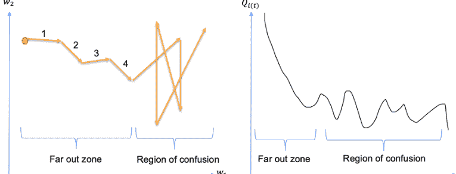
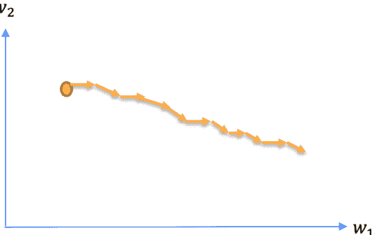

# 通过优化实现的正则化

## 本章内容

- SGD 的隐式正则化效应及利用 SGD 梯度流的平均迭代进行的近期理论分析
- SGD 在期望下的收敛性
- 流行的 SGD 变体，如动量（momentum）和 Adam，它们并不一定比标准 SGD 具有更好的泛化性能
- 一元线性回归设置下 SGD 收敛行为的理论分析

迄今我们所涵盖的正则化技术（包括通过数据、模型和目标函数进行的正则化）都涉及对模型训练过程的额外处理，以实现正则化效果。例如，我们可以通过扩充训练数据、在神经网络中添加丢弃层或在目标函数中惩罚权重大小来对过拟合模型进行正则化。然而，作为模型训练过程的最后一个组件以及本章主题的优化算法，无需任何额外处理即可引入隐式正则化效应。换言之，我们在常规优化模型的同时即可获得正则化的好处。

能够同时优化并（隐式地）正则化神经网络模型的特定优化算法是随机梯度下降（SGD），这是一种古老却最广泛用于训练大型深度神经网络的算法。我们在之前的章节中多次遇到 SGD，并使用该算法优化了多个神经网络。本章将通过分析其理论特性和实证表现来考察其隐式正则化行为。我们对其对泛化性能贡献的理解仍在不断加深，该领域的近期研究论文也印证了这一点。本章希望介绍关于其正则化属性的一些最新发现。

## 8.1 随机优化

深度学习中的泛化性能是一道独具神秘色彩的菜肴，包含多种配料，随机优化是主要成分之一。与确定性优化相比，随机优化强调优化过程中的随机性成分。这种随机性（或噪声）未必是坏事。事实上，随机行为往往能驱动优化器找到比确定性优化器更好的解，使用 SGD 训练的模型与使用全批量梯度下降算法训练的模型对比便可见一斑。

让我们重新审视经验风险最小化框架，并在此背景下分析梯度下降算法族。

### 8.1.1 通过梯度下降实现经验风险最小化

训练深度神经网络的旅程归结为一个优化问题：在参数空间中定位能实现最佳泛化性能的解。在数学上，对于给定当前权重 w 和训练数据集 D 时返回损失的损失函数 Q(w, D)，我们的目标是找到其（全局，希望如此）最小值：

```
min_w Q(w, D) = min_w \sum_{i=1}^n Q_i(w, D_i)
```

此处损失函数是所有个体损失的总和，属于有限求和问题。当 n → ∞ 时，我们得到一个随机优化问题。

现在回顾第 2 章介绍的梯度下降更新算法公式，此处也予以展示以便参考。在下一次梯度下降更新迭代的方程中，我们根据当前权重 w_t、偏导数的梯度向量 ∇_w Q(w_t, D)（通过对当前损失关于权重求导计算得出）和一个较小的学习率 η，获得下一次迭代的权重值 w_{t+1}。

此处，Q(w_t, D) 是基于训练数据集 D 和当前权重向量 w_t 的经验损失函数。目前，我们假设它是直接的损失项，如均方误差（MSE），尽管它可以包含其他正则化项，例如权重的 L1 或 L2 范数。此处的负号表明 w_t 沿着损失函数下降最快的方向移动。然后，我们将继续迭代梯度下降更新，直到该过程收敛（w_t 变化极小）或保留验证集（用于近似未见测试集）上的性能指标（即 MSE）不再下降。

让我们讨论一下此梯度下降更新面临的挑战。

首先，我们需要使用训练集 D 中的所有观测值并将个体损失相加以获得总损失 Q(w_t, D)。当训练集中的观测数量变得很大时，遍历所有观测值以计算个体损失将非常耗时。

其次，在内存有限的 GPU 实例上计算 Q(w_t, D) 具有挑战性，因为我们需要将所有数据装入 GPU 内存以计算总损失并执行反向传播更新。GPU 内存的硬件限制要求在计算过程中处理合理数量的数据。

第三，无需使用所有观测值来计算平均损失 Q(w, D)。由于中心极限定理适用，我们只需使用 D 的一部分来计算平均损失项 MSE，它在合理数量的迭代后将收敛到整个数据集的 MSE。

出于这些考虑，通常使用基于 D 子集的随机梯度下降更新规则。如下一个更新方程所示，我们用 D_t 表示 D 的随机子集（也称为小批量）。在每次迭代中，我们随机采样一个子集 D_t 并用它执行一次梯度下降更新。该更新规则也称为小批量 SGD（minibatch-SGD），如第 2 章所述。

```
w_{t+1} = w_t - \eta \nabla_w Q(w_t, D_t)
```

随机子集 D_t 可以被视为一个随机变量，在每次更新中由 D 中的一组随机观测值组成。然而，在实践中，我们通常将原始训练集 D 预先划分为不同的子集（称为小批量 mini-batches），在内层循环中对不同的小批量执行梯度下降更新，并在外层循环中多次重复该过程（称为轮次）。

需要注意的是，在数学分析中我们将小批量 D_t 视为随机变量，以确保不同小批量之间相互独立。为实现这一点，我们会求助于随机数生成器并生成随机索引以获取小批量中的观测值，其大小也取决于 D 的大小。

此外，使用随机梯度下降算法并不保证我们能在每一步都降低损失函数。由于子集的随机性，我们甚至可能在特定步骤中增加损失值，但整体过程将随机地朝局部最优解移动。

在每次梯度下降更新中切换到小批量有助于在 D 相当大时促进模型训练。然而，我们可能会问小批量梯度下降更新算法是否收敛到代价函数的局部最小值，或者是否在损失曲面上不断游荡。让我们在下一节中查看 SGD 的收敛性。

### 8.1.2 SGD 的收敛性

为了让一个算法取得成功并获得普及，我们通常会询问该算法是否收敛到某个解，以及如果收敛，收敛速度如何。对于标准梯度下降，我们知道在选择合适的学习率时，该算法总是会收敛到某个特定的局部最小解。尽管该解在泛化性能方面可能并不理想，但它仍会收敛到权重空间中的一个临界点（更具体地说，梯度向量等于零的点）。

但是，由于使用随机小批量 D_t，在每次 SGD 更新中都随机走一步，我们是否仍能得到同样的保证，即该过程会导致某个特定解？换句话说，我们想知道 SGD 是否仍然收敛。

我们将使用 SGD 估计器 Q(w, D_t) 的无偏性性质。无偏估计器意味着估计器在期望上等于被估计的目标。也就是说，如果以下条件成立，我们的 SGD 估计器 Q(w, D_t) 就是原始损失项 Q(w, D) 的无偏估计器：


\(\mathbb{E}[Q(\mathbf{w}, D_t)] = Q(\mathbf{w}, D)\)

该属性表明，在使用小批量SGD且给定足够小学习率时，经验风险在期望意义下不会相对于全批量GD而增加。这也符合直觉。SGD使用训练数据随机子集的平均损失来执行梯度下降更新。由于期望运算符在经验上对应于平均值，这些平均损失 \( \{Q(\mathbf{w}, D_t)\}^{t=1}_B \)（共有 \( B \) 个小批量）随后被平均以近似 \( Q(\mathbf{w}, D) \)。此外，由于期望运算符涉及对 \( D_t \) 中的随机性进行积分，无偏性属性本质上表明 \( Q(\mathbf{w}, D_t) \) 中的期望平均小批量损失因此等于基于整个训练集的平均损失 \( Q(\mathbf{w}, D) \)。

SGD估计器的无偏性属性是确保SGD收敛的重要属性，尽管每个步骤都有随机梯度估计。为了证明SGD的收敛性，我们依赖于Doob的鞅收敛定理，该定理指出任何满足特定有界性条件的超鞅都必须收敛。我们知道损失函数将被零下界界定；也就是说，我们为回归（即均方误差）和分类（即交叉熵损失）选择的损失函数不能为负。现在的问题是，随机变量序列，即小批量损失项 \( Q(\mathbf{w}_t, D_t) \)，是否是一个超鞅。

让我们先介绍一下什么是鞅。鞅是指具有一系列随机变量的随机过程，其中序列中下一个值的条件期望等于当前值，与所有先前值无关。换句话说，鞅在期望意义下既不增长也不收缩。另一方面，使用SGD以损失迭代形式观察到的随机变量序列将是一个超鞅，它表明未来的期望值不大于当前值。从数学上讲，我们有：

\(\mathbb{E}[Q(\mathbf{w}_{t+1}, D) \mid \mathbf{w}_t, \mathbf{w}_{t-1}, ..., \mathbf{w}_0] \le Q(\mathbf{w}_t, D)\)

在此，我们将下一次迭代的期望损失以从 \( \mathbf{w}_0 \) 到 \( \mathbf{w}_t \) 的过去迭代历史作为条件。换句话说，当损失迭代遵循超鞅时，随机梯度下降更新算法可以通过使下一次迭代的平均损失小于当前损失来平均降低成本。从直觉上讲，这是有道理的，因为在SGD更新的每个步骤中，随机梯度向量 \( \nabla_w Q(\mathbf{w}_t, D_t) \) 指向当前小批量损失函数的最陡下降方向；我们知道，基于不同小批量的下一次迭代的期望损失 \( Q(\mathbf{w}_{t+1}, D_t) \) 不大于基于整个训练集 \( D \) 的当前损失 \( Q(\mathbf{w}_t, D) \)。

现在让我们看一个简单的一维示例，以表明序列 \( \{Q(\mathbf{w}_t, D)\} \) 确实是一个超鞅，您会发现SGD估计器的无偏性属性起着重要作用。在下图中，我们为标量权重 \( \mathbf{w}_t \in \mathbb{R} \) 和训练集 \( D \) 绘制了使用MSE的损失函数 \( Q(\mathbf{w}, D) \)。对于与 \( \mathbf{w}_t \) 不相距太远的下一次迭代 \( \mathbf{w}_{t+1} \)，我们可以使用一阶泰勒展开来基于当前损失值 \( Q(\mathbf{w}_t, D) \) 和线性近似（如虚线所示）近似 \( Q(\mathbf{w}_{t+1}, D) \) 的值。这给出了以下内容：

Q(w_{t+1}, D) \approx Q(w_t, D) + (w_{t+1} - w_t) \nabla_w Q(w_t, D)

Figure 8.1 Approximating the loss value at the next iterate using first-order Taylor expansion.

由于SGD要求 \( w_{t+1} = w_t - \nabla_w Q(w_t, D_t) \)，因此有 \( w_{t+1} - w_t = - \nabla_w Q(w_t, D_t) \)。将其代回上式可得：

Q(w_{t+1}, D) \approx Q(w_t, D) - \eta \nabla_w Q(w_t, D_t) \nabla_w Q(w_t, D)

由于我们关注SGD更新的平均情况行为，我们对两边应用期望运算符，得到：

E[Q(w_{t+1}, D)] \approx Q(w_t, D) - \eta E[\nabla_w Q(w_t, D_t)] \nabla_w Q(w_t, D)

这里我们使用了 \( E[Q(w_t, D)] = Q(w_t, D) \) 的事实，因为历史更新中没有随机性。

现在让我们引入SGD估计器的无偏性属性，即 \( E[Q(w, D_t)] = Q(w, D) \)。由于期望运算符和梯度运算符可交换，我们有：

E[\nabla_w Q(w_t, D_t)] = \nabla_w E[Q(w_t, D_t)] = \nabla_w Q(w_t, D)

将前面的泰勒展开近似代入得到：

E[Q(w_{t+1}, D)] \approx Q(w_t, D) - \eta \nabla_w Q(w_t, D) \nabla_w Q(w_t, D) = Q(w_t, D) - \eta [\nabla_w Q(w_t, D)]^2

由于 \([\nabla_w Q(\boldsymbol{w}_t, D)]^2 \to 0\) 且 \(\eta > 0\)，我们有 \(\mathbb{E}[Q(\boldsymbol{w}_{t+1}, D)] \le Q(\boldsymbol{w}_t, D)\)，从而证明了损失迭代序列是一个超鞅。根据Doob的鞅收敛定理，它最终会收敛到局部极小值中的一个稳定点。尽管下一次迭代的损失并不总是下降，并且由于子集 \( D_t \) 中的随机性有时可能会增加，但我们可以保证，平均而言，它会随时间下降。期望风险在期望意义下不会增加。Figure 8.2 summarizes the sketch of the proof of SGD convergence.

Figure 8.2 Sketch of proof on the convergence of the SGD algorithm.

请注意，并非所有估计器都是无偏的。实际上，在使用神经网络等复杂学习器时，我们很少能获得无偏估计器。然而，在实践中，情况仍然相当不错。当优化器由于高方差而困难时，我们可以通过引入少量偏差来改善这种情况，同时大大缓解高方差问题，这是第2章中涵盖的偏差-方差权衡话题。有许多示例，我们可以使用有偏但低方差的估计器获得良好的模型，例如在第7章中涵盖的在损失函数中添加LASSO惩罚项。请注意，使用有偏估计器可能无法在有限训练时间内收敛到稳定点。

既然我们知道SGD是一种收敛到局部极小值的计算经济型算法，接下来我们想问的是解的质量如何。它与全批量梯度下降算法的质量相同，还是更好？事实证明，SGD通常比GD提供更好的解，因为由此得到的模型对未来未见测试集的泛化性能更好。这种泛化性能来自SGD的隐式正则化效应，将在下一节中讨论。

### 8.1.3 SGD的隐式正则化

为了观察小批量SGD和全批量GD之间学习行为的差异，让我们看一个涉及两种情况的简单示意图示例。如图8.3所示，我们将Q(**w**，D)（假设为MSE，并由虚线曲线表示）的平均损失曲线绘制为权重向量**w**的函数，为简化起见假设其为一维。我们将使用基于全批量训练集的梯度下降更新来减少MSE，最终收敛到最优**w***。我们还将使用SGD进行优化时不同小批量的损失曲线绘制出来，其中小批量损失曲线（实线曲线）在形状上与使用全批量GD的损失曲线（虚线曲线）相似。基于SGD的无偏性属性，全批量损失曲线是四个小批量损失曲线的平均值。

Figure 8.3 Visualizing the loss curves using full-batch GD and mini-batch SGD, where the latter curves are similar in shape and close to the former.

使用训练集的这些单个小批量，我们获得了基于全批量GD的平均损失曲线的良好估计。换句话说，这些小批量损失曲线中的每一条都能告诉我们最优权重**w**所在的位置，并且这些小批量损失曲线的局部极小值都在**w***的一个接近邻域内。在使用SGD的每一轮更新中，我们选择一个随机子集并（因此）根据相应的小批量损失曲线指导下一次权重更新。几乎所有这些小批量损失曲线都使用SGD将我们指向同一方向，并且在更新方向上方差很小；在这种情况下，SGD和GD的表现将相似。

让我们来看另一种场景，其中基于全批量GD的相同平均损失曲线是将若干差异很大的小批量SGD损失曲线平均得到的结果。如图8.4所示，所有小批量损失曲线都有一个陡峭的局部极小值，这不是一个理想的解，用于


推广到测试集（回顾我们在第 4 章中讨论过的偏好宽盆地而非陡峭山谷的问题）。所有局部极小值位置各不相同，并且这些极小值在其邻域内伴随着损失的突变（即大梯度）。

图 8.4 使用全批量 GD 和小批量 SGD 可视化损失曲线，后者曲线形状不一，且与前者相距较远。

一组形状不一的陡峭小批量损失曲线会使 SGD 难以收敛。例如，基于某个小批量的损失曲线可能会将优化器引向与基于另一小批量的另一条损失曲线完全不同的方向。在存在高方差的尖锐损失曲线时，SGD 难以收敛，因为大梯度很可能导致优化器发散并跳出包含 w* 的区域。

因此，我们预期 SGD 会偏好第一种情景，即损失曲线组较为一致且方差较小，而非第二种情景，即损失曲线组不一且方差较高。在第一种情景下，SGD 收敛相对容易实现。关键在于，如果 SGD 更新对当前使用的训练集中的哪个小批量非常敏感，那么它很可能对未来的测试集也非常敏感，从而难以很好地泛化。当训练集中的小批量之间存在较大差异时（如图 8.4 所示），训练集与测试集之间的差异可能较高，从而导致泛化性能较差。因此，SGD 偏好第一种情景，并利用其随机性来诱导更好的泛化性能。

### 8.1.4 分析平均迭代

一篇捕捉这一直觉的近期论文有助于揭示 SGD 在偏好小批量间方差较小的损失曲线区域方面的作用。正如 Samuel Smith 等人在题为《随机梯度下降中隐式正则化的起源》的论文中所介绍的，作者使用修改后的损失来近似使用 SGD 的梯度流路径的平均迭代。该调整后的损失包含一个关于全批量 GD 和小批量 SGD 之间损失方差的显式项，可以解释 SGD 对低方差区域的偏好。

让我们更详细地看一下这个视角。如图 8.5 所示（从原论文重新绘制），我们绘制了使用全批量 GD 和小批量 SGD 对二维损失函数进行权重更新的示例路径。左侧面板显示了使用全批量 GD 算法的确定性梯度下降并收敛到一个静态点。中间面板显示了每一步的随机梯度集合，其中每个圆代表由于 SGD 中使用的不同小批量而导致的当前步骤之前的所有可能权重值。当前迭代中使用的随机小批量将确定确切位置。由于 SGD 的随机性，随机噪声会累积，圆（可能位置的分布）会变得越来越大，因为未来步骤的可能结果空间更大。右侧面板代表使用 SGD 的这些圆的平均迭代。

图 8.5 比较不同梯度下降算法的权重更新路径。左图显示了使用全批量梯度下降算法的路径，中间图显示了使用 SGD 在每次更新中使用不同小批量的路径分布，右图显示了使用 SGD 的平均迭代。

可能路径的分布使得分析 SGD 的行为变得困难，该论文的主要亮点之一是专注于每个时间步的平均迭代来表征其预期行为。绘制平均迭代（如图 8.5 右侧面板所示）使路径变得非随机和确定性，从而忽略了每个时间步沿线的随机性，并使仅分析平均值变得更加容易。

从数学上讲，回顾 SGD 更新算法采用以下形式：

```
w_{t+1} = w_t - \eta \nabla_w Q(w_t, D_t)
```

通过将 w_t 视为随机变量，我们可以通过对训练集的所有可能随机小批量取期望来分析其均值/预期值，得到：

```
\mu_t = \mathbb{E}_{D_t}[w_t]
```

这里，我们对子集 \(D_t\) 中的随机性进行积分消去，以呈现每个时间步的预期权重值。该操作因此给出了时间步 \(t\) 的平均迭代，并在不同时间步上累积平均迭代，从而得到图 8.5 中的右侧面板图。

接下来，我们将平均迭代视为遵循连续梯度流 \(\mathcal{Q}\)，即 \(\mu_t = \mathcal{Q}(t)\)，其中时间步 \(t\) 现在是连续的，而不是以离散方式在参数空间中跳跃。连续近似函数以时间变量（也是连续的）作为输入，并输出特定时间步的对应平均迭代。因此，平均迭代的 SGD 更新算法变为：

```
\(\mathcal{Q}_1 = \mathcal{Q} - \eta \nabla_{\mathbf{w}} \hat{Q}_{SGD}(\mathcal{Q}, D)\)
```

其中，\(\hat{Q}_{SGD}(\mathcal{Q}, D)\) 是一个修改后的损失函数（不同于经验损失函数 \(Q(\mathbf{w}_t, D_t)\)），\(\nabla_{\mathbf{w}} \hat{Q}_{SGD} (\mathcal{Q}, D)\) 表示新损失函数相对于权重的梯度，以当前平均迭代 \(\mu_t\) 和训练集 \(D\) 作为输入。平均迭代的近似更新现在基于以全批量方式使用的修改后的损失函数 \(\hat{Q}_{SGD}(\mathcal{Q}, D)\)，关于小批量子集 \(D_t\) 的信息现在编码在 \(\mu_t\) 中。

如下所示，修改后的损失函数可以让我们更接近 SGD 的低方差特性。修改后的损失函数 \(\hat{Q}_{SGD}(\mathbf{w}, D)\) 现在由两部分组成：不带任何梯度噪声的全批量损失函数 \(Q(\mathbf{w}, D)\)，以及小批量 SGD 和全批量 GD 之间梯度的方差 \(\mathbb{E} \| \nabla_{\mathbf{w}} Q(\mathbf{w}, D_t) - \nabla_{\mathbf{w}} Q(\mathbf{w}, D) \|^2\)，乘以常数 \((\eta/4)\)。第二项本质上是 \(\nabla_{\mathbf{w}} Q(\mathbf{w}, D_t)\)（即 SGD 的梯度）与其平均值 \(\nabla_{\mathbf{w}} Q(\mathbf{w}, D)\) 之间差异的（L2）范数，基于无偏性质。这一项使 SGD 的隐式正则化效应显式化：运行小批量 SGD 算法等同于运行全批量 GD 并添加一个针对其梯度方差的额外正则化项。

```
\(\hat{Q}_{SGD}(\mathbf{w}, D) = Q(\mathbf{w}, D) + \frac{\eta}{4} \mathbb{E} \| \nabla_{\mathbf{w}} Q(\mathbf{w}, D_t) - \nabla_{\mathbf{w}} Q(\mathbf{w}, D) \|^2\)
```

该正则化项也依赖于数据。根据参数空间中的特定位置和所使用的数据集，SGD 算法在最小化修改后的损失函数时会避开梯度方差较高的区域。高方差区域对应于先前的图 8.4，SGD 算法难以收敛到静态解。当方差较小时（如图 8.3 所示），SGD 将更容易收敛。图 8.6 总结了 SGD 中隐式正则化效应的直觉，即偏好参数空间中相对较宽的极小值（而非狭窄极小值）的区域，这些区域对梯度方差不敏感。因此，SGD 倾向于得到更具泛化性的模型权重。

图 8.6 通过修改后的损失函数说明 SGD 的隐式正则化效应。

然而，基于平均迭代的此类分析也有其局限性。例如，当损失函数是双峰的时（如图 8.7 所示），轨迹在后续更新中不一定会显示出更大的方差。相反，更新会逐渐收敛到这两个极小值中的一个。

图 8.7 带有双峰损失函数的 SGD 更新轨迹。随着 SGD 算法收敛到其中一个局部极小值，方差会减小。

因此，平均迭代分析是隐式正则化效应的良好指示性解释，但不适用于所有情况。


由于SGD因随机噪声而收敛相对较慢，一个自然的问题是：我们是否可以做些什么来抑制这种随机性，并（预期地）加速其收敛？这个问题催生了一系列SGD变体，其中动量和Adam是社区中最受欢迎的优化器选择。

### 8.1.5 SGD变体：更好还是更差？

我们在第6章中使用Adam优化器训练了一个多分类模型。我们在第2章中也提到过，它可以加速学习，但并不一定总能获得良好的泛化性能。在训练深度神经网络时，我们应该坚持使用Adam还是SGD？不一定。许多实践者在训练开始时使用Adam，因为它对学习率的选择不太敏感（稍后会详细介绍），然后过一段时间后切换到SGD，以获得良好的泛化性能。将短期近视奖励（如Adam的情况）与长期非近视收益（如SGD的情况）相结合，是许多策略设计中的流行选择，例如在强化学习和贝叶斯优化领域。

作为SGD的一种变体，Adam基于两个关键方面：使用动量的平滑更新和使用梯度范数的缩放学习率。让我们先阐述动量的概念。假设我们正在处理一个二维参数空间，其中要最小化的损失函数很窄，如图8.8所示的细长椭圆（级集）所示。想象优化器正在寻找狭窄山谷的底部（局部最小值）（损失函数）。由于垂直于通往局部最小值路径的方向上有陡峭的斜坡，当前位置的偏导数（由实心点指示）在幅度上差异很大。具体来说，左侧面板中的偏导数g2将远大于g1，在给定较高学习率的情况下，这会导致每次更新时出现震荡，并可能偏离局部最优解。

图8.8 左侧：由于偏导数不成比例和较高的学习率，SGD更新轨迹出现震荡；右侧：由于学习率较小，进展缓慢。

另一方面，将学习率降低到很小的数值在一定程度上可以缓解震荡，但反而会导致收敛缓慢；SGD需要很长时间才能朝着局部最小值显示出不错的进展。在这两种情况下，实际的收敛性能对学习率超参数都非常敏感。

解决这一问题的早期方法之一称为动量，它在每次SGD更新中使用梯度的移动平均值，从而缓解了SGD梯度中的高方差问题。将原始梯度向量表示为gt = ∇wQ(w, Dt)，其移动平均值表示为mt。当前移动平均值mt基于以下关系计算：

mt = β1 · mt−1 + (1 − β1)gt

其中β1是一个超参数，用于控制先前移动平均值与当前梯度之间的权重（逐元素）。带有梯度运行平均值的相应SGD更新规则因此变为：

wt+1 = wt − ηmt

使用平均梯度进行迭代更新将平滑轨迹，因为相反方向的梯度会因平均效应而相互抵消。因此，动量平滑了通往局部最小值的垂直方向上的随机性。

作为进一步的改进，Adam优化器使用自适应步长来估计梯度的范数。如图8.8左侧面板所示，优化器倾向于在g2方向上移动更多，因为它远大于g1。因此，Adam的目标是重新缩放梯度的范数，使得梯度向量中的每个偏导数都具有相似的规模。具体来说，梯度范数向量vt的运行平均值定义如下：

vt = β2vt−1 + (1−β2)gt²

其中gt²表示对梯度向量gt中的每个元素（偏导数）求平方，β2是另一个预设的超参数。一旦我们有了平均梯度及其移动平均范数，就可以使用以下更新规则来选择下一个权重值：

wt+1 = wt − η * mt / sqrt(vt + ε)

这里我们对vt开平方根：将其转换为与权重相同的单位，并使用一个小常数ε以避免除以零。自适应步长由η/(√(vt) + ε)表示，其中新的学习率对每个参数都不同，而不是对所有参数使用统一的学习率；毕竟，有些参数往往对高学习率更敏感。图8.9总结了相对于SGD的这两项自适应变化。

### 动量

$$\mathbf{m}_t = \beta_1 \mathbf{m}_{t-1} + (1 - \beta_1)\mathbf{g}_t$$

$$\mathbf{w}_{t+1} = \mathbf{w}_t - \eta \mathbf{m}_t$$

通过移动平均值使用梯度向量中平滑的偏导数向量

### Adam

$$\mathbf{v}_t = \beta_2 \mathbf{v}_{t-1} + (1 - \beta_2)\mathbf{g}_t^2$$

$$\mathbf{w}_{t+1} = \mathbf{w}_t - \eta \frac{\mathbf{m}_t}{\sqrt{\mathbf{v}_t + \epsilon}}$$

在迭代更新策略中平滑梯度的一阶（均值）和二阶（方差）矩

图8.9 说明动量和Adam中的自适应变化。

总的来说，Adam估计梯度向量的一阶和二阶矩（均值和方差）来更新权重。由于梯度向量的范数被估计和平滑，更新将对学习率的值不那么敏感。正因为如此，Adam是一种广泛使用的优化器，并且收敛相对较快。然而，如Wilson等人在其2017年NeurIPS论文《机器学习中自适应梯度方法的边际价值》中后来指出的那样，像Adam这样自适应地改变梯度，尽管其优化性质更快，但通常会损害与SGD等随机方法相比的泛化性能。事实证明，这种随机性是一种福音而非诅咒；它使SGD能够处理棘手的情况，例如偏好低方差平坦极小区域而非高方差尖锐极小区域。

作为一种加速的基于梯度的方法，Adam在训练深度神经网络时充当开箱即用的优化器。许多实践者使用Adam训练神经网络，因为该优化器对我们如何设置超参数（包括学习率和网络的初始权重）不敏感。然而，使用SGD需要对这些超参数进行一定程度的微调。Adam收敛速度远快于SGD，因此从优化角度来看是更好的优化器。然而，它存在泛化性能差的问题，这是训练模型时更关键的追求。如第5章所讨论的，良好的离线泛化性能与在无限新数据流下的快速在线优化性能（即快速收敛）相关。由于实际场景中训练数据集几乎总是有限的，我们可能不希望将快速收敛作为唯一目标。

总结来说，SGD中的梯度噪声是随机优化过程中的一个基本特征，而非劣势。通过避开高梯度噪声区域，SGD相比动量和Adam等加速方法能够提供更好的泛化性能。因此，保持随机性作为获得良好泛化性能的神奇要素之一至关重要。

在下一节中，我们将基于一元单样本线性回归模型，对SGD的收敛特性进行更详细的分析。

## 8.2 更多关于SGD收敛的内容

SGD的理论分析要求每个小批量都有放回地抽样；也就是说，一个样本*可以*在下一个小批量中重复。让我们用*t*表示第*t*次迭代，并用*i(t)*表示第*k*次迭代用于SGD更新的随机样本的索引，每个小批量使用单个样本。在每次迭代中，*i(t)* = {1, 2, ..., *N*}可以是训练集中的任何样本。因此，我们在迭代*t*中使用单个观测值的SGD更新规则变为：

**w**<sub>*t*+1</sub>=**w**<sub>*t*</sub> - \(\eta_t\) \(\nabla_w Q(\mathbf{w}_t, D_{i(t)})\)

其中*D*<sub>(*t*)</sub>表示当前采样的单个观测值，*η<sub>t</sub>_是作为时间步函数的学习率。处理单个观测值使更新速度快*N_倍，其中*N_在现代应用中轻松可达数百万。这一理念——在每一轮梯度更新中使用单个随机观测值而非整个训练集——最初由Robbins和Monro在其1951年论文《随机逼近方法》中提出，并且至今仍是现代神经网络中的主流优化方法。

在单样本SGD更新中观察到的一个有趣现象是，在初始阶段下降通常很快且稳定，如相对平滑的轨迹所示，随后在特定区域内出现随机震荡。此类波动是由随机小批量（单个样本）中的随机性以及对学习率的高度敏感性共同造成的。

图8.10说明了这种行为。在左侧面板中，我们绘制了使用单观测SGD的典型轨迹。请注意，前四个迭代（由数字1-4指示）在右侧区域向局部最优解取得了相对较快的进展，这限制了后续的波动更新。Suvrit Sra（他在其关于SGD的YouTube教程中讨论了这种现象）将第一个区域称为“远外区域”，将第二个区域称为“混乱区域”，表明优化器现在正遭受随机波动的困扰。这里我们使用相同的名称。


### 使用单样本SGD的典型轨迹



图 8.10 说明了单样本SGD的典型轨迹（左侧）及其对应的损失曲线（右侧）。两者都包含两个区域：远离区域，当前迭代点远离损失最优解；以及混淆区域，当前迭代点位于最优解附近。

右侧面板进一步体现了这种行为：在远离区域初期损失迅速下降，进入混淆区域后则出现随机震荡。

需要注意的是，即使每一步都使用极小学习率进行SGD更新，仍可能产生稳定轨迹，如图 8.11 所示。对学习率的敏感性仅在学习率较大时才会体现。

### 每次SGD更新使用极小学习率的稳定轨迹



图 8.11 每次更新使用充分小学习率的稳定轨迹。

### 8.2.1 一元线性回归中的SGD

我们可以从一个简单的框架中进一步了解SGD的收敛特性：即采用单样本SGD更新规则的一元模型。因此，我们需要最小化的目标函数变为：

$$Q(\mathbf{w}) = \frac{1}{2} \sum_{i=1}^n (y_i - f(\mathbf{x}_i; \mathbf{w}))^2 = \frac{1}{2} \sum_{i=1}^n (y_i - x_i w)^2$$

此处乘以 1/2 是为了便于后续的数学分析。由于这一单维优化问题的目标函数是凸函数，我们可以对其求导并将梯度设为零，从而得到局部最小值处的解，这对于当前的随机样本 $(x_i, y_i)$ 来说也是全局最小值。现在所有变量均为一维，因此易于分析，于是将 $Q(\mathbf{w})$ 写作 $Q(w)$。

由于代价函数 $Q(w)$ 关于 $w$ 是二次函数，我们可以令其梯度为零，从而得到最优解 $w^*$ 的解析表达式，如下所示。

$$\nabla_w Q(w) = \sum_{i=1}^n (y_i - x_i w)x_i = 0$$

$$w^* = \frac{\sum_{i=1}^n x_i y_i}{\sum_{i=1}^n x_i^2}$$

在SGD的语境下，梯度将基于第 $i$ 个单一样本的代价计算，即，

$$Q_i(w) = \frac{1}{2}(y_i - x_i w)^2$$

同样，令梯度为零可得到第 $i$ 个单一样本的最优解 $w^*$：

$$\nabla_w Q_i(w) = (y_i - x_i w)x_i = 0$$

$$w_i^* = \frac{x_i y_i}{x_i^2} = \frac{y_i}{x_i}$$

基于 $N$ 个随机选取的单一样本，我们共有 $N$ 个最优解 $\{w^*\}_{i=1}^N$。在这组最优解中，我们可以得到其最高和最低候选值，即 $\max_i\{w_i^*\}$ 和 $\min_i\{w_i^*\}$。一个有趣的问题随之出现：全批量解 $w^*$ 与 $\min_i\{w_i^*\}$ 和 $\max_i\{w_i^*\}$ 相比如何？

为便于分析，我们假设所有输入观测值均为正，即对所有 $i \in \{1,...,N\}$ 均有 $x_i > 0$。这并非一个过于强的假设，因为我们可以将所有观测值同时平移一个常数，直至它们变为正数。我们进一步记 $U = \max_i\{w_i^*\}$ 和 $L = \min_i\{w_i^*\}$。我们可以根据以下观察进行推导：

$$\frac{y_i}{x_i} \le U = \frac{y_U}{x_U}$$

此处我们用 $(x_U, y_U)$ 表示给出最大解 $\max_i\{w_i^*\}$ 的样本。重整各项并两边同时乘以 $x_i$，我们得到：

$$x_U y_i \le x_i y_U$$
$$x_U x_i y_i \le x_i^2 y_U$$

现在，对所有 $i \in \{1,...,N\}$ 求和并互换各项，得到：

$$\sum_{i=1}^N x_U x_i y_i \le \sum_{i=1}^N x_i^2 y_U$$
$$x_U \sum_{i=1}^N x_i y_i \le y_U \sum_{i=1}^N x_i^2$$
$$w^* = \frac{\sum_{i=1}^N x_i y_i}{\sum_{i=1}^N x_i^2} \le \frac{y_U}{x_U} = U$$

这意味着，使用全批量得到的最优解被单样本解的最大值所上界限。

我们可以用类似的方法进一步证明下界，如下所示：

$$\frac{y_i}{x_i} \ge L = \frac{y_L}{x_L}$$

$$x_L y_i \ge x_i y_L$$
$$x_L x_i y_i \ge x_i^2 y_L$$
$$\sum_{i=1}^N x_L x_i y_i \ge \sum_{i=1}^N x_i^2 y_L$$
$$x_L \sum_{i=1}^N x_i y_i \ge y_L \sum_{i=1}^N x_i^2$$
$$w^* = \frac{\sum_{i=1}^N x_i y_i}{\sum_{i=1}^N x_i^2} \ge \frac{y_L}{x_L} = L$$

因此，我们有 $w^* \in [L, U]$。这就是真实最小值所在的区域。图 8.12 总结了推导过程。

### 一元线性回归中真实最优解的界定

### 全批量梯度下降

### 小批量（单样本）SGD

$$Q(w) = \frac{1}{2} \sum_{i=1}^n (y_i - x_i w)^2$$
$$w^* = \frac{\sum_{i=1}^n x_i y_i}{\sum_{i=1}^n x_i^2}$$

$$Q_i(w) = \frac{1}{2} (y_i - x_i w)^2$$
$$w_i^* = \frac{y_i}{x_i}$$

$$\frac{y_i}{x_i} \le U = \frac{y_U}{x_U}$$
$$x_U \sum_{i=1}^N x_i y_i \le y_U \sum_{i=1}^N x_i^2$$

$$\frac{y_i}{x_i} \ge L = \frac{y_L}{x_L}$$
$$x_L \sum_{i=1}^N x_i y_i \ge y_L \sum_{i=1}^N x_i^2$$

$$w^* \in [L, U]$$

图 8.12 利用不等式推导了一元线性回归模型真实最优解的上界和下界。全批量GD解被小批量SGD解所上界和下界限。

让我们重新审视GD及其SGD对应项的梯度，如下所示。

$$\nabla_w Q(w) = \sum_{i=1}^n (y_i - x_i w)x_i$$
$$\nabla_w Q_i(w) = (y_i - x_i w)x_i$$

根据前面的讨论，我们知道小批量SGD优化器将向全批量GD优化器给出的解移动，因为它是该特定点上损失函数真实梯度的无偏估计量。这种移动在两个区域中表现出两种截然不同的行为，即远离区域和混淆区域。

当SGD优化器位于远离区域内，即 $w < L$ 或 $w > U$ 时，单样本梯度 $\nabla_w Q_i(w)$ 和全批量梯度 $\nabla_w Q(w)$ 将取相同的符号。换句话说，SGD将与GD采取相同的移动方向，且每次GD更新对应SGD中的 $N$ 次更新。SGD将朝向混淆区域移动。这解释了初始训练阶段良好且快速的进展，如图 8.10 所示。

然而，当SGD优化器进入混淆区域时，统一的符号不再保证。取决于梯度计算中使用的具体观测值，SGD优化器将因移动方向的随机性而在混淆区域内来回弹跳。这解释了训练后期的震荡，如前面在图 8.10 中所示。

让我们做一些可视化以便更好地理解。回顾图 8.3 和图 8.4 中的多个小批量损失曲线。我们可以为SGD中使用的每个样本绘制一条损失曲线，由于关于 $w$ 是二次函数，每条损失曲线都将是U形的。如图 8.13 所示，我们绘制了混淆区域的上界 $U$ 和下界 $L$，由两条虚线指示。SGD优化器将在两个周围的远离区域取得良好进展并向混淆区域移动。然而，一旦进入混淆区域，优化器便开始波动并永远地来回跳跃。这解释了为什么早期停止是训练神经网络中一种实用的技术。

图 8.13 说明了使用SGD的一元线性回归模型中的远离区域和混淆区域。

需要注意的是，落入混淆区域未必是坏事。在使用真实数据训练大型神经网络时，损失曲线通常是高维且强非凸的。震荡会将SGD从尖锐最小值推开，并向梯度范数较小的区域移动，这是前一节介绍的隐式正则化的一种特性。然而，从优化角度来看，由于这些震荡，SGD并不是一个好的优化器。

### 8.2.2 SGD的期望收敛性

SGD优化器是一个极佳工具，它允许我们使用随机小批量对大型数据集进行优化，同时在平均上仍能得到相同的真实梯度（即无偏性特性）。然而，仅拥有一个无偏估计量是不够的，因为一个估计量可能会遭受高方差问题，但仍表现出无偏性。因此，我们希望拥有一个无偏估计量，它能在平均上以高概率获得低方差。当估计量的方差趋向于零时，我们说该估计量已经收敛。

Suvrit Sra 给出了关于任意目标函数SGD期望收敛性的一般证明，其中预期梯度范数随着...趋向于零


随着 SGD 迭代次数的增长。该证明基于少量假设，偏好较少理论属性的读者可以安全地跳过本节。

第一个假设涉及梯度 \(\nabla f(x)\) 的 Lipschitz 光滑性，其中 \(f\) 是一般函数，可解释为代价函数 \(Q\)。换句话说，函数 \(f\) 具有 Lipschitz 连续梯度，其定义形式如下：

$$
\|\nabla f(x) - \nabla f(y)\| \leq L \|x-y\|
$$

我们可以令 \(x = \mathbf{w}_t\) 且 \(y = \mathbf{w}_{t+1}\)，以表征两个连续 SGD 迭代之间梯度的距离，并用 \(Q(x)\) 代替 \(f(x)，从而得到如下结果：

$$
\|\nabla Q(\mathbf{w}_t) - \nabla Q(\mathbf{w}_{t+1})\| \leq L \|\mathbf{w}_t - \mathbf{w}_{t+1}\|
$$

由于代价函数 \(Q(\mathbf{w})\) 在使用 MSE（均方误差）进行回归或使用 CEL（交叉熵损失）进行分类时均为凸函数，我们还可以得到以下二次上界：

$$
Q(\mathbf{w}_{t+1}) \leq Q(\mathbf{w}_t) + \nabla Q(\mathbf{w}_t)^T(\mathbf{w}_{t+1} - \mathbf{w}_t) + \frac{L}{2}\|\mathbf{w}_{t+1} - \mathbf{w}_t\|^2
$$

由于 \(\mathbf{w}_{t+1} = \mathbf{w}_t - \eta_t \nabla Q(w_t, D_{(t)}) = \mathbf{w}_t - \eta_t \nabla Q_t(\mathbf{w}_t)\)，将上述不等式代入可得：

$$
Q(\mathbf{w}_{t+1}) \leq Q(\mathbf{w}_t) - \eta_t \nabla Q(\mathbf{w}_t)^T \nabla Q_t(\mathbf{w}_t) + \frac{L}{2} \eta_t^2 \|\nabla Q_t(\mathbf{w}_t)\|^2
$$

由于我们关注 SGD 迭代的平均行为，可以对两边取期望，如下所示：

$$
\mathbb{E}[Q(\mathbf{w}_{t+1})] \leq \mathbb{E}[Q(\mathbf{w}_t)] - \mathbb{E}[\eta_t \nabla Q(\mathbf{w}_t)^T \nabla Q_t(\mathbf{w}_t)] + \mathbb{E}[\frac{L}{2} \eta_t^2 \|\nabla Q_t(\mathbf{w}_t)\|^2]
$$

由于期望是针对每次 SGD 迭代中单个样本（有放回）抽样的随机性而取的，我们可以根据线性性质将常数移出期望算子，并对每一项应用期望算子：

$$
\mathbb{E}[Q(\mathbf{w}_{t+1})] \leq \mathbb{E}[Q(\mathbf{w}_t)] - \eta_t \mathbb{E}[\nabla Q(\mathbf{w}_t)^T] \mathbb{E}[\nabla Q_t(\mathbf{w}_t)] + \frac{L}{2} \eta_t^2 \mathbb{E}[\|\nabla Q_t(\mathbf{w}_t)\|^2]
$$

现在我们引入两个额外假设以继续推导。第一个是与 GD 更新相比 SGD 的无偏性，即 \(\mathbb{E}[\nabla Q_t(\mathbf{w}_t)] = \nabla Q(\mathbf{w}_t)\)。这并非严格假设，因为根据大数定律，随着迭代次数的增长，SGD 迭代将始终趋近于 GD。第二个假设要求我们将 SGD 梯度的范数由常数 \(G\) 界限，即 \(\|\nabla Q(\mathbf{w}_t)\| \leq G\)。对梯度进行界限可以确保函数 \(Q(\mathbf{w})\) 的形状不会过于起伏。应用这两个性质可得：

$$
\mathbb{E}[Q(\mathbf{w}_{t+1})] \leq \mathbb{E}[Q(\mathbf{w}_t)] - \eta_t \mathbb{E}[\|\nabla Q(\mathbf{w}_t)\|^2] + \frac{L}{2} \eta_t^2 G^2
$$

移项并两边同时除以 \(\eta_t\) 得：

$$\mathbb{E}[\|\nabla Q(\mathbf{w}_t)\|^2] \le \frac{1}{\eta_t}\mathbb{E}[Q(\mathbf{w}_t) - Q(\mathbf{w}_{t+1})] + \frac{L}{2}\eta_t G^2$$

现在我们选取 \(\eta_t=c/\sqrt{T}\)，使得学习率随总迭代次数 \(T\) 的增加而降低，其中 \(c\) 为常数。这可得：

$$\mathbb{E}[\|\nabla Q(\mathbf{w}_t)\|^2] \le \frac{\sqrt{T}}{c}\mathbb{E}[Q(\mathbf{w}_t) - Q(\mathbf{w}_{t+1})] + \frac{L}{2}\frac{c}{\sqrt{T}}G^2$$

需要注意的是，左侧项表示梯度范数的方差。

我们可以将 $t=1$ 到 $t=T$ 的前述不等式两边相加，得到：

$$\sum_{t=1}^T \mathbb{E}[\|\nabla Q(\mathbf{w}_t)\|^2] \le \frac{\sqrt{T}}{c}\mathbb{E}[Q(\mathbf{w}_1) - Q(\mathbf{w}_{T+1})] + \frac{Lc\sqrt{T}}{2}G^2\\
 \le \frac{\sqrt{T}}{c}(Q(\mathbf{w}_1) - Q^*(\mathbf{w})) + \frac{Lc\sqrt{T}}{2}G^2$$

第二个不等式成立是因为 \(Q^*(\mathbf{w})\) 表示（常数）全局最小值，因此去除了期望算子。

最后，两边同时除以 \(T\) 以得到梯度范数方差的平均行为：

$$\frac{1}{T} \sum_{t=1}^T \mathbb{E}[\|\nabla Q(\mathbf{w}_t)\|^2] \le \frac{1}{c\sqrt{T}}(Q(\mathbf{w}_1) - Q^*(\mathbf{w})) + \frac{Lc}{2\sqrt{T}}G^2 = \frac{1}{\sqrt{T}}\left(\frac{Q(\mathbf{w}_1) - Q^*(\mathbf{w})}{c} + \frac{Lc}{2}G^2\right)\\
 = \frac{C}{\sqrt{T}}$$

此处使用 \(C\) 将右侧的常数合并在一起。

实质上，我们已经证明，随着 SGD 迭代次数的增加，梯度范数的方差平均呈下降趋势。这意味着，随着迭代的进行，SGD 轨迹将变得更加稳定、波动更小，一直持续到达到我们称为收敛的稳态，其收敛速率为次线性速率 $1/\sqrt{T}$。图 8.14 总结了推导过程。

图 8.14 SGD 期望收敛性证明图解。

### 8.2.3 SGD：过去、现在与未来

SGD 已被提出超过 70 年。尽管其规则极为简单，但它仍然是训练大型神经网络中最广泛使用的优化算法。其中最大的原因之一是，其在测试集上的泛化性能优于其他替代方案，而从理论角度理解这种泛化性能是一个活跃的研究领域。如前所述，噪声（或随机性）对优化界通常是不利的，但对机器学习界的泛化而言却是好事。

我们还讨论了 SGD 理论分析与其实际用法在小批量随机采样方式上的差距。理论分析基于每个数据点都有放回地随机采样以确保 i.i.d 条件（独立同分布）的假设。然而，大多数深度学习工具包会预先对整个训练数据集进行随机打乱并划分为不同的小批量，这些小批量内的样本在后续梯度计算中保持固定。

SGD 也有许多改进版本。除了动量（momentum）和 Adam 等流行的“改进型”优化器外，梯度裁剪和权重平均等技术在大多数情况下都是改善测试集性能的好方法。同样，理解其理论驱动因素仍然是一个开放的研究问题。如果你能读到本书的这一章节，很可能你之前已经使用过 SGD，并且和作者一样对它的奥秘和潜力感到兴奋。

## 8.3 小结

- SGD 提供隐式正则化效应，有助于提升神经网络在测试集上的泛化性能。
- GD 与 SGD 在训练深度神经网络时均最小化经验风险，区别在于 SGD 基于小批量（单个样本）在梯度中引入随机性。
- SGD 为 GD 提供无偏估计量，并对凸和非凸函数逼近器都具有次线性速率的收敛性（在梯度范数的某些假设下）。
- 隐式正则化特性使 SGD 优化器偏好梯度范数方差较低的区域；当将 SGD 平均迭代视为梯度流时，该方差将成为显式罚项。
- 动量和 Adam 等 SGD 变体有助于加速优化，但与原生 SGD 相比会损害泛化性能；在深度神经网络的非凸优化中，更快的收敛并非首选。
- SGD 在远离区域快速降低损失，但一旦进入一元线性回归设置中的混乱区域，就会开始波动和震荡，这一过程有可证明的理论分析支持。
- SGD 的期望收敛性表明，随着迭代次数的增加，梯度范数的期望方差会变小。
- 对 SGD 泛化性能的理论理解仍然是一个开放问题和活跃的研究领域。

