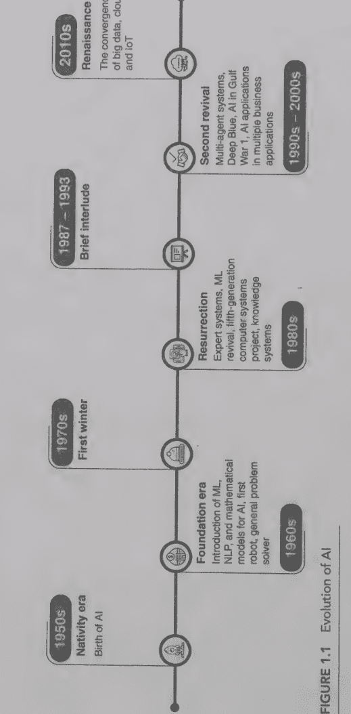
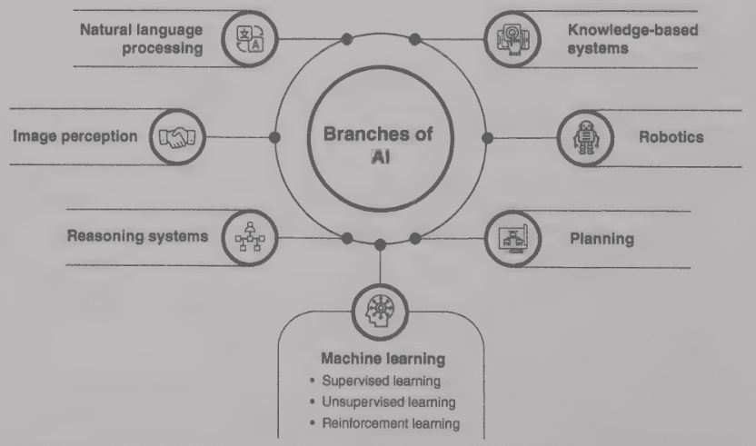

## 人工智能的演进

本书关于未来，但我们将花一点时间讨论过去，因为理解演进能为我们提供背景，帮助我们欣赏通往未来的道路。在本节中，我们将演进划分为多个时代；这些是我们选择的，并非行业标准。

自文明开始以来，人类一直在思考在机器中重现类人能力的问题。从希腊神话开始，就有对机器的提及。虚构文学中关于人工智能的例子已有数百年之久。玛丽·雪莱的 *《弗兰肯斯坦》*（1818年）、塞缪尔·巴特勒的 *《达尔文与机器》*（1863年）和卡雷尔·恰佩克的 *《R.U.R. 罗素姆万能机器人》*（1920年）是讨论智能设备和机器人的出版物中的一些例子。除了文学之外，这些想法也在早期的电影和电视中出现。可以说，1927年的德国科幻电影 *《大都会》* 是第一部描绘机器人的电影。1960年代在美国非常受欢迎的节目 *《飞出个未来》* 也非常准确地描绘了未来世界。虽然该节目设定在2062年，但其中展示的许多酷炫技术现在已成为我们日常生活的一部分；这些包括视频通话、扫地机器人、机器人助手、平板电脑、智能手表、无人机、全息图、飞行汽车、平板电视、喷气背包等等。描绘技术丰富未来的趋势一直延续到今天。我们经常从文学和虚构作品中汲取生活灵感。对人工智能来说也是如此。

## 1950年代 – 诞生时代

人工智能作为正式的学科和实践诞生于1950年代。艾伦·图灵、约翰·麦卡锡、马文·明斯基、艾伦·纽厄尔、纳撒尼尔·罗切斯特、克劳德·香农和赫伯特·A·西蒙被认为是人工智能的奠基人。诺伯特·维纳为控制论奠定了基础，克劳德·香农提出了信息论，艾伦·图灵描述了思考机器。这些想法的汇聚导致了人工智能的发展。人工智能这一术语首先由约翰·麦卡锡提出。1956年夏季在达特茅斯学院举行的达特茅斯人工智能夏季研究项目是人工智能首次被正式确立的事件。它始于几个月前由麦卡锡、马文·明斯基、纳撒尼尔·罗切斯特和克劳德·香农提出的提案，其中首次使用了人工智能这一术语。提案写道，

> 我们建议在1956年夏季于新罕布什尔州汉诺威的达特茅斯学院开展为期2个月、10人的人工智能研究。研究将基于这样一个猜想：学习或智能的任何其他特征原则上都可以精确描述，以至于机器可以模拟它。将尝试找出如何使机器使用语言、形成抽象和概念、解决目前仅限于人类的各种问题并自我改进。我们认为，如果一群精心挑选的科学家一起工作一个夏天，可以在这些问题中的一个或多个取得重大进展。(3)

但人工智能并非仅仅因为1940年代和1950年代的学术研究而突然起源。人工智能的根源在于形式推理，其历史非常悠久，超过2000年。在古希腊、印度和中国的古籍中都可以找到对形式推理的提及。值得注意的是，许多早期的数学家也是哲学家。德国数学家戈特弗里德·莱布尼茨是第一个提出人类理性可以用机械计算来解释的人之一。阿尔弗雷德·诺斯·怀特海和伯特兰·罗素于1910年出版的《数学原理》是为现代数学和逻辑奠定基础的开创性著作。很长一段时间以来，我们人类一直在为创造人工智能而努力。

七十年前，在1950年代，炒作周期并不存在，技术从学术领域向实际工业应用的过渡需要很长时间。人工智能也面临同样的命运。在其诞生的十年里，世界见证了人工智能基础概念的建立。但这一十年也产生了许多乐观情绪，因为人们现在可以现实地看到计算机（机器）承担任务，尽管是简单的任务，而这些任务迄今为止只存在于虚构领域。这一十年中的一个重要发展是约翰·麦卡锡于1958年发明了最早的编程语言之一 Lisp。它的意义在后来的几十年才被认识到，因为它很长一段时间成为人工智能编程的主流。

## 1960年代 – 奠基时代

1950年代的乐观和活力导致在1960年代发展出许多基础理论，这些理论至今仍构成了人工智能的基础。许多进步使人工智能从理论上的可能性转变为实际上的适用性。以下是一些亮点：

- **通用的系统性和编程方法来解决任何问题。** 通用问题求解技术的开发。在上一个十年结束时，赫伯特·A·西蒙、J. C. 肖和艾伦·纽厄尔编写了第一个无约束问题求解程序。
- **用数学解决人工智能问题。** 贝叶斯方法用于归纳推理和预测的引入。雷·索洛莫诺夫以托马斯·贝叶斯的原始定理和皮埃尔-西蒙·拉普拉斯对其的改进为基础，进一步发展以满足人工智能的需求。
- **机器人学的引入。** Unimate 是第一台工业机器人，它在通用汽车装配线上工作，将压铸件从装配线运输并将这些零件焊接到汽车车身上。这是一项复杂任务，机器执行后提高了工人的安全，因为工人在执行该任务时经常受伤。十年末期，Shakey the Robot 出现了，成为第一台通用机器人，它可以分析命令并将其分解为较小的可执行组件，然后再执行所命令的任务。
- **通过数学建模过去数据来预测未来。** 机器学习（ML）的引入。ML 的根源可以追溯到200多年前托马斯·贝叶斯创立贝叶斯定理。在此前的几十年里，围绕 ML 发生了大量发现。但在感知机发明、贝叶斯方法在人工智能中的引入以及其他算法的开发之后，这一十年是它正式开始成型的时期。
- **计算机能够理解和处理人类语言。** 自然语言处理（NLP）的引入。麻省理工学院人工智能实验室教授约瑟夫·魏岑鲍姆构建了 ELIZA，这是第一个能够用英语就任何话题进行对话的 NLP 程序。

在这些发展推动下，这一十年以进一步的乐观情绪结束。麻省理工学院人工智能科学家马文·明斯基预测：“在三年到八年内，我们将拥有一个具有普通人类一般智能的机器。”但事实并非如此，人工智能将在下一个十年遭遇第一次重大挫折。

## 1970年代 – 第一次寒冬时代

从1970年代中期到1980年代初被称为人工智能的第一次寒冬，进展因技术挑战、怀疑主义加剧、资金缺乏以及现实世界应用中进展非常有限而停滞。

那个时代也是计算机发展的早期阶段。许多算法要以任何有意义的方式工作所需的计算能力不足。例如，自然语言处理的承诺受到了阻碍，因为词汇无法扩展到20个词左右。模式识别和图像处理因类似原因无法进一步进展。机器人的能力仍然停滞不前。虽然在上一个十年许多学者在庆祝人工智能快速进展的承诺，但在这一十年中，一批不同的学者对人工智能的可能性及其无法以有意义的规模解决问题的能力提出了非常激烈的批评。迄今为止人工智能研究的大部分资金都由政府机构赞助，其中许多与军事有关。鉴于进展缺乏和随之而来的批评，大部分资金都被撤回了。

然而，这并不是一个完全失去的十年。在这个十年里，围绕视觉感知、自然语言处理以及各种算法方法，进行了大量的理论研究和出版。在这个十年里发生了三件非常重要的事情，对未来几年产生了重大影响：

- 赫伯特·A·西蒙因其有限理性理论而获得诺贝尔经济学奖，这是人工智能的基石之一。
- 马文·明斯基在1975年提出了模式和数据语义解释的概念。
- 世界上第一辆自主车辆，尽管很基础但完全由计算机控制，由汉斯·莫拉维克在斯坦福人工智能实验室建造。

十年代后期出现的悲观情绪和放缓，帮助人工智能在下一个十年重新启动。

## 1980年代 – 复兴时代

人工智能在1980年代获得了新的生命，这个十年对于推进人工智能向前发展的许多能力的进步变得至关重要。硬件和算法方面都取得了进展。此外，政府对人工智能研究的支持也重新开始流动。以下是这一时代的一些亮点：

- **专家系统的兴起以解决特定问题。** 通过模仿特定领域的专家并使用算法解决更明确定义的问题，人工智能再次开始证明其价值。
- **机器学习得以复兴。** 反向传播技术的引入使得预测模型中的误差校正成为可能。
- **第五代计算机系统项目的启动。** 日本政府的这一努力开始引入大规模并行计算来解决人工智能问题，并使机器更接近人类推理水平。
- **计算能力推动的ANN算法。** 新的电子晶体管和用于集成芯片的超大规模系统集成（VLSI）开发使计算机的处理能力大幅提升，使得像人工神经网络这样处理密集型的算法成为可能。
- **知识系统的开发。** 从Cyc开始，许多使用人工智能的先进知识管理系统开始得到开发；为未来像深蓝这样将人工智能推向新水平的项目奠定了基础。

这个十年完成了许多事情，使人工智能能够在解决复杂的现实世界问题方面实现规模化，并突破学术领域。

## 短暂的间歇

1987年至1993年，人工智能浪潮再次放缓，这在很大程度上是由硬件和计算能力无法跟上算法进步所驱动的。因此，更广泛的影响并未显现，资金再次被削减。然而，这并没有持续太久。研究社区退居幕后，在阴影中运作，以便在1990年代带着一些令人印象深刻的成就回归。

## 1990年代和2000年代 – 第二次复兴

最终，在这一时代，人工智能突破了学术世界，开始变得更主流。这在很大程度上得益于计算能力的提升和分布式系统的发展。最初为人工智能开发的许多算法最终在数据挖掘、搜索（如Google）、机器人技术、医疗诊断、金融服务和其他工业应用等商业世界中得到普及。在1990年代，有许多其他值得注意的游戏，人工智能程序获胜。人工智能程序DART在第一次海湾战争中被部署用于军事目的。在下一个世纪的第一个十年，机器人技术和自动驾驶方面取得了很多成就。机器学习、智能辅导、案例推理、多智能体规划、调度、不确定推理、数据挖掘、自然语言理解和翻译、视觉、虚拟现实、游戏等人工智能的许多学科都获得了在现实生活中展示的机会。

这是世界首先被Y2K危机所吞噬，然后是互联网，随后是电子商务和点-com公司的巨大繁荣。因此，虽然人工智能没有得到太多宣传，但它一直在幕后不断进步。这有所帮助，因为没有需要满足的夸大期望，研究人员却能够为解决商业问题做出贡献。在这一时代发生了两件非常值得注意的事情，最终导致了围绕人工智能的当前炒作：

- 深蓝在1997年击败了国际象棋冠军加里·卡斯帕罗夫，并在计算机和算法的强大能力周围创造了巨大的轰动。
- 多智能体系统开始成熟，并出现了来自决策理论的新概念来创建智能体；我们将在本书后面多次讨论多智能体系统。

世界在2006年庆祝了人工智能50周年。人工智能在其第二次复兴期间取得了很大进展。花了一些时间，但在其存在的最初50年后，人工智能开始获得显著的牵引力。

## 2010年代 – 文艺复兴时代

2010年代将被铭记为人工智能在技术主导的变革中占据中心舞台的时期。人工智能的至高无上地位可以归因于前几年大数据、云和物联网取得的成果，以及人工智能在幕后的持续发展。大数据、云和物联网的进步解决了困扰人工智能进步的两个主要问题：提供了足够的数据并确保了足够的计算能力。深度学习变得可行，并放大了机器学习和人工智能更广泛的价值，将其效用扩展到比以前更多的问题空间。微软、谷歌、亚马逊等主要技术公司在此期间将人工智能作为其主要议程。由于这些发展是最近的，我们在这里不会详细介绍。

图1.1描绘了过去七十年人工智能的演变。

### FIGURE 1.1 Evolution of AI

## AI AND ITS BRANCHES

许多研究人员将人工智能技术分类为：

- **弱人工智能或狭义人工智能。** 这些是针对特定问题的应用；目前世界上大多数实际的人工智能实现都属于这一类别。
- **强人工智能或通用人工智能（AGI）。** 这是机器能够像人类一样解释问题并对其采取行动的时候。流行地说，这种转变也被称为*奇点*。[1] 这仍然在实验室环境中，可能需要几十年时间才会出现任何有意义的应用。与AGI也存在许多伦理问题。
- ** superintelligence。** 这是机器超越人类思维的能力和容量，超越奇点状态的时候；这仍处于早期研究阶段。

人工智能处理各种问题类型。有不同的方法来解决这些不同类型的问题。方法上的差异导致了人工智能内部的不同分支或学科。让我们从最顶层的<|message|>

data scientist start with a model; in reinforcement learning, one does not have to start with a model, and the model can emerge during the analysis.

The diagram in Figure 1.2 is a handy depiction of the various branches of AI.

For the last several years, deep learning has been very talked-about in the AI scene. It is one of the more popular reinforcement learning techniques today. Companies like DeepMind have contributed a lot to the popularity of deep learning. Deep learning uses artificial neural networks and convolutional neural networks. Deep learning is inspired by how biological systems learn. It works in layers and through multiple passes of the learning algorithms over the data. With each layer of analysis and learning, there is a higher level of abstraction of the raw input data to create new insights. This way the program can find correlations between actions by interpreting the corresponding data. This approach allows deep learning to work without predefined constraints and find new boundary conditions of optimal performance or achieving an objective. In rule-based systems, we create the rules based on history or understanding; deep learning helps us explore the unknown possibilities. For example, in the famous example of DeepMind optimizing HVAC systems using deep learning, they were able to find new ways of substantially reducing energy consumption by changing the sequence of operations and flow of chilled water using rules that were identified by the AI programs instead of being preset by humans. Deep learning is emerging as one of the more popular AI techniques in tackling complex problems that are not fully understood. There are many different types of deep learning algorithms like multilayer perceptron, convolutional neural networks, recurrent neural networks, autoencoder, long-short-term memory, deep belief networks, etc. Deep learning techniques have also been employed to enrich supervised and unsupervised learning in addition to being one of the most popular reinforcement learning techniques.

FIGURE 1.2  Branches of AI

## A BIT ABOUT ALGORITHMS

Let us now clarify a few things about algorithms. The myriad techniques and algorithms can get very confusing for the uninitiated. Simply put, algorithms are the mathematical expressions that capture the process and logic chain for decision making. AI techniques, like the ones described above, take those algorithms, use data, and create insights from the decision-making process. Algorithms are the tools while data provides the fuel for the vehicle of AI to function.

Here are the top-nine things to keep in mind about algorithms:

- 1. **The same algorithm can be used in multiple AI techniques.** For example, the Convolutional Neural Network (CNN) algorithm can be used for both classifying and recognizing images as well as predicting the future value of something. So, the same algorithm can be applied differently for finding out which is the picture of a cat, a dog, and a traffic light, and at the same time predict how much energy your home will most likely consume tomorrow.
- 2. **Multiple algorithms can be applied to solve the same problem class.** For example, two different algorithms, like random forest and support vector machines, have been applied successfully to predict equipment failure. However, rarely are multiple algorithms applied to the same problem set simultaneously.
- 3. **Certain algorithms are better suited for specific problems.** For example, the CNN algorithm from point 1 above is better suited for energy prediction modeling as opposed to the image recognition problem.
- 4. **Each algorithm has a general method and a specific architecture as it gets applied to solve specific problems.** Every algorithm has a standard mathematical analysis process. However, during that analysis, it can use different variables and computations in different sequences, changing its architecture.
- 5. **The same algorithm can have different architectures.** Therefore it can be adapted to be applied differently for different problem classes using different techniques.
- 6. **Effectiveness in selecting the best algorithm for a problem comes from experience.** Data scientists with years of experience and exposure to a variety of problems can intuitively figure out the best approach. Some tools can help you navigate that, but most of them are still in their infancy.
- 7. **Algorithmic development is an iterative process.** Even the most experienced data scientists will refrain from claiming success at the first pass. They will experiment with multiple techniques, multiple algorithms, different architectures, and different cuts of the dataset before they finally work on a solution. This is also a very effective way of approaching this space because there are multiple choices.
- 8. **The algorithmic process starts with feature engineering.** This is the process of determining which variables among all available in a dataset have more relevance and better-quality data for the analysis and desired outcome. Some of the algorithms, like the deep learning algorithm LSTM, self-determine which variables are more important and relevant for the algorithm architecture.
- 9. **Usually, the quality of data from variables determined at the feature engineering stage is more important for most algorithms and most techniques.** However, for analyzing captured data to make meaningful predictions and choices. The Uber example from above is a perfect example of such a transformation.

We have studied hundreds of projects and scores of companies implementing AI. Through this exercise, we have found some best practices that lead to a higher probability of success with the AI initiatives, and missing them usually leads to disappointing results. Here are some of the key ones:

- a. The problem should be big but well-defined.
- b. First figure out the business value of solving the problem before you unleash the data scientists.
- c. Choosing the right algorithm matters a lot.
- d. Involve partners, but keep control over the data and algorithms.
- e. Change management is critical.

As we go through the different chapters in the book, we will be talking more about each of these best practices.

One thing that we have learned through the evolution of AI is that while science and math have always been extremely competent, other impediments limit the impact of AI. So, it is important to have realistic expectations and be thoughtful about the implementation.

## PURPOSE AND STRUCTURE OF THE BOOK

Most organizations are making AI a part of their core agenda for their survival and success in the future. But sometimes their leaders struggle with developing a roadmap for how to reimagine their world with AI. This book is intended to help both business and technology leaders navigate the complex world of AI with its myriad dimensions in several ways:

- - Understand the opportunity landscape.
- - Develop a framework for business transformation.
- - Investigate the possibilities across multiple industries.
- - Build a technology foundation and the enabling ecosystems.
- - Address broader societal concerns around ethics, privacy, and security.
- - Manage the change.

This book has two types of chapters – one focused on how AI will transform specific industries and the other type focused on deployment aspects of AI across many industries.

After this introductory chapter, in Chapter 2 we will discuss how to build a framework for applying AI to any business domain.

Then we will dedicate the next eight chapters to how AI will transform eight specific industry verticals:

- 1. Healthcare
- 2. Education
- 3. Transportation
- 4. Retail
- 5. Financial services
- 6. Built environment
- 7. Smart cities
- 8. Smart government and citizen services

We chose these eight because they impact our individual lives and businesses more than others and are also the biggest contributors to a nation’s GDP and future prosperity. We started this book before the COVID-19 crisis hit us, but as we kept writing we realized that the industries we had selected are also the ones that are most relevant in this current scenario.

Chapters 11 and 12 are the only technology-oriented chapters in this book, but they are not very deep into the technology or algorithms. Chapter 11 focuses on how to build a technology landscape while Chapter 12 goes into the nuances of ethics, privacy, and cybersecurity. Our goal is not to make you a technology expert; it is to give you enough orientation and tools for a holistic perspective.

Chapters 13, 14, and 15 focus on helping you get organized around your AI initiatives and manage change. Change management is an extremely critical part of the success of any AI initiative.

We believe there are a few unique aspects of this book:

- - This is possibly the first and only book that tackles the topic of AI from a holistic business transformation perspective and focuses on multiple industries.
- - This is a how-to book that contains some fundamental research and thinking into the various topics influencing and being impacted by AI.
- - This book is peppered with a lot of practical examples and innovations as observed in this evolving landscape.
- - This book will demystify the technical intricacies involved with AI for the readers and show them a path to success.
- - This book requires rudimentary technical understanding and basic management orientation to navigate the space of AI effectively.

As you will see, there are several areas of overlap between the different industries and technology choices, which further proves the point that AI will morph the way we live and work.

We hope you share our excitement and find this journey with us to be useful.

### REFERENCES

- (1) Modeling the Impact of AI on the World Economy; McKinsey Global Institute; September 2018.
- (2) Dawn of The Age of Algorithms; Sudhi Ranjan Sinha; January 2018.
- (3) A Proposal for the Dartmouth Summer Research Project on Artificial Intelligence; John McCarthy, Marvin Minsky, Nathaniel Rochester, and Claude Shannon; August 1955.
- (4) The Coming Technological Singularity: How to Survive in the Post-Human Era; Verner Vinge, Winter 1993.

