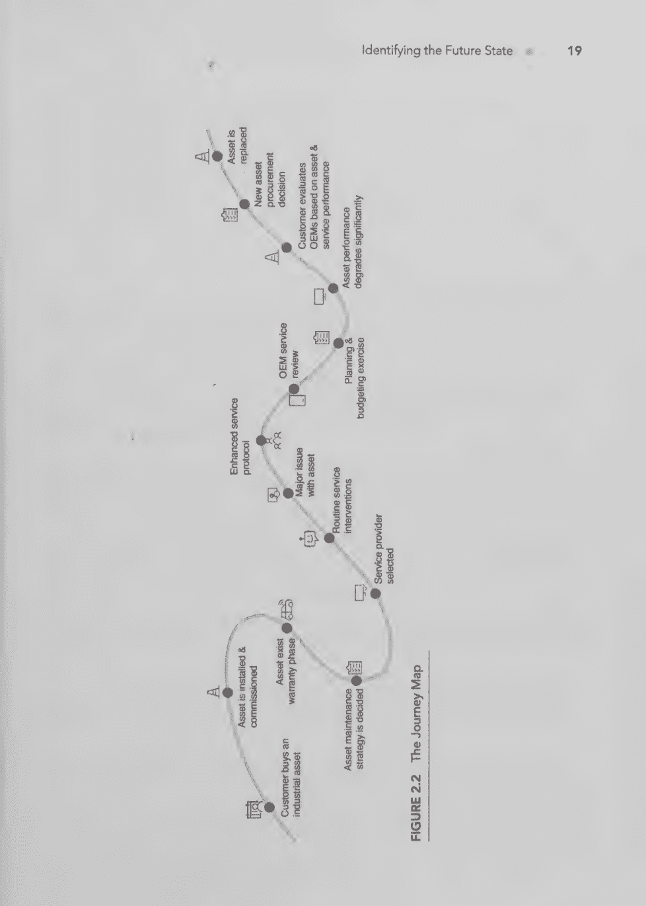
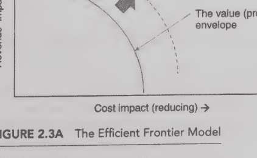
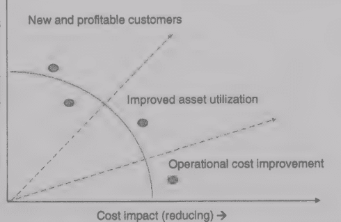
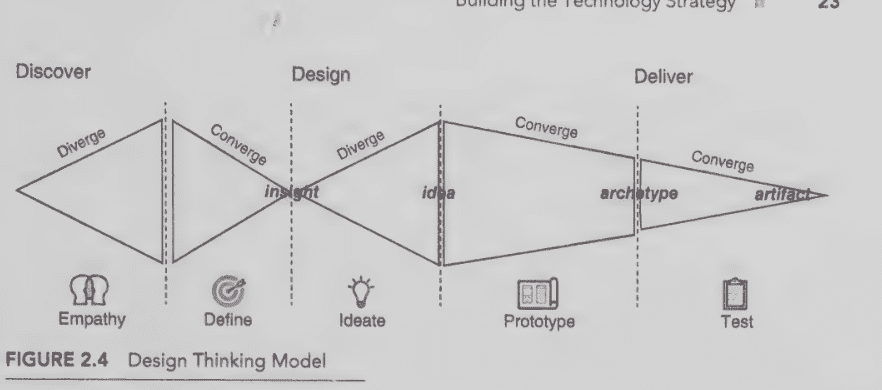
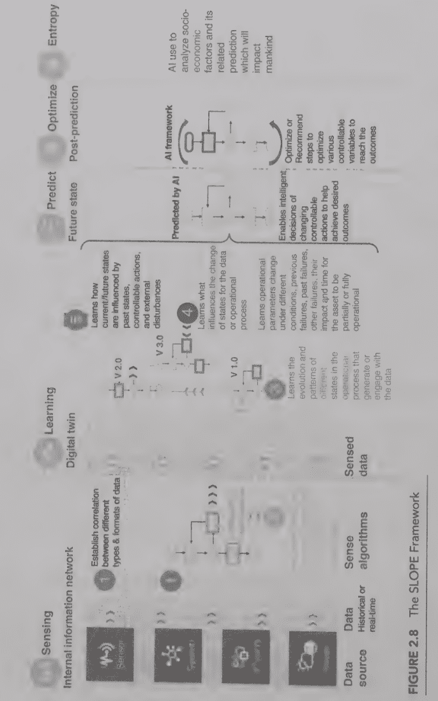

# 第 2 章
## 构建应用 AI 的框架

> “你不需要是天才、远见卓识者，甚至不需要拥有大学学位就能取得成功。你只需要一个框架和一个梦想。”
>
> —迈克尔·戴尔（Michael Dell）

### 引言

人工智能（AI）作为一个领域非常庞大，其应用范围极广。在第一章中，我们探讨了人工智能的各种分支和流派。正如引言中所述，根据麦肯锡近期的一项研究，预计到 2030 年底，人工智能的影响规模将达到约 **13 万亿美元**，且超过 **70%** 的企业将受到人工智能的影响。这意味着没有人能免受人工智能影响所波及。大多数企业和商业领袖感到有义务在人工智能方面采取一些行动，就像他们过去面对每种新技术热潮时所做的那样。他们被落后的风险所驱动，因此采取了行动。通常，这些人工智能倡议被授权给首席信息官（CIO）、首席数据官（CDO）或其他高级技术领导者。如果仅使用人工智能的新分析能力来改进内部运营或产品性能的某些方面，其影响将是有限的，无法实现变革性的目标。为了产生更大的影响，商业领袖和 C 级高管需要亲自发起并监控这些努力。他们还需要以框架的思维来推动这些倡议并捕获价值。新冠疫情确保了数字化处于每位商业领袖议程的首要位置，且他们正在积极探索人工智能等高级分析技术，以确保其业务今天得以生存，并最终在明天蓬勃发展。

框架是成功的结构；它包含在此变革工作中取得成功所需的所有组件、它们之间的相互关系，以及整个生态系统中的行动和效果流动。

框架的概念由来已久。框架从神学到计算机编程都有应用。许多声誉卓著的分析师和咨询机构创建了用于商业价值建模的框架。我们看到 **Gartner 模型** 和 **Accenture 模型** 是很好的起点。

**Gartner 商业价值模型** 考察了业务方面（Business Aspect）、聚合体（Aggregates）和主要指标（Primes）。业务方面是一个广泛的功能领域，如需求管理。聚合体是广泛功能领域内的主题领域。在需求管理下，聚合体包括诸如市场响应能力、销售效率和产品开发效率等主题。主要指标是进一步分解的一层，深入到具体指标，这些指标共同代表了聚合体的状态。例如，销售效率聚合体拥有许多主要指标，如销售周期指数、销售成交指数、销售价格指数等。Gartner 模型有很多优势——它结合了诸如平衡计分卡和经济增加值等多种模型的精髓，它非常详细且定义精确，并触及组织几乎每个功能维度。然而，该模型并未与 AI 驱动的分析绑定，也未超越功能性考量采取更宏观的观点。

另一方面，**Accenture 模型** 更偏向 AI，除了功能性考量外，更具有结果导向的商业价值韵味。该模型考察四种不同的解决方案活动——效率模型、专家模型、效能模型和创新模型。效率模型使用 AI 使例行分析更高效、可重复且低成本。专家模型引入了人类参与循环。效能模型考虑了更广泛和非结构化的组织方面。创新模型专注于寻找新的边界。

这两个框架在适当使用时都非常好且有效。还有其他许多框架，由于篇幅和时间有限，我们无法深入探讨每一个细节。

在我们看来，当我们试图使用高级分析解决严重的商业问题时，在这种情况下使用的良好框架应遵循以下指导原则：

-   a. **采用客户回溯方法。** 很多时候，我们陷入内部复杂性和竞争之中，往往忘记了我们存在的目的以及如何服务于客户。采用客户回溯方法有助于保持对最终目标的关注，即更好地服务更多客户，从而推动盈利增长——这是任何业务的主要目的。这种方法还避免了内部冲突，并形成了所有人都能团结一致的优先级排序和决策“北极星”。

-   b. **以经济价值为中心。** 在任何组织中，始终存在许多活动和流程。并非每个活动或决策对业务结果的影响都一样。良好的框架应捕获那些创造真正经济影响的因素，而不仅仅是反映内部职能部门赋予的相对内部重要性。

-   c. **捕获所有触发器和催化剂。** 当前的业务流程非常复杂且错综复杂。它们也是相互依赖的，并受许多因素（其中一些可能并非显而易见）的影响。为了全面捕获业务流程，至关重要的是要捕获所有作为任何指标或业务结果绩效变化的触发器或催化剂的因素。例如，股票市场指数经常受社会政治事件情绪的影响，有时甚至受世界其他部分地区的影响。

-   d. **代表信息流、决策干预、经济影响和流程接口。** 换句话说，框架是对人类如何……的良好表征

在本章中，我们将针对以下主题提供有关构建应用 AI 框架的更详细指导、框架和最佳实践：

-   识别未来状态
-   构建技术战略
-   定义商业案例
-   创建解决方案路线图
-   识别 AI 能力
-   建立治理流程

### 识别未来状态

识别业务的未来状态是最具挑战性的工作之一。它需要对业务有非常深入的理解：它如何为其客户创造价值、它在何种市场和竞争对手背景下运营、其核心能力和竞争优势是什么，以及这些因素随时间如何演变。在对业务进行深入分析以了解什么促成了其当前的成功以及什么将驱动未来的成功时，至关重要的是要保持非常客观、冷静和有条不紊。每个假设都必须经过测试和验证。

当面对如技术（在此情况下为 AI 和其他数字技术）等变革性力量时，企业必须重新思考和重新定义其当前的业务模式，而不仅仅将其视为技术练习或营销努力。许多拥有非常成功记录的大型公司，凭借为内部改进创造令人印象深刻的技术，将那些举措作为能够转变整个市场的基础，但结果发现它们在改变内部业务实践方面存在缺陷，未能创建出在市场能增加重大价值的新业务模式（超越技术能力），且未能随着市场和技术的持续演变而保持敏捷和适应性。商业领袖需要避免的最大风险是当营销超越了产品所创造的价值时所产生的风险。

为了定义业务最可能的未来状态，我们建议采用三步骤流程——从客户开始，了解什么创造价值，最后模拟未来状态。

#### 步骤 1：创建客户回溯互动旅程地图

许多框架采取内部运营视角来看待组织的能力和Activity，并将它们框定在功能桶中。这些方法易于组织工作，因为这是我们在日常生活中习惯的。然而，这种方法最终可能只是使当前状态稍有效率，而不是探索截然不同的未来状态。因此，我们建议使用客户回溯互动旅程地图。由于客户是所创造价值的最终仲裁者，从他们的视角进行审查是明智的。

我们将使用一个示例来解释如何创建旅程地图。我们从客户购买高价值工业资产这一简单示例开始，并追踪该资产的主要生命周期事件，直到其被替换。图 2.2 中的图表是此旅程的高层视图，该旅程将持续数年。

#### 图 2.2 旅程地图

在绘制旅程地图时，重要的是要牢记各利益相关方的主要目标。在我们的示例中，我们将考虑两个主要利益相关方的目标——资产所有者或客户，以及在本案例中也提供服务的新设备制造商（OEM）。客户希望资产具有尽可能长的寿命、最高的性能可靠性以及最低的运营成本（包括维护成本）。OEM 希望帮助客户实现其目标，获得该资产的维护合同，最大化任何附带服务机会，并在多年后资产更换时成为首选供应商。在绘制旅程地图时，考虑这些目标至关重要，以确保不会遗漏实现这些目标的关键影响因素。

### 步骤 2：识别决策点

在任何业务流程中，都有许多决策点，有时多达数百个，但总有几个更为重要，并且与本次练习中已确定的关键目标相关。因此，在我们的示例中，关键的决策点包括：

- 当客户决定维护策略和服务提供商时 – 影响客户的所有目标以及 OEM 获得服务业务的能力
- 当客户进行规划和预算编制时 – 影响客户的运营成本和性能考虑，影响 OEM 的服务续约和服务业务拉动
- 当客户选择替代资产时 – 影响 OEM 保留客户关系的目標以及客户拥有成本最优且性能最佳的新资产的目标

准确识别决策点至关重要，因为它们对分析有着显著的影响。

### 步骤 3：构建业务价值链

了解旅程地图以及关键决策点及其影响，有助于我们构建业务价值链。一个好的业务价值链必须能够回答以下三个问题：

- 1. 我们试图解决哪些问题？
- 2. 你拥有解决这些问题所需的数据，或者至少知道需要哪些数据？
- 3. 哪个具体的用例，即某个活动、产品或服务的具体情境，将有助于解决这些问题？

我们从定义结果开始，这是通过解决当前客户旅程地图中的一些问题来捕捉未来状态影响的一种方式。对于每个定义的结果，我们列出一个或多个目标；对于每个目标，我们列出一个或多个用例。结果、目标和用例之间始终存在多对多关系的可能性；但最好尽可能保持单一性和细粒度，以便我们可以综合出最相关和最相关的内容。

在我们的示例中，表 2.1 展示了如何捕捉结果、目标和用例。

#### 表 2.1 用例推导方法

| 结果 | 目标 | 用例 |
| --- | --- | --- |
| 改进资产管理 | 优化性能，降低运营费用和资产生命周期成本 | 远程和持续监测资产性能 预测未来性能和运营成本 主动识别需要维护的性能问题 推荐优化运营和维护的策略 最小化资产性能下降或维护干预对其他运营的影响 预算、预测、财务规划 资产的净现值（NPV）管理 |

通过上述步骤，可以对价值创造获得非常透彻的理解。通过根据具体情况代入实际财务数据，你可以得出量化的价值创造，从而确定机会领域。此时，你应该对未来状态已经有了相当清晰的看法。

### 有效前沿模型

1952年，诺贝尔奖得主哈里·马科维茨（Harry Markowitz）(3) 引入了一种基于风险和收益的投资组合管理模型。我们从同一模型中汲取灵感，并对其进行改编，以构建价值创造框架。

在我们对模型的改编中，我们将 X 轴视为成本维度，Y 轴视为收入维度。X 轴的推进表示成本影响减少，Y 轴的推进表示收入影响增加。每个企业都在一个有效前沿中运营，即利润或价值创造的包络。任何企业的目标都是不断将包络推向下一个前沿。（见图 2.3a。）

#### 图 2.3A 有效前沿模型

#### 图 2.3B 含举措的有效前沿模型

各种举措可以根据其财务影响绘制在该图表中。例如，如果你有一组旨在解决业务运营成本的举措，其中一些旨在提高业务中的资产利用率，另一些则瞄准新的增长市场，你可以按照图 2.3b 所示的方式将它们放置在相对位置。

我们发现有效前沿模型框架是一个非常有用的概念化、优先级排序和沟通工具，用于为转型中的各种举措提供背景。

### 设计思维模型

设计思维是一种解决复杂问题的有效认知思维方法，特别是那些具有大量层次和相互依赖性问题的问题，正如我们在人工智能和分析领域必须处理的那样。设计思维可追溯至 20 世纪 60 年代，当时出现了将科学与设计艺术相结合的早期尝试。设计公司 IDEO 和斯坦福设计学院从 20 世纪 90 年代开始使其普及。如今，这在商业界被广泛使用和讨论。你可以在所有主要咨询公司以及专注于设计思维的精品公司中找到专门的设计思维实践。世界上许多大学都提供设计思维课程，并且围绕这一主题已经产生了大量文献。我们的目标不是在这里重新创建或重复这些内容；我们旨在让你接触这些方法，以便你在理解和使用分析解决业务问题时可以应用它们。

广义上，设计思维包括五个主要步骤：

- 1. 同理心 – 理解背景，包括与业务背景相关的所有行为和人因素
- 2. 定义 – 阐明问题以及涉及该问题的人物角色
- 3. 构思 – 思考可能的解决方案
- 4. 原型 – 部分建模解决方案以验证问题和解决方案假设
- 5. 测试 – 运行短周期创新以验证解决方案的功效和有效性

#### 图 2.4 设计思维模型

但是，设计思维不是一个线性的过程；像其他创造性过程一样，它是迭代的，并因参与者不同的背景和思维而得到丰富。一些专家认为，这五个步骤促成三个结果——发现、设计和交付。他们还认为，你需要通过发散和收敛的迭代过程来获得最佳的洞察和想法。图 2.4 将这种思维与五步经典流程结合。

一旦你较好地了解了未来状态，下一个主要活动是定义技术策略，以有效评估想法的可行性并确定通往成功的最优路径。为了理解数据和分析需求以指导技术策略，必须回答以下三个主要问题：

- 1. 哪些能力最令人兴奋？
- 2. 我们能否将“正确”的能力与它们的问题连接起来？
- 3. 当我们将这些点联系起来时，会出现哪些情景？

在定义未来状态时，你已经概述了业务流程和主要决策点。在构建技术策略时，同样，你必须创建数据旅程。任何数据旅程都有五个主要步骤：

- 1. 收集数据。
- 2. 评估数据。
- 3. 解释数据并提供指导。
- 4. 改进绩效。
- 5. 预测需求和事件。

这些是顺序但又循环的步骤，反复进行。

除了数据旅程，你还需要创建更详细的业务流程或期望结果的活动地图。活动地图的目的是实现已识别的结果

在用例定义期间提供未来状态的更全面视图。每个活动 ideally 应被归类为价值创造型或价值使能型，以便我们能更精确地确定诊断需求和技术战略。

图 2.5 是对如何绘制数据旅程和活动的简单图示表示，以本章前面提到的改进资产管理这一持续示例为例。

在构建技术时，这里有几件重要的事情需要记住：

- a. 避免产生用平台和应用来解决业务问题并实现未来状态的诱惑。在当今以应用为基础的经济中，我们的思维经常会被每天接触到的众多应用所塑造。在这个阶段，你应该完全专注于战略部分，而不是技术实施部分；后者在你设计解决方案时才会到来。
- b. 在思考你的数据旅程和活动时，不要受限于你今天拥有的数据或你能轻松获取的数据。围绕传感器和数据管理的可用选项是巨大的，而且成本结构也在迅速下降。你必须确定为解决问题和创造价值所需的重要数据要素和活动。
- c. 连接各点需要一种系统的方法和批判性思维。对业务流程有深入运营理解的人应为此练习提供输入。最好验证和交叉检查每一个假设。通常你会最终提出业务流程的完全新范式，这可能对你的组织甚至市场具有颠覆性。但这正是使用分析进行转型练习的全部意义——看到显而易见之外的东西。

正如你所见，为构建 AI 框架而制定技术战略并不是一项技术练习；它更像是一项业务思考和重新思考的练习。因此，虽然你应该让技术领导参与其中，但该练习必须由业务主导。

### 定义业务案例

第 3 步是建立数字业务案例并收集计算所需的数据，以得出数字化转型之旅的投资回报率。在构建 AI 数字业务案例时，价值创造通过财务回报和额外的、可衡量的收益来明确阐述。我们评估当前技术栈的状态，并确定最可行的实施系统，以最大化价值并最小化数字化转型的相关成本。与其他步骤类似，你需要回答一些关键问题来制定业务案例并得出投资回报率计算：

- 可以和应该构建哪些分析？
- 系统和数据的当前状态是什么？
- 价值创造、相关成本和回报是什么？

你从上一步中确定的能力和活动开始，然后对每个组，识别创造的价值和价值创造的财务影响以及额外的

#### 图 2.5 技术战略：数据旅程和活动地图

##### 数据旅程
- 收集数据
- 评估数据
- 解释并提供指导
- 改进绩效与价值
- 预测需求与事件

##### 当前状态

##### 未来、连接状态

##### 价值创造活动
价值使能活动

- 传感器连接资产
- 了解资产生命周期历史
- 构建条件维护模型
- 为资产构建最佳绩效指标
- 建议运营调度周期
- 启用远程绩效管理
- 自动化合规报告
- 改进财务预测
- 预测资产停机时间
- 优化运营成本

##### 01 基于规则的维护

支持客户识别围绕需要零件或服务的常见资产状况的具体维护规则

- 更好地了解给定资产的历史维护需求
- 从过去出现的问题中学习
- 围绕资产的常见问题以及类似资产构建规则

##### 02 自动化和远程

连接设备使运营商能够与服务提供商合作进行定期远程绩效检查

- 运营商可以减少每个财政年度的定期手动资产检查次数
- 服务提供商的远程检查将根据预先约定的条件规则生成详细报告

##### 03 预算效率

管理资产合规标准并了解零件需求/使用预测；运营费用预算压力较小

- 通过有效的审计报告减轻合规风险，这些报告将根据资产使用类型进行预定义和定制

##### 04 运营绩效

确保资产绩效并消除停机时间可以确保建筑物内每项资产的运营成本得到优化

- 基于规则的维护或概率资产评估，在收集足够数据后可以转变为预测性资产管理
- 预测性维护可以保证零停机时间

#### 图 2.6 通过分析进行回报建模

无形收益。有时无形收益在战略上可能很重要，但我们不建议仅为无形收益进行任何重大投资。

图 2.6 说明了思考此练习的一种方式。

要完成业务案例，你需要下一步构建成本基础。投资在收集新数据、实施新传感器或构建新应用方面可能很小。然而，根据我们的经验，如果你正在进行真正的转型练习，AI 计划很可能需要进行更广泛的技术工作才能充分实现收益。

图 2.7 提供了一个框架来帮助你思考可能涉及的各种成本维度。

| 活动线程 | 创造的价值 | 财务影响 | 额外收益 |
|---|---|---|---|
| 活动 1 活动 2 | • 价值创造 #1 及如何 • 价值创造 #2 及如何 • 价值创造 #3 及如何 | • #1 的 $$ 价值影响 • #2 的 $$ 价值影响 • #3 的 $$ 价值影响 | • 无形 #1 • 无形 #2 |
| 活动 1 活动 2 | • 价值创造 #1 及如何 • 价值创造 #2 及如何 • 价值创造 #3 及如何 | • #1 的 $$ 价值影响 • #2 的 $$ 价值影响 • #3 的 $$ 价值影响 | • 无形 #1 • 无形 #2 |

| 技术输入 | 基础设施/实施需要解决的问题 | 财务影响 |
|---|---|---|
| 1 诊断工具 | • 需要集成哪些类型的系统？ • 需要应用哪些规则来驱动增强的诊断查询？ • 应应用哪些合规标准？ | • 成本驱动因素 1 = $ 价值 • 成本驱动因素 2 = $ 价值 • 成本驱动因素 3 = $ 价值 |
| 解决方案选项 2a 技术架构 | • 我们如何管理数据和分析管道？ • 采用新软件的数据隐私流程步骤是什么？ • 配置、数据发现、事件丰富、分析要求？ | • 成本驱动因素 1 = $ 价值 • 成本驱动因素 2 = $ 价值 • 成本驱动因素 3 = $ 价值 |
| 2b 业务应用 | • 我们试图通过解决方案改进哪些流程？   • 标准操作程序   • 风险管理   • 业务劳动力效率 • 通过应用跟踪的最重要指标是什么？ • 运营标准是什么？ | • 成本驱动因素 1 = $ 价值 • 成本驱动因素 2 = $ 价值 • 成本驱动因素 3 = $ 价值 |
| 3 变革管理 | • 环境中 1 年？3 年？会发生什么变化？ • 我们如何希望将改变数字模型的努力运营化以用于企业？ • 如何正确配备变革管理整合人员？ • 持续维护和整合的成本是多少？ | • 成本驱动因素 1 = $ 价值 • 成本驱动因素 2 = $ 价值 • 成本驱动因素 3 = $ 价值 |

#### 图 2.7 分析计划的成本建模

现在你已经清楚地了解了可以获得的收益以及可能需要投入的资金，那么你就可以轻松地构建商业案例，并决定是继续推进、调整目标或方法，还是干脆放弃整个想法。

### 制定解决方案路线图

第四步也是最后一步，是设计解决方案和实施计划，以实现第一步中定义的期望客户成果。我们回顾技术战略和从商业案例中收集的数据，以确定哪些系统要素需要首先试点、哪些数据集能为客户带来最大影响，以及实施计划需要哪些资源。理解成果与实现成果的交付流程之间的联系，正是我们将建筑使命与企业使命无缝连接的方式。

在本书中，我们不会在解决方案路线图制定和设计练习中深入细节。技术设计和开发是非常成熟的学科；围绕这些主题的文献十分丰富。分析计划与大多数其他数字化转型项目遵循相似的模式和路径。你也可以参考我们之前的书籍，了解围绕IoT、大数据和分析的解决方案开发的框架、模型和最佳实践。

然而，在选择或构建适合AI的数据平台时，与普通数据应用或IoT应用相比，存在一个重要区别。表2.2展示了不同平台的一些细微差别，并强调了以AI为中心的数据平台必须具备的特性。

理解这些差异很重要，因为这些是业务领导者必须做出的长期且昂贵的决策。

表2.2 平台比较

|  | 普通数据平台 | IoT平台 | AI平台 |
|---|---|---|---|
| 集成 | 类似的数据源 | 广泛的传感器和数据源 | 任何类型的数据源，提供任何格式的数据 |
| 数据组织 | 通常是结构化的 | 半结构化的 | 结构化、半结构化、非结构化——所有可能的组合 |
| 传感器融合支持 | 否 | 有限 | 高 |
| 数据情境化 | 否 | 有限 | 灵活的基于图的 |
| 分析 | 数据收集和报告 | 基于启发式的分析 | 基于学习的分析 |
| 自主反馈循环和持续学习 | 否——完全依赖人工 | 有限——需要大量专家干预 | 高度自主且由学习驱动 |
| 应用支持 | 桌面仪表板和移动应用 | 桌面仪表板和移动应用 | NLP应用、沉浸式应用 |
| 可扩展性 | 针对特定数据集成果 | 针对特定处理链成果 | 针对企业级成果 |

### 识别AI能力

根据我们的经验，将组织所需的AI能力分类到一个统一且共同的框架中总是很有帮助的，这能让每个人更容易沟通并团结一致。以下是我们构建的一个框架，你可以使用——SLOPE框架，其中AI能力根据其主要用途分为感知（Sensing）、学习（Learning）、优化（Optimizing）、预测（Predicting）和熵（Entropy）。我们略微调整了分析逻辑顺序以创建该缩写词。

#### 感知（Sense）

感知能力使AI能够从所有数据源访问和收集数据、对其进行清理和分类，并为进一步分析做好准备。感知能力包括使用AI技术自动检测和移除异常数据、数据清理以及缺失数据插补的智能机制。关联不同类型和格式的数据也是感知算法中的关键作用。这里考虑的数据包括实时数据和历史数据。感知的示例包括收集资产的传感器数据、来自其他来源的运营影响数据（如公用事业消耗数据）、其设计数据、来自相关其他系统和资产的数据，以及该资产所属信息网络之外的外部信息来源——这些对于全面了解资产绩效及其影响（如天气或能源成本）至关重要。

#### 学习（Learn）

一旦数据被感知，AI解决方案将学习运营过程中产生或涉及数据的不同状态的演变和模式，以及哪些因素影响数据或运营过程的状态变化。AI解决方案学习当前/未来状态如何受过去状态、可控行为和外部干扰的影响。学习通过各种算法进行，该能力也被称为为各种流程和数据元素构建“算法数字孪生”。在资产示例中，学习将包括了解运营参数在不同条件下如何变化、过去的故障、过去故障的触发因素、故障事件发生时的其他条件、故障发生时影响了什么、资产或其所属系统恢复完全正常运行所需的时间等等。学习提供了上下文。

#### 预测（Predict）

学习完成后，AI可以预测未来的各种状态。预测能够做出改变可控行为的智能决策，从而帮助实现期望的成果。例如，如果我们能预测高价值资产未来发生故障的可能性，我们就可以采取许多补救措施来避免故障，或者在故障发生时制定备用计划。在另一个示例中，如果我们能预测某些事件（如健康恐慌或重大社会政治事件）可能影响人们的生产力，就可以采取措施来隔离和管理影响。

#### 优化（Optimize）

在预测之后，AI系统还可以优化或推荐优化各种可控变量的步骤，以达到作为AI框架一部分所设定的成果。优化的AI算法与预测算法紧密配合。优化始终是在已定义目标函数的背景下进行的，该目标函数规定了系统需要达到什么状态以及系统必须处理哪些约束。例如，优化资产的运行以使其更具成本效益、最高性能或最长寿命，是分析可以推荐或执行的不同选择。

#### 熵（Entropy）

熵在AI应用中迄今尚未被广泛使用，但AI最适合建模和预测那些超出常规考虑范围的高度破坏性事件。我们现在处于“黑天鹅”领域。例如，阿拉伯之春能被预测吗？如果我们分析并推断社会经济数据、人口日益增长的不满情绪以及其他数据流，我们不会得出该事件的严重程度。然而，当我们综合以前从未被放在一起考虑的各种数据时，我们就可以开始得出不同的结论。威尔逊中心的迈克尔·戈登在2018年2月就此主题撰写了一篇非常学术的文章，你可以看到许多分析和推断可以系统且有条理地整合在一起。这类AI应用既是科学也是艺术，因为你如何训练机器或算法去识别要寻找的内容以及从何处开始？

图2.8展示了SLOPE框架的各个阶段。

### 建立治理流程

围绕AI计划建立良好的治理流程与构建良好的框架来启动和管理它们同样重要。通常，业务领导者会启动一些AI计划，然后由才华横溢的研究人员接手。他们最终可能会专注于非常有趣且具有智力挑战性的问题，而没有完全了解其商业影响。寻找优秀的AI人才很困难，而且成本可能非常高，因此确保定期审查正确的重点和优先级就变得更加关键。

以下是一些围绕AI建立良好治理流程的推荐最佳实践：

- 1. 任命一位对业务有强烈感知并以业务成果为主要驱动力的AI负责人。
- 2. 建立一个由业务领导者组成的指导委员会，他们应对未来有远见、理解技术和技术曲线、欣赏分析并乐于实验。业务领导者应能代表客户和产品/服务。避免在指导委员会中安排过多专注于短期成果的运营领导者，因为这是一个需要长远眼光的领域。指导委员会应加入少量精选的内部和外部AI专家，

包括你的人工智能组织的负责人。这将使可能性和现实性之间取得平衡。指导委员会应被赋予资源分配和优先级排序的权力，同时也应获得3至5年的运营期限，并配有阶段性的成功衡量指标和交付成果。

3. 创建一个优先级矩阵并广泛发布，以教育组织中的其他人员，并对所有关键利益相关者保持透明。优先级矩阵应以客户价值创造与获取视角下的经济可取性、技术可行性和竞争差异性为指导。有效前沿模型是一个很好的工具，可以将AI举措映射到其上，查看它们的排名和优劣。

4. 至少每月审查一次进展，至少每季度审查一次优先级排序。短期内业务可能发生很多变化；新问题可能出现，新机会也会呈现。AI团队应该能够理解并应对这些。

5. 审查过程应少一些状态汇报，更多关注从分析中学习和讨论业务影响。这些是广大商业领袖必须熟悉并精通的新领域。因此，对话对于学习和内化过程至关重要。

6. 通常，特定的AI举措会与现有的产品或服务业务或职能更加契合。因此，最好让数据科学家与这些团队保持一致，以便他们能够借鉴现有成员的领域经验。然而，拥有一个统一的AI团队也至关重要，因为有才华的数据科学家通常会被领域内其他杰出专家吸引，并在高绩效同行群体中表现最佳。在中央人才库中建立关键规模的数据科学家团队来推动AI举措，被认为是成功的重要标准。

7. 将AI研究团队与产品或技术开发团队结合起来，按照共同的能力发布计划开展工作。各自为战的追求导致许多优秀的AI工作因缺乏实施而停滞不前。

8. 为AI举措设定时间期限。如今，有足够的分析技术、计算能力和数据，大多数业务问题可以在3到6个月内使用AI解决。可能还需要一点时间来完善分析或技术，并使其正式投产，但核心开发不应花费太长时间。延迟通常意味着方法不当、人才不足或内部功能失调——任何这些问题都应在萌芽状态就予以消除。

任何治理流程都必须有充分的文档记录，但更重要的是，应与所有利益相关者共享和沟通。治理流程的有效性也必须每年审查，并酌情调整。

### 总结

当你踏上AI之旅时，必须采取结构化的方法，以免迷失方向。本章旨在帮助你做到这一点。

你首先要确定业务的未来状态。未来状态的设计是通过综合市场趋势、竞争行动、新技术可能性，以及最重要的是如何为客户创造新的和改进的价值来实现的。这一过程的最终成果是列出将构成转型计划一部分的各种用例。有效前沿模型和设计思维模型是帮助你识别未来状态的良好工具。

一旦确定了未来状态，接下来就是制定技术战略，然后是商业案例。按这个顺序进行很重要，因为围绕技术所做的选择可能对投资和回报产生严重影响。最后，解决方案路线图启动转型。

接下来，我们向你介绍了SLOPE框架，这是一个简单的工具，可帮助你思考算法需求。

最后，我们以管理大规模AI和数字化转型的一些最佳实践作为本章结尾。这类项目是一项巨大的变革管理工程，文化和能力变革的重要性不应被低估。本书专门用了一整章来讲述管理变革。

从下一章开始，我们将更深入地探讨各个行业领域。

### 参考文献

1. 建模人工智能对世界经济的影响；麦肯锡全球研究院；2018年9月。
2. “用人工智能重塑商业”；麻省理工学院斯隆管理评论；2019年10月。
3. 投资组合选择；哈里·马科维茨；1952年3月。
