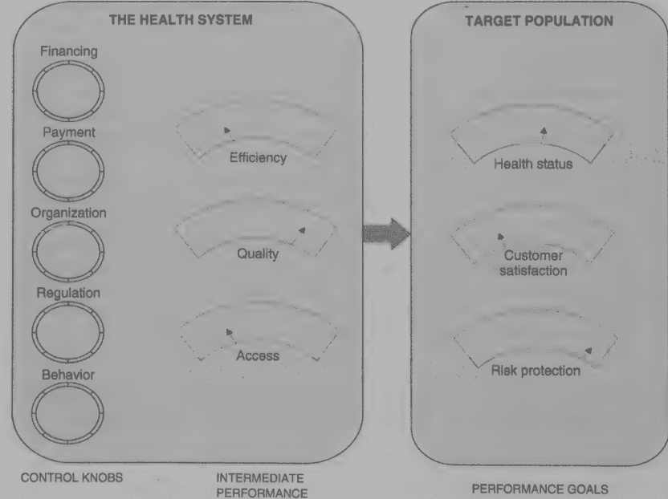
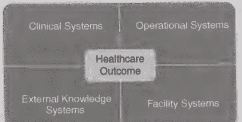
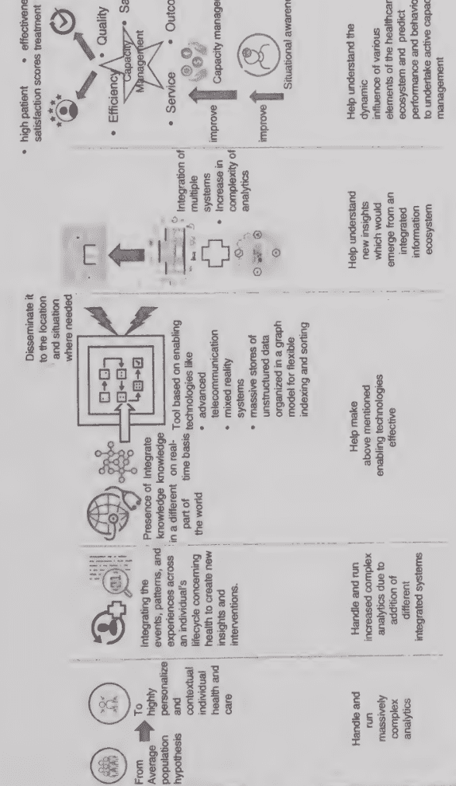

## 第3章

### 用人工智能变革医疗保健

> “我们应该像看待患者护理一样看待AI——作为一个连续体，跨越护理领域和疾病状态。”
> 
> *——马克·米哈拉斯基博士，临床数据科学家*

### 引言

医疗保健是全球规模最大、最重要的行业之一。最近的COVID-19危机使之成为当今最重要的行业，并且在未来许多年里将继续占据中心舞台。到2023年，全球医疗保健行业预计将达到1.2万亿美元。从2018/19年开始，该行业的增长率一直接近9%。与五年前相比，增速提高了超过100个基点。这受到全球主要宏观经济转变的推动，我们将在下一节讨论这些转变。尽管该行业规模庞大，但高度分散。全球头部企业合计仅占医疗经济中个位数的份额。

医疗保健是一个非常多方面的行业。它雇用了大量人员，并且一直是许多技术进步的中坚力量，这些技术也渗透到其他行业。然而，医疗保健在国家GDP中所占比例不断上升，消耗了经济体其他方面所需的资源。在美国，国民医疗支出预计到2025年将接近GDP的20%，这一时刻即将到来。在1960年代，这一影响只是如今成型趋势的四分之一。在几乎所有发展中国家和发达国家，情况都类似。医疗成本不断上升，不仅消耗国家资源，还影响私营企业和个人的利润。

但更重要的是，健康与一个国家的经济繁荣和社会进步直接相关。2000年1月，世界卫生组织（WHO）成立了宏观经济与健康委员会（CMH），以研究该主题并提出一些建议。(2) 它发现了许多有趣的事实，例如：

-   将预期寿命从50岁提高到70岁可使年增长率提高1.4%。
-   营养不良和婴儿死亡率等疾病可能对GDP造成0.23%至>4%的负面影响。
-   1975年至1990年间，拉丁美洲多个国家的经济增长中有三分之一可归因于人口健康的改善。
-   可追溯至200年的研究表明，像英国这样的发达国家有三分之一到一半的繁荣可归因于食品消费和健康的改善。

另一方面，正如我们在COVID-19危机中所看到的，像全球大流行这样的重大医疗事件可以在极短时间内摧毁世界经济。

医疗保健每天都在影响全世界的每一个人。人们普遍认为，医疗保健对人类社会的进步至关重要。技术与目标丰富的环境使其成为当今转型的理想之选。

与我们生活和经济的其他方面一样，医疗保健行业也深受数字技术增长的影响。一个新出现的细分市场被称为数字医疗市场。根据Global Market Insights的研究，2019年至2025年间，该细分市场预计将增长近30%，规模超过5000亿美元。(1) 还有许多其他行业报告同样表明，医疗IT行业已经跨越了该数字的一半，并且增长正在加速。

医疗保健也是一个非常复杂的生态系统，由患者、医生、医院、医疗设备、制药、家庭、环境和教育等多方利益相关者定义和影响，涉及研究、诊断、护理和认知等多个维度。技术以多种方式影响该生态系统的各个方面，并使它们更加集成，我们将在本章后面看到。（见图3.1。）

医疗保健行业是一个非常数据密集的行业。预计该行业在2020年将产生超过2,000亿亿字节的数据，如果充分利用，将超过全球数据中心存储容量。这种数据的增长是由物联网的[content]
医疗保健行业是一个非常数据密集的行业。预计该行业在2020年将产生超过2,000亿亿字节的数据，如果充分利用，将超过全球数据中心存储容量。这种数据的增长是由物联网、电子病历的普及、临床和研究数据的收集与处理，以及该领域信息整体增长所驱动的。从数据和分析的角度来看，该行业对时效性、准确性、可信度、隐私性和多样性也具有非常高的敏感性。人工智能驱动的分析的作用将集中于解决所有这些不同维度的问题。预计到2021年，医疗保健和生命科学分析市场将突破250亿美元，使其成为最重要的分析领域之一。

然而，这一行业——无论是诊断还是研究——都是基于平均值运作的。每个个体都是独特的，具有独特的生活方式和独特的健康特征。我们的当前健康和未来福祉受到多种不同参数的影响，如当前生命体征、睡眠模式、饮食习惯、工作习惯、锻炼习惯、家族史、家庭-工作-通勤环境因素、对某些治疗和过敏的历史反应、其他家庭成员的健康状况、心理状态和压力、身体状况随时间演变以显示模式并检测这些新兴模式的运动、基因特征、社区特征等。所有这些信息都存在，但存在于孤岛中，很少被关联和情境化，并且没有被深入考虑以用于适当的诊断或补救目的。同样，每天都有关于因果关系、治疗和药物方面的新信息出现，其中很大一部分无法供个人获取或情境化。

该行业还面临着在护理的各个学科和维度上分散且脱节的问题。我们在不同时间点和不同地点接受多种医疗干预。虽然我们总是被询问与健康相关的病史，并且我们尽力分享，但此类信息的可信度有限。经常此类信息也会受到患者或其家属的教育背景、意识、社会制约和其他因素的影响。

医疗保健是我们生活中一个最具挑战性和最具破坏性的事后反应领域。在理想情况下，除了意外情况外，我们希望我们的健康能够被预测，并采取补救措施。

人工智能将以多种方式改变医疗保健行业——实现医疗保健的真正个性化，具有更具针对性的诊断和治疗；预测患者和医疗专业人员的需求；整合从家庭到医院的医疗保健全生命周期；并将完整的医疗保健生态系统汇入一个协调一致的引擎中。在本章中，我们将探讨人工智能和数字技术将如何改变医疗保健行业。

### 理解推动医疗保健行业未来智能能力的宏观因素

医疗保健行业今天正处于转型的拐点。推动这一转型的有四个主要驱动力——政策、经济、社会和技术（PEST）。

在许多国家，医疗保健改革是关键的政策议程。政策行动试图通过保险和可负担性干预来解决人口在医疗保健系统中的包容性问题，同时改善护理质量。改革政策包括许多技术，如监测药品流动及其价格、护理提供和所产生成本的多因素验证、将付款与结果挂钩而非纯粹基于提供的服务、增加治疗的可电子追溯性和治疗或护理提供的环境、远程监测患者和远程提供护理，以及许多其他创新项目。政府不断创造激励措施以提高包容性和改善可负担性，但有时这些措施对医院、医疗专业人员、制药公司和其他生态系统利益相关者提出了严重的运营挑战。随着对隐私和网络安全问题的关注日益增加，医疗保健系统现在还必须应对另一层合规框架。

在他们的开创性著作《Getting Health Reform Right: A Guide to Improving Performance and Equity》中，流行地称为“控制旋钮理论”，哈佛大学T.H. Chan公共卫生学院的Marc Roberts、William Hsiao、Peter Berman和Michael Reich创建了一个非常有用的框架来思考医疗保健领域的此类政策干预（图3.2）。

#### 图3.2 控制旋钮理论

推动医疗保健转型的经济力量也带来了一些有趣的挑战。一方面，我们有社会或社会群体，其更高的可支配收入推动了对健康和护理质量的更大关注。在中国等许多经济体中，个人医疗支出接近人均可支配收入的10%。另一方面，世界上仍有大量人口经济上处于劣势，获取必需品的机会有限，其中包括医疗保健，从而对国家的整体经济产出造成拖累。在这两种情况下，都需要将医疗保健的重点从治疗转向预防。更好的预防需要在医疗保健生态系统的各个方面都有政策驱动的基础设施，以及大规模的教育。从医疗服务提供者的角度来看，更好的护理需要更多的专业化和更多的工具，这反过来又造成了能力和成本限制，从而挑战了可负担、包容、个性化和及时护理的目标。私营参与者或公私合作伙伴关系（PPP）模式的日益参与也在改变医疗保健行业的经济维度，因为它们带来了与完全由公共资助的系统不同的绩效考虑和投资回报时间范围。

在社会方面，也有许多变化正在影响医疗保健转型。我们有由大多数国家快速城市化驱动的医疗保健城乡失衡日益加剧。我们还大多数国家的人口老龄化，这对医疗保健系统造成了额外压力。最后，家庭日益核心化影响了人们在需要时个人的生态系统。这些因素加剧了医疗保健的供需问题。传统医院已无法满足对医疗服务日益增长的需求，走向智能化势在必行。慢性病正成为许多新兴经济体公共卫生的头号威胁。它们由于病程长、原因复杂、医生与患者之间需要频繁互动等因素，对医生和患者都造成了巨大压力。问题因全球范围内合格医生和治疗设施缺乏而加剧。一方面，医学科学在治疗慢性病和新兴疾病方面的研究与开发取得了巨大进展；另一方面，其对更广大世界人口的可用性存在差距。因此，传统医院需要转变为智能健康管理组织。智能医院和医疗保健系统的试点项目正在国家和区域层面实施。

在技术方面，创新速度和随之而来的颠覆呈指数级增长。根据德勤于2019年发表的关于《健康未来》的研究，到2040年的医疗保健行业将与我们今天所知的截然不同。二十多年前，第一台机器人被用于辅助手术；今天机器人已在许多常规手术中非常频繁地使用。在过去20年里，我们从花费数百万美元编码第一个基因组，到现在以不到100美元的成本为数百万人进行基因组学。纳米技术、量子计算、机器人技术、生物医学工程、存储方法和成本、普遍连接、混合现实和3D打印等技术进步将改变医疗实践的实践。人工智能将在所有这些中发挥关键的基础性作用，因为我们需要新的方法来管理和理解海量且有时瞬态的数据，这些数据对于获得我们需要的研究、教育、预防和护理方面的洞察至关重要。

物联网使设备互联互通成为可能，连接物理设备/空间和医疗服务，并有助于提高医疗治疗的效率和效果。大数据、云计算和人工智能的发展使数据处理能力呈指数级增长，并使众多决策和辅助治疗工具成为可能

这一切都变得可能。IT和移动互联网技术、视频成像和高分辨率通信进一步提高了人与人、人与物之间的沟通效率，这也极大地提高了医院和医疗保健系统的运营效率——无论是研究还是治疗。

如今的医疗保健主要聚焦于治疗；未来的医疗保健将更多转向关注健康。我们将看到在技术和AI的助力下，从治疗向预测性和预防性姿态的转变。

### AI在未来医疗保健中的关键作用

随着医疗保健的重点从诊断和治疗转向主动健康管理、预防性干预和全生命周期参与，我们还将看到向更个性化和有针对性的医疗保健体验的转变，以促进健康，以及医院和微型诊所等医疗保健设施角色的转变。

未来的医疗保健需要解决几个重大问题。从分析的角度来看，有五个关键问题领域需要我们借助AI等先进技术发挥巨大作用：

- **1. 避免平均化方法，为医疗保健创建个性化情境。** 如今，绝大多数关于健康的假设都基于特定年龄组、地区/种族和性别中表现出某种行为或症状的平均人群。任何医疗干预的有效性都受到个体对该干预的生理和心理反应、个体独特基因构成的倾向性反应以及其他可能影响它的客观情况所限制。人们越来越倾向于将个体与健康和护理高度个性化和情境化。这需要完整地刻画每个人的独特构成，并结合大量健康指标进行精细监测和分析，以设计干预措施。我们现在谈论的是融合医学科学多个分支的海量数据，并进行极其复杂的分析，这些只能通过深度学习和其他AI工具来完成。

- **2. 整合个体一生中与健康相关的事件、模式和经历，以创造新的洞察和干预措施。** 当我们将医疗保健的范围扩展到个体的整个生命周期和环境时，我们必须将上述要点在连续统一体中结合起来，以实现预期结果。而现在，我们恰恰放大了系统的集成度和分析的复杂性。

- **3. 提供所有与研究、诊断和治疗相关的知识和资源。** 医学科学在世界各地许多文明中已有数千年传统。在上个世纪，医学科学在理解问题、因果关系和寻找治疗方法方面取得了巨大进步。在过去几十年里，这些信息日益数字化，如今大部分信息已很容易为大众所获取。但随着医学科学变得更加复杂，也出现了更多的专业化分工来应对这种复杂性。由于我们面对的是人的生命，有时在流行病情况下还涉及更广泛人群的生命，因此对症状和不断演变的情况做出及时响应变得至关重要。考虑到问题的复杂性、其他情况下可能出现的独特事件先例，以及知识可能存在于世界另一角落，我们需要更好的工具来实时整合知识，并将其传播到需要的地点和情境中。先进的通信、混合现实系统，以及以图模型组织用于灵活索引和排序的海量非结构化数据等使能技术已经可用。AI技术有助于让这些使能技术发挥效力。围绕这些新的数字技术和分析来开发更多能力，以重塑医疗保健行业的知识管理方式，还有更多工作要做。

- **4. 将临床系统与运营系统相结合，创造统一的结果和体验。** 从历史上看，医疗保健行业尤其是医院中的不同技术系统是孤立演进和管理的。一段时间以来，人们越来越意识到，要实现比任何单个系统所能提供的更广泛的结果，需要跨各种系统进行更深层次的无缝集成。例如，病房中的患者护理需要医院信息系统、电子病历系统、室内患者系统（如娱乐系统）、护士呼叫系统、专业医疗系统、HVAC系统以及楼宇自动化系统等多个系统的统一集成。我们更需要系统集成以及实时响应患者新需求的能力。我们需要AI技术，以便从这样一个集成的信息生态系统中产生新的洞察。

- **5. 改善容量管理。** 容量管理是当今世界任何地区医疗保健行业面临的最大挑战之一，即便在最发达的经济体中也如此。几乎每家大型医院的管理者都会将其列为三大问题之一，并将其作为降低开支、提高效率和扩大护理覆盖范围的解决方案。医疗问题在增加，世界上大部分地区的人口和老龄化人口也在增加，但医院或医疗专业人员的数量并未按比例增长。人均可用的治疗和研究资金也没有增加，但支出却在增加。容量管理的大问题在于能够预测整个生态系统的利用率临界点，一旦达到85%的阈值，通常会急剧推高等待时间和系统压力。容量管理可以通过提高态势感知能力，以及在一个拥有数千个独立元素的极其复杂的生态系统中，平衡医疗事务量、时间、空间和资产的可变性来改善。约翰霍普金斯大学首席行政官James Scheulen将其列为最重要的议程项目之一，通过深思熟虑的方法和适当使用技术及分析，取得了显著成果，包括患者等待时间减少35%，术后手术室滞留减少70%，各科室床位分配减少11%至80%，以及其他典范性的成就。主动容量管理处于质量、安全、结果、服务和效率的交汇点。它带来了非常高的患者满意度和治疗效果。没有AI技术，理解医疗保健生态系统各元素的动态影响以及预测绩效和行为几乎不可能实现主动容量管理。

此外，许多AI技术已经被部署在研究和诊断功能中，随着数据和工具的日益丰富、待解决问题复杂性的增加以及AI专业人员解决新问题能力的提升，AI技术的使用将继续增加。

自然语言处理等特定AI技术正越来越多地用于医疗保健系统与患者之间的互动平台，使其更简化、更流畅；用于教育平台，使知识更易获取和理解；也用于检测事件模式。未来AI在医疗保健领域的影响，将仅仅受限于人类想象力的缺乏。

在接下来的两个章节中，我们将深入探讨两个主要的转型领域：个人健康云和智慧医院。

### 个人健康云

以人为中心的健康云概念将在未来几年成为最具变革性的发展之一。如今，我们已经能看到许多科技公司在云平台上提供面向医疗保健的功能；这并不新鲜。Salesforce已经将其核心CRM适配到患者管理和患者体验中。我们还看到一些非常创新的应用，比如Unite Us（www.uniteus.com），它采用社区方法协调与医疗相关的行动；还有Health Cloud（www.healthcloudsa.com），一家总部位于南非的初创公司，试图创建一个平台，供医疗保健行业各参与者进行开放信息和洞察交流。医疗技术长期以来一直是一个充满活力的投资领域，因为机会众多。2017年，风险投资基金在数字技术初创企业上投入了超过400亿美元，此后这一数字大幅增加。即使是大型医疗保健系统和医疗公司也在对不断增长的创新和颠覆网络进行组合投资。因此，我们显然会看到越来越多的云和分析应用，其中许多将解决现实问题、规模化并帮助改善未来的医疗保健。

然而，有一个尚未开发的领域将受到更多关注。在前面的某一节中，我们讨论了医疗保健行业如何主要受平均法则驱动，这可能会使任何诊断、治疗和长期护理的效果次优化。我们当前的健康和未来的福祉受到若干不同参数的影响，如当前的生命统计、睡眠模式、饮食习惯、工作习惯、锻炼习惯、家族病史、家庭-工作-通勤环境因素、对某些治疗和过敏的历史反应、其他家庭成员的健康状况、精神状态和压力、随时间演变的身体状况以显示模式并检测这些新兴模式的运动、基因特征和社区特征。所有这些信息都存在，但它们存在于孤岛中，很少被关联和情境化，也没有被考虑到适当的诊断或补救目的所需的深度。同样，每天都有关于因果关系、治疗和药物的新信息，其中很大一部分无法供个人消费或情境化使用。

关注理解个体细节这一理念已被人认可一段时间了。在个体层面发展基因组学背后的想法，是启动这一过程

of understanding the person instead of just looking at patterns. What is missing today is a network of nodes of person-centric information repositories capturing the different types of data described in the above paragraph.

Developing technology infrastructure and enabling the business ecosystem for personal health cloud is complicated, will require significant investments, will take time, and most importantly will take coordinated action between many current industry participants and possibly even the development of several new players. Whenever there is a fundamental shift in the industry structure and incentives of incumbent participants, this level of complexity and resistance is not unprecedented. Whether it is online retail models driven by Amazon or completely different models of consuming music like those ushered in by Apple, the path to transition has never been simple. The primary challenges behind the development of personal health cloud are driven by many factors, such as:

- a. **Absence of primary player with access to majority information.** Presently, the insurance providers, healthcare systems, and individuals, collectively have a lot of the information, but not all of the information. To get a comprehensive picture of the individual, more investigation and collection of information will be required. Such high-touch and person-dependent activities for large populations are difficult. Imagine doing census for the first time but with a couple of orders of magnitude complexity. One could always start with collecting as much as possible for as many as possible, but the lack of adequate data will impact the efficacy of the information.
- b. **Lack of anchor beneficiary other than the individual.** Persistent investment of money and time for such a complex endeavor requires that there is a single or small group of major beneficiaries with enough economic interest so that they can change the demand and/or supply economics. In the foreseeable future, the primary beneficiary for a personal health cloud is the individual. But in this case, the “individual” is a very fragmented beneficiary group because the benefits kick in only when healthcare services are required, something that at an individual level is unpredictable and (hopefully) infrequent. When we look at a large pool of people together as a collective, the benefits are more favorable, but there is no immediate natural organization of people into a collective in any of the existing industry structures. The one constituent which can change the equation dramatically driving quicker development and adoption of personal health cloud is the State. Governments can legislate, create an incentive, or take any other number of measures to drive action. For the State, there are clear incentives for improving health and care at an aggregate level. The other potential catalyst for such a development could be a large technology company like Microsoft or Google or AWS that may have other incentives of driving consumption and near-monopolistic preference for their technology by being an early and decisive mover.
- c. **Developmental complexity.** The development of the technology infrastructure has a lot of inherent complexity as well. We will need a graph database approach for the underlying data management framework. Building massive scale and very flexible graph databases have architectural and programming challenges and require a higher order of technical acumen and capability. Given the diversity of data, metadata management adds another layer of complexity. Ensuring the security and privacy of highly sensitive personal and health data at this scale is not something that has been done before. Deciding who can access what data under what circumstances requires some serious policy-level to emerging needs and experienced issues.

Taking this definition a bit further, smart hospitals or healthcare facilities of the future will expand beyond one single smart physical facility into a network of nodes of capability delivery to achieve better health outcomes and care from home to hospitals. There is an argument to be made that in the future, the physical hospitals that we know today where all aspects of healthcare converge to care for the patients will be replaced or supplemented by virtual centers of specific capabilities and specializations. The healthcare system of the future will be an amalgamated ecosystem of people, knowledge, and infrastructure that will be connected, be aware, and be adaptive to the health needs of the patients as well as the broader population.

We shall first describe the AI-enabled hospital of the future.
In any such hospital, there are four different types of information systems:

- 1. **Clinical systems.** These are systems that are required by a healthcare facility for medical diagnosis and treatment. Such systems typically include electronic health or medical records, intensive-care systems, imaging systems, emergency response systems, nurse-call systems, in-room systems for functions such as bed management, surgical systems, testing systems, etc. In normal treatment environments, clinical systems capture more than 30 measurements per day, but in intensive or special-care scenarios, this number could end up being 60 times more. These systems are the foundation of medical practice. They have strong decision-support systems. Often, many of these devices and data from them are required together in unison to perform one diagnostic or treatment chain. The clinical systems’ information systems need an exceptionally high-fidelity and quick transmission. There is usually also a need for traceability of information and insights as well as longtime storage of both. A very large population of such devices is already connected and data from them is being collected and processed in real time. As per a report from Allied Market Research published in June 2019, more than 3.7 million devices are already connected and this population is rapidly growing due to increased proliferation of IoT, the advancement of medical technology, and progress in telehealth. Maintenance of medical devices and clinical systems is critical to healthcare success and often leads to ancillary information systems.

- 2. **Operational systems.** These are the systems that are not required for the core practice of medicine but are critical for the functioning of the hospital or the healthcare system. For example, healthcare operational systems include office automation, hospital information or resource management system, real-time location tracking systems for assets, research management system, the entire backbone of healthcare, prescription management system, compliance management systems, etc. The operational systems have to frequently integrate and interact with the other types of information systems in the healthcare ecosystem.

- 3. **Facility systems.** Winston Churchill once famously remarked(4) that “we shape our buildings and then our buildings shape us.” Like any other building, any modern hospital will

拥有数百甚至数千个传感器和设备。这些传感器和设备及其管理系统使医院保持功能正常和安全。这些传感器和系统满足医院在电力管理、供暖、通风、空调、能源管理、管道、安全、安保、移动性（电梯/自动扶梯）和专用输送系统、位置跟踪和导航、照明、清洁和后勤服务以及其他此类系统方面的需求，以有效运行设施。通常，我们会发现建筑管理系统在所有这些设施系统之间协调行动和性能。此外，我们还会发现设施管理系统来协助医院设施的运营和维护。大多数医院会有数十名维护人员和更多数量的合同人员，因此也可以找到管理系统来管理劳动力。医院通常在环境条件和/或安全保障措施方面需要相当严格的运行条件。医院中几乎所有系统，包括设施系统，都受其健康状况和性能方面的合规要求约束，这些要求会不时被当局审计。医院中几乎没有任何设施系统存在次优运行或停机时间的容忍度，这使得其配置和应用与其它类型的设施相比具有独特性。医院设施系统会以更高的频率捕获更多数据。

4. **外部知识系统。** 这些是系统不一定与任何特定医院或医疗系统相关联，但对于完成信息生态系统是必需的。医学知识管理系统、天气、以及其他新闻或事件推送系统、健康咨询系统、患者信息系统（如果是更大网络的一部分）、保险管理系统等都是外部知识和参与系统的例子。此类系统将拥有来自不同来源的信息，以非常不同的非确定性频率更新，并且大多以非常不同的格式呈现。由于缺乏固有的相关性，对此类信息创建上下文非常困难。

这些信息系统很少基于统一的，更常基于分布式 IT 和通信骨干。

来自这些各种系统的数据流入一个充当数字金库的公共存储库。在这个金库中，会发生几件事——数据首先被清理，然后被排序并安全存储，数据各个方面之间的相互关系和上下文得以建立，数据得到丰富和标记，最后数据为分析做好准备。虽然看起来这里有很多事情在发生，但所有这些都在微秒和亚秒级完成。医院信息生态系统的神经网络随后将数据通过其功能强大的分析引擎运行以创建可操作的洞察。这些洞察的主要目的在于：

- 1. 改善患者治疗效果
- 2. 优化资产和资源容量
- 3. 提高运营效率

输出体现在一系列用户体验应用中，围绕患者体验、工作流程管理以及其他此类功能。（见图 3.3。）

图 3.3 医疗信息系统

在 Khaled 的领导下，Bee'ah 集团正在开展一个未来主义医院项目。随着前所未有的大流行席卷世界，我们正在重新审视和重塑我们的战略，以反思未来医院或“面向未来的医院”将是什么样子或是什么样的。一些深刻的趋势正在加速，我们正在考虑这些趋势：

- 1. 集成连接系统概念（指的是更具可扩展性和更小的专科/社区中心网络，使其能够实现更灵活的容量和受控/安全访问机制，同时所有这些都连接到单一数字基础设施）
- 2. 在医院入口、检测、运营和出口全程利用数字技术，尽可能实现无接触（最大限度减少人与表面接触）
- 3. 远程医疗、虚拟护理和连接健康中心加速（涵盖基于云的 IT 解决方案、AI 应用和分析，以支持多学科方法来支持治疗决策和更高效的系统，同时管理患者流动并在危机期间扩大护理规模
- 4. 护理尽可能送到您家门口：通过移动医疗车辆提供选定服务，使其能够快速直接地进行筛查、检查和检测（例如，移动集装箱中的迷你医院）

以下是阿联酋发明/采用的一些技术和创新：

- 1. 激光检测技术——用户友好且能够实现更快速的大规模筛查，结果在几秒钟内即可获得
- 2. “超智能”头盔，能够“用于从安全距离诊断人群，使其能够处理人群、获取生命体征读数和分析数据”
- 3. 无人机——用于国家消毒和灭菌
- 4. 在街头部署机器人 TAF35 以支持消毒作业。该机器人可在 300 米距离内远程控制，能够泵送大量消毒和灭菌材料。
- 5. ALHOSN 应用——依赖于使用短期蓝牙信号来显示个人是否与曾接触过 COVID 病毒感染患者的个人处于近距离接触。这是为了帮助遏制 COVID 的传播。为了补充追踪工作，电子手环与 ALHOSN 链接，被给予检测呈阳性的人。

### 医疗保健中的 AI 应用

现在让我们审视一些 AI 应用，它们为医疗专业人员和系统提供更具前瞻性的能力。AI 应用的范围远不止于此。随着时间的推移、数据的可用性以及更易于分析师使用的工具的出现，这一列表将会增长。思考 AI 应用时，至关重要的是要记住 AI 只有在需要以规定的或可接受的准确度水平预测某物的未来状态或行为时才应有效使用；对于所有其他分析或决策支持需求，更简单的基于启发式的方法可能更合适和高效。

#### 个性化治疗方案

个人健康云和基因组学的进步将导致关于个人及其在暴露于不同环境和医疗条件下时的反应以及此类反应如何演变的有足够具体的数据。此类数据对于预测新的医疗干预最可能的结果会是什么样以及对特定个体最有效非常有用。梳理如此庞大和复杂的数据只能通过机器学习方法实现。

#### 远程诊断

在医学诊断中，有四个关键因素——个人病史、临床检查、循证解读，以及基于知识和经验的医生直觉。个人病史的可靠性存在问题，因为它高度依赖于个人的反馈，而个人可能并不总是记得所有事件，或因不认为相关而忽略某些事件的报告，并且仅仅由于时间跨度和个人报告病史的不同地点，其中很多内容都会丢失。AI 将有助于个人健康云的开发，并将个人病史的各个方面与正在调查的具体情境相关联。AI 还将通过提示根据病史和其他参考资料中最可能场景的分析需要捕获哪些额外信息来帮助捕获病史。

高端诊断工具如 MRI 和其他成像工具或不同类型的血液和化学分析工具在识别问题和缩小潜在原因方面非常有效。此类临床检查最初需要经过高度培训和专业的分析师来解读数据；随着时间的推移，同样的需求已得到远程常规能力的补充，现在越来越多地被机器接管，并使用机器学习技术执行。这种方法使诊断过程更快、更准确，用相同资源覆盖更多诊断病例，且成本更低。这种方法对于诊断许多类型的癌症、心脏问题、肝脏相关/肾脏相关问题，以及普通疾病非常有效。使用编程语言 Julia 和 Contextflow 等工具开发的自动化 ML 程序已帮助将放射科医生过去花费 20 分钟寻找模式和信息的时间缩短到 2 秒。

在讨论更具实证基础的技术时，机器学习对于绘制疾病或一系列症状最可能出现的医疗结果进程尤为有用。结合上文讨论的个性化方面，这将是一种确定正确治疗方案的极其强大的工具。在该领域有许多成功的试点案例，例如，由 Google DeepMind 进行的肾脏疾病预检测，或 IBM 利用视网膜研究识别潜在失明的工作。

我们越来越多地利用机器的学习和超快处理能力，使其越来越接近人类的直觉。

### 药物研发

传统的药物研发过程需要数年时间和数十亿美元的投入。这使得药物成本高昂，进而导致治疗费用昂贵，大众获益延迟，并将创新和研究限制在行业内少数几家大型企业中。但人工智能正在改变这一现状。2020年1月30日，由代码名为 DSP-1181 的英国初创公司 Exscientia 与日本制药企业住友制药（Sumitomo Dainippon Pharma）合作，宣布发现了全球首个由人工智能发现的强迫症（OCD）药物。发明者声称，用于发现该药物的算法（这一过程仅耗时一年，而非数年）也可用于发现其他药物。人工智能不仅对新药的发现有用，还能帮助确定同时给药或作为同一治疗方案一部分时不同药物之间的相互作用。人工智能有助于梳理并模拟药物相互作用的各种排列组合及其影响。英国国家医疗服务体系（NHS）等各个国家的机构正在设立专门的医疗保健人工智能实验室，以促进更多的研发。加速研发过程使生态系统中的每一个利益相关者受益。

### 机器人手术

手术是另一个迄今为止被认为是高度专业化的医疗专业人员专属领域的区域，同时也在受到人工智能辅助机器人使用的影响。简单、重复的小任务，如小切口、缝合或使用探针，是机器人可以非常有效地学习并用于执行手术的活动。约翰·霍普金斯大学四年前开发的智能组织自主机器人（STAR）是最早协助手术的机器人之一。STAR 包括缝合工具以及荧光和 3D 成像、力传感和亚毫米定位功能。当这些能力应用于软组织手术时，与常规人类驱动的类似软组织手术相比，使过程更加有效。这仅仅是个开始；该领域每天都在持续发展。机器人手术有许多优势——它为医生提供技能增强，以应对供需之间日益扩大的差距；减少手术期间的疲劳和压力；在切口和其他此类过程中更加精确，从而改善恢复时间；并且随着学习的扩展，其范围已超出单个医生的个人经验，而是基于全球所有手术的集体知识，因此正在扩大学习范围。

### 应急响应

应急响应可能是医疗专业人员——无论是医生、护士还是技术人员——最常发生且压力最大的活动之一。应急响应的高效性要求非常快速地理解局势、对问题进行分类、确定问题的因果关系，并确定最佳的下一步行动方案。鉴于在早期阶段大量紧急情况的共性，人工智能算法可以有效部署并实现此处描述的所有功能，因为我们可以非常快速地在非常大的数据池上进行分析。在分诊情况下，机器学习和神经网络对于具有中等紧迫性驱动因素的情况非常有效。对于患者监护，人工智能技术非常有助于识别异常并预测未来可能性，同时减少人为干预。不同种类的神经网络技术在此类建模活动中非常有效。

### 容量规划与管理

医院运营是复杂的生态系统，具有高度的相互依赖性、时间敏感性、变异性以及出错的可能性。医疗保健中的容量管理问题与主要交通枢纽或复杂供应链网络中经历的场景非常相似，只是其关键性程度要高得多。在医疗保健环境中，资产和资源始终是固定数量的，但它们可能会突然且同时被多种不同事件所需，最终导致容量管理问题，进而导致延误和较差的护理水平。人工智能算法可以有效用于约束优化和给定约束下的最佳结果，从而辅助容量管理。对容量管理场景和新兴事件的历史分析可以快速综合，以得出最优化场景。当我们需要应对由自然灾害或重大法律与秩序问题引起的紧急情况时，这些方法极其有用。

### 能量预测与诊断

从历史上看，人们一直非常关注能量优化，但通常是在事后实施。但如今，我们有足够的传感器、数据和分析技术来主动理解未来的能源消耗模型，并能够基于这些洞察采取行动。基于人工智能的能源预测模型（EPM）通常基于深度学习、序列到序列长短期记忆（LSTM）技术，用于预测整个建筑的能源消耗，以及在不同室外和室内条件下设备或组件级别的能源消耗。这允许削峰、移峰填谷、需求响应和采购决策，平均减少 10% 的能源消耗和能源成本。基于人工智能的模型通过实时和历史物联网传感器数据自适应训练。基于人工智能模型的能源故障检测模型是一种（基于深度学习的）能源异常检测或故障检测与诊断（FDD）模型，它根据预测能源消耗的偏差检测异常或有故障的能源消耗。这种能力平均减少 15% 的能源消耗，延长建筑设备寿命并降低维护成本。这是一个数据驱动的基于人工智能的模型，利用历史数据自主构建和调优。一种基于深度神经网络和强化学习的 HVAC 系统最优控制解决方案，通过考虑建筑的热质量作为热存储、预测的能源负载、电价结构、区域温度、湿度、室内空气质量（IAQ）和占据者信息，计算 HVAC 系统空气侧的最优运行设定点。所提出的方案是一个通过传感器数据实时训练的数据驱动的基于人工智能的模型。该方案平均减少 20% 的能源成本，提高建筑占据者的舒适度、福祉和生产率。

### 预测性资产维护

在医疗保健类环境中，关于资产的最大维护顾虑是紧急停机。此类停机可能对临床系统或设施系统的运营产生重大影响；运营商和所有者对此类事件的容忍度非常低。通常，人们会设置多重冗余，这不仅效率低下，而且成本高昂。人工智能在预测此类事件并建议补救措施方面非常有效。在人工智能方法中，停机预测被表述为一个异常检测问题。各种最先进的深度学习架构，如长短期记忆（LSTM）自编码器和 LSTM 变分自编码器，被用于此类预测。通过现有各种诊断识别出的异常和故障，以避免设备故障、昂贵的设备损坏和资源浪费，是人工智能实施的其他主要领域。需要解决两大类优化问题。第一类是短期决策（例如每日或每小时）的优化，即在客户服务协议（SLA）范围内最优化分配和路由技术人员以执行维护任务，并同步技术人员和资源（设备、工具、车辆等）。第二类是长期决策（每月或每年）的优化，这可能涉及考虑运营成本、维护成本、更换成本、故障成本、维护预算和资源，最优化地规划资源节约、设备改造或更换。此处可以使用的技术是优化技术，如约束规划、动态规划、马尔可夫决策过程（MDP）和混合整数线性规划（MILP），这些技术与基于人工智能的预测模型交互。

### 模型预测维护

大多数维护协议基于资产状况和健康状况，或基于通过研究历史理解得出的某个周期或维护干预。模型预测维护是一种独特的概念，选择维护协议基于优化资产的净现值，该净现值是使用资产的当前操作参数、预测维护成本和预测运营成本计算的，同时评估其他替代资产（包括新资产和/或不同维护协议类型）的净现值和总成本，并确保来自系统的核心性能输出保持不变或几乎相同。模型预测维护是通过结合人工智能和启发式模型得出的。这是一种更有效的技术，因为无需等待很长时间以获取足够的数据和变体来构建模型，而无需理解底层物理原理。

### 资产追踪与利用率

实时资产追踪和利用率知识是医疗保健领域的一个重大问题，可以使用人工智能技术来解决。据报道，护士可能会花费一小时

花时间寻找输液泵、移动心电图机等设备和器械。这种浪费不仅极大地拖低了生产力，还可能导致患者无法获得应有的护理水平。利用实验室设备等高价值专业资产是另一个影响护理效果的问题。了解其可用性和使用模式对于改善研究和临床成果非常有帮助。多种 AI 技术有助于模式识别和推荐。

### 警报噪声抑制

鉴于医疗环境中存在大量临床及设施相关的设备，这些设备和系统会产生大量信号。在许多情况下，这些信号中存在大量噪声，无论是手动还是通过简单的规则，都很难筛选出假阳性或不太重要的问题。理解这些信号及其噪声的系统性贡献非常困难。例如，在门禁控制系统等安全系统中，通常 90% 以上的警报信号不值得关注，但剩下的 10% 却可能具有至关重要的意义。AI 技术在结合适当的上下文并随时间学习方面，在优先处理警报信号方面表现得非常有效。

### 合规管理

对于任何医疗主体的所有者/运营商/管理者——无论是医院还是制药公司——合规管理都是一个巨大的挑战。合规管理通常涉及筛选海量数据并验证是否满足所有要求。AI 非常适合此类活动。在合规管理中，比报告相关负责人更关心的是能够预判任何潜在违规行为。此类措施需要同时对多个不同且通常不相关的变量进行模式分析。这也是 AI 非常擅长的任务。由于任何合规项目通常涉及大量人工干预，更多地使用 AI 将减少由此产生的错误可能性及相关成本。

### 网络安全与隐私保障

这已是医疗及多个其他行业中一个巨大且日益增长的关切。威胁向量数量不断增加，入侵行为也日益创新。我们将在本书后文中更详细地讨论这一主题。使该问题在医疗行业中变得关键在于数据的敏感性、数据生成点的数量以及针对恶意行为者的多个入侵点。AI 驱动的异常检测和高频模式识别对于解决此类问题至关重要。

### 数据真实性

数据的准确性和质量是医疗及许多其他学科的巨大挑战。传感器和系统的多样性、数据类型和频率以及其它变异性加剧了这一问题。清理如此复杂且往往不可靠的数据流非常繁琐。数据真实性是指数据准确、精确且可信赖的程度。在将数据引入 ML/AI 管道（包括训练和推理）之前，必须纠正数据真实性问题，以便开发准确的 ML/AI 模型（经过训练）并生成准确的解决方案（预测或推理）。在进行故障预测、异常检测、资产健康分析、可靠性分析、预测性维护、运营优化、能源预测、健康预测、安全风险分析以及基于 AI 创建智能推荐时，经常会遇到此问题。用于异常检测和递归模式识别的各种技术对于理解和解决数据真实性问题非常有用。

## 医疗保健行业的未来商业模式

过去几年，医疗行业的商业模式一直在发生变化。我们看到多家私人诊所和小型机构合并为少数大型医疗系统参与者。我们还看到医疗保险运作方式的变化——围绕积极生活方式管理的折扣、资源池化、更动态的保费定价等。我们也看到了远程诊断和远程健康管理的参与日益增加。我们还看到专业化和微专业化的兴起。最后，我们还看到医疗系统的日益全球化——例如，克利夫兰诊所不仅在克利夫兰以外的美国城市有布局，还在阿布扎比和多伦多设有分支机构。这些商业模式的变化并不剧烈；它们更像是现有模式的延伸，而技术更好地赋能了这些模式。

然而，在新的数字世界中，我们看到了一些更根本的变化。

最大的变化领域将围绕医疗服务的定价和成本。目前医疗行业中绝大多数的财务模型都基于事件和互动——我们按就诊、测试、治疗、药物等付费。这些费用并不一定与健康结果挂钩。未来我们将看到更多基于结果的定价或财务模型。数字技术和 AI 将使我们能够更好地预测和管理目前难以建模的健康结果。随着医疗更加个性化，以及更精准的治疗和药物，人们将希望看到与其达成的结果相关的更具体的定价，类似在其他行业我们开始看到的那些模式。这种转变首先不会从患者开始，而最有可能从医疗保健行业的供应商开始。在医疗供应商生态系统中，基于结果模型最可能的起点是设施服务或远程患者服务，甚至是诊断服务。类似的一个已经发生的转变是，在许多国家，医院因治疗院内感染而获得的补偿很少，甚至没有。医疗行业财务结构和激励机制的变化将需要更高水平的追踪和透明度，这需要更密集地使用技术来进行合规。技术基础设施的修改也必须伴随围绕人员行为和工作流程的大量变革管理努力。

商业模式方面第二个重大变化领域将是基于地理位置的模式。随着信息和知识在全球范围内更加统一和易于获取，随着远程诊断和治疗能力变得更加精致，随着资源和资产的容量变得更加网络化，大型资本密集型单体设施的作用将会改变。虽然没有完全的对等关系，但银行分支机构、零售店和远程学习的作用也因数字技术而发生了巨大变化。这一转变将花费更多时间，且永远不会达到相同的程度，但将在远程医疗的推动下逐渐发生。在这种情况下，非常以人为中心且通过高接触模式执行的个性化患者护理也将不得不改变。实现患者满意度和健康结果将需要一种更系统和整合的方法，实现信息和见解的无缝流动。随着实体设施重要性降低，在远程医疗管理中将需要更多管家式的方法以保持相同的有效性水平。

商业模式的第三个重大颠覆将来自社区的作用。多年来，我们已步入一个更加以个体为中心的社会。随着新一代人的到来，我们正重新回到个体与社区之间有趣的交汇点。随着世界不断更加一体化，我们的生活不断更加社会化，我们将看到关于健康的社区焦点重新增强。当焦点从反应性治疗转向主动护理时，将需要影响个体之外的更广泛人群。

第四个重大颠覆领域将是长期护理。当前的商业模式非常依赖高接触。一方面是需要护理的人口数量增加，另一方面是护理人员缩减，为了平衡供需，AI 驱动的智能代理（如聊天机器人）将在接触患者和管理日益增加的互动中发挥巨大作用。虚拟助手的使用已经开始对转变其他行业的客户服务产生巨大影响。

第五个重大颠覆领域将是未来医院的建设和管理，因为设施系统中的技术和分析技术的普及程度极高，超过大多数其他类型的设施。我们将看到新的物联网设备和系统出现在整个医院信息系统谱系中。我们还将看到新的互操作平台突破现有的孤岛、采购周期和市场结构。技术应用程序和平台空间已经开始变得非常活跃，正如我们在本章前面讨论的大型投资那样。我们将看到不同类型的技术专家和服务提供商，他们将集成各种系统并管理其运营。在许多托管服务环境中，这些服务中的许多也将与结果挂钩，而不是基于资源成本的更传统商业模式。

### 摘要

我们一直知道医疗保健对我们个人和国家整体都很重要；然而，它很少在任何考量中占据核心位置。在 COVID-19 危机爆发之前，“健康即财富”这句谚语几乎已经变得俗套。现在我们生活在一个不同的世界。我们已经看到流行病如何在我们的生活和生计的各个方面造成破坏。我们在 COVID-19 出现之前首次撰写了本章。现在，当我们回顾我们涉及的所有主题和转变时，一切都显得如此相关。我们希望这些能力今天存在，以帮助应对这场危机。

### 未来需求

#### 人工智能干预

- 从平均人口假设转向高度个性化、情境化的个体健康与照护
- 处理并运行大规模复杂分析
- 整合个体生命周期中与健康相关的事件、模式和经验，以创造新的洞见和干预措施
- 因集成不同系统而处理并运行日益复杂的分析
- 具备基于实时的不同知识整合能力
- 基于使能技术的工具，如先进电信、混合现实系统、以图模型组织的海量非结构化数据，并具备灵活的索引与排序能力
- 帮助上述使能技术发挥效用
- 将其传播到所需的地点和情境中
- 帮助理解从集成信息生态系统中涌现的新洞见
- 多系统集成带来的分析复杂度提升
- 帮助理解医疗生态系统中各要素的动态影响，并预测绩效与行为以开展主动容量管理
- 高患者满意度评分、治疗有效性
- 质量、安全、容量管理、效率、服务成果
- 提升容量管理能力，提升态势感知能力

例如，如果个性化治疗方案早已存在并得到个人健康云的支持，那么为每个个体提供更优治疗方案的能力将大大提升，或许许多生命本可被挽救。如果远程诊断更加成熟和普及，医疗机构的负荷或许会减轻。在一些医院，机器人已被用于为新冠患者运送物品，以减少接触暴露。如果机器人的使用更为普遍，我们或许能更大程度地减少前线医务人员的暴露风险。虽然人工智能已被用于药物发现，但我们还能做得更多吗？紧急响应的整个层面如今获得了完全不同的强度。随着人工智能和数字技术得到更多、更好的应用，我们本可以在感染区域、感染病例、分诊流程等方面更加主动和更具预测性。由于这场突如其来的危机冲击，几乎每个国家都在与自身的医疗基础设施作斗争。虽然人工智能无法解决当前的问题，但它肯定可以帮助我们更好地为多种替代情景做好准备，也可以用于不时开展主动演练。没有人为此做好准备，医务界和市政管理部门花了数天乃至数周才弄清楚该如何应对。我们几乎可以围绕新冠重写整个章节，而所有论述依然成立，只是影响会更加剧烈。

自然与我们之间的平衡已被打破。这正在导致环境变化，也是我们今天看到的诸多生态和流行病学问题的潜在促成因素。过去几年中，我们经历了非典、中东呼吸综合征，如今又是新冠。每一次新的疫情爆发，影响都在加剧和扩大。未来我们很可能继续看到此类问题的出现。我们需要更协调的战略和工具来应对这些新兴问题。这正是人工智能能够而且将会提供帮助的地方。

图3.4简要概括了人工智能可能如何影响未来的医疗行业。

保重；平安。

### 参考文献

- 《医疗保健全球市场机遇与策略至2022年》；ResearchAndMarkets.com；2019年6月。
- 宏观经济学与健康：投资健康以促进经济发展；杰弗里·D·萨克斯；2001年12月。
- 《数字健康市场预测2019–2025》；Global Market Insights；2019年2月。
- 下议院演讲；温斯顿·丘吉尔；1944年10月。
