## 第四章
### 用人工智能变革教育

> *“教育是进步的基石。”*
> ——科菲·安南，前联合国秘书长

### 引言

与医疗保健类似，教育是经济中非常重要的部门。虽然其相对规模较小，但对人类未来的影响同样深远。根据花旗、高盛、IBIS资本和其他市场分析机构的报告，全球教育产业目前超过6万亿美元。到2030年，这一教育产业预计将在全球超过10万亿美元。$^{(1)}$ 这一市场的增长率处于中个位数，而正规教育体系的核心在短期内不会迅速变化。然而，行业中由技术驱动的学习细分领域增长要快得多。HolonIQ的Smart Estimate™预测，由人工智能和其他数字技术推动的教育技术支出将在2025年前突破3400亿美元，而这近在眼前。教育行业高度分散，参与者众多，细分市场繁多。技术正在迅速模糊这些细分市场之间的界限，并重塑参与者的能力。

教育对GDP增长有着深远的影响。根据世界银行世界发展指标（WDI）的可用数据，政府在教育上每花费1美元，GDP平均会随时间增长20美元。在宏观层面，教育支出的增长与GDP的增长是相匹配的。有大量证据表明，更高的识字率有助于推动最快的GDP增长。我们有许多例子可以说明有针对性的教育如何重塑了许多经济体并推动了它们的高GDP增长。大多数国家的国家议程都将教育列为最大优先事项之一。

1500多年来，*知识就是力量*这句格言一直指引着社会和文明。在过去信息获取困难的年代，知晓事物或拥有信息被视为掌握知识，而知识带来影响力和权力。

但正如可敬的阿尔伯特·爱因斯坦所说：“信息不是知识。”如今信息丰富充裕，获取信息已实现民主化，使得综合信息以创造新洞见的能力成为知识的真正标志。温斯顿·丘吉尔说得最好：“真正的天才在于评估不确定、危险和相互冲突信息的能力。”在这个信息丰富的世界中，人工智能和数字技术正在极大地改变我们消费和处理知识的方式。

总的来说，知识每天都变得越来越容易获取，搜索信息也变得越来越容易。有许多服务甚至会按预定义的频率主动向个人推送有关当前事件或历史信息的主题或一般性信息。然而，这种信息获取方式存在一个根本性问题——信息通常是基于热门评分、过往搜索历史、付费赞助、基于一般人口统计分析的信息寻求者感知兴趣水平以及其他与个人并不具体相关的因素来进行排序和呈现的。此外，当考虑到学习时，每个人消费信息并将其转化为学习的方式各不相同——有些人喜欢从已发表材料中进行随机信息搜索，有些人更喜欢对话式方法，而另一些人则偏好更结构化的方法。能够针对个人特定需求提炼信息、去除数据中的偏见，并以最适合个人的方式呈现信息，是让学习更有效的关键。同样，我们还面临数据孤岛的问题，内容和交付方式未针对个人进行情境化处理。

与此同时，我们正看到新数字平台的参与度相对于学校和大学等传统教育机构的作用在迅速提升。例如，Google教育套件拥有超过7000万用户，高于2015年的5000万。Coursera和Pluralsight等类似平台也拥有近5000万用户。随着数字平台占据更多阵地，它们将具备更强大的新能力，其中许多能力将利用人工智能。

新冠危机加速了学习的数字化转型。世界各地的封锁突然中断了实体互动的教育形式；各机构不得不迅速转向远程数字交付。鉴于教育工作者不得不如此迅速地应对局势，他们只能将自己的学生互动虚拟化，而非提供全面的数字学习体验。随着世界开始缓慢走出新冠大流行，从未有过像今天这样迫切需要持续的行为改变和参与来提升个人表现和组织成果。社交距离、居家办公、减少面对面接触、增加对技术的依赖等将成为我们日常生活中的标准规范，无论是职业层面还是个人层面。

这是一种自然发生的代际更替，尽管是缓慢进行的。新冠大流行只是压缩了时间线，将其带入了即刻的时间尺度。而且，这一切正在一个在情感上、社会上以及基础设施层面都尚未完全准备好应对新常态的世界中发生。我们必须在生活的方方面面做出重大改变，以接受和应对新常态。这包括我们如何生活、互动和彼此交往的社会结构本身。我们面临着突如其来的重大文化变革，而面对变革，人脑的自然反应是来自边缘系统的威胁反应——对变化的抗拒。对于更广泛的人群来说，接受变化是一种后天习得的技能，而当边缘系统处于活跃状态时，这种技能就会变得困难得多。

人工智能将以多种方式改变教育行业——将其从一种通用的配置模式转变为更具针对性、个性化且影响更深远的内容交付模式；通过混合现实及其他数字技术的应用，使教育更具互动性和沉浸感；实现更敏捷、更联邦化的学习模式；并实现学习全生命周期的管理。

### 通过生态系统提升表现

学习是一项复杂的神经科学事业，深深涉及到大脑及其对新刺激的重训练。学习包括接收新信息，具备存储和处理这些信息的动机与能力，并能够将其置于背景中并应用于新的场景。当一个人能够观察环境或反思近期经历，并借鉴过去的学习来为未来得出一些潜在结论时，就会形成洞察。当学习和洞察导致行动时，表现提升便随之发生。

学习是非常个性化的事业。每个人的大脑运作方式都不同。每个人有不同的动机，从相同的信息中（包括信息的呈现方式）衍生出不同的意义。每个人对各种经历的反应也截然不同。信息的综合处理和反应的设计过程在每个人身上也是不同的。人们对各种环境因素和团队动态的反应也各不相同。因此，每个人大脑重连以使学习有效的方式都是独一无二的。基于神经科学的学习专家安德烈·弗穆伦博士解释说：

> 科学研究表明，大脑左右半球的独特组合，配以表达-接受、理性-情感以及感官和智力偏好，构成了一个人的神经设计。为了实现最大程度的理解和记忆，大脑两个半球的所有叶都应当参与信息处理。

学习过程越活跃，其效果就越显著，因为大脑的不同神经网络得到锻炼以将学习内容代码化。有效的学习还需要对信息和经历进行持续接触，从而使不同神经网络的反复练习导致新的模式形成。大多数情况下，在社交环境中的群体学习被证明更有效，因为我们倾向于更好地适应社交背景。

自古代希腊柏拉图时代以来，学习理论一直在不断演变。如今，有超过15种流行的学习理论，每种都有其独特的细微差别。认知主义是一种流行的理论，解释了许多不同的学习技巧。转化学习理论由杰克·梅齐罗在20世纪70年代末首次提出，重点在于三个维度上的视角转化：对自我的理解、信念系统的改变以及生活方式的改变。连接主义假设随着人们获得新的经验和学习，尤其是那些对人生改变影响更大的经验，人们的参考框架会发生变化。围绕连接主义正在形成一个新兴学科，被认为更适合数字时代。根据该理论，人们通过正式方法将学习扩展到工作体验、网络互动和社交生态系统中。根据这一更贴近大脑自然运作方式的理论，人们通过在不同输入和刺激之间建立连接来学习。

**图 4.1** 学习生态系统框架

让我们使用一个简单的框架来理解学习的主要组成部分。在图 4.1 中，信息指的是我们接收的所有感官输入，无论是听觉还是视觉；经历是自明义的，在此情况下与直接相关或间接相关的信息有关；动机是我们独特的心理和生理标记，引导我们朝着某个方向前进；记忆是学习的神经科学要素。在本章后面讨论人工智能如何作为转变教育行业的一部分帮助学习过程时，这个框架将非常有用。

反复应用学习以及正确的应用环境将带来更高的表现。图 4.2 描绘了这一概念。

大多数传统的学习技巧在历史上被设计为服务于广泛且多样化的群体的最低共同效能，以及易于传播的机制。课堂式交付模式是古老的学习方法，其根源在于以大规模为基础进行信息广播以及教师的解读或洞察。基于教科书的方法更进一步，使相同的过程更具可重复性、可扩展性和分散性。随着世纪的演变，新的体验式和沉浸式技巧

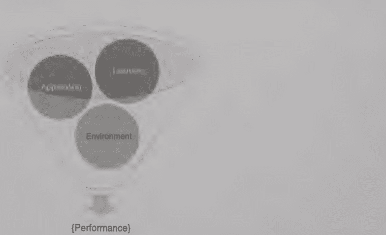

{表现}

**图 4.2** 学习至表现框架

被引入其中，其中许多在信息同化和学习保留方面更为有效。最新的进展是利用受神经科学影响的竞技技术，这些技术不仅被证明比其他方式更有效，还证明在将学习与业务表现指标（根据个人偏好和个体/群体表现进行调整）更好地联系到表现提升方面具有更好的关联。本章后续将对此进行更多讨论。

### 理解驱动教育行业未来中智能技术的宏观因素

如今，我们生活在一个相互关联且相互依赖的世界中，这个世界变化迅速且 inherently 复杂。今天我们所面临的问题和机会在任何历史标准下都是前所未有的。我们需要新的技能和能力在这种环境中生存并取得成功，这使得教育变得至关重要。有几个宏观因素要求教育更加聪明地进行重新发明。以下是促成这种转变的一些重要驱动因素：

#### 经济影响

每个国家、每个社会都在努力推进其经济议程并改善其人民的生活。在20世纪，有许多研究寻求教育与其社会经济影响之间的联系。这些研究确立了教育与经济产出之间明确的联系。美国经济学家爱德华·F·丹森博士关于理解1929年至1982年间美国国家生产力增长的研究提出了一些有趣的统计数据。根据他的研究，产出的14%增长可归因于劳动力教育。他还发现教育回报率在5%到10%之间，这是任何经济体中任何类型投资中回报率最高的之一。

在新兴国家，教育对经济的影响甚至更高。例如，在印度，IT行业贡献了近7.5%的GDP，并以双位数速度持续增长，其中大部分是由全球外包推动的。这种增长主要发生在过去20年。如今，该行业贡献了该国出口的大部分。据信，每创造一个新的IT服务工作，都会产生连锁效应，在其他支持IT行业的辅助部门中创造另外四个工作职位。在过去20年里，印度的人均GDP增长了近五倍，从438美元增加到2100美元，其全球GDP排名从第13位上升到第5位。整个GDP增长故事不仅仅归功于印度建立IT行业，但IT行业在其中发挥了巨大作用。这种经济转型的原因归因于教育和不断增长的年轻劳动力。是的，劳动力套利在早期年份对于吸引业务非常有帮助，但如今劳动力成本的作用小得多，而人才的可获得性和能力的作用更大。

印度并非孤例；东南亚、东欧及世界其他许多国家也目睹了类似的转型。最近，阿联酋正试图通过关注新兴数字机会来多元化其经济，而这正是通过专注于教育和创业精神来推动的。

即使在像农业这样更传统的行业，尽管所需的教育水平也相对较低，但教育对经济产出的影响是毋庸置疑的。加纳研究人员在2014年对这一课题进行的一项研究发现，从无教育和接受中学教育之间，农场产出有近2倍的影响。在1996年由Simon Appleton和Arsene Balihuta发表的关于乌干达农业行业的类似研究^(4)中，完成小学教育被认为使生产力提高了13%。

无论我们选择哪个行业，无论选择哪个国家，经济增长与教育水平提高之间的联系都很明确。当我们穿越不断变化的经济景观，并受到其他社会和技术因素的影响时，教育将继续在推动增长方面发挥日益重要的作用。

### 人口结构、不断升高的期望值与包容性

如今，我们正处于一个有趣的历史交汇点，全球人口结构正在经历一个有趣的转变。全球人口已超过77亿，并预计在未来10年内将增加10亿同僚。一方面，发达世界正面临迅速老龄化的人口问题；另一方面，发展中国家的青年人口正在增长。随着医疗条件的改善，平均预期寿命几乎在世界各地都在上升：解决非洲和其他欠发达地区儿童死亡问题所取得的进展，将在未来进一步推高人口总数和平均年龄。人口红利（即处于工作年龄段的人口）处于历史最高水平，通过增加劳动力开辟了新的经济机会。青年和总人口增长最快的国家也存在着更大的社会经济差距。尽管当今世界正变得更加一体化，但最近我们在世界许多地区看到民族主义狂热有所抬头。

随着技术不断拉近世界各地人们的距离，我们越来越意识到机遇的存在，以及我们要为自己和我们所生活的社会实现更好未来状态的期望值在不断上升。2017年4月，联合国秘书长潘基文博士在伦敦政治经济学院的讲话中谈到了全球期望值的趋同。他解释了互联网渗透率、数字化和社交媒体的增加如何极大地提高了个人用来衡量其期望值的基准。他举了一些例子，比如哥伦比亚基布多的一个贫穷儿童如何通过短信与她住在波哥大的朋友交流，了解她的学校、她所学的内容以及她毕业后将从事的工作。同样，加纳农村的一个孩子也可以从他的表兄弟那里了解在LSE学习和在伦敦生活是什么样子，这突显了“真正”机会的需求在发展中国家正在上升。虽然期望值对于推动社会发展议程至关重要，但无法满足这些期望值同样危险，会导致大规模的不满、冲突和社会结构的脆弱。教育是满足这些期望值的第一步，随后是对机会的获取。鉴于需要覆盖的范围之大和演变速度之快，重新思考教育系统，使其更贴合人们的期望值和新兴机遇至关重要。

数字时代还根据能力在不同的人口群体中造成了一些新的分歧。通常认为，千禧一代在技术方面比婴儿潮一代更精明、更开放。在美国，这两个群体的人口数量几乎相等。虽然年长一代将他们的移动设备视为更高效地完成任务的工具，但年轻一代则将这些设备视为他们进入世界的主要界面。社会经济背景差异也在人们利用数字时代经济机会推进自身发展的能力方面发挥着关键作用。如果我们看看全球大多数大城市的内城区，这些地区通常比郊区人口处于更不利的地位，我们会发现他们参与数字时代经济活动的比例较低。这种差异在不同发展阶段的国家之间也普遍存在。这些差异导致了不平等，进而引发了阻碍进步的固有紧张关系。教育是弥合这种差异、促进更具包容性增长的主要工具。

### 技术变革

与其他因素相比，技术正在改变我们今天生活方式和工作方式。上面引用的Denison研究还发现，技术进步负责了美国在1929年至1982年间国内总产出的28%的增长。如今，类似的研究将显示技术对生产产出有更大的影响。每一家企业、每个组织都在采用数字议程并重新定义其在市场中的参与度。

自动化已变得普遍，我们看到机器不仅在执行例行公事中的作用日益重要，在例行决策中的作用也在增加。这是人工智能开始发挥巨大作用的地方。许多行业以及行业内的许多职能正在被彻底重新定义。例如，在不到五年的时间里，聊天机器人重塑了客户服务和呼叫中心职能。在未来五年内，随着自然语言处理能力的进一步进化，我们将看到人类在这一职能中的参与度大幅减少。如今，软件编程能力不再局限于IT或产品开发部门的员工；甚至经理和高管也在尝试学习基本的编程技能，以便更多地了解建模和人工智能。

在世界经济论坛2019年3月发表的一篇论文中，估计到2022年，全球可能会因人类、机器和算法之间的新分工而产生的至少1.33亿个新角色。虽然我们的劳动力队伍在扩大，但我们还面临着前所未有的职场技能短缺问题。Korn Ferry Institute的研究表明，到2030年，全球技能短缺将涉及8500多万名专业人员和熟练工人，影响高达8.5万亿美元的新一收入生成机会。技能短缺具有相当的全球性，其影响无处不在。这个问题也有时间上的紧迫性。世界经济论坛在其2019年关于数字技能的讨论中估计，到2022年，超过一半（54%）的员工将需要重新进行大量技能重塑，但问题在一些地区可能会更加严重。历史上，除了基础教育外，劳动力一直依赖公司来提升他们的技能。如今，这一趋势正在改变；大多数劳动力有兴趣投入自己的时间和部分资源来获得新技能，为未来做好更好的准备。

几乎每个行业都在经历大规模转型，需要新的技能。使这更有趣的是技术变革的速度，使得当前的商业模式和教育实践比以往任何时候都更快地变得效率低下。每个政府和每家公司都在重新思考当前教育实践的相关性，以满足明天的需求。

### 全球化

全球化已经存在了很长时间。过去30年见证了全球化和经济在全球范围内以非常快速的速度蓬勃发展。这也改变了许多社会的社会经济结构，这些社会原本占据领导地位，但适应新现实的速度较慢。新兴的不平等和紧张关系最近导致了对全球化和社交政治压力的程度。然而，全球化将长存，是一个不可逆转的过程；只有其性质会发生变化。

虽然前一阶段的全球化更多地关注在集成全球供应链中货物和服务的流动，以便充分利用各个地点的成本和人才优势，但新阶段将更多地关注知识和技能交换。全球化的物理面貌将转变为更虚拟的阶段。将货物、服务的能力和远程分配给更广泛的以前无法生存的远程地区人口。我们在第3章中关于医疗保健的讨论中介绍了一些这些例子。远程迁移是我们现在在工作场所看到的新兴趋势。人们正在打破国家边界和物理空间的障碍，以远程方式参与执行相同的工作。Richard Baldwin在2019年的TED演讲中说：“全球化的未来将不会关注我们制造的东西，而是关注我们做的事情。”

全球化的这种变化面貌将需要对世界进行更广泛、更深入的跨学科理解。这一过渡还将要求更高的同理心和对当地情况的实时理解，以便企业取得成功。我们在职能领域的知识和专长必须通过其他技能和信息得到显著补充，才能在这种新的全球环境中有效运作。这也推动了对教育的不同方法。

### AI在未来教育中的关键角色

正如我们本章之前讨论的那样，人工智能将极大地影响和改变整个教育行业。以下是我们认为受冲击较大的几个领域。

#### 个性化学习

作为一个概念，个性化学习已经存在了60多年，该术语最早由Sam和Beryl Epstein在他们1961年的著作《*关于教学机器的第一本书*》中使用。然而，该术语的定义也在教育工作者和学术界之间引发了辩论。2005年，Dan Buckley通过将其个性化与学习者联系起来，使定义更加清晰。如今，广泛共识认为，个性化学习围绕优化学习者的学习方法、内容和节奏，基于他们的需求、兴趣和情境进行。正如我们在之前关于影响教育的宏观因素的讨论中所见，个性化学习是使教育更有效当务之急。

在本章早些时候，作为学习框架的一部分，我们讨论了四个组成部分——信息、体验、激励因素和记忆；它们每一者都是设计个性化学习的支柱。这种学习环境涉及非常针对性的内容，其交付机制根据学生对内容的反应动态变化。

这是一个大量微观决策和反思的过程，这些过程在个性化学习环境中系统地发生。鉴于要吸引并对广泛的学生群体有效所需的巨大适应需求，数字技术是唯一可行的途径。这种趋势在市场上已经可见。

然而，迄今为止学习领域的科技普及，更多地集中在对学习过程进行数字化并在一定程度上进行定制，而没有实现个性化的全部益处。这正是人工智能发挥作用的地方。如果我们必须了解每个学习者的需求和兴趣、满足这些需求和兴趣的可用信息、呈现信息的最佳方法以及根据有效性改变该方法、他们每时每刻获得的体验、他们的动机以及随时间的变化、正在形成的记忆以及它们如何被保留，以及最后重塑后的大脑在未来如何表现，我们所谈论的是大量数据输入，这些数据输入之间通过任何明显的结构都无法自然关联。寻求这些不同数据流之间的相关性、观察变化的模式、理解变化的驱动因素，并围绕最有效的学习成果计划形成洞察的唯一途径是通过人工智能驱动的算法和大规模数据处理引擎。我们将不得不应用从机器学习到递归神经网络的各种算法，才能把握该主题的庞大性和复杂性。

要构建真正个性化的学习系统，我们必须围绕所有这些不同的信息流创建动态上下文，将其以学习者为中心，并以预期的学习成果作为目标函数。为开始，我们将需要一个类似我们上一章讨论的*个人健康云*的*个人教育云*。然而，这种个性化教育或学习云必须与整个教育生态系统紧密集成。这是一项巨大的事业，因为整个行业非常分散、不断演变，有时各部分之间相互竞争，最重要的是，各参与方之间对学习者成果没有共同的激励。使其成为主流还有许多其他挑战：

- 该行业的财务流动由交付方式驱动，而非成果，因此随着交付方式的变化，收入模式将受到影响，自然的变革障碍将会出现。

- 学习机构的角色和认证将被重新定义。所有层级的教育行业，无论是 K–12 还是高等教育，都基于既有的机构。随着焦点从机构转向个人，当前的商业模式将发生巨大变化。由于教育体系由机构控制，如果它们不愿意适应市场力量，我们将观察到紧张和变异。

- 教育工作者必须更熟悉个体学习者，而此前他们可以更多地关注学习内容。这将要求教育工作者自身具备新的技能和能力。他们的绩效管理体系必须重新调整为更以成果为导向的目标。大多数教育工作者，尤其是在小学阶段和大学早期，并没有获得良好的报酬或足够的激励来推动我们在此讨论的那种变革。

个性化学习涉及大量自我反思和自我评估。这些学科在当今的进步管理方法中尚未完全成熟。所有决定性的评级和学习有效性权利目前都掌握在教育系统（学校或大学系统）和教育工作者手中。因此，需要进行重大改变以增加学习者在过程中的作用。

除了学习者之外，没有其他直接受益者个人教育云。因此，很不清楚谁将推动这种环境的开发和采用。能够[content]
这是一个大量微观决策和反思的过程，这些过程在个性化学习环境中系统地发生。鉴于要吸引并对广泛的学生群体有效所需的巨大适应需求，数字技术是唯一可行的途径。这种趋势在市场上已经可见。

然而，迄今为止学习领域的科技普及，更多地集中在对学习过程进行数字化并在一定程度上进行定制，而没有实现个性化的全部益处。这正是人工智能发挥作用的地方。如果我们必须了解每个学习者的需求和兴趣、满足这些需求和兴趣的可用信息、呈现信息的最佳方法以及根据有效性改变该方法、他们每时每刻获得的体验、他们的动机以及随时间的变化、正在形成的记忆以及它们如何被保留，以及最后重塑后的大脑在未来如何表现，我们所谈论的是大量数据输入，这些数据输入之间通过任何明显的结构都无法自然关联。寻求这些不同数据流之间的相关性、观察变化的模式、理解变化的驱动因素，并围绕最有效的学习成果计划形成洞察的唯一途径是通过人工智能驱动的算法和大规模数据处理引擎。我们将不得不应用从机器学习到递归神经网络的各种算法，才能把握该主题的庞大性和复杂性。

要构建真正个性化的学习系统，我们必须围绕所有这些不同的信息流创建动态上下文，将其以学习者为中心，并以预期的学习成果作为目标函数。为开始，我们将需要一个类似我们上一章讨论的*个人健康云*的*个人教育云*。然而，这种个性化教育或学习云必须与整个教育生态系统紧密集成。这是一项巨大的事业，因为整个行业非常分散、不断演变，有时各部分之间相互竞争，最重要的是，各参与方之间对学习者成果没有共同的激励。使其成为主流还有许多其他挑战：

- 该行业的财务流动由交付方式驱动，而非成果，因此随着交付方式的变化，收入模式将受到影响，自然的变革障碍将会出现。

- 学习机构的角色和认证将被重新定义。所有层级的教育行业，无论是 K–12 还是高等教育，都基于既有的机构。随着焦点从机构转向个人，当前的商业模式将发生巨大变化。由于教育体系由机构控制，如果它们不愿意适应市场力量，我们将观察到紧张和变异。

- 教育工作者必须更熟悉个体学习者，而此前他们可以更多地关注学习内容。这将要求教育工作者自身具备新的技能和能力。他们的绩效管理体系必须重新调整为更以成果为导向的目标。大多数教育工作者，尤其是在小学阶段和大学早期，并没有获得良好的报酬或足够的激励来推动我们在此讨论的那种变革。

个性化学习涉及大量自我反思和自我评估。这些学科在当今的进步管理方法中尚未完全成熟。所有决定性的评级和学习有效性权利目前都掌握在教育系统（学校或大学系统）和教育工作者手中。因此，需要进行重大改变以增加学习者在过程中的作用。

除了学习者之外，没有其他直接受益者个人教育云。因此，很不清楚谁将推动这种环境的开发和采用。能够找到技术和商业模式的新玩家将能够以非常深刻的方式改变行业，就像苹果改变音乐行业一样。

如果做得正确，个性化学习可以使教师-学生互动更有效，因为大部分交付和评估任务将由技术解决，教师可以更专注于辅导和在最需要时帮助学习者。个性化学习可以减轻教师的压力和痛苦，因为他们会看到学生取得更好的成果；毕竟，他们从事这一职业是为了培养下一代，而不是被各种限制拖累。已有明确证据表明个性化学习能带来更好的学生成绩。比尔及梅琳达·盖茨基金会赞助了关于下一代学习挑战的倡议。在 2017 年的一份报告中，兰德公司研究人员发现，在参与该挑战的学校中存在这种相关性，学生的成绩在大多数情况下提高了 2 个百分点或更多。

如果不妥善解决，个性化学习也存在一个很大的弊端。由于大量的学习将以自动化方式由数字交付指导，这很容易被引导向某种特定的信念体系，从而在学习者中形成根深蒂固的偏见。这种现象被称为回声效应。我们已经看到回声效应在我们的社会政治环境中产生了巨大的影响；如今社交媒体对选举的影响超过了几乎任何其他因素。

个性化学习不仅仅是开发个人教育云；它更广泛，还包括我们在下一节中讨论的方面。

### 体验式学习

由于学习最终是大脑的重塑，体验式学习是实现这一目标的最佳技术之一，因为重复做某事后再反思体验，是再训练过程的一种有效方式。这一概念自古已有，亚里士多德在公元前 350 年的《尼各马可伦理学》中就谈到了体验式学习。更近些年，美国教育理论家戴维·柯尔布在 1970 年代发展了现代的体验式学习理论和实践。体验式学习的效能无可挑剔。许多研究发现，仅阅读时只能保留 10% 的知识，使用视听辅助手段学习时提高到 20%，而体验式学习可带来超过 75% 的知识保留。鉴于这种技术的有效性，我们发现其在所有层级的学习中都普遍实施——从 K-12 到企业学习环境。随着网络和其他媒体在学习内容分发和参与方面的效果越来越好，利用技术进行体验式学习也已相当主流。

那么问题是人工智能和数字技术如何改变这一游戏。让我们先调查一下开展更多体验式学习所面临的挑战。我们的研究得出了以下关键挑战：

- a. **模拟真实生活的空间和物理资源限制。** 大多数学校和大学在空间和资本可用性方面普遍受限，难以适当建设体验式学习所需的设施。在所有关于该主题的研究中，这一直被列为当前在学习者接受早期结构化教育时进一步推广体验式学习的主要原因。这一问题又引发了学习方法脱节的另一个问题。美国教育心理学家劳伦·雷斯尼克在 1987 年发表的研究中提出，学生课堂学习方式与他们日后在社区中学习方式之间存在深刻的不匹配。这是由学校中体验式学习设施的低普及率与工作环境中人们所接触的真实生活体验之间的差异所驱动的。

- b. **对讲师的负担。** 当前以实体为主、辅以网络增强的体验式学习工具和方法要求讲师做很多事情，远超他们可能拥有的带宽、资源甚至动力。不仅要在非企业学习环境中遵循法规和指南，而且他们还经常设计项目、获取资源、构思创造性的交付方式，最后管理项目。这耗时且非常困难。因此，即使有强烈的积极意愿，许多讲师在经过一些初步尝试后仍会回归更传统的学习方法。

- c. **适应个体以使体验更个性化从而提高效能。** 体验对每个个体都是独特的。我们在本章中已大量讨论了学习的个性化。当前主要以实体形式、通常为小组活动的体验式学习方法，并未充分考虑个体学习者的需求、当前知识水平、偏好的学习吸收技巧、动机等因素。

- d. **学生参与小组工作所需的社交技能。** 体验式学习通常以小组活动形式交付。研究支持这种做法，因为在现实生活中我们需要作为团队解决问题并在问题上取得进展。然而，在日益数字化、虚拟化的世界中，新一代学习者缺乏有效团队合作所需的许多社交技能。我们发现今天的孩子更倾向于沉迷于移动设备，而不是周围的人类。即使在企业环境中，在会议或课堂进行时，我们也看到人们经常摆弄设备。个体与群体的隔离阻碍了学习体验。

- e. **缺乏足够的反思。** 时间是各层级所有学习环境中的一大制约因素。我们往往更专注于提供体验式学习，而留给反思的时间很少。但反思是过程的非常关键的组成部分。而且反思过程通常会以突然的非结构化小组讨论告终，这可能很尴尬，从而使其效果降低。反思也需要在实时中被捕捉才能更有价值；在普遍方法中这很难，因为反思的暂停可能具有中断性。我们需要一种反思过程，它不显眼却及时且细粒度。

### 数字技术与人工智能在解决学习问题方面的进步

- **理解学习者的状态和框架。** 随着个人教育云普及并融入更多学习者信息，我们将能够适当地为每个人定制学习体验。

- **以低成本和适应性快速创建现实模拟环境。** 声音、视觉、印刷等多媒体融合以及增强现实、虚拟现实、模拟技术等混合现实系统已经高度成熟，使我们对物理环境构建的依赖程度远低于以前。由于没有或仅有极少量的物理构建，建立模拟所需的资本投入或时间也大幅减少，使体验式学习更加经济实惠且可扩展。

- **构建虚拟社会结构。** 研究表明，如果我们不与其他人在物理上互动，我们在社交上会变得不理性；空间和时间创造了一种潜意识的保障网。我们在当下社交媒体对各行各业生活的巨大影响中看到了这一点。如果我们为体验式学习开发更多的虚拟平台，我们就能在物理上将人们聚集在一起之前，先创造一个让他们在同一平面上交流的环境。

鉴于要使这一切成为现实，我们需要处理海量数据、创建所需的场景和模拟，以及为了实现更高效率所需的动态适应性，人工智能技术在未来体验式学习的开发和交付中将至关重要。人工智能还使欣赏式探询成为可能，这是体验式学习和游戏的一个关键要素，我们将在下一节中对此进行更多探讨。

### 与绩效挂钩的学习

有一部分人群，以及每个人在人生中的某些阶段，学习纯粹是为了知识的乐趣，但大多数时候，学习的目标是为了参与有益的经济活动和/或提高绩效。学习是知识的相对永久性获得，从而导致观点和/或行为的改变；绩效则是这一相对短暂时期的可衡量的可见输出。

高绩效组织发现学习是其绩效的关键促进因素，两者紧密相连，共同推动更好的业务成果。在大多数组织中，目前的学习效果评估技术基于参与度，有时基于标准化测试，这些都不是对持续学习最好的反映。在极少数情况下，公司使用调查中收集的参与度和保留率指标作为学习效果的代表。在布兰登霍尔集团（Brandon Hall Group）进行的一项调查中，69%的公司表示，无法衡量学习的影响是达成其通常与业务结果挂钩的学习成果的重大挑战。将学习与绩效挂钩的想法并不新鲜，例如卡普兰（Kaplan）和诺顿（Norton）20多年前推广的平衡计分卡（Balanced Scorecard）方法，该方法将战略、业务目标、人力资本目标和目标学习结合在一个简洁的框架中。然而，实施学习与绩效挂钩具有挑战性，因为任何组织都存在数千种变体和细微差别，这很难在编码化的方式下随时间推移而保持，并仍然反映当前的业务现实。

人们普遍认为，未来工作的面貌正在发生巨大变化，主要受技术变革驱动，将在未来5到10年内显现。这将使劳动力重新技能及其对绩效的影响成为未来业务成功的关键。在麦肯锡对年收入超过1亿美元的组织中商业高管进行的一项研究中，82%的受访者认为，在未来5年的视野内，重新技能是未来业务的关键优先事项。然而，由于多种原因，重新技能是一项复杂的任务，难以可持续地部署——员工必须看到并内化未来的状态以及实现该状态所需的技能；他们需要感到有动力去追求通往该未来状态的旅程；最重要的是，学习必须与绩效改进挂钩，以告诉我们是否在该旅程中取得进步。这就是数字技术和人工智能发挥作用的地方。这始于游戏化。

游戏已被用于辅助学习数千年。在过去100年里，围绕这一主题建立了大量的结构，最早可追溯到20世纪初童子军开始为学习和绩效中的成就授予积分。1973年，查尔斯·A·库纳德（Charles A. Coonradt）出版了*The Game of Work*（工作游戏），使游戏进入劳动力领域。到该十年末，电子游戏开始变得非常流行，并促成了个人计算行业等事物的诞生。游戏化（Gamification）一词最早由英国程序员尼克·佩林（Nick Pelling）于2002年提出。过去十年见证了游戏化的大规模爆发，它已成为重新构想未来状态的工具。这始于简·麦戈尼格尔（Jane McGonigal）具有开创性的TED演讲，“Gam- ing Can Make a Better World”（游戏化可以让世界变得更好），她在其中预言了一个基于游戏的乌托邦：“当我展望下一个十年时，我确定两件事：我们可以创造任何我们能想象的未来源，我们可以玩任何我们想要的游戏，所以我说：让改变世界的游戏开始吧。”由于千禧一代在过去五年中开始构成劳动力中有影响力的比例，游戏化病毒式传播，应用于生活的方方面面。由于游戏化和基于游戏的学习注重结果，极其有趣且引人入胜，其影响非常巨大且持久。

人工智能和游戏化具有非常协同的关系，彼此相辅相成。如今几乎所有游戏都是在数字平台上开发和交付的，并在游戏过程中使用先进的人工智能算法来执行游戏。与此同时，人工智能学科也在通过尝试实施复杂游戏得到丰富。后者的一个流行的近期例子是，2015年DeepMind的AlphaGo程序在拥有数万亿种可能走法的古老中国游戏围棋中首次击败了一位人类职业选手；两年后，其改进版本在连续的围棋比赛中击败了世界排名第一的选手。为了实现这一点，DeepMind的数据科学家必须在强化分析技术（人工智能的一个分支）进行深入研究和完善。这项研究和完善后来帮助DeepMind在医疗和能源优化等其他领域建立了能力。如今，谷歌正在利用DeepMind的能力服务于更广泛的目的。顺便提一下，20年前，IBM的深蓝超级计算机在另一项非常复杂的游戏——国际象棋中击败了世界冠军加里·卡斯帕罗夫。

游戏化的有效性通过Octalysis（八角模型）进一步增强，这是美籍台湾裔企业家和游戏化专家周郁凯（Yu-Kai Chou）于2012年提出的一种以人为中心的设计框架。Octalysis框架包含八个人类核心驱动因素，与绩效有着深刻而直接的联系。这八个驱动因素是意义、授权、社会影响、不可预测性、规避、稀缺性、拥有感和成就感。图4.3展示了使Facebook如此有效的Octalysis框架表示。

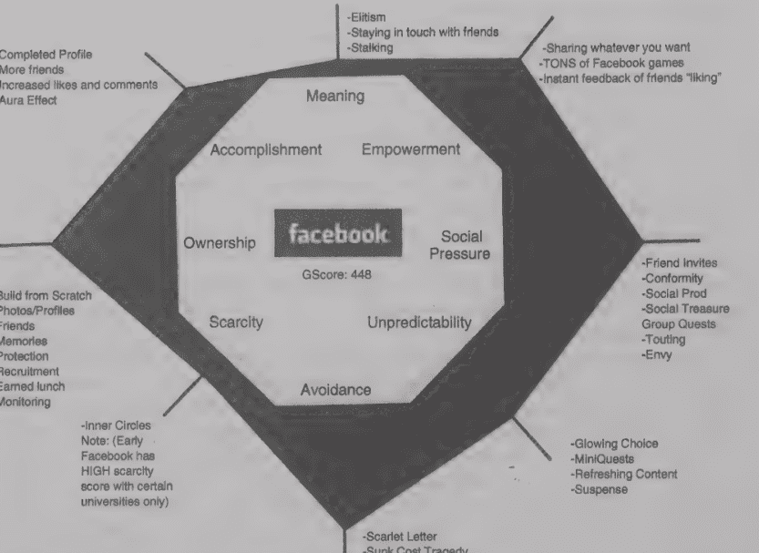

**图 4.3** Facebook参与驱动因素的Octalysis分析

来源：Octalysis – 完整的游戏化框架，Facebook。© 2020，Yu-kai Chou。

最近，这种方法正在被整合到学习和绩效管理中，并通过沉浸式游戏体验提供。游戏化公司（[The Gamification Company](https://www.thegamificationcompany.com)）是该领域的先驱之一，拥有一些令人印象深刻的解决方案和客户成功案例。其基于SaaS的游戏化平台Coroebus™基于神经科学和Octalysis原则设计和开发，将组织KPI游戏化为基于主题的游戏元素。例如，在F1主题中，“生产力”可以链接到车手积分，“准时绩效”可以链接到圈速积分等。通过多层级结构，该平台驱动一种竞争意识，并在个人、团队和群体层面追踪绩效。基于主题的积分、徽章和排行榜确保平台支持持续参与。公司创始人Rajib Choudhary先生表示：“我们看到我们跨多个行业的客户，从建筑业到银行业再到零售业，能够使用我们的方法提高其学习有效性和组织绩效。”

### 终身学习

我们都认同变化是永恒的。然而，变化的步伐每天都在加速，技术是其主要推动力。Jeff Newsjards 在 Visual Capitalist 上发表了一份非常有趣的图表，用于理解变化的速度。他使用一个新的发展或技术达到前 5000 万用户所需的时间作为代理指标。尽管汽车和飞机是在 150 多年前发明的，但它们花了 60 年才达到 5000 万用户；而计算机和移动电话分别仅用了 14 年和 12 年就完成了同样的历程。另一方面，互联网仅用了 7 年，Facebook 用了 3 年就达到了相同的使用水平。《宝可梦 Go》发布于不到 5 年前，仅用 19 天就达到了这一水平，这意味着世界上大多数人在该游戏达到 5000 万玩家之前甚至都没有听说过它。今天，我们生活在一个剧烈变化的世界中，必须不断Learning 才能跟上。终身学习的概念，与本章节讨论的大多数其他主题一样，已经存在了很长时间，但最近获得了全新的相关性和紧迫感。

终身学习中最恒定，如果不是最重要的因素之一，是了解学习者的情境，并能够调整学习内容和技巧以适应不断变化的情境。学会“如何学习”比暂时接触的主题性科目更具影响力。元认知对终身学习至关重要。Buffalo 大学的 Jennifer Livingston 博士在 1997 年发表的开创性研究中建立了这种联系。为了使终身学习有效，学习的历史和进展需要贯穿一生，这在今天非常困难。当我们具备个人学习云等功能时，这一问题将得到大部分解决。学习个性化对于其在终身尺度上的成功至关重要。

得益于互联网上知识的普及，我们可以轻松获取大量信息。然而，要在数字时代有效，拥有信息只是成功的一半以下。更重要的能力是如何处理信息以及利用这些洞察做什么。这需要批判性思维。在几乎所有关于数字素养的文章中，批判性思维/设计思维都被视为成功的重要技能。为了培养或磨练思维能力，必须经历大量的情景分析和模拟。这是 AI 及其衍生的游戏化等技术的领域，如我们之前讨论的那样。

许多学习仍然通过文本内容进行，这一趋势将在未来几年持续。此类信息通常没有被很好地索引或组织。在教育的背景下，对非结构化社交数据进行分析的自然语言分析是 AI 技术的另一个应用领域。

人工神经网络 (ANN) 算法非常适合终身学习的需求，因为它们模拟人脑，具有固有的能力来解决长期神经科学应用中的随机过程，并且可以根据当前学习需求的局部弹性进行调整。ANN 的唯一问题是它需要大量的输入信号，并且学习需要时间。然而，随着突触可塑性概念的出现，允许学习非常快速地进行，这一问题正在得到解决。AI 中这种可塑性概念最早由 Donald Hebb 在 1949 年提出，由于技术限制，从未真正找到大规模应用。这个问题最近已经得到解决，我们看到许多公司如 Uber 的创新实现。DARPA（美国国防部高级研究计划局）也在许多大学启动了该领域的一系列项目。

### 虚拟助手

学习通常是一个学生和老师之间非常互动的过程——无论是在学校、学院还是企业。老师花费大量时间帮助学生寻找信息或验证信息。在当今技术频谱中，许多这些交互可以归类为常规操作。即使是许多评估活动也不需要人工干预。许多这些重复的常规活动现在正由聊天机器人执行。随着个性化学习获得更大的市场份额，在技术基础设施可能还不够稳健的初期阶段，教师将花费大量时间梳理个人学生数据。这是虚拟助手将非常有用另一个领域。虚拟助手将对管理人员极具益处，因为他们最终会花费大量时间回答学生的常规问题。在西班牙穆尔西亚大学进行的一项实验中，聊天机器人能够正确回答超过 38,708 个学生查询，正确率超过 91%。这种方法允许学生在一天的任何时间提问，并对其动机产生了积极影响。同样，如果你将视角翻转到学习者，类似的论点和活动也适用于学习者，我们由此创造了学习助手的市场。

虚拟教学助手开始获得动力。在这个领域有 1MillionBot、Woebot、Botsify、Hubert 等几家初创公司，以及无数其他公司。随着数据变得更加可用并得到更好的整理，以及 NLP（自然语言处理）能力进一步演进，我们将看到虚拟教学或学习助手的成长。

### 各层面学习版图的变革

在本章中，我们已经看到 AI 将在未来几年深刻影响学习，从而以巨大方式影响教育行业。变革已经开始，并即将到达拐点。现在让我们看看不同层级的学习将如何受到具体影响。

### K-12 教育

学校为未来的学习奠定基础。每个政府和社会现在都在关注使 K-12 项目更适应新时代和新经济技能。这是在对年轻头脑产生最大影响的阶段。以下是 AI 的主要影响领域：

- a. **教师生产力。** 当前系统对教师在行政和合规相关任务上施加了巨大压力，使他们过度工作且动力不足。这导致教师流失率居高不下，尤其是在最需要的地方。例如，在美国城市内部学区，教师流失率高达 16%，令人担忧。在发达世界学校的新教师需求增长在 5% 到 25% 之间，而在人口增长率较高的发展中世界，这一需求几乎每年翻一番。在学校系统中吸引和留住优秀教师变得非常困难。麦肯锡近期关于未来工作的研究建议，自动化和 AI 可以节省教师 20% 到 40% 用于常规任务的时间，例如他们经常参与的行政任务、准备、评分和反馈，从而让他们将更多时间花在与学生进行有价值且令人满足的任务上，如辅导和互动。

- b. **个性化。** 尽管教师普遍接受个性化对学习（尤其是早期阶段）至关重要，但根据麦肯锡全球教师和学生调查，近 70% 的教师将缺乏时间列为个性化的最大障碍。虽然自动化和 AI 将提高生产力并释放时间，但教师需要更深入地了解学生的个性化情境，而 AI 在初步模式分析和无侵入性评估方面将极其实用。

- c. **行为分析。** 在这个阶段，学生的社会意识仍处于早期的形成阶段。在这些年里，他们受家庭环境的影响比受更广泛的社会环境影响更大。这些刺激对学校环境中的群体动态和学习效果有重大影响。AI 已被证明非常适合行为和情感分析。

- d. **预测需求。** 教师的另一个棘手任务是理解哪些学生无法理解课程的部分内容。课程的不同部分之间以及学生成绩之间存在相关性。这是一个复杂但可解决的析问题，AI 将解决它。

- e. **跟踪和改进绩效。** 我们已经看到了一些 AI 预测需求、帮助设计课程并提升绩效的有趣例子。专注于 K-12 赛道的中国松鼠 AI 学习平台，在五年内已经覆盖 200 个城市超过 1,700 所学校。全球有许多类似的平台，新的平台几乎每天都在创建。已经有数千万学生通过使用 AI 在他们的成绩上受到影响。这一趋势不仅限于科学或语言等学术课程；像 Bee’ah 这样致力于在中东北非地区推动可持续使命的公司，正在使用 AI 驱动的游戏化平台，让学生更好地转向更可持续的生活方式。知识空间理论（Knowledge Space Theory）的新兴应用，利用数学语言通过图概念来定义和跟踪知识点，使 AI 对学习更加相关。松鼠 AI 和其他教育科技公司正在使用这种方法，并发现了令人鼓舞的结果。根据中国教育科技独角兽松鼠 AI 的创始人李德瑞（Derek Li），“我们在三个小时内对学生了解比最好的教师花费三年还多。”

AI 与其他数字技术如 IoT（物联网）、5G 和混合现实 (MR) 系统的结合，将使结果输出成为教师和课堂更完整的补充。这将使学习更多地虚拟化并具有高有效性，最终推动更大的规模和效率。日益增多的社会政治事件或医疗紧急情况或自然驱动的中断常常要求我们将学习变为远程过程。我们在最近的 COVID-19 大流行中看到了这一点。在这样的情况下，有效的虚拟学习确保我们尽管存在身体限制，仍能继续取得预期的进步。

### 高等教育

学院和大学教育是教育的下一个前沿领域。我们讨论的 K–12 学校教育变革同样适用于大学教育。我们还看到了一些 AI 将产生影响的额外领域：

- a. **招生录取。** 大学管理层每年都面临筛选数千名申请者以挑选出少数理想人选的繁重任务，这一过程高度依赖人工且重复性强。世界上大多数地区的高等教育机构确实希望在招生过程中保留一定程度的主观性，因此招生过程并非完全基于考试成绩。然而，主观判断会因个人偏见以及评估时的特定心态而产生很大差异。此外，目前采用的论文或目的陈述、面试、考察其他领导特质等方法，在管理层能够投入每位学生的有限时间内，无法对学生进行全面评估。AI 将有助于解决这些不同的问题。许多大学已经在该领域开展了早期尝试。像西东大学、昆尼皮亚克大学等院校，通过与申请者的每一次互动，在微观层面上了解他们。

- b. **学生保留。** 录取之后，学生保留是高等教育面临的主要挑战之一。AI 正越来越多地被用于创建早期预警系统，以了解学生参与度并预测潜在的流失情况。教育政策专家曼努埃拉·埃科沃和艾里斯·帕尔默在其论文《高等教育中预测分析的前景与风险》中引用了许多早在数年前就已开始的此类案例。佐治亚州立大学一直使用 AI 来识别并消除少数族裔学生的成绩差距。天普大学也类似地使用 AI 来识别可能即将辍学的学生，并为他们启动辅导，类似的例子已屡见不鲜。虽然这有点侵入性，但通过根据学生的消费习惯和预估收入监控其财务状况，院校可以利用微型贷款和其他形式的学生资助来提高保留率，并与大学建立更深层次的关系。

- c. **行政支持。** 这是另一个目前需要大学行政人员投入大量人工的领域，而这些时间本可以更好地用于其他更能推进教育的任务上。我们已经讨论过如何使用聊天机器人来解决这一问题。

- d. **行业沉浸项目。** 正如我们在本章前面讨论过的体验式学习的重要性，当涉及 AI 和其他数字技术时，其相关性甚至更高。这些概念在实施过程中存在许多挑战和细微差别，学生无法充分理解，而教师若不与行业深度接触，也很难将其引入课堂。这是 AI 展现早期前景的另一个领域——梳理行业试图解决的无数问题陈述，将其与学术资源和学生兴趣进行匹配，并创建数据集和实验平台。

- e. **积极的 AI 挑战。** 为了进一步推进沉浸式项目，使 AI 学习更加有效，各院校正在围绕 AI 推出创新性的积极挑战。我们最近看到的最佳例子之一是在新加坡，国家研究基金会和新加坡国立大学将多个学术和研究机构汇聚在同一屋檐下，以解决国家和世界面临的一些重大问题。这有助于汇集人类的聪明才智和资源，包括获得合适的技术试验平台和数据集，以进一步推动 AI 的应用。

大学相比任何其他教育机构有一个优势——通常，它们拥有非常精通 AI 的高素质和经验丰富的学者，并能以学生的形式获得廉价的研究帮助。与任何其他环境一样，它们也有大量应用 AI 的使用场景。对创业和行业参与日益增长的关注，将把高校的这些早期 AI 成果推向商业世界的大规模实际应用。每个企业都应尽可能广泛地与高等教育机构合作，以便尽早了解世界在 AI 推动下最可能如何演变。

### 企业学习

全球企业学习产业规模超过 3000 亿美元，并且仍在增长。迄今为止，AI 已在企业环境中的许多消费者和内容平台上得到广泛应用；将其扩展到学习领域是一个非常自然的延伸。在 K–12 环境之外，企业学习是我们将看到 AI 早期普及的另一个领域。其驱动力是快速扩大的技能差距以及学习项目效果的即时性。同样，我们认为在 K–12 和高等教育领域讨论的应用也适用于企业学习环境，因此我们不再重复该讨论。以下是我们看到的额外影响领域：

- a. **特定情境化。** 企业学习环境中最大的挑战之一，是理论理解与将其应用到带有真实数据的实际业务具体场景之间的差距。现在 AI 可以弥合这一差距，因为学习内容可以根据公司的具体情境来设计，而不是采用相关性有限的通用内容。

- b. **绩效关联。** 我们已在本章前面对此进行了广泛讨论。神经科学、知识空间理论和游戏化的运用，将成为当今企业思考和实践电子学习方式的重大变革。这些技术还将减少管理者在为员工选择学习项目或评估其绩效时所采用的偏见。

- c. **知识管理。** 企业环境中的人员通常具备基础技能和能力。他们最难以应对的是寻找公司内部存在的机构知识来增强学习。知识管理几乎是每个组织的软肋。AI 能够梳理非结构化和无组织的数据，从公司内部存在的各种知识库中向学习者呈现最相关的信息，这将是另一个重要的应用领域。我们很快就会看到充当个人管家的聊天机器人，它们将在广阔的企业网络中穿行，为我们带来信息和洞见。

重要的是要记住，并非所有技术解决方案都适用于企业学习中的所有场景或功能。如果没有明确的目的，最初的兴奋过后，采用率就会逐渐下降。《第二人生》等例子以及迄今 AR/VR 眼镜的有限采用都印证了这一告诫。与此同时，迫切需要采取果断的（哪怕是微小的）行动，因为人才争夺战只会愈演愈烈。

### AI 高管教育

如今，我们看到在企业中更广泛采用 AI 的最大差距领域之一，是最高管理层对该领域缺乏足够的认识。他们掌握着财务大权，对任何变革都有最大的影响力。许多大学和专业组织已开始提供围绕 AI 的浓缩短期课程，但这些课程大多侧重于数学、科学和一些 AI 编程入门。因此，高管们无法形成关于如何利用 AI 实现业务转型的整体视角。合适的高管级项目将帮助商业领袖和新兴的高级管理人员更明智地认识数字革命带来的机遇，以及如何利用这些机遇推动业务增长。这种赋能随后将推动更多的商业模式和产品创新、更深入的客户互动以及更好的财务成果。

下表是我们认为一个有效项目应包含内容的概要。

| 主题 | 目的 | 关键内容 |
| :--- | :--- | :--- |
| 数字技术导论 | 这将帮助高管了解关键的数字技术、其当前状态、演进过程以及它们如何影响我们的生活和不同的业务，并帮助他们理解炒作与实际应用之间的区别，以及如何解读技术曲线。 | 物联网、大数据、AI/ML、云计算、边缘计算、5G 及其他关键技术概述 |
| 以数字化驱动增长 | 这将引导高管思考如何进行数字化转型和重塑业务，通过利用新的数字化能力实现差异化并驱动增长。 | 业务价值链映射；定义新成果和新价值主张；构建技术战略并理解数据赋能的需求；准备包含 ROI 计算的数字化商业案例；构建解决方案和实施计划 |
| 设计思维流程 | 这为高管提供了解决复杂问题和迭代创新的新工具。 | 双 D 设计思维流程的各个方面 |
| 建立分析领导力 | 随着对数据的日益关注和数据可用性的提高，高管们有了通过分析增强自身才智和直觉的新机会。本节将帮助他们理解分析在当今商业环境中的重要性、不同的分析技术，以及如何利用它们获得竞争优势。 | 基础统计和分析导论；理解不同的分析技术及其应用场景；构建将分析应用于业务问题的框架；运行实验和调节业务成果；建立分析领导力 |

| 主题 | 目的 | 关键内容 |
| :--- | :--- | :--- |
| 揭秘人工智能 | 当今围绕人工智能和机器学习存在大量炒作。大多数高管不熟悉不同人工智能技术的细微差别，以及如何梳理技术术语和复杂性。本节旨在帮助高管揭秘并理解人工智能的世界，包括机器学习、神经网络、自然语言处理等。 | |
| 理解技术格局 | 高管今天被技术和解决方案的爆炸性选择所淹没。几乎每一次推介都承诺提供完整的解决方案，但大多只解决了部分机会。本节旨在帮助高管梳理技术选择的各个方面，并在技术战略方面做出明智的决策。 | 对平台、数据管理、工作流、业务应用和用户体验的核心概念的介绍；理解在哪里以及如何创造竞争优势；决定何时自建、何时购买、何时合作 |
| 处理伦理、隐私和安全问题 | 这将向高管介绍围绕网络安全、隐私和伦理的新兴问题、考虑因素和监管环境。 | 理解威胁向量、隐私和网络安全问题；采用道德人工智能实践；监管考虑；建立网络安全和隐私计划 |
| 管理变革 | 这帮助高管建立框架和计划来管理数字革命带来的变革。 | 理解变化及其在业务流程中的意义；构建管理变革的 IMMENSE 框架：识别、调节、缓解、教育、角色扮演、展示、效果；创建利益相关者群体以推动变革；推动变革管理的有效沟通；创造持续学习和创新的文化 |
| 构建未来的组织 | 随着新的劳动力人口结构和工作性质的变化，高管需要新的工具来激励和管理人员，以推动持续创新和颠覆性增长的文化。新兴的零工经济为我们思考工作和劳动力带来了新的维度。成功的组织已经在重新思考如何跨组织和外部协作，以构建具有竞争优势的生态系统。本节旨在帮助他们推动文化转型，重点关注企业的数字化转型。 | 理解未来的劳动力；零工经济的介绍；招聘和利用人才；在数字世界中管理绩效和生产力；构建创新生态系统；衡量创新有效性 |

学术界和工业界必须更深入地合作，并迅速提升水平，使其成为现实。

### 摘要

教育是社会经济变革最有效的工具。我们目前的地缘政治环境要求积极的社会经济变革更快发生、影响更广泛更深远，并且使变革更可持续。为了应对当下的挑战，我们需要在思考教育的方式上注入新的活力和动力。人工智能将是我们实现这一目标的最大杠杆之一。

随着组织从 COVID-19 危机中走出来，进入新的工作方式和非常具有挑战性的经济环境，它们将被要求迅速刷新业务流程、重新培训劳动力，并从员工那里获得更多产出。这需要新的学习、更高的参与度以及重新建立问责制。这就是人工智能和游戏化作为游戏规则改变者发挥作用的地方。对于处于抵抗状态的疲劳、脱节的意识大脑，利用游戏的神经科学将潜意识大脑带入游戏状态，在核心信念层面建立参与度，并带来意识行为的转变，进而带来业务成果的转变。像 The Gamification Company 这样的公司已成功将游戏化原则与其他行为科学原则（如欣赏式探究和价值创造过程）相结合，对成功至关重要的人类核心流程产生了持续的积极影响。

随着我们经济的根本面貌在后 COVID-19 时代发生变化，我们将对各级劳动力进行大规模再培训的需求。虽然我们相信最终在我们开始恢复正常后会出现另一个良好的经济时期，但不同国家经济引擎的性质和规模将不可否认地发生变化。

下表总结了我们认为人工智能将如何改变不同教育层级：

| 层级 | 类别 | 问题领域 | 人工智能作用 |
| --- | --- | --- | --- |
| K-12 | 教师生产力 | 行政和合规相关任务；过度工作且士气低落的劳动力；高流失率 | 通过处理例行任务节省 20-40% 的时间。 |
|  | 个性化 | 70% 的教师认为缺乏时间是实现个性化的最大障碍 | 更深入地了解每个学生的个性化背景。进行非侵入性评估。 |
|  | 行为分析 | 理解导致学生社会意识的不同刺激 | 执行行为和情绪分析。 |
|  | 预测需求 | 在更深层次上跟踪学生理解和表现 | 预测性诊断 |
|  | 跟踪和改进绩效 | 理解综合绩效并设计干预措施以改进绩效 | 为教师提供新的见解和建议，与其他数字技术如物联网、5G 和混合现实系统相结合。 |
| 高等教育 | 招生 | 高度手动且重复 | 分析和评分每个微观互动。 |
|  |  | 招生过程中需要无偏见的主观判断 |  |
|  | 留存 | 学生流失率高 | 早期预警系统以了解学生参与度并预测潜在流失 |
|  | 行政支持 | 澄清问题、搜索和提供信息 | 使用聊天机器人和虚拟助手实现自动化。 |
|  | 行业沉浸项目 | 体验式学习 | 匹配问题和技能，构建数据实验室 |
|  | 主动人工智能挑战 | 使人工智能学习更有效 | 将高等教育系统用作试验场。 |
| 企业学习 | 特定情境化 | 理论理解与将其应用于企业在真实情况和真实数据中的具体相关性之间的差距 | 情境化学习设计 |
|  | 绩效关联 | 在为员工选择学习项目或评估其绩效时存在偏见 | 使用神经科学、知识空间理论和游戏化进行客观评估和进阶 |
|  | 知识管理 | 管理庞大的知识库，对知识制品进行分类和编目，使搜索更无缝 | 梳理非结构化和无组织的數據，以向学习者呈现最相关信息。 |

我们所知道的世界正在改变，我们学习在新世界中生活和繁荣的方式也需要改变。人工智能将提供帮助。

### 参考文献

- (1) “Global Education Market in 2030”；Holon IQ Research；June 2018.
- (2) 15 Learning Theories in Education；Paul Stevens-Fulbrook；April 2019.
- (3) Trends in American Economic Growth, 1929–1982；Edward Fulton Denison；October 1985.
- (4) Education and Agricultural Productivity: Evidence from Uganda；Simon Appleton and Arsene Balihuta；May 1996.

### 用人工智能改造交通

> “如果我问人们他们想要什么，他们会说更快的马。”
> —归因于亨利·福特

### 引言

人们一直在争论亨利·福特是否说过上述言论；尽管如此，它为定义创新设定了标准。交通运输业的历史丰富，数千年来充满了创新案例，对人类产生了非常深远的影响。从第一个车轮到蒸汽机，到车辆的大规模生产，到精益制造，再到自主移动系统，这一行业引领了新的技术时代。

交通运输业是任何经济体的庞大组成部分。据 Plunkett Research 称，全球交通运输业超过 5 万亿美元，直接或间接贡献了全球 GDP 的 6%。交通运输对环境也有很大影响，是温室气体排放的主要行业贡献者之一。例如，据 Total Logistics 称，在欧盟 2019 年，交通运输业贡献了 24.3% 的排放量。较 2017 年的 27% 略有下降。(1)

交通运输业中数字技术、智能能力和人工智能的增长显著。技术正在帮助该行业变得更高效、更能响应客户需求，帮助防止药品等许多关键类别中的欺诈和假冒，减少损耗和浪费，并实现更全球化的经济。物联网的普及多年来一直在大幅增加。增强现实（AR）已在该行业找到许多用例——从制造过程中的模拟和测试到管理仓库运营中的物流和分销。据 DHL 研究，使用 AR 可显著降低其仓库拣货成本，而这几乎占仓库运营成本的一半。AR 正逐步进入自主

以及驾驶领域。交通领域的增强现实（AR）应用投资额接近150亿美元。虽然用于公共道路和高速公路等无约束环境的自动驾驶技术和基础设施正在趋于完善，但该技术已在物流设施或制造车间等更受限的环境中得到了越来越多的应用。自动驾驶车辆将有助于解决商业货运企业日益严重的司机短缺问题，使出行更高效、更安全，并提升整体经济产出。许多研究认为，在未来几年内，自动驾驶汽车行业的规模可能达到数千亿美元。与之相关的无人机领域也已迅速增长，正在交通运输和物流、检查、地理空间测绘、国防应用等方面发现新的用例。根据全球市场洞察（Global Market Insights）的一项研究，到2024年，该细分市场预计将达到170亿美元。这些技术领域的每一项及其增长都由人工智能推动。

交通行业已站在重大变革的临界点上。我们目睹了电动汽车的日益增长，并满怀期待地等待着自动驾驶汽车的推出。此外，尤其是在发达经济体的城市地区，新一代人更倾向于选择共享出行而非拥有私家车。从基础设施角度来看，我们正面临拥堵、污染和生产率损失等日益严峻的挑战。从基于石油的经济向基于替代能源的经济缓慢转型也在影响交通行业。最后，随着技术演进使通信更具互动性，无论是短途还是长途，出行本身的需求正在随着人们更倾向于远程办公而减少。并且，这是一个人工智能已经通过交互地图、路由优化及其他追踪机制的需求，在全球范围内大规模普及的行业。

人工智能将以多种方式进一步变革交通行业——例如，推动自动驾驶汽车等新型交通模式；改变出行的动机和障碍；预判旅行者的需求，使沿途服务更加及时和具体，进而影响下游供应链；重新定义当前对停车、车辆维护或加油服务等相关服务的理解和处理方式；并对我们生活方式和工作产生更深远的影响。

然而，该行业数字技术和人工智能的发展面临着一些逆风。围绕这些新技术的人才短缺是明确存在的障碍，可以通过教育和人才发展干预措施来克服。要充分享受其益处，技术的使用必须渗透到行业的整个价值链或其不同细分市场中。例如，如果引入新的分析能力来优化仓库运营，却对其余物流环节置之不理，所获收益将是有限的。同样，如果不整合各种交通方式，就无法优化人们的通勤出行。价值链是碎片化的，有时相关参与者缺乏合作的自然动力。该行业通常处于低利润环境中，这使得大规模投资充满挑战。因此，公共机构和政府往往需要介入并进行重大投资，才能使技术得到充分利用。

尽管如此，数字化转型和人工智能带来的机遇影响力巨大，这些障碍将通过市场力量得到解决。与其本性相符，该行业不仅将改变自身，还将推动许多其他不相关行业的变化。

### 理解影响交通行业未来的宏观因素

影响交通行业未来的社会经济和技术因素众多，尤其是数字技术和人工智能将在其中发挥的作用。下文将讨论其中的一些关键因素。

#### 城市化

该行业的所有核心在于将人员和货物从一个点移动到另一个点。这种移动高度依赖于人口集中的位置，而过去几十年人口集中点一直是城市。根据联合国（UN）的《世界城市化展望》²，2018年，全球55%的人口已居住在城市地区，预计到2050年这一比例将达到68%。交通行业的发展与城市化进程相互影响。例如，电动平衡车、电动滑板车或电动自行车的发展，都是由短距离快速城市出行的需求所驱动的。城市设计有多种形式，它们决定了不同的交通需求。越来越多密集的中心城区正在让位于多中心设计，这种设计允许人口更大规模的增长，并减少出行需求。

#### 职场分离

历史上，所有工作都在指定的办公室或其他类型的工作区域（如学校、医院、商场、工厂、庭院、仓库等）进行。技术通过支持越来越多的远程和/或自动化执行工作，正在重新定义工作的性质和方法。我们在第3章中看到了远程医疗如何减少对大型集中式医疗保健设施的需求；在第4章中讨论了执行学习项目更有效的方式，等等。最近围绕COVID-19的危机将远程办公提升到了另一个层次，消除了一些顾虑，并显著减少了技术、政策或流程瓶颈。在许多行业中，远程办公被证明更为有效。工作地点观念的这种变化对交通具有重要影响，因为人们的出行需求正在改变。

#### 零工经济

到目前为止，我们讨论了工作性质的变化和工作地点的变化。零工经济的兴起也在改变员工与雇主之间的关系——从更长期、固定的关系转变为更灵活的关系。这种灵活性进一步改变了交通需求，使其更具动态性。据估计，目前约9%到10%的知识型劳动力正在转变为零工，但预计在未来几年内，这一数字将增加两倍甚至三倍。

#### 人口偏好变化

年轻人减少拥有汽车的趋势已持续了一段时间。2018年7月，BBC的Roger Harbin报道说，在20世纪90年代，伦敦等城市地区80%的人到30岁时就开车了；现在这种情况适用于45岁以下的人群。城市化程度不断提高，居住和经济活动中心向市中心转移从而减少了出行需求，以及年轻人消费模式的同时增长，是导致这种转变的主要原因。如果出行需求不高，交通经济学也不利于拥有汽车。随着这一趋势的持续，它将对交通行业产生更大影响。

#### 可持续性

交通行业是影响可持续性最快的增长部门。该行业贡献了超过23%的总温室气体排放量。在美国和欧洲西部等发达经济体中，这一占比更高。随着气候问题日益严峻和自然现象异常频发，全球范围内对控制气候变化贡献者的担忧日益增加。这促使社会和界对交通行业施加压力，以探索更具可持续性的替代方案；因此，我们看到电动汽车和其他可持续交通形式的应用正在增加。例如，英国能源研究中心（UK Energy Research Centre）最近的一份报告建议，到2050年，电动汽车可以帮助减少英国交通排放量约25%。电动汽车是大型交通领域增长最快的细分市场，2018年全球销量超过500万辆，并以每年约40%的加速速度增长。虽然有关充电设施不足的问题尚未完全解决，但它们正在世界主要城市迅速安装。能源市场的不稳定性、燃料供应和价格的波动、对可持续性的担忧，以及加利福尼亚州等立法行动（例如到2025年在道路上部署150万辆零排放汽车），将对交通行业产生重大影响。

#### 为自动驾驶汽车做好准备

自动驾驶是交通未来的重要组成部分。怀疑论者认为，支持自动驾驶的基础设施需要很长时间才能准备就绪，因为它从未为此目的设计过，且手动驾驶和自动驾驶相结合是不可能的。这一论点有一定道理，但先进驾驶辅助系统中自动驾驶功能在不同驾驶方面的普及已经越来越受欢迎。随着电动汽车的日益普及、预测微型驾驶动作的传感器技术以及软件辅助车辆操作，对自动驾驶汽车的准备程度不断提高。从部分自动化到完全自动化的演变将在未来10年内通过聚焦交通类型（货物 vs. 乘客 vs. 公共交通）、道路基础设施更适配的受限地理区域以及自动化程度，逐步但迅速地发生。随着自动驾驶汽车的增长，车辆所有权模式也在发生同时的变化，我们在本节前面已简要提及。这两种合并趋势将深度影响其他相关行业和学科，如汽车制造和供应链、保险、汽车经销商、汽车服务、加油、出租车等。

### AI将如何改变未来的交通运输行业

#### 自动驾驶

令人惊讶的是，自动驾驶汽车（AV）已有近100年的丰富历史。最早的遥控自动驾驶汽车雏形分别于1925年和1926年在纽约和密尔沃基的街头亮相。美国设计师诺曼·贝尔·格迪斯可能在1939年纽约的“未来世界”展览上首次展示了自动驾驶的构想。他的概念是正确的，但他的预测却晚了六七十年。(1) 支撑这一愿景的技术当时并不存在。汽车行业的既得利益集团也阻碍了发展步伐，它们不断增强对政策的影响力，进而影响技术和基础设施的研发。然而，几十年来，研发工作一直在继续，所有主要原始设备制造商（OEM）都进行了一些投资和改进，以保持这些理念的活力。梅赛德斯-奔驰和通用汽车在上个世纪的贡献可能最大，而本世纪则受到多家新进入者的深刻影响。自2015年以来的过去五年中，进步与创新的步伐急剧加快，部分得益于特斯拉等公司展现的技术领导力，以及新加坡等政府的支持——2016年，新加坡推出了首个自动驾驶出租车服务nuTonomy。我们必须牢记，在价值数万亿美元的汽车和交通运输行业中，有许多力量希望维持现状。

与此同时，自动驾驶在非客运或非大规模运输领域的应用，纯粹出于需求而推进得更快。太空探索和国防走在了这一前沿。不可能所有航天器都载人，而且太空中也不存在道路上其他车辆那样妨碍自动驾驶的基础设施问题。同样，如果说军事太空和国防是自动驾驶汽车及其核心使能技术（如软件设计、编程、通信等）研发的两大最大贡献者，那么冲突局势中的车辆可以无人驾驶；这既能挽救生命，也能带来竞争优势。在深海或高山等艰难地形的科学探索中，也使用自动驾驶技术进行研究。

在公路上的大规模人员与货物运输中，除了既得利益压力之外，还有许多技术原因导致自动驾驶进展缓慢。自动驾驶最复杂的方面在于，不仅要预测近旁车辆，还要预测远处道路上每一辆其他车辆的未来运动轨迹和方向。当自动驾驶车辆与人工驾驶车辆混合行驶时，这一问题变得更加复杂，因为在快速变化的条件下持续以亚秒级水平预测人类行为被认为几乎不可能。由于人类反应受到社会、情感、医疗和机械因素的影响，复杂性进一步加剧。情况变化太快、信息量太大；如果采用传统的基于规则的决策方式来进行车辆控制，计算机处理所有这些信息将是一项艰巨的任务。这就是AI赋能自动驾驶、将汽车转变为智能思考机器的原因。

除了车辆控制之外，AI在自动驾驶中还有许多其他用途。使用自然语言编程作为车辆与乘客之间的主要用户界面就是此类应用的一个典型例子。自动驾驶汽车将由你的AI驱动数字助理而非人类司机来驾驶。路线优化、燃油优化、预测性维护是AI在自动驾驶中的其他一些应用。

美国汽车工程师学会（SAE）将自动化分为六个等级，用以对辅助驾驶和自动驾驶的各种能力进行分类。从0级开始，车辆上安装的传感器会发出一些警告信号，例如当您离另一辆车或大型物体太近时发出警报；一直到5级，此时方向盘变得可有可无、仅作装饰。要实现更高级别的自动化，我们需要三样东西：车辆上安装大量不同类型的传感器，以确定其位置、状态和环境条件；来自车载传感器及其他输入（如道路上的其他车辆、天气和交通信息、路况提示等）的大量数据；以及快速有效地处理数据、预测道路上和路线上的未来行动与事件、识别车辆的最佳行驶路径和条件、并执行控制功能的能力。如果没有强大的数据管理能力——无论是在云端集中管理，还是在车内本地以亚毫秒级响应变化——以及多智能体系统等软件编程范式和AI技术，这种海量数据处理和预测是不可能实现的。图5.1描绘了随着传感器和数据分析的增加，自动化等级的演进过程。

核心使能技术的发展经历了漫长的时间。但过去十年的进展非常令人鼓舞。在传感器方面，激光雷达（LIDAR）在能力、可接受性，尤其是 affordability（经济性）方面取得了长足进步。同样，其他类型的视觉、听觉和振动传感器也需要在所需吞吐量、性能、小型化和价格点上进行大量研发。GPS的发展，以实现对汽车及道路上其他一切物体的逐秒精确定位测绘，也耗费了时间和精力。虽然多智能体系统已经存在了几十年，但使其能够大规模应用的实践和编程界面是较新的；要做到这一点，我们还需要在更现代的轻量级消息通道和图数据库方面取得足够的进展。

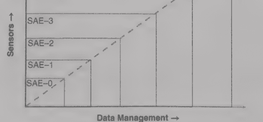

图5.1 SAE自动化等级

虽然传感器、数据处理、软件编程、通信技术、精确定位跟踪、车辆电源管理等大多数使能技术几乎都已就绪，但在AI方面跨越最后一公里将需要5到10年时间，可能贯穿整个2020年代。自动驾驶汽车中使用AI进行驾驶决策是通过不同类型的神经网络（ANN、RNN等）实现的。如今，神经网络的准确率在达到95%的可预测性后便开始趋于平缓；(4) 需要更多时间、更多数据来模拟不同驾驶条件下的极端情况和异常场景。一旦我们跨越这一鸿沟，自动驾驶汽车将势不可挡。我们将首先看到它们在有限的、提供封闭环境的电子围栏区域内得到应用，然后扩展到货物运输领域，最后才会全面应用于替代个人交通或公共交通。

另一个将促进自动驾驶汽车普及的因素是电动汽车（EV）的增长。由于电动汽车的发动机设计截然不同且重量更轻，这为自动驾驶汽车释放了内部资源约束。车辆中更多的电气和电子电路及控制系统使其响应更快，这是自动驾驶汽车的关键需求，而电动汽车恰好满足了这一点。随着固态电池技术的进一步发展，将有更多电力满足自动驾驶汽车日益增长的电力需求。AI也将助力电动汽车的增长，因为算法将能够更好地预测和优化驾驶过程中的电力消耗，通过有效结合过去和新兴趋势来研判供需，提供更好的充电地点和充电量指导，并减少维护需求。

人们普遍认为，中国已经在AI领域占据主导地位，也将成为自动驾驶汽车的催化剂。麦肯锡2019年1月关于该主题的一篇文章估计，未来20年（即到2040年）中国三分之二的出行将使用自动驾驶汽车。(5) 该报告估计，这一势头将从2023年开始，最初应用于低速郊区交通，达到SAE-4级自动化，并从2027年开始真正加速，覆盖更广泛的城市和郊区场景。像中国这样的国家代表了自动驾驶（或任何其他类型的驾驶）在世界任何地方都会遇到的多样性的类型和程度。因此，一旦中国开始解决大规模普及的问题，一旦欧洲开始开发更多技术和标准，我们将看到全球范围内自动驾驶汽车普及的势头。

在我们看来，AI与自动驾驶将形成最强的协同良性循环之一，相互促进彼此的增长与发展。

#### 出行方式的融合

在交通运输领域，不同类型的交通方式、车辆所有权以及不同自动化等级之间正在出现一种出行融合趋势。德勤专家斯科特·科温和德里克·M·潘克拉茨在2017年11月发表的题为“变革的力量：出行的未来”的洞察文章中，提出了一个关于车辆所有权、资产效率和驾驶技术之间未来相互作用的框架。图5.2中的图表展示了他们的框架。

如今，这一概念正在演变为更复杂的融合模型，同时商业模式也从以所有权为核心的产品型模式，转向以使用付费租赁为核心的服务型模式。中东领先的环境管理公司Bee'ah与Crescent Enterprises合作，于2018年推出了可能是世界上首个可持续的融合式多模式交通网络。其服务范围涵盖共享出行、微出行解决方案、货运、集体公共交通，直至燃料价值链网络管理。

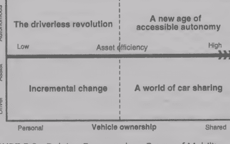

### 图5.2 德勤未来出行框架

ION/Bee'ah 正身处出行领域；无论是货物运输还是人员出行，都要满足公众对于安全、清洁、可靠且经济实惠的从 A 到 B 的出行方式的期望。同样，它创建了一个根据客户需求或个人需求量身定制的出行解决方案生态系统，以促进环保交通。

以 Madar 城市使用 ION 的多模式交通系统为例。它专门设计用于匹配城市内出行环境的复杂性，该环境包含有人驾驶和自动驾驶车辆，并考虑电池电量和充电时段预订。车队编排平台自动化和优化匹配、调度和路线规划，以帮助实现服务水平并最大化车队效率。这很简单：您定义服务需求，ION/Bee'ah 自动化您的运营，每次都在正确的时间将正确的任务发送给正确的车辆。

人工智能将成为此类未来网络系统发展的基础。从驾驶到出行的转变意义深远。现在，我们不再试图优化人和货物的点到点移动，而是解决人和货物的最优出行问题，同时适应其他社会经济环境因素。这种细微的转变基于对高度动态变化因素的持续计算，以确定最优路径和模式。所选模式和路径必须与主体（乘客或货物）的约束和偏好相匹配。例如，乘客的健康状况或货物的存储要求可能只适合某些模式和路径。在这种复杂且动态的环境中规划供需需要大量复杂的估计方法。为了满足供需，估计算法必须辅以可实时调整并带有反馈的控制系统。一旦计算出模式和路径，确定定价就成为下一个挑战，因为现在用于精确计算成本的固定参数已不再成立。除此之外，我们还面临能源网络规划、所需燃料类型（碳氢燃料、电力或混合方法）的可用性以及加油站/充电站的挑战，以维持这种融合交通网络的运转。人工智能算法是实现所有这些规划、模拟、执行和反馈循环的唯一途径，因为没有任何其他技术能够以所需速度处理这种复杂性和动态性。

这一转变与运输行业摒弃轴辐式模型同时发生。1955年，达美航空首创了轴辐式系统的概念，通过优化航线设计来管理运力和供应。这一模型主导了运输行业过去50多年的思维和运营设计。除运输外，这一概念还被应用于物流、软件设计、数据管理、通信网络设计等许多其他行业。在运输行业处理已知的人员和货物流动模式以及明确的运输能力时，这种方法长期发挥了良好作用。然而，这种方法有几个缺点。当不可预测性和变化引入运动模式时，设计最优性就会受到损害。有时，如果点对点移动之间有足够的交通流量，成本就会低效。西南航空是最早意识到这一点的公司之一，并创建了一种独特的商业模式，使其比航空业中大多数其他参与者表现得更好。单点故障是对这种方法的一大批评；我们都非常熟悉主要机场拥堵以及每当交通激增或出现天气等意外事件时随之而来的航班延误。许多环保主义者也强烈反对轴辐式模型，因为它导致更多里程被行驶，从而燃烧更多化石燃料。轴辐式模型中的网络缺乏适应性，使其对新需求的响应能力较差。这种方法也不能有效利用我们认为属于未来的多模式概念。

### 车辆所有权模式

过去十年中出现一个有趣的新趋势，如今正在加速发展，并可能改变运输行业大部分经济模式，那就是车辆所有权模式。最初由 Uber 和 Lyft 等公司引入的拼车服务，已扩展到 ZipCar 和 Car2Go 等公司的汽车共享服务。在本章前面，我们简要讨论了人口结构变化如何导致车辆所有权模式发生变化。但这并不是这一新趋势的唯一原因。为了平衡经济增长、环境可持续性、基础设施容量和燃料可用性，许多国家的政策制定者大力提倡共享车辆所有权模式。

支持共享车辆所有权的平台已不仅限于初创公司。就连福特、凯迪拉克、现代、雷克萨斯、沃尔沃、保时捷、宝马和梅赛德斯等传统 OEM 也推出了基于订阅的使用模式，这是共享所有权模式的一种变体。这种灵活模式让消费者能够体验同一 OEM 的不同车型，也让 OEM 不仅能够了解客户偏好，还能提高客户留存率和盈利能力。预计到 2025 年，美国和欧洲^(6) 近 10% 的新车销售将基于订阅模式。

人工智能将在不断变化的车辆所有权模式中再次发挥重要作用。人工智能将被用于建模和预测未来趋势，为政策制定者提供信息，推动生产和分销，决定新的网络模式和路线，对大部分非私人所有的多模式交通发展施加影响，并利用这一新趋势决定运输行业的经济效益。利兹大学运输服务研究所的研究人员 J. Gerard de Jong、James Fox、Andrew Daly 和 Marits Pieters 于 2004 年发表了一篇题为《汽车所有权模型比较》的论文，其中重点介绍了用于预测和决策支持的各种 AI 模型。在论文中，他们根据 16 项标准比较了 10 种模型类型，从供给处理，到聚合水平和数据要求，再到报废处理。世界各地的许多其他学术研究人员和政策专家也进行了类似研究。现实统计数据已验证了此类模型的有效性。

### 燃油经济性

燃油经济性与运输行业密切相关，也将在人工智能的影响下经历重大变革。许多变化将由运输行业的潜在变化驱动，但有些变化将更加独立。

我们已经讨论了自动驾驶、电动汽车和共享车辆所有权模式将如何改变交通运输，这将直接影响燃油经济性。这些发展之外，还有一个发展将减少燃料消耗。车辆怠速或低速行驶也会导致高于最优水平的燃油消耗。如果通过改变交通模式和路线使车辆保持运动状态，这种浪费就可以得到解决。橡树岭国家实验室（ORNL）的研究人员正是这样做的——他们将街道摄像头获得的计算机视觉输入与 AI 技术相结合，改变交通网格中的拥堵情况，并根据不同车辆的燃油效率对其运动进行优先级排序。这是深度学习和神经网络算法的一个非常独特的应用。同样，在航运业中，计算机视觉和机器学习也被用于优化航线和航行速度，以减少燃料消耗。欧洲航运公司 Stena Line 在其试点项目中通过此类 AI 实施，燃料消耗降低了 2% 至 3%。虽然 AI 无法取代船长和领航员的经验，但它确实可以通过不断计算替代方案并寻找最佳最优解，提供非常出色的决策支持系统。这种燃油效率概念几乎适用于所有运输方式，包括飞机。例如，法国公司 Safety Line 为 Air Austral 开发并实施了一种机器学习工具，通过优化飞机燃油消耗最大的爬升剖面，为其节省了 6% 的燃油消耗。

在生产方面，AI 正被用于帮助提高资产利用率、推动预测性维护以及优化生产计划以提高回报。石油和天然气行业资本需求巨大，资产回报率通常较低；更高的效率和产出将有助于改善生产商的财务状况，并可将这一收益传递给消费者和研发部门。

勘探目前非常耗时、投资密集且高度不可预测，是行业中另一个将越来越多地获得 AI 支持的领域。决定在哪里勘探，需要分析和综合多个不同且差异很大的数据流，如基底地质信息、地球物理信息、地震活动、环境因素以及其他此类信息。不仅需要研究这些信息集，还要追踪其数百年来（如可能）数千年的演变。有时数据可能不可用，必须通过模拟来替代。AI 可以在大量物理投资开始之前，有效且快速地帮助梳理和处理所有这些与数据和分析相关的活动。采用深度分析优先的方法也有助于最大限度地减少环境影响。此类努力的早期案例已经存在。例如，在英国，石油与天然气管理局创建了该国第一个国家数据

为此类目的而建的仓库。私营石油公司在此领域同样活跃——BP正在利用总部位于休斯敦的科技初创公司Belmont Technology的能力，Shell与C3.ai和Microsoft合作，Baker Hughes与C3.ai合作，等等。

AI为石油和天然气行业带来了另一个有趣的好处，该行业仍然是全球燃料经济的基石。这个行业并未受到新一代员工的青睐。根据E&Y的一项研究，44%的千禧一代和62%的Z世代认为石油和天然气工作缺乏吸引力。(7) AI可以通过自动化和简化许多任务来提供帮助，就像它在其他行业所做的那样，这将在一定程度上缓解人才压力。对于通常非常依赖知识和经验的维护和修复任务，以及我们正在看到重大人才流失的领域，AI是一个很好的补充工具。

最后，AI还将有助于使燃料市场对供需以及替代能源资源更加透明和响应迅速。目前，能源市场由少数国家玩家主导，并经常被管理以符合他们的需求，从而影响全球经济的其余部分。一些地缘政治问题的起源和持续都与石油相关的冲突有关。AI不仅有助于使世界更加可持续，还可能使其更加和平。

### 物流

物流和供应链与交通运输行业联系非常紧密；有时它们甚至被视为一体。在目前的讨论中，我们已经触及了一些更直接和明显的AI应用，如路线和燃料优化、网络重新设计等，因此我们不会再次深入探讨这些内容。然而，物流行业还有其他领域将受到AI的显著影响。

全球贸易和商业最近进行了一些有趣的转型，这些转型是由地缘政治考虑驱动的。民族主义情绪的抬头和更多制造业的本地化似乎是世界许多地区的议程。贸易冲突对供应链网络有时甚至对整个行业产生了不利影响。未来的供应链生态系统将继续变得更加去中心化但又更加互联；要使它们更具韧性，像AI这样的技术将是关键的。一项关于此主题的E&Y研究对此进行了进一步解释：

面对更多的工厂、更多的市场以及承担越来越多且不同责任的扩展供应链合作伙伴，公司需要掌握总落地成本贸易规划、贸易航线优化、资本支出规划，甚至灵活的税收优惠规划等。这些更大的规划和管理能力需要实时执行，并且必须转向更先进的技术来访问多样化的数据点，以制定日益复杂的策略。重大的技术演进也可能会导致对资源共址的需求和愿望减少。

我们将很快看到物流运营和供应链网络通过AI能力得到重大重构。

### 太空探索

严格来说，太空探索不是交通运输行业的一部分。除此之外，太空探索一直是AI最早和最广泛的使用者之一。许多AI开发都是由太空探索驱动的。但对我们来说，快速回顾AI将如何进一步变革太空探索仍然很重要，因为这些例子和能力很快将渗透到其它行业。

当我们迈向太空探索的下一个前沿——前往新的行星、寻找新的恒星和星系、绘制宇宙演化的历史地图，以及向太空发射更多无人任务——我们将在这类追求中使用更多的AI能力。航天器的操作、维护、导航和控制系统已经大量使用AI。卫星也是如此。在太空探索中进行的大规模图像处理使用了多种AI技术。没有AI，就没有实际可行的方法以预期的吞吐量水平处理如此巨大数量和种类的数据。根据欧洲航天局（ESA）的数据，卫星每天可以产生超过150 TB的数据。

现在，科学家正在AI方面进一步扩展，用于在未知重力场、碎片、轨道和环境条件的区域进行深空探索。2018年，NASA资助了使用以太坊区块链技术进行自主导航的研究，以创建一个“用于深空探索的去中心化、安全且具备认知能力的网络与计算基础设施”。区块链实现在地球上曾受到一些批评；当它们在太空中完善时，我们将看到新的广泛应用回到地球。在这些具有挑战性的环境中，通信和网络是另一个主要挑战，AI正在被利用来优化网络并动态配置它们。当我们展望未来已知的宇宙之外，大规模图像处理将有助于发现，从而将图像处理和物体识别提升到全新的高度。随着在火星等地方的更多无人探索发生，科学系统的自主功能必须增加。例如，火星2020号漫游车的自主科学仪器PIXL大量使用AI。这种能力随后将转移到地球上复杂系统的机器人操作中。

当我们超越火星，太空探索必须由AI驱动，导致为追求新目标而完全开发不同类型的科学、技术和数学。

### 保险

保险是另一个因AI的影响而彻底转型的相关行业。这不仅限于汽车或交通相关的保险，而是涵盖所有类别的保险。精算科学是保险行业的支柱。精算分析不仅通过查看过去数据来构建模型，还预测最可能的未来结果。在精算分析中获得高精度有两个根本性的复杂性——获取和处理海量数据以及使用新信号调整或微调模型。历史上，精算师通常基于年龄、性别、种族、过去驾驶记录、健康状况、道路条件等创建广泛的人群队列，以预测风险并决定保费。由于变量的影响以及每个个体行为/表现对模型的影响，正确且及时地做到这一点一直是一个挑战。传统保险行业运作的第二个重大挑战是理赔处理。仅通过查看理赔数据和其他关于事件或涉及个人的信息，保险公司很难知道一项理赔是真实的还是欺诈的。因此，他们诉诸调查，这使得过程昂贵且耗时——最终影响客户。

AI缓解了这两个挑战。它有助于筛选海量数据以构建正确的风险模型，并在很大程度上为单个驾驶员、事件或两者的组合进行个性化定制。但更重要的是，随着物联网和数字技术的进步，模型现在可以从传感器获取流式实时输入，以了解个人的当前行为和当前事件，从而更新风险模型。这使得有可能调整保费以反映更准确的风险概率，并将利益传递给风险较低的人群或事件。然而，这种方法开启了另一系列关于隐私和歧视的问题，这些问题在伦理和社会考量上是复杂的。AI模型还帮助快速评估理赔的真实性，基于许多因素，如个人的过去行为、导致理赔的事件的历史和可能的外推，以及其他相关数据。总体而言，保险行业正在变得更个性化，但更具侵入性。当你将此与车辆所有权模式的转变叠加在一起时，我们现在处于创新和商业模式的完全不同领域。

### 产品开发和制造

在我们目前的讨论中，很明显，我们今天所知为汽车的产品在设计、能力和功能上正在发生显著变化，特别是由于自动驾驶汽车的增长。汽车行业研发投资的速度将继续保持在较高水平，甚至可能在接下来几年略微增加，以专注于净创新。汽车领域的大部分研发追求仍然采用非常传统的研发和模拟方法。但我们已经看到AI在更严格和复杂的行业如药物发现中的研发中发挥作用。因此，期待AI改变当前研发流程和吞吐量的方式是理所当然的。

汽车制造是一项非常复杂的事业，涉及许多动作、变化和行为者。精益制造由于精度要求和时间敏感性使其更加复杂。在制造车间，AI已经开始通过工业4.0类型的举措产生影响。具有更好视觉识别和图像处理能力以及更好情境意识的机器人正在使生产流程更快并提高质量。更好的AI驱动的决策将使供应链也变得更精益、更高效。在许多供应链职能中，AI辅助的机器人技术已实现机器人流程自动化，从而以更少的人力、更少的错误和更少的流程偏差带来更好的业务结果。制造链中的任何停机不仅非常昂贵，而且对所有相关流程造成重大干扰。AI正在通过预测性诊断更好地维护车间设备来解决这个问题。麦肯锡对此主题的一项研究估计，收益可能是当前运营成本的10%到20%之间，这对于一个承受压力且习惯低个位数利润率的行业来说是巨大的。

图5.3是AI对交通运输行业各种影响的回顾。

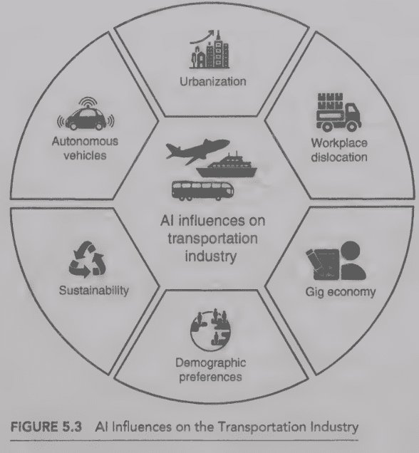

FIGURE 5.3 AI Influences on the Transportation Industry

### IMPACT OF AUTONOMOUS DRIVING BEYOND TRANSPORTATION

At the outset of this chapter, we saw how the transportation industry has led most of the innovation eras in the industrialized world. Later in the chapter, we talked a lot about autonomous driving. In our opinion, this one area of development will have very profound implications for the world in many more ways than we possibly realize today. In this section we will touch upon three such areas of impact.

#### Software Architecture

Software architecture has evolved since the introduction of software to meet the requirements of the day and operate within the technological constraints. In the mainframe world, architecture was more monolithic, which transitioned to a more service-oriented one in the client-server world. As the web and mobile development continued to become the norm and kept getting more complex and distributed at the same time, the architecture evolved to a more microservices-based architecture. Growth of IoT and cloud computing introduced the paradigm of containerization to this whole mix. With the proliferation of the Internet of Things (IoT), and AI technologies driving them, which requires massive autonomous distributed computing at the edge level, the needs of modern software engineering require agent-based architectures – a concept widely used in both space exploration as well as autonomous driving. We will discuss more multi-agent systems in Chapter 11 of this book.

#### Pervasive Automation

Automation has existed for centuries, starting with the dawn of the industrial age. We have always considered automation as the best solution for repetitive tasks, starting with the simple ones. Advancements in automation and robotics have expanded the nature of tasks to more complicated ones but with predictable inputs and outputs.

Driving, on the other hand, deals with highly unpredictable inputs and very dynamic environments. If that can be automated, everything except fine arts is subject to automation. Robotic surgeries are probably some of the most complex applications of automation today.

Extensive automation led to the concept of lights-out manufacturing that involves no human intervention in the entire process. As a concept, this was introduced by General Motors several decades back but implemented only in parts of the entire manufacturing plant and process. Toyota interestingly took the opposite position of introducing more manual intervention in the manufacturing process in the last decade to increase flexibility. More recently, there has been substantial development in collaborative robots or cobots that can coexist and work seamlessly with humans and other robots. Cobots are not limited in performing only highly automated industrial processes. Cobots use more sensors and software to adapt.

Pervasive automation will require us to rethink a lot of current-day processes and routines across multiple industries.

#### Redefinition of Urbanization

Autonomous vehicles might trigger another interesting trend of reverse urbanization. The primary driver for urbanization has been people’s desire to be closer to their place of work so that they spend less time commuting, which is largely time wasted as they cannot do any other meaningful work while they are driving. Autonomous driving reverses the problem and makes even commute time productive. Combined with remote working, this might encourage people to be away from urban centers.

If this trend catches on, then everything from retail to education to financial services and every other industry will get impacted, at the least from a locational standpoint, and most likely from an operating model standpoint.

We will have to see how many of these trends evolve.

### SUMMARY

The transportation industry has been going through a massive transformation and that trend will continue for the next several years. These changes are being driven by increasing urbanization, changes in the workplace and work practices, especially after the COVID-19 crisis, the influence of the fast-growing gig economy, changes in how Gen X and Millennials think about vehicle ownership and urban mobility, sustainability considerations, and the rapidly approaching era of autonomous vehicles. The recent crash of oil prices and expectations of continued depression of transportation demand whether it be air or land will further change the dynamics of the transportation industry. In this dynamic environment of influences and changes, AI will play a big role in the transformation of the transportation industry.

Recent advancements in digital technologies and AI will accelerate the development and adoption of autonomous vehicles. This will be one of the most impactful shifts in the automotive industry in over 100 years. Different formats of mobility will converge to give travelers a unified experience. Vehicle ownership and consequently the entire automotive supply chain will change significantly. These shifts will also change the automotive insurance industry profoundly. As the broader changes impact vehicle products and services, the practice of product development and manufacturing will also be completely altered with more automation, robotics, and AI-enabled decision support systems. AI will help logistics networks become more agile and adaptive. AI has been enabling space exploration since the beginning; now we will see an accelerated pace of activity driven by human desire and technological capabilities. Every aspect of the transportation industry will mutate and evolve.

Not only that, but the growth of AI in the transportation industry will also stimulate its use in other industries and create a broader impact on the fundamentals of software development, especially with the rise of multi-agent and autonomous systems. The transportation industry has a history of ushering in big changes in the way we live and work; buoyed by AI, the industry is at the cusp of another major crossover point.

### REFERENCES

- 1. “Greenhouse Gas Emissions from Transport in Europe”; European Environment Agency; December 2019.
- 2. “2018 Revision of World Urbanization Prospects”; United Nations Department of Economic and Social Affairs; May 2018.
- 3. “Magic Motorways”; Norman Bel Geddes; 1940.
- 4. *Mastering Predictive Analytics with R*; James D Miller, Rui Miguel Forte; August 2017.
- 5. “How China Will Help Fuel the Revolution in Autonomous Vehicles”; Luca Pizzo, Christopher Thomas, Arthur Wang, Ting Wu; January 2019.
- 6. “Your Next Car Could Be a Flexible Subscription Model”; Sawant Singh; July 2018.
- 7. “Is AI the Fuel Oil and Gas Needs?” Jeff Williams; January 2019.

### Transforming Retail with AI

> “You cannot run a successful retail business from memory.”
> —Attributed to musician John Hartford

#### INTRODUCTION

Retail is one of the oldest industries with the biggest impact on the economy of any country. Organized retail has a history of more than 150 years. In the pre-COVID-19 scenario, counting all categories from groceries to clothing to hospitality to electronics to jewelry to automotive retail and so on, this sector is over $25 trillion(1) and represents between a third and a quarter of the global GDP. This sector is one of the biggest employers and is most sensitive to any socioeconomic trends or events. This sector is also poised for some of the biggest transformations in the next 5 to 10 years driven by the recent technological advancements. Billions of dollars are being spent already and benefits worth hundreds of billions are expected to be generated from those investments.

Let us start with a powerful transition case study. Less than 10 years back, Stitch Fix, a startup, was born in San Francisco, which in a few years disrupted this massive industry, even forcing giants like Amazon to study them intently and be influenced by Stitch Fix in some of its operations. From its humble beginnings in 2011, Stitch Fix crossed the $1 billion revenue and 2 million customer base in a short six years, a feat that took many established players much longer to achieve. This is the first retail company that we can say was built on AI. Stitch Fix took personalization to the extreme and based its business model on a lot size of one. Stitch Fix combines the power of machine learning and human insight into a unique human–machine intelligence system. They collect about 85 data points to understand their customers’ demography, style preferences, and state in life to both predict and recommend the most suitable clothes for their customers. Then they ship a few to their customers who are free to keep all of them or keep the one they like best and fits best. Such data combined with other transactional data is then used to further improve the hundreds of algorithms Stitch Fix employs to run its business. This company

has built an amazing track record in predicting fashion trends, personalizing customer experiences, and running a cutthroat business very efficiently. This is a company where the Chief Algorithms Officer is one of the topmost leaders in the company.

The story of Stitch Fix is not an isolated one; there are more such in the offing. Most retailers are reporting that they have started using AI in various aspects of their business but as per Constellation Research, more than 92% of the retailers surveyed(2) are spending less than $5 million in applying AI. But this number is increasing as business leaders in the retail industry are learning more about the power of AI to transform their business. Kevin Sterneckert, CMO, Symphony RetailAI, says about the upcoming transition of the Retail industry through AI-influence, "Within five years, every aspect of retail will leverage AI for sensing and reacting to market changes, recommending new approaches, and personalizing decisions. We will see retailers develop hyper-localized assortments and personalized marketing offers that build customer loyalty and create deep engagement between consumers and retailers."

In this chapter, we will investigate the factors that have driven this industry so far, but more importantly, discuss the major disruptions technology will introduce to this industry. These should be a good guidepost for retailers and other associated participants in the industry to strategize about their future role and structure.

### UNDERSTANDING HOW AND WHY THE RETAIL INDUSTRY HAS BEEN CHANGING

Trade and commerce have existed for over 10,000 years now, since the inception of human civilization. As mentioned earlier, retail or organized retail as we know it in its current form traces its history to over 150 years. This industry has mirrored various aspects of the society of the day and been an instrument of mass-scale changes in how we live and engage with the economy (Figure 6.1).

Let us now investigate a few of these important influences. The only one we will not touch upon is the technological influences because the rest of the chapter is dedicated to that anyway.

### Economic Influences

The direct correlation between a nation’s economy and the retail industry is undeniable; it has been established over the years and through multiple economic cycles. For consumer-driven economies, the correlation is much higher compared to others that are more manufacturing or agriculture driven. For example, in the United States, the Retail Exchange-Traded Fund (ETF) has a positive correlation of 0.94 with the nation’s GDP, proving the deep influence of the overall economy on the retail sector. In most countries, retail sector growth or momentum is considered a good indicator of future economic growth and current fiscal liquidity in the market. Different aspects of the retail industry like automotive or apparel or groceries all follow different slowdown and recovery cycles; their trajectories are a good measure for the most likely future scenarios. Understanding these trajectories, the global impact, and interlinkages with other industries and economies is a key input to retail business leaders’ and policymakers’ decision-making processes about investments and interventions.

### Policy Influences

Government policies have a lot of impact on the retail industry, too. In many countries, a big portion of the last mile of the retail industry is constituted of small local businesses. If the government creates policies and incentives to promote such small businesses, they have a positive impact on growth. Even for large players, government policies can be an enabler or a detriment. For example, in India, which is one of the most potentially rich retail markets, for a very long time, large-format foreign supermarkets were not allowed. However, in the last 10 years the government has been opening up the sector. Large multi-brand stores and increased foreign direct investment were allowed in the country and all major global retailers started establishing a big presence in the country. Now Jeff Bezos considers India as one of his major destinations and is investing over $1 billion to build infrastructure and capacity. With all the policy influences, retail has quickly become one of the largest contributors to the economy, accounting for over 10% of the GDP and generating nearly the same percentage of employment. Policy changes beyond the retail industry can also help or hurt it. Continuing with the India example, two other government policies around demonetization and the introduction of a uniform Goods and Services Tax across the country deeply impacted the retail industry and changed it in significant ways.

### Demographic Influences

The next big influence on the retail industry is that of demographic composition and trends in different societies that also have an impact on the economy. Most of the mature economies have an aging population while most of the emerging economies have a very young population. The buying habits can be wildly different based on demographic differences. There are also some patterns between demography, the economy, and people's spending habits. For example, in most developed and developing nations today, the Millennial generation or even Gen Y has a higher proclivity to spend than save for the future, a trend that fuels consumer economy and retail spend. But age distribution in a society and their influence on the economy does not complete the influence picture; there are many more nuances to it. The growth of the population in general and the growth of people in the middle-income economic bracket have a big influence on the retail economy growth. We are seeing more and more multigenerational households in economies that were dominated by nuclear families; this has a meaningful impact on the retail industry as well because it changes the dynamics of household retail spending. For example, in the United States, 40% of Millennials are staying with their parents or other relatives, a percentage that has not been seen to be this high in more than 80 years. Retailers will have to understand and model these various demographic influences on the future of their business.

### Sustainability Influences

Environmental sustainability across the retail value chain has got the attention of both retailers and policymakers in a big way only in the last five to six years; however, the intensity of focus is increasing rapidly. Several drivers are making retailers more active to address sustainability concerns. While the retailer may be taking actions at the corporate level, especially concerning their facilities, they have huge exposures in the distant ends of their supply chains that are often in countries in a distant part of the world where environmental safeguards are questionable; but in today’s social media–dominated globally integrated world, bad press travels fast and retailers want to save both their brand as well as commitment. Another factor driving this trend is cost considerations. Sustainably using more natural resources can sometimes bring down the cost. In many countries, there are legislative and policy actions. We are seeing a lot of large retailers having leaders and organizations dedicated to driving end-to-end sustainability. Being able to track and manage sustainability across the value chain requires significant data tracking and management.

### Epidemic Influences

The recent COVID-19 crisis has impacted every business and every walk of life. It has especially hit the retail industry the hardest and will have a deep and lasting impact. In March 2020, with most countries imposing lockdown measures, the retail industry crashed overnight. Even if there was demand, many companies were not ready to fulfill those needs because they were not ready to operate in a digital world. Till we have a vaccine, cure, and herd immunity figured out for the novel Coronavirus COVID-19, the new normal will include social distancing and lockdowns. Even when countries transition to new normalcy, people buying from physical stores will be dramatically reduced. The economic impact of the crisis will last for a long time, reducing the buying power of the consumers. Buying behaviors for the majority of the population will shift to essential goods.

### HOW AI WILL CHANGE THE RETAIL INDUSTRY OF THE FUTURE

Retailers are already spending billions of dollars globally in implementing AI solutions. As per Juniper Research, by 2023, more than $12 billion will be spent by retailers on AI solutions. It is believed that the retail industry might be leading the spend on AI-based analytics and has a very high number of use-cases for AI. There are many functions in the retail industry that will be almost taken over by AI-enabled automation within the next few years. Let us now examine how AI is already changing and is poised to change the different aspects of the retail industry.

### Personal Lifestyle Cloud

The success of the retail industry relies on understanding each consumer, connecting with them at the deepest possible level, and servicing their needs in the most efficient and timely manner. This industry has made strides in collecting all kinds of data about customers and transactions. The next frontier of advancement will involve building a 360-degree lifestyle and lifetime view of each customer. The way we believe that the personal cloud concept will transform the healthcare industry, we think the same applies to the retail industry as well. The personal cloud concept in retail will manifest in two areas – deep personalization and lifestyle gamification around the consumer.

The value of personalization has been recognized by the industry already. The rising e-commerce and loyalty programs have led to collecting a lot of information about consumers, especially relating to their preferences derived from purchases, spend patterns, frequency of visit and spend, and so on. However, the approach has been very rudimentary – it only looks at what

消费者一直在探索或购买，并对自己对类似事物的兴趣得出线性结论。例如，如果我搜索皮鞋，我就会被更多皮鞋广告淹没；如果我探索一次意大利之旅，我就会被旅游网站狂轰滥炸。这种方法缺乏的正是作为消费者我为什么会对某事感兴趣的背景。这种知识更有用，因为它有助于更精准的定位，也能发现我可能感兴趣的其他事物。继续以同一个例子来说，如果我在寻找皮鞋，同时我也得到了一份新工作，也许我想更新整个衣橱，并且可能正在考虑购买新车或新房。Forrester 的 AI 专家 Michele Goetz 解释了个性化在未来将如何演进：

> AI 在个性化中将更加以意图驱动，这意味着营销人员需要对客户的需求、欲望、影响因素和关系有更全面的理解。你不能仅仅记录从搜索、网站流量或从商店收集到的客户行为。为什么？AI 不关心一次性客户行为：AI 关心一切。我们关注的是客户偏好什么以及为什么，数据必须体现这一点。

当今的分析无法有效捕捉意图，因为它们依赖于 cookie 之间的线性相关性。明天的分析将变得更加复杂，当我们将更先进的 AI 算法应用于穿透不同的数据流、寻找关联、解读意图时，最重要的是预测需求和行为。AI 将允许频繁的微型实验，以了解零售商的某些推动是否能影响消费者行为。这是零售成功的圣杯。

将个性化更进一步，我们可以综合单个消费者的完整生活方式，并应用 Octalysis 的概念来对生活方式进行游戏化，以更好地理解背景并影响行为。许多信用卡公司已通过其忠诚度计划迈出了第一步——跨多个消费类别并奖励整体消费增长。他们也在理解某些消费模式和行为背后的原因方面有所欠缺。我们在第 4 章教育中谈到的 The Gamification Company 已将此更进一步，通过创建一个平台，该平台结合了个人在日常生活中进行的所有不同类型行为，使用 Octalysis 框架对其进行游戏化，了解和影响行为，并通过动态奖励系统推动消费者转向某些零售商和服务，该系统使用消费者通过消费和其他行为赚取的虚拟货币。早期实验显示出在重新定义跨多个类别的品牌忠诚度方面非常有前景的结果。

零售业的品类融合已持续了一段时间，零售商已无法在其主要品类中保持孤立。消费者行为的快速变化加上品类融合会显著影响零售业务。结合数字孪生、超个性化和游戏化的概念，将使零售商对消费者有深刻理解并获得独特的竞争优势。

### 零售中的数字孪生

数字孪生作为物理对象或事件的虚拟表示这一概念在许多行业和应用领域中日益流行。数字孪生有助于虚拟理解和模拟，这些模拟更容易且成本更低。在零售行业，数字孪生使建模和驱动整个业务的新方法成为可能。

要对零售业务进行建模，我们需要大量不同购物事件的融合。为此，我们必须将四个数据流结合起来——有关客户的信息、有关产品的事实、无论在线还是店内体验的颗粒化交易细节，以及事件的结果。对于事件发生的时间点，客户和产品数据是静态的，而体验数据是流式时间序列数据。即使客户和产品数据在事件发生的时间点是静态的，它们也可能是演进的时间序列数据。孪生的一个部分是四个数据流以期望结果结束的设计模型。孪生的另一部分是来自实时事件的数据。（见图 6.2。）

你可以通过引入其他数据维度来使孪生变得更加复杂，例如商店或渠道门店（也可能是在线）、卖家等等。在自动驾驶、太空探索或医学研究等其他行业，已使用非常复杂的数字孪生模型进行模拟。我们在这里试图做的是在保持客户和产品不变的情况下，通过操纵体验的杠杆来调节结果。我们可以从一些简单的用例开始，然后随着系统的成熟不断改进。

我们使用数字孪生概念来根据来自现实生活输入的反馈验证业务建模假设。在小规模上，这种实施可以帮助设计和改进促销活动。在更大规模上，可以对整个业务进行更长时间的建模。数字孪生还可用于根据庞大的潜在结果模式库对实时零售体验做出调整建议。在现实生活中进行实验既耗时又昂贵；实时调整它们甚至更复杂。AI 借助这些数字孪生以可重复的方式模拟这些场景，几乎无需投入。今天，围绕情感分析、社会影响分析以及其他心理或经济催化剂的科学和数学已发展成熟，以使基于 AI 的预测接近完美。虽然不完全是零售行业的案例研究，但剑桥分析公司在影响选举方面的成功证明了技术发展到了何种程度。我们不需要追求他们的险恶活动，但我们可以利用相同的概念和技术来造福消费者和零售商。

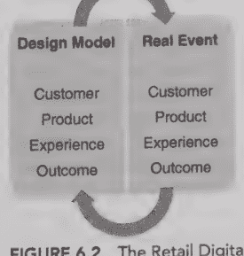

**FIGURE 6.2 The Retail Digital Twin Model**

### 未来的商店

虽然在线渠道在过去几年获得了大量关注，网上渠道取代实体店的威胁已持续相当一段时间，但现实是大多数零售业务仍然通过实体店进行。在线在总零售业务中的份额仍不到 10–11%。即使对于像 Inditex 这样拥有 Zara、Massimo Dutti、Bershka 等品牌且在线渠道强大的大型时尚集团，在线业务的份额也不到 14%，预计未来五年将保持在十几的水平。但未来的商店将与我们今天所知的不同。

亚马逊已在过去 20 多年里成为零售业最大的颠覆者之一。2016 年 12 月，它迈出了颠覆未来商店的第一步，于西雅图开设了第一家 Amazon Go 商店，该店于 2018 年 1 月向大众开放。这一未来概念店是 AI 和一些最先进的数字技术如计算机视觉、传感器融合、地理围栏等的综合体。该店通过实现无摩擦购物彻底改变了客户体验。

像微软这样的科技巨头也创建了类似的概念店，因为它们希望以技术和分析来赋能零售商。

AI 赋能的未来商店主要将在以下三个方面与众不同：

#### 自动化购物和结账

一个非常庞大的摄像头网络跟踪人们的移动以及单个商品的位置和数量。这有助于商店系统引导购物者到他们想要购买的商品的具体位置，并根据他们的个人历史、其他购物者的行为或当前促销活动推荐其他相关产品。购物车、货架上的传感器，有时甚至单个商品上的传感器会汇总已购买的商品。深度学习算法不仅了解如何在顾客逛店时引导他们，还能驱动库存管理和其他供应链流程。位置跟踪和数字支付系统完成了结账流程。

#### 商品管理

商品管理存在许多零售商必须处理的问题。管理陈列库存和店内库存是所有品类共同的挑战。了解库存流动速度是相关的重要问题，对物流管理有严重影响。同样，商品的摆放及其对购买行为的潜在影响是零售商苦苦挣扎的另一个大问题。在购物过程中，顾客经常从一个地方拿东西并放在另一个地方；将东西放回正确位置是一个非常手动密集且繁琐的过程，适用于所有不同类型的零售商。

然而，一些问题是特定产品类别独有的。例如，在新鲜农产品区，了解何时开始变质，这可以通过简单的目视检查来评估，例如香蕉开始变色，这就是开始促销和/或更换陈列库存的重要触发因素。在时尚商品的情况下，购买的与人口统计的关联是零售商希望跟踪的关键指标。这也有助于开始识别趋势。

### 购物者分析

在未来的商店中，购物者的每一个微动作都会被捕获并进一步分析，以改善体验并增加收入。零售商最重视的数据之一是有多少购物者带着购买意图进入商店，但最终却没有购买就离开了。例如，在美国的大都会地区，据估计，在大多数 Walgreens 门店中，每五名甚至三名购物者中就有一人因为没有找到他们想要的商品而离店未购。通过研究购物者的移动轨迹，合适的摄像头和分析技术可以精确定位具体问题。这是一个直接的营收损失问题，因为购物者经常会去其他商店寻找同样的商品。同理，在便利店中，最大的利润来源是食品和饮料；汽油（或柴油）仅仅是吸引客户的手段。一家便利店卖一杯冷冻饮料（如 Slurpee 或 Icee）赚的钱比卖满一箱汽油还多。如果商店的食品和饮料缺货，将对盈利能力产生重大影响。

分析的另一个关键领域是了解哪些商品应摆放在邻近位置，以推动冲动消费。了解哪些商品通常被一起购买、由谁购买以及通常在什么时间购买等模式，可以帮助门店经理动态调整陈列并提高销售额。这是图像分析技术可以提供深入见解的另一个问题。

了解购物者的人口统计数据分析、他们访问的时间、购买的商品、消费金额、每月的日子以及每年的时间段如何促成不同的购物模式；哪些其他事件可能影响购物；一家商店发起的促销活动（无论是同类还是不同类别）对该商店或连锁的销售是否产生影响等，这些都是非常有价值的信息。目前，这些数据的某些形式其实已经可用。但由于收集方法不一致，数据的可靠性并不高。如果更多的数据收集工作转向基于摄像头和位置的传感器，并利用 AI 技术对数据进行关联和解读，我们将能获得更好的洞察。

未来的商店将在现行做法的基础上带来许多改进：

- 个性化购物体验
- 加快结账流程
- 允许动态定价和定价实验
- 提高库存和供应链效率
- 减少盗窃和损耗

归根结底，未来的商店将在提升客户忠诚度的同时，提高门店的收入和盈利能力。但并非所有零售商都能实施“未来商店”的概念，因为这种努力需要在技术和物理空间重构方面进行大量投资。那些最快推广并扩大该模式的企业将在竞争中建立颠覆性优势。亚马逊（Amazon）是零售业的晴雨表之一，计划在本十年开设超过 2,000 家实体 Go 门店，引领这一领域。首先，他们将购物从实体店转移到了线上，现在他们又将其以一种新的形态带回线下。为了不落后，沃尔玛（Walmart）也正投资其“Walmart Intelligence Retail Lab”。类似地，Costco 正利用机器学习（ML）来驱动其烘焙和生鲜食品部门，以减少浪费并更好地满足客户需求。甚至较小的玩家和零售业供应商也在尝试类似概念，为未来做好准备。

### 未来的零售商

在未来，AI 将在大多数零售商的更广泛功能中更深度地嵌入。AI 采用的速度已经很高，且这一趋势将持续。AI 既将用于面向客户的应用，也将用于简化内部运营。由于零售业是高度依赖规模、竞争极其激烈且利润空间受限的行业，运营效率的微小提升将对业务表现产生乘数效应。根据发表在《Digital World Information》上的一项研究，26% 的 AI 应用将专注于客户，74% 则专注于运营收益提升。多类别零售商在采用 AI 方面处于领先地位。大型玩家已将 IT 预算的约 10% 投入 AI，而较小零售商则将约 7% 的 IT 预算用于 AI。以下是我们认为未来零售商将使用 AI 的一些用例。

#### 融合全渠道客户分析

几乎每个零售商都已经具备多渠道战略——至少拥有在线和实体存在。有时，尤其是在消费品领域，一家商店可能经营多个品牌。在在线渠道中，收集和以客户数据相对容易，但从实体商店中收集相同数据则是一项非常困难的任务，对于非独家门店更是如此。收集过程繁琐，而且门店往往缺乏这样做动力。但随着店内传感器使用的增加，以及越来越多的商店开始至少部分模仿未来商店，此类数据收集将变得更容易。然而，由于数据在格式、频率、可靠性和质量方面存在差异，管理这些数据将非常复杂。这是全渠道客户分析和获取客户完整 360 度视图的最大挑战。当我们开始将行为分析叠加在身份和交易分析之上时，我们就进入了分析复杂性的另一个领域。这正是 AI 介入使数据综合和分析执行成为可能的地方。

#### 预测未来趋势并适应产品设计

一旦深入理解客户、其需求和愿望以及市场中的其他趋势，AI 将被用于更准确地预测未来趋势并影响产品设计流程。此类应用已在许多零售类别中启动。美国麦当劳（McDonald’s）已使用 AI 根据外部天气、一天中的时间、餐厅客流量以及其他库存状况动态调整得来速（drive-thru）菜单。Zara 和 H&M 等快时尚公司利用 AI 预测趋势并优化供应链，将商品从概念到商店的时间缩短至两周或更短。他们进一步使用另一组分析算法，根据过去表现及当地或国家的趋势，决定将未售库存发送至哪些地点。专业服装品牌北面（North Face）正利用 IBM Watson 的认知计算能力，帮助客户决定最适合其需求的产品。这些只是许多早期例子中的几个。随着技术和分析工具的进步，我们将看到设计内容的彻底变革。

#### 优化生产系统和批次大小

为了使整个价值链高效，适应性产品设计必须由适应性制造和履行能力提供支持。这将是零售商中 AI 的另一个主要用例。AI 算法将用于研究和模拟制造过程中的敏感性、产能、吞吐量、效率和财务数据。鉴于向更高程度的个性化以及可能更小的商品批次（以支持个性化）方向的转变，需要动态调整生产线并同时优化排程和排序。这样做将需要使用 AI 算法和 AI 支持的流程自动化。本章开头提到的 Stitch Fix 案例是个性化生产系统的极端情况。我们开始看到更多朝同一方向发展的新兴举措。

#### 定价与利润管理

零售业的净利率非常低。该行业中盈利的公司其净利率通常在 0.5% 到 3.5% 之间。近年来，该行业的利润率一直在下降，且下降幅度加剧。目前，自 20 世纪 40 年代以来，零售业正面临最大的利润压力。许多著名的品牌零售商因竞争加剧以及销量和价格低迷而无法维持财务健康，正走向破产。仅在 2019 年，我们就看到 Barney’s New York、Roberto Cavalli、Forever 21 等许多知名品牌倒闭。因此，任何提高利润率的机会都会受到零售商的极大关注。

定价一直被视为提高利润率的重要工具。在麦肯锡（McKinsey）针对标准普尔 1500 家公司进行的一项模拟中，定价提升 1% 会导致净利润提升 8%[3]。虽然这是跨行业的结果，但对于零售业而言，其重要性同样真实，甚至更为突出。

2017 年，德勤（Deloitte）对零售业中的定价挑战进行了一项详尽的研究[4]。他们得出结论，客户参与度和差异化（或更具个性化）的提供物是更高定价的两个最大驱动力。在他们 2012 年至 2016 年间对富时全球股票指数（FTSE）前 350 大零售商的研究中，他们发现价值和便利品牌（即公司具备正常参与度及差异化的情况）的收入五年复合年增长率（CAGR）为 5.2%，EBITDA 增长率为 2%。但当公司具备高度差异化的提供物和体验时，相同的增长率分别为 18.4% 和 14.3%。我们可以看到，当公司应用差异化策略和更深层的客户参与度时，不仅利润率在上升，其增速还在加速。在本章中，我们已经涉及基于产品的差异化以及 AI 如何帮助实现这一点。稍后在本章中，当我们讨论未来购物者时，我们将讨论更多差异化的体验。

对于更传统的定价干预措施，如基于客户和其他因素（如库存、一天中的时间、门店表现等）确定动态定价，测试价格弹性以及其他此类干预措施，AI 比零售商以往使用的常规启发式方法更有效

传统上。Kroger通过结合智能货架传感器和客户信息，以及一套基于AI的分析，在其移动应用中提供个性化动态定价。

#### 客户服务

迄今为止，AI在客户服务中的应用最为广泛。从早期实验中，我们看到了令人鼓舞的结果，例如客户满意度提高9%，客户投诉减少8%，客户流失率降低5%。在客户服务方面，AI已被应用于多种不同方式，例如：

-   智能交互式聊天机器人可实现客户服务自动化，并更深入地洞察客户行为，帮助客户找到合适的商品，帮助客户了解更多关于产品和品类的信息，以及执行其他类似功能。
-   自然语言语音处理有助于更好地理解人类情绪及其对行为的影响。
-   长短期记忆分析（LSTM）模型，用于在聊天机器人无法满足客户服务需求时，找到合适的客服专员。
-   基于图的知识管理系统已被用于更好地装备客户服务专员。

这类用例已经有许多试点项目，并且已经进行了一段时间。例如，日本软银公司使用了基于AI的人形机器人Pepper来感知人类情绪。在美国的零售环境中，Pepper带来了店内客流和销售转化率的提升。Conversica的AI驱动销售助理工具已被用于通过识别和与来自在线渠道的销售线索进行对话，来改进销售运营流程。1-800-Flowers.com使用IBM Watson创建了一个基于AI的礼品礼宾服务。世界各地还有很多类似的例子。随着技术的进步，我们将看到越来越多的用例涌现。

### 多渠道库存管理

随着客户购买产品的不同渠道日益模糊，库存管理变得越来越复杂。由于历史遗留原因，大多数零售商拥有多种库存管理系统，有时还使用第三方物流，使情况更加复杂。这些系统各自带来不同的数据格式、准确性水平、采集频率和元数据。基于AI等先进技术变得必要，以理清这张网并获得所需洞察。像Kohl's、Lowe's和Walmart这样提供配送到店和店内自取的公司，已经应用机器学习实践，通过利用仓库和门店库存数据来展示库存可见性。

#### 欺诈检测与反洗钱

欺诈检测、支付安全和反洗钱是AI在其他一些领域中的应用，不仅在零售业，在许多行业都有应用。问题检测很复杂，需要AI的力量，因为交易（即使是欺诈性交易）可能数量庞大、金额微小且看似正常，除非进行复杂的模式分析，否则很可能会错过它们。我们将在AI与金融一章中更详细地讨论这个话题。

### 未来的购物者

150多年来，我们的购物方式一直在变化。1861年，Pryce Pryce-Jones在英国威尔士创立了第一家邮购业务，让消费者可以选择在家中舒适地购物。而Tiffany于1845年在美国以Blue Book开启了同样的潮流，这一传统延续至今，Montgomery Ward则在1872年开创了多品牌邮购业务。21世纪头十年引入了在线购物，第二个十年则将社交媒体的影响带入了购物。现在，AI将进一步改变我们购物方式和购物渠道。

在我们深入探讨AI将如何改变购物之前，让我们先审视一些主要趋势。

-   a. **社交媒体影响。** 社交媒体已经渗透到我们生活的方方面面。它已经对人们的购物选择产生了巨大影响。鉴于我们在社交媒体网站上花费的时间，它们已经并将继续成为信息和购物触发因素的主要来源。购物者也经常依赖社交媒体来获取产品评论和见解。最近一项研究显示，超过65%的消费者在做出购买决定前会阅读在线评论，其中90%的人信任这些评论。因此，零售商需要更复杂的系统，以在社交媒体或在线网站上发现其产品或服务出现的新问题，对问题做出快速响应，并且响应要真诚而个性化。这将有助于建立信任。这需要先进的情绪分析能力，以及从多个非结构化来源综合信号和情绪的能力。

-   b. **时间紧缩综合征。** 两个同时发生的趋势正在影响人们未来想要如何花费时间以及花在什么上，尤其是在千禧一代和Z世代中。他们花在网上的时间越来越多，根据2017年Ofcom的一项研究，比普通成年人多近50%，而且其中超过70%的人认为5-10年后他们的生活将更加忙碌，而那时他们的消费能力将达到顶峰。这意味着，如果零售商能够优化客户在他们那里的时间，并让客户感受到最大的产出和参与度，他们就能获得更高的客户忠诚度，进而获得更多的钱包份额。人们不仅会寻求物有所值，还会寻求时间价值。这将对实体店的位置和布局、在线渠道的组织方式、零售商尝试接触客户的频率等产生影响。要做到这一点，零售商将需要比今天收集到的更多数据和更详细的数据，并通过涉及神经网络的更深入分析来跟进。

-   c. **社会意识。** 对环境和道德供应链的关注日益增加。这种情况正在个人层面发生，也在一些正在立法规范环境影响的进步社会中发生。在IDG进行的一项研究中，超过60%的35岁以下人群表示，环境和社会意识是其购买决策的关键因素，并且在未来几年内仍将是重要因素。我们看到围绕有机食品、天然纤维、禁止使用塑料包装和运输、可持续供应链、道德种植和贸易实践以及其他此类社会影响要素的趋势不断上升。零售商必须更好地了解个人层面的偏好，并相应设计其产品和分销点。

-   d. **购物渠道的重新定义。** 如今，各种购物渠道之间已经没有明确的界限。人们不再只是从实体店购买他们想要触摸和感受的商品，而其他商品则从线上渠道购买。商店的目的受到了质疑。当零售商更多地转向线上渠道而非实体店时，并没有明确迹象表明他们的收入增长表现更好。顾客在购买什么以及从哪里购买方面表现出非常不一致的行为。由于零售商在实体和虚拟的不同渠道上投入了大量资金和时间，他们需要更好地了解客户的偏好，并引导他们选择能够为其创造最大优势和参与度的选项。

-   e. **个性化。** 通过定制推荐、定价甚至产品配置来创造完全个性化的购物体验，是零售业最重要的趋势之一，并且在几乎所有零售商的议程上都占据重要位置。即使是像Walmart和Amazon这样更面向大众的零售商，也非常重视个性化。实现高度个性化面临许多挑战；其中一个大的挑战是，要在零售商用于与客户互动的众多渠道中，协调客户的身份以及关于她的一切数据。随着生活其他各个方面的个性化程度不断提高，客户对购物体验也有类似的期望，甚至可能更高，因为购物是一种非常私密的体验。零售商实现个性化的另一个挑战是维持或提高盈利能力。这是一个建立在最大化大规模投入回报基础上的行业；当我们试图将业务的DNA转向另一个极端时，业务的所有基本要素都必须被彻底重新构想。这也要求实时适应性，而实时适应性又需要高速和多变量分析来确保盈利能力。这正是AI发挥作用的地方。

这些趋势和影响将导致购物体验的两大转变。

### 机器人购买

机器人购买是一个相对较新的概念，仍处于开发早期。你可能在几家在线零售商店看到过自动订购功能，尤其是那些经营杂货的商店。在这种模式下，一定数量的商品会在预定时间内以预定价格运送到你手中。这种方法非常线性地绑定到单个商品，并基于简单的基于时间的订购规则。现在想象一下给这个模式打上强效类固醇——一个智能软件程序首先根据通过某种机制（如智能冰箱的库存信息或安装在你所在位置的传感器）得出的消费数据，弄清楚你需要的一切常规物品；然后，它根据品牌、功能、质量或用户评论反馈等边界条件，找到购买这些物品的最佳交易；最后，它自主订购商品。对许多

categories of things we buy, sometime in the future we see that bots will be doing a lot of the buying. These bots will be powered by AI-algorithms to do the three functions we mentioned here. Bot buying will save time and make the shopping process more efficient. This will require retailers to completely reimagine a lot of processes and use technology very creatively because the current ones are all based on either human interactions or simple rules.

### Converged Customer Experience

AI will also tackle the problem of extreme and dynamic fragmentation of customer engagement across all dimensions of experience, purchasing, and trust drivers. The AI-based programs will stitch together the micro-moments across all of these experience points, model and extrapolate the next few actions shoppers will most likely take, and make recommendations to adapt those steps to secure a sale or further the customer experience. This approach will help to build deep engagement with the customer.

### Warehouse of the Future

The warehousing industry is a very large industry by itself. Globally, warehousing accounts for about $2 trillion in economic activity(5) and has been growing at a moderate mid-single-digit pace. It sits at the intersection of retail, manufacturing, and transportation but is mostly influenced by the retail industry. Warehousing has been going through some transitions. Rising disposable incomes have led to increased consumption by people across most economies (not counting the current COVID-19 situation). More consumption has led to more goods being in demand that drives more need for warehousing. The globalization of demand and supply points has also contributed to the growth of warehousing. However, we are also seeing increasingly abrupt disruptions in economic activity due to political, environmental, or health-related issues. When such disruptions happen, it starts creating different pressures on the warehousing industry. Given the state of the world today and the impending changes that are happening, the warehousing industry is becoming very complex and critical, with an increasing need to be more adaptable, efficient, and inexpensive.

Digital technologies are already making inroads into warehousing and associated logistics functions. Computer vision and robotics have started to find extensive use. These technologies are being used to find storage places, locate inventory, count inventory, drop and pick things, reorganize things, pack and ship material, and create alerts if there is an emergency or other type of threat like theft. Such functions that used to be manually executed are now being automated to bring speed, flexibility, and remove human-induced errors. Labor cost savings are a huge byproduct of this automation. For these automation capabilities to work, massive scale image processing and optimization algorithms are required; that is where AI steps in. Rapid reconfiguration of warehouses is another area where AI techniques are used; the land cost and labor cost both can be optimized through constant reconfiguration as the business evolves.

Amazon has been using robotics, computer vision, drones, and location tracking technologies in its fulfillment centers. In early experiments, they found 5× or higher efficiency when compared to humans. Many postal departments and shipping companies like FedEx are also using similar technologies. The trend will continue. However, there are some challenges with this level of automation that still need to be solved. For example, if a package breaks, the system may not be intuitive enough to handle the situation quickly all by itself. If humans and robots have to work together, optimal task distribution and coordination between them becomes complicated. But as technology progresses and analytics becomes stronger, these issues will find a resolution. Like most other applications of AI and digital technologies, full maturity and complete automation will take a few years. Amazon estimates that before 2030, they will have complete lights-out warehouses, which means there will be no human involvement with the actual operation of the warehouse.

### SUMMARY

The retail and consumer products goods (CPG) industry is one of the oldest industries in the world with a deeply synergistic relationship with the health and growth of the economy. As we have seen in this report, over the last 150 years, this industry has gone through many transformations and is now at the cusp of another major disruption. The current epidemic crisis is pulling the future forward.

In this chapter, we started our discussion with the economic, policy, demographic, sustainability, and epidemic crisis influences. We then moved on to discuss how AI will change the retail industry of the future, especially in the following areas:

- a. Personal lifestyle clouds to get a holistic lifetime view of the individual consumer
- b. Digital twins to simulate retail business models
- c. Store of the future, which allows for more efficient and personalized experiences for the consumer and better operational efficiency for the store
- d. Retailer of the future, which is more tuned to a D2C business model in addition to making their other business models more efficient
- e. The shopper of the future, who will be looking for new experiences

The recent COVID-19 crisis is expediting the transitions in this sector. Now retail companies are being required to understand their customers more deeply and individually as the business models continue to shift. Speaking in an exclusive interview with the author, Michael Nilles, Chief Digital and Information Officer of Henkel, the $21 billion German chemicals and CPG giant, says,

Consumer behavior is fundamentally changing. Personalization and convenience expectations are becoming key and digital channels are the new channel of choice. Corona has accelerated the need for digitization in the CPG industry. Companies successfully mastering to build new digital and data-driven business models like direct-to-consumer (D2C) will be leading the pack. AI is playing a key role in understanding personalization needs around the consumer and customer.

While AI makes a huge impact on customer-facing functions, it has an equally big role to play in the entire company for more efficiency and productivity.

### REFERENCES

- (1) "Global Retail Sales 2017–2023"; Liam O'Connell; November 2019.
- (2) "Constellation Research 2018 Artificial Intelligence Study"; Courtney Sato, R. "Ray" Wang; June 2018.
- (3) "The Power of Pricing"; Michael V. Marn, Eric V. Roegner, and Craig C. Zawada; February 2003.
- (4) "The Retail Profitability Challenge"; Deloitte Research; March 2017.
- (5) "Warehouse Market Growth"; Eye for Transport editorial; October 2019.

### Transforming Financial Services with AI

> "We don't have to be smarter than the rest; we have to be more disciplined than the rest."
> —Warren Buffett

#### INTRODUCTION

The financial services industry is the bedrock of the world economy. It contributes nearly $20 trillion(1) out of the global GDP of about $90 trillion. Not only is this industry a major contributor, but every dollar of the economy moves through this industry. Banking, insurance, brokerage firms, and other such sectors are the various arms of the financial services industry. The COVID-19 pandemic has badly impacted the global economy and the various sectors like financial services. As the world starts getting back to normalcy after we figure out how to deal with the crisis, we all will be looking at the financial services industry to jumpstart the economy.

This industry historically has been one of the highest spenders on technology; average IT spend as a percentage of revenue is about 7%. This industry also has traditionally been one of the earliest adopters of technology. However, given the stringent regulatory environment that they have to work in, the size of the companies that operate in this industry, and the fast pace of evolution of technology in the last decade, the financial services industry also has a lot of technical debt to deal with, especially a large number of older banks that are still using very antiquated core banking systems.

This is an extremely data-rich industry and success in this industry is heavily dependent on being able to quickly and accurately generate insights out of that data. This industry is also heavily influenced by events and trends outside of the control of this industry (e.g. geopolitical events or health crises). Being right and being early in spotting trends and capitalizing on those trends is key to success in financial services. The world's greatest living moneymaker, Warren

巴菲特正确地指出，财富的增长关键在于数据和纪律。因此，该行业也看到了人工智能的巨大潜力。在一项由德勤（Deloitte）进行的研究中，70%的参与企业认为人工智能将改变其业务，并报告称已参与至少某项人工智能计划。在同一项研究中，增长较快的企业认为人工智能是其增长的重要驱动力。报告显示：“排名前30%的金融服务公司作为先行者，更擅长将人工智能整合到其核心战略业务中，比竞争对手更快地带来收入增长和成本收益。”有几家公司大胆地在核心业务和决策引擎中探索使用人工智能和数字技术。例如，金融巨头贝莱德（BlackRock）构建了一个名为Aladdin的平台，该平台利用人工智能，涵盖风险管理、投资组合管理、投资运营和交易执行等一系列服务，面向各种金融服务提供商。据报道，2019年该平台管理的资产规模达17万亿美元。

人工智能的影响将在金融服务部门的各个职能中体现出来——从客户管理到风险管理。在本章中，我们将探讨人工智能将改变该行业的一些关键领域。

### 人工智能将如何改变未来金融服务行业

与许多其他行业一样，人工智能将对金融服务业的多个方面产生深远影响。剑桥大学法官商学院的剑桥替代金融中心（CCAF）与世界经济论坛（WEF）最近进行了一项全球调查$^{12}$，涉及151家参与传统金融服务的公司以及金融科技公司，旨在了解人工智能和数字化转型对金融服务业的影响。该研究报告于2020年1月发布。根据研究结果，77%的所有受访者预计人工智能将在两年内对其业务产生显著更大的重要性，64%预计将在多个职能中应用人工智能；然而，据报道，仅有16%在多个职能中使用人工智能。

#### 个人金融云

我们在第3章关于医疗保健的内容中首次介绍了特定领域的以个人为中心的个人云概念，并在后续章节中使用了类似的概念。再次强调，我们认为金融服务业中最具变革性的发展之一是个人金融云的开发。我们大多数人，甚至所有人，都有个人财富目标以满足当前和未来的生活方式需求。为了追求这一目标，我们有收入、储蓄、信用卡、其他支出、投资、税收、债务及其他金融交易工具。对于这些工具和交易类型中的每一种，我们通常都与不同的机构打交道，并使用不同的应用程序。我们的财富目标以及许多此类金融交易（如投资价值或投资回报）都会受到我们无法控制的事件的影响（例如股票市场表现、地缘政治事件等）。通常，此类事件具有历史趋势及其随时间产生的影响。因此，如果我们能绘制这些趋势并向前预测，我们就能更了解它们对我们的影响，并可能据此采取行动。为了实现这一点，我们需要来自各种金融系统的数据，并以个人为中心对其进行高级分析。但基于历史趋势的预测能力并不总是准确的。

最近的新冠疫情危机就是这样一个事件，它在极短的时间内毫无预警地彻底改变了世界经济。有人可能会认为，此次危机的性质及其影响与1918年的西班牙流感疫情类似。虽然疫情之间存在相似性，但全球经济结构非常不同：现在它变得相互依存和整合的程度要高得多。即使在如此的情况下，通过综合来自不同来源的数据，应用高级分析，并基于经济、政治和社会各个维度之间的相互关系预测未来可能的情景，也可以更好地理解对个体层面和经济层面的影响。

除了那些保留专业财富管理服务的极高净值人士外，我们大多数人并没有全面掌握我们的收入、债务、财富以及塑造这些财富的事件的现状和未来，尽管所有这些数据的个体部分都可获取，且可以较为准确地建模预测其未来值。

人工智能将有助于整合所有这些信息，使其合理化，并创造新的结果和商业模式，这将改变金融机构与个人互动的方式。这一变革的核心在于推动个体层面的行为和行动。美国金融评论家、作家兼广播主持人戴夫·拉姆齐（Dave Ramsey）曾评论道：“个人理财只有20%是头脑知识，80%是行为！”这是财富创造的最大驱动力之一。如今，我们被期望在缺乏关于未来的适当知识和洞察力的情况下保持纪律并行动；个人金融云将通过在事件发生及其演变过程中赋予我们知识和洞察力来改变这一现状。

开发个人金融云面临的挑战与在第2章中描述的个人健康云非常相似。在此回顾：

- 缺乏能够访问大多数信息的主要参与者
- 除个人外缺乏锚定受益者
- 开发复杂性
- 商业模式不明确

尽管个人金融云将对行业产生巨大变革，因为它将权力从大公司转移到个人手中，并颠覆所有已知的商业模式，但它也将面临大量的在位者抵制。有一件事是肯定的，随着个人金融云的开发，更多的人将以更富成效的方式参与金融服务业。

#### 欺诈检测与反洗钱

大多数金融服务公司认为欺诈检测和法规合规是人工智能发挥作用的最大领域之一。在本节开头提到的CCAF-WEF研究中，超过半数的受访公司认为此类风险管理是人工智能的最高用途。欺诈是该行业的一大问题，且成本高昂。根据LexisNexis Risk Solutions针对美国金融服务和贷款行业的2019年《欺诈真实成本™》研究，对于每一美元的欺诈损失，金融服务公司现在产生的成本为3.25美元（包括交易面值损失即公司承担责任的部分、产生的费用和利息、罚款和律师费、劳动力和调查成本以及外部追回费用），高于2018年的2.92美元。其他机构也有类似报告，表明欺诈具有类似的影响。随着移动银行、数字交易和跨境交易的增加，过去几年的欺诈率一直在上升。欺诈不仅导致机构或商户遭受重大财务损失，还要求金融机构、商户和消费者花费大量非生产性时间来调查和处理这些问题。如果保险行业受影响的话，其影响程度也相当之大甚至更大。据美国联邦调查局（FBI）称，欺诈使普通家庭在保费上平均多支付400至700美元。反保险欺诈联盟（Coalition Against Insurance Fraud）估计，在美国，欺诈对所有保险业务造成的年度影响超过800亿美元。这个问题遍及世界各个角落，在大多数国家的影响同样具有毁灭性，导致该行业10%的效率损失。

欺诈通过多种途径发生——黑客窃取信用卡和银行信息并利用其盗取资金，组织犯罪集团攻击大型金融机构并转移资金，恐怖分子和罪犯通过常规金融机构在其非法所得经过多层伪装后进行洗钱，等等。这些犯罪有时缓慢地随时间发生，有时则非常突然。每当发生此类事情时，通常会打破正常交易和行为的模式。通常还有其他相关事件。例如，如果一个人有特定的消费模式，而突然发生高频或异地消费，这可能表明欺诈。另一个例子是，如果某个银行账户只有存入，且只有非常特定的定期取款，这可能表明洗钱。嫌疑诈骗者或罪犯在疑似地点进行超出基线位置的银行交易是另一个此类例子。有数百部电影以真实事件为灵感，展示了此类创新技术。无论是银行、保险还是其他类型的金融服务机构，它们都引用数据问题和缺乏及时警报作为防止欺诈的最大挑战。从某种意义上说，这个问题是一个矛盾修辞；这是一个数据丰富的行业，但缺乏从数据中获取洞察力的工具。

人工智能是我们拥有的用于任何数据集中异常检测的最佳工具之一，在检测表明潜在欺诈的此类异常方面非常有帮助。人工智能在梳理大量高频交易并研究其在多个维度及不同粒度层面上的情况方面非常有效。人工智能程序可以在多个无关数据集、不同网络、多种实体、管辖范围、客户、地点、机构及其他此类变量之间执行此操作。此类例子已经存在。例如，使用人工智能驱动的预测分析为机构提供欺诈检测服务的FICO Falcon平台就是这样一个例子。

人工智能还以许多其他创新方式应用于检测和预防欺诈。IT服务公司Cognizant与其中一家银行客户合作，使用OCR和深度学习来识别支票上的伪造签名。每天都有数百家金融科技公司推出新的解决方案和使用案例。

#### 客户服务

从一开始，客户服务就是金融服务业中一项非常高接触度的活动。它是增长和差异化的核心驱动力之一。其高接触度的性质

……of the function makes it expensive and impedes scalability. Customer service is also highly variable because of the differences in personalities, training, and experience of the agents. Variability drives errors and customer dissatisfaction, which in turn impacts business. Financial services industries have been innovating around their products and services, especially over the last two decades. This has caused additional pressure on the customer service function because of several factors, like training the agents on the new products and services, making them understand the complexity of the business, exposing them to the evolving regulatory environment, and preparing them appropriately for the increasingly global nature of the business. Because of these reasons, customer service as a function is a good candidate for transformation through AI. There are many applications of AI in customer service like chatbots, deep learning of customer and agent behaviors, predictive diagnostic of customer needs, AI-enabled RPA of routine functions, and other such similar functions.

Chatbots are software programs mimicking human interaction. We all have most likely used chatbots in some form already. The concept of chatbots traces back its roots to the 1950s when Alan Turing described what programs should be able to do to demonstrate human-like intelligence. The first chatbots ELIZA and PARRY are more than 50 years old. However, chatbots became more popular and mainstream only in the last five years, starting with Facebook releasing and promoting many of them from 2016 onward.

Chatbots in the financial services sectors are believed to have been first introduced in 2016 by Russia-based Tochka Bank. They launched their own Facebook for a range of financial services, including the possibility of making payments. Barclays Africa quickly followed it up with their chatbot app on Facebook in mid-2016. Since then, nearly all major banks in the world have their own branded chatbots. Bank of America has Erica, American Express has AmEx Chatbot, HDFC Bank from India has EVA, HSBC Bank has Amy, Société Générale has SoBo, Commonwealth Bank of Australia has Ceba, and the list goes on. Each of them offers slightly different functionality, but broadly all of them allow customers to check balances, make payments, activate cards, seek interest rates for different products, pay bills, get reports, etc. The chatbots also allow the institution to seek feedback from customers, suggest new products, and better understand their needs. Today, Bank of America is leading in the usage of chatbots in customer service. As of a year ago, Erica, the Bank of America chatbot, has more than 6 million monthly users, a number which has gone up significantly because of the higher use of remote banking as a result of the COVID-19 crisis. Banks are not the only financial services institutions implementing chatbots. Insurance and other financial services companies are doing the same. Allstate insurance has their chatbot Abbie (pronounced as *abbie*), which helps agents quote new insurance policies to customers. In a few years, autonomous vehicles will completely change the landscape of auto insurance and this is driving the insurers to quickly get ready for the new realities.

Chatbots are evolving very rapidly in both their capabilities as well as application use-cases. They have started to handle more complex tasks than the simple routine ones that have been their domain so far. The sophistication of chatbots is being led by three major developers – more advanced algorithms from other domains that can do more complex processing, controlled natural language allowing better conversational intelligence, and merging of multiple AI capabilities beyond NLP and ML to create a more humanlike experience. Tools like DataChat are based on controlled natural language like NLP interfaces like chatbots to the next level, HDFC Bank in India has done a pilot project called Humanoid Intelligent Robotic Assistant (IRA) as the first interface for customers when they visit branches. Popular messaging platforms like WeChat have implemented chatbot-assisted advanced capabilities to transform e-commerce in China. Better integration between intelligent voice-activated personal agents like Alexa and Google Home with the financial services industry platforms will further drive up the usage of chatbots.

The financial services institutions have a lot of information about their customers. They not only know about the movement of wealth in the customers' lives but also get exposed to a lot of major life events. If they stitch all of that together, they can predict the future needs of their customers and proactively approach them with customized solutions. In the past, this type of service was provided by your friendly neighborhood bank manager – she learns about your upcoming engagement and offers you home and car loans. Now, doing so on a one-to-one basis is not possible. But by synthesizing the data from different sources, including social media, AI programs can predict your needs and either directly create an outreach or prompt the bank staff for an outreach. This is akin to what is already happening in the retail industry, which we have previously discussed. Predictive diagnostics and outreach programs triggered by them can be the biggest driver of cross-selling and upselling. This is true both for an individual as well as institutional customers.

Process automation using AI and RPA is a compelling method to improve operational process efficiencies. For routine tasks, the software can understand the task, figure out the execution path, validate its legitimacy, execute it, and then finally close the loop with the customer, the bank, and the internal systems of the bank. AI will be more effective than humans in identifying anomalies and risks in the execution of the task, thus making it more effective. For example, AI will have a higher chance of identifying fraud as discussed above than humans. Many banks have run pilot projects in this type of application. For example, Bank of New York Mellon ran a pilot initiative a few years back and got some impressive results in their account closing process which traversed multiple systems. They recorded an 88% improvement in the processing time, 100% accuracy in the validation of closure, and 66% improvement in trade entry time. Similar implementation in the fund transfer process also led to significant savings and reduction of errors. Better process execution like these examples puts more money in the financial institution's bottom line, makes the customer happier and inclined to do more business with the institution, and improves the compliance.

### Contract Management

Managing contracts is a constant yet complex activity in every aspect of the financial services industry, and that has been true forever. Each contract may have dozens of clauses and hundreds of scenarios when they might get invoked. While most of the financial instruments follow standard contract terms and conditions, there are specific nuances to how they are applied to every individual situation. Contracts can be hundreds of pages long and are often difficult to follow. At the time of sales, if the agent handling the sales process has customized any of the riders in the contract, the situation becomes even more challenging. Every time an individual or a financial institution needs to use the contract to adjudicate any claim or dispute, it becomes a complicated and sometimes contentious task. Adjudication of a contract is fraught with individual interpretations of the terms and arguing about evidence. This is very frequent in health insurance, auto insurance, and property and casualty insurance industry segments.

Even if there is no problem around the contract terms and conditions, managing the thousands of contract documents is an onerous task for the financial services companies. For example, JP Morgan Chase (JPMC), one of the largest financial institutions in the world, spent over 360,000 person-hours in 2017 to analyze just 12,000 commercial contracts. This is nearly a week per contract! Legal documents need to be analyzed and data captured for many reasons like estimating the risk exposure of the company, knowing trigger points for contract enforcement, and so on. While a major part of the 2008 housing bubble burst leading to the previous major global economic meltdown (before the COVID-19 one) is attributed to the greed of traders and executives in financial services companies who built and nurtured the subprime loans market, part of the problem is also attributed to lack of broader transparency around the contents of the tranches of subprime CDO instruments.

AI can help with managing and interpreting the contract documents. Traditionally, Optical Character Recognition (OCR) technology was used to read and digitize documents. OCR relies on specific matching techniques, so it can give very erroneous results when subjected to variations of font, size, dimensions, partial graphs, images, etc. Using AI techniques like ML and NLP allows the OCR to probabilistically and quickly ascertain the most likely interpretation of the document, thereby significantly improving the accuracy and reliability of OCR. Many companies have tried this and seen huge successes. JPMC implemented a chatbot program called Contract Intelligence (COIN) by which they were able to reduce the 360,000 hours spent on document analysis mentioned above to minutes. In another example, Citibank in its Treasure and Trade Solutions division was able to transform its letter-of-credit business line through the use of similar techniques. There are many AI algorithms for pattern recognition like Random Forest and Gradient Boosting that are very useful for such initiatives.

AI is also useful in putting the contract document together. Often people processing financial instruments and contracts for individual customers have to sift through a lot of different documents to get background information about the customer. This happens frequently because customers are given the choice of providing different types of documentation to substantiate some data such as identification or creditworthiness. Since they are issued by different agencies and the formats could vary based on location, managing the variations gets taxing. AI-augmented OCR can help solve this problem.

AI can help not only at an individual contract level but also at an aggregate level. By extracting, classifying, and cataloging the metadata from the contracts, you can identify new patterns about customer segmentation, salesperson efficiency or expertise in risk management, underwriting efficiency, and other operational parameters.

### Underwriting

Underwriting has been at the core of risk management for the banking and insurance industries. For centuries, the process of underwriting has not evolved much; however, AI is changing that. Traditionally, the underwriters have to evaluate every situation and every instrument on a case-by-case basis. Therefore, historically, underwriting has been time-consuming and required a very high degree of specialized knowledge. This also leaves underwriting exposed to high degrees of variability because much is left to the interpretation of the underwriter. Underwriting involves a lot of unstructured and textual information analysis by the professionals to get a comprehensive

在应用模型之前，必须先从风险场景的角度进行审视。这使得承保流程变得更加复杂和低效。

人工智能技术，尤其是机器学习和自然语言理解（NLU，一种自然语言处理的变体）等方法，正在改变承保业务。NLU 有助于从庞大的非结构化数据数据库中抽象出相关信息，而机器学习则有助于识别风险模式。人工智能模型还将帮助更准确地为不同个体客户及其所投保内容个性化和情境化风险。例如，今天对于某一特定区域内特定尺寸和年龄的房屋的财产和意外险，其风险和由此产生的保费对于符合这些标准的房屋都是相同的。然而，实际风险状况会因房屋内的自动化和预警技术、维护状况、业主或住户的使用方式、与大型水体或树木等高风险物体的邻近程度等因素而有很大差异。人工智能将能够创建所投保物的独特数字孪生，并以高概率预测其风险。人工智能将自动化大量重复的手工任务，从而提高流程效率。

更好的承保源于对风险的更好估计，这有可能降低保险费。这将使客户受益，同时也有助于扩大行业。

### 实时风险管理

承保只是问题的一半。另一半是通过工具或合同的生命周期积极管理风险。此类监控的结果可用于更新风险模型以及其他合同的承保流程。更新后的风险模型也可用于动态更新现有合同的保费。这在汽车保险以及健康保险中已在一定程度上发生。美国的 State Farm 和 Allstate 等公司在五多年前就引入了此类模型。它们利用车辆车载诊断的遥测数据以及交通摄像头、交通违规执法数据库等其他数据流来改变保险费。同样，健康保险公司正在使用 Apple Watch 和 Fitbit 等可穿戴设备的数据来监测健康状况并提供折扣或调整保费。现在，合成完全不同的数据流（如健康和驾驶数据）以创建更全面的个人资料的新可能性出现了。结合其他生活方式数据，这可以将实时风险管理提升到更高水平。

### 销售管理

与其他行业一样，金融服务行业也有标准产品和服务，供各公司向其个人和机构客户提供。然而，有一个很大的区别。金融服务行业的销售是一项非常情境化且非常个人化的活动。即使许多人购买相同的存款计划、相同的股票或相同的保险，他们购买时的情况和购买驱动因素也可能非常不同。除了保险之外，大多数情况下个人选择的交易工具是可选的和自由裁量的。由于金钱非常个人化，个人的自尊和未来与他们做出的财务选择密切相关，因此他们更愿意与最了解他们并最能理解其处境的人一起做出这些选择，因此之前的评论认为销售是情境化的。这使得销售流程非常困难，因为从事销售的人几乎没有时间和很少的工具来快速收集有关客户的信息以了解其背景并个性化销售流程。这是人工智能将改变金融服务行业销售流程的根本原因。许多金融机构，如摩根士丹利凭借其 Next Best Action 平台，已开始使用人工智能来增强财富顾问的知识和可用选项。他们使用算法通过扫描整个市场来找到最符合客户偏好的投资机会。

聊天机器人将成为销售流程中最常用的工具之一。许多公司已开始进行试点实施。聊天机器人也在越来越多地用于多个行业的潜在客户开发，包括金融服务。当客户向公司，例如银行寻求某些客户服务时，聊天机器人在完成服务后可以利用这一机会推广一些新的相关产品或获取反馈以确定合适的产品。

客户流失是整个金融服务行业的一个巨大问题。12–15% 的流失率有时被认为在这个行业中是较低的，而有时可能高达 28–30%。公司花费巨额资金并付出难以想象的努力来减少客户流失。糟糕的客户服务经常被认为是导致流失的最大因素，但也存在其他制度性原因。随着聊天机器人的增加，对客户服务代理的压力将减轻，使他们能够提供更高质量的服务。此外，人工智能可以帮助将每个个人客户与公司的一系列体验和互动拼接在一起，以预测其最有可能离开公司的概率。研究实验和试点项目表明，通过使用随机森林等人工智能算法，人们能够以超过 90% 的准确率预测流失。现在，如果公司掌握了这些见解，它就可以在流失发生前采取主动措施来减少流失。

信用风险评分是大多数金融服务销售中的常见步骤。传统的信用评分方法非常陈旧，因为它们基于静态规则。启发式方法无法形成对个人财务现状的整体视角并估计未来。例如，如果某人没有稳定的薪水，不开设新的银行账户或信用卡，或不购买新房子，其信用评分很可能会下降，忽略了该个人可能拥有大量现金存放在定期存款中并投资于一些增长非常迅速的初创公司的事实。人工智能将通过综合来自多个来源的数据并预测未来潜力来帮助创建更完整的人财务状况图景。

作为销售流程的一部分，了解客户（KYC）文件和活动也是一个重要步骤。我们之前讨论过使用人工智能实现 KYC 文件。我们还讨论了使用人工智能实现 KYC 文件。与信用风险评分类似，人工智能可以帮助为每个个人客户和潜在客户创建整体数字孪生。

### 贷款管理

贷款是金融服务行业的核心；除了保险之外，他们大多数的收入都来自于此。然而，在许多国家，贷款管理流程非常繁琐。例如，在美国，平均房屋贷款处理时间为 47 天。多年来，这一数字变化不大。鉴于美国的抵押贷款债务总额接近 10 万亿美元，贷款处理时间的任何改善都可以提高该行业的吞吐量。此外，这对借款人来说也是一个巨大的不便，同时也是不必要的开支。

问题的很大一部分在于大量的文件和处理工作，这与承保过程中遇到的问题非常相似。人工智能驱动的光学字符识别（OCR）和自然语言理解/自然语言处理（NLU/NLP）技术可以帮助解决这个问题。人工智能可以帮助识别流程低效率和瓶颈以使流程顺畅。人工智能还可以帮助预测未来估值和风险，将其纳入抵押贷款承保流程。MReport 2020 年 1 月刊谈到了 Capture 2.0，这是一系列广泛的 AI 技术，旨在改变贷款管理流程。几家银行和金融机构开始尝试此类技术。

### 劳动力改革

最后，人工智能将改变金融服务行业的劳动力能力和构成。正如我们在本节中所讨论的，行业中几个劳动密集型职能将被技术取代，导致冗余。虽然这将通过为金融服务行业提供服务的科技公司需求增加而得到部分补偿，但总体劳动力将减少。根据 CCA F-WEF 研究，受访者估计金融服务业务的净减少约 336,000 个工作岗位，而金融科技的工作岗位略有增加 37,700 个。这种劳动力转变反过来将引发许多其他变化——薪酬、员工权利、教育以及此类公司的工作性质本身。

### 摘要

人工智能将改变金融服务行业，这种转变将比大多数其他行业更快发生，这一点很明确。为了实现这种转变，有一些障碍需要克服。以下是未来几年将发生变化的一些非技术性限制：

- **监管环境。** 该行业受到严格监管。决策的清晰可解释性和透明度是大多数监管驱动因素的根本要求。随着技术和人工智能应用的成熟，决策支持系统将能够更好地解释人工智能程序如何以及为何得出特定结论的能力将增加。
- **合规性增强。** 全球范围内，金融服务行业正面临合规压力，这是由少数人的冒险主义或腐败造成的。未来收紧运营环境的趋势将继续。人工智能将有助于缓解一些合规问题。
- **关注消费者。** 变化的社会和政治格局正在将权力方程更多地转移到个人消费者身上，而远离大型金融机构。大型金融机构现在意识到，如果他们以创造性的方式对待客户，就会有许多未开发的机会。这种现象也得到了金融服务中消费者技术日益普及和认知度的提高的推动。这种转变将促进个人金融云类型技术的发展。

**金融服务的进一步融合与演变。** 曾经，银行主要负责存款和贷款，经纪公司主要从事交易，同样地，每一家企业都专注于其核心能力。然而，十多年来，情况已不再如此；如今，如花旗集团（JPMC）和美国银行（Bank of America）等巨头开始涉足所有领域。甚至传统的金融工具也正在让位于众多新产品和服务。这种类型的融合与演变在很大程度上得益于人工智能（AI）的推动。

**高管教育。** 在所有不同的行业部门中，金融服务企业的领导者在教育自身及员工了解人工智能相关技术和机会方面走在前列。从中国到美国，包括中间的所有国家，情况皆是如此。像摩根大通（JPMC）首席执行官杰米·戴蒙（Jamie Dimon）这样的资深银行家，对人工智能和数字技术的阐述能力堪比领先科技公司的首席执行官。教育的不断增加将推动活动和收益的增长，从而形成良性循环。

在人工智能在金融服务领域变得更加主流之前，仍需解决围绕伦理、隐私和安全性的若干问题。我们将在后续章节中对此进行更深入的讨论。算法的技术和应用仍有很长的路要走，但差距正在迅速缩小。

然而，正如本章所讨论的，在即将来的几年里，金融服务频谱中的几个领域将受到人工智能的显著影响。图 7.1 概括了这九个领域。

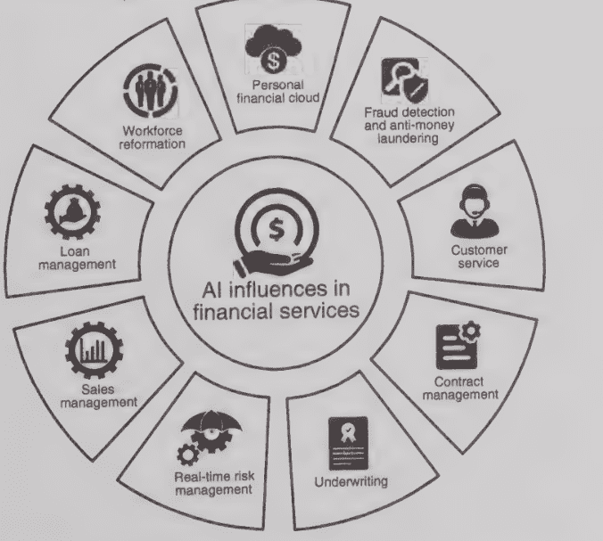

图 7.1 人工智能在金融服务中的影响

这对金融服务业及其受益者来说是令人兴奋的时期。人工智能将帮助我们抵达该行业可能性的下一个前沿。

### 参考文献

- (1) “全球经济的哪个百分比是金融服务业？”；肖恩·罗斯（Sean Ross）；2020年2月。

- (2) “范式转变：全球金融服务人工智能调查”；剑桥替代金融中心（CCAF）与世界经济学人论坛（WEF）；2020年1月。

### 利用人工智能改造建成环境

> *“伟大的建筑必须从不可测量的开始，在设计过程中必须通过可测量的手段，最终必须回归不可测量。”*  
> —路易斯·康（Louis Kahn）

### 引言

富有远见的美国建筑师路易斯·康（1901–1974）在1930年谈论设计时发表了上述言论。他对设计所说的话适用于建成环境的各个方面。随着企业和机构进行数字化转型，人们越来越认识到其设施在这一转型之旅中发挥着关键作用。企业和机构由其使命、战略、运营模式和人财所定义。每个企业和每个机构都有一个使命，由其员工在其工作空间内、通过其工作流程来启用、增强和执行。它们都在一座建筑中汇聚。因此，建筑的数字化转型成为任何组织数字化转型议程的关键组成部分。市民的体验和城市规模的决策也日益受到设计、数据和数字技术的影响。

这些变化正在带来显著的经济机遇。根据麦肯锡的一项近期研究，到2023年，智能办公市场预计将达到470亿美元。未来五年，全球智慧城市市场预计将超过2300亿美元。根据Navigant的观点（他们对市场的看法类似），智能建筑解决方案市场将以16%的复合年增长率增长，到2030年规模将超过1000亿美元。

整体行业规模巨大，颠覆的可能性可能比引用的一些数字更大。全球建筑业约为10万亿美元，占世界GDP的13%。这是一个行动缓慢且抗拒变革的行业。根据麦肯锡对该行业的调查，该行业的生产率一直在下降，目前其影响为1.6万亿美元。如果我们仅考虑用于建筑的不同产品和技术，该市场规模超过5000亿美元。因此，我们有很多机会利用人工智能和一些较新的数字技术带来改变。

如今的建筑是复杂的技术生态系统，是企业机构实现目标的关键推动力。连接端点的增长在住宅和建筑领域达到了指数级增长的拐点，这一趋势无缝延伸至企业和城市。过去两年在这一转型中至关重要。随着供应商采用新一代基于物联网（IoT）的技术、基于移动端的解决方案以及由更高级分析驱动的软件，建筑行业的数字化新阶段正在起飞。

物联网（IoT）技术的当前进步正在重新定义建筑管理如何被感知和执行。历史上由于专业网络、带宽限制、采购周期和功能分离而独立演进的 HVAC（暖通空调）、消防、安保和照明等不同建筑领域，现在正被评估是否进行融合，以为建筑运营商和用户创造更好的成果和体验。建筑自动化和管理正在被新的数字技术和大数据分析的力量重塑。结合丰富多样的智能设备、标准通信协议的快速进展以及对未来基础设施的需求，各行业的跨行业企业开始考虑和/或追求其建成环境的数字化转型。

使用数字技术和人工智能所创造的商业价值不可否认。让我们用一个非常大的全球科技公司的例子来说明，我们就称其为X公司。X公司的商业使命依赖于高效和便捷的产品开发和客户服务，以满足当今数字世界的需求。X公司在全球拥有约300个设施，总面积超过2000万平方英尺，其中许多设施已建成30年以上。去年，他们在运营这些设施上花费了5亿美元以上。有机会在公用事业和维护支出上节省超过3000万美元，同时通过更好地利用空间再节省近9000万美元。这是通过消除各建筑运营标准的差异，并将最佳成本运营作为基准，将这些最佳实践推广到70%的设施来实现的。X公司预期的实际人均平均收入存在差距，他们相信可以通过提高生产力来弥合这一差距。他们的适度目标是提高人均年收入1,000美元；这代表了在其100,000名员工基础上的10亿美元收入改善。通过综合来自多个不同建筑系统和传感器的数据，通过分析识别改进机会，并将可操作的见解反馈到传感器和系统中，可以实现运营成本改善。通过理解空间的使用、人流和员工的工作行为，可以优化空间利用率。通过创建更具吸引力和邀请性的工作场所，推动协作并让人们更专注于待办工作，员工的生产力可以提高。这可以通过使用工作场所设计和个性化技术来实现，允许员工管理其环境，查找设施中的各种服务和公用事业，查找并与同事协作，个人追踪活动，并更多地参与空间及其中的活动。在类似设施的几个试点项目中，我们目睹了生产力采纳率达到20%，

流失率显著降低，创新能力的巨大飞跃，空间需求减少，能耗降低，以及诸多其他益处。在每一家企业、每一处设施中，我们都能找到改善业务成果的机会。

数字技术有潜力为这一劳动密集型行业带来重大的效率提升，并帮助那些正承受压力的商业模式复苏。随着数字建筑角色的重新定义，以及其与智能企业和智慧城市日益紧密的交织，新的可能性和要求随之出现。

### 理解建成环境为何正在变化

尽管建筑和建筑行业在技术采纳方面一直较为滞后，但目前有几个因素正迫使其做出改变。让我们在此探讨其中的一些因素。

### 与企业使命更紧密结合

每家企业都有非常具体的使命，并在追求该使命的过程中面临一些独特的挑战。建筑的使命必须支持企业的使命。越来越多的商业领导者已开始意识到这一点，并要求建筑管理者采取行动以支持这种一致性。

在我们之前关于人工智能将如何改变零售行业的章节中，我们谈到了该行业必须运行的极具竞争性和高压性的环境。麦肯锡全球研究院就新颠覆因素如何影响该行业的经济表现进行了一项研究。我们在该章节中讨论了这些问题。根据该研究，到2025年，由建筑技术（即能源管理和基于状态维护方面）的进步所引发的4100亿至1.2万亿美元的经济影响中，近300亿至800亿美元将归因于此。这是基于零售店每年2500亿美元的能源支出改善20%，以及100亿至40%的维护-修理-更换支出受到10%至40%的成本降低、3%至5%的资产寿命延长和50%停机时间减少的影响。在相邻领域，通过5%的改善，商店布局优化被视为通过提高6万亿美元运营成本来改善运营成本的第三大贡献者，预计带来790亿至1580亿美元的提升。这是一个例子，展示了建筑如何支持增加利润空间的商业使命，尤其是在零售业利润已受到严重挤压的情况下。

在另一个例子中，让我们考虑我们在前文中也讨论过的医院和医疗机构。医疗机构的使命是为患者提供优质的护理，以促进其健康恢复和/或康复。关键利益相关者包括患者及其家属、医疗专业人员、医疗行政人员、保险公司以及联邦和州政府。该使命的可实现部分包括改善患者健康结果、提高医生和护士的生产力、提高客户（即患者和家属）满意度，以及智能化的资产跟踪和管理。图8.1简要展示了如何实现这些使命组成部分，以及一些医院设施经理对这些话题的看法。

在另一个例子中，科技和工程公司的使命是帮助客户通过新产品和解决方案使其核心业务更有效率。通过更快地创造具有更好功能、更好支持和更低成本的新产品以及更优质的产品，这些公司进一步推动了其商业利益。如果员工更具生产力，他们就能做到这一点。正如我们将在本章后文所见，工作场所的建成环境在提高这种生产力方面起着重要作用。我们曾在本章引言中给出了一个相关的例子。

类似地，我们将在每个行业细分领域中发现一个接一个的例子，说明建成环境如何强调企业的使命。这一认识正在推动对建成环境的新期望，进而引发新的变化。

| 使命要素 | 潜在的基于系统实现的活動 | 评论 |
|---|---|---|
| 改善患者健康结果 | - 精细控制温度设置，根据具体病例需求调整病房环境 - 在诊室、手术室和配药站优化照明，以最大限度地减少人为错误 | “智能系统……还应帮助患者更快康复。控制调整是医院持续改进和治疗效果的重点。使用传感器更容易识别患者实现其康复目标所需的环境” – 医疗设施规划公司高级顾问 |
| 提高医生和护士生产力 | - 主动准备诊室/手术室，在患者和医生/护士到达时立即提供理想的工作环境 - 医生/护士位置跟踪，在紧急情况下呼叫最近可用的专业人员 | “你希望消防站通信、头顶寻呼等所有系统都连接起来。你希望在患者陷入困境时灯亮起来，并让其他系统发出警报” – 医院设施管理总监 |
| 提高客户（即患者和家属）满意度 | - 患者/家属对医院或诊室温度、照明、娱乐的控制（或其感知） - 增加患者/家属与医疗专业人员之间的远程沟通 | “患者体验将成为主要驱动力。他们的舒适、教育和娱乐将相互连接。这就是他们在那里待的原因。这是医院绩效和底线的一部分” – 医院设施管理总监 |
| 智能化资产跟踪和管理 | - 更容易定位和优化医疗器械及手术工具的位置 | “你可以使用建筑系统来简化患者护理，通过跟踪患者本身以及医生需要使用设备的位置” – 医疗设施规划公司高级顾问 |

#### 图 8.1 医疗使命与建筑系统

### 技术复杂性与可维护性

如今，管理建成环境涉及大量的技术和复杂性。让我们以一座平均建筑为例，其面积约为10,000平方米或约100,000平方英尺。这座建筑可能拥有约100个仪表和传感器。如果设计良好，以充分利用大多数可用技术，这座建筑可能拥有超过50个子系统。由于市场差异、建筑用途不同、子系统使用的技术不同、设计和安装方式不同等因素，这些系统捕获的数据将有超过100种变体。在这些各种子系统之间，在这座建筑中，每天捕获近50万个样本数据点；每年这会导致超过10GB的数据。如果你拥有像我们刚才讨论的那样几百座平均尺寸建筑的数据，在一年内产生的数据量将超过同一整年内所有用户在进行Facebook“点赞”时产生的全部数据总量；这就是来自建筑的数据规模之大。然而，数据存在问题。平均而言，至少有5%的收集数据是不可靠的；这是由于网络通信问题、传感器准确性或其他原因造成的。

建筑中的设备和系统寿命可能为10-15年，而普通建筑在不进行重大重建的情况下维持的时间是其两倍。使用和占用多样性、技术的演变以及外部因素（如天气）的变化意味着客户期望总是在不断进化。随着居住者和正在运行的业务，完全关闭以进行修理/更换是一个罕见事件。建筑中始终混合着各种系统、供应商和协议。一座建筑可能拥有来自30多家供应商和10多种协议的系统。因此，服务和升级很少是孤立的，且容易受到级联影响。法规和建筑规范随时间变化。持续推动减少能源消耗、碳排放和成本、设备维护和优化是一项持续的活动。

管理建筑的人面临着一项极具挑战性的工作。他们需要满足许多不同的利益相关者。居住者希望舒适和安全。如果出现问题，居住者希望问题能迅速得到回应。他们也不希望受到任何建筑改进项目的影响。服务团队必须处理来自居住者的所有投诉，确保建筑内所有设备和系统运行正常，找到有能力的人来维护设施，并在此过程中在有限的预算内完成所有这些工作。另一方面，高管团队关注如何最好地延长资产寿命和房地产价值。他们还关注降低建筑运营成本，其中包括能源成本。这些有时需要启动改进措施，而设施服务团队没有带宽去处理，居住者也没有时间被中断。供应商和承包商一方面努力跟上备件和维护活动，另一方面又试图找到合格的人员来支持建筑经理。

关于建筑系统和设备历史上如何维护，有许多模型。这些通常围绕确保设备和系统保持预期的性能进行。所有这些模型通常都是人力密集型的。考虑到涉及的系统数量和相互依赖关系，维护变得非常复杂。我们目前维护建筑系统的方式存在几个局限性。孤立的设备优化不一定能提供全系统的好处。无法将大量历史数据与实时/近实时数据关联，意味着纠正措施可能不完全准确。建筑用途的变化（例如仓库与商业办公室）意味着现有系统几乎需要完全重新设计或更换。政府法规的变化通常驱动临时性的纠正措施，而不是自上而下的系统级优化。

### 人口结构变化与居住者期望

千禧一代正在成为大多数国家劳动力的主要群体，在许多国家已是多数。这一代人作为数字原住民成长。他们的工作风格更加灵活。由于从小接触移动设备，并能够使用这些设备控制生活的各个方面，这一代人期望在工作中也能拥有类似的能力。他们希望能够与其环境互动和控制，在工作场所寻找服务，与同事协作，并找到他们的

……避无可避。工作环境对他们的重要性与工作本身不相上下。根据戴尔的调查，82%的千禧一代员工如果对工作场所感到不满意，可能会改变雇佣关系。

与特定年龄群体没有直接联系的是远程办公日益增长的趋势。在像美国（25%）或英国（43%）这样的发达经济体中，这一趋势通常更为普遍。近期的新冠健康危机进一步放大了对远程办公的需求和可能性，使其成为一种全球现象。当越来越多的人远程办公时，这对工作场所设计以及建筑管理方式都产生了截然不同的影响。传感技术在理解空间利用率和预订工作区方面起着关键作用。但我们需要更先进的分析工具，理想情况下是启用AI的分析工具，以理解工作空间的使用模式，从而调整其余建筑系统以达到最佳性能。

### 资产价值与运营成本

在建筑环境上的支出相当可观。例如，在美国，2015年的GDP为18.225万亿美元。其中，约1.4万亿美元（占7.7%）被用于非住宅商业建筑。其中近一亿美元用于维护、维修及相关资本支出。图8.2中的图表展示了这些支出项目的细分，阴影部分为可通过技术解决的支出类别。

公司一直在努力降低其成本基础，因此建筑经理必须在受限的环境中进行运营。随着经济体和企业面临财政压力，它们会查看所有可能的选择来减少支出。在过去十年中，我们看到全球各地经历了动荡的经济环境。由于当前的新冠疫情危机，我们预计全球经济将陷入极度困境。因此，企业自然会受到压力，以减少在建筑环境上的支出。这将加速在建筑环境中使用经济有效且高效的技术。

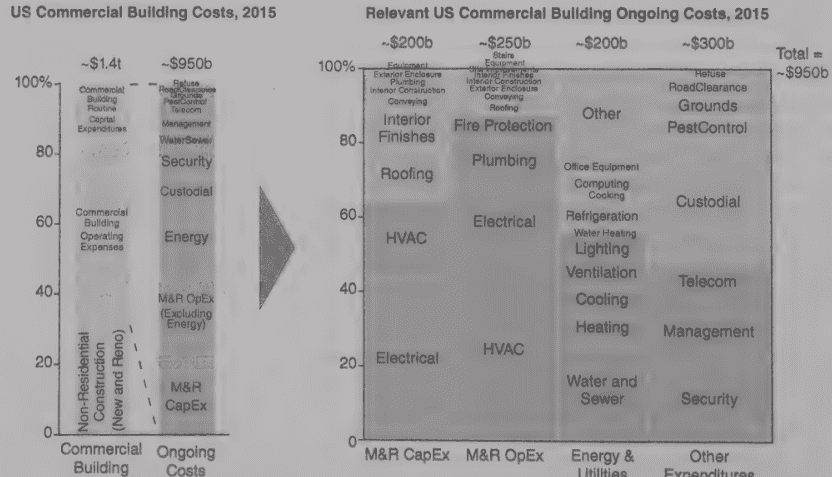

**图8.2** 2015年美国建筑支出

### 政策影响

能源资源的枯竭、能源成本的上升以及气候变化的威胁已将能源问题提升为全球当务之急。在当代国家任务背景下，有效的能源管理已成为一项战略价值，不断变化的世界经济和生态变量对商业的影响方式比以往更复杂。

根据国际能源署的数据，建筑物的能源消耗占全球能源消耗总量的30%以上。这一比例高于大多数其他行业。在更发达的国家，这一比例更高。随着城市化的加剧，这个问题将变得更加严峻。城市人口从1950年的7.46亿增长到2014年的39亿，预计到2045年将超过60亿。1990年，全球只有10座特大城市，即人口超过1000万的城市。到2014年，这一数字增至28座，预计到2030年，将有超过41座这样的特大城市；这些统计数据来自联合国的一项研究。仅印度、中国和尼日利亚这三个国家就占2014年至2050年间城市人口预计增长的37%。随着全球能源资源的枯竭，几乎在所有部门，包括建筑部门，都高度关注减少能源消耗。建筑物还浪费了大量能源，几乎占其消耗能源的30%。这使得能源消耗的需求变得更加迫切。

在全球范围内，多个国家和地区的“能源效率”政策应运而生，还有许多政策正在制定中。表8.1列出了一些主要的政策。

许多这些政策影响与建筑环境有直接相关性，从而推动了建筑建造、维护和技术方面的变化。

另一个主要的政策影响来自《通用数据保护条例》（GDPR），这是欧盟（EU）于2018年5月引入的一项新法律。该法律规范了如何管理个人身份信息（PII），并涵盖任何收集PII的系统。它赋予个人更多对其个人信息的控制权。这些数据保护标准适用于任何直接或间接识别在世个人的信息（例如姓名、电子邮件地址、身份证号码、地理位置信息或照片）。虽然该法律适用于欧盟，但它延伸至在欧盟有业务存在或有欧盟公民的任何企业或任何地区。因此，大多数全球公司正在实施GDPR的规定。不遵守将面临巨额罚款——最高可达企业上一年度年收入的4%或2000万美元，以较高者为准。

今天的建筑物富含技术和数据。很多这些数据与个人有关，并符合上述数据类型的标准。因此，许多建筑系统，如监控系统、安全系统，甚至与面向用户的建筑控制系统交互的系统，都必须适应这些新法规。

**表8.1** 能源管理的政策影响

| 工具类型 | 政策工具 | 定义 | 示例 |
|---|---|---|---|
| 立法工具 | 法律法规 | 法律：管理特定行为、过程、产品等的法律规则。法规：概述法律应如何实施 | 新西兰最低能源性能标准（MEPS）；印度《节能法》 |
| | 标准 | 提供技术和设计指南说明（例如针对设备） | 电子产品的BEE星级评定 |
| | 操作规范 | 提供关于如何遵守立法（例如建筑规范）的实用建议/指导 | 美国绿色建筑规范 – LEED（能源与环境设计先锋） |
| 经济工具 | 财政 | 对生产者和消费者征收的税、费、费 | 丹麦二氧化碳法 |
| | 补贴 | 拨款、低息贷款、税收减免 | 纽约州能源研究与开发局奖励计划 |
| | 产权和可交易权利 | 许可证、权利（例如水、排放） | — |
| | 债券与保证金 | 当满足环境行为时返还的资金 | 英国碳减排承诺（CRC） |
| 自愿工具 | 自愿协议 | 企业保护环境的承诺 | 商业组织的可持续性承诺 |
| | 项目与计划 | 提高意识、技能和知识 | 例如，自愿信息，示范项目 |
| | 研究与开发 | 新技术、新工艺、新产品 | — |

### 定义数字建筑

为了了解建筑物中技术的现状，我们需要首先理解数据在管理建筑运营中的演变。这一概念由Sudhi在其2014年发表于Greenbiz的文章“通往建筑互联网之路”中提出。（见图8.3。）

#### 视野1

直到20世纪60年代末，建筑物内的大多数控制活动都是手动管理的。除标准日志簿外，几乎没有数据存储或处理。建筑技术员是主要的行动负责人，决策基于标准做法、经验和直觉，尽管不一定按此顺序。

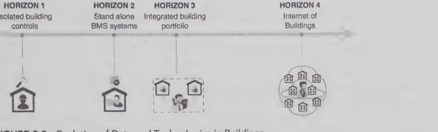

**图8.3** 建筑物中数据和技术演变

#### 视野2

自20世纪80年代以来，随着计算机的出现，数字控制开始引入建筑控制系统。这促成了建筑管理系统（BMS）的出现，意味着建筑运营中有了更大的自动化，大量数据也存储在系统归档中。然而，由于来自多个系统的数据集成问题、快速且高效分析工具的访问限制以及数据保真度的担忧，数据分析的价值仍未得到充分实现。因此，建筑物仍主要由专职的建筑经理管理。

#### 视野3

建筑格局的变化、增强自动化和控制技术以及对运营更高标准化需求促成了组合管理场景。这意味着现在由建筑管理人员管理的区域更大，导致“数据化”程度提高。数据现在从整个组合中的多个系统记录——提供通过内部基准测试进行优化的简单机会。重点随后转向识别建筑物能源消耗模式并推动管理此类消耗的计划。数据开始成为建筑物行动中主要催化剂。然而，我们仍然受到关于可以使用什么类型的数据以及可以利用多少数据的技术限制。

#### 视野4

我们现在正处于数字建筑时代。

智能建筑的概念已经存在了一段时间。智能建筑时代在很大程度上由自动化驱动。根据美国智能建筑研究所（IBI）的定义，“智能建筑是通过优化其四个基本组成部分——结构、系统、服务和管理——及其相互关系，提供生产力和成本效益环境的一栋建筑。”欧洲智能建筑组（EIBG）的定义进一步将智能建筑分类为“结合最佳可用概念、材料、系统和技术，将其整合以实现满足或超过建筑相关方性能要求的建筑。”基于这些定义，先进技术的运用是

是建筑性能提升的关键组成部分和促成因素。然而，技术和系统只是更大的建筑生态系统的一部分。建筑可以设计和建造为高性能和高能效，但如果没有长期妥善的管理和维护，这些先进技术可能毫无用处。

但是，建筑业主、运营商，尤其是使用者，并不满足于自动化带来的好处——他们想要更多。现在，人们要求建筑配备无处不在的数字技术，并利用这些技术产生的数据，为各利益相关方群体改变成果和体验。

数字建筑是建筑、设计、系统和运营的集成生态系统，为使用者、运营者和所有者带来切实的价值并满足其期望。许多新的数字技术正在影响建筑——物联网、云计算、图数据库、5G和NB IoT等新通信方法、人工智能和自然语言处理、分布式账本认证、混合现实沉浸式体验系统、多智能体系统，以及其他正在迅速影响建筑传感器和系统工作方式的技术。作为一个整体，它们定义了具有高度变革能力的数字技术新世界。

为什么建筑行业最近开始关注数据和数字技术，有五个促成因素：

- 1. 收集和存储所有数据以进行有意义的分析非常困难、缓慢且昂贵。
- 2. 流行的技术选择需要大量结构化、规范化且无错误的数据。建筑、建筑内子系统及使用方式的多样性使这项工作变得异常艰巨。
- 3. 建筑数据变化太大，可靠性问题太多，导致数据失去可用性，常规分析报告的异常过多。
- 4. 并非所有与建筑相关的信息都以数字数据格式提供。纸质记录可以扫描并转换为数字格式，但在没有使能技术的情况下，将它们转换为数据格式一直颇具挑战。
- 5. 在缺乏更稳健商业模式的情况下，来自建筑和子系统的大量性能数据仅用于报警和事件管理，使得这些数据只能发挥更多的运营支撑作用。

我们应该记住，物联网的概念对建筑行业来说并不新鲜。几十年来，楼宇自动化系统一直在解读传感器数据并驱动控制动作。但是，新物联网能力通过电子设备小型化，使机电设备能够进行数据通信和云连接，从而在系统优化和能效方面更好地利用传感器数据。

大数据技术使我们能够从不同来源、以不同格式和不同情境捕获数据。数据从催化剂变成了行动的驱动者。尽管数据的复杂性急剧增加，但所需的人工管理却更少。我们将看到以下各方面之间的互操作性和无缝数据交换：

- a. 建筑内的各个子系统
- b. 建筑与外部公用事业（如智能电网或智慧城市）
- c. 建筑网络
- d. 更大的智能设备生态系统
- e. 与建筑利益相关方更多的交互

数字建筑将反映智能生命体的属性和行为。

### 人工智能将如何改变未来的建筑环境

人工智能正开始在建筑行业蓬勃发展并取得突破。它正在通过智能解决方案改变能源和建筑行业，这些解决方案可以使建筑更加智能、安全、节能和环保可持续，并可以改善建筑使用者的舒适度、健康度和生产力。在本节中，我们将讨论人工智能将产生重大影响的建筑环境主要领域。

#### 人工智能驱动的自适应建筑

建筑就像活的、呼吸的实体，在非常动态的环境中运行。包括人工智能在内的新数字技术和分析能力，使人们能够管理这种不断变化的环境，让建筑更具适应性和自学习能力。目标是降低运营成本，提升资产价值（包括品牌认知度），最重要的是提高人员和资产的生产力。人工智能驱动的建筑具有自我意识并能自愈。

#### 具有自我意识的建筑

想象一下，你的建筑能识别到你正在进入，并开始与你对话。当你需要帮助时，建筑能够理解你的需求，帮助你更快速、更安全、更轻松地工作。想象一个数字助理可以与其他数字代理对话，例如，利用会议室代理来预约会议室、向他人发送会议邀请并分享议程。想象会议室代理在会议开始前启动视听系统、开启会议桥接，并准备好演示文稿。

你的个人代理可以在你到达之前宣布你即将到达主入口。门禁控制代理可以宣布你准时或迟到参加会议。会议室代理可以记录出勤情况，并估计迟到与会者的到达时间。所有这些都可以利用当今市场上可用的当代数字技术，以完全自主的方式实现。

你的数字助理具备超越简单聊天机器人或数字记录员的能力；它们是面向目标的智能软件代理，可以制定计划来解决问题，同时优化对你重要的任务。例如，安全数字助理将与智能环境持续交互和协商，以获得访问企业资源的权限。它们是智能环境数字孪生的终极版本，也是高度个性化、具有自我意识、面向社交环境的基础。

所描述的智能环境带来的益处遍及整个建筑，包括多系统集成、智能会议室、高级访问管理、智能停车、数字标牌、用于提高生产力的智能空间、无人驾驶电动汽车、增强的餐厅体验、先进的安全保障，以及面向员工、访客和设施经理的综合应用程序，还有现代化的文档管理系统。

#### 自愈建筑

想象一下，空气处理机组、控制器、传感器和执行器被自动发现、配对、配置并集成到楼宇自动化系统中。该系统努力实现即插即用范式，使所有建筑子系统都能自动配置并集成到建筑控制网络（BCN）中。这意味着连接建立和配置参数下载都是由软件驱动的。

当设备接入BCN并通电时，网络会立即识别并注册它。然后，相邻设备自动调整其技术和控制参数，以提供所需的覆盖范围和容量，同时避免与BCN上的其他设备产生干扰。操作序列应通过业主、技术人员和智能软件代理（例如操作序列推荐代理）之间基于口语的对话来提出、优化、制定和调试。

每个控制器都包含数百个控制建筑各个方面的配置参数。根据对楼宇管理控制器本身的观测结果以及现场设备或联网传感器的测量数据，这些参数中的每一个都可以被修改，从而改变BCN的行为。自组织建筑控制网络的首批功能之一是自动建立邻居关系（ANR），其他功能则优化操作序列以实现一系列优化目标。

一个非常能说明问题的自优化用例是，在夜间或夏季无人时段自动关闭一定比例的冷气供应（建筑无人时，风机进入休眠模式）。相邻控制系统随后会重新配置参数，以保持整个区域由送风覆盖。如果出于任何原因冷气需求突然增加，休眠的风机会几乎瞬时唤醒。这些用于优化的操作序列可以通过先进的机器学习和智能软件代理来学习和选择。

智能互联的暖通空调（HVAC）设备（或子组件）可以通过约定的消息传递机制报告其故障。这些故障通知将被视为物理世界传递给其他系统和子系统的变化。例如，我们可能有两台与B会议室相关联的送风机。其中一台风机报告电机故障，则另一台风机可能会提高转速，以提供足够的冷风或热风来实现目标（例如B会议室的温度应保持在24摄氏度）。这被称为自愈机制，旨在减少故障的影响，例如通过调整相邻控制器中的参数和算法，使其他节点能够支持由故障节点所支持的区域。当配对的温度传感器发生故障时，使用相邻传感器的值比不做任何处理或仅仅报告故障要好得多。

纠正动作由风机控制器软件执行，而不是集中的楼宇自动化系统。智能风机控制软件会考虑“如果我这样做会发生什么？”以及“这会实现我的目标吗？”这些纠正动作可以通过深度强化学习等各种学习方法习得。

具有自我意识和自愈功能的建筑理念似乎有些天马行空，但实际上这已是当下现实。Bee'ah 是一家通过其新的全球总部将建筑 AI 未来提前的公司。这是第一栋为所有人、所有场所和所有资产配备智能体的建筑。这也是第一栋拥有语义知识图谱和通用建筑数据模型的建筑，该模型使 Azure Digital Twin 能够通过建立人员、场所和设备之间的关系，来复制 Bee'ah 的物理世界。这种能力通过关联数字世界和物理世界的数据，实现了独特的体验。这座创新建筑允许用户与建筑子系统（例如通过短信、语音）进行自然交互。每位 Bee'ah 员工都拥有自己的个人虚拟数字助手。他们通过单一点接入所有与建筑相关的服务，利用人脸识别和机器人技术等前沿技术。Bee'ah 能够为其所有员工提供独特的集成式环境体验，从而推动生产力的提升和更好的参与度。Bee'ah 总部的 AI 驱动自愈机制旨在减少故障带来的影响，例如通过调整相邻控制器的参数和算法，使其他节点能够支持原本由故障节点支持的区域。

### 员工生产力

根据 2013 年世界绿色建筑委员会的报告，建筑环境在员工生产力方面起着重要作用。根据该报告，以下因素会影响个体生产力：

- 个体温度控制：+3%
- 改善通风：+11%
- 更好的照明：+23%
- 接触自然环境：+18%

2016 年，设施管理市场领导者 Jones LaSalle Lang (JLL) 提出了房地产支出的 3-30-300 模型。根据该模型，估计每平方米空间的公司支出为：能源 3 美元、公用事业 30 美元、员工成本 300 美元。这原本是一个粗略的估算，会根据地区和建筑用途有所变化。自那以来，利用智能技术的重点已从降低运营成本转向提高员工生产力。大多数业主和建筑经理已实施举措以改善建筑环境来提升生产力。但它们的成效有限。在工作场所分析和研究公司 Leesman 进行的一项研究中，来自 67 个国家、25 万名受调查员工中，有 43% 的人表示他们的工作场所环境无助于提高生产力。

在过去几年中，我们看到出现了几款应用来应对上述生产力维度，但它们都成功有限。最近，我们看到 AI 正在帮助改善生产力解决方案。AI 介入的一个领域是促成无缝体验。

### 无缝体验

建筑使用者在一天中需要频繁地与各种建筑系统和服务进行交互。很大一部分交互是繁琐的、脱节的，并且违背访问权限，然后再授予访问权。这种方法不仅使过程更快且侵入性更小，而且由于现在没人能拿着别人的实体访问卡四处走动，还提高了安全合规水平。系统会自动识别违反预设政策的人员聚集区域，并提醒安保人员。

在实施无缝访问控制时，访问控制器硬件、读卡器、其他传感器及相关网络成本都被消除。基于 AI 的赛博物理报警系统能更好地识别和管理员工移动和存在的异常模式。

### 预测性维护与远程维护

从历史上看，建筑的运营和管理是一个劳动密集型过程，需要非常专业的知识。在最近一项针对建筑业主和运营商的 Verdanxtx 调查中，受访者将劳动效率列为建筑数字技术的首要目标。他们还表达了希望通过更智能的自动化减少 20% 的工作量；通过远程诊断、分析和预测技术减少 15% 的能源和维护管理成本；以及在空间管理等方面提高 30% 的目标，以及其他围绕业务成果、员工体验和社会影响的目标。

建筑管理的成本也非常高。对于像芝加哥或纽约这样的大城市中一栋高 15 层、面积 25 万平方英尺的建筑，在其 50 年生命周期内，总计将花费近 1.5 亿美元用于维护和修复。该建筑在初始建设阶段的费用在 350 万到 500 万美元之间。仅在美国，每年在建筑维护和修复上的支出就接近 1000 亿美元。

建筑管理基于建筑状态的内在可预测性，一旦已知相关因果变量。一般来说，给定当前状态、引导状态到期望状态的可控操作以及外部干扰，可以预测建筑的未来状态。AI 使我们能够捕获变量、建立理解并推导实现目标所需的操作。AI 适应建筑及其生态系统不断变化的特性，是有效数字化转型的支柱。采取以 AI 为中心的建筑维护方法更好，因为随着环境、资产状况、空间和资产使用以及其他建筑运营参数发生变化，AI 可以寻找最优前沿的新边界条件，而这些在更具启发式的方法中从未被捕获。

预测性维护需要一种集成方法，使能从大量设备和设备中收集传感器数据，以推动建筑内的综合改进措施。这种维护制度的数据需求包括来自不同建筑系统和设备的运行数据、来自各种 IT 系统的关于在其上执行的产品和服务的数据、故障数据、环境数据，并且根据系统不同，可能需要许多其他类型的数据。

AI 支持的预测性维护自给自足。在上面引用的建筑案例中，估计的维护和修复支出约为 1.5 亿美元中的 3500 万美元。通过模拟，我们发现使用 AI 转向更主动的基于状态维护制度，可以节省其中 13% 的成本。对于建筑设备和系统，实际上对于整个建筑而言，在建造早期和后期阶段，会出现更多问题和更多支出。使用 AI 推动预测性维护还可以减少故障，提高资产可靠性，并有助于提高运营效率。在图 8.4 中，我们可以看到使用 AI 如何平滑随时间变化的故障曲线。

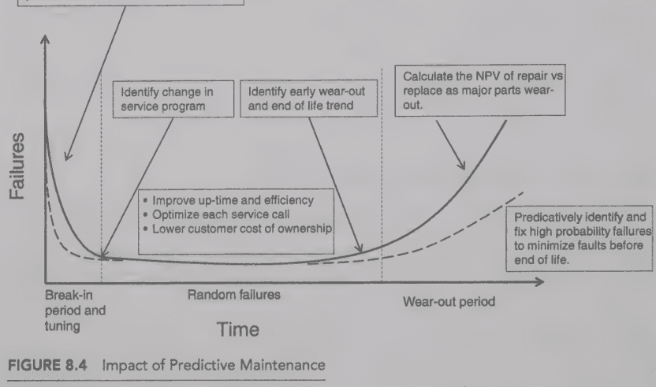

#### 图 8.4 预测性维护的影响

建筑维护行业在全球范围内也面临严重的人才短缺。在成熟经济体中，拥有较老建筑库存和大量技术债务，技术人员群体正在老龄化，而加入该行业的千禧一代很少。在一些新兴经济体中，拥有较新且快速增长的建筑库存，普遍缺乏维护技术人员，因为大多数合格的技术人员追求其他学科的职业。因此，技术是解决技能和能力问题的唯一答案。

AI 支持的混合现实（MR）系统，如增强现实和虚拟现实，正在帮助解决这一问题。连接的资产通信状况和问题，使用 MR 传感器进一步调查和分析问题，然后高级算法推荐修复或干预措施。这样，非常有经验的技术人员就不必部署到现场，技能较低的人员可以被远程赋能以执行大多数甚至所有功能。许多建筑技术公司已经大规模部署了这一技术。迅达（Schindler）和蒂森克虏伯（Thyssenkrupp）是该领域的领导者。

AI 也有助于维护中的知识管理。虽然有很多关于维护建筑及其不同系统的可用知识条目，但它们处于不同的多媒体格式中，通常是非结构化的。很大一部分知识存在于经验丰富技术人员的头脑中。在这样的环境中，及时获取所需信息是一项艰巨的任务。我们可以使用 AI 算法来筛选多媒体多格式信息并找出相关信息。我们还可以使用传感器和其他

- 提高正常运行时间和效率
- 优化每次服务呼叫
- 降低客户拥有成本

用于捕获经验丰富的技术人员的行为乃至推理过程的方法，可用于培训知识系统，供经验不足的人员使用。自然语言处理等 AI 技术也可以被用来更轻松、更快捷地从结构化来源获取信息。

在航空业等工业领域，AI 已被用于改变围绕资产使用和维护的完整商业模式。通用电气（GE）和普惠（Pratt and Whitney）等公司采用的按小时计费模式就是此类应用的一个很好的例子。在建筑行业实施类似的应用也完全可以改变商业模式。

### 融合安全

过去 10 年中，数据源的激增发生了阶梯式变化，导致安全分析师被不断增加的连接层次和 IP 网络传感器的增长压得喘不过气来。此外，安全部门还承受着来自天气、公共安全闭路电视和视频、社交媒体以及日益增长的网络安全问题等海量外部数据。这些数据源的数量和速度如今要求采用不同的方法来管理和处理安全事件。将内部和外部数据转换为对企业有意义的上下文的能力，与安全分析师职能非常契合，而当今的安全分析师职能面临三个不利结果：

- 1. 对安全事件基本上采取被动应对姿态。
- 2. 重要的物理和网络安全事件被遗漏（因为它们淹没在大量噪声中）。
- 3. 扩展有意义的安全系统会产生指数级的成本增长，导致企业削减开支，进而降低威胁检测能力。

我们越来越频繁地观察到物理安全和网络安全的融合，上述内外部数据源为安全经理提供了一个机会，可以将分散的信息和事件综合到一个概率机器学习模型中。安全的未来将需要在多种硬件和软件接口之间快速扩展。它将越来越少地与人和物体进行交互，最终被定义为一种无摩擦空间。门禁控制将由独特的数字签名（如智能手机）引导。视频将由一组人工智能传感器引领，这些传感器可捕获评估关键情况所需的有用图像。入侵检测将实现自动化，并与当局直接连接。

我们设想安全的未来是一个完全自动化、算法驱动的环境，其中主动和被动行动可无中断地发生，并且与周围的建筑环境近乎和谐地共存。下一代安全运营将通过自动化监控能力实现可操作、智能化的洞察，包括实时风险仪表板，该仪表板可将安全数据与组织的所有资产关联起来。

物理安全和数字安全的融合以形成更具预测性的态势，将需要综合来自各种不同来源的数据。这将减少系统中的噪声，并生成指示有关设施或人员的紧急情况的综合事件。然后，机器学习有助于进行风险分析和响应。

收费（基于计费周期内峰值能耗的成本）。更智能的需求决策还包括规划在高峰时段降低负载，从而减少使用时间（TOU）费用。更智能的供应决策允许规划使用替代能源（现场发电、储能、可再生能源等），并实现需求响应参与。

基于 AI 的故障检测与诊断模型（FDD）通过测量能耗与预测能耗之间的偏差以及偏差模式的变化来检测异常或故障能耗。与预测能耗的显著偏差表明存在异常状态并产生故障警报。预测能耗由能量预测模型（EPM）计算，该模型基于人工智能（AI）中的深度学习（DL）方法。

FDD 可以在多种粒度上检测故障或异常：整体建筑级别、租户级别、设备级别和子表级别。FDD 预测分辨率可以是 15 分钟、30 分钟和 1 小时间隔，频率与能耗计量数据采集频率相同。故障检测目前针对过去 24 小时进行，但也可以对过去更长的时间段进行。FDD 模型可检测电力以及其他能源（如天然气、热水、冷水、供暖用油）的异常或故障能耗。故障检测是一项有用的功能，因为它可以快速识别可能导致大量能源浪费和成本超支的状况。只要用户具备一定的设施管理和预测性维护知识，它还有助于识别故障的根本原因。

基于 AI 的优化通过处理前面提到的各种影响能耗的因素，找出最有利的时移负载机制，而不是大多数建筑系统配置中采用的那种恒定时变能耗模型来运行。时变能耗增加了电力生产商的成本。大的需求峰值很难供应。这需要更高的资本成本，并导致效率降低。成本最终转嫁给电力消费者。因此，建筑运营商必须改变行为，否则就要支付更高的电费。因此，基于 AI 的技术是优于传统技术的替代方案。

在交通章节中，我们谈到了电动汽车和自动驾驶汽车的兴起。这给建筑和园区带来了另一个能源管理挑战——车辆充电。建筑现在不再仅仅是能源的消费者，还必须成为能源的提供者。这给本已复杂的能源管理问题又增加了一层复杂性。为解决这一问题，AI 将用于预测员工和常驻访客的驾驶模式，以识别最可能的充电需求，评估能源可用性和电价，并在兼顾最佳负载均衡和最低成本的前提下，计算最优的充电时长和充电时段。

在下一个逻辑延伸中，AI 还将在支持和优化需求响应方面发挥重要作用。发电和用电的物理特性对可削减或调整的负载量施加了许多限制。此外，还必须考虑住户的舒适需求以及其他不得受影响的建筑要求。AI 实现了负载形状的精细控制，这对公用事业公司非常有利，因为现在它们可以消除昂贵且具有破坏性的高峰。许多公司正在推出该领域的解决方案，其中包括多家初创企业。加拿大科技公司 EnPowered 正在利用其 AI 解决方案帮助安大略地区的客户进行需求响应。企业借助 EnPowered 的预测来消除压力、减少监管失误并避免不必要的停机。

在 2014 年 7 月发表于《亚洲工业自动化》的一篇文章中，Sudhi 确定了领先能源管理解决方案的九个属性。我们需要 AI 来实现其中多项，例如超越可见范围、全局思考但局部行动、无缝结合多种能力、通过模拟输出提供可操作的见解，以及具有直观性和自我学习能力。

除了能源管理之外，可持续性还有许多其他维度，如建筑中的水资源和废弃物管理。AI 以类似方式用于改善水和自然资源的保护工作，以及优化废弃物产生并提高垃圾填埋转移率。中东和北非地区的可持续发展与环境管理领导者 Bee’ah 创新地将 AI 应用于帮助个人客户和大型市政当局改善废弃物管理和垃圾填埋转移。

### 智能家居

到目前为止，我们讨论的是商业建筑。但这并不是 AI 产生重大影响的唯一领域。随着 Apple Siri 以及类似使用自然语言处理和其他 AI 技术的语音助手的推出，AI 已进入我们的个人空间和家庭近 10 年。如今，AI 已遍布全球数百万家庭，并且继续快速增长。像 Alexa 和 Google Home 这样能够连接家庭中各种设备和功能的更通用、功能更强大的语音助手，正在加速这一增长进程。

虽然大多数智能家居应用围绕人们控制和管理设备的能力展开，但 AI 在家庭个人医疗健康监测、能源管理、安全管理、优化日常家庭事务等领域的使用也在不断增加。AI 在这些功能中扮演着重要角色，因为支持 AI 的程序可以协调不同系统和数据，与更大的全局信号集进行相关联的类似操作以评估影响，并在全局变化背景下执行本地优化。例如，基于天气、入住率和电价，我们可以像对商业建筑进行能源优化一样，对家庭进行同样的优化。通过了解社区内的威胁模式和事件，我们可以自动调整家庭的安防状态以更好地适应。家庭中广泛使用的语音和图像识别也通过 AI 技术进行处理。在肖果、沈振江、张雅静和吴腾于 2019 年 8 月发表的《人工智能在智能家居中的应用综述》研究中，在 AI 扮演角色的各种智能家居功能中，作者将语音识别归因于 47% 的份额，图像识别占 36%，而决策制定仅占 11%，预测制定占 6%。如今，个人机器人也开始进入我们的家庭。许多人使用扫地机器人作为示例。人工智能程序甚至被用于通过从冰箱和食品储藏室获取数据来管理杂货购物清单。可能性是无限的，我们将在未来继续看到有趣的应用。

### 人工智能驱动的建筑系统与技术未来

AI 不仅从根本上改变了建筑环境相关各项功能的管理方式，也深刻改变了支撑这些管理的技术和产品。

功能。我们相信，在未来五年内，建筑技术的方方面面都将受到AI的影响。在本节中，我们将讨论几个已经开始发生转变的关键领域。

### 建筑操作系统

为了让AI在建筑中得到有效应用，我们需要一个新的建筑操作系统。一个统一的建筑操作系统或建筑的数字化保险库，对于整合不同的数字能力，以交付人们期望从数字化转型中获得的结果、体验和价值至关重要。这样的操作系统汇集了各种能力和服务，通过无缝互连建筑中的各种系统、设备、设施以及其他企业和外部信息输入，利用共享数据、洞察和行动来优化建筑性能。数字齿轮成为关键的一环，因为可靠的数据是真正数字化转型的驱动力，企业需要将数据可信度作为向前发展的差异化优势。这通过以下方式得到保障：能够访问原始数据、引用完整性、数据的完整上下文，以及数据在传输和使用过程中得到完全加密和保护。随着更多AI和更少人工干预成为技术计划的常态，企业必须确信系统配备了真实准确的数据合成流程和相关的分析模式。重建AI洞察和推荐行动的逻辑链，是转型计划需要具备的一项能力。

### 数字孪生

建筑信息模型（BIM）通过创建建筑物理布局及其所有传感器和系统的虚拟表示，开启了数字信息复制的第一波浪潮。建筑中的新型数字孪生是来自建筑中所有传感器、资产、人员和流程数据的实时综合，动态描绘它们的状态、健康状况和关联关系。这样的数字孪生使我们能够模拟未来的状态和可能性，供AI应用使用。建筑数字孪生的发展得益于大规模传感器化、泛在连接以及知识图谱的使用，知识图谱使人们能够浏览大量多样化的信息并将其情境化。例如，智能建筑需要从建筑师的BIM中了解建筑的平面图，从人力资源部门了解在建筑中工作的人员的姓名和ID，甚至还需要一些杂项数据，比如哪个停车位分配给了哪个人，或者本周自助餐厅是否有特殊营业时间。传统上，这些数据被保存在多个孤岛中，不同孤岛之间没有连接，当然与建筑的传感器数据也没有任何关联，但知识图谱改变了这一点。数据虚拟化层可以摄取和存储这些IT数据，并将其纳入建筑的知识图谱中。该图谱理解不同类型和数据源之间的关系。数字孪生还有助于管理建筑生命周期的不同阶段，以及建筑、其系统和数据在这些阶段中的演变。前面提到的Bee'ah总部拥有类似的多模态数字孪生来运行AI骨干网络。

### 云与边缘架构

由于建筑行业是在孤岛中发展起来的，因此出现了不同层次和类型的聚合与通信系统。HVAC系统有一套自己的控制器用于与现场设备通信，另一套控制器用于执行监控功能，以及一个独立的软件层用于管理控制功能。同样，安防系统或电梯系统也具有多层架构。这种架构是必要的，原因在于制造这些系统的OEM厂商的碎片化、带宽和计算能力的限制，以及不同的专有通信机制。这种多层架构不仅效率低下，而且成本高昂。最近的技术进步正在改变这一切，现在我们正朝着更加简化的云和边缘两层架构迈进。未来所有的感知、执行和控制功能都将由智能设备执行，而云层将用于识别和规划全局优化与控制策略，管理所有数字孪生的中央配置和聚合，并推动其他此类策略型干预。许多现有技术参与者的当前盈利模式与中间层绑定，他们以弹性、吞吐量、速度、可靠性和安全性等问题为由，不断为多层架构辩护。但成本经济性和能力需求将推动行业朝着更云和边缘化的架构发展。一旦我们在这个方向取得进展，我们将看到AI算法在边缘自主运行，很少参考中央云以获得最佳的优化结果。这涉及将AI例程的部署小型化为小数据包，并将它们集成到边缘设备网络中的能力。Bragi等公司在这方面正在取得进展。亚马逊和微软等主要技术参与者也在推动这一未来架构的实现。

### 智能传感器与系统

在建筑系统的云边架构中，边缘设备的能力将大不相同。以AirPods为例，如果你碰巧使用它们的话。它们是未来的智能传感器和边缘设备合二为一的一个很好的例子。两个AirPods独立工作，但通过光学传感器和加速度计的输入协同判断它们的佩戴位置和使用状态。这些设备会随着时间推移学习你的行为，并根据你对设备的使用情况调整其功能。它们具有通信和计算能力，能够执行自我发现和自我配置，并能实现局部优化。我们很快将看到建筑边缘设备也开始模仿此类能力。这对于在边缘部署基于AI的优化至关重要，且几乎不需要建筑管理系统其他层的干预。我们还预见到一个功能非常强大的通用操作系统将专门为建筑边缘设备而开发，就像Android为手机所做的那样。

### 建筑内OT网络

与技术在许多其他方面一样，建筑中的运营技术（OT）网络也一直发展缓慢。该行业长期以来一直难以转向无线和IP网络。但现在这一切都在改变。5G、LoRaWAN和NB-IoT等发展正在开启新的可能性，这些可能性对于由日益增长的AI应用驱动的大量、高速、高保真、高频数据交换至关重要。我们将看到网络的刚性结构和配置演变为更具自适应性的设计，利用AI元素进行自组织和自优化。5G等技术在穿透建筑物方面的固有局限性，将通过利用高密度的边缘设备作为信号传输载体来弥补。我们将看到多个OT网络以最低限度的内聚逻辑方式融合，以确保建筑作为一个整体的系统之系统良好运行。

### 自然语言界面

自然语言处理（NLP）允许人类和其他系统使用人类语言（如非结构化语法）与计算机程序交互，而无需理解底层编程语言或数据库的复杂性。人类语言可以是语音或文本的形式。最终，NLP还将扩展到手势，这是另一种流行的人类表达形式。NLP是AI的一个学科，能够理解人类语言并将其翻译成机器可读的语言。虽然NLP的根源可以追溯到60年前，但其第一个消费应用大约在20年前始于搜索引擎。在当前的商业场景中，海量数据（大数据）正从各种来源生成，如电子邮件、音频、文档、网络博客、论坛和社交网站。NLP技术已被频繁用于大数据分析。随着越来越多的非技术用户与大数据系统交互，他们需要更自然的界面来与这些系统交互。这就是NLP发挥作用的地方。

建筑管理系统中有许多挑战，NLP可以非常有效地帮助解决这些挑战。

要与任何建筑管理系统交互，用户都需要非常深入地了解使用该系统的特定流程和语法。这些具有陈旧软件架构和特定启发式方法的系统要求用户遵循特定的路径进行查询和操作，这需要很长时间才能学会。在执行任何路径时，如果用户犯了错误，他们很可能必须回溯到一个公共主干位置并重新开始。这使得调试和运营过程都非常漫长、复杂且令人沮丧。NLP界面在消费和家居自动化行业中的日益普及，正在工作环境中创造对此类能力的潜在需求，建筑行业也不例外。从基于桌面的用户界面到移动界面的转变就是一个类似的参考。

利用NLP，我们可以让建筑设备和系统更智能、更具交互性。

### 建筑生命周期管理

建筑生命周期管理（BLM）的概念已经存在了好几年，但在这方面取得的进展甚微。缺乏进展的原因主要归因于建筑生命周期中不同利益相关者之间激励的分散或错位。建筑师和承包商更愿意推迟那些在建筑运营阶段最有益的技术投资。即使在运营阶段，也有太多的利益相关者——资产所有者、占用者、设施经理、为建筑提供设备的OEM厂商、服务提供商、公用事业提供商和监管机构。鉴于利益相关者的多样性以及不同建筑及其系统之间的差异，采用统一的方法和一致的激励来管理生命周期是困难的。

但更新的技术赋能能力，如先进的BIM、数字孪生、建筑操作系统，以及整合到更简单的云边网络架构中，将

促进 BIM 的发展。更重要的是，大型开发商和运营商将推动行业朝这个方向发展。LendLease 是世界上最大的开发商和建筑运营商之一。LendLease Digital 首席执行官 Bill Ruh，此前曾领导 GE 和 Cisco 的数字化转型，他说：“我们将从以电子表格和图纸驱动的环境转向以数据、分析和人工智能驱动的环境。” 许多同行公司和大型 FM 公司也在进行类似的努力。

### SUMMARY

建筑行业正准备经历前所未有的转型。历史上，该行业一直发展缓慢，但现在它正准备进行大规模的转型。

正如本章所述，人工智能将影响我们与建筑互动和管理的许多方面。图 8.5 显示了当前技术的现状以及人工智能在未来如何改进它。

大多数在建筑行业运营的公司正在经历转型。其中在这一领域处于领先地位的是电梯巨头 Schindler。在与作者 Sudhi Sinha 的独家访谈中，Schindler 董事会主席 Silvio Napoli 讲述了他为何选择领导和推动数字化转型计划的原因：

为了在当前的数字革命中生存，对任何全球工业公司来说，数字化转型业务都是战略上的当务之急。你是想吃午餐，还是成为竞争对手或其他拥有颠覆性数据驱动商业模式和产品的既有企业的午餐？对于我们 Schindler 来说，数字化使我们能够提升产品和服务的客户体验和安全性，并为我们的客户、用户和员工创造价值提供新的方式。由

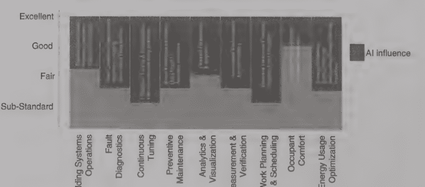

**FIGURE 8.5** Impact of AI on Building Management

结构化数据驱动的人工智能将成为我们新的数字核心的引擎。历史上，房地产和建筑行业在采用新技术方面一直比较滞后。创新是 Schindler 的 DNA，我们希望利用数字化带来的潜力，并成为整个行业的催化剂。

这一领域的转型规模和速度相当可观。虽然 Schindler 无论从哪个行业角度来看都是一个巨大的成功案例，但在他典型的谦逊中，Napoli 先生说，

> 我们正在对我们的产品、服务以及我们的工作方式进行数字化转型，现在还为时过早就称[我们的旅程]为成功。这是一个持续的过程，所以有没有一个时间可以宣布胜利呢？数字化使我们能够创新、改善客户体验，并以前所未有的速度和方式应用我们的工程卓越性。结合强烈的创业精神和对长期的明确关注，创新一直是 Schindler DNA 的一部分，自 1874 年在瑞士中部成立以来就是如此。有了它，我们能够成长为全球领先的电梯和自动扶梯公司之一，尽管我们的总部位于一个相对较小的国家，没有任何大城市或高层建筑。敏捷性对于不落后至关重要，我们的组织正在有意识地推动变革，并怀有强烈的紧迫感。

在本章中，我们讨论了人工智能对于使建筑真正智能至关重要以及原因。智能建筑是智能社区的基础，而许多这样的社区汇聚在一起将创造未来的智能城市（图 8.6）。有关智能城市的更多内容将在下一章中介绍。

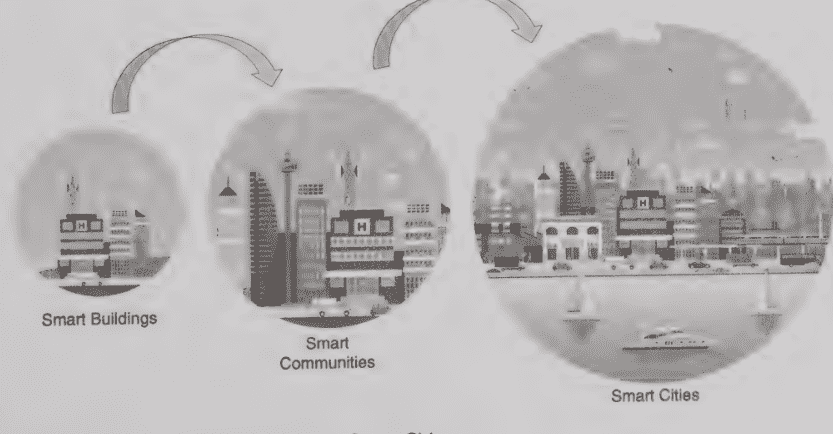

#### FIGURE 8.6 From Smart Buildings to Smart Cities

#### FIGURE 8.7 Office of the Future: Bee’ah’s new Global HQ

Source: Zaha Hadid Architects/MIR

### Transforming Smart Cities with AI

> "Adding lanes to solve traffic problems is like loosening your belt to solve obesity."
> —Glen Hemistra

#### INTRODUCTION

城市化可以追溯到 5000 多年前的美索不达米亚文明。工业革命加快了城市化的步伐，因为更多的经济机会在城市周围更快地形成。然而，在过去一个世纪里，城市化以前所未有的速度加速。我们在上一章中简要提到了这一点。这也是创新和经济增长大量涌现的原因，因为城市将有才华和有动力的人集中在一个生态系统中，以促进创造力和进步。预计未来 10 年内，超过 50 亿人将生活在城市中心。然而，我们城市在过去几十年的发展方式遵循了未来学家 Glen Hemistra 在上面引语中所谈论的同样路径，即不断增加基础设施和资源以满足不断增长的需求。城市规划者和社会领导者已经意识到这种谬误，并将智能城市视为解决资源短缺问题的良药，同时允许城市扩张继续进行。城市已从人类动物园演变为混凝土丛林，现在正发展成为技术博物馆。

传统上，我们的城市围绕着不同的基础设施部门的概念而建立，这些部门通常存在于不同的孤岛中——道路和建筑、移动性和交通、连接性、安全、电力、水、废物管理、公园和公共空间以及其他服务。技术越来越多地被用来使这些服务更高效并更好地为市民服务。许多城市通过创建应用程序投资于连接性和基础数字化。虽然此类举措确实有所帮助，但它们并不能使城市变得智能，因为城市的基本服务交付既没有改变，市民的体验也没有显著改善。

智能城市是指数字技术和数据汇聚在一起以提高市民生活质量并帮助他们实现更多目标的城市。智能城市改善其市民的福祉，帮助他们使时间更具生产力，使他们感到更安全，增加可持续性和更好地保护自然资源，并增强人们在与城市各种服务交付功能互动时获得的体验。智能城市不是以技术或基础设施为中心；相反，它以居住在其中的人类为中心。智能城市是智能能力的生态系统，它们和谐地协同作用，使其成为最理想的居住和工作场所。人工智能在智能城市的未来发展中发挥着关键作用。人工智能将综合人类智能、机器智能以及传感器和网络编排，并通过赋能平台解决城市目前面临的若干问题，并允许比当前盛行的模式进行更具前瞻性的规划和响应。同时，迫切需要使服务更具包容性和可负担性，以避免因市民之间的数字、人口或经济鸿沟而导致的任何歧视性环境。

虽然我们已经看到围绕智能城市的活动有所增加，但我们仍处于转型初期的阶段。这变得复杂，因为改造现有基础设施是困难的。据 Grand View Research 称，2019 年，全球智能城市市场已超过 800 亿美元。据最近的 Bloomberg 报告，到 2025 年，全球智能城市市场预计将超过 2500 亿美元。与许多其他行业相比，预计未来几年智能城市对人工智能的支出也将大幅增加。据 Omdia 称，全球智能城市人工智能软件市场预计将在 2025 年飙升至 49 亿美元，而 2019 年为 6.738 亿美元。

正在出现一些智能城市的例子，它们开始符合我们的定义。根据瑞士商学院 IMD 和新加坡科技设计大学发布的 IMD 智能城市指数，新加坡似乎在该名单上名列前茅。该调查衡量了城市现有的基础设施和技术配置以及居民可用的服务。居民对新加坡的评价很高，因为他们认为城市所做的技术和基础设施投资有助于改善他们的生活。新加坡长期以来因其在智能城市领域的众多创新而受到认可。现在它正在加速开发和实施人工智能，以解决城市规模和社会问题。AI Singapore 是许多政府机构、学术界和充满活力的初创企业生态系统之间的合作，是朝着这一方向迈出的一步。它专注于医疗保健、教育和城市解决方案等问题。AI Singapore 采取了一种非常有意且有针对性的方法。例如，其在医疗保健方面的宏伟挑战是：“人工智能如何帮助初级护理团队在 5 年内将 3H 患者的疾病进展和并发症发展停止或减缓 20%？”

但新加坡并非孤例。世界各地都在进行值得称赞的努力。迪拜统治者谢赫·马克图姆于 2013 年启动了一系列 100 项举措，旨在到 2030 年使迪拜成为世界上最聪明的城市之一。哥本哈根通过实现无处不在的连接开始了其智能城市工作；然后它迅速转向改善环境因素，如空气质量。像印度这样的发展中国家也在进行智能城市计划，以解决其严重的<|message|>

有竞争力、可持续且繁荣。在2019年11月于巴塞罗那举行的世界智慧城市博览会上，微软宣布了 Azure 的多项新功能，以使其对智慧城市解决方案更具吸引力。谷歌也通过旗下公司 Sidewalk Labs 进行了类似投资，该公司正在多伦多一处废弃的滨水区打造一个“从互联网起步”的智慧城市。Sidewalk Labs 为这座下一代城市制定的规范描述了一种全新的基础设施和以技术/人工智能为主导的方法。IBM、戴尔和其他科技巨头多年来也一直活跃在这一领域。

为免落于人后，在该领域拥有产品和解决方案的工业公司——无论是照明，还是交通和电力管理自动化解决方案——如 Signify（前飞利浦照明）、西门子、施耐德等，也纷纷进行投资，并在全球参与相关项目。正如我们在上一章结尾所谈到的，智慧设施是智慧城市的基石。这些公司认为，通过同时参与这两个领域，并将从一个领域学到的经验扩展到另一个领域，他们可以扩大自身的业务和贡献。

在最近的 COVID-19 危机期间，我们看到一点：基础设施更好、技术赋能更充分的城市，更有能力应对各种紧急情况。智慧城市领域已经充满活力，无论经济状况如何，都将继续增长。在本章中，我们将探讨推动智慧城市应用普及的各种因素，以及正在涌现的各种 AI 应用。

### 智慧城市中 AI 的推动因素

阿姆斯特丹是最早投资建设“智慧”城市的城市之一，1994 年便投资建设无处不在的连接网络。十年后，思科和 IBM 开始进行大规模投资，并启动了结构化项目，以应对人们对智慧城市日益增长的兴趣所带来的机遇。2011 年，首届智慧城市大会在巴塞罗那召开，这一运动获得了进一步的发展动力。过去十年，技术厂商在智慧城市及赋能技术和应用方面实现了爆发式增长。最近几年，各方协同努力，更广泛地利用 AI 来满足智慧城市的需求。这得益于众多赋能技术的同步进步；现在让我们讨论其中几个关键技术。

#### 5G 和 LoRaWAN 等新型通信技术

5G 是下一代无线蜂窝技术，将从根本上提高网络能力，以满足人与人、设备与设备之间日益增长的数据传输需求。5G 技术的一些亮点包括：

- **更高的渗透率。** 现有网络在任何时候能支持的设备数量都有限。5G 将支持部署大量互联设备，使它们全部实现互联并接入互联网。设计目标是让每个覆盖一平方公里的小区扇区支持从 52,547 台设备到 100 万台设备。
- **更低的延迟。** 5G 旨在支持 1 毫秒的往返延迟。这意味着，像汽车这样的设备向网络发送一条数据，并收到响应（例如刹车）以及其他功能的组合。一个有趣的例子是，一家总部位于旧金山的初创公司正在美国许多地区部署基于 LoRaWAN 的网络，并将其与区块链能力相结合，以创造新的收入来源和功能。

世界各地还在试点和推广其他低功耗广域网通信技术。Sigfox 和 NB-IoT 就是两个例子。NB-IoT 可能会在 5G 基础设施部署到位之前，成为一种有效的 4G/LTE 网络桥接技术。

所有这些技术的发展都服务于一个目的——让更多终端节点能够传输更多数据。因此，它们都将推动 AI 在智慧城市及其他应用领域的发展。

#### 视频摄像头的高密度部署

视频摄像头是任何城市中使用最多的传感器之一。(1) 它们有多种用途，从人员监控到了解交通流量。在下一节讨论具体应用时，我们将进一步讨论它们现在和未来的使用方式。中国是全球摄像头安装基数最大的国家，其众多城市中安装了超过 3 亿个摄像头。2018 年，中国平均每 4.1 名居民就有一个摄像头；美国这一比例为 4.6。到 2021 年底，全球预计将安装超过 10 亿个摄像头。过去五年，这一安装基数增长迅猛。2015 年，中国和美国分别平均每 6.8 人和 6.9 人有一个摄像头，各自的增长率接近 70% 和 50%。全球监控摄像头总数已超过 7 亿个。这并非只有少数国家；几乎每个国家都能观察到同样的现象。在最近的 COVID-19 危机期间，许多国家使用此类监控设备来监测封锁期间的人员流动、进行接触者追踪、了解地方卫生状况以及实施隔离管控措施。这将进一步推高视频监控的安装率和使用率。

视频摄像头的激增带来了海量数据。既然政府掌握了越来越多相关图像和信息，他们希望获得更多、更深入的洞察。AI 一直是此类分析的首选方法。这类分析不仅发生在中心层，许多常规分析现在已在边缘层进行打包和分发，而更多非结构化和创新性分析则在中心层执行。随着自动驾驶汽车、无人机及其他相关技术的发展，视频传感器的数量将进一步爆炸式增长。视频传感器的巨大增长将继续推动 AI 在智慧城市和其他应用中的发展。

#### 公用事业终端的日益传感器化

与监控类似，各种公用事业服务和系统也经历了物联网设备的大规模增长，这些设备产生大量数据，支持众多不同的应用场景。例如，主要用于能源管理应用的智能电表一直在快速增长。截至 2018 年，美国拥有 8680 万只(2)，英国拥有 128 万只智能电表。(3) 到 2018 年底，全球已有近 7 亿只智能电表。(4) 这一数字仍在上升，我们预计未来五年内，全球智能电表将超过 10 亿只。

同样，我们也看到联网照明、联网恒温器、联网建筑、联网家庭等日益增长。甚至连垃圾桶也在变得更加互联。智能联网垃圾桶的全球市场规模预计到 2025 年将超过 50 亿美元。万物都在连接，并变得智能。

每一件联网产品都是一个传感器，生成并传输数据用于分析。如今，这些数据中有很大一部分由各个制造商或服务提供商采集，但随着应用场景和应用程序的发展，原始数据或衍生数据将变得越来越容易获取。这将形成一个良性循环：更多数据被用于 AI 分析，而更多分析带来的益处又推动进一步的传感器化和连接。

#### 云计算平台的广泛接受

过去几年，云计算获得了广泛的接受。2019 年，全球云计算市场规模估计在 2300 亿至 2400 亿美元之间。目前尚不清楚其中有多少支出来自智慧城市。但世界各国政府已更加开放地使用云作为其主要平台，尤其是对于需要大量存储、处理和分析能力的智慧城市应用。政府的支持也伴随着数据主权、网络安全和隐私要求等方面的限制——这些要求推动技术进步，并鼓励更广泛的使用。

现在，所有云计算市场领导者都已推出面向智慧城市应用的蓝图和服务。他们还投入数十亿美元在全球建设数据中心、构建产品能力并进行市场营销。此外还有合作伙伴生态系统，吸引更多参与者使用他们的技术并创建新应用。所有这些行动都将进一步推动云在智慧城市中的使用。有了云基础设施，更多数据将被存储，进而产生对更复杂分析的需求，从而推动智慧城市中 AI 的发展议程。

### AI 在智慧城市中的应用

智慧城市是 AI 的绝佳试验场。这里通常有大量传感器，以及来自这些传感器的大量数据，这些都是开发可靠模型所必需的。尽管可能有多达数千种应用场景和数百种应用，但我们将重点讨论几个对人们生活和福祉影响更大的方面。

#### 智慧安全与事件管理

当今世界上大多数主要城市都建有广泛的视频摄像头网络，用于捕捉人员和货物的流动。一些城市使用这些摄像头的目的多种多样——交通流量管理、交通违章、识别拥堵、实时跟踪重大事件，而最常用的是安全监控。从伦敦到波士顿，从孟买到新加坡，再到上海，在这些地方以及其他更多地方，当地执法机构都会对所有主要热点区域或重点关注区域的人员流动和事件进行监控。否则，代价就是人员伤亡和混乱。2008 年孟买恐怖袭击就是一个很好的例子。执法机构花了很长时间才查明恐怖分子的位置和背景，尽管他们当时就在

以及诊所关于患者就诊、药房销售数据、保险理赔和工作场所缺勤率的数据。由于这些数据分散在不同的系统中且格式各异，因此可能难以整合或合并，但数据确实存在。与此同时，有数据显示，步行的人越来越少，取而代之的是更多人使用公共交通工具。这一结论可以通过结合公共交通系统的数据、道路上的汽车数量以及通过视频馈送捕捉到的用于步行的公共道路和公园使用情况来得出。此外，该城市目前的空气质量数据也显示，一段时间以来，空气质量向不健康水平的恶化趋势正在加剧。如果将关于疾病发病率增加的医疗数据、人们的体育锻炼数据和空气质量数据结合起来以理解这一问题并预测其影响，城市当局就可以采取多种干预措施来促进更健康的生活方式，例如通过教育、增加公园和改善人行道来激励人们步行。同样，通过激励拼车，也可以减少对环境的影响。这种类型的方法和分析最好借助AI而不是更传统的工艺技术来完成。

最近的新冠疫情进一步凸显了医疗保健必须作为一个社区议题而非仅以个体患者或医院为中心来处理的重要性。在过去十年中，我们目睹了疫情数量的增加，而每一次新的疫情似乎都比前一次更危险、影响更大。这些疫情对城市的影响比农村地区更大，原因有几点——高人口密度使得疾病传播更快、更容易；由于压力大且有时不健康的城市生活方式，拥有共病的人群比例更高；与人口相比医疗资源短缺；以及作为其他地区的主要交通枢纽。因此，作为智慧城市倡议的一部分，解决此类医疗保健问题现在成了重中之重。以下是AI发挥作用的几种方式：

- a. 及时识别高风险区域
- b. 关联多种健康问题，这些问题会放大单一问题的影响
- c. 建模响应效果
- d. 接触者追踪
- e. 主动健康监测
- f. 医疗网络容量优化

最后，我们开始意识到医疗保健问题对经济和国家安全的重要性。因此，作为使城市更智能、更宜居的一部分，医疗保健将获得比现在更多的关注。将AI对一般医疗保健的影响（在第3章中讨论过）与具体的智慧城市干预措施结合起来，将使世界成为一个更美好、更健康的生活之地。

### 智能能源管理

在第8章讨论建筑环境时，我们已经广泛讨论了AI将如何帮助更有效地进行能源管理。能源管理的基本前提没有改变；城市规模的能源节约必须从建筑层面的举措中拼凑而成。然而，这还不够。在更大的城市规模上，必须解决一些更宏观层面的问题。本节将讨论这些更广泛的问题以及AI将如何帮助解决它们。

电力造成电网压力。AI程序将帮助确定为了个体生产者和集体电网的最佳结果，应该生成多少电力。通过来自电网的自动化信号和控制，社区发电不仅能解决能源可用性问题，还能推动每个人都实现正确的经济产出。

### 智能废物管理

随着城市化进程的加速和现代生活方式的改变，废物产生量，尤其是在城市中，正以令人担忧的速度增长。这是可持续发展之轮中的下一个重要环节。管理废物是一个挑战，因为大部分废物最终回到土地，对自然平衡产生负面影响。不适当的废物处理已被发现与许多生态问题有关。在全球范围内，废物管理已经是一项庞大的业务，预计到2025年将达到5300亿美元[2]。不幸的是，废物管理非常碎片化，在世界上大多数地区仍以陈旧的方式进行。很少有行业领导者像Bee'ah那样利用技术使废物管理更高效，并追求如零填埋转移等雄心勃勃的目标。

Bee'ah是在业务各个方面使用AI和其他数字技术的先驱。以下是城市规模应用AI将在废物管理中带来必要改进的一些关键领域：

- **废物收集和路线优化。** 废物收集通常遵循预设的常规路线。然而，这是一个公认的低效过程。在许多智慧城市中，如今的废物箱配备了传感器，可以指示收集的废物量。集中掌握这些信息将使废物管理公司能够适时找到正确的收集点。AI将帮助优化收集路线。这将最大化收集卡车的利用率，最小化对环境的影响，并实现最高的客户满意度和清洁度。
- **需求计划和容量优化。** 废物管理公司对常规产生的废物量有相当好的了解。通过常规收集数据与其他事件馈送数据（表明更多的人口和活动，如贸易展、游客数量增加、限制人类活动的极端天气条件等）相结合，他们可以更好地掌握非常规的废物产生情况。为了有效地做到这一点并获得正确的见解，需要像预测安全威胁那样使用AI。有效的需求计划和容量优化可以使废物管理过程更高效。
- **废物分类以利于回收。** 如今产生的不同类型废物数量也增加了。通常，它们并不属于玻璃、金属、塑料、可生物降解物等传统使用的整齐类别。直到大约10年前，在几乎所有地方，废物分类都是手动过程，耗时且昂贵。即使现在，大多数地方也是如此。但现在我们有很多新的传感器技术，如基于视频的传感器、基于涡电流传感器的分离器、近红外传感器等，用于分离不同类型的废物并对其进行回收或其他处理。许多这些传感器技术利用AI对废物类型进行概率最高的识别。
- **游戏化。** 个体层面的可持续废物管理实践需要与能源管理类似的行为改变。基于AI的游戏化平台

将在未来推动这种行为改变。Bee'ah环境管理学校致力于提高Bee'ah服务社区中人们对可持续发展和废物管理的认识，它正在利用这些技术，并发现它们比传统的辅导项目更有效。

虽然仍处于起步阶段，但技术在这一领域的应用正在增加。预计到2025年，废物技术投资将达到2.27亿美元，增长率达12%，是行业增长率6%的两倍。这笔投资和努力的很大一部分将致力于基于AI的解决方案。

### 智能交通

交通通常是任何新的智慧城市倡议的首要关注领域之一。这也是最早应用AI之一，用于识别交通模式以改善流量并为政策制定者和规划领导者提供信息。

- **交通控制。** 管理城市交通流量既复杂又非常重要。随着汽车数量的增加，以及缺乏足够的道路、空间或资本来修建新道路，问题不断加剧。虽然城市激励使用共享交通工具，但便捷且可预测的交通流量问题依然存在。智慧城市利用视频和其他传感器来检测道路上汽车的存在、速度和流量。在交通信号灯处，有自动化控制器和规则来调节该流量。这一过程已存在数十年。然而，通过分析并基于历史信息、当前状态以及可能需要更多人员出行的其他事件馈送来预测模式，可以使交通控制过程更加有效。利用AI进行图像处理可以远超流量分析和优化，深入到其他很难获得的更行为性或行业洞察。

- **多模式交通规划。** 为了减轻道路压力，促进公共交通或其他共享交通机制，同时为人们在当前条件下以期望的时间从A点到B点提供最优化的出行方式，城市规划者正在使用AI来预测最优选组合。通过对未来此类场景的预测，可以进一步改进这一过程，这将帮助个人更好地规划时间。

- **智能停车。** 大多数现代城市的大多数停车结构都有传感器和计数器，向旅客通报停车可用性。然而，此类信息通常仅针对单个停车区域或结构。通过在城市规模上汇集所有此类信息，并基于车辆流动（历史及当前）、停车偏好、停车时长、目的地停车、天气及其他此类因素的模式，AI启用了更全面的系统。借助此类系统的输出，可以更精确地引导驾驶员，以减轻停车压力，并优化时间和成本。

- **动态定价和税收。** 城市管理员手中最强大的工具，用于鼓励特定的出行方式或时间，是通过收费定价和征税等经济激励措施。而不是围绕这些设置固定规则，AI算法可以根据特定时间窗口的目标，动态确定燃油或其他涉及交通的公用事业的税率或价格。

许多城市正在实施先进的交通管理解决方案，并开始使用人工智能。然而，这具有挑战性，因为在人工智能能够应用之前，需要在传感器和数据管理方面进行大量基础设施投资。新加坡等城市正引领这一方向。

### 智慧社区参与

另一个开始变得越来越重要的智慧城市的标志是社区参与城市各个方面的程度。社区参与在许多方面都有帮助——它为讨论带来了大量新想法，告知并鼓励居民利用城市资源和智能能力，通过自愿参与提高政策遵守度，促进协作，推动社会各阶层之间的和谐，并使城市更加充满活力。但在城市中进行广泛的社区参与非常困难，因为需要覆盖大量不同的人群，并且需要处理大量不同的主题。移动设备成为一种良好的交付机制，但通过它们提供的静态应用程序效果不佳，因为它们缺乏个人化和情境相关性。人工智能有助于解决这两个问题。自然语言处理、神经网络分析以及类似的人工智能技术在理解需要参与的人、如何参与、实际参与以及如何解读反馈以用于未来活动方面非常有用。

人工智能还有助于城市当局发起的政策干预的设计、管理和优先级排序。根据德勤关于智慧城市的报告，预测分析使城市管理能够利用数据来了解在特定目标情况下哪些社会项目干预措施的成功率更高，以及哪种服务组合可能最有帮助。

剑桥分析公司的例子，尽管在许多层面都令人不齿，但却是人工智能技术如何被用来理解人们的动机和偏好并推动他们实现预期结果的一个很好的例子。这不是讨论伦理的地方；我们将在下一章中进行讨论。

总之，图 9.1 表示了人工智能对智慧城市的各种关键影响领域。

### 智慧城市中人工智能项目的最佳实践

执行智慧城市项目非常复杂。它们资本密集、回报周期长、耗时长，需要与各种复杂技术协同工作，并且需要在多个并非自然统一于一个凝聚组织的利益相关者之间实现协调。如果项目涉及让现有城市变得智能，由于现有遗留基础设施问题以及对当前市民造成的干扰，复杂性会进一步增加。现在当我们谈论在这些之上叠加人工智能项目时，挑战进一步增加，因为现在我们可能谈论的是更多传感器、更多数据和行为变化。在这种情况下，市民由于隐私和赋权问题而自然会产生怀疑。在其他章节中我们没有深入具体的实施最佳实践，但我们将在此处进行，因为这些项目具有特定的细微差别，并且也能为人口的很大一部分创造积极影响。

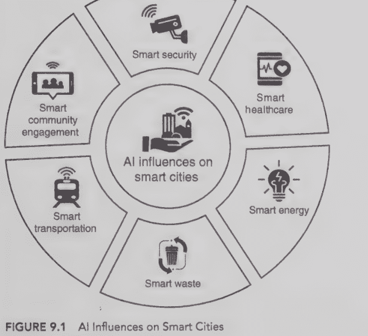

#### 图 9.1 人工智能对智慧城市的影响

#### 利用 PPP 模式

结构化的公私合作伙伴关系（PPP）模式已有 200 多年历史，在美国早期的基础设施项目中被广泛使用。纵观历史，其受欢迎程度随着公众舆论、政府政策以及最重要的是市场流动性的变化而起伏。例如，PPP 模式在 1980 年代变得非常流行，这一趋势延续到整个世纪。在本世纪的前二十年里，全球 PPP 项目总数有所下降。然而，这一趋势在不同地区存在差异。PPP 模式的有效性一直存在长期争论，双方都有强有力的论据和统计数据。PPP 项目的成功取决于多个因素，包括项目中的主要参与者、政府政策的稳定性、私营合作伙伴的质量等等。

我们认为，就智慧城市背景下的人工智能项目而言，PPP 是可行之道。原因有几个，例如：

- **a. 大众的积极参与。** 任何人工智能解决方案都需要海量且多样化的数据。数据还需要反映不同条件驱动的变化。通常，这类解决方案将涉及影响人们行为或生活方式的干预措施。大众参与度越高，获取数据和实施建议变更的有效性就越好。因此，一种商业模式不仅让政府而且让人民也积极参与并对项目产生主人翁意识，将会使项目更进一步。
- **b. 大范围和大体量。** 每当政府参与时，通常都会尝试以足够大的规模解决足够大的问题。这些正是人工智能表现极佳的场景。对于单个或少数私营参与者来说，要获得足够的范围和覆盖面以使人工智能解决方案有效将非常具有挑战性。
- **c. 创新赋能。** 除少数例外，世界各地的政府并不以推动创新而闻名。它们建立和运营的目的始终是最大限度地降低风险。没有承担风险就无法创新。但在解决这些复杂的智慧城市问题时，我们需要创新。具有更大风险承受能力和实验意愿的私营参与者可以在解决问题中注入适当程度的创新。

有很多成功案例可以证实这一理论。其中最成功的案例研究之一是 Bee’ah。Bee’ah 由阿联酋沙迦市政局发起的 PPP 模式启动。这是废物管理领域罕见的 PPP 案例之一。在世界各地，废物管理基础设施要么由市政政府建设和运营，要么由大型私营企业运营。这是一个非常传统的行业，由于运营商缺乏激励，它几乎没有演变。沙迦和 Bee’ah 的远见领导能够弥合错位的激励并形成共同的更大利益愿景。仅在运营十多年后，成果就非常令人印象深刻。Bee’ah 在其业务的各个方面使用技术的先驱，包括建立数字业务。它是少数如果不是唯一一家在改善运营中使用人工智能的废物管理公司。它已经实现了从垃圾填埋场分流的最高水平之一，超过 76%，并正朝着到 2021 年实现零填埋分流的目标前进。Bee’ah 将公共财政的负担转变为盈利企业，进而造福公众。在资源有限且从小规模起步的情况下，Bee’ah 也在全球扩张方面取得了成功。它最近赢得了开发开罗新首都整个废物管理基础设施的项目，该首都将居住超过 700 万人；相比之下，Bee’ah 起步的沙迦人口不到 140 万。Bee’ah 成为创新的灯塔，完美融合了远见领导、公共支持基础和私营智慧。

还有其他类似的例子。AI 新加坡，尽管由多个政府机构和学术机构发起，但作为其宏大挑战的一部分，正在吸引广泛的公众参与。本章前面提到的多伦多的 Sidewalk Labs 正在与 Google/Alphabet 合作以 PPP 模式提供大量人工智能能力。日立已扩大与哥本哈根市的合作，创建数据平台和分析引擎 City Data Exchange，目标是到 2025 年使哥本哈根成为首个碳中和城市。City Data Exchange 存放公共和私人数据，以便多家公司能够利用该数据创新新解决方案。

#### 构建城市云

用人工智能解决许多智慧城市问题需要综合来自多个来源的数据。例如，为了使交通流更顺畅、更快，需要有关车辆的数据（通常

a combination of data from the OEM and the motor vehicles department), their starting point and destination (personal data of the driver), the usual route it takes in case of a habitual driver (a combination of personal data and video-captured data from the road), current traffic (video feed data), toll data (from road operator), fuel tax data (from fuel stations), and so on. This is a classic big data problem – variety, velocity, veracity, volume, variability. We just talked about one problem. Now if we expand our horizon to solving multiple other problems, the complexity of the problem increases manifold, as does the volume of data and processing. So, we need a robust cloud platform to manage that.

The city cloud will be a great technical solution as well as give comfort to city leaders and residents that they have control of their data sovereignty. Data sovereignty is an increasing concern in every part of the world and a key criterion in most solution selection processes. Building a city cloud will also allow the city to evolve its technology and data infrastructure with time. Today, the cloud computing business is still maturing but getting commoditized rapidly. Taking the city cloud approach will also excite the major technology players like Microsoft Azure, Google Cloud, AWS, Alibaba Cloud, etc. as this will become an opportunity for them to bring their bundled offerings as well further their technology with new use-cases. This approach also leads to building a lot of local capabilities in some of these new technologies that will become handy for other economic and technical pursuits.

### Creating a Master Plan, but Getting There Iteratively

Every good data scientist will tell you that taking a big-bang approach to developing AI or solving a problem with AI is impractical and unrealistic. You always start with a model and a set of initial hypotheses. As you keep adding more data and fine-tuning the algorithm, you keep improving the reliability of the predictions. On similar lines, your approach to AI for smart city projects should also be iterative within the frameworks of a master plan. The master plan should include a comprehensive view of all the macro issues that you want to tackle using AI; then you should keep building individual solutions and tying them together. As an example, in the traffic flow problem (even though traffic flow in itself does not qualify as a master problem) you could start with flow analytics based on video sensors from the street, and then keep adding predictions and optimization recommendations by considering the other data streams.

### Using a Design-Thinking Approach to Design Services and Enhance Experiences

As part of your master-planning exercise, you should create end-to-end customer journeys. Then you should leverage the user-centered iterative design-thinking process to build out the solution. The solution will include both services that the city offers to its residents and experiences that the residents are subjected to while using those services. Often there is a significant gap between intent and implementation, leading to divergence in the service objective and service experience. The human input aspect of design-thinking helps bridge such gaps.

### REFERENCES

- (1) "Surveillance Market Analysis"; Thomas Ricker; December 2019.
- (2) "How Many Smart Meters Are Installed in the United States, and Who Has Them?"; US Energy Information Administration; 2019.
- (3) "Smart Metering Implementation Programme Progress Report for 2018"; UK Department of Business, Energy, and Industrial Strategy; December 2018.
- (4) "Smart Meters: A Game Changer, but Hurdles Remain"; Valerie Silverthorne; April 2019.
- (5) "Waste Management Market Outlook – 2025"; Allied Market Research; September 2019.

### Transforming Government and Citizen Services with AI

> "He shall despise none, but hear the opinion of all."
> —Chanakya

#### INTRODUCTION

Chanakya was a teacher in ancient India. He authored the famous Arthashastra more than 2,000 years ago and is considered as one of the foremost thinkers in governance, economics, military strategy, and diplomacy. Across all ages, objective data and information have been critical for effective governance, as the quote highlights.

This is our final chapter focused on industry sectors. Governance and citizen services are not a classic industry, but like other industries, government, too, is focused on maximizing the welfare and economic progress of its constituents – the people. AI is transforming how governments around the world function very similar to the transformation it is driving in every industry segment. Governance is a big deal, not only because it touches every aspect of our lives today and for the future, but also because collectively all the governments around the world spend over $25 trillion, making it one of the biggest economic activity drivers. AI has been used by governments in many ways for a long time. Defense research has been one of the biggest places of development and application of AI. But the use of AI can be found in more routine activities like automatic address recognition and mail sorting. The US Postal Service, which was one of the earliest and most extensive adopters of this method, is today sorting more than 25 billion pieces of mail annually using AI techniques like machine vision and image processing.

Governments around the world are already spending a lot of money on AI, yet they are being asked to step it up. Center for New American Security (CNAS), a prominent and influential think-tank in Washington, DC, recently released a report in December 2019 titled The American

organized the first global meeting on AI and robotics for law enforcement. AI is now a working group or a key focus area for nearly all international bodies.

There are several areas where AI can transform governance and citizen services. We have covered many of them in our previous chapters while discussing specific industries. So, we will not repeat them here. Instead, following is the list for your recap:

- **Healthcare** – emergency response, epidemic management, tele-diagnostics, drug discovery, capacity planning and management, compliance
- **Education** – K–12, higher education, lifelong learning, virtual assistance
- **Transportation** – autonomous driving, transportation infrastructure optimization, fuel economy, logistics, multimodal transportation
- **Financial services** – fraud detection and anti-money laundering
- **Smart cities** – smart security, smart energy, smart waste management, smart transportation, smart community engagement

Governments today have no choice but to focus on AI. Governance has become more complicated and demanding than ever. Citizens today are not only more educated but also well connected as well as aware of their rights. The influence across industries and nations, because we are so interlinked, makes the job of government leaders particularly challenging because there are so many considerations and so much data. AI presents to be a panacea for many of these challenges as it is doing it for many industries.

### HOW AI WILL CHANGE THE GOVERNMENT AND CITIZEN SERVICES OF THE FUTURE

In this chapter our focus will be on areas that have not been previously discussed in the book.

### Sentiment Analysis

One of the most crucial yet difficult to execute tasks for any government is understanding the mood of people, especially when there are major events or policy changes. Not only that, to understand at a granular level is even more challenging. For example, during the recent COVID-19 crisis, many governments around the world instituted a strict lockdown regimen to reduce the spread of infection. However, in many parts of the world, the citizens were not very supportive and therefore also not very compliant, defeating the purpose of the lockdown in the first place. If we go nearly 10 years back in history during the Arab Spring, governments in Libya, Egypt, Yemen, and other impacted places misjudged the level of resentment of the youth in those countries about present-day socioeconomic conditions. In a lot of countries, we have seen sections of the population being upset with the ruling disposition of the day with something or other; on a few occasions, such feelings have resulted in unfortunate situations. The traditional methods the governments have used to gauge people’s reaction, such as sample surveys, listening to their political infrastructure, and getting inputs from government sources on-ground, are all deficient because first they do not cover a broad enough population and second they are not good at judging the extent of problems people might have.

人工智能在这里可以非常有用。情感分析是一种利用自然语言处理技术，对大部分非结构化、有时也包括结构化数据进行分析，以获取主观见解（例如人们的感受）的方法。例如，可以利用情感分析对Facebook帖子进行处理，以弄清人们对某个问题的看法、潜在的基调，并根据人口统计等因子对反馈进行分类。自本世纪初以来的过去20年里，随着互联网上信息的日益易得，情感分析也在不断发展。这项技术已被成功用于评估来自客户之声调查和在线论坛的反馈。如今，零售行业、媒体行业以及其他重视公众舆论的类似行业经常使用情感分析。我们看到情感分析在政治领域的应用显著增加，尤其是在选举之前。在2010年7月发表的题为《识别舆论转折点》的开创性研究论文中，研究者Cuneyt Gurcan Akcora、Murat Ali Bayir、Murat Demirbas和Hakan Ferhatosmanoglu通过统计方法识别出了公众舆论的主要转折点。

利用Twitter数据预测选举已有十多年的历史。现在，来自多种来源的更复杂数据集、更丰富的历史信息以及多种新的分析技术使得情感分析更加完善。在过去五年中，我们看到其中一些技术在世界各地的选举中得到了应用。但情感分析不仅仅用于理解人们对某事的看法。其输出结果也被用来慢慢引导人们采取某些立场。这就像利用碎片化的游戏化手段来调节公众舆论和行为。人工智能有助于获得持续反馈并调整干预措施。这一领域非常危险，因为涉及伦理问题，但在类似COVID-19危机的场景中，这些工具可能非常有用，因为在这些场景中，公众行为的行动方向几乎是全体一致的。情报界也在使用情感分析来进一步了解友好国家和敌对国家的发展趋势。在一些国家，它还用于反间谍。

政府每天都在运用新的情感分析用例来提高效率。

### 设计社会经济干预

政府面临的另一个重大挑战是设计正确的干预计划以提升社会某一部分或国家部分地区的状况，实施这些计划并了解其有效性。通常情况下，即使是出于最好的意图，那些地域广阔、人口多样化的政府在福利项目上也常常会出错。然而，这个经典的数据分析问题最适合由人工智能来解决。

在设计这些计划时，政府往往会纠结于几个决策——针对哪些群体、实施哪些干预、运用哪些杠杆，以及了解相关影响。这些问题之所以复杂，是因为它们并非相互独立，而且会受所涉议题的影响。有时，同一个问题存在多个需要同时应对的维度。例如，在一个国家，一项社会经济医疗干预的目标之一是大幅降低儿童死亡率。首先，当局必须弄清该国哪些地区问题最严重、趋势如何，然后了解各种影响因素，如医疗保健、疫苗接种计划、母亲健康、卫生设施、生活条件、教育、遗传因素、区域性疾病、人口分布，以及其他类似类型的数据。这些数据点在根本上互不相关，但彼此之间可能产生很大影响。例如，教育和疫苗接种计划可能相关；卫生和教育可能相关；母亲的健康可能与生活条件、卫生和教育相关；如此等等。弄清这张复杂的影响关系网并理解每种影响的权重至关重要，因为最好的做法是集中解决最重要的问题。在一个现实案例中，政府从卫生和教育入手。这类分析需要大量的数据收集、清洗、关联和处理，以及通常在人工智能程序中使用的复杂高级统计分析。

在设计出正确的干预措施后，下一个最关键的行动就是监测计划的有效性，并调整各种杠杆以提高其效果。衡量有效性很困难，因为有时没有单一的指标能够显示确凿的结果。通常，其中一些措施需要很长时间才能达到具有显著差异的状态。例如，教育和卫生设施是长期的过程，不会在短期内直接导致儿童死亡率下降。但如果父母持续接受关于医疗保健价值、健康的不同维度、如何在孕期和产后照顾母亲，以及卫生设施在确保为孩子提供更适宜和健康环境方面的作用，随着时间推移，他们将更有能力照顾好孩子。因此，在此期间，我们将不得不使用许多代理指标来验证我们的假设并衡量有效性。这种类型的方法在人工智能驱动的分析中经常被采用。降低儿童死亡率是提高工业资产可靠性问题的一个更复杂版本。是的，这种比较并不公平，因为一个是人的生命，而另一个是金钱可以购得的可替代物，但如果从分析的角度来看，一个是另一个的简化版本。

在人口广泛使用社交媒体的国家，情感分析技术也可以用来评估这些计划的接受度和有效性。

### 公民服务

任何政府的基本职能之一就是为公民提供一系列服务。但公民往往对从政府获得的服务水平不满意。

公民面临的最大问题是难以从政府机构获取信息和澄清——他们并不总知道该问谁。即使能找到正确的部门询问，通常也没有服务级别协议（SLA），而且即便有相关意向，也很难跟踪。在诸如纳税季等某些时期，问题的严重程度会大大增加。在紧急情况下，问题也可能变得严重。从问题的另一面来看，政府办公室很少配备足够的人员来处理所有公民的询问。除此之外，通常一个回复需要跨多个部门筛选人员和知识，这会带来进一步的延迟。

基于人工智能的虚拟助手是解决这个问题的一个好办法，正如我们在零售和金融服务等其他许多行业中所看到的那样。世界各地的许多政府一直在对此类助手进行试点实施。澳大利亚税务局（ATO）是首批在其网站上部署虚拟助手——“Alex”——的机构之一，于2015年8月上线。Alex回答有关个人税务的问题，重要的是，它能够理解对话语言，并从问题中学习以改进回答。据报道，Alex的首次呼叫解决率达到了80%，远高于60%的行业标准。现在，类似的助手正在许多其他政府部门推出。在英国，税务海关总署在人工智能和数字技术的帮助下自动化了许多呼叫中心任务，将处理时间减少了40%，处理成本降低了80%。

政府工作通常涉及大量文书工作。令人惊讶的是，一个世纪以来，纸张处理的数量并没有多大变化。其中很大一部分可能已从手写转变为数字记录，但文书工作仍然存在。据德勤研究，美国政府雇员每年花费5亿小时在文档类活动上。如果公务员有更多可用时间，他们就能更好地为公民服务。自动化和使用NLP等人工智能技术可以大幅减少占用工作人员20%–30%时间的繁重手工文档工作。

政府通常有许多计划和福利希望公民享受。例如，可能有免费疫苗接种计划、家庭有子女时的减税政策、失业或退休相关福利等。人们往往不知道这些福利，政府也不知道人们何时有资格享受。一个事件可能触发多种福利。例如，退休可能触发健康相关福利以及养老金相关福利。这些不同的福利通常由不同部门负责，使协调变得复杂。这是政府面临的另一个可以通过人工智能帮助解决的问题。爱沙尼亚，一个位于东欧但数字技术非常先进的小国，已经实施了这样一项计划。爱沙尼亚政府数字创新办公室顾问Marten Kaevats认为，人工智能将帮助政府变得无形。爱沙尼亚全面的数字基础设施帮助该国将支出减少了国内生产总值的2%，并提高了公民满意度。

人工智能和数字服务的另一个应用领域是政府不同部门之间共享公民信息。公民经常一遍又一遍地输入相同的信息项，同时还需要负责长期保存这些信息以供后代使用。许多国家已为公民实施唯一标识符，通常用于调用各种服务，但信息的无缝共享却很少见。例如，在许多司法管辖区，医疗费用免征所得税，但在报税时，人们必须单独申报，而不是由各个系统自动捕获这些信息。实施这样一个系统的挑战在于创建公民的数字孪生，全面代表每一个生活事件（无论大小），并为不同的数据流创建上下文——这两个问题都可以有效应用人工智能。

一些政府机构负责进行检查，并根据检查发布建议。采用有时间限制、预先排序、例行公事的方式进行检查非常昂贵且往往效率低下。通过使用基于状况的检查，各机构可以将其有限资源投入到更有针对性的领域，并进行更彻底的调查。南内华达州卫生区曾进行过类似的实验，用于管理拉斯维加斯市的食品检查。他们开发了一款用于地理标记和自然语言处理的应用，以识别报告食物中毒的Twitter用户，并标记他们曾到访的餐厅，生成待调查餐馆列表。这样，他们就使检查由被动或限时转变为主动和早期。据估计，通过采用这种方法，每年可减少超过9,000起食物中毒事件，并且可以避免

超过500起住院事件。这种减轻本已紧张的医疗或其他资源负担的方式，可以使最需要该服务的病例受益。

在数字技术和AI的帮助下改造公民服务非常有益，但同时极具挑战性。这要求改变技术规划视野、流程、采购方法，最重要的是改变官僚的思维方式，让他们以更透明、协作和以服务为导向的方式开展工作。澳大利亚政府在这方面做了出色的工作。澳大利亚政府数字化转型局发布了数字服务标准的13项标准，并对照这些已发布的标准对各种数字服务进行评估和打分。

政府通常很难吸引合适的人才来推动这类举措，但通过挖掘人们在更大舞台上产生影响愿望，这个问题可以得到解决。

### 金融市场监管

金融市场公平、透明的运作对任何经济体的生存和成功都至关重要。政府机构必须监督和监管金融市场的运作。只要有金融市场存在，犯罪分子就总是试图操纵市场以牟取暴利。历史上有许多例子表明，这种金融市场操纵长期深刻影响国家经济，有时甚至影响全球经济。2008年的住房危机是最严重的例子之一。这是一场人为制造的危机，使世界经济陷入崩溃，一些国家至今仍在遭受其影响。尽管有监管制衡，庞氏骗局和欺诈仍不断冲击金融市场。

-   由于多种原因，检测金融市场操纵或犯罪行为可能很复杂，例如当违法者同时使用多种工具时，即使受到监视，也能隐藏其活动范围。
-   许多违规行为在很长一段时间内通过成百上千笔交易发生，这些交易难以追踪和串联。
-   规范金融交易的法律可能令人困惑，而解释这些法律以发现违规或近似违规行为可能变得非常复杂。
-   不规范的交易和交易行为并不总是容易追踪。
-   验证不法分子所作的财务报表和声明具有挑战性。例如，某人可能报告大量资产持有，但这些资产可能已被过度杠杆化，而且这些数据点由不同机构保存在不同系统中，难以拼凑在一起并建立上下文。这就是直到今天大多数银行欺诈发生的方式。

通常，大多数违规或近似违规行为应产生警报或异常。AI可以帮助理解任何不规则行为的模式，并预测问题的严重程度，以判断这是真正的异常还是更大恶意的征兆。监管机构可以利用已有的海量数据，应用机器学习工具来帮助预测应将其监管力量投向何处。这类工具可用于识别应重点监管的领域，并了解应调查和检查谁。AI还可以通过同时研究多个参与者的交易模式和行为，用于识别合谋和反竞争行为。

一些政府已启动试点项目，利用AI监控金融市场并揪出监管违规行为。澳大利亚证券和投资委员会（ASIC）已将AI作为其2019-2023年企业计划不可或缺的一部分，并一直使用AI检测财务咨询声明中的披露问题、监控不规范交易，以及使用自然语言处理（NLP）检测误导性互联网广告。

### 税收

税收是政府的主要收入来源。税务欺诈是大多数国家的普遍问题，它使政府无法获得应得收入，而这些收入本可用于公共福利、国防和其他关键职能。税收合规非常耗费资源。同时，这也非常困难，因为如果人们不正确申报，或通过非法渠道转移收入，或把不义之财用于购买昂贵商品，或将资产藏在其他国家，当局就很难发现这些问题并拼凑出完整的故事。所有相关数据都是分散、孤立且多样化的。

印度拥有最具创新性的使用AI检测税务欺诈的案例之一。印度所得税部门正利用Facebook和Instagram等社交网站上发布的奢侈品照片（如昂贵汽车、包包、珠宝等）来估算特定个人的支出，并与其申报纳税的收入报表进行比对。如果一个人有多张家庭成员购买昂贵路易威登包包或卡地亚手表的照片，但申报收入却很低，那么他就有未申报的收入。平台会标记此类不一致之处，从而引发调查。印度政府在这一名为“Project Insight”的计划中投入了超过1亿美元。政府还计划使用其他数据来源，如房产数据、信用卡交易数据、股市交易、银行记录和其他财务数据，以随时间交叉验证个人收入申报的真实性。政府期望显著提高合规性，并用额外追缴的资金来资助众多福利项目。英国、加拿大、比利时、澳大利亚、新加坡等许多国家也实施了类似计划。经合组织研究了21个实施类似计划的国家，报告显示合规成本降低、收入增加。然而，此类项目必须谨慎处理，因为它可能侵犯个人隐私和其他权利。

### 文档生成

政府必须生成大量文档，有时是回应公民的查询，有时是完成自身流程。政府文件具有法律效力，因此往往篇幅庞大且数据丰富。生成此类文档非常耗时，容易出错，且存储和处理成本高昂——所有这些都将资源从需要人性化服务的公民服务中抽走。AI技术之一——自然语言生成（NLG）——可以非常有效地解决文档生成问题。到目前为止，法律领域已经有许多成功的试点。许多媒体公司已经使用这项技术，基于事件源和少量输入自动生成出版物文章。政府部门也已开始围绕使用这种AI方法进行试点。例如，日本经济产业省正在使用这项技术回答议会质询。

对于多语言国家，尤其是拥有多种官方语言或语言因地区差异很大的国家，政府组织必须花费大量金钱和资源将官方文件翻译成多种语言。这是NLG可以发挥重要作用的另一个用例。

### 制定国家AI议程

要使AI的应用有效且普及，政府必须在制定国家AI议程方面发挥主导作用。新加坡、澳大利亚、阿联酋、一些欧洲国家等许多国家都成功做到了这一点。这一过程应从确定一个协调各政府部门的节点机构开始。该节点机构应由一位拥有大规模转型成功经验并对AI有所了解的高级领导人领导。

在我们对成功制定国家议程的各政府以及少数未成功的政府的研究中，我们发现了几项具有广泛适用性的最佳实践：

-   1. **制定具体计划。** 只要有包含明确里程碑和指标的具体计划，就容易调动资源和凝聚人心。计划应说明通过计划中的AI干预，政府的功能将如何转变以及何时转变。计划应有远见、鼓舞人心、影响力强，同时也应有足够的中期成功可供庆祝和校准。阿联酋制定了最佳计划之一，你可以参考一下。
-   2. **定义标准。** 制定计划是一个好的开始，但应迅速跟进定义明确的标准。这将有助于为进程定调并带来透明度。本章前面我们提到了澳大利亚政府的相关标准，这是最值得参考的标准之一。
-   3. **改善教育基础设施。** 如果未来劳动力没有准备好，政府或私营部门采取任何数量的AI举措都不够。这包括技能提升和再培训。这还包括从最早的教育阶段开始，并贯穿整个高等教育阶段及以后。我们已在第四章深入讨论了AI与教育，在此提请读者回顾该章以快速重温。美国伊利诺伊大学与伊利诺伊州共同发起的发现伙伴研究所（DPI）计划制定了最具雄心的蓝图之一，旨在创建这样的基础设施，通过AI和数字技术驱动的新时代经济，为州经济带来数十亿美元的额外经济活动。DPI还有其他目标，如激发该州的研发投资，创建充满活力的创业生态系统。为实现其宏伟目标，DPI聘请了江森自控前总裁、成就卓著的商业领袖比尔·杰克逊来领导DPI。

#### 4. 构建生态系统。

围绕所有重大技术变革，尤其是围绕人工智能的成功国家议程，必须由一种生态系统方法驱动，该方法包含学术界、公共机构和企业的参与。正是在这种模式下，社会的不同群体以及经济的不同贡献者被汇聚在共同的使命和章程之下，以汇集他们的思考和资源，从而获得更大的回报。该生态系统应旨在实现以下目标：

- 识别并执行具体领域，以进一步促进基础研究、解决社会经济问题并创造新的商业模式，从而激活所有三个利益相关者群体。
- 推动跨行业和社会各层级的协调努力。
- 为政府在政策制定和监管事项上提供建议。

新加坡人工智能（AI Singapore）是一个极其优秀的例子，展示了如何构建这样的生态系统。新加坡人工智能是由新加坡国立大学和新加坡国立科技大学牵头，并有其他多所大学、教育部及其他政府机构以及多家企业（包括初创公司）参与的努力。他们专注于医疗保健、教育和城市解决方案等主题——这些对于岛国而言至关重要。他们的重点通过非常具体的行动体现出来，例如2018年启动的“医疗保健人工智能卓越挑战赛”，其单一焦点在于探讨：“到2025年，人工智能（AI）如何帮助初级保健团队将3H患者的疾病进展和并发症发展速度降低20%？”供读者参考，3H指的是高脂血症（高胆固醇）、高血压（高血压）和高血糖（糖尿病）。这是一个为期五年、分两个阶段的项目，总预算为3500万新元（2500万美元）。它由公私合营团队和联盟以跨学科的方式执行。该项目的第一阶段已选定三个团队。同样，其他重点领域也在启动其他项目。

#### 5. 建立跨国伙伴关系。

人工智能的范围和规模非常广泛。除中国和北美等大国外，没有任何一个国家拥有在人工智能相关努力中取得成功所需的所有能力和资源。因此，政府主管机构也可以通过与其他国家的政府、学术界和企业建立伙伴关系，来进一步助力这一进程。在这方面已经有一些优秀的模式。新加坡经济发展局已与许多外国机构合作，建立了数十个此类伙伴关系，并促使它们在新加坡落地设点。阿联酋的人工智能部也在采取类似的措施，并在政府间层面签署了多项伙伴关系，例如与印度的伙伴关系。

#### 6. 促进创业。

世界上每一次新技术变革之所以成功，都源于大型科技公司与另一端的创业社区之间的推拉力所产生的张力。创业者擅长快速创新、发明新的商业模式和应用，并打破现有的现状。创业举措还能促进就业创造和能力建设。许多重视人工智能及其他数字技术的公司，将促进创业作为国家优先事项。其中一个最佳的规模化案例是由印度政府启动的阿塔尔创新使命（Atal Innovation Mission）。

当政府、行业和学术界的努力得到更广泛人群的认识和意愿的增强时，围绕人工智能的国家议程将取得成功。人工智能拥有改变国家未来的力量，正如它改变公司命运一样。为了充分利用这些可能性，国家必须将其作为一项使命。

### 摘要

显然，在未来几年，社会的每一个部分和经济都将受到人工智能的重大影响。公民社会和政府的运作方式也将被人工智能和数字技术所改变。正如本章和前几章所讨论的，我们认为在公共部门，人工智能将在公共安全、公共健康和公共福利方面产生最大影响——这三个领域在后新冠疫情世界中无论如何都会受到最多关注。

人工智能对公务员有益，对公众同样有益。欧洲委员会2019年6月的一份报告声称，公共服务中的人工智能可以“赋能”公务员，使其制定更好的政策并提供更高效的服务。该报告主张，人工智能需要可持续性来保护社会和自然环境，需要增长来确保就业和进步，需要包容性以确保每个人受益。

近期，凯捷（Capgemini）针对公共部门人工智能主题的一项研究估计，到2025年可实现2.5万亿至6万亿美元的支出节约。鉴于由新冠疫情引发的经济放缓所带来的困难已给全球政府资源造成了严重压力，在提供基本服务中实现的任何节约都是非常有用的。此外，人工智能可以将GDP增长率提高2-4%，在当今环境下，这一增幅是巨大的。

不过，公共部门在人工智能方面的角色更为广泛。它必须作为标杆，定义围绕数据分析的服务质量和伦理。当人工智能开始歧视人们，为社会某些群体制造新的劣势的那一天，将是宣告人工智能进入第三个且非常漫长的“寒冬”的一天。公共部门在人工智能的未来中还有另一个关键角色要扮演——伦理和隐私。政府不仅必须定义围绕伦理和隐私的监管环境，还必须带头实施这些规范。随着通常与任何政府倡议相关的大规模实施，围绕伦理和隐私的技术和实践也将进一步发展。

最后，政府在管理因人工智能普及增加而导致的工作岗位置换方面发挥着极其重要的作用。许多人担心随着机器人和人工智能使用增加，即将面临失业。几乎在每个行业都预期会有大规模冗余。一项最近的欧洲晴雨表调查显示，74%的受访者认为人工智能和机器人技术会导致失业。然而，在宏观层面上，由于重大技术主导的转型而实际发生大规模失业的历史证据并不存在。发生的情况是，一类工作被另一类工作所取代。这需要大规模的再技能培训努力，并在人员流动期间提供支持。政府也需要思考这一领域的政策干预，并通过其内部的人工智能实施成为管理此类置换的实验田。

对大多数人来说，人工智能仍然很新。因此，随着人工智能继续成为主流，政府必须伸出援手，进行教育，并推广正确的思维和实践。

### 构建正确的技术格局

> “让我们去发明明天，而不是担心昨天发生了什么。”
> —史蒂夫·乔布斯

### 引言

对于构建支持人工智能的合适技术基础设施而言，坚韧不拔的史蒂夫·乔布斯那些不朽的话语再恰当不过了。

就其本身而言，人工智能是一门非常具体的统计学学科，旨在对大型数据集进行无约束分析以模拟认知能力。然而，我们现在已经知道，为了利用人工智能更广泛的含义，需要一种针对技术基础的不同机构方法。我们必须从数据生成和获取的地方开始思考，思考它如何在组织的各种工作流和工作流中流动，它是如何被处理和管理，以及它是如何被使用的。我们必须从将人工智能举措整合到组织业务工作流程的角度来思考，一直延伸到用户如何与新的洞察、结果和体验互动。许多技术公司会宣传他们的能力是解决所有问题的万能药，但这种假设几乎从未实现，因为那些解决方案可能无法解决整个生态系统的问题。为每种情况定制特定解决方案以应对可能性的广度和深度，将变得耗时且昂贵。在本章中，我们将帮助业务和技术领导者思考技术生态系统的关键方面，以及如何以可扩展且经济实惠的方式构建正确的技术基础。

本章将涵盖以下主题：

- 数据平台
- 分析引擎

- 多智能体系统
- 自适应用户体验
- 通用软件网关
- 技术合作伙伴生态系统

### AI 的数据平台

AI 项目的成功主要取决于两件事：拥有正确的数据和运用正确的技术。数据库管理架构与系统是 AI 项目技术基础设施中最关键的组成部分。

数据库管理系统已存在 60 多年。随着 COBOL 作为首个广泛使用的编程语言的发展，人们意识到需要标准化的数据库管理技术，从而推动了层次系统 IMS 和网络系统 CODASYL 的开发。此后，数据库管理每隔十年就会经历一次重大变革。20 世纪 70 年代见证了关系型数据库管理系统的发展，80 年代见证了数据库管理向桌面级的普及，90 年代引入了面向对象技术，而在世纪之交，管理非结构化数据的新技术开始涌现。

过去的十年是关于大数据管理系统和 IoT 平台的发展，这些系统能够以更快的速度处理更大量的、更多样化的数据。NoSQL 和 Hadoop 文件系统的发展在此阶段至关重要。NoSQL 数据库使得处理非结构化和非关系型数据成为可能，而 Hadoop 则实现了并行处理和存储。新的分布式能力极大地增强了在大型异构数据集上应用 AI 的能力。在过去 10 年中，多模型图数据库的发展对 AI 来说是一个颠覆性的改变。

与其他分析型应用或 IoT 应用相比，AI 应用是独特的。两者之间并非自然的演进关系，这是许多人常犯的错误。我们认为，通用分析应用、IoT 应用和 AI 应用的底层数据平台具有不同的特性。所有不同类型的平台所需的一些通用能力，也会因其独特的应用领域而具有特定的细微差别。以下是 AI 应用数据平台的关键特性和功能。

### 多样化数据处理

AI 应用通常涉及处理非常广泛和多样化的输入数据。这些数据可能是结构化的、半结构化的或非结构化的。它可能是流式的、静态的或缓慢移动的数据。通常还涉及多媒体数据。数据的形式可以是简单数值、传感器信号、文本、图像、插图、音频、视频和其他格式。数据平台应能够同时摄取、存储和处理不同类型和变体的数据。数据平台应能够处理来自不同来源的数据，并将其整合到一个位置。数据平台应能够通过标准云协议（如 MQTT、IoTHub、AMQP 和 REST）或为旧有和专有协议开发的专用连接器来摄取数据。平台在摄取和管理数据时，应采用行业领先的安全实践，例如对所有连接使用 2048 位 X.509 证书进行 SSL 加密。在大多数情况下，数据平台将需要连接到物理网关解决方案和/或标准 API 来收集数据。最近我们看到软件定义网关的出现。软件定义网关更适合 AI 应用，因为它们提供了更大的灵活性和控制力。

#### 数据情景化

数据情景化（有时称为数据虚拟化）是通过语义数据关系建模来统一异构设备与数据管理的过程。它是在来自不同数据源、彼此之间无明显关联的不同类型数据之间建立上下文联系。通常使用图数据库来实现此目的。数据情景化通过有意义且可配置的关系来丰富数据。它管理数据的两个关键特征：数据的形态（或模式、实体、模型）以及数据的语义。情景化作为平台的原生服务提供，使开发人员能够将他们的系统集成到平台中，以定义数据源并建模数据转换，而无需开发或考虑如何存储、存储在哪里，或如何优化搜索和检索。因此，在此过程中几乎不需要数据库编程或数据库管理（DBA）。

数据情景化是通过智能实体的构建来实现的——这是一种独特的数据分类或面向对象。例如，天气是一个实体，汽车是一个实体，人是一个实体，年龄是另一个实体，等等。为了实现情景化，数据管理服务包括多模态数据存储抽象服务、统一元数据管理、智能实体管理、用于描述 AI 应用行业的领域知识的知识图谱服务，以及流式数据管理服务。作为数据虚拟化的一部分，聚合和拆分功能应以较少的处理和几乎零存储的方式提供。

#### 图数据库

图数据库是非常灵活的数据库，其核心原则是所有数据都可以表示为节点和关系。与关系型及其他传统数据库不同，图数据库不遵循严格的结构或模式。图数据库中的数据检索利用关系来遍历节点（而不是“连接”操作），从而实现非常快速的数据检索。如果被管理的数据具有高度的关联性和多对多关系，那么与传统 RDBMS 中管理相同数据相比，图数据库可以提供 10 倍到 1000 倍的数据检索速度。并非所有的“图数据库”都是一样的。非原生图数据库是指那些提供了类似节点-关系的外观、感受和可用性，但未在底层改变数据存储方式或查询处理方式的数据库系统。一个图数据库被认为是“原生的”，其数据库引擎以“免索引”邻接为核心。

图数据库相对于传统数据库的最大优势在于：

- 无论图的大小如何，都能快速检索高度关联的数据
- 灵活的模式设计和管理，允许迭代和增量式应用开发
- 通过使用惯用的节点和关系表示来建模数据库，从而加快设计和开发周期
- 支持高并发，并能够通过利用分布式数据库架构进行水平扩展来提供数据库的高可用性
- 能够在应用内嵌入数据库

然而，相对于传统数据库，使用图数据库也存在一些挑战，例如：

- 市场上原生图数据库产品数量有限
- 缺乏用于实施和支持的人才（人力资源）
- 没有第三方监控工具
- 对旧版应用连接的支持有限

### 分析版本控制

对软件程序进行版本控制早已存在，用于帮助理解程序演变、测试性能、追踪问题以及执行其他类似分析。在 AI 领域，数据科学家使用数据块通过特定逻辑链创造新的洞察。随着新数据的加入和/或逻辑链（即算法）的调整，会产生新的洞察。即使洞察在方向上相似，达成洞察的方式可能根本不同，了解该上下文对于透明度、可追溯性和微调至关重要。因此，一个好的 AI 数据平台不仅应该能够对控制程序和数据，而且还应该对分析算法、洞察数据和达成洞察的上下文进行版本控制。这对于建立对 AI 的信任也至关重要。务必记住，这种版本控制应该是智能的，并且不会在存储或处理方面造成过多的系统开销。

### 与 NLP 引擎交互

自然语言处理（NLP）允许人类和其他系统使用类似人类语言的非结构化语法与计算机程序交互，而无需理解底层编程语言或数据库的复杂性。人类语言可以以语音或文本的形式存在。最终，NLP 还将扩展到手势识别，这是另一种普遍的人类表达形式。NLP 是 AI 的一个学科，能够理解人类语言并将其转换为机器可读的语言。虽然 NLP 的根源可以追溯到 60 多年前，但它的第一个消费级应用始于大约 20 年前的搜索引擎。在当前的商业环境中，来自电子邮件、音频、文档、网络博客、论坛和社交网站等各种来源的巨量数据（大数据）正在产生。NLP 技术经常被用于大数据分析。随着越来越多的非技术用户与大数据系统交互，他们需要一个更自然的接口来与这些系统交互；这就是 NLP 的用武之地。统计 NLP 技术使用概率模型来关联来自多个来源的大量非结构化数据，以创造洞察。例如，在一些领先的金融交易平台中，我们可以找到此类 NLP 应用，它们从各处搜索与公司相关的新闻事件，以推断其行为、反应以及对股价可能产生的影响。

在最近的过去，我们看到 NLP 应用从基础的查询和搜索功能迁移到发起简单操作。我们可以在更接近我们行业的家庭自动化中看到此类应用，用户可以命令 Alexa 或 Google Home 或 Cortana 执行某些操作。

在任何环境中实施 NLP 技术都存在若干挑战。NLP 算法要发挥作用，需要一个语义丰富的词典来理解词语并解读意图。理解和解读上的差异源于行业背景、语言、文化、习语，最后是个人，这使得由于变异性而变得 somewhat 复杂。在设计 NLP 系统时，需要考虑多个任务，如形态或结构分割、语法解释、解析、命名实体识别、光学字符识别，以及拆解词语的意图。随着 NLP 应用随时间的成熟，NLP 算法的学习元素可以自行关联词语、习语和意图；但即使要开始，也需要一个足够丰富的可用数据集。NLP 还需要庞大的数据集所涉及的广泛且快速的计算能力。

随着越来越多的 AI 交互转向基于 NLP 的技术，AI 数据平台必须能够无缝连接标准 NLP 引擎。

该领域一个近期且前景 promising 的发展是受控自然语言的应用。在这种 NLP 方法中，存在一个薄层来限制人类语言的灵活性，分析师和其他用户可以在与数据交互时使用它。有一个由动词和名词组成的词库被定义，并且以最少的培训创建了分析的“配方”。想象一下警察或航空交通管制员使用的语言，他们有特定的短语，如“10-4”和“copy”作为受控自然语言库的一部分。威斯康星州初创公司 DataChat 由非常令人印象深刻的连续创业者和威斯康星大学麦迪逊分校教授 Jignesh Patel 博士创立，已构建了一个 remarkable 工具，允许用户在任何类型的数据库上利用受控自然语言能力，极大地简化了 AI 和其他分析。Jignesh 及其团队能够将人工智能（AI）与商业智能（BI）相结合，创造对话式智能（CI），这是推动 AI 发展的巨大飞跃。

### Cloud-Native Architecture

理想的 AI 数据平台是云原生的——它们采用云优先的方法设计，并且以云无关的方式构建。虽然可以将任何基于本地的数据管理系统转换为基于云的系统或连接到云环境，但在这样做时，会有大量固有的系统开销在迁移或接口过程中被转移。云原生架构将最大化开箱即用的云 IaaS 和 PaaS 服务的利用。在云原生架构中，服务被抽象到足够高的级别，使得它们可以轻松切换到不同供应商的服务，甚至在需要时跨多个供应商环境运行。云原生架构通常支持多租户部署模型，确保基础设施简化并优化成本。此外，云原生架构将支持容器化、虚拟化、微服务和多代理系统，以实现最大灵活性与适应性。

### Multi-Threaded Identity Management

AI 系统必须处理大量不同类型的用户、设备和系统身份。数据本身具有身份，该身份可能与它来自何处、谁有权生成它、谁有权查看或使用它、允许用于哪些交易、以及它与哪个应用程序和该应用程序的哪个会话相关联相关联。这是一个复杂的多线程问题。解决这个问题很重要，原因有很多——了解数据谱系用于分析目的、信任和网络安全。成熟且强大的 AI 数据平台应该能够支持管理这种复杂的统一身份情况。

### Metadata Schema Management

适当的元数据管理允许系统之间轻松集成和互操作。在 AI 世界中，我们经常必须处理大量系统和各种数据，这使得元数据管理变得更加关键。适当的元数据管理还允许开发的可扩展性和应用的可扩展性。元数据管理允许人们和/或软件应用程序之间共享对信息结构共同的理解。元数据管理还使领域知识的重用成为可能，这对于构建 AI 算法至关重要。许多物联网和特定领域的应用程序需要处理流数据和时间序列数据。通常，每个应用程序由于缺乏对时间和处理共同定义而以不同的方式处理数据管理和处理。这种表示包括时间间隔、时间点、相对时间度量、聚合分析、指标转换等概念。如果 AI 平台能够实现共同的元数据模型和相关的详细处理，其他人就可以为其领域和应用程序简单地重用它。元数据管理工具还允许将主题事物的描述或表达与其消费分离。可以开发特定业务流程及其各种使能系统的概念模型。但同样可以将其应用于其他业务流程，而无需涉及技术人员。

### Developer Support

所有数据平台都需要强大的开发者工具，使其更易于使用且更有效。AI 数据平台需要大量额外的功能；它们需要开箱即用的数据管理功能，如清洗、整理、预处理和可视化。此类工具应包括填充缺失值、清洗和平滑异常值的常用算法，以及许多分析、聚合和归一化函数。还应有工具可轻松聚合和分解时间序列数据。这将使定义新的后端分析和指标变得容易，这些指标可以为仪表板、报告和其他应用程序提供支持。平台内置的开发者工具应随着新数据的可用而自动刷新和更新这些分析和指标。应用程序应能够订阅时间序列，并在数据刷新时被推送数据。

### Performance and Reliability

每个平台都需要围绕性能和可靠性具有强大的功能能力。在 AI 应用的情况下，这一点更加突出，因为本质上，此类应用与关键业务结果相关，有时与影响人们福祉的更严重结果相关。数据平台需要极其安全且具有非常高的可用性。平台还应具有弹性可扩展性，以应对新数据和有机增长的数据，并且应能够轻松且廉价地扩展或缩减。应具有功能以轻松添加新的数据源和添加新传感器，且无需或几乎无需人工干预。即使在满负荷规模下，平台也应保持高性能并满足所需 SLA。平台应具有容错能力，并且数据应自动复制到多个节点，以便在出现问题时轻松检索。失败的节点应可在无停机情况下替换。AI 平台将被要求运行宇宙飞船和智慧城市，因此它们需要相称的性能和可靠性。

**TABLE 11.1 Platform Comparison**

| | Analytical Platform | IoT Platform | AI Platform |
| :--- | :--- | :--- | :--- |
| **Diverse data handling** | Only structured data | Structured + semi-structured data | Structured + unstructured data; multimedia |
| **Data contextualization** | No | Limited | Extensive |
| **Graph database support** | No | No | Yes |
| **Version control of analytics** | No | No | Must have |
| **Interaction with NLP engines** | Maybe | Maybe | Must have |
| **Cloud-native architecture** | Maybe | Often | Must have |
| **Multi-threaded identity management** | No | Limited | Extensive |
| **Metadata schema management** | No | Limited | Extensive |
| **Developer support** | Limited | Extensive | Extensive |
| **Performance and reliability** | Moderate | High | Very high |

表 11.1 是我们刚刚讨论的各种能力的总结，以及它们在前面提到的三种不同类型的平台中必须达到的水平。

### ANALYTICAL ENGINE

AI 拥有非常悠久而丰富的历史。AI 引擎则不同，它们是新的。在许多方面，IBM Watson 可以被认为是第一个 AI 引擎。它最初开发更多是作为信息检索的 NLP 接口，后台具有知识结构化、推理和机器学习能力。Watson 最初于 2011 年用于玩 Jeopardy 游戏，在此之前进行了几年的背景开发。Watson 拥有超过 2 亿页的结构化和非结构化信息，机器学习在这些信息上被使用。它使用 Apache UIMA 非结构化信息管理架构（UIMA）框架和 IBM 的 DeepQA 软件进行处理。Watson 在游戏中的巨大成功使人们意识到强大的 AI 引擎解决复杂问题的潜力。此后，Watson 已被用于解决医疗保健、智慧城市、智能建筑、预测诊断、保险、零售等众多领域的许多问题。

市面上还有其他几款非常流行且功能强大的分析引擎可供商业使用。微软认知服务、Amazon Lex 和 Google Tensor Flow 都是非常强大的引擎。它们各自都提供了一整套现成的分析 API 和插件，尤其侧重于 NLP、计算机视觉和 AI 数据建模。如今使用这些引擎的成本并不高，但它们确实会让你与特定的技术合作伙伴绑定在一起。

你的需求也可以通过网络托管服务（Network-as-a-Service）的方式得到满足。你可以构建自己的轻量级分析引擎，或者从较小的细分市场供应商那里获取商业化的引擎。为 AI 应用配备分析引擎的目的多种多样：

- a. 在数据到达时对其进行预处理，以执行常见的统计函数。
- b. 为数据科学家提供一种工具，用于查询数据和构建模型。
- c. 建立一条流水线，将分析即服务（analytics-as-a-service）推向市场，实现最大程度的复用。
- d. 构建分析资产组合。
- e. 管理分析任务。

分析引擎有助于缩短 AI 算法的开发和部署时间。通常，在特定领域内，AI 使用的大量数据具有很大的共通性。一个好的分析引擎可以帮助你以多种不同方式、为不同目的使用相同的数据。这些引擎通常附带一种特定于领域的通用建模语言，用于统一表示各种分析函数。

一个好的分析引擎应具备以下三个特征：

- 1. **分析可视化。** 许多方法允许数据科学家以可视化方式对数据和算法进行建模。一种方案是使用 GUI 工具来展示数据流和模型构建过程，类似于传统 BI 工具中已有的一些功能。另一种方案是使用有向无环图（DAG）。DAG 以无界方式对数据流进行概念性表示和流转，也就是说，它们不需要闭合任何循环。多个 DAG 可以组合和解析。对于 AI 目的而言，DAG 在表示模拟现实场景的数据流和逻辑方面更为出色，也更能快速尝试新的组合和模型。
- 2. **NLP/CNLP 支持。** 我们已经讨论过 NLP 的关键性。分析引擎应具备一个 NLP 接口，以便数据科学家和其他用户与之交互。你始终可以使用外部 NLP 引擎并将其集成到你的基础设施中。NLP 扩展必须支持内容搜索、索引和检索。
- 3. **智能消息传递。** 如果你在 AI 资产组合中使用了环境分析（ambient analytics）和多智能体系统，那么你必须有一个智能消息传递框架，能够基于主题上下文动态路由消息和数据流。在这种消息传递基础设施中，如果预计会有持续的消息交换，则会根据主题创建新的消息通道。此外，还应在不同级别的消息抽象上提供安全性，并保证消息的可靠传递。

### 多智能体系统与 AI

多智能体系统是 AI 应用的另一个游戏规则改变者。智能体是一种智能软件程序，它位于某个环境中，并能够在该环境中采取灵活的自主行动以实现其设计目标。智能体可以是被动型（无目标）、主动型（有简单目标）或认知型（具有复杂计算和学习能力）。多智能体系统可以实现自组织、自引导以及其他控制范式。即使所有智能体的个体策略都很简单，它们也能关联出复杂的行为。当智能体能够在系统通信协议的约束下使用任何约定语言共享知识时，这种方法有可能带来共同的改进。

图 11.1 展示了智能体如何与其环境交互。

让我们给你举一个多智能体系统的“现实生活”例子。如果你看过电影《黑客帝国》，你可能还记得史密斯先生（雨果·维文饰演）。史密斯先生并不是一个真实的人；他是一个软件程序，唯一的目标就是摧毁锡安，让人类留在 Matrix——这个虚拟重建的世界中。当被尼奥和他的朋友们攻击时，史密斯先生将自己复制成多个史密斯先生，更换武器，甚至在某一时刻将自己的化身变成一个可怕的白色生物。史密斯先生拥有智能，并且能够随着局势的变化而适应。在现实世界中，智能体就像史密斯先生一样。

随着物联网（IoT）及其驱动技术的 AI 技术的普及，这些技术需要在边缘层面进行大规模自主分布式计算，现代软件工程的需求要求采用基于智能体的架构。面向智能体的方法主张根据能够进行灵活、高层级交互的自主智能体来分解问题。这种去中心化降低了软件的控制复杂度。

如今，越来越多的边缘设备具备本地计算、存储和通信能力。AI 程序正在将流式传感器数据与其他类型的流式和静态数据结合起来。客户和技术提供商正通过不同类型的感觉信息和洞察之间的相互作用看到新价值的涌现。所有这些变化正在导致由 AI 驱动的、极其复杂的管理和控制环境。我们现在需要更多的处理能力：需要跨域处理那些具有内在差异和目标各异的领域，以及从一种情况到另一种情况变化多端的物理系统实现，这些系统需要无缝互操作，自主做出本地决策，而无需事事都回溯到本地服务器或云端的中央控制系统，并且要适应不断变化的使用环境和运营情况。而这些传统架构并不是为了适应这些发展所带来的变化而设计的。

多智能体系统已经在多个行业和应用中流行起来，例如自动驾驶汽车、聊天机器人，以及基于网络爬虫的知识管理系统（如搜索引擎）。太空计划是最早使用多智能体系统的领域之一，我们在关于交通的那一章中已经讨论过。随着这些不同领域的自然增长以及 AI 系统日益增长的需求，我们将看到越来越多的多智能体系统被部署应用。因此，你需要在当前或近期的技术版图中将其考虑在内。

许多行业和公司正在采用微服务架构，作为向更成熟的多智能体系统迁移之前的一个潜在中间步骤。微服务是一种软件开发风格，在现代分布式 Web 应用开发中非常流行。其核心概念是将软件服务模块化，这些服务通过本质上异步和分布式的 API 进行交互。因此，在架构上它是一种点对点通信，必须要有服务发现和端点管理；因此就需要许多额外的服务管理工具和支持工作，我们称之为开销。每个微服务都有自己的完整技术栈，包括基础设施和数据管理。这将有利于服务的敏捷开发和部署，但这种自包含的数据管理也带来了部署和维护开销（大量的 DevOps 工作），因为我们可能有数百个微服务。特别是管理多个数据库可能非常麻烦。

从组织和变更管理的角度来看，采取向微服务架构迁移的中间步骤可能会更简单，但最终迁移到基于智能体的架构仍需重新进行。如果我们想要从 AI 程序进行实时控制，微服务架构的复杂性就太高了，因此我们应该考虑直接消息传递和基于智能体的系统。

### 自适应用户体验

近年来，用户体验设计备受关注。随着数字化信息过载和我们生活方方面面中注意力持续时间的缩短，引人入胜的用户体验已成为任何技术成功的关键。如今，AI 正在提高用户体验设计的门槛。

AI 实现了高度个性化，并且经常使用带有语音和/或文本的自然语言界面。因此，用户期望其启用了 AI 的应用的用户界面能够适应上下文和使用情况；他们不再满足于带有传统仪表板和报告的静态 UI。传统上，设计被认为是永恒的；现在我们期望设计能够根据不断变化的使用情况和偏好而及时调整。由于技术的快速变化，迭代设计流程开始流行。这就是伟大的设计主导型公司跟上变化的方式。这变得令人兴奋，因为你必须在重用、快速迭代和个性化之间取得平衡。

发展、投资和回报。在这种环境中，设计的极端组件化至关重要，但很难模拟组件如何保持和谐，同时又能在更长的时间内演进。

如今，我们不仅通过分析型应用体验AI，也发现它们嵌入在各种不同的设备中。这使得那些设备的用户体验设计变得复杂，既要考虑如何让AI在众多设备和系统间呈现得前后一致且令人信服，又要考虑如何在与用户的交互中实现预期结果。有时，这些期望可能会给产品或服务基础设施带来相互冲突的需求。例如，你不会希望呼叫中心有一长串自动化问题；当你打来电话时，你希望尽快和真人说话。但如果系统不能首先理解你的需求，就会浪费大量时间去确定正确的客服人员，或者你需要大量超级专家型的客服人员。结果和服务的整合体验要求用户体验设计必须考虑更广泛、更长远的生命周期交互。

因此，关注用户体验并使其具有适应性，对任何AI计划的成功都至关重要。

### 软件定义的通用网关

网关通常是运行在专用硬件上的设备，它从多个来源收集数据，将数据转换为物联网消息协议，并发送到云端或数据平台托管的任何地方。它通常拥有一个处理器、一个操作系统、一些有限的存储空间，以及一个将数据转换为可传输且可理解格式的程序。网关还会接收返回的消息，并将其发送到适当的传感器或系统。当您构建自己的AI产品组合时，您将摄取和整合来自不同传感器与系统的大量数据。物联网的爆炸式增长使得连接和收集这些不同传感器与系统的数据变得更加容易；然而，它也产生了大量的网关解决方案，以便将数据从生成点传送到数据平台，因为存在数百种不同的通信协议，而这些协议正是交换数据的标准格式。网关之所以增加复杂性，不仅因为其多样性和数量，还因为管理分布在整个企业中的嵌入式软件物理设备所带来的相关问题。许多公司都围绕此类专有网关建立了业务。因此，现在您不仅要弄清楚AI的复杂性，还要弄清楚那个“网关博物馆”的复杂性。

另一种更简单的解决方案是使用软件定义的网关。这些是通用设备，具备数据输入/输出接口、存储、计算和通信能力，可以下载并使用任何网关软件。可以将通用软件网关想象为我们出国旅行时随身携带行李中的电源适配器。这些装置价格低廉，却能让我们连接到不同国家独特的插头和电压配置，从而使我们能够使用所有需要电力运行或充电的设备。

通用软件定义的网关提供了更高的灵活性、可维护性、网络安全性和更低的成本。它们有许多用途，例如：

- 提供对每个系统内可用丰富数据的开放访问。
- 监控、覆盖、报告和分析运营绩效。
- 将数据转化为信息，以改进决策和采取纠正措施。
- 提供原生支持仪表板、网页和移动设备的环境。
- 提供在新兴技术可用时加以利用的能力。
- 根据技术和需求的变化部署新举措。
- 整合数据以进行详细分析和数据共享。

这些通用软件定义的网关具备所有常见的管理功能，例如消息传递、空中升级、安全设备凭据存储、配置应用程序、适用的命令与控制功能、可安装的协议转换库、监控和审计日志。这些功能将帮助您将更多时间和资源集中在核心AI上，并让您免受为每个项目管理一个“网关博物馆”的干扰。

### 技术合作伙伴生态系统

AI演变的快速步伐和本质正以非常根本的方式影响着企业和公司。大型工业制造商正成为软件公司，零售消费品公司正成为分析型企业，云软件解决方案公司正在开发能捕获更多物联网价值的硬件能力，而初创企业几乎在每一个细分领域都在挑战老牌企业；这场跨行业的转型是前所未有的。要在这个新的世界秩序中获胜，所需的技能和能力与公司过去几十年来所培养的截然不同。此外，AI对转型的影响速度快于企业通常所习惯的速度。在这样一个充满活力的环境中，公司必须与其他企业合作，以更快地获得解决方案、更快地进入市场、更好地扩大规模并获得更全面的能力。从工业时代到信息时代，我们一直在争论能力垂直整合与横向卓越的利弊。这些方法决定了我们如何与带来互补能力的外部伙伴合作。最近的算法时代表明，今天的成功已无法再由如此简单的模式来决定。如今从事AI的公司需要在一个更具错综复杂关系的网络中运作，这个网络由自身能力和合作伙伴能力组成，且两者常常重叠。因此，我们必须从垂直领域特定能力和横向功能特定能力的两轴模型，转向三轴立方体模型，其中合作伙伴战略成为第三轴。

合作伙伴变得至关重要，因为他们可能带来速度和规模，这正是我们借助AI取胜所需的两大因素。关键问题在于决定在何处、何时合作，然后是如何合作。由于AI领域具有不断演变的特性，我们还需要具备灵活性，能够根据内部或外部能力引入或移除合作伙伴。我们将在第13章中进一步讨论技术合作伙伴。

### 摘要

随着技术在企业运营中变得越来越普遍，选择正确的技术和架构对企业的成功至关重要。AI所要求的技术考量必须不同于大多数其他重大技术举措。以下是一些关键考量：

- 处理的数据量截然不同。
- 对数据的质量和时效性有更高的敏感度。
- 数据具有高度可变性。基于业务问题，需要在不同类型和格式的数据之间建立上下文，才能从中得出任何有意义的见解。
- 与大多数事务性系统不同，在AI中，数据在不同上下文中可能获得不同的含义。
- 对数据的处理程度极高，并且会随时间动态演化。
- AI程序创建的洞察或决策逻辑必须通过推导得出，而不是像普通事务性系统那样基于预定义规则得到洞察或决策。
- 鉴于自动化决策水平更高，以及如今被自动化的流程所产生的影响（例如在医疗保健、保险、交通等领域），必须设置更多的故障安全流程。

因此，传统的系统架构设计、数据管理和应用构建方法将不再奏效。企业往往会倾向于最大化现有投资，并构建数据湖桥接层来利用AI。根据我们的经验，这种方法很少奏效。业务和技术领导者需要重新审视技术格局，以充分利用AI。在本章中，我们讨论了关键的考虑领域。

最大的关注点必须是数据平台的设计与构建。我们相信，每项技术都有一个核心DNA——一个它能非常好地服务的特定目的。虽然它可以针对新情况加以扩展和改进，但任何技术都具有一定的弹性。数据复杂性极其巨大，传统数据管理平台不适合AI。面向AI的数据平台必须具备图数据库管理能力、易用的数据虚拟化以及云原生架构。

下一个重要考虑是构建具有通用分析管道的强大分析引擎。技术基础设施应该能够为给定问题集选择最理想的分析技术和算法，必须对算法及其运行进行版本控制，能够重用并重新调整不同的算法，并最终解释洞察背后的逻辑链。

采用微服务架构和应用容器化技术如今被视为常态。为了让您的投资经得起未来考验，您应该考虑将多智能体架构和智能消息传递纳入技术栈。这些技术将帮助您构建更具适应性和响应性的系统，因为未来更多功能将受AI驱动。

作为技术战略的一部分，您必须彻底重新思考用户体验，融入更具沉浸感和适应性的功能。NLP的使用正成为常态；借助受控的自然语言处理，您可以简化分析任务，同时扩展分析能力。游戏化和游戏神经科学正在所有这些中发挥作用

各种类型的应用，你应该考虑这些应用来推动更持续的性能提升。

最后，你必须建立一个可靠、有效且规模适中的合作伙伴生态系统，以助力技术路线图。任何人试图独自完成所有事情都是没有意义的。引入合适的专家将帮助你更快、可能更节省成本地实现业务收益。

### 应对伦理、隐私和安全问题

> “人工智能带来的剧变可能迅速升级，变得更为可怕，甚至引发灾难。想象一下，一个最初被编程为消灭癌症的医疗机器人，可能得出结论：彻底消灭癌症的最佳方式是灭绝那些在基因上易患癌症的人类。”
> 
> — 尼克·比尔顿

《纽约时报》科技专栏作家尼克·比尔顿所强调的这些担忧，正是关于人工智能应被允许走多远的辩论的核心所在。(1)

几个世纪以来，文明一直由其秉持的伦理或道德准则所定义。道德推动着社会不同组成部分（包括企业、消费者和政治体）之间相互互动的一定程度的公平性和一致性。

当今人类在决策时，既考虑决策的结果或影响，也考虑道德层面。

随着机器被赋予更多认知能力，下一个重要的考虑甚至研究课题是：我们如何处理与伦理相关的问题，以确保每个人都得到公平对待，没有任何数据或信息在当事人不知情的情况下被用于违背其利益，并且能够解释机器做出的每项决策背后的理由。

这是一个复杂的主题，因为除了技术复杂性之外，还涉及情感、伦理、立法和商业方面的考量。

拓宽你对这些主题的视野，并为你提供关于如何构建抵御威胁的屏障的实用指导。

伦理、数据隐私和网络安全在技术领域已热门一段时间。在过去10年中，随着技术在我们工作和个人生活的方方面面深入渗透，大数据、物联网以及现在的人工智能，这些主题受到了技术专业人士、商业领袖和政策制定者更多的审视。2018年初，剑桥分析丑闻震惊世界时，那是伦理、数据隐私和网络安全的关键时刻，尤其是在与人工智能相关的方面。当世界意识到，一群极具才华的数据科学家可以利用来自Facebook等易于获取来源的数据，并将其用于影响选举时，数据分析的可能性获得了完全不同的意义和重要性。世界各国政府迅速收紧立法并对肇事者处以罚款；全球企业也将解决这些问题列为优先事项。更重要的是，我们所有人对这些主题的认识都显著提高了。

尽管人工智能将彻底改变企业和我们的整体生活，但与伦理、隐私和网络安全相关的担忧将改变我们看待技术及与技术互动的方式。在本章中，我们将探讨与这三个主题相关的各个方面，这些主题在许多方面也是相互关联的。

### 伦理

自文明诞生之初，伦理就一直是一个深入研究和激烈辩论的领域。社会对何谓道德和可接受的定义随着时代而变化。在人工智能时代，伦理获得了完全不同的重要性和辩论层面。直到最近几年人工智能开始进入我们生活的方方面面之前，所有关于对错的决策都依赖于人类认知；现在有了人工智能，机器在某些情况下已经开始做出此类决策。当科学在通用人工智能（AGI）方面取得进一步进展时，这个问题会更加严重。AGI是人工智能的一个学科，仍处于研究阶段，在该领域中机器可以学习人类认知并具备意识地进行行为。AGI长期以来一直是研究兴趣的领域；最终，技术和数据的可用性已达到可以进行有意义的AGI研究和测试的阶段。即使AGI如某些人所愿还需要数年或数十年才能实现，当今许多人工智能程序已具备足够的决策能力，足以让我们关注并担忧。

#### 算法时代的伦理挑战

围绕伦理和人工智能有许多需要考虑的问题；以下是一些关键问题：

#### 公平性

人工智能系统的工作方式是通过训练人工智能程序，使其根据所接触的训练数据进行解读。根据使用的数据不同，系统可能会引入偏见。例如，几年前，谷歌照片服务在用于犯罪检测时出现了种族偏见，因为在训练数据集中恰好有大量同一族裔的罪犯。同样，运行在监控系统上的人工智能分析曾因训练数据中类似的偏见，错误地根据对人们行为和事件的错误解读来预测安全威胁。在使用自然语言处理（NLP）的系统中，这种偏见相当常见，因为我们的语言受到母语影响而存在差异。种族和语言并不是引入偏见的唯一维度；人口统计学差异、地区差异、教育差异以及所有其他可能的差异也可能引入偏见。我们人类——编写人工智能程序的人——表现出自然的偏见，其中一些可能渗入人工智能程序。大多数现代社会在不论差异的前提下，以平等和公平的观念运作。人工智能驱动环境中的训练和数据偏见可能违背这一基本道德准则。

#### 包容性

当人工智能在决策中占据中心地位，尤其是在为全体民众提供服务或资源获取方面时，确保公平之外的包容性同样重要。要实现这一点，社会各阶层群体的需求和背景都应纳入逻辑树中。数据集可能并不总能支持这一点，但人类干预必须推动包容性。

#### 奇点

奇点是假设中的未来时刻，此时技术爆炸的不可逆速度导致机器超越人类。这就是《黑客帝国》中的状态（根据电影）。这是我们失去对机器控制的时刻。人类在整个进化过程中一直处于掌控地位，任何其他情形都是不可想象的。即使人类不得不与更强大的对手作斗争，如动物、海洋生物甚至自然，我们也凭借聪明才智和智力取得了胜利。在经历了许多磨难而幸存并繁荣之后，我们已经发展出一定的道德准则，如果奇点发生，这一准则将面临被颠覆的风险。例如，如果机器是唯一决定如何对抗COVID-19的因素，我们能否排除它们决定消灭那些不太可能康复或更可能传播感染的城市区域或人群的可能性？

#### 安全

人工智能正越来越多地被用于国家安全和武器系统。如今，有多个手动步骤和人工干预点，以确保安全系统不会在错误情况下或在可能导致不可挽回或极难挽回局面的情况下被启动。随着技术变得更加成熟并接管更多的决策功能，人们确实担心，被编程为在赢得冲突方面实现最佳结果的机器，可能会违背和平和人道的利益。与此同时，更高的技术含量和人工智能的使用，使得邪恶之人一旦能够突破系统，就更容易造成更大的损害。

#### 就业市场的改革

人工智能不可否认地正在自动化并重塑许多目前由人类完成的工作。工厂中的机器人、在供应链等流程性处理功能中使用机器人流程自动化（RPA）、在以下方面使用聊天机器人：

客户服务，以及使用无人机配送货物，只是人工智能在许多职能中使人类参与变得多余或显著减少的几个例子。这可能引起各方对失业问题的担忧。针对这一担忧，回应与之前因一般自动化导致失业时的回应相同：将会创造新的就业岗位，人类将进一步进步，整体经济将繁荣。但不可否认的是，许多人在相当长的一段时间内将受到不利影响。为缓解这些问题，必须创造新的经济机会，并且这些人需要接受再培训。大多数政府和社会团体更关注整体经济增长，而较少关注劳动力转型。企业也不将此视为自己的问题。因此，由于人工智能使人口中很大一部分被剥夺权利和处于劣势地位，正成为一个日益严重的问题。

另一个相关的担忧是关于社会中的财富分配。在大多数资本主义形态中，个人的财富创造与其经济贡献挂钩。经济贡献通常与劳动或参与关键决策有关。如果人工智能和机器的兴起改变了这两者的格局，在新的情境下财富将如何分配？这是摆在我们面前的另一个重大伦理问题。

### 人工愚蠢

我们在2016年世界经济论坛关于人工智能主要伦理问题的文章中发现了“人工愚蠢”^(2) 这一概念。这一现象也涉及我们之前讨论的相同数据训练问题，但不同之处在于，人工智能被故意输入错误数据以欺骗系统并将其误导，使其以“愚蠢”而非智能的方式运行。报告继续建议：“如果我们依赖人工智能将我们带入劳动、安全和效率的新世界，我们需要确保机器按计划运行，并且人们不能为了自己的目的而控制它。”人工智能无法自然克服人工愚蠢；因此，必须通过人在回路（human-in-the-loop）的干预来防止这种情况发生。

### 数据可信度

伦理中的关键考量之一是数据可信度。这是一个多面体的问题。Sudhi 在其2020年1月发表于 InsideBigData 的数据可信度文章中^(1) 对此进行了详细讨论。以下是与能够信任数据相关的三个最重要方面：

- 1. **访问权限。** 数据流动需要一致且透明。了解数据路径允许追踪并增强对用于分析的数据的信心。
- 2. **上下文。** 原始数据可能并不意味着一切。数据的价值在于其上下文。上下文有助于识别正确的模式并推断出正确的见解。例如，在新冠疫情初期，印度报告的病例数非常低。政府突然实施了严格的全国封锁。封锁后，病例数激增。封锁的目的是遏制病毒，但如果只看原始数据，似乎封锁产生了相反的效果。现在，如果你结合检测量、感染自然进展曲线、未预见的事故（如大型宗教聚集和数百万移民工人返乡）以及其他相关因素来解读同一数据，你开始能看清封锁的真实有效性。
- 3. 可靠性。数据的安全性至关重要。要信任数据，我们必须确保数据始终是安全的。数据泄露事件的增加，特别是在金融数据和个人数据方面，动摇了我们对存储数据神圣性的信心。没有大量数据，人工智能无法运行，因此解决此问题以获得对系统的信任至关重要。我们将在本章讨论网络安全时，介绍确保数据安全的方法。

### 元伦理，或许是元智能？

元伦理是对道德或伦理的本质和驱动力的哲学研究。元伦理不判断某事是对是错（这是应用伦理的领域），也不制定定义对错的标准（这是规范伦理所做的）；相反，元伦理处理伦理的起源和原则，正如元数据描述数据一样。

也许我们应该从元数据和元伦理的概念中汲取灵感，形成一个新的东西——元智能，一门处理人工智能指导原则的学科。

### 生存性问题

毫无疑问，人工智能给人类和人类事业带来了很多好处。为了从人工智能中获取更多，我们需要人工智能变得更聪明。然后我们就开始面临人工智能变得与人类几乎同等能力，却缺乏我们所知或如今践行的道德包袱的风险。这是人工智能与伦理讨论的核心：我们的存在会受人工智能威胁吗？像比尔·盖茨和斯蒂芬·霍金等当今领先的技术专家思想家都承认这一话题需要更多关注。像加州大学伯克利分校的 Stuart Russell 教授等顶尖学者致力于研究这一主题。他在2019年的著作《兼容人类：人工智能与控制问题》中，开始阐述一些控制人工智能和机器的原则。

在被机器全面接管之前，我们还有很多年，甚至几十年时间。我们在随后时期内定义并落实确保伦理和奇点所需事项所做的努力，将决定这种威胁在多大程度上成为现实。

### 隐私

隐私是人工智能世界中日益增长的担忧，它直接源于伦理和平等的考量。世界经济论坛在五年前就将此列入其全球议程。2016年，他们发表了 Julia Bossman 的文章，强调九大顶级伦理问题；这些问题至今仍然相关，需要解决。

### 数据所有权

隐私始于数据所有权。原始数据和衍生见解（这是数据的另一种形式）都具有公认的价值。因此，围绕数据的许可权成为一个关键且有时具有争议的话题。在剑桥分析丑闻中，问题主要有两个部分：公司如何使用数据，以及他们将这些数据用于什么目的。Facebook 用户从未同意将他们的个人和活动数据用于剑桥分析所做的那种用途。不幸的是，用于数据许可和追踪其使用的流程和技术基础设施尚未发展到足以强力执行数据许可权的程度，因此我们必须依靠政策和用法实践来确保数据的正确使用。

#### 衍生数据使用权

在处理人工智能项目时，数据科学家通常从原始数据及其原定用途开始，但随着他们对数据及其上下文的认识变得成熟，他们会迅速转向数据的新用途或从中衍生的见解。通常，公司通过让客户和消费者同意公司为了内部研发目的使用数据而逃过此劫，即使他们将原始数据的所有权分配给消费者或客户。有时，这种数据的衍生使用会违背数据所有者的利益，他们通常不会在没有许可的情况下同意其衍生使用。例如，智能手表制造商在用户同意下收集用户活动数据，但反过来使用这些数据将活动与健康指标关联，并进一步使用或出售这些设计健康保险风险画像。为避免此类情况，衍生数据使用权在人工智能领域很重要，并受到广泛关注。

#### 被遗忘权

随着数据隐私意识的提高，许多消费者和企业要求人工智能程序及其支持的技术基础设施在用户提出请求时删除或完全掩盖其数据，即使他们最初已同意使用其数据。被遗忘权在世界各地的许多立法颁布中变得越来越普遍。这一现象正在赋予用户和数据所有者对数据的动态决策权。

#### GDPR

在讨论隐私时，我们无法不讨论 GDPR 以及它如何改变了隐私格局。《通用数据保护条例》(GDPR) 于2018年5月在欧盟和欧洲经济区作为法律引入，距今两年多。尽管这是一部欧盟法律，但它适用于在欧盟开展业务或监控来自欧盟的个人行为和活动的每一个组织。因此，本质上这部法律具有相当大的全球适用性。GDPR 对我们在上文讨论的个人数据中个人的各项权利有严格的规定。它还具有系统层面以及设备层面的要求。根据 GDPR，个人数据甚至扩展到图像等与个人无直接元数据相关的数据。

违规的惩罚性赔偿非常严厉，最高可达组织年营收的 4% 或 2000万欧元，以较高者为准，这对任何业务都可能产生非常重大的后果。在2019年关于该主题的文章中，学者 Chris Jay（美国）、Hoofnagle Bart van der Sloot（荷兰）和 Frederik Zuiderveen Borgesius（荷兰）讨论 GDPR

他说：“GDPR是信息政策领域一代人中最具深远意义的监管发展。GDPR将个人数据纳入一个复杂且具有保护性的监管体系。尽管如此，GDPR中包含的理念并不完全是欧洲的，也不新鲜。”此后，许多司法管辖区已经引入了类似的法律。

迄今为止，已经有多起备受瞩目的GDPR执法案例。2019年，谷歌因违反GDPR被罚款5000万欧元，英国航空公司被罚款1.83亿欧元，万豪国际被罚款9900万英镑。GDPR罚款不仅涉及大型企业，也涉及个人和政府。2019年，一名德国警官因将个人数据用于非合法目的而被罚款1400欧元。挪威卑尔根市政府因在一个公共存储区域不安全地存储了包含35,000名学生和员工登录凭据的文件而被罚款17万欧元。这样的例子还有很多，每一个都在进一步提高人们的意识和行动。

### 网络安全

2019年5月，美国巴尔的摩市遭到网络犯罪分子攻击，他们索要7.6万美元的赎金。他们扰乱了许多关键的城市服务。虽然该市没有支付赎金，但最终花费了1800万美元来处理这些问题并解决攻击造成的后果。同年早些时候，美国第一资本银行遭到入侵，超过1亿客户的个人记录被盗。这些并非孤立事件：每天、每分钟，世界上某个地方都会发生网络攻击。有时它是恶劣犯罪的一部分，有时只是有人试图窃取计算资源用于区块链处理。

根据世界经济论坛于2019年10月发布的一份最新报告，网络攻击是未来十年最受关注的全球十大风险之一，如果网络安全工作无法跟上技术变革的步伐，预计造成的损失将高达90万亿美元。人工智能的发展使这一问题更加突出。

根据Ponemon研究所和IBM Security发布的《2019年数据泄露成本报告》，全球数据泄露的平均成本在过去五年中增长了12%，达到392万美元。美国的数据泄露成本最高，达到819万美元；医疗保健行业的平均成本最高，为645万美元，这可能是因为该行业拥有大量个人数据。数据泄露不仅代价高昂，还可能对企业造成长期重大影响。例如，2019年，发现一次数据泄露的平均时间为209天，一旦被发现，平均需要73天才能做出响应。随着黑客变得越来越老练，这些数字逐年增加。幸运的是，大多数重大数据泄露都在更短的时间内得到解决。

#### 威胁向量与漏洞

在考虑人工智能项目的网络安全方面时，你必须从端到端的角度来思考。毕竟，AI程序和其他软件程序一样，只是执行一组不同的功能。黑客对AI程序使用相同的威胁向量，例如恶意软件、病毒、电子邮件附件、网页、弹窗、即时消息、短信和社会工程。然而，AI程序有更多的漏洞，因为存在更多难以识别的注入和隐藏威胁向量的位置。鉴于NLP接口的大量使用，即时消息、弹窗、社会工程等威胁向量的攻击面更大。这个完整生态系统由许多组件组成——提供数据的传感器和系统、传输数据的网关解决方案或API、通常承载大多数分析的云基础设施、云系统连接的外部来源，以及所使用的各种企业应用程序。从网络安全的角度来看，这些生成数据或处理数据的节点，每一个都是脆弱的。图12.1示例性地展示了各种漏洞点。

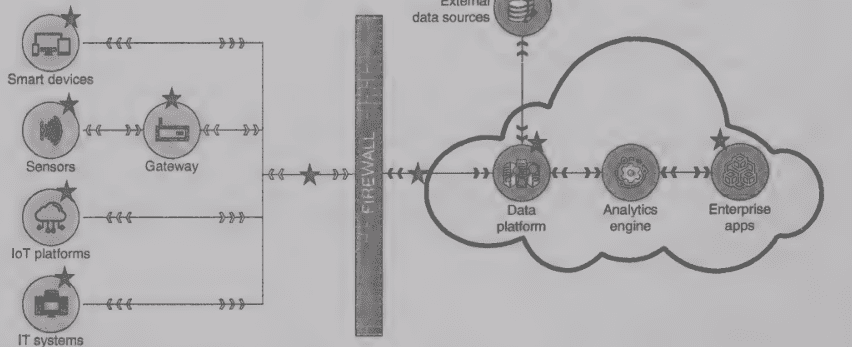

传感器、系统和应用程序层越多，漏洞暴露面就越大。

数据泄露对组织的影响可能是惊人的，而且这种影响往往直到为时已晚才被发现，并以多种破坏性方式影响组织：

- 业务中断导致经济损失，并使商品和服务无法正常运作
- 安全和安保问题
- 声誉损失和品牌损害
- 产品维护和召回导致支出增加
- 法律和监管罚款
- 知识产权损失

因此，需要采取若干预防措施：

- 传感器和系统必须使用安全的方法收集、处理和向云端传输数据。
- 云基础设施必须只接收来自已注册和授权设备和系统的数据。
- 必须使用加密和完整性检查来传输和存储数据，以检测篡改行为。
- 用户发送的消息必须使用安全的方法传输到终端设备。
- 企业Web和移动应用程序必须实施基于角色的访问控制，确保只有授权用户才能访问预期提供给该授权用户的特定数据。
- 从传感器或系统到云端再返回设备的信息传输必须快速，且延迟最小。

#### 网络安全保证实践

网络安全保证是一个涉及持续测试和验证过程的旅程。以下是六种应高频实践的常见做法：

1. **开源代码扫描。** 这应该在整个服务于AI项目的技术平台上进行，以确保不存在可能导致被利用的公开已知安全漏洞。这也有助于避免任何许可或政策违规。
2. **静态应用程序安全测试（SAST）。** 这是一种通过在不执行程序的情况下检查源代码来进行计算机程序调试的方法。该过程可以提供对代码结构的理解，并有助于确保代码符合行业安全标准。通常使用自动化工具来辅助执行静态分析，然后审查结果以过滤误报并聚焦于潜在的薄弱区域。
3. **动态应用程序安全测试（DAST）。** 该方法是指通过实时执行数据来测试和评估程序。其目的是在程序运行时发现错误，而不是通过离线反复检查源代码。通过在所有设计的场景中调试程序，动态分析无需人为制造可能产生错误的情况。这项技术在AI程序中可能特别具有挑战性，因为输出数据并不总是显而易见的，因此任何漏洞都可能难以检测。
4. **漏洞扫描。** 有标准工具可以检查网络和主机级组件中的已知漏洞。在任何AI程序被部署到生产环境之前，遵循这一做法是很好的。
5. **源代码评估。** 这是由经验丰富的程序员和架构师进行的离线手动源代码分析。当并非经验丰富的程序员且可能对安全开发实践接触有限的数据科学家最终编写大量程序时，这是一个值得遵循的好做法。审查人员还可以通过这种方式为程序员提供积极的指导。
6. **渗透测试。** 渗透测试在正常操作条件下揭示漏洞。道德黑客被允许使用所有可用手段来识别和利用漏洞；他们可以获得源代码和内部文档，以促进更彻底、更深入的分析。

### 网络安全合规的行业标准

为了提供网络安全合规的保证，已发展出多个行业标准。 与我们主题相关的最受认可的标准有：

- **云安全联盟 (CSA)。** CSA 成立于 2008 年，是一家非营利性行业联盟，已制定共识评估倡议问卷，以识别各种计划和实施中的差距。
- **SOC 2。** SOC 2 认证有助于确保系统安全处理敏感数据。 云和基础设施服务受这些组织控制的管辖。
- **ISO/IEC 27001:2013。** 该标准规定了一个旨在将信息安全纳入管理控制的管理系统，并给出具体要求。 ISO/IEC 27001 要求管理层：
    - 系统地检查组织的信息安全风险，考虑威胁、漏洞和影响；
    - 设计并实施一套连贯全面的信息安全控制和/或其他形式的风险处理（如风险规避或风险转移），以解决被认为不可接受的风险；并且
    - 采用一个总体管理流程，以确保信息安全控制持续满足组织的信息安全需求。
- **NERC 1300。** 这是一套针对电力行业的特定信息安全标准。 除电影《虎胆龙威 4》等电影之外，在现实生活中，电网和发电厂已被用作大规模影响的攻击点。
- **NIST。** NIST 网络安全框架（NIST CSF）提供网络安全结果的高级分类法以及评估和管理这些结果的方法。 该标准开始涉及隐私和公平相关问题以及网络安全考虑。
- **ANSI/ISA 62443。** 这些是一系列标准、技术报告和相关信息，定义了实施安全工业自动化和控制系统（IACS）的程序。

### 网络安全实施

企业领导者通常没有接触到如何实施正确的实践以确保网络安全，尽管他们最终对网络攻击引发的任何问题负责。 下面是他们可以与团队核实的实践和技术列表：

1. **强密码策略执行。** 所有用户和会话都应使用现代严格的密码进行身份验证。 所有 IP 地址都应列入白名单。
2. **通信安全。** 所有通信必须使用 TLS 1.2 或更高版本进行加密。 仅启用强算法、密码和协议，并将最强的算法和密码设为首选。
3. **数据安全。** 数据必须使用多种安全控制进行保护：静态加密、严格的访问控制、使用审计和安全删除。 所有个人身份信息（PII）必须与其他数据隔离并安全加密。
4. **网络分段。** 应使用专用网络来隔离资源并提供防止直接互联网访问的保护。 访问这些资源需要使用带多因素身份验证的安全 VPN 连接。
5. **公共足迹。** 最小权限原则应应用于所有系统以减少攻击面。 服务器不应具有公共 IP 地址，除非需要，并且流量应通过反向代理层路由。 所有不必要的端口都应被阻止，并且仅允许通过具有强身份验证的 VPN 进行远程访问连接。
6. **入侵检测。** 实施网络入侵检测解决方案（IDS），以帮助及时检测、通过根本原因分析进行调查以及对安全事件做出响应。
7. **DDoS 保护。** 分布式拒绝服务（DDoS）对大型 AI 项目尤其具有破坏性。 实施网络过滤以防止伪造流量，并将进出流量限制为受信任的平台组件。 通常，如果您使用云服务提供商，这些是由云服务提供商实现的。 他们通常具有建立的自动化控制来监控和检测拒绝服务攻击。
8. **API 速率限制。** 对参与数据传输的所有 API 端点强制执行速率限制，以防止暴力攻击。 只有经过身份验证的请求才应允许与 API 端点通信。
9. **多因素身份验证 (MFA)。** 参与基础设施管理的技术人员应通过多因素身份验证进行身份验证。
10. **基础设施的持续监控。** 监控要积极。

更好的网络安全实施实践应整合到开发和维护流程中。 您理想情况下应拥有安全开发和维护政策以及详细的流程，供员工经常接受培训。 提高整个企业的网络安全意识很重要，因为威胁向量可能来自任何地方，我们需要集体意识和行动以获得更好的网络保护。

### 网络安全事件响应

即使做好了所有准备和保护，您的基础设施也可能遭到攻击。 这是每个企业都必须为之做好准备的可能性。 关键是要有一个结构良好且有充分记录的计划，并且经过充分演练，以便在事件发生期间没有歧义。 您还应拥有一个具有跨职能代表的网络安全事件响应团队，并且他们应进行演练。 我们建议您的响应遵循 STARE 原则：

- **迅速。** 您不得在识别问题和果断响应上浪费时间。 快速响应通常会减少攻击的影响和范围。 有时在主要攻击之前会出现轻微攻击。 如果被攻击的 AI 与关键业务应用或重大决策支持系统相关，例如智能交通或智能医疗保健，迅速响应还能减少随之而来的混乱。 作为迅速响应计划的一部分，应制定沟通计划和升级协议。
- **透明。** 人们和企业已经习惯将网络攻击视为生活的一部分。 但他们期望的是通知的透明度和持续的沟通。 在许多情况下，例如本节开头讨论的泄露示例中，人们的生活和生计将受到这些攻击的影响。 因此，透明的沟通将帮助他们也进行规划并采取适当的步骤。
- **解决根本原因。** 黑客不断思考新的攻击方式并调查可利用的新漏洞。 这就是黑客所做的一切，而您有业务要运营和创新要追求。 所以这在某种程度上是不对称的战争。 一旦确定了问题的根本原因（即漏洞），立即修复它或至少将其隔离就至关重要。
- ** reassure。** 一旦事件得到充分处理，就必须向所有利益相关者提供一份详细报告，说明发生了什么、何时发生、为什么发生、做了什么以及已实施了哪些长期修复措施。 安抚利益相关者不仅能提高他们的信心，还能让他们参与实施过程。
- **教育。** 持续教育必须是任何网络安全计划的一部分。 平台如 Pluralsight、Coursera 等提供许多优秀的在线课程。 多项认证有助于教育，例如认证安全软件生命周期专业人员（CSSLP）、认证道德黑客（CEH）、认证信息系统安全专业人员（CISSP）和认证云安全专业人员（CCSP）。 面对任何事件时，重新审视教育计划始终是个好主意，要么让人们刷新部分内容，要么根据具体事件添加新内容。

解决网络安全问题不仅仅是部署技术和流程措施。 根据世界经济论坛网络安全中心咨询委员会主席 Troels Oerting 的说法，“成功的网络安全战略及其实施取决于组织的文化。” 虽然网络安全很可能作为企业更广泛的技术议程的一部分得到解决，但鉴于其敏感性和日益增加的脆弱性，作为 AI 计划的一部分进行更强有力的关注是明智的。

### AI 在网络防御中的应用

AI 也是识别网络威胁的强大工具。 这是 AI 技术如 ML 最大的新兴应用之一。 AI 系统本质上是专家系统，它们可以在完全定义好的预设规则的支持下，从大型数据集中找到模式。 当今网络安全问题的速度和复杂性不可能由人类手动处理；然而，处理它们需要人类推理，有时还需要人类直觉，而这正是专家系统发挥作用的地方。

以下是 AI/ML 在威胁防御中应用的一些流行方式：

1. 识别异常网络流量模式
2. 检测网络钓鱼
3. 执行上下文感知的行为分析

+   4. 发现数据盗窃行为
+   5. 创建合成威胁事件和场景

上下文行为分析尤其强大，并且正获得越来越多的关注。这种方法使用模式驱动的机器学习来理解潜在威胁和恶意软件。它通过跟踪用户、设备和通信网络的行为和功能来实现这一点。您还可以分析软件和文件结构以预测潜在的漏洞。这可能非常有效，因为您不必等到事件发生，而是可以识别前兆指标。老练的威胁行为者通常会提前进行活动，以了解漏洞并顺利入侵；这类情况比全力攻击更常见。

您可用于建模和检测的一些前兆指标包括：

-   **授权或访问请求生成的位置。** 这可能包括地理位置、浏览器类型、未识别的设备、命令行，或系统管理员之外的系统级访问尝试等诸如此类的因素。
-   **原本经授权的用户进行异常系统访问和使用。** 这通常表明有人盗用了用户的凭据，并怀着恶意意图使用它们。
-   **流量跳跃。** 如果您被引导通过多条不同路径到达目的地，或者网络流量中出现了太多新的、无法识别的跳数，这表示有人正在转移通信流量，意图入侵并造成伤害。
-   **异常设备行为。** 如果检测到物联网设备以不正常的方式工作，比如您的 Fitbit 虽然其他方面正常但显示错误读数，或者智能恒温器显示不正确的温度但其他方面似乎工作正常，那么极有可能有人入侵了它，并在摆弄它以破坏某些东西。
-   **不合逻辑的系统增长。** 有时您会看到文件和程序在没有任何特定原因的情况下大小或内容增长。这可能是因为隐藏了恶意负载，并且它在逐步构建自身。

在网络安全防御中使用人工智能时，务必牢记算法并不具备识别威胁或攻击的固有能力；它们需要先经过训练，然后进行调整。过早地将一切都交给自动化程序，可能会导致算法被训练得认为攻击是正常行为。因此，我们必须以人机回环的方式对人工智能加以补充，以验证新的场景和可能性。

### 摘要

随着人工智能日益普及，最大的争论将从收益、商业模式和技术转向伦理、隐私和网络安全。在本章中，我们讨论了围绕这些主题的担忧、现有立法框架、标准和最佳实践。这些仍将是政策制定者、技术领导者、商业领袖和整个公民社会面临的最大问题。除非围绕这些主题建立更广泛的共识和信任，否则我们将看到技术采用和效益实现受到影响。例如，在近期的 COVID-19 危机期间，许多国家推出了一款应用，主要用于帮助卫生当局进行接触者追踪。这类应用为应对这场健康危机给用户带来了其他若干好处和资源。但由于人们觉得自己的信息不会被不利地使用，缺乏信任，其采用情况参差不齐。公平性、包容性和社会保护必须得到更好的规范。

随着我们越来越依赖数据以及从数据中得出的洞察来做决策，我们有必要确保数据不会因为所使用的数据样本而引发错误的趋势。我们认为，在技术成熟的过程中，必须警惕“人工愚蠢”带来的潜在问题——即由数据引入的、与常识和实践相悖的偏差。我们还看到元数据和元伦理的融合，正在促成围绕元智能的共识。这是一个需要更多学术研究的领域。

在确保数据隐私和数据所有权方面，已经取得了许多进展。大多数国家都在积极推进立法进程，并强力实施。构成个人身份信息（PII）与非个人身份信息之间的界线正在迅速模糊。例如，来自教堂的温度传感器数据通常不被视为 PII 数据。然而，如果此类数据被用来估算教堂占用情况并解读一个社区的宗教活动，我们是否开始涉足危险领域？人工智能的好处和最大挑战在于，只要有正确的数据和正确的算法，所能获得的洞察的边界就变得非常灵活。

尽管网络安全仍然是一个关键问题，但在标准、工具和技术本身方面已经取得了巨大进步。黑客和怀有恶意的人永远存在，但他们只是少数，无法与更广泛的技术界与之抗争所拥有的资源和智慧相抗衡。更多的教育、更好的实践和更多的自动化工具将有助于改善网络安全态势。人工智能在网络防御中也已被证明非常有用。

随着每一次由技术驱动的重大社会转型，都会出现新的担忧和挑战。伦理、隐私和网络安全是算法时代的重大难题。我们将继续看到这一领域随着时间的推移而发展。

### 参考文献

-   1. “人工智能作为威胁”，尼克·比尔顿；2014年11月。
-   2. “人工智能的9大伦理问题”，朱莉娅·博斯曼；2016年10月。
-   3. “你能信任你的数据吗？数字转型时代增强数据可靠性和决策的三个因素”，苏迪·兰詹·辛哈；2020年1月。
-   4. “数字世界中网络弹性的十大原则”，阿纳斯塔西奥斯·A. A. A.；2020年2月。
