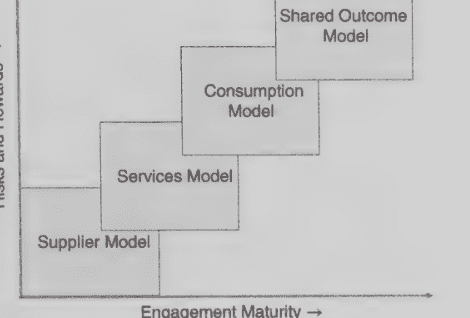
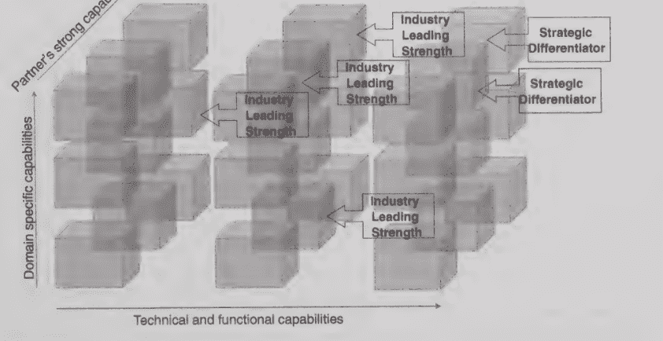

### 构建面向AI驱动转型的合作伙伴生态系统

> “走到一起是开始；保持在一起是进步；共同工作是成功。”
> ——亨利·福特

### 引言

从工业时代早期开始，商业哲学家们就一直在争论什么能为公司创造更多价值和竞争优势——是能力的垂直整合并自给自足，还是横向整合职能能力。过去一个世纪技术进步的速度推动了合作伙伴在创造和传递价值方面的重要性，因为没有哪家公司能够跟上步伐。在信息时代，伙伴关系变得更为主流，克莱顿·克里斯滕森提出的核心竞争力概念成为公司开始关注的重点。但争论的焦点在于，能力的垂直整合与横向整合，哪种才是最佳选择。这些方法决定了您如何与带来互补能力的外部伙伴合作。AI领域充满活力且所需能力高度专业化，这使得与伙伴合作变得很有必要。伙伴变得至关重要，因为他们可能带来速度和规模，这两个因素是您借助AI获胜所需要的。然而，如果AI成为您业务中更核心的部分，您希望保留对最重要部分的所有权和控制权。关键问题在于决定在哪里以及何时进行合作，然后再决定如何合作。由于AI领域的演进性质，您还需要具备灵活性，在内部或外部能力之间与伙伴进行合作与解约。本章为您提供构建和管理合作伙伴生态系统的专业知识。

本章将涵盖以下五个主题：

-   1. 构建合作伙伴战略：决定在何处、何时以及为何需要合作伙伴
-   2. 开发三维能力框架
-   3. 构建合作伙伴选择框架
-   4. 管理合作伙伴关系
-   5. 监控合作伙伴效果

### 构建合作伙伴战略

与传统技术领域不同，在传统领域中少数大型科技公司几乎可以满足您所有的技术和服务需求，在AI领域，您将需要不同的合作伙伴战略。没有哪一家厂商能够满足您所有的需求。尽管像IBM、埃森哲等大型科技巨头拥有广泛而全面的能力，并且有帮助客户进行AI驱动转型的案例研究，但几乎没有或很少见到有明显成果的完整解决方案的示例。您要么几乎完全靠自己构建，要么小心地将来自许多方的技术组件串联成一个解决方案生态系统。如果您试图快速有效地构建AI业务，伙伴关系是一条可行且有时必要的路径。此外，今天的客户不太关心您自己做什么，而更关心您如何解决他们的问题。

### 合作伙伴分类

在开始构建合作伙伴战略时，您需要有一个深思熟虑的合作伙伴分类模型，以便定义与他们的关系结构。为了帮助完成这项工作，我们可以使用以下大类来对潜在合作伙伴进行分类评估：

### 数据获取合作伙伴

丰富且多元的数据是任何AI之旅的起点。很多这样的数据已经存在于您的业务中。您可能需要专门的帮助，将其提取为可用的格式。有时，您需要帮助将来自物联网传感器的数据导入您的数据平台以应用AI。这类公司将为您提供使边缘设备智能所需的设备或技术。这一公司谱系可以涵盖从设计到工程、采购、制造和过时管理等按照您规格要求的一切。如果您是一家成熟的企业，正在以更广泛的物联网渗透进军AI，您可能更愿意与合作伙伴建立原始设备制造商（ODM）关系。对于规模较小的公司来说，贴牌生产别人的产品可能是更好的策略。如果您需要聘用一家公司为您提供网关解决方案，以从现有系统中获取数据，那么他们也属于这一类别。在大多数情况下，您需要访问外部第三方数据，如天气、新闻源、财务信息、消费者信息等，以完成您的AI解决方案。像Weather.com和Dun & Bradstreet这样的公司，其全部业务就是为其他公司提供此类数据。这些是另一种通常需要考虑的数据获取合作伙伴类型。

### 数据平台合作伙伴

这一类公司范围非常广泛，可以帮助你存储、处理和管理AI所需的数据。即使你已经拥有自己的数据湖和数据平台，也很可能是在某些第三方技术之上构建的。在考虑数据平台时，你需要顾及它的方方面面——数据源或设备管理、数据路由与实时分析、数据服务平台、元数据与虚拟化服务、智能消息传递等等。甚至我们之前讨论过的分析引擎，也属于更广泛数据平台的一部分。

像微软、谷歌和亚马逊这样的大型云容器解决方案提供商，像GE Digital和IBM Watson这样的大型分析平台提供商，以及大量小型初创企业和像Thingworx这样的混合型公司，都属于这一类别。这个领域非常拥挤，而且每天都在快速增长。这类公司很少会帮助你完成前面描述的更上游的步骤，但它们通常会尝试与你接洽接下来的下游阶段。几乎所有这些公司都会承诺虚拟的即插即用能力，让你访问其平台中强大的分析和学习功能。这些承诺和宣传通常非常吸引人，但在与这类公司合作时，你必须评估几个方面，比如长期锁定风险、成本结构，以及为使其平台适应你的业务需求所需付出的努力。根据我们的经验，取决于你团队的成熟度和能力，你可能会发现自建数据平台更快、更容易、更便宜。但我们也建议不要尝试构建自己的云基础设施，因为与微软和亚马逊等巨头的服务相比，这将成本高昂且能力有限。与众多小型初创企业合作的挑战在于，它们可能没有完整构建全面的能力，也可能没有足够的持久力。因此，如果你决定与这类公司合作，你需要验证它们现有能力的广度，而不是其开发管道，同时还需要验证它们的长期生存能力。一个好的策略是让这类公司参与开发你的平台，而不是按订阅模式租用它们的平台。

### 分析合作伙伴

在你的核心举措中，你需要足够强大的数据科学能力。数据科学家是数据的艺术家——他们对数据充满好奇，能够发现趋势，认为数据代表着终极之美，并能用数据讲述故事。他们以算法思维思考，能够描绘出一幅令人信服的图景，告诉你如何使用数据和分析来重新审视你的业务。数据科学家必须拥有扎实的高等数学和统计学知识。他们非常熟悉建模技术，如回归分析、时间序列分析、贝叶斯网络、约束理论、神经网络、博弈论、威布尔分析以及其他算法方法。他们必须能够看到表象之外的东西，并通过数据发现关联。他们非常擅长数据建模、处理、存储和挖掘。他们需要对人工智能、机器学习和自然语言处理有广泛的理解。大多数优秀的数据科学家都精通Python、R、C#、Java和其他流行语言的编程。

找到数据科学家正变得越来越容易，但供应量并不充足，而且很多情况下成本也难以承受。如果你还没有足够的数据科学家队伍来构建分析能力，那么找一个分析合作伙伴可能更好。有一些专门的公司可以做到这一点。大多数主要的咨询和技术公司也提供类似服务。这些公司的人员可能没有足够的领域知识，也对你的业务背景没有足够的了解。但即使你能够获得AI技能并设法补充领域技能，你仍然可以取得很大的进展。

### 变革管理合作伙伴

我们在本书开头已经讨论过，变革管理是任何AI驱动转型的关键组成部分。在专门讨论各个行业领域的章节中，我们也讨论了AI驱动的变革会有多深入。鉴于这一切，变革管理不能像其他重大技术举措那样，仅仅被视为沟通和社交活动；对于AI驱动的转型，变革管理必须是一项参与度更高、范围更广的工作。我们的最后一章专门讨论了这个主题。如果你的组织没有足够的能力或精力来开展如此持续的变革管理工作，你可以考虑聘请一家专业公司来帮助你。

### 服务合作伙伴

在推进你的举措时，你可能需要广泛的能力，从构建交付应用程序的专业服务，到可视化解决方案提供商，再到在业务交付活动方面具有特定能力的精品公司。这类公司都属于服务合作伙伴的范畴。

### 安全合作伙伴

正如我们在前一章中所讨论的，网络安全对AI项目来说非常重要。一些专业公司正在处理AI业务的安全方面，这些公司就属于这一类。这类公司可以担任你的顾问、安全开发人员、入侵分析师、验证提供商或道德黑客。我们还没有看到大型综合性安全解决方案提供商以AI为细分领域。根据你内部网络安全实践的成熟度以及内部网络安全团队的能力，评估与外部安全合作伙伴合作总是好的。

### 专业合作伙伴

一些独特的服务不属于上述任何具体类别；所有这类公司都将成为这个类别的一部分。专门的产品或用户体验设计公司、研究和营销公司，以及专门从事AI业务融资的咨询公司，都属于这一类。

你可能会遇到许多公司，尤其是大型科技和咨询公司，它们通过有机发展或收购在这些不同服务领域建立了能力；然而，你应该考虑它们在各个具体类别中的参与情况，以确保你做出正确的选择。

### 合作伙伴合作的驱动因素

公司选择寻找一个或多个合作伙伴来推进其AI举措的原因各不相同。根据你的内部能力和诸如上市时间等驱动因素，你会选择与外部合作伙伴合作。以下是一些指导原则，帮助你思考何时与这类公司合作：

#### 能力增强

你刚刚起步，在生态系统的某个或某些特定部分能力有限。例如，你的制造能力非常出色，可以轻松扩展到制造智能设备，但你在数据分析方面的经验非常有限；在这种情况下，你可能需要与数据平台合作伙伴合作。再比如，你在边缘设备和数据平台方面有不错的能力，足以启动你的举措并将其扩展到一定程度，但在对AI的深入理解方面能力有限；在这种情况下，你可能需要寻找一个分析合作伙伴。

#### 规模化

规模在这些举措中至关重要，如果你无法在合理的时间内达到规模，最好与合作伙伴合作。这与常用于并购的理由相同。建设规模往往是一个物理问题——是质量和动量的函数。无论你愿意投入多少，建设规模都需要时间维度；在这种情况下，合作是更好的选择。

#### 成本

使用合作伙伴的能力/平台可能比你内部努力更便宜。如前所述，我们发现使用他人的托管基础设施通常在经济上更划算。同样，你几乎可以把这套逻辑应用到任何对你的成功不核心，且不一定需要你拥有技术IP和能力的领域。

#### 生态系统带动

通过合作，你通常可以获得更大的生态系统。有时会有机会从其他友好或无关的行业学习。你的合作伙伴可以帮助你接触到新客户和安装基础。通常在这种情况下，你会获得联合上市的机会，或为你的产品获得营销支持。这种现象大多出现在拥有大量投资带宽的平台公司试图利用合作伙伴基础来推广其技术时。

#### 投资带宽

这是一种当你预算有限但合作伙伴愿意投资时想要合作的情况。许多初创公司受益于这一趋势。如果你刚刚起步且缺乏资源，这种方法显然是选择。即使对于资源有限的大公司，它们也可以探索与初创公司和风险投资家进行三方合作，以构建物联网业务。我们看到这一趋势在某些市场正在升温。

### 技术中立性

技术变化太快，你不想被锁定在任何特定选项上。对于数据平台来说，这一点尤其正确。

无论你的标准是什么，让推动该计划的核心团队对这些标准有清晰的认识都很重要，以便能够设定正确的期望和行为。

### 合作模式

你可以选择多种不同的模式与合作伙伴进行合作。所有这些都是已建立的商业交易模式，但你可能希望在合作中融入与你的 AI 计划相关的特定要素。

### 供应商模式

在这种类型的关系中，你购买的是商品，你的合作伙伴的承诺仅限于质量、进度、成本等参数。你通常会以这种模式与硬件和数据提供商合作。一般来说，你购买的大多数都是标准产品或服务。

### 服务模式

购买服务时，你通过外部资源来增强自身能力。由于 AI 仍在不断发展，你必须寻找参与项目的人员的特定背景和专业知识。

### 消费模式

这种模式在采购数据平台能力时最为明显，有时也适用于分析引擎。这类似于基于公用事业的定价，你按需为所消耗的技术量付费。这种模式下的典型安排在像微软和亚马逊这样的云平台提供商中很常见；他们最初仅通过基于消费的定价提供托管服务，现在正扩展到越来越多的软件产品。这是一个降低风险、合同管理、调节增长、实现规模并承担有限责任的好模式。另一方面，你必须时刻了解合作伙伴对平台所做的所有更改，以确保你的业务仍然兼容。

### 共享成果模式

这对于参与各方来说可能非常有吸引力，因为风险-回报-投资的元素已内置于设计中。然而，由于未知因素众多，这也可能具有挑战性。共享模式通常比其他模式的期限长得多，因为投资方会计划收回回报。通常拥有深厚资金和巨大增长雄心的技术提供商希望以这种模式与你合作。在设计此类模式时，请注意不要损害你的长期前景，最重要的是你对客户关系和数据的访问/所有权。你还需要仔细考虑所有知识产权影响和所有权。我们建议

#### 图 13.1 合作伙伴合作模式

只有在你的 AI 之旅达到一定成熟度后，才进入共享成果模式。

图 13.1 捕捉了各种合作伙伴模式所需的合作成熟度，以及相关的风险和回报。

没有唯一正确的模式，你可能与合作伙伴有多种不同的模式。像任何其他合同一样，最好在事先明确驱动因素、目标和成果以及设定的治理规则。无论如何，在 AI 领域开展合作时，请注意以下事项：

- 1. 你的合作伙伴在合作领域拥有深厚的专业知识和专业能力。例如，如果他们被聘请提供分析支持，他们拥有大量非常可信的数据科学家，并且也在与你的领域相似的领域执行了许多项目。创新、快速原型设计、敏捷纪律等周围还有多种能力，合作伙伴必须成熟以帮助你。
- 2. 永远不要对特定技术或合作伙伴过于依赖或完全锁定。AI 将在未来几年继续发展，在明确的赢家出现之前，你的生态系统架构、解决方案设计和商业模式需要考虑到这种灵活性。
- 3. 不断评估你的项目的经济性以及它如何使你的业务具有竞争力。
- 4. 你的合作伙伴不应成为可能在你业务核心领域竞争的竞争对手或参与者。AI 正在模糊不同行业细分和公司产品之间的界限。你应保留对长期增长战略核心部分的知识产权和平台所有权。公司经常犯的错误是几乎完全依赖合作伙伴进行分析和数据平台；我们认为在大多数情况下这是有害的。
- 5. 限制你合作的合作伙伴数量。没有足够的时间来开发平台、分析以及其上的业务；生态系统也因合作伙伴过多而变得非常复杂，最终业务的经济性将受到不利影响。因此，用少数合作伙伴投资你的时间和金钱，但要深入合作以获得最佳回报。

### 开发三维能力模型

一旦你为你的 AI 驱动业务定义了模型，你就需要定义成功所需的所有能力。能力需要涵盖从你的产品到客户实现成果的整个光谱。我们在几年前为物联网驱动的转型也使用了类似的框架。你首先列出所有所需的能力。不断迭代该列表，直到你认为它详尽且代表你的实际业务环境。在构建列表时，将所有技术和功能能力绘制在水平 x 轴上，将更具领域特定的能力绘制在 y 轴上。你会发现很难区分什么放在哪个轴上；这是 AI 驱动业务真实复杂性的体现。通常你会发现同一事物出现在两个轴上，你需要基于尽可能使 x 轴通用化并尽可能使 y 轴具有领域密集性来进行区分。

在 x 轴上，你将拥有诸如摄取方法、协议转换、消息基础设施、容器设计、数据存储和检索技术、建模算法、可视化工具和 IT 应用开发技能等维度。在 y 轴上，你将拥有诸如业务流程特定主题、影响设计的环境因素、法规和认证要求、数据吞吐量考虑、控制算法和优化技术等维度。

现在你拿出你的合作伙伴选择并了解两件事——他们的增长战略是什么以及他们在 AI 领域擅长哪些方面。例如，微软的增长战略基于成为技术处理平台和工具的最佳提供商。因此，微软在 Azure 云平台、分析和可视化工具、自然语言和类似处理引擎以及编程平台方面表现出色。微软拥有许多产品和方式供客户利用其技术，因此他们也在其产品中嵌入了强大的网络安全能力。这与公司过去 40 年的发展和成长方式非常一致。微软有时会创建垂直领域特定的平台和工具变体，以便其他公司更容易采用。他们的战略并非基于试图开发与客户竞争的能力和产品。在类似领域的另一位行业领导者亚马逊，具有与微软相似的愿景，但他们有略有不同的背景和战略。微软历史上一直专注于使用光谱的两端：大型企业和个人计算。亚马逊作为一家具有强大零售背景的非常创新的初创公司迅速成长。因此，亚马逊网络服务 AWS 的分析和开发人员工具非常用户友好。他们能够让新客户和计划上线的能力是行业标准。微软和亚马逊都是拥有广泛能力的大型公司。即使对于较小的公司，你也可以进行类似的分析并了解他们的优势。但在这种情况下，关键是要了解强大能力与战略增长重点之间的区别。例如，如果一家在传感解决方案方面具有卓越能力的小型技术提供商，其主要增长路径是作为分析服务提供商还是传感技术平台提供商，你将需要仔细评估如何与该公司合作，因为他们的精力和投资将朝不同的方向发展。

一旦你列出了这些各种能力——内部和合作伙伴来源——你可能希望将它们绘制在三维模型上以便轻松参考、使用和更新。它将

#### 图 13.2 三维能力模型

它也有助于识别你拥有或需要哪些能力，哪些能力必须处于行业领先地位，以及哪些能力将带来最大的差异化优势。图 13.2 展示了如何思考这种三维模型。

在构建以及更重要的是维护这样的模型时，请记住以下几点：

- 这不是一个静态模型；它将随时间、技术、商业模式和合作伙伴选择而演变，因此请定期（至少每三或六个月）更新该模型。
- 更高的细粒度使其更具意义，但你可能会选择针对不同受众使用不同的抽象层级。
- 通过严格且客观的流程确定内部能力。
- 通过透明的对话流程确定合作伙伴的能力。
- 评估竞争对手的行动，并利用洞察来改进你的模型。

关于竞争对手行动的最后一点至关重要，因为你必须持续监控业务面临的威胁，理解不断变化的格局，并制定适当的应对措施，这些措施需要以你的能力为基础。由于进入壁垒非常不同，你需要在 AI 驱动的业务中保持高度警惕和宽广的视野，才能保持领先地位。

### 构建合作伙伴选择框架

本章迄今，你已经接触了一些用于识别能力需求、理解合作伙伴以及探索技术的工具。现在你需要着手确定那些将帮助你构建 AI 业务的合作伙伴。以下是评估潜在合作伙伴的一些关键标准：

#### 基因 (DNA)

每家公司和每个解决方案都有一个核心，这是它们非常擅长的领域，其整个存在都是围绕这一领域设计的，它是唯一能够定义和区分它们的特征。尽管每个人都试图扩展其能力和产品组合，但它们在核心领域总是最出色的。例如，Salesforce 今天通过其合作伙伴网络拥有整个企业级产品范围，但它仍然是销售自动化和分析的最佳选择之一；Apple 始终是最好的用户体验公司之一；Microsoft 始终是最好的生产力解决方案公司之一；GE 始终是最好的工业解决方案公司之一；Bee'ah 始终是最好的废物管理公司之一；3M 始终是最具创新性的消费解决方案公司之一；等等。要理解一家公司的基因或核心，你需要理解它们如何以及以何种方式演变。然后你需要理解其他方面，例如他们的商业模式是基于规模（大众市场）还是独特性（精品店）；这将表明你应该如何利用合作伙伴的解决方案。最后，你需要评估合作伙伴对持续改进和成本削减的关注程度，以判断你的解决方案在这一合作中将如何演变。

#### 技术与分析领导力

对于 AI 领域的任何公司而言，如果不擅长技术和分析能力，想要取得成功将极具挑战性。你需要那些处于类似轨迹上的合作伙伴。你需要找出你的合作伙伴是否拥有在技术前沿保持领先地位的适当重点、愿望和能力。这通过许多方面体现出来——对核心技术的深刻理解、适当的研发投资水平、技术人员的质量、知识产权（IP）、同行级别和多元化的行业认可、学术协会、解决方案深度以及公司的整体基调。奖项和诸如魔力象限之类的高排名是良好的指标，但不能替代上述提到的其他因素。

#### 竞争威胁

竞争威胁有很多方面——你所在行业正在走向共同的技术足迹，这可能会使你孤立无援；你的竞争对手做出的一些技术选择将为它们带来独特的优势；你的竞争对手做出了与你相同的选择，但投入更多且执行更快；或者你的产品/提供品类正在被不同的替代品所摧毁。这些每一项都代表不同的问题域，需要独特的应对方式。你需要用技术和合作伙伴武装自己，以保护你的产品和地位。在技术上采取领导地位，并积极在你和相邻行业中推广此类选择，往往是一个好策略，但你需要具备耐心和为此投入。或者，你可以借助拥有大量资源的巨型技术供应商的势头来实现类似的目标。通过深入地将你的领域专业知识与技术集成，你可以抵御品类颠覆的威胁。有时你会希望合作伙伴与你的关系比与你的竞争对手的关系更深厚。虽然不太可能进入排他性关系，但你肯定可以获得更多的关注度。

#### 能力

你需要考虑潜在合作伙伴的能力（人员、工具、基础设施），看它们如何互补你的能力，以及是否足够全面以满足你的需求。有时人们发现这两个因素是矛盾的，但事实并非如此；你希望合作伙伴在需要时能够介入几乎每个活动领域。审查合作伙伴能力的一个好方法是使用我们在本章前面讨论过的能力矩阵。

#### 咨询式方法

大多数时候，你希望合作伙伴能够与你协作，而不仅仅是对你的指示做出反应。鉴于 AI 的演进性质和无穷的可能性，你希望与合作伙伴进行联合探索之旅。然而，为了使其更结构化且更短，最好让合作伙伴带来一些框架和过往经验，因此请关注这些方面。你不需要那些既缺乏你所在行业领域背景，又缺乏对你技术生态系统具体知识的通用管理咨询公司或技术服务提供商。你需要的是那些能带着同理心推动你前进的人。

#### 经济性

这是一个非常重要的考量因素，因为尽管存在新颖性因素，AI 仍是一个竞争激烈的领域。因此，你需要尽可能降低技术和开发成本。此外，至关重要的是不要有长期锁定的成本；你希望成本结构具有最大的灵活性。由于这不是一个成熟的领域，请寻找总成本而不是单位或交易成本；有时起初看起来便宜的东西最终可能变得更贵。

#### 长期可行性

AI 充斥着初创公司和那些准备搭上炒作周期顺风车的公司。对于许多此类公司而言，它们的目标是通过获取技术和服务的安装基础量来制造一些短暂的热潮和吸引人的估值。你从事的是长期事业，你希望合作伙伴能与你长期合作。因此，你需要评估合作伙伴的长期可行性和利益。没有简单且明显的方法做出这种判断；你将不得不进行深入对话，以理解潜在合作伙伴的长期目标、商业模式理念、现金流和储备、当前和预期的估值、退出计划以及投资概况。

#### 独立性/对其他合作伙伴的依赖

你经常会看到公司完全靠自己构建能力和产品，或者利用更大的其他合作伙伴网络。这在任何新兴技术领域都非常常见。取决于你试图实现的目标，这两种选择都可以是好的。在评估电子元件和通信合作伙伴时需要特别小心，因为它们通常依赖于其他供应商或更广泛的采用网络。例如，如果你有一个边缘设备或网关合作伙伴，它与拥有大量芯片组和通信模块应用的公司没有关联，你将在长期处于成本和技术劣势。

#### 合规性

鉴于隐私和网络安全的独特且严格的要求，你希望与理解这些各种合规要求的合作伙伴合作。否则，除了所有其他交付物外，合规的压力和教育责任都将落在你身上。

你需要创建一个正式的评估矩阵，针对每个因素赋予权重，并调整以适应你的业务环境。邀请具有不同背景和视角的内部人员参与集体评估。一旦完成评估过程，向合作伙伴解释选择他们的理由以及你的期望。透明度和目标的一致性是任何潜在合作伙伴关系成功的关键。

### 管理合作伙伴参与

引入合作伙伴与选择合作伙伴同等重要。你不能期望扔出一份工作说明书，然后收到能帮助你获胜的非凡结果。构建你的平台、分析和业务必须是一个协作且通常是迭代的过程。你需要采取几个步骤来使这一伙伴关系变得有意义。你的合作伙伴可能缺乏关于你业务的足够背景；理解你环境的复杂性需要他们一段时间和几轮教育。你需要保持开放，在损害竞争优势之前尽可能多地分享。记住，一旦建立基于信任的关系，你获得的回报将与你投入的一样多。鉴于 AI 驱动转型的紧迫性以及它们最终花费的时间之长，有效的合作伙伴引入对于缩短周期时间至关重要；在我们对各种 AI 业务的审查中，我们能够追溯许多下游问题是源于最初缺乏理解。

#### 业务导向

你从在业务背景下向合作伙伴提供以下内容的概览开始：

#### 经济价值链

向合作伙伴解释在你的行业或产品类别中资金是如何流动的，以及价值是在每个步骤中如何创造的。波特在《竞争优势》一书中提出的价值链分析模型仍然是一个不错的起始工具。经济价值链分析有助于理解客户看重什么，看重程度如何，以及创造感知价值的成本构成。对于常规商品和服务，价值链通常是一次性流动；对于 AI 驱动的业务，由于数据随时间创造新形式的价值，因此存在随时间和使用的迭代价值创造。例如，你购买一辆汽车并愿意支付

一次性价格最终会随时间推移而降低；然而，当你购买预测性维护或仪器化保险服务时，你将随着其为你创造更多价值而持续付费。如果你很好地理解经济价值链，你可能会选择让预测性维护或仪器化保险服务的定价随着你对它们需求随时间增长而逐步提高。这使你能够随着时间推移创造新的价值流。

### 信息价值链

向你的合作伙伴阐明信息在处理链的不同阶段是如何以及如何被创建的，其影响，如何解读它，以及它能为整个流程的其余部分创造什么价值。这与经济价值链类似，但涉及数据和洞察。此练习应以迭代方式进行，深度不断增加。这将进一步解释数据对你业务各方面的意义。

在此练习中，我们在第 2 章中讨论的框架建模将非常有用。

### 规则设定

你可能有多位合作伙伴。让他们相互熟悉、理解相互的角色和责任，并拥有一些共同的游戏规则以便获胜，这将很有用。有时不同合作伙伴和技术之间的边界并不清晰。此外，每个参与者都有投资组合扩张和业务量增长的愿望。例如，你的数据平台合作伙伴会希望分得一部分分析工作。如果你选择了不同的合作伙伴，必须有充分的理由并解释原因。为了获得更多关注、技术共享和业务，你的合作伙伴可能会与你的最终目标不一致。及早建立竞争规则并保持透明，对你的成功至关重要。

### 试点项目执行

没有什么比由选定的合作伙伴共同进行一个动手项目更能推动归纳过程了。这让你和你的合作伙伴能够了解彼此的工作节奏、运营流程和执行语言（如开发流程），并在团队之间建立关系、对质量的认知和文化层面。共同的成功或共同的学习将建立坚实的基础。试点项目不应是可丢弃的；它应是你试图解决的问题或试图构建的组件。它应足够大以让每个人都有参与感，但又不能太大以至于危及更大的努力。例如，与数据平台合作伙伴，你可以着手从一个来源摄取数据，进行一些元数据管理，运行几个算法，识别一些洞察，并将其与一些最小的客户价值联系起来。

### 共享指标和成功定义

你和你的合作伙伴可能有不同的动机和进入此项事业的原因。提前明确你的驱动因素、共同的交集点，以及你将如何确定成功。这必须在更长的时间范围内进行，并附带中间的成功定义。例如，与数据平台服务提供商，你们的共同目标可能是平台使用指标，因为它推动了提供商的消耗，并可能为你带来更广阔的洞察机会。现在增加消耗并不一定会为你的合作伙伴带来更大的收入，因为存储和处理的成本在下降，你可能也在持续优化数据管理。如果在此情况下关键成功标准在前期不明确——是消耗、收入还是两者——你和你的合作伙伴可能会走上不同的道路。同样，你的合作伙伴需要认识到，他们可以通过消耗模式不断带来新能力来增加收入机会，但除非他们为你的业务创造可直接附加的货币化机会，否则你对这些新能力的消耗意愿会远低于预期。因此，你需要对创新成果也有共同的理解。

### 知识产权生成和所有权框架

在人工智能领域，知识产权在业务的许多不同方式和阶段产生，其速度绝对高于其他业务。你会在预存算法的独特使用方式、你在特定领域如何创造洞察、你如何管理数据和平台、你如何实施安全等方面创造知识产权，清单还在继续。你可以为人工智能计划的每个维度创造数十甚至数百项知识产权。我们在自己的工作中亲眼见证过这种情况。人工智能的动态性和乐观主义深刻地助长了这种创新文化。你总是希望将所有知识产权保留在组织内部。但要确保为你的合作伙伴创造足够的激励，让他们为创新过程做出贡献。同时，建立机制来认可和奖励合作伙伴可能带来的任何外部创新，以帮助你的业务。

### 数据所有权和权利

数据所有权在大多数人工智能业务中往往成为棘手问题。客户会因最终产品/服务的拥有权而主张其权利；你会作为使其成为可能的方而主张你的权利；你的合作伙伴会试图分得一杯羹，因为他们可能帮助你获取或使用某些数据。每个人都认为数据所有权将决定他们未来从衍生洞察中获得的经济利益。我们见过公司进行在财务上不可行的交易只是为了获取更多和更多样化的数据（这对人工智能或其他方面都不是好做法，因为它违背了商业基本原则）。务必与所有合作伙伴和利益相关者就数据所有权及其更重要的使用关系保持非常清晰。你希望避免两件事：未来被拒绝访问数据，以及让另一方在未来提供与你今天为客户提供的相同服务/产品/能力。

### 退出标准和流程

结束合作伙伴关系是正常的商业流程。在人工智能的背景下，它具有一些不同的含义。你可能从合作伙伴处获取技术或能力，你需要对其在关系长度之外更长时间内保持访问或支持。也有可能你和你的合作伙伴都拥有来自客户的数据，你们可以在未来以不同方式应用这些数据来相互不利。人工智能周围总是有棘手的责任问题，因为数据、洞察和行动在整个处理链中经历了多次转换。在所有情况下，你必须确定退出标准以及不同各方在退出后的角色和责任。

### 合作伙伴治理流程

治理是任何成功关系不可或缺的元素；在人工智能项目中也不例外。治理流程应概述相互期望、成功指标、庆祝模式、评审流程、升级流程、关键人员以及各种治理活动的节奏。识别庆祝模式和想法很重要，因为你们正在涉足一些新颖而令人兴奋的事情，你们希望向全世界讲述你们的成功并创造自我强化的循环。

### 推动组织变革以便与合作伙伴有效协作

到目前为止，你已经了解到人工智能如何带来对你正常商业实践的差异，甚至在你管理合作伙伴的方式上也有不同。在正常情况下我们谈论合作伙伴但将其视为供应商；在人工智能的情况下，我们必须思考并行动起来作为合作伙伴以实现快速成功。因此，你可能需要改变一些习惯和行为以便与合作伙伴有效协作。推动任何此类变革必须是有思考、有意的，并融入公司的运营节奏。我们在整章中讨论了许多变革。以下是我们九项最佳实践的汇总列表：

1. 分享一切（在不损害任何机密或高度战略性竞争信息的前提下）关于你的市场、商业计划、产品、客户和价值链中对成功必要的信息。在这里保留信息不是权力的来源，而是模糊的原因。

2. 专注于合作伙伴的成功，而不仅仅是自己的成功。你需要他们，就像他们需要你一样，所以也让他们赢。我们见过太多采购组织试图挤压合作伙伴以至于他们的兴趣急剧下降。

3. 向你的员工解释合作伙伴评估和选择细节；这将帮助他们更好地理解为什么需要关注合作伙伴。

4. 鼓励你的内部员工向合作伙伴学习并利用他们的服务或解决方案。这将有助于你的自力更生，使你的员工更有价值，并培养安全感。这也将使你更好地利用合作伙伴的能力并建立更健康的相互尊重。

5. 创建多个联合工作马拉松，让你的团队和合作伙伴团队以某种非结构化的方式共同工作。我们在承受绩效压力时非常专注于项目任务和计划；在没有此类论坛的情况下，很难建立良好的联合工作节奏。仍有许多未知之处，我们可以一起探索更多。

6. 不断收集反馈，了解事情进展如何，以便你能及时解决任何摩擦问题；你正与时间赛跑，不想在摩擦上浪费任何时间。记住，他们也在努力建立业务，他们很可能会记住那些帮助他们到达的人。

7. 支持你的合作伙伴在推广和开发活动方面。他们也在努力建立业务，他们很可能会记住那些帮助他们到达的人。

8. 利用任何合作伙伴论坛和贸易展会来社交并向与你类似的公司学习。

9. 不要阻止你的合作伙伴与你的竞争对手合作；毕竟，你可能也有东西可以学习。

### 监控合作伙伴效能

当你制定AI战略时，你会为业务设定多个目标。其中常见的包括：新产品或运营改进带来的收入和利润、市场份额增长、进入新市场机会、（如适用）对现有配备AI赋能产品的资产和客户装机基础进行渗透，以及捕获新的价值流。你投入巨大的合作伙伴生态系统，有望帮助你更快、更好地实现这些目标。因此，你需要构建一个简单而有效的框架和流程来评估合作伙伴。表13.1就是这样一个框架的示例，其中包含一些建议的类别和衡量指标供你起步参考，但你应该设计最适合自身业务的框架。

在进行这项评估时，请注意几个因素：

- 高分并不总是意味着更好。例如，如果你的产品过度依赖合作伙伴的能力，你面临的风险就更高。
- 随着业务背景和AI目标不断演变，权重也应随时间调整。

**表13.1** 合作伙伴效能监控工具

| 类别 | 衡量指标 | 权重 | 得分 |
| --- | --- | --- | --- |
| 对业务的财务影响 | 合作伙伴在构建/赋能产品方面发挥重要作用的收入 | | - |
| | 合作伙伴识别或开发的创新所带来的收入 | | |
| | 通过合作伙伴的努力，产品与运营在成本降低或利润率提升方面的成效 | | |
| 上市速度 | 合作伙伴技术/产品所节省的时间 | | |
| | 合作伙伴帮助你接入的新市场渠道数量 | | |
| | 你能够大规模改造复用并推动业务增长的合作伙伴解决方案/产品数量 | | |
| 竞争影响 | 合作伙伴帮助你建立的竞争壁垒数量 | | |
| 技术领导力 | 合作伙伴培育的新技术创新的数量与影响 | | |
| | 合作伙伴引入的新技术能力数量 | | |
| 相互依赖 | 合作伙伴在你的AI版图中所占的份额 | | |
| | 你在合作伙伴业务组合中所占的份额 | | |
| | 你完全依赖合作伙伴能力的产品数量 | | |
| 推广影响 | 合作伙伴提供的公关（PR）次数和平台数量 | | |

始终建议与合作伙伴透明地分享这些评估结果，以便双方都能采取改进措施。

### 小结

利用AI重新定位业务是一段艰辛的旅程。你可能需要在相对较短的时间内完成很多目标，然后在接下来的几年里持续迭代和创新。根据你为这次转型所做的准备情况，选择合适的合作伙伴组合，你可能会更有成功的把握。过去，强大而高效的合作关系一直是许多技术主导型转型项目成功的关键。与此同时，商业文献中也不乏规模巨大、代价高昂的失败案例。因此，选择正确的合作伙伴并善加管理是成功的关键。

在本章中，我们为你介绍了几种框架和最佳实践，以指导你完成合作伙伴的选择和管理流程。建立有效的合作伙伴关系并非易事；这需要你深入思考并付出努力。

最后，请记住以下这些结语：

- 与合作伙伴共事，可以让你方便地获取关于AI如何影响不同行业的信息和洞察。这些知识将帮助你理解其对你业务的影响。
- 这是你的业务，只有你才能对它的成功负责。合作伙伴能发挥作用，但不能取代你的思考和努力。
- 合作伙伴和技术格局快速演变，你不能因为当初做出了一些看似正确的选择就高枕无忧。在这个尚处于萌芽阶段的环境中，你必须时刻保持警惕，以发现最能满足你需求的东西。
