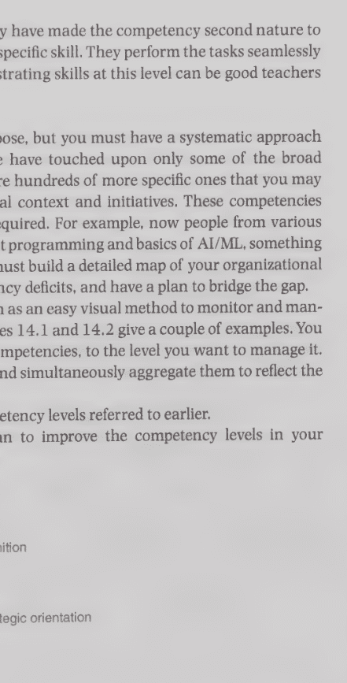
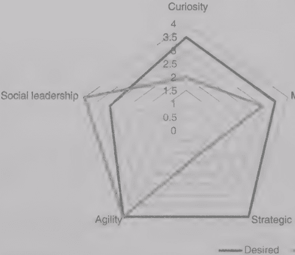
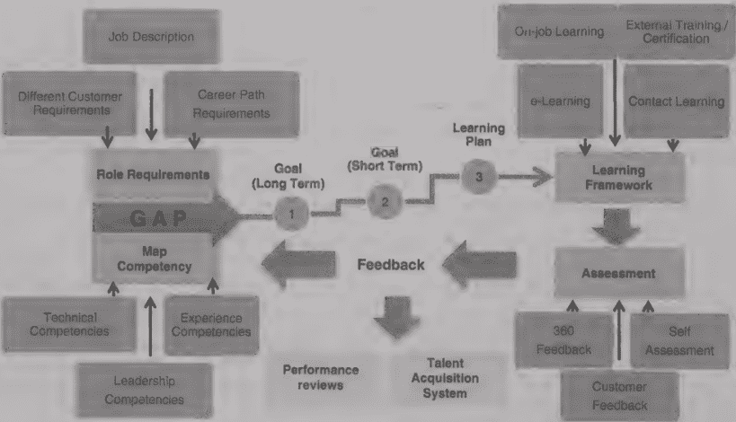
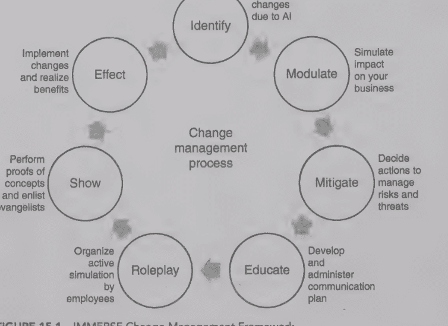

## 第14章
### 为AI驱动的转型打造制胜团队

> *“天才赢得比赛，但团队合作和智慧赢得冠军。”*
> 
> ——迈克尔·乔丹

### 引言

数字化转型不仅仅是另一波技术炒作，而是对业务的彻底重新思考。以往的技术炒作周期专注于新的改进，而数字化关乎颠覆。使用物联网（IoT）、大数据、人工智能、多智能体系统、5G等新通信方式、分布式账本系统等数字技术，与将数字化融入企业DNA之间，存在着显著差异。同样，每个组织做分析已有数十年，但利用AI来转型业务则是一种截然不同的范式。现在，你不仅要做出最优响应，还要预见未来状态，并调整你的系统和组织，以最大化实现该未来状态的潜力。数字化和AI要求你进行长期博弈（无限博弈），你的目标不是在狭义情境中取胜，而是始终保持领先。在数字化中胜出，对企业未来至关重要。博扬·乔瓦诺维奇（Boyan Jovanovic）和格伦·M·麦克唐纳（Glenn M. MacDonald）在1994年发表于《政治经济学杂志》（*Journal of Political Economy*）的研究论文《竞争性行业的生命周期》中，阐述了行业如何被颠覆。他们指出，一个行业中70%–90%的生产商品和服务的公司都会在颠覆高峰期过后消失。在由AI和数字技术驱动的这一轮颠覆周期中，我们正处于这一临界点。

我们在数字化领域所见的重大失败，根源就在团队上。各种项目失败的原因多种多样：误判新的经济模式、过度偏重技术、错误解读市场和竞争，以及偏离核心战略太远。这些问题由专业团队造成，最终也由专业团队解决。在2019年10月发表于《哈佛商业评论》（HBR）的文章《数字化转型失败的两大原因》中，作者迈克·萨特克利夫（Mike Sutcliff）、拉加夫·纳尔萨莱（Raghav Narsalay）和阿罗希·森（Aarohi Sen）将领导者之间的目标分歧，以及试点与规模化阶段之间能力的差距，视为当今数字化项目面临的主要挑战。团队因对最终目标、实现路径缺乏清晰认识，以及高层不断推动变革而感到疲惫，也被认为是项目不成功的另一个常见原因。在团队中汇聚合适的能力并形成良好的默契，对于AI驱动的数字化转型成功至关重要。本章将深入探讨这一主题。

### 识别AI驱动数字企业的不同之处

让我们先探讨未来的AI驱动数字企业有何不同，以此开启讨论。在最高层面上，它们通过预见未来状态，将姿态从被动应对转变为主动出击。这正是我们使用AI的初衷：梳理大量快速变化的输入，发现规律，根据当前趋势预测未来结果，并通过不同干预模拟不同结果。但如果再深入挖掘，还有更多。在我们的研究中，我们发现转型后的企业展现出以下八大特征。

- **高度以客户为中心。** AI驱动或AI转型的企业以客户反向视角重新定位自己。它们狂热地致力于从新的收入流和利润池中创造新价值。这些企业深刻理解客户的经济价值模型，并能将其产品、服务和流程与客户的价值链对接，从而为这类经济价值链创造协同优势。
- **面向未来状态。** AI和数字化举措的目标是实现一种未来状态，使企业在市场竞争中脱颖而出并取得领先成功。在AI驱动的企业中，绝大多数（如果不是全部）员工都对这一未来抱有共同愿景，并理解自己在其中的角色。他们对未来表现出兴奋之情，并采取果断行动。
- **创新驱动。** AI驱动企业在通往未来状态的旅程中不断试验、迭代和调整方向。它们将市场视为成功的最终裁判，并从市场获得关于新解决方案和新商业模式的反馈。这类组织中的创新文化无处不在。只要有过深思熟虑的规划、快速的行动，并从这些失败中获得了公认的经验教训，它们对失败的容忍度就明显很高。
- **痴迷学习。** 这些企业持续提升员工技能，在知识管理和知识共享方面采取制度化方法，不断反思成功与挑战，以明确未来应如何调整做法；它们向外看多于向内看，并拥有真正重视学习的文化。痴迷学习的组织拥有开放的文化和高度的多样性。
- **具备超高速增长能力。** 每家企业都有驱动和吸收特定增长态势的内在能力。根据增长态势对公司进行分类，一个简单的方法是看三个不同的同比增速区间：5%–10%、30%–50%、1–2倍或更高。每一种增长态势都需要截然不同的组织文化和赋能流程。传统工业和消费品公司通常处于

在第一个增长前沿中，几家成功的科技公司已经在第二个增长前沿运营，很少有公司经历过第三个增长前沿，而那些经历过的通常是市场颠覆者。AI驱动型企业拥有组织实力，能够追求极高的增长（前沿2）或超高速增长（前沿3）议程。具备超高速增长能力的组织拥有快速且去中心化的决策机制，能够迅速响应不断变化的市场反馈，拥有更多对业务多个方面非常熟悉的人员，展现出无缝的跨学科协作，并且不受僵化流程的束缚。

- **6. 动态适应性。** AI驱动型企业还展现出高度的敏捷性、在多速运营环境中的运作能力，并且本质上是协作型的。这些特性使此类组织能够适应不断变化的业务条件并快速响应。

- **7. 更高的技术素养。** 在AI驱动型企业中，很大一部分员工对数字技术及分析能力有很好的理解，并通常具备工作层面的相关知识。在任何对话中提及AI和数字技术时，你很少会看到人们把问题指向技术团队。在本章后续部分，我们将进一步讨论为什么这对成功实施并维持AI计划如此重要。

- **8. 生态赋能。** AI驱动型企业依靠其生态系统的集体能力而蓬勃发展。它们最佳地利用网络中的各种能力来最大化自己的目标——无论是与技术、销售、资源还是工具相关的。

当我们继续阅读本章后续章节时，牢记这些属性将有助于理解该主题的背景。

#### 构建关键能力

对于组织在数字化转型和AI计划中取得成功所需的关键能力，有不同的审视角度。我们将能力分为两大类：领导力能力和技术能力。

##### 领导力能力

这些是任何类型的企业或任何类型的计划都需要的通用特质。但在推动AI驱动的业务转型时，这些能力对成功至关重要。参与该计划的每位团队成员都需要在不同程度上具备这些能力。能在这种充满活力的工作环境中蓬勃发展的人，必须具备较高水平的以下八种能力：

- **1. 好奇心。** 在我们看来，好奇心是在数字领域取得成功所需的最重要能力之一（如果不是最重要的话）。好奇心将帮助你在很深的层面上理解事物为何以它们的方式运作，以及它们如何能更好地运作。你将必须发现新的模式，并超越显而易见的事物。你还必须理解公司外部甚至行业之外的其他元素将如何影响你的业务。例如，像机器人这样的自主系统，最初在重复性制造业中得到大规模采用，如今正在改变医学和交通运输。

  好奇心是计算机永远无法取代人脑的主要原因之一，另外两个重要原因是感知和意识。好奇心还驱动其他几种领导力能力，如敏捷性、创新驱动的战略导向、社会领导力等。领先的科技公司非常重视好奇心。正如谷歌前CEO埃里克·施密特所指出的好奇心在公司的价值：“我们是靠问题而非答案来运营这家公司的。”谷歌的根基建立在AI之上，如今它是数字化转型的最大受益者和催化剂之一。

  每个孩子生来好奇；早期养育可以培养这种特质，使其成为第二天性。即使在生命后期，好奇心也可以通过学习干预、行为激励和组织环境的结合来增强。

- **2. 元认知。** *元认知*一词最早由美国发展心理学家约翰·弗拉维尔于1976年提出。他将其定义为“对思考的思考”。换言之，元认知是关于自我反思和自我调节，以促进更高阶、更有效的思考和学习过程。由于你在数字化的道路上会持续频繁接触新情境，你需要通过自我认知和自我调节来更好地管理这种动态性，这使元认知成为一项重要能力。元认知还能帮助你在勾勒未来状态时进行更好的推理。

  元认知是知识（陈述性、程序性、条件性）、调节（计划、监控、评估）和经验的综合体。认知练习和辅导有助于改善元认知。

- **3. 战略导向。** 战略导向是预见未来可能性的能力，并制定实现这些可能性的路线图。正如我们在第2章中所讨论的，理性且现实地思考未来状态是任何数字计划的关键起点。需要战略导向来理解什么干预创造价值，什么驱动差异化，什么使一个人的竞争优势可持续。这种能力有助于综合各种输入，以决定最优行动方案。

  从广义上讲，人们要么有战略导向的倾向，要么缺乏这种倾向。但在大多数情况下，这种能力可以通过培训和辅导来提高。

- **4. 敏捷性。** 敏捷的人经常在模糊和风险条件下展现出适应性、好奇心和创新思维。高度敏捷的人即使在事情不确定或前进方向不清晰时，也必须能够有效运作。敏捷性和管理模糊性是很难培养的技能，大多数领导者在这方面表现平平。它是商业和技术领导者与绩效相关的顶级技能之一。在AI和数字领域工作会带来前所未有的模糊性。我们经常不清楚要解决什么问题、价值将如何创造、使用哪些算法来寻找解决方案，等等。例如，当我们启动一个应用AI来更好地诊断工业设备性能并预测故障的项目时，我们最初的假设是更好维护的受益者将是最终用户；随后，我们了解到服务提供商同样看重这种能力，因为它使他们能够更好地管理有限的资源。同样，在数据科学方面，我们从传统的机器学习算法开始，但受到数据数量和质量的限制；不久后，我们转向使用更多的循环神经网络算法，如长短期记忆算法。

  管理模糊性要求一个人拥有非常强的智力能力、很大的勇气、对多样性的深刻理解，以及广泛接触不同环境的经验。在一个人身上同时找到这些特质是罕见的。虽然这些特质可以被培养，但需要很长时间。敏捷的领导者还表现出很高的实验倾向。他们不断尝试新事物，从成功和失败中学习，并根据市场反馈进行调整。这并不意味着他们不专注，恰恰相反——敏捷领导者会追求非常少的选择，但在改变方向之前会快速果断地行动。敏捷需要高能量——活力、韧性，以及克服障碍追求成就的动力。

- **5. 社会领导力。** 社会领导力是一种由影响力、协作和人际意识组成的综合能力，用以推进集体目标。鉴于构建AI驱动型企业和推动数字化转型的复杂性，人们必须与大量且多样的利益相关者互动。任何变革管理的诀窍在于使其成为每个个体和每个群体的议程。如果没有适当的社会领导力技能，完成手头的任务将非常具有挑战性。社会领导力还促进协作——倾向于工作上的相互依赖、群体决策和追求共同目标。社会领导力还要求在组织内外具备强大的导航能力。虽然一个人不必过于外向，但在需要时，应该能够深入网络、建立联盟，并与他人互动以推进目标。社会领导力的另一个关键方面是有效处理冲突的能力，这要求创造一种环境，让人们能够表达自己的意见并走自己的路，同时还要足够包容，不让任何人落后或脱节。这样做需要大量的同理心、人际关系、出色的倾听和沟通技巧以及耐心。冲突不可避免，并且有助于发散思维和建立更强大的团队。要做到这一点，个人和群体都需要有自我意识。我们经常发现，在技术主导的环境中，高成就者需要增强社会领导力技能，因为他们大多是在更个人主义的环境中培养起来的。

- **6. 领域知识。** 领域知识是指关于行业和运营环境的知识。领域知识为正在探索的想法和正在解决的问题提供背景。每个环境都有多个数据变量，它们都具有不同的相关性和重要性，并且这两者都可能随时间变化。领域知识帮助我们理解业务中不同数据变量的重要性和相关性，从而在设计算法或数字系统时做出明智的选择。人们普遍认为，这是优秀数据科学家、数字专家甚至数字领导者区别于其他人的重要差异化因素之一。

### 打造制胜团队，驱动 AI 转型

领域知识是可以培养的。虽然它无法在不同行业间无缝迁移，但在某一行业积累的深厚领域知识会加速在另一行业的学习进程。对某个行业或业务拥有良好领域知识的人，通常熟悉其财务和流程脉络。这有助于他们判断哪些杠杆更为关键，以及如何更有效地运用它们。

#### 7. 系统思维

系统思维是对系统的跨学科研究，这一概念最早由奥地利生物学家卡尔·路德维希·冯·贝塔朗菲在半个多世纪前提出。(1) 系统思维及其相关领域控制论，专注于探索系统的结构、约束和可能性的跨学科方法，共同构成了设计数据、洞察和应用生态系统的基础。这构成了任何数字化转型举措的基石，因为它是复杂自适应系统的基础。所有 AI 算法本质上都代表着复杂自适应系统。

系统思维能力需要通过长期学习和实践不断打磨。

#### 8. 技术素养

AI 和数字技术是高度技术性的领域。过去，高管们可以将任何层面的技术理解和决策委托给技术人员，而自己只关注业务成果。但如今这已不再可能。数字技术与当今业务的交织程度如此之深，以至于往往很难划分业务流程与底层技术之间的界限，因为流程的执行必须动态适应，这要求技术具备兼容性。用一个非常简单的例子来说明：你能想象 Uber 的成功及其演进能够脱离其核心技术平台吗？反观另一个例子：WeWork 并不是共享办公空间理念的首创者，(2) 但他们创造了一个利基空间，专注于新业态中初创企业和自由职业者——这些人渴望充满活力的办公空间、优越的地址，以及非常重要的与其他人的协作机会，从而使大家共同取得更大的成就。WeWork 在前两方面做得很好，但缺乏合适的底层技术和整合的业务模式来支撑协作层面。这并不是其业务困境的主要原因，但如果他们当时能解决这个问题，他们在抵御经济下行带来的挑战时就会更加坚韧。

除了差异化的技术驱动业务模式之外，高管和组织内其他职能部门也有其他动因去学习 AI 和数字技术。随着技术领域对网络安全、隐私和伦理的关注日益增加，高管们必须定期就这些相关议题的政策发表意见；如果缺乏足够的技术素养，他们在这类决策中的有效性将大打折扣。熟悉技术也有助于领导者和其他不直接交付技术的职能人员赢得那些发明和部署技术的团队的尊重。看看当今领先的科技公司，如微软、谷歌、特斯拉等，它们的领导者都具有深厚的技术背景。微软目前在云领域的成功的种子是由史蒂夫·鲍尔默埋下的，但萨提亚·纳德拉凭借其对技术的深刻理解，以及如何通过新的业务模式部署技术来解决客户问题的能力，得以将这一效应放大。

在众多领域中，公司必须在三个主要技术素养方向上建立一定的深度，并同时构建更广泛的理解：

**组织数据。** AI 和数字化转型始于客户和预期成果，但它们建立在数据的基础之上。因此，围绕理解和思考数据来构建能力是一项关键技能。数据管理的实践正从关系型结构转向更多的图式网络模型。这是数据思维方式的范式转变，驱动着深层次的技术和工具变革。

**统计分析。** 我们都具备一定程度上的分析能力，但要在实施 AI 方面取得成功，我们需要扎实的统计学基础。如果对这些技术缺乏正确的理解，我们思考如何解决问题的能力就会受到限制。

**编程。** 当我们思考新问题并获取一些数据来探索问题时，如果能够自己进行一些初步调查，效率会更高。这要求我们具备一定程度的编程技能。如今，编程比以往任何时候都容易得多，因为我们拥有非常成熟的高级编程语言，这些语言已经开始模仿自然语言。在开源世界中很容易找到大量现成的程序和组件，而且有很多工具可以让编程变得简单。

#### 技术能力

对于那些希望对技术有更深入理解的人，以下是一份帮助你入门的话题清单：

- 机器学习
- 强化学习
- 神经网络
- 自然语言编程
- 算法设计
- 网络安全
- 建模工具：Matlab、Ansys、AnyLogic
- 编程：Python、Java、JavaScript、C/C++、Go、Swift、R
- DevOps
- AIOps
- 嵌入式系统编程
- 机器人技术
- 分布式账本技术
- 图数据库
- 下一代网络与通信
- 多智能体系统设计
- 自主系统编程
- 云迁移
- 知识产权开发
- 容器化、压缩、编排
- 当代测试与性能保障实践

Coursera、Pluralsight 等多家数字学习平台提供了许多免费或非常便宜的课程，你可以利用它们来学习这些主题。许多大学和其他学习机构也开始提供类似的在线和课堂项目。你通常可以找到一个实践者社群，从同行那里学习。学习的途径和机会广泛且易于获取。

#### 获取技能：自建/购买/合作？

每个组织都知道自己需要新技能来推动数字化议程。每个人都在纠结的大问题是：他们能否通过提升现有员工的技能在内部自建？还是应该与外部公司合作，将无法内部满足的工作外包出去？或者干脆收购公司或以高价聘用人才来弥合人才缺口？每种方法的局限性都很明显。提升现有员工的技能可能耗时太长、难度太大，可能会导致你错失机会窗口，甚至永远无法达成目标。购买技能可能非常昂贵，而且文化融合可能是一个巨大的挑战。合作伙伴关系会让你依赖他人，且无法建立长期竞争优势。根据能力和差距的严重程度，你可能需要采取多种方法的组合。

然而，有几个领域你必须在内部建立能力，这些能力对你的业务长期维持和增长至关重要，并将让你在市场中占据优势。它们是：

- a. 业务流程再造
- b. 数据架构与数据湖设计
- c. 变革管理
- d. 客户体验设计

#### 管理能力层级

关于管理能力层级的框架有很多。每一种都有其优点和特定的最佳应用场景。在 AI 和数字技术领域，我们发现一个古老、通用但非常有效的框架，即保罗·R·柯蒂斯和菲利普·W·沃伦在他们 1973 年出版的《生活技能教练的动力》一书中提出的意识能力模型。根据该框架，能力有四个层级：

- 1. **无意识的无能。** 此时一个人处于无知和/或否认的状态。既没有对该技能的任何有意义的接触或相关接触，个人也没有意识到该能力的重要性。要想走出这种状态，需要自我意识、承认，并花时间理解该主题的基础知识。

- 2. **有意识的无能。** 这是能力的下一阶段，一个人至少能够理解自己的知识和能力缺陷，以及如何弥补这些缺陷——要么通过进一步学习，要么通过运用自己的专家人脉网络。通常，人们在这种状态下执行任务时会犯错，而组织

环境必须对这类错误有容忍度，并提供继续前进所需的工具和带宽。

### 3. 有意识的能力

在这一状态下，人们应用该能力时已相当熟练且富有成效。有时他们可能仍需要查阅知识库或寻求指导才能把工作做好，但通常他们已经能够独当一面，甚至可以帮助他人。

### 4. 无意识的能力

当一个人达到最后阶段时，这项能力已成为第二天性，以至于他们甚至没有意识到这是一项特定技能。他们能够无缝且高质量地完成任务。通常，处于这一水平的人如果有教学天赋，也可以成为好老师。

你选择什么框架并不重要，但你必须有一套系统的方法来管理能力。在本节中，我们只涉及了一些宽泛的领导型能力。然而，根据你具体的组织背景和举措，你可能还需要数百种更具体的能力。这些能力也会快速演进，并会出现新的需求。例如，现在包括高管在内的各个职能部门的人都在学习编程以及AI/ML基础，这在几年前是闻所未闻的。你必须绘制一份详细的组织需求地图，标明当前和预测的能力缺口，并制定计划弥合差距。

我们采用了一种基于蜘蛛图的方法，作为一种简单直观的可视化手段来监控和管理能力管理流程。图14.1和图14.2给出了一些例子。你可以不断将其分解到你想要管理的具体能力层级。你可以管理个人的能力，同时将它们汇总起来以反映团队的状态。

图14.1和图14.2描绘了前文提到的四个能力层级。

图14.3是一个经典的部署计划，用于提升组织中的能力层级。

**图14.2** 技术能力（概要级）

**图14.3** 能力提升部署框架

### 解决领导力问题：CDO/CIO/CTO？

传统上，首席信息官（CIO）和首席技术官（CTO）的角色相当分明；CIO专注于通过IT基础设施为业务流程提供技术赋能，而CTO或工程/产品开发副总裁则专注于利用技术提升产品和服务能力。但现在，企业中的技术管理正变得越来越复杂，尤其是随着数字化转型举措的推进以及首席数字官（CDO）角色的引入。CDO的角色通常更以业务为中心，更关注增长和变革。CDO的概念是近期才出现的，因此其定义和能力要求仍在不断演变。他们中的大多数来自业务背景，具有较高的技术素养。这种界限正变得模糊，以往的功能边界已不再适用。但更清晰的界定对于快速、果断地推动数字化议程的成功至关重要。

我们看到企业做出了不同的组织选择，任何结构在合适的情况下都可能奏效。没有唯一正确的答案；一切都取决于你的组织背景。让我们看几个例子。2015年，工业巨头迅达（Schindler）在其非常出色的时任CEO、现任董事长西尔维奥·纳波利（Silvio Napoli）的领导下决定推动一项专门的数字化议程，于是启用了其富有远见的CIO迈克尔·尼莱斯（Michael Nilles）。尼莱斯当时已在推动迅达核心IT基础设施和业务流程的现代化，并建立了一个专门的数字业务以驱动新的收入增长。迈克尔是技术领导者出身，但具有很强的业务导向。目前，他担任消费品巨头汉高（Henkel）的首席数字与信息官。另一个例子是另一家工业巨头贝克休斯（Baker Hughes）的拉米·卡西姆（Rami Qasem），他目前领导着该公司的数字业务，并且是在业务中成长起来的。玛氏（Mars）任命其首位CDO时，启用了印孚瑟斯（Infosys）前高管桑迪普·达德拉尼（Sandeep Dadlani）。我们看到企业做出了各种不同的选择，并且都成功执行了数字化议程。

#### 选择领导力模式的考量因素

要解决领导力问题，即数字化议程的权限和问责应该放在哪里，请考虑以下四个因素：

- 1. **领导力能力。**
  我们在上一节讨论了八种不同的领导力能力：好奇心、元认知、战略导向、敏捷性、社会领导力、领域知识、系统思维和技术素养。领导力能力是推动数字化议程成功的最重要因素。如果你所在组织目前无论是技术领导者还是业务领导者都不具备合适的数字化领导力能力，那么最好从外部招聘合适的人才。但如果这样做，你还必须考虑如何为该人才提供充分的支持并赋予其足够的资源和决策权，以便他本人以及最终的数字化议程取得成功。这在你选择领导力模式的决策中应具有很大的权重。
- 2. **技术债务。**
  每个公司的IT系统技术成熟度各不相同，这些IT系统支撑着内部流程、客户使用并付费的产品与服务，以及面向客户和销售/供应商渠道等其他生态系统伙伴的互动平台。每家公司的技术债务都是其过去在投资和优先级排序上所做选择的结果。如果你的企业有过多次并购/收购/分拆的历史，这些技术平台很可能充斥着更多遗留债务。消除或大幅减少这项技术债务将是推动数字化转型的关键因素。这可能需要组织重组和投资优先级调整，并且通常涉及人员技能重塑。在做出组织选择时要牢记这一点，因为你希望权力和问责更靠近行动一线。
- 3. **转型重点。**
  不同公司的数字化议程有不同的侧重点。对某些公司而言，它纯粹是为了创造新的收入和利润流；对另一些公司来说，是重塑它们当下的业务运营方式；还有一些公司是让产品焕发新生，以更好地满足市场需求；而这本质上是在构想一个包含所有其他因素的全然不同的未来。你可能已经拥有成熟的IT系统和运营流程，和/或市场领先的物联网与分析赋能产品，和/或现代化的客户互动平台。你仍然可以推行数字化议程，以弥合任何阻碍业务发展的差距，或重新构想业务。转型重点将决定大部分工作需要在何处开展。在构建数字化议程时，你很可能会涉及我们在这里讨论的许多不同方面。这一决策及其对各职能部门的相应影响，决定了你的行动主战场应该设在哪里，以及什么样的领导结构更为合适。
- 4. **组织范式。**
  每个组织也有不同的运营范式。有些属于工业制造范式（GE、UTC、Ingerson Raird、富士康），有些属于服务范式（微信、Nordstrom），有些属于零售中心范式（亚马逊、信实工业、大多数银行），有些属于技术范式（微软），有些可能属于创新范式（3M）。一个企业可能同时从事其中多种或任何一种，但它们会有一个定义组织DNA的主要范式。同一行业的竞争对手也可能基于其差异化和价值创造的选择而拥有不同范式。即使是拥有多个不同业务的集团企业，也可能仍有一个主导范式。而且，随着企业和组织的发展，范式也可能随时间而改变。组织范式对你设计和部署任何转型计划都有关键影响。因此，这是解决领导力问题的另一个重要考虑因素。

#### 不同领导力模式的比较

每种选择都有其优点和缺点。表14.1汇总了不同领导力模式的主要优缺点。

如果设立独立的CDO角色，最好为其设定三到五年的明确时间框架，以赋能组织并将变革制度化。该职能的目标应该是在业务及其各职能部门的DNA中融入数字化议程和能力。一旦完成这一目标，独立的职能就应该并入业务。这也是确保不会随着时间的推移不断产生各种独立议程的一种方式。

我们正看到一个新兴趋势：企业将CIO、CTO，有时甚至还包括CMO（营销）等多个“首席”角色整合到CDO职能之下，以便它们拥有一个共同的

### 表 14.1 数字领导模式

| | 优点 | 缺点 |
| :--- | :--- | :--- |
| **CIO（首席信息官）主导** | 对最终通常发生大量运营变更的 IT 基础设施拥有最高的熟悉度和组织控制力 了解业务流程、组织优先事项和政治动态 | 遗留约束带来的包袱 通常不被视为变革领导者（据德勤 2018 年调查，占比仅为 9%）[5] 最终可能更侧重于技术，在文化转变和能力提升方面取得的成功有限 最终可能在服务业务方面与改变业务方面侧重略有不同 将被持续分散在运营 IT 问题上——专注度有限 |
| **CTO（首席技术官）主导** | 数字举措最容易的切入点，可能带来更快且更直观的成果（物联网方法） 对市场背景有更深刻的理解 更容易获得组织接纳 | 遗留约束带来的包袱 最终可能更侧重于技术，在文化转变和能力提升方面取得的成功有限 最终可能在服务业务方面与改变业务方面侧重略有不同 将被持续分散在新产品开发（NPI）和维持工作中——专注度有限 |
| **CDO（首席数字官）主导** | 为新人才提供审视和重塑外部世界的机会 用过往经验丰富变革工作 更侧重于业务，围绕以客户为中心的统一业务视角进行转型，构建新的数字议程 更专注于推动文化和能力转变 | 可能需要时间来理解业务，甚至行业，以建立接纳度 需要与其他职能部门（如人力资源、IT、产品/服务和市场营销）进行更多协作，这初期可能会减缓进度 在搭建或重构技术基础设施时可能会遇到困难 |

目的、统一的规划，以及在不同职能部门之间建立协同关系。你需要将各种面向技术和面向市场的职能部门聚集起来以兑现数字承诺，因此，如果你的组织背景合适且高管层有强烈意愿，这种方法在消除所有混乱方面是合理的。

### 组建团队以实现成功

在本节中，我们将不深入探讨你应如何进行组织设计，或者应创建哪些职能部门来推动你的 AI 和数字议程。围绕这些问题已有相当多的公开文献。你也可以参考我们之前书籍中关于团队构建的章节；大多数概念和结构都可以应用于当前语境。在本节中，我们将讨论在构建基于 AI 的业务时经常遇到的三个主题。

### 执行试点与规模化构建

许多公司在其 AI 和数字试点项目中取得了早期成功。通常，会组建一支顶尖团队在中央执行这些项目。他们获得了大量的授权、资金以及在追求转型目标时变更事物的许可。业务最高层会投入大量的关注、支持和及时干预以确保其成功。通常，内部团队会通过引入外部能力进行补充，以应对任何能力或容量缺口。早期的成功创造了一群非常有动力的信徒和管理层支持者；人们开始相信未来的承诺。

当事情开始规模化时，现实介入，我们看到了麻烦的第一个迹象。Tim Fountain、Brian McCarthy 和 Tamim Saleh 在《哈佛商业评论》上发布的一项研究表明，只有 8% 的公司建立了扩展 AI 举措以实现全企业影响的容量、基础设施和赋能。为了组织你的业务以进行规模化的 AI 驱动转型，我们推荐以下七项最佳实践：

- 1. **广泛沟通。** 为了实现规模化成功，你不仅需要广泛的组织对齐，还需要深入内化由 AI 驱动的未来说法。为此，从高层开始，你需要沟通、沟通、再沟通。庆祝成功——不仅是人们的贡献，还包括客户反馈和精化的业务成果——是一种有效的沟通形式。对沟通的内化、人们对变革的承诺以及沟通的适应性的持续反馈对于效能至关重要。这是我们建议增加实体和数字干预的一个方面，因为个性化将提高影响力。

- 2. **限制 CDO 组织的规模和范围。** 这是确保在前线业务中而非在职能部门中建立容量和能力的关键策略。所有执行职能部门都应回归业务，包括汇报取得的进展。CDO 应更多地成为业务领导者的顾问，而不是扮演更活跃的角色。各个业务单元必须承担责任。在试点执行阶段之后，CDO 应关注：
  - a. 推动教育和能力/容量建设
  - b. 指导变革管理
  - c. 通过工具、治理和最佳实践赋能举措
  - d. 协调技术和架构选择
  - e. 构建合作伙伴生态系统

- 3. **构建由集权辐射型组织组成的网络，以进一步推动 AI 举措。** 规模化的最佳方式是通过拟态分裂，这是许多生物体快速繁殖的方法——通过分裂成两个或更多类似的生物体。这样，你可以继续创建大型集权辐射网络，其中每个辐射节点成为网络中下一环节的集权中心。首先以 CDO 组织作为集权中心，然后在每个业务单元中建立小型高效团队，然后继续向下延伸。随着网络不断深入，你应鼓励人员流动，以改善知识转移，更好地构建社会纽带，并分享最佳实践。

- 4. **大力投资于用于规模化的工具和流程。** 最初，你在 AI 上的投资很大一部分将用于构建技术、数据和算法

根据应用情况，考虑在团队中配备可视化专家。无论如何，请遵循亚马逊的“两个披萨团队”原则——一个可以用两个大披萨喂饱的团队。这是为了确保团队中的人际动态不会失控，从而产生最佳结果。

在 AI 和数字化旅程的早期阶段，最好将 AI 团队集中管理，将所有数据科学家聚集在一起。在一个可参考且相互关联的同行群体中，有助于他们更容易受到挑战、获得动力，并汲取彼此的经验专业知识。即使他们被分配到不同的项目中，其管理、治理和指导也应由中央统一管理。随着时间推移，当你建立更多举措并扩大 AI 在企业范围内的足迹时，你应在业务的不同角落建立卫星团队，以便将行动尽可能贴近一线。

### 整合 AI 团队、平台团队和产品团队

当公司将技术团队整合在一起时，有时他们会创建不同的团队，分别专注于 AI、数据平台以及使用数据和 AI 创建的 digital 产品。在规模化层面，这种结构运作良好；但在构建 AI 举措和数字业务的初期阶段，这些独立的团队应在结构上保持一致或非常接近，共享共同的任务书，并执行相同的业务计划。早期的分歧会导致不和谐和对齐失误。

例如，在一家大型工业公司中，我们发现不同的团队分别从事 AI 工作、构建核心数据平台，以及开发用于管理资产及其运营的面向客户的产品。产品团队受新功能快速发布的驱动，以便覆盖更多市场。他们使用捷径以便更快地进入市场，并未充分利用甚至并未采纳由平台团队开发的数据管理和治理。结果，该产品的架构存在缺陷，并开始表现为规模障碍。当 AI 团队着手为资产系统构建新的预测诊断和优化操作序列时，他们难以获得足够的高质量数据，因为产品团队并不太关心数据真实性，平台团队也是如此。作为这一切的结果，数千万美元的技术投资不得不进行重构以解决这些问题。这并非孤立案例；这是几乎所有面临组织失调的业务的故事。

### 激励个体与管理团队

由于专业化程度高且稀缺，如今从事 AI 领域工作的人才备受重视。我们在本章前面提到，AI 驱动的业务略有不同，运行速度也不同；因此，推动 AI 举措的人员在行为和工作态度上也表现出类似的差异。这类人常常受到组织层级的压抑，但通常会对权威和结构表示尊重。有时他们会期待权威来遏制他们在追求中面临的混乱。他们通常对诸如财务或职位奖励等常规激励措施并不太兴奋。他们有时可能比较沉默，但在合适的环境中，他们喜欢分享、协作并乐于助人。

在这里，我们分享10个最佳实践，这些在我们之前关于大数据和物联网主题的著作中已经讨论过（这些对于激励从事人工智能和其他数字技术的人员同样适用）：

- **1. 根据已实现和预测的收益激励员工。** 大多数激励方案基于简单的收入、盈利能力、生产力和客户满意度目标。虽然这些对每个企业都很重要，但在人工智能驱动的企业中，这些参数产生显著影响会存在滞后。另一方面，如果你能快速创建和部署模型以促进业务增长或提高利润率，你就增加了长期成功的机会。通过可扩展的解决方案激励增长模型的开发和部署，将对员工和企业产生正强化。

- **2. 提供学习新技术和获取新经验的机会。** 在技术和商业模式方面，这一领域正在发生大量新的发展。人们学得越多，就越能更好地应用这些知识来造福自己。这也能帮助他们保持与时俱进，并让你的业务保持新鲜感。送你的员工去参加会议和贸易展；让他们向竞争对手、供应商和相邻行业学习。即使你从事工业互联网领域，也要参加消费电子展；那里对新技术的采用更为广泛。物联网会议是了解技术和应用新用途的另一个好地方。组织培训或派团队外出培训以提升他们的技能。你的员工会感激你释放了他们的潜能。

- **3. 允许试验。** 传统的企业经营管理原则旨在确保每个方面（无论是产品开发、销售还是客户服务）都具有较高的可预测性。这些固然重要，但要利用人工智能实现差异化和颠覆，还需要进行大量的探索。因此，你需要允许团队进行一定程度的试验。你必须在商业模式和计划设计中为创新建立这样的容许度。大多数成功的人工智能企业都是由创新驱动，并根据经验教训进行调整。

- **4. 创造展示思想领导力和技术卓越的机会。** 你的团队相信他们正在从事改变世界的尖端技术和业务。通过鼓励他们与世界分享思想领导力和技术卓越性来满足这种感受，当然前提是不损害任何竞争优势。有几种方式可以做到：申请专利、发布白皮书或案例研究、在会议上演讲。这些都是成本相对较低的方法。它们还有助于公司或机构的品牌建设和市场营销。专利还能提升组织的估值。通过赞助参与专利、公关和出版物，提供经济激励。

- **5. 让团队亲身了解他们的努力对客户和渠道合作伙伴的影响。** 让你的团队站在客户的角度，并了解产品到达客户的各个途径。他们将更好地理解他们正在解决或能够解决的问题。这将催生许多新的想法和可能性。不要只把这项工作留给用户体验研究员和设计师。在传统企业中，这类活动仅限于产品营销部门的少数人。当市场和业务成熟时，你可以承受有限的经验学习；对于不断变化的市场和机会，经验学习是生存之本。

- **6. 奖励协作。** 一个成功的人工智能企业的出现需要多种技能和努力的汇聚，我们至今已对此进行了广泛讨论。因此，你需要鼓励并奖励团队内部和跨组织边界的协作。有时你的团队会接触更广泛的生态系统，发现可以增加你产品组合的独特能力；要欣赏这些努力。如果人们表达出对跨平台或跨学科学习的渴望，帮助他们拓宽视野，他们会在核心工作中做得更好。

- **7. 庆祝那些业务其他部门感受到影响的成功。** 在某些情况下，你人工智能工作的直接和即时受益者可能是更传统的业务线。因此，你可能无法直接看到对你团队的影响。即使在这种情况下，也要庆祝你帮助促成的他人胜利。

- **8. 当团队根据失败的试验修正方向并内化经验教训时予以表扬。** 为了与试验和创新的精神保持一致，你很可能会在某些时候遭遇失败。如果团队能够理解失败的原因并调整方法以避免将来再次失败，那就庆祝吧。这样做将促进一个负责任的学习型组织。

- **9. 不要通过组织层级和过时的流程扼杀创造力和速度。** 这无疑是任何创业举措的杀手，而你需要大量这样的举措来建立和发展人工智能项目及其商业影响。因此，你需要谨慎选择管理者和监督人员。通常，如果他们缺乏自信和对上下文的理解，他们就会拖延时间，并通过设置多个未必能为业务增值的检查点来提高自己被感知的价值。模块化、自包含且自组织的团队能表现出更高水平的责任感，表现也更好。

- **10. 只招募最优秀的人才。** 这有多重好处。你将更快地发展你的人工智能生态系统和业务，可能更快实现商业价值。你的团队会尊重人才并加速学习。他们会有一些竞争行为，并受到激励始终保持卓越、保持优势。你想快速并可能率先产生影响，因此你绝对不能没有最优秀的人才来解决你的问题。

### 总结

在本章中，我们首先设定了背景，讨论了人工智能项目与其他技术转型举措的不同之处。以此为基础，我们深入探讨了技术能力和领导力能力。我们引入了一个简单而有效的胜任力管理程序，以确保技能和能力始终维持在所需的最优水平。决定是内部培养技能、通过无机途径获取，还是通过合作获得，取决于组织的成熟度。然而，有一些特定的业务和技术技能是转型项目的核心，应始终严格保留在内部。随着每一个新技术炒作周期的出现，新的领导角色也随之产生。在过去几年中，除了传统的CIO和CTO角色之外，我们还看到了CDO的出现。一些组织正在纠结于哪种领导模式最好。在本章中，我们分享了帮助做出这一决策的框架。最后，我们讨论了组织团队取得成功以及激励参与人工智能项目的高需求员工的各种最佳实践。

管理人才总是比管理技术更难。人工智能和数字化转型计划的成功在很大程度上取决于团队的质量、团队的合作程度，以及最重要的高层领导力。谈到正确的数字化领导力特质，汉高CDO、最成功的数字化领导者之一Michael Nilles表示：

> 数字领导者之前是否在IT、技术或业务领域工作过并不那么重要；最重要的是领导全公司范围的变革转型举措的个性和履历。激励组织为更大的愿景而奋斗，在组织孤岛之间建立协同努力，并为实现愿景承担责任，这些都是至关重要的。

关于保留还是合并CIO和CDO职能这个经常争论的话题，他有非常明确的意见：“要在你所在的行业成为数字化业务冠军，需要创新能力、敏捷性和速度。将力量汇聚于一位领导者之下，你将获得必要的火力。”

谈及作为数字化转型领导者的体会，迅达董事会主席Silvio Napoli表示：

> 保持谦逊是关键，无论是在科学领域还是在推动创新方面。将一家全球工业公司转变为数据驱动的业务，需要勇气和毅力去探索——往往令人不适的——未知领域。与任何转型一样，你需要有清晰的愿景和目标。如何利用新技术造福客户、乘客和员工？适应需要什么？敏捷性和速度是成功的关键。在这个环境中，快鱼吃慢鱼。数字化转型也是文化变革的伟大催化剂，迫使组织打破孤岛，拥抱学习和适应的新开放性。

在最后一章中，我们将讨论变革管理这个非常关键的话题。

### 参考文献

- (1) “一般系统论：基础、发展与应用”；卡尔·路德维希·冯·贝塔朗菲；1968年。
- (2) “共享办公的发展史”；*共享办公资源*；2019年3月。
- (3) “数字化组织：CIO/CDO关系”；德勤研究；2018年12月。
- (4) “构建人工智能驱动的组织”；蒂姆·方丹、布莱恩·麦卡锡和塔姆林·萨利赫；2019年7-8月。

管理期刊。自那以后，关于有效的变革管理已经写了和谈了很多。甚至开发出了行业和情境特定的模型。在人工智能领域，没有既定的变革管理框架，但由于变化的量子、深度和广度及其影响，该主题具有最高的意义。在本章中，我们将说明如何将人工智能给你的组织带来的变化置于背景中，然后为你提供一套框架来管理变革过程。

我们将在本章中涵盖以下主题：

- 理解人工智能引起的业务流程变化及其意义
- 思考变化的意义
- 构建管理变革的IMMERSE框架：识别（Identify）、调节（Modulate）、缓解（Mitigate）、教育（Educate）、角色扮演（Roleplay）、展示（Show）、效果（Effect）
- 创建利益相关者小组以推动变革
- 防止变革管理的障碍

### 理解人工智能引起的变化

正如我们在本书中已经认识到，人工智能正在驱动我们生活和企业的根本变化。在上一章中，我们广泛讨论了AI驱动的数字企业所表现出的属性。现在让我们反思一下由人工智能引入的一些更深层的变化细微差别。

#### 企业及其流程必须预测并适应，而不仅仅是根据预定义规则做出反应。

人工智能使决策过程——无论是计算机程序还是组织——能够预测未来状态并理解导致该未来状态的行动途径的含义。这减少了对过去知识和预定规则的依赖，以应对不断变化的情况，这种方法通常被认为效果较差。这也意味着从数据中得出的相关性正在取代对因果关系的传统理解，成为核心。

现在，对大量数据的快速有效处理可以准确预测接下来会发生什么，而无需深入理解原因。因此，进化数据的重要性正在超过通过大量努力工作、毅力和在开发项目中的重大投资获得的静态知识。大数据领域的 foremost 思想领袖之一，Mayer-Schoenberger 教授评论道，$^{(2)}$ “相关性让我们通过分析现象来识别一个有用的代理，而不是通过揭示其内部机制来理解。”

这种变化要求组织发展新技能并归档一些旧能力。例如，在早期，零售公司雇佣成群的市调分析师，挨家挨户地与成千上万的客户交谈；现在，这些公司更依赖统计学家和行为科学家。虽然以前的决策过程依赖于拥有因果分析知识和理解力的群体或个体，但回答*为什么*现在也要依赖数据预测的可能结果情景。这种转变可能在以前被视为正式和组织或业务知识守护者的人群中产生不稳定性和不安全感。这种转变对于必须在决策过程中较少依赖直觉的高管来说也同样关键。

处于预测和适应模式还要求组织更具敏捷性。

#### 直觉正被数据驱动的洞察取代。

长期以来，管理第六感一直被颂扬为个人和组织加速增长的关键。我们认为，第六感不过是一些人培养的显著高于平均水平的数据处理和分析能力。人工智能正在以更结构化、系统化和可重复的方式实现这一点。因此，更多的企业和商业领袖倾向于使用人工智能支持的演绎推理，而不是更轶事式的归纳推理。

归纳推理是一种自下而上的方法，通过观察具体现象并据此得出广泛的一般结论。演绎推理则恰恰相反。你从一个广义假设开始，然后通过对它进行基于数据的测试来证明或证伪它，这是一种更自上而下的方法。在归纳推理方法中，你的所有前提、观察和假设可能是正确的，但结论仍可能是错误的；另一方面，在演绎推理方法中，为了使结论为真，你所有的初始假设和观察都必须为真。大卫·休谟$^{(3)}$和卡尔·波普尔$^{(4)}$等哲学家批评归纳推理具有局限性，因为人们基于有限的日常经验和当前知识范围的限制数据得出结论。在当今复杂性和相互依赖性不断增加的商业环境中，演绎推理对于管理复杂性变得至关重要。

这种转变要求管理者较少依赖直觉和过去的经验，更多地依赖数据及其洞察。这种变化特别困难，因为社会的大部分和我们教育体系都基于归纳推理，而演绎推理仍然更多是一种学术或高级研究努力。我们是在归纳推理中长大的，现在却被要求超越它。

这种转变还需要一种非常根本的文化转变，才能真正成为数据驱动的。许多商业领袖认为，要求大量数据、拥有大量数据以及要求大量数据来支持决策过程就构成了数据驱动的公司；恰恰相反。在数据驱动的文化中，人们不会拍桌子谈论数据的重要性；相反，他们深入理解不同类型数据的可用性、重要性、边界和细微差别。

#### 协作和融合是充分利用数据和分析的关键。

伟大的洞察需要多个学科、不同类型的数据和不同的思维方式聚集在一起。这需要更具灵活性的团队组合以及敏捷的工作和协作方式，而无需过多的流程开销。协作的驱动力和欲望必须是完全直觉和非侵入性的。

协作是组织文化的一个要素，通常由支持性工具和流程提供支持。为了使协作有效工作，人员、职能和流程的激励结构必须以不违背共享或更广泛目标的方式设计。

除了协作之外，在AI驱动的数字企业中，我们看到企业不同组成部分之间的深度融合：品牌、业务流程、客户互动、硬件、软件、人员能力和组织的其他每个部分。

最终，协作和融合导致持续专注于为客户创造价值。在当今设备密集的数字世界中，人们的注意力跨度正在迅速缩短。因此，我们不仅必须不断为客户创造新的和不断增加的价值，还必须采用新技术来保持客户参与。

#### 需要时刻关注竞争格局和新兴颠覆。

人工智能是一个巨大的能力平衡器。几年前的“大数据时代”确保了人们有足够的数据意识和如何利用它的认知。随着对大数据的关注，出现了几种有效管理结构化和非结构化、流式和静态数据以及处理围绕大数据量和大变异性复杂性的工具和能力。随后，在物联网关注期间，技术进一步进步，从不同生成点创建更细粒度的数据，捕获并传输以进行进一步处理。最后，在当今的算法时代，AI算法携全部数据和处理能力介入以生成洞察。

企业最初通过垄断数据和连接性创造了竞争优势。然而，许多行业和问题领域的大量数据正变得容易且廉价地获取。同样，连接性和通信方法正变得更加开放和可移植。因此，许多新玩家有效地利用数据和连接性进行分析、创建洞察并提出新的价值创造模式。因此，企业需要不断关注新出现的市场参与者和可能对其前景产生负面影响的颠覆性商业模式。

### 变化的意义

如果不能有效管理变化，组织要么面临传统竞争对手和邻近玩家的威胁，要么面临更有效地使用AI和数字技术的非传统竞争者的威胁，使组织的商业模式和长期可持续性面临风险。

在此背景下，其中一个最早且仍然非常有趣的例子是网络广告如何改变。当网络广告最初推出时，网络平台根据与赞助公司的预安排推送内容。因此，所有在特定时间访问特定网站的人都会看到相同的广告。广告位曾经通过批量或现货交易进行拍卖或出售，时间和资金是预定的。

该领域的领先公司现在采取了非常不同的方法。一旦他们看到用户加载页面，就会对个人资料进行实时分析，参考过去的活动，并创建偏好配置。在实时基础上，他们向赞助内容提供方或经纪人拍卖这些偏好以推送广告。参与者响应拍卖。当用户加载页面时，成功出价者的广告就会显示出来，所有这一切都发生在不到一秒内。因此，现在你和我在同一时间访问同一个网站时会看到不同的广告。作为结果，当你在访问不同的网站时，也会看到类似主题的广告运行。事实上，自我们开始撰写本书以来的过去几个月里，每次我们上网，即使去新闻网站，我们总是看到人工智能广告，大多与学习或某些

new platform because these are the other searches that we have done! There are very sophisticated AI engines running in the background that are making sense of all of this streaming data on a real-time basis and deciding which advertisements users might be interested in.

In this example, there are four changes which AI has introduced:

+   1. New business models around dynamic real-time auctions
+   2. Incentive models for participants in the process
+   3. Operating processes required by companies auctioning the ad slot and those responding to the auction
+   4. Skills required for analysis and response

Our experience and research demonstrate that AI always brings changes in the context of the above four dimensions. Previously such decisions were made by people who were considered gurus who understood consumer behaviors, trends, and user preferences. Now we need new skills around analytics, and also need to use people will legacy skills around understanding consumer behaviors in a different way. Changes brought by technology are often rapid. But AI, when it gains more momentum in mainstream businesses, will bring changes at lightning speed.

Changes have to be identified and dealt with in the context of business models, people, organization structures, and operating processes concerning skills and incentives.

### APPLYING THE IMMERSE FRAMEWORK FOR MANAGING CHANGE

Now you have a good understanding of most of the changes in your world that AI is causing. Right away the question is, how do you take all of these changes and manage them for your business? There are many change management methodologies and frameworks which you can adopt as well. Holger Nauheimer, a famed change management consultant and author, has created a collection of tools, methodologies, and strategies for change management entitled The Change Management Toolbox, which is available for free download.

We have not found any specific ones developed for AI initiatives, but we will now introduce a framework called IMMERSE to help you manage such changes. We have found this quite effective for various digital initiatives. We applied it first for several Big Data transformations and then for building several IoT businesses. IMMERSE stands for Identify, Modulate, Mitigate, Roleplay, Educate, Show, and finally, Effect. We believe these are the various stages an individual or a team has to go through in the change process. This framework is a progressive, sequential one that you should run in iterations to improve and make it sustainable. Figure 15.1 presents a summarized view of how this process works.

Managing change is a process, not an event. To make it effective, you start at one point and keep improvising as you go along based on the feedback and effectiveness experienced.

### Identify

The first step in this process is to identify the changes. You need to ascertain the changes that are happening at the industry level, what your competition is doing, and what is altering within

#### FIGURE 15.1 IMMERSE Change Management Framework

your business. As mentioned earlier, the changes have to be identified in the context of business models, operating processes, organization structures, individual roles and responsibilities, and incentive models in the industry and for your people.

Five key questions you need to ask at this stage are:

+   1. **How is the industry changing?** Here you need to reflect on the changing business models, trends, products and services, customer expectations and engagement, and convergence or divergences with other industries. You need to paint a macro picture that will build a compass or baseline for consideration to help you to deep-dive into the other questions.

+   2. **What are the competitive actions?** How are existing players responding to the changing business models and operating processes? You should find out what your traditional competitors are doing to take advantage of data and analytics. You need to research how the existing players are responding to the changing business models and operating processes. It is difficult to do so, but immensely useful if you can find out the reasons behind their particular actions or approach. To get this information, you could:
+   
+   a. Start with annual and quarterly reports of the company along with the corresponding analyst briefings.
+   
+   b. Check out on the Internet what employees of the organization are publishing on.
+   
+   c. Listen to what people from these companies are presenting in the different industry conferences and forums.

+   d. Browse through social media for relevant forums to see what kinds of discussions the employees of those organizations are engaging in.

+   e. Talk to people in the company without violating any confidentiality.

+   f. Talk to the industry influencers – they seem to know everything going on everywhere!

+   3. Who are the emerging new players? Once you have completed the analysis for your existing competitors, scan the horizon for the ones that are potentially going to pose competitive threats to you in the future. They can be small niche players today with dreams of getting bigger tomorrow; they can be adjacent players in your industry; they can even belong to completely nonrelated industries from the current context. If your business belongs to one of these categories, think about the traditional players. Build and run with as many scenarios as you possibly can; ultimately only the paranoid survive.

+   4. How are industry economics getting impacted? Think carefully about how data and analytics are changing how companies make money in your industry. Here you also need to think about new incentive models getting introduced for the ecosystem participants. You need to ask questions like do your customers expect you to incentivize them for acquiring data, and are there ways you can pay for the data and connectivity infrastructure through the value of analytics? Make all such inquiries now. As you do this, go back and check whether you have incorporated these considerations in your value and benefits calculations discussed in the previous chapter.

+   5. What are the possible impact areas for your business? AI may not be affecting all parts of your business now; you need to know which are the most impacted. This will help you focus your energies on a more manageable effort. Do not worry about pinpointing the impact level yet; we will tackle that in the next step. Presently you need to have an exhaustive understanding of all the aspects of your business getting impacted significantly.

### Modulate

Next, you need to get more specific in simulating how the changes are going to impact your business. In doing so, you need to answer these five questions:

+   1. What is the urgency for you to change? You need to understand how long you can continue to sustain and/or grow by remaining immune to these changes. Typically, if you have a very large business or are in a very niche market with strong demand, you will be able to go longer without changing, but for sure you will be impacted – later if not sooner. You need to understand the timing so that you can plan and deploy your change actions accordingly.

+   2. How are your core competencies and key differentiators impacted by this changing ecosystem? Every successful organization has some core competencies which are difficult for others to emulate; you also have some. Similarly, every successful business will have some strong differentiators which attract customers to them. You need to take stock of those core competencies and differentiators and simulate where they will stand with all the changes being introduced by AI.

+   3. What are the financial implications of your identified impact areas? In the previous stage, you identified the impact areas. Now put a number to those. You should consider revenue, profit, and market share impact, all of them in this calculation.

4. **如果你做出改变，可预见的风险是什么？** 如果你的业务运转良好，你和上级可能会抗拒改变，除非有令人信服的理由。通常，引入突然或颠覆性改变所带来的感知风险会降低改变的倾向。因此，你需要充分理解并妥善调节这些情况。

5. **你有哪些组织储备来应对改变？** 你必须知道自己的承受能力，以应对任何改变或不改变决定所带来的后果。为此，你需要考虑财务储备以及人才可用性。你应该思考自己拥有多少资金和人力来承受不断变化的生态系统。

### 缓解

在第三步中，你要为所有已识别的风险确定缓解策略。一旦你了解了业务领域以及AI对这些业务领域构成的威胁，你就要考虑从以下五个方面对业务进行改变：

1. **需要做出哪些业务模式改变？** 在业务模式中，你主要需要关注企业如何盈利，以及如何与客户和供应商互动来实现盈利。你所有的收入来源和步骤都应当属于这项研究的范畴。这包括你向客户提供的不同产品和服务、客户如何感知其中的价值，以及这些产品和服务如何定价并交付给客户。

2. **需要做出哪些运营模式改变？** 在运营模式中，你要审视产品或服务的交付链条。你应当考虑与客户接触所涉及的所有内部流程和活动。你必须考虑参与这些流程的各个部门和职能。通常每个流程或活动都会有一些结果指标；你需要思考其中是否有任何指标正在发生变化，如果有，新的指标及其阈值是什么。

3. **需要做出哪些组织结构改变？** 现在，你要分析AI干预对当前组织结构的影响，以及组织结构需要如何变化以吸收这种影响。通常，你会创建新的角色和职能，同时根据业务模式或运营模式变化的需要，让一些旧角色变得多余。在组织结构中，你还需要考虑组织各部分和各层级之间的信息流动。在考虑改变之前，建议你从一张白纸开始，只将客户和最终目标放在心上。然后将当前的组织叠加到该模型上，以了解所需的变化。这种方法有助于限制当前低效带来的影响。

4. **你需要为员工灌输哪些新技能？** 一旦你了解了模式和结构的变化，就要将其转化为员工现在需要采取的不同做法。这会使你明确员工所需的新技能和行为能力。你需要评估哪些差距可以通过培训来弥补，哪些技能需要重新获取。有时在这个阶段进行全面的技能盘点很有用，因为你可能会发现企业中已有的某些技能和人才，可能有助于进一步推进AI项目。

5. **你如何用新的激励模式激发员工？** 你业务中的生态系统参与者，尤其是你的员工和供应商（如果有的话），会通过你制定的薪酬和激励模式来理解你如何评价他们的绩效和贡献。如果你要求他们改变当前的行为和行动，你就需要调整薪酬和激励方案来体现这一点。

### 教育

一旦你确定了改变、理解了其影响，并制定了让业务为新生态做好准备的计划，你就需要开发一套沟通和培训方案，帮助员工理解这些改变。我们将在下一章进一步讨论这套方案的开发。方案准备好后，你需要建立一种机制来捕捉教育过程的成效。在教育阶段，你需要涵盖十个关键事项：

1. **什么是AI，它如何影响世界？** 定义AI，分享现实世界中的AI案例，并讨论几个由AI催生的新业务或新业务模式的例子。这是一个入门环节，因此请尽可能少用技术术语。使用日常生活和商业世界中的例子，帮助人们将你所说的内容置于具体情境中。

2. **数据科学和高级分析如何帮助企业？** 使用不同行业的例子，展示不同公司如何创造新客户，或为现有客户创造新价值，从而增加业务或提升竞争力。

3. **AI正在推动你所在行业的哪些变化？** 如果你有AI在你所在行业应用的例子，就在这里讨论。讨论AI对行业的影响——无论是业务模式、市场还是运营流程方面。重要的是帮助人们描绘出行业未来的图景。如果你预见到新的竞争领域，请谈论它们及其影响。

4. **你的公司计划如何应对这些变化？** 谈谈公司为解决这些行业层面的变化而采取的具体举措。展示贵公司在应对外部挑战方面的良好记录会非常有益。重申你对AI举措的信心，并向人们解释这些举措如何解决你们的挑战。

5. **这些变化对员工个人及其所属团队有什么影响？** 在不断变化的环境中，人们最关心的是对自己的影响。在这里，你主要需要讨论组织结构和运营流程的变化。尽可能让讨论针对你的受众。在这种情况下，透明度能带来安心和员工的认同。

6. **他们需要学习哪些新技能和能力才能在AI世界中取得更大成功，以及如何利用数据和数据分析来表现得更好？** 人们相对容易理解变化正在影响他们，但很少有人意识到自己也需要改变；他们需要学习新事物并使用新工具。在谈论这些话题时，要多用例子和细节。把这部分做成一场展示和讲解的环节，而不是充满演示文稿的环节。

7. **由于AI举措，员工预期会发生哪些行为变化？** 人们仅仅学习新技能和使用新工具来有效运用AI是不够的。你的员工还需要以不同的方式思考和行事。这可能是变革管理过程中最难的部分，尤其是对那些在贵公司有深厚资历的人来说。解释行为改变的理由并使用例子，会使这一过程更加有效。尝试让员工群体中的影响者和意见领袖成为你的倡导者。

8. **由于这些AI举措，公司未来会是什么样子？** 如果员工看到光明的未来，他们会更好地投入变革过程；他们将自己的命运和福祉与公司的命运和福祉联系在一起。因此，模拟环境，展示AI将如何改变公司的未来以及公司届时会是什么样子。想象一下员工今天的日常生活，然后展示未来一位类似员工的日常生活。以客户为中心创建类似的例子。这些将有助于传递信息。

9. **为什么AI对贵公司如此关键？** 对于任何新引入的事物，多重强化总有助于加强吸收过程。现在总结AI对贵公司的所有好处。

10. **不应对这些变化的后果是什么？** 这一步是为了强化AI对贵公司的紧迫性和关键性。在之前的一些步骤中，你在员工中营造了兴奋感、成就感、安全感；现在则要反其道而行之。这些对立的情感会强力推动信息的传递。

### 角色扮演

为了帮助人们吸收这些变化，我们发现在新的变化世界中让员工进行一些角色扮演模拟是最有效的方法之一。这能帮助他们内化教育阶段分享的内容，并使其长期铭记。角色扮演有许多流行的技巧——我们个人最喜欢的是“战争游戏”。你将团队分成小组，让他们经历三项练习：

1. 首先，他们像客户一样思考和行动，以识别一些可以通过AI实现的新兴期望。重要的是要举例说明，在你们的产品和服务中使用AI如何积极影响客户的运营。

2. 其次，他们扮演不同的竞争对手，并设想他们将如何制定和实施战略以在市场中获胜的情景。

3. 最后，他们运用AI来改变你们的业务，以应对不断变化的客户期望和竞争行动。

这种方法还能帮助你的员工从全面的视角看待这个变化中的世界。理想情况下，这些角色扮演会议应在异地举行，这样正常的业务环境不会影响他们的思考，他们也不会被日常职责分心。每次角色扮演应持续一到两天。根据变化的规模，你可能需要每隔一段时间重复这些活动，以便更好地吸收。你的变革负责人最好能够扮演引导者的角色。但如果你需要且负担得起，也可以请一位专业的引导者。

### 展示

这是你将组织中的怀疑者或难以改变的人转化为支持者的关键阶段。你可以利用一些试点项目的成功案例来做到这一点。即使对于相信者，你也需要强化他们的信念；你需要帮助他们加深理解。你开始

在展示阶段为你的AI计划创建品牌大使。在开展推广活动时，请牢记以下六个要点：

1. 谈论带有切实成果的成功案例。
2. 让项目团队与人们互动；如果可以，也请你的客户（即使是内部客户）参与进来。
3. 向人们介绍未来的路线图。
4. 为未来项目创建一个模拟环境。
5. 将变化和益处置于具体情境中，说明它们如何影响你的受众的生活。
6. 为人们创造机会与你进行后续对话。

### 效果

最后阶段是你的实现阶段，你需要实施变革、获取收益，并持续调整以保持收益。在进入这一阶段之前，要清楚地确定用于衡量和监控成功的关键指标。所有参与该计划的人员都需要事先就指标的定义和衡量方法达成一致，以避免日后失望。实现阶段可能会持续很长时间，但一定要为这一阶段设定一个具体的结束日期。这将有助于你适当地收尾项目，并将其移交给正常的业务运营。你还需要为实现活动安排评审计划，最好列出评审会议的议程。这样的步骤将使这一阶段更具可预测性，并确保人们承诺参与整个过程。

你的典型效果阶段将包括三个循环活动：实施、评审和调整。你将首先实施新的商业模式、运营流程和其他变革；然后经过一段时间（比如每三个月）评审这些变革对绩效指标的影响；接着调整分析或流程以获得更好的结果。如果持续看不到成功，不要害怕放弃项目或做出重大方向修正。

### 创建利益相关者小组以推动变革

变革管理已被广泛认为是任何AI和数字化转型计划成功的最重要标准之一（如果不是最重要的话）。这是最终推动该计划的首席数字官或首席执行官的首要职责。你应该配备具有专业变革管理经验的专职人员，以确保工作有效。如果变革的影响或范围很大，也就是说，如果它跨越多个部门并涉及数百人，那么实现收益可能需要一年以上；我们建议你创建一些利益相关者小组，使变革管理更加有效和深入。

我们建议你创建不超过三个这样的小组：项目组、工作组和评审组。

1. **项目组**

    这是你的核心项目团队。该团队主要负责实现项目目标，但应将持续维护的责任移交给工作组。

2. **工作组**

    这是来自业务部门的实施团队，将推进AI带来的变革。这个团队每天都会体验AI工作的成果。项目团队将专注于项目的技术方面，而工作组则更关注数据和数据分析的实际使用。作为项目的一部分，你可以将这些人纳入你的团队，但项目结束后他们需要回到业务部门。你需要事先明确项目组和工作组的角色与职责分工以及时间表。

3. **评审组**

    这是负责战略、方向、监控和协调的管理小组。你应该让业务负责人（可能是你自己）、支持业务的各种职能部门负责人，以及业务中能充分代表客户观点的人参与其中。这个团队不同于你通常的项目指导委员会，他们需要更深入的参与，而不是仅仅作为汇报和审批点。

我们认为你不应该将这些小组称为“委员会”，因为这个词带有强烈的官僚意味。每个小组成员都需要对各自团队的成果负有个人责任，并且这一点应纳入他们的目标表。

### 预防变革管理中的障碍

我们广泛研究了各种计划，不仅想了解什么能使变革管理成功，还想了解主要的阻碍因素。有趣的是，即使组织环境或应用领域可能大不相同，这些阻碍因素却惊人地相似。以下是四大障碍：

1. **高层基调薄弱。**

    许多调查显示，大多数企业的高层领导认为AI将对其未来产生重大影响。然而，我们经常发现，高层的意图并未转化为更广泛的组织行动号召。这是因为高层基调仅限于谈论AI驱动的数字化组织的重要性和意图。在高层领导亲自进行更深层次交流、结合公司和行业背景提供细节和示例的组织中，更大的组织开始认同，他们及其员工理解了转型的关键性。

    要实现强有力的高层基调并非易事；这需要高层管理层投入大量时间亲自学习和参与。他们不仅要做一两次，而是要持续一段时间。在这些层面挤出时间并权衡优先事项非常困难，但如果转型的影响（或缺乏转型的影响）将是严重的，高级领导层必须做出决断。这也要求他们能够放下身段，去学习新技术、新技能，并挑战许多过去行之有效的做法。在所有成功的计划中，我们无一例外地看到高层强有力的基调和深度参与作为共同因素。

2. **业务流程和商业模式缺乏数字化。**

    即使高层基调很强，许多计划仍会失败，因为支持AI主导转型的基础设施不足。当业务流程和支持业务系统没有完全数字化时，就会出现这种情况。当商业模式没有面向数字化时，也会出现这种情况。

    最近的一个例子是，在新冠疫情引发的金融市场动荡期间，一家大型银行希望使用AI为高净值投资者（HNI）提供多元化投资建议，以实现未来收益最大化。这一计划本可以通过HNI创造更多财富，同时使银行与他们的关系多样化和深化。这一计划本可以让HNI与银行合作使用新的投资工具。在启动时，所有人都意识到，要在银行开立新的投资工具，客户必须手动填写一份表格，并由后台部门手动处理。不幸的是，由于该银行所在国家实施封锁，无法进行纸质表格的实体处理，该计划失败了。这家银行恰好多年来一直因专注于在线银行和整体数字化工作而受到认可；但在一个非常关键的时刻失败了，因为一个关键流程没有数字化。每个行业都有无数这样的例子。

3. **对教育的关注不足。**

    在本书中，我们一直强调提高组织中的数字素养和分析素养对于推动成功的转型项目至关重要。AI和数字技术几乎影响到组织中的每个人；计划在试点阶段之后能否成功，取决于核心项目团队之外的人员能力。我们见过太多公司在这一点上有所欠缺。导致教育关注存在缺陷的原因有很多：只关注核心团队及其密切合作者的能力，采用耗时且昂贵的学习方法，试图面面俱到，假设一轮学习干预就能成功，等等。教育与变革管理一样，是一个迭代、渐进的过程，需要持续的关注。

4. **不支持的文化。**

    文化与变革管理相辅相成。它们具有协同关系，并且是同一个良性循环的一部分。为了让AI和数字计划在组织中生存和发展，文化必须是持续学习的文化，对实验和失败具有高度容忍度，并且能够推动快速、协作的决策，同时始终一只眼睛关注未来，另一只眼睛专注当下。支持性文化可以放大AI和数字化转型的影响。

### 总结

数字化转型是当今每个企业的重要任务，尤其是在最近的COVID-19危机之后。当前形势进一步提高了变革的必要性，甚至需要在可能的情况下加速变革。变革管理是任何转型计划和实质性AI计划成功的熔炉。在本章中，我们探讨了变革管理的各个方面。

我们从理解变革的驱动因素及其重要性开始讨论。我们必须微调业务模式和运营模式，使其更加适应并响应数据驱动的洞察，推动跨学科融合，并始终保持对变化的外部环境的警觉。在转型过程中，变革将是实质性的且令人不适的，因此在高层定调、以身作则对持续成功至关重要。

IMMERSE框架是一种有效的方法论工具，有助于引导变革过程。它促使人们：
- 识别变革的所有维度。
- 调整变革对其业务环境和能力的影响。
- 通过业务模型、运营模型和组织变革来确定缓解策略。
- 教育领导层以及更广泛的组织。
- 以客户回溯的方式演练未来状态。
- 向整个组织的人员展示变革的好处。
- 实施变革。

变革管理流程的参与必须覆盖整个组织，但变革计划的强度需要与转型的影响进行校准。最后，我们讨论了围绕领导力参与、组织教育、支持性文化以及业务流程缺乏数字化而阻碍变革的因素。

人工智能和数字化转型将成为我们生活中不可或缺的一部分。让我们拥抱它们带来的变化，建立更好的企业，创造更美好的世界。

例如，我们与整个Bee'ah团队共同设定了一个愿景，即成为领先的数字平台公司，将可持续发展提升到新的高度，为我们国家的未来做出贡献。我们旅程中的关键成功因素之一是让所有利益相关者团结起来并管理变革。我们组建了一个由不同部门青年才俊组成的团队，推动变革并执行关键的数字计划，例如基于人工智能的未来办公室和数字废物管理平台。在数字世界中，如果你不能将数据、人工智能和分析带给组织中的每个人来使用，任何数字化转型项目都无法成功。这就是为什么我们要在Bee'ah利用数字学习平台推出一个人工智能学院，服务于可持续发展的世界。

### 参考文献
- (1) *提升组织变革管理的有效性*；朱利安·R·菲利普斯；1983年。
- (2) *大数据：一场改变我们工作、生活和思维的革命*；维克托·迈尔-舍恩伯格教授，肯尼思·库克耶；2013年10月。
- (3) *人类理解研究*；大卫·休谟；1748年。
- (4) *科学发现的逻辑*；卡尔·波普尔；1959年。
