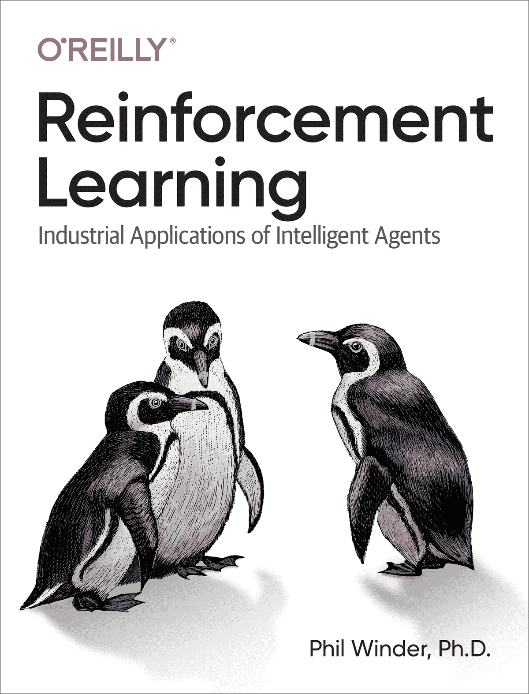

# 强化学习：智能体工业应用

# *强化学习* 赞誉

> “强化学习是机器学习中最令人兴奋的领域之一，遗憾的是，它也是最复杂的领域之一。*强化学习* 出色地阐述了背景、现状及机遇，让读者能够利用这项开创性技术，从而显著推动数据科学家影响业务的方式。”
>
> — David Aronchick，Kubeflow 联合创始人

> “Phil Winder 博士的这本强化学习书籍令人耳目一新。他将一个极其动态的主题提炼成了一本通俗易懂的书，专注于读者的理解与洞见。这本书令人振奋，因为强化学习与在不确定环境下的学习息息相关。”
>
> — Your Chief Scientist 创始人、培训师、《深思熟虑的机器学习》作者

> “对于任何想要将强化学习技术应用于实际问题的人来说，这是一本必备书籍。它通过大量实用示例和详细解释，引导读者从基本原理进阶到前沿技术。”
>
> — David Foster，Applied Data Science Partners 合伙人、《生成式深度学习》作者

> “Phil Winder 著作的这本好书。大自然经过验证的‘学中做’方法终于进入了软件开发者的标准工具箱。强化学习是人工智能的飞轮，本书旨在将这一视角带入工业和商业应用中。”
>
> — Danny Lange，Unity AI 高级副总裁

# 献词

献给 Emma、Eva 和 Cora

# 前言

**强化学习 (RL)** 是一种 **机器学习 (ML)** 范式，能够优化序列决策。

RL 之所以有趣，是因为它模仿了人类的学习方式。我们本能地能够学习策略，帮助我们掌握骑自行车或参加数学考试等复杂任务。RL 试图通过与环境交互来学习策略，以复制这一过程。

最近，企业一直在应用 ML 算法来做一次性决策。这些算法在数据上训练，以在当时做出最佳决策。但通常，当时的正确决策可能并非长远来看的最佳决策。没错，那大桶冰淇淋会让你短期内开心，但你下周就得多锻炼。同样，标题党推荐可能拥有最高的点击率，但从长远来看，这些文章让人感觉像骗局，损害长期参与度或留存率。

RL 令人兴奋，因为它能够学习长期策略并将其应用于复杂的工业问题。企业和从业者都可以使用直接关联业务的目标，如利润、用户数量和留存率，而不是准确率或 F1 分数等技术评估指标。简单来说，许多挑战取决于序列决策。ML 并非为解决这些问题而设计，RL 才是。

## 编写目的

我写这本书是因为我读到了太多利用 RL 解决看似不可能任务的惊人案例。但这些案例都来自学术研究论文，而我随后读到的书要么面向学术界，要么只是花哨的代码清单。几乎没有从工业视角出发，或解释如何在生产环境中使用 RL。我知道这项技术多么强大，于是着手写一本关于在工业界使用 RL 的书。

开始写作时，我想专注于运维方面，但很快意识到工业界几乎没人听说过 RL，更别提在生产环境中运行 RL 了。此外，在读者调研中，我发现许多工程师和数据科学家甚至从未见过许多底层算法。因此，这本书变成了基础解释与实用实现建议相结合的形式。我希望这本书能激励并鼓励在工业环境中使用 RL。

我相信这是第一本讨论 RL 运维问题的书，当然也是唯一一本将算法发展与运维发展融合成 RL 开发过程连贯图景的书。

## 谁应该读这本书？

本书旨在推广 RL 在生产系统中的应用。如果你正在（现在或将来）构建 RL 产品，无论是在研究、开发还是运维岗位，这本书都适合你。这也意味着我更多地为工业界而非学术界量身定制了这本书。

## 指导原则与风格

基于我阅读其他书籍的经验，我确定了几条我认为对这类书籍很重要的指导原则。

## 前言

首先，我完全避免了代码清单。我认为在大多数情况下，书籍并非代码清单的合适载体——软件工程书籍是显而易见的例外。这违背了常规智慧，但就我个人而言，我厌倦了跳过一页又一页的代码。我买书是为了听取作者的思想、他们解释概念的方式以及见解。不印刷代码的另一个原因是，许多实现（尤其是后面章节中的）实际上相当复杂，实现中包含大量优化细节，这会分散我要讲授的主要思想。你通常无论如何都会使用库的实现。还有些算法尚无实现，因为它们太新或太复杂，尚未合并到标准库中。基于所有这些原因及其他原因，这不是一本典型的“给我看代码”类书籍。

但别担心，这并不意味着完全没有代码。代码在配套的代码仓库中，连同大量其他实用示例、操作指南、综述、论文集以及更多内容（请参阅补充材料）。

这意味着有更多空间容纳洞见、解释，以及偶尔的几个烂梗。读完这本书后，你会体会到内容的数量与密度、覆盖面的广度，以及你无需跳过一页又一页代码这一事实。

我秉持的第二条原则关乎数学。强化学习（RL）是一个高度数学化的主题，因为用几行数学公式解释算法，通常比用 20 行代码容易得多。但我完全理解数学有时看起来像外星语言。像其他编程语言一样，数学有自己的语法、假定知识和内置函数，你必须先了解这些才能充分领会其精髓。

因此，全书我并不回避数学，尤其是在解释 RL 基础算法时，因为它们是重要组成部分。然而，我确实尽量在力所能及的地方限制数学的使用，在无法避免的地方提供详尽解释。我通常尝试遵循 Thomas 和 Okal 的《马尔可夫决策过程符号，版本 1》中提供的符号表示。^(1) 但我经常滥用这些符号以使其更加简单。

第三条原则，你可能会发现它与其他更侧重最佳实践和工程艺术的技术书籍不同，它关乎一个事实：RL 的发展是由研究驱动的，而非经验。因此，本书充满了对研究论文的引用。我试图汇总并总结所有这些研究，为你提供对最前沿技术的广泛理解。我也试图平衡深入的程度。

作为一名教作者，这很难做到，因为你可能已经是专家，也可能是刚学会编程的完全新手。我无法取悦所有人，但我可以以中间受众为目标。平均而言，我希望你会感到：在提供足够信息让你建立信心，以及简化内容防止你不知所措之间，取得了良好的平衡。如果你确实想在特定主题上深入钻研，请参考研究论文、参考文献和其他学术书籍。如果你感到不知所措，请慢慢来，不必着急。我提供了大量指向其他资源的链接，它们将助你一臂之力。

第四条原则是，我总是试图指出陷阱或可能出错的地方。我跟一些人交流过，他们把这理解为 RL 还没准备好，或者我不看好它；其实它已经准备好了，我也看好它。但理解未知数和困难至关重要，这样你才不会过度承诺，或预留足够时间完成工作。这绝对不是“正常”的软件工程。所以，无论何时你看到“挑战”或“如何改进”的解释，这些都是至关重要的重要信息。失败是最好的老师。

## 先决条件

所有这些意味着，在你甚至开始之前，RL 就是一个相当高阶的主题。要最大程度地从本书获益，你最好对数据科学和机器学习有所接触，并需要一点数学知识。

但如果你不具备这些也别担心。你随时可以后补。我在合适的地方提供了大量参考资料、延伸阅读链接，并解释了辅助概念。我保证你仍将获得大量知识。

## 范围与大纲

本书的范围涵盖你尝试将 RL 产品推向生产的全过程。首先，你需要学习 RL 赖以构建的基本框架。接着，你将学习利用该框架的简单算法。然后，你可以学习越来越高级、能实现更大壮举的算法。随后，你需要思考如何将这些知识应用到你的工业问题中。最后，你需要设计一个健壮的系统，使其在运维层面可行。

这正是本书遵循的路径，我建议你从头到尾线性阅读。后续章节建立在早期章节的思想之上，所以如果你跳过可能会错过一些内容。不过，随时可以跳转到你感兴趣的特定章节或小节。每当必要时，我都会链接回前面的小节。

以下是概览，以唤起你的食欲：

第 1 章，*为什么要用强化学习？*
: 本书以温和的介绍开篇，回顾 RL 的历史与背景，并从其他科学学科汲取灵感以启发思考。它奠定了基础，并让你对 RL 中所有不同类型的算法有一个全局概览。

第 2 章，*马尔可夫决策过程、动态规划与蒙特卡洛方法*
: 艰苦的工作从定义 RL 基础概念的章节开始，包括马尔可夫决策过程、动态规划和蒙特卡洛方法。

第 3 章、*时序差分学习、Q-Learning 与 n-Step 算法*
: 在本章中，你将进阶到所谓的*价值方法*，它们试图量化处于特定状态的价值，这是主导所有现代 RL 的基础算法。

第 4 章，*深度 Q 网络*
: 近来的许多激动人心的进展源于价值方法与深度学习的结合。你将深入探究这一组合，我向你保证，这些算法的表现会让你大吃一惊。

第 5 章，*策略梯度方法*
: 现在你将学习第二大流行的 RL 算法形式——策略梯度方法——它们试图将参数化策略推向更好的性能。主要优势在于它们能处理连续动作。

第 6 章，*超越策略梯度*
: 基础策略梯度算法存在一系列问题，但本章探讨并修复了它们遭遇的许多问题。并引入了离策略训练的承诺以提高效率。

第 7 章，*用熵方法学习所有可能的策略*
: 熵方法已被证明具有鲁棒性，能够学习驾驶汽车或控制交通流等复杂活动的策略。

第 8 章，*改进智能体的学习方式*
: 从核心 RL 算法中退一步，本章探讨辅助组件如何帮助解决难题。这里我重点关注不同的 RL 范式和构建马尔可夫决策过程的替代方式。

# 章节概览

- **第 9 章，《实用强化学习》**  
  这是两章构建生产级 RL 系统内容的第一篇。本章将引导你完成工业级 RL 算法的设计与实现过程，涵盖流程、设计决策及实现实务。

- **第 10 章，《运维强化学习》**  
  如果你想了解如何在生产环境中运行 RL 产品，本章适合你。我将深入探讨应考虑的架构设计，以使你的解决方案具备扩展性与鲁棒性，并详述需重点关注的关键方面。

- **第 11 章，《总结与未来》**  
  最后一章不仅是总结，更包含大量实用技巧，助你在 RL 探索中受益，并提出未来研究方向建议。

# 补充材料

我创建了网站 [`https://rl-book.com`](https://rl-book.com) 以组织本书所有配套材料。你将找到配套代码、深度文章与练习册、RL 技术对比与评测、当前 RL 案例研究数据库等更多内容。请参阅 “指导原则与风格” 了解为何本书不印刷代码。

创建完整网站而非仅代码仓库的原因在于：我认为 RL 不仅仅是代码。它是一种改变范式的思维方式，关注决策如何产生长期影响；它是一套全新的技术体系，需要完全不同的架构。基于这些原因，这些补充信息不适合放在仓库中，也不适合印刷（可能快速变更或印刷效率低）。因此我构建了这个生态系统，确信你会从中获益。请务必查看，若有缺失请告知我。

# 本书约定

本书使用以下排版约定：

- *Italic*（斜体）  
  表示新术语，偶尔用于强调。

- `Constant width`（等宽字体）  
  用于引用特定类或 RL 环境。

> **Tip**  
> 表示提示或建议。

> **Note**  
> 表示一般性说明。

> **Warning**  
> 表示警告或注意事项。

## 缩写词

强化学习充斥着缩写词，尤其是在讨论算法实现时。我在 术语表 中提供了完整列表及关键术语说明。

## 数学符号

总体上，我倾向于使用 Thomas 和 Okal 的《马尔可夫决策过程符号规范》第 1 版。但我进一步简化了它，移除了时间分隔等形式化符号，并扩展了撇号的用法以表示当前与下一时刻。如需完整数学严谨性，请参考学术教材与论文。

通常，花体字母表示集合，小写字母表示集合元素。撇号表示下一时间步。大写字母表示函数或常数。

> **Warning**  
> 为提高公式可读性，我省略了从随机变量采样特定状态的形式化过程，改用变量的具体实例化（例如 `s`）来表示。

文献中通常用大写字母表示随机变量。

部分算法大量使用索引，意味着需缓冲数据并在缓冲区内访问特定位置。推导这些算法时，我使用下标表示索引；例如 `a[t]` 表示时间或位置 `t` 处的动作。

如果你初次阅读公式，请放慢节奏。先理解每个符号的含义，再确定公式意图。像任何技能一样，练习越多越容易。点等号 `≐` 可读作“定义为”。

阅读算法时，按过程阅读。在可能的情况下我使用文字，但很多时候用公式更简洁。算法中的 `←` 符号读作“更新”；之所以首选它，是因为等号在技术上表示数学相等（如软件中的 `==`）。大多数软件语言滥用此符号，同时用等号表示“定义”与“更新”。

我选择用学术伪代码而非软件工程风格呈现算法。我深思熟虑后做此决定，主要有三个关键原因：
1. 所有学术文献均采用此形式。我想让本书成为工业界与学术界的桥梁，另一种表达只会加大鸿沟。
2. 这些算法在学术形式下更简洁，归功于数学表达。若转为软件伪代码，将充斥 `for` 循环与临时变量。
3. 转换容易出错。尽管我简化了数学，伪代码仍代表真实实现。将论文实现转为软件伪代码会引入过多错误。

# 合理使用政策

本书旨在帮助你完成工作。一般而言，若本书提供示例代码，你可在自己的程序和文档中使用，无需联系我们获取许可，除非你复制了大量代码。例如，编写一个使用本书多个代码片段的程序不需要许可。销售或分发包含 O'Reilly 书籍示例的 CD-ROM 需要许可。引用本书并引用示例代码回答问题不需要许可。将本书大量示例代码纳入产品文档需要许可。

我们感谢但不要求署名。署名通常包括书名、作者、出版社和 ISBN。例如：“*Reinforcement Learning* by Phil Winder, Ph.D. (O'Reilly). Copyright 2021 Winder Research and Development Ltd., 978-1-098-11483-1.”

如果你认为自己的代码使用超出合理使用或上述许可范围，请随时联系 `permissions@oreilly.com`。

# O'Reilly 在线学习

> **Note**  
> 40 多年来，[O'Reilly Media](http://oreilly.com) 一直提供技术与商业培训、知识与洞见，助力企业成功。

我们独特的专家与创新者网络通过书籍、文章及在线学习平台分享知识与专长。O'Reilly 在线学习平台提供按需访问的实时培训课程、深度学习路径、交互式编码环境，以及来自 O'Reilly 和 200 多家其他出版社的海量文本与视频资源。更多信息请访问 [`http://oreilly.com`](http://oreilly.com)。

# 联系我们

如需 RL 支持或建议，请使用 关于作者 中的详情联系 Phil。

关于本书的意见与问题，请联系出版社：

- O'Reilly Media, Inc.
- 1005 Gravenstein Highway North
- Sebastopol, CA 95472
- 800-998-9938（美国或加拿大）
- 707-829-0515（国际或本地）
- 707-829-0104（传真）

我们为此书设有网页，列出勘误表、示例及任何补充信息。可访问 [`https://oreil.ly/ReinforceLearn`](https://oreil.ly/ReinforceLearn)。

别忘了更新上述链接。

如需对本书发表评论或提出技术问题，请发送电子邮件至 `bookquestions@oreilly.com`。

有关我们书籍和课程的更多资讯和信息，请访问我们的网站 `http://www.oreilly.com`。

在 Facebook 上关注我们：`http://facebook.com/oreilly`

在 Twitter 上关注我们：`http://twitter.com/oreillymedia`

在 YouTube 上观看我们的视频：`http://youtube.com/oreillymedia`

# 致谢

这一节献给所有帮助我完成本书的人。

首先，我要感谢所有协助校对、审阅并为本书提供建议的人。没有你们，这本书看起来就像是一个八岁孩子写的。感谢 Eric Ma、Josh Starmer、Nick Winder、Ben Henson、David Foster、Catalin Jora、Matt Hobby、Kim Falk、Vladimir Blagojevic 和 Matthew Pettis。

感谢 O’Reilly 优秀的团队给予的鼓励、建议、审阅和编辑。我要特别感谢 Corbin Collins、Gary O’Brien、Jon Hassel 和 Nick Adams。没有你们，这本书就不会问世。

献给我可爱的妻子和孩子们。感谢 Cora 带来的幽默，Eva 带来的爱，以及 Emma 带来的力量和支持。你们成就了现在的我。

献给我的家人，Dot 和 Richard，Carol 和 Paul，Nick 和 Ashley，Sarah，Richard，Oliver 和 Charlotte，Steve 和 Aaron，Lucy，Jamie，Oliver 和 Emily。感谢你们的支持。

最后，献给我们所有的朋友。感谢你们带来的美好时光！

^(1) Thomas, Philip S., and Billy Okal. 2016. [“马尔可夫决策过程的一种表示法”](https://oreil.ly/VT7np). ArXiv:1512.09075, September.
