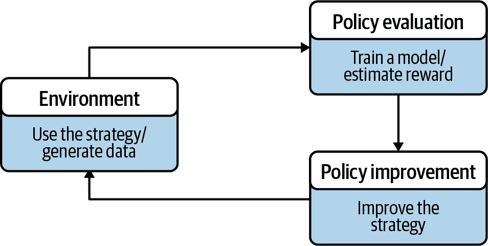

# 第 1 章 为什么要用强化学习？

人类是如何学习的？这个看似简单的问题困扰了思想家数千年。古希腊哲学家柏拉图及其学生亚里士多德自问：真理和知识是内在于我们心中的（理性主义），还是源于经验（经验主义）？即使在今天，2500 年过去了，人类仍在试图回答这个永恒的问题。

如果人类已经知道一切，就不需要再经历生活了。人类可以把地球上剩下的时间花在通过做出明智决策和思考“大问题”（如“我的钥匙在哪里？”和“我锁前门了吗？”）来改善生活上。但人类最初是如何获得这些知识的？知识可以传授。更高的平均教育水平能带来更美好的社会。但你无法传授所有东西。无论是在课堂上还是在生活中，学生都必须*亲身体验*。

年幼的孩子最能体现这一过程。他们需要经历各种情境和结果。从长远来看，他们开始追求有益的经历并避免有害的经历（你希望如此）。他们主动做出决策并评估结果。但孩子的世界充满困惑，奖励往往具有误导性。爬进橱柜吃块饼干的即时奖励很诱人，但惩罚更大。

通过*强化*学习结合了两项任务。第一是探索新情境。第二是利用这些经验做出更好的决策。给定足够时间，这会形成一个完成任务的计划。例如，孩子在站立后学习走路，通过向前倾倒在慈爱的父母怀里。但这只有在无数小时的牵手、摇晃和跌倒之后才会发生。最终，婴儿的腿部肌肉协同运作，采用多步骤策略告诉他们何时移动哪块肌肉。你无法教授孩子将来所需的每一个计划，因此生活提供了一个框架，让他们找到一种学习的方式。

本书展示了如何在计算机中实施强化过程。但为什么要这样做？这能让机器自主学习。借用我妻子最爱的电视剧《星际迷航》的一句台词：你赋予了机器寻找新体验的能力，大胆去往无机器到达过的地方。

本章介绍强化学习的基础知识。（我将正式的强化学习定义推迟到第 2 章给出。）首先，我将说明工程师为何需要它，以及为何是现在。读完本章，你将了解哪些行业可以使用强化学习，并建立你的第一个数学模型。你还将大致了解本书后续将遇到的算法类型。

> **注意** 全书我使用*工程师*一词，泛指利用技能设计解决方案解决问题的任何人。因此我指的是软件工程师、数据工程师、数据科学家、研究人员等。

## 为什么是现在？

两个原因促成了执行强化学习的需求和能力：海量数据的获取和更快的数据处理速度。

直到 2000 年，人类知识主要存储在书籍、报纸和磁带等模拟设备上。如果压缩这些知识，1993 年你需要 15.8 EB（1 EB = 10 亿 GB）的存储空间。2018 年这一数字已增至 33 ZB（1 ZB = 1 万亿 GB）。^(1) 云服务商甚至不得不动用集装箱大小的硬盘驱动器来上传大量数据。^(2)

你还需要必要的计算能力来分析所有这些数据。为了说明这一点，请看最早的强化学习实现案例之一。

1947 年，Dietrich Prinz 在英国曼彻斯特的 Ferranti 公司工作。在那里他协助设计并制造了曼彻斯特计算机的首个量产版本——Ferranti Mark 1。^(3) 他在 Alan Turing 和 Cicely Popplewell 的指导下学会了为 Mark 1 编程。受 Turing 相关论文的影响，1952 年 Prinz 发布了一个国际象棋程序，能解决一类称为“两步将死（mate-in-2）”的单一问题。这些谜题要求选出导致国际象棋将死的两步棋。Prinz 的算法通过穷举搜索所有可能位置，平均在 15—20 分钟内生成解决方案。这是第 2 章所述蒙特卡洛算法的一个实现。Prinz 认为国际象棋编程“是通过电子计算机处理其他领域结构性或物流问题方法的线索”。他说对了。^(4)

数据量与硬件计算性能提升的汇聚，意味着 2010 年前后，让机器学会学习成为可能，也成为必要。

## 机器学习

> **注意** 机器学习的完整总结超出了本书范围。但强化学习依赖于它。请尽可能多阅读关于机器学习的内容，特别是我在“延伸阅读”中推荐的书籍。

数据的普遍存在和廉价高性能计算的可用性，让研究人员得以重温 1950 年代的算法。他们选择了*机器学习*（ML）这个名称，这其实是个不当的名称，因为 ML 同时被视为一门学科和一组技术。我认为 ML 是*数据科学*的分支，后者是一门涵盖性的科学领域，研究现象产生的数据。我出于类似的原因不喜欢*人工智能*（AI）这个术语；智能本身就很难定义，更别提说明它是如何实现的了。

## 强化学习

ML 以大量 *观测* 数据的形式开始。观测表示在单一时间点描述实体的一组属性。例如，在选举民调中，一次观测代表单个选民的意向投票。对于推荐任务，观测可能是对特定产品的点击。工程师使用 ML 算法来解释这些信息并据此做出决策。

在*监督*学习中，*标签*代表针对该特定观测的问题答案。算法随后尝试利用信息猜测正确结果。*无监督*学习在没有标签的情况下工作，你根据数据的特征做决策。我总是建议我在 Winder Research 的客户以监督学习为目标——例如通过付费或运行实验来寻找标签——因为如果你没有任何真实标签，你会发现很难量化性能。

寻找算法以解决问题的过程称为*建模*。工程师设计模型以简化和表示底层现象。他们使用模型对新观测做出有根据的猜测。例如，模型可能会告诉你新客户在申请中提供了虚假信息，或者它可能将你的语音转换为文本。

鉴于这些描述，考虑尝试教你的孩子骑自行车。最好的方法是什么？根据 ML 范式，你应该提供大量带标签的观测。你可能会让孩子观看职业自行车手的视频。一旦他们看了足够多的视频，无视任何厌倦的抗议，你可能会根据一些任意的、技术性的成功标准来测试他们的能力。这行得通吗？不行。

尽管 ML 是许多应用的基础，但有些问题并不适用。延续前面的例子，更好的解决方案是让孩子尝试。有时他们会尝试并失败。有时他们会成功。每个决定都会改变他们的判断。经过足够多的尝试和一些指导后，他们将学会最大化自己对成功定义的策略。这就是通过强化而非监督来学习的承诺。

*强化学习* (RL) 告诉你如何在特定情境下按顺序做出最佳决策，以最大化现实生活中的成功度量。决策实体通过试错来学习这一点。它不会被告知该做哪些决定，而是必须通过尝试自行学习。图 1-1 介绍了 RL 的四个组件，第 2 章 将深入探讨。

每个决策都是一个*动作*。例如，当你骑自行车时，动作包括转向方向、蹬踏力度以及是否刹车。如果你尝试自动将商品添加到购物篮，那么动作就是添加特定商品的决定。

情境虽然可以代表任何现实生活情况，但通常会被约束以使问题可解。RL 从业者创建一个接口来与*环境*交互。这可以是模拟、现实生活，或两者的结合。环境接受动作并返回结果和一组新的观测。

*智能体*是做出决策的实体。例如，它可以是你的孩子、某个软件或一个机器人。

*奖励*编码了挑战。这种反馈机制告诉智能体哪些动作导致了成功（或失败）。奖励信号通常是数值，但只需要强化行为即可；例如，遗传学习策略会淘汰表现不佳的智能体，而不是不给予奖励。

继续举例，你可以奖励机器人到达目标，或奖励智能体将正确商品放入篮子。简单，对吧？但如果机器人花三天时间解决一个简单迷宫，因为它大部分时间都在原地打转怎么办？或者智能体开始把所有商品都加进篮子怎么办？

这一过程在动物身上也会发生。它们必须最大化生存几率以传递基因。例如，像大多数食草动物一样，驼鹿需要大量进食才能生存。但在 2011 年，瑞典哥德堡附近发现一只驼鹿因吃了发酵的苹果而卡在树上。^(5) 驼鹿的奖励系统（告诉它们去吃）失效了，因为目标太笼统。你不能什么都吃来最大化生存几率。这比那复杂得多。

这些例子开始凸显 RL 中的一个主要问题，这个问题自 Ada Lovelace 首次编写生成伯努利数的算法以来就一直存在。你如何告诉机器你想让它做什么？RL 智能体受困于它们经常优化错误的目标。目前，我建议你尽可能保持奖励简单。问题通常有天然的奖励。第 9 章 将更详细地讨论这一点。

这四个组件代表一个*马尔可夫决策过程* (MDP)。你可以用 MDP 来构建你的问题，甚至是非工程问题。第 2 章 将更详细地介绍这些概念。

## 何时应该使用 RL？

网上有些 RL 例子看起来很牵强。它们拿一个 ML 例子，尽管缺乏明确的智能体或动作，却试图应用 RL。看看一些试图将 RL 引入股市预测的例子吧。虽然存在使用自动化智能体进行交易的可能性，但在许多例子中这并非重点；重点仍然在于预测模型。这是不合适的，最好留给 ML。

当决策是连续的且动作导致环境探索时，RL 效果最好。以机器人技术为例，这是一个经典的 RL 应用。机器人的目标是学习如何执行未知任务。你不应该告诉机器人如何成功，因为这要么太难（你如何告诉机器人盖房子），要么你可能受自己的经验偏见影响（你不是机器人），所以不知道作为机器人移动的最佳方式。如果你让机器人探索，它可以迭代出最优解。这非常适合 RL。

### 提示

你应该始终选择能以满意程度解决你当前问题的最简单方案。

RL 的主要优势在于它针对长期、多步骤奖励进行优化。次要好处是它非常容易融入业务使用的指标。例如，广告解决方案通常针对单个广告的最佳点击率进行优化。这是次优的，因为观众通常会看到多个广告，目标不是点击，而是更大的目标，如留存、注册或购买。展示的广告组合、顺序、内容，都可以通过 RL 利用一个符合业务需求的易用目标自动优化。

你可以放弃上一节提出的四个组件中的一些以简化开发。如果你没有天然的奖励信号，比如机器人到达目标，那么可以设计一个人工奖励。创建环境模拟也很常见。你可以对动作进行量化或截断。但这些都是妥协。模拟永远无法替代真实经验。

RL 主动搜索最优模型。你不必生成随机样本并离线拟合。当快速最大化性能至关重要时，快速的在线学习能创造奇迹。例如，在基于利润的 A/B 测试中，比如决定使用哪个营销文案，如果某个版本表现不佳，你不想浪费时间收集随机样本。RL 免费做到这一点。你可以在第 2 章了解更多关于 A/B 测试与 RL 的关系。

### 提示

总之，RL 最适合需要连续、复杂决策且具有长期目标（在单次决策的语境下）的应用。ML 可能只能完成一半工作，但 RL 在具有直接反馈的环境中表现出色。我曾与一些从业者交谈，他们利用 RL 取代了整个数据科学家团队，这些团队原本负责从 ML 解决方案中调优性能。

## RL 应用

全书中我展示了一系列示例，主要出于两个原因。首先，我想阐释理论层面的内容，比如算法是如何工作的。这些示例简单且抽象。就我个人而言，通过示例学习对我很有帮助。我也建议你尝试复现这些示例以辅助学习。其次，我想展示如何在工业界使用 RL。

媒体往往聚焦于智能体在游戏中击败人类的案例。它们喜欢讲述人类变得过时的精彩故事。而学术界继续发现游戏很有用，因为游戏提供了复杂的模拟环境。但我决定不谈论 DeepMind 的 AlphaGo Zero（击败围棋世界冠军的智能体版本），也不谈论击败 Dota 2 世界冠军的 OpenAI Five，而是专注于跨广泛行业的应用和示例。我并非说游戏示例是浪费时间。游戏公司可以将 RL 用于许多实际用途，比如帮助他们测试或优化游戏内的“AI”以最大化收入。我的意思是，我想帮助你看透炒作，向你展示 RL 适用的各种不同场景。为了展示可能性，我精选了一系列我个人认为有趣的实验：

*   机器人领域有许多应用，包括改进移动和制造、玩接球游戏、翻煎饼。^(6) 自动驾驶汽车也是一个活跃的研究课题。^(7)
*   你可以使用 RL 来改进云计算。一篇论文针对延迟优化应用程序，^(8) 另一篇针对能效/使用率。^(9) 数据中心制冷、CPU 散热和网络路由都是当前正在使用的 RL 应用。^(10,11,12)
*   金融行业利用 RL 进行交易和投资组合配置。^(13,14) 并且在实时优化定价方面有浓厚兴趣。^(15)
*   建筑物的能源消耗（通过供暖、用水、照明等）可以通过 RL 大幅降低。^(16) 电网可以利用 RL 来应对需求复杂的情况；家庭既是生产者也是消费者。^(17)
*   RL 正在改进交通信号灯控制和主动车道管理。^(18,19) 智慧城市也受益匪浅。^(20)
*   近期论文表明 RL 在医疗保健领域有许多应用，特别是在给药和治疗计划方面。^(21,22) RL 可用于设计更好的假肢和假肢控制器。^(23)
*   教育体系和电子学习可以受益于高度个性化的 RL 驱动课程。^(24)

没有哪个商业领域能幸免：游戏、科技、交通、金融、科学与自然、工业、制造和公共服务都引用了 RL 应用。

### 注记

我不想让你迷失在无穷无尽的列表中，因此我建议你参考[配套网站](https://rl-book.com/applications/?utm_source=oreilly&utm_medium=book&utm_campaign=rl)，那里有我整理的 RL 应用综合目录。

任何技术在错误的人手中都是危险的。就像民粹主义反对 AI 的论点一样，你也可以将 RL 解读为危险的。我请求你，作为一名工程师，作为一个人，考虑一下你在构建什么。它将如何影响他人？风险是什么？它是否与你的道德准则冲突？始终向自己证明你工作的正当性。如果你做不到这一点，那你大概就不应该做这项工作。以下是三个有据可查的恶意应用。每一个都触及不同的伦理底线。你的底线在哪里？哪些应用在你看来是可以接受的？

*   Pwnagotchi 是一个由 RL 驱动的设备，它主动扫描、嗅探并破解 WPA/WPA2 WiFi 网络，通过解密握手包实现。^(25)
*   研究人员展示了如何训练智能体规避病毒扫描器中的静态恶意软件模型。^(26)
*   美国陆军正在开发战争模拟，以演示自主机器人如何在战场上提供帮助。^(27)

我将在第 10 章中更深入地讨论安全与伦理。

## RL 方法分类

在 RL 的发展过程中，出现了几个主要主题。你可以利用这些主题对算法进行分组。本书详细介绍了许多此类算法，但现在提供一个概览会有所帮助。

## 无模型或有模型

你必须做出的第一个重大决定是：你是否拥有环境的准确模型。*有模型*算法利用其所处环境的确定性知识来改进学习。例如，棋类游戏通常限制你可以走的步骤，你可以利用这些知识来（a）约束算法，使其不提供无效动作，（b）通过向前推演时间来提高性能（例如，如果我走这里，对手走那里，我就能赢）。围棋和扑克等游戏的人类击败算法可以利用游戏的固定规则。你和对手只能做有限的一组动作。这限制了算法必须搜索的策略数量。像专家系统一样，基于模型的解决方案学习高效，因为它们不浪费时间搜索不当路径。^(28,) ^(29)

*无模型*算法理论上可应用于任何问题。它们通过交互学习策略，在此过程中吸收任何环境规则。

然而，故事并未结束。一些算法可以在学习最优策略的同时学习环境模型。几种新算法还可以利用其他智能体（或其他玩家）潜在的、未知的动作。换句话说，这些智能体可以学会对抗另一个智能体的策略。

这类算法往往模糊了基于模型和无模型之间的界限，因为归根结底，你在某处都需要一个环境模型。区别在于你是否可以静态定义它、是否可以学习它，或者是否可以从策略中假设该模型。

### 注记

本书专注于无模型算法，因为你可以将它们应用于任何工业问题。但如果你遇到环境具有严格、静态规则的情况，请考虑开发一个定制的基于模型 RL 算法，以便利用这些规则。

## 智能体如何使用和更新其策略

任何智能体的目标都是学习一个能最大化奖励的策略。我使用“策略”一词，因为它更容易理解，但正确的术语是“策略”。第 2 章将更详细地介绍策略。

算法如何以及何时精确地更新策略，是大多数无模型 RL 算法之间的决定性区别因素。有两种主导智能体性能和功能的关键策略形式，但它们非常容易混淆。

## 在线与离线更新、同策略与异策略

首先是在线更新和离线更新策略的区别。在线智能体仅使用刚刚观察到的数据来改进其策略，然后立即丢弃这些数据。它们不存储也不重用旧数据。所有 RL 智能体在遇到新经验时都需要在一定程度上更新其策略，但大多数最先进的算法都认同保留和重用过去的经验是有用的。

离线智能体能够从离线数据集或旧日志中学习。这可能是一个主要优势，因为有时与现实世界交互既困难又昂贵。然而，当智能体在线学习时 RL 往往最有用，因此大多数算法旨在结合在线和离线学习。

第二个有时很微妙的区别取决于智能体如何选择由其策略定义的动作。*同策略* 智能体学习预测根据当前策略选择动作后处于特定状态的奖励。*异策略* 智能体学习预测选择*任意*动作后的奖励。

我理解这个微妙之处难以理解，所以让我举个快速的例子。想象你是一个婴儿，准备尝试新食物。进化仁慈地在你的舌头上提供了甜味感受器，让你感到快乐，所以你爱喝母乳。同策略婴儿会尝试以当前策略为起点学习新策略。他们可能会倾向于其他尝起来像奶一样甜的东西。同策略婴儿会变成“甜食爱好者”。然而，异策略婴儿仍然以当前策略为起点，但被允许探索其他可能是随机的选择，同时仍然被喂奶。异策略婴儿仍然喜欢甜奶，但可能也会发现他们喜欢其他美味的口味。

此时这种区别可能看起来很小，但这一早期发现成就了你今天看到的惊人 RL 驱动的壮举。大多数最先进的算法都是异策略的，以鼓励或改进探索。它们允许使用规划机制来指导智能体，并且往往在具有延迟奖励的任务上表现更好。然而，同策略算法往往学习得更快，因为它们可以立即利用新策略。现代算法试图在这些特性之间取得平衡，以兼得两者之长。

## 离散或连续动作

环境中的动作可以采取多种形式：你可以改变施加到电机控制器上的扭矩大小，决定是否将香蕉放入购物篮，或者在交易中买入数百万美元的股票。

有些动作是二元的：停/行路标恰好有两类。其他时候你可能有可以编码为二元动作的类别。例如，你可以将车辆的油门控制量化为三个二元动作：无、半功率和全功率。

但通常动作需要更多的技巧。当你开车时，你会在无限多个角度上转动方向盘。如果你将其离散化，痛苦将随之而来。如果你的公交司机以 90 度为增量转动方向盘，你会作何感想？

动作的权重或持续时间也可能很重要。在 *超级马里奥兄弟* 中，你按住跳跃按钮的时间越长，马里奥跳得越高。你可以将时间作为问题的一部分，并拥有一个表示按住按钮时长的连续动作，例如。或者你可以将其离散化，并确保反复轮询智能体以查看它是否应继续执行该动作。如果你能论证动作的持续时间与执行动作是解耦的，它们可以是单独的变量。

RL 算法应当能够处理二元和连续变化的动作。但许多算法仅限于其中一种。

## 优化方法

14 到 16 岁左右，当你得到数据和大量草稿纸时，你可能学会了如何手工求解线性方程。但你练习的例子可能非常简单，只使用一个未知变量。在现实世界中，你通常要处理成百上千甚至数百万个自变量。此时，由于计算复杂度，使用你在学校学到的相同方法变得不可行。

通常，你构建模型（可能包含线性方程，也可能不包含），并使用优化方法对其进行训练。RL 面临同样的问题。你想构建一个能够在给定目标下产生解决方案的智能体。它究竟如何做到这一点，构成了 RL 中的另一个基本主题。

一种方法是尝试尽可能多的动作并记录结果。未来你可以通过遵循导致最佳结果的策略来引导智能体。这些被称为 *基于价值* 的算法，我稍后会向你介绍它们。

另一种方法是维护一个模型，并调整模型的参数以倾向于产生最佳结果的动作。这些被称为 *基于策略* 的算法。你可以在 第 5 章 中阅读更多关于它们的内容。

为了帮助你理解这一点，想象一个二维网格，南边有一个悬崖。你的任务是设计一个机器人，它会反复测试每个方格，并了解到掉下悬崖是有代价的。如果你使用基于价值的算法，并将策略转化为语言，它会说“不要踏出悬崖”。基于策略的算法会说“远离悬崖”。一个微妙但重要的区别。

基于价值和基于策略的算法目前研究最多，因此最流行。但 *基于模仿* 的算法，即优化智能体以模仿专家的动作，在你试图融入人类指导时效果很好。任何不属于这些类别的其他算法未来可能会催生新的方法论。

## 策略评估与改进

理解算法如何改进其策略的另一种方式是从 *策略评估* 和 *策略改进* 的角度来看待它，如 图 1-2 所示。

首先，智能体遵循一个策略（即政策）来做决策，这会生成描述环境状态的新数据。

根据这些新数据，智能体尝试预测环境当前状态的奖励；它评估当前策略。

接着，智能体利用这个预测来决定下一步做什么。通常它试图改变策略以改进政策。它可能建议移动到预测奖励更高的状态，或者选择探索更多。无论哪种方式，动作都会反馈给环境，旋转木马再次开始转动。

> **提示**
>
> 绝大多数算法都遵循这一模式。这是一个如此基础的结构，以至于如果我有机会重写这本书，我会考虑以这种方式呈现内容。

## 强化学习中的基本概念

通过试错进行强化学习的想法，作为所有 RL 算法的基本基础，起源于早期关于动物学习心理学的研究。杰出的俄罗斯生理学家伊万·巴甫洛夫于 1927 年首次报告说，你可以使用与进食任务无关的刺激来触发动物的消化系统。在一个著名的实验中，他测量了狗在看到食物时分泌的唾液量。同时，他引入了一个声音。经过几次重复后，狗单独对声音产生了唾液分泌反应。^(30)

声音不是食物的自然前兆，也无助于进食。先天反射（如眨眼或唾液分泌）与新刺激之间的联系现在被称为经典条件反射，或巴甫洛夫条件反射。

## 第一个 RL 算法

1972 年，罗伯特·雷斯科拉和艾伦·瓦格纳发现了另一个巴甫洛夫条件反射无法解释的有趣现象。他们首先向兔子的眼睛吹了一口气，导致它眨眼。然后他们训练兔子将一种外部刺激（声音）与那股气流联系起来。当兔子听到声音时会眨眼，即使没有气流。接着他们重新训练兔子，使其在同时接触声音和光线时眨眼。再次，当兔子听到声音并看到光线但没有气流时，它眨眼了。但接下来，当研究人员只闪烁光线时，兔子没有眨眼。^(31)

兔子形成了一个期望层级：声音加光线等于眨眼。当兔子没有观察到基础期望（声音）时，这*阻断*了所有后续的条件作用。你可能自己也经历过这种感觉。偶尔你会学到一些不可思议、根本性的东西，你可能会觉得任何衍生信念也都无效了。你的低层条件作用被打破了，高阶期望被阻断了。这项工作的成果是雷斯科拉-瓦格纳模型。他们的研究从未以这种方式呈现，但这描述了一种称为*价值估计*的方法。

## 价值估计

想象一下你正试图模拟雷斯科拉-瓦格纳的兔子实验。目标是预测兔子何时眨眼。你可以通过描述输入和预期输出来建立该实验的模型。输入代表你可控的动作，输出是对兔子是否眨眼的预测。

你可以将输入表示为向量 `s = (s[0], s[1], ..., s[n-1])`，其中如果第 `i` 个刺激在试验中存在，则 `s[i] = 1`，否则为零。这些是二元动作。

例如，假设特征 `s[0]` 代表声音，`s[1]` 代表光线。那么向量 `s = [0,1]` 就代表声音不存在但光线存在的情况。

你可以将估计输出写为 `V`，它代表兔子是否眨眼的预测。然后通过函数 `V(s)` 将状态映射到正确的预测。

### 注

我主动决定尽可能简化数学内容，以提高可读性和理解性。这意味着它失去了数学形式性，例如用*尖帽*表示估计值，以提高可读性。请参阅学术论文以获得完整的数学严谨性。

现在到了困难的部分：定义映射函数。一种常见的解决方案是将输入乘以你可控的*参数*。你可以改变这些参数以产生依赖于输入的输出。这些参数被称为*权重*，你刚刚构建的模型是*线性*的。

权重由另一个向量 `w` 定义，其形状与特征相同。例如，数据可能显示光线没有导致兔子眨眼；它只在听到声音时眨眼。这导致声音特征的权重值为 1，光线特征的权重值为 0。

形式上，该函数是输入与权重乘积的总和。这种运算称为*点积*。结果如公式 1-1 所示，是对兔子是否眨眼的预测。

### 公式 1-1. 价值估计

$$
\begin{array}{cl}
V(s,w) & \doteq w_0 s_0 + w_1 s_1 + ... + w_n s_n \\
       & = w \cdot s = w^{\intercal} s
\end{array}
$$

但总的来说，如何决定权重的值呢？

## 预测误差

你可以使用优化方法来寻找最优参数。最常用的方法是量化你的估计与真实情况（正确答案）相比有多大偏差。然后你可以尝试许多不同的权重来最小化误差。

你预测中的误差 `δ` 是实验实际结果 `E` 与预测（价值估计）之间的差值。预测基于环境的当前状态（对兔子的观察）`s` 和当前权重。所有变量随时间变化，通常用下标 `t` 表示，但我忽略了这一点以减少符号数量。你可以在公式 1-2 中看到其定义。

### 公式 1-2. 预测误差

$$ \delta \doteq E - V(s,w) $$

理解公式 1-2 的一种方式是 `δ` 是一种惊讶的形式。如果你预测兔子肯定会眨眼但它没有，那么你预测的与发生的之间的差异就会很大；你会对结果感到惊讶。

鉴于惊讶的定量定义，权重应如何调整？一种方法是按预测误差的比例轻推权重。例如，考虑一种情况：预期声音（索引零）和光线（索引一）具有同等重要性。权重集合为 `w = [1,1]`。

这次实验只照射光线，没有声音。所以实验的观测状态是 `x(s) = [0,1]`。为了进行预测 `V(s,w)`，计算对前面的向量执行点积的结果。结果是 1（眨眼）。

当你运行模拟时，兔子没有眨眼。实际值是 0。公式 1-2 的值 `δ` 等于 -1。

对先前状态和预测误差的了解有助于调整权重。将它们相乘，结果是 `δ * x(s) = [0,1]`。将其加到当前权重上得到 `w = [1,0]`。

注意新权重本会正确预测实际结果，0（不眨眼）（`w^⊺ * x(s) = [1,0]^⊺ * [0,1] = 0`）。

## 权重更新规则

如果你有机器学习经验，就会知道不应试图直接跳到正确的*最优*结果。一个原因是实验结果可能有噪声。应始终逐渐向正确结果靠近，并重复实验多次。然后，由于*大数定律*，你会收敛向最佳平均答案，这也是最优答案。一个警告是，这只有在底层数学证明收敛是不可避免时才成立；在许多算法中，如那些使用非线性逼近器的算法，这无法保证。

这被形式化为权重的*更新规则*。在公式 1-3 中，你可以使用超参数 `α` 来控制权重更新的速度，它必须在零和一之间。公式 1-3 *就地*更新权重，这意味着下一时间步的权重源自当前时间步的权重。同样，我忽略下标以简化符号。

### 公式 1-3. 权重更新规则

$$ w \leftarrow w - \alpha \delta x(s) $$

## 强化学习和机器学习是一样的吗？

公式 1-1 和 公式 1-3 中呈现的数学提供了动物如何学习的一种心理学模型。你可以轻松地将同一方法应用于软件控制的智能体。但深入探讨的真正原因是为本书其余部分提供数学热身练习。这里我使用了后续章节中使用的数学符号（原始论文使用了心理学中不同的符号和术语）。

## 强化学习基础

## 预测与控制

如果暂时忽略数学细节，通过更新权重以产生更好拟合的想法听起来可能很熟悉。你说得没错；这就是机器学习中的回归问题。目标是根据给定的一组输入（观测值）来预测一个数值结果（总奖励）。从业者称之为*预测*问题。为了做出好的决策，你需要能够预测哪些动作是最优的。

机器学习与强化学习的主要区别在于，你赋予了智能体选择的自由。这是问题的*控制*部分，乍一看似乎只是在机器学习的*预测*问题之上简单地增加了一层。但不要低估这一挑战。你可能会认为最好的策略是选择预测值最高的动作。不对，因为可能存在其他奖励更高的状态。

## 控制与自主性

控制赋予了自主性；超级机器可以从自己的错误中学习。这项技能开启了一系列新的机遇。许多挑战极其复杂——例如教会机器人拍摄特定物体的照片——以至于工程师不得不求助于约束、规则，并将挑战拆解为微问题。同样，我合作的客户不得不每天甚至每小时重新训练模型以纳入新数据。不再需要这样了。放弃控制，使用强化学习吧。

## 探索与利用

强化学习算法试图以不同的方式平衡这两个关注点：探索与利用。一个常见的区别在于算法如何改变探索的速率。有些以固定速率探索，有些设定的速率与价值预测成正比。甚至有些尝试针对给定状态获得最大奖励的概率。本书将贯穿讨论这一点。

## 奖励与反馈

机器学习研究者从神经科学中汲取了灵感。最常被引用的例子是*人工神经元*的发展，它是*神经网络*和*深度学习*的基础，模拟了你大脑中的基本单元，就像原子模型总结了物质的基本单元一样。特别是强化学习，深受大脑通信机制的影响。

一种神经递质——多巴胺，由大脑中的特殊细胞产生。它参与主要的大脑过程，包括动机、学习，从而影响决策。它也可能有负面影响，如成瘾和一系列医学疾病。尽管关于多巴胺仍有许多未知之处，但已知它在处理奖励方面起着基础性作用。

关于多巴胺存在的传统理论依赖于该化学物质的强化和愉悦效应。但 1990 年代初的研究揭示了一些惊人的事实。研究人员能够定量测量猴子体内多巴胺的活动。他们的结果显示存在一个持续的背景多巴胺释放水平。随后，他们让每只猴子接受传统的条件反射任务训练，就像你在“价值估计”中看到的那样，猴子在看到灯光几分钟后期待食物。训练开始时，给予奖励时多巴胺水平显著高于背景水平。随着时间的推移，研究人员观察到猴子体内的多巴胺释放转移到了灯光出现的时刻。最终，每只猴子一看到灯光就会产生多巴胺峰值。^(32) 如果你原谅我将此类比为人类经验，我可以证明我的孩子们对吃冰淇淋的*前景*比实际吃冰淇淋更兴奋。

一项更迷人的后续研究使用了相同的条件反射训练，观察到当猴子因条件刺激而预测奖励时，出现了相同的多巴胺峰值。然而，当研究人员呈现刺激但在预期时间不给猴子奖励时，背景多巴胺水平显著下降。当猴子没有获得奖励时，相对于基线出现了负面的多巴胺效应。^(33)

正如在“预测误差”中所述，这些经历可以用一个修正过程来很好地建模。多巴胺神经元并不直接发出奖励信号本身。多巴胺是代表奖励预测误差的信号。换句话说，多巴胺是大脑的*δ*。

### 延迟奖励

奖励模拟了智能体中动机的概念。是什么激励你早上起床？你会立即获得奖励吗？大概率不会。这就是为什么延迟满足是一项如此重要且难以掌握的生活技能。早起、吃健康早餐、努力工作、待人友善的奖励因人而异。

延迟奖励问题在强化学习中也很难解决。智能体往往需要等待很长时间才能观察到奖励。算法技巧在此有所帮助，但从根本上说，改变奖励信号使其提供更频繁的更新，有助于引导智能体找到解决方案。这种改变奖励的方式称为*奖励塑形*，但我更喜欢将其视为*奖励工程*，类似于机器学习中的特征工程。

与此问题相关的是奖励的归因。例如，是哪些决策导致你陷入了现在的境地？你如何知道？早期的一个决策可能就是成功与失败的分水岭。但考虑到复杂系统中所有可能的状态和动作，解决这个问题很困难。一般来说，只能说在一组假设和约束条件下，这些决策在平均意义上是最优的。

### 事后诸葛亮

成语*trust your gut*（相信你的直觉）意味着在观察新情况时，你应该相信自己的本能反应。这些启发式捷径是通过多年的经验学会的，通常能带来好的结果。批判性思维——即你逻辑且有条理地解决问题的过程——需要消耗更多的精力和注意力。

大脑中的这两个过程，通常被称为系统 1 和系统 2 模型，是一种节能机制。为什么要浪费宝贵的心智资源去处理你每天都在执行的任务？你会发现，如果必须有意识地思考如何走路，那将非常困难。但阿尔茨海默症患者每天都要面对这种可怕的衰弱处境。^(34)

研究人员提出，大脑内部的神经学差异解释了这些系统。^(35) 大脑中“本能”部分的工作是快速决定行动。另一部分的任务是审核这些行动，并在必要时采取纠正措施。

这种结构促成了*演员-评论家*系列算法的发展。*演员*负责做出重要决策以最大化奖励。*评论家*则负责未来规划，并在演员答错时进行纠正。这一发现对许多先进的强化学习算法至关重要。

## 强化学习作为一门学科

直到 20 世纪 80 年代左右，强化学习一直作为两个独立的学科发展。心理学研究动物行为。机械和电气工程师开发理论来描述系统的最优控制。

*最优控制*一词起源于 20 世纪 50 年代，用于描述如何调整系统以维持目标。这在 1957 年达到顶峰，当时 Richard Bellman 开发了*马尔可夫决策过程*（MDP），一套数学上可处理的环境需求，以及*动态规划*，一种求解 MDP 的方法。^(36)

根据某个来源，动物行为研究可追溯至 19 世纪，当时观察到了涉及“摸索与尝试”的实验。^(37) 爱德华·桑代克将猫关在“迷箱”中，并记录猫逃脱所需的时间。^(38) 他发现，随着反复尝试，逃脱时间从 5 分钟减少到了 6 秒。这项工作的成果是“效果律”，这更广为人知的是尝试-错误学习。

术语 `reinforcement` 首次出现于 1927 年巴甫洛夫关于条件反射手稿的译文中。但强化学习（RL）是由计算机科学之父艾伦·图灵推广的，他在 1948 年撰写了关于人工智能的最早思想。在下面的引文中，他谈论的是如何将他称为“机器”的一组电子电路“组织”起来以做一些实际的事情：

> 这可以简单地通过允许机器随机穿越一系列情境来完成，当做出错误选择时施加痛苦刺激，做出正确选择时施加愉悦刺激。最好在做出无关选择时也施加痛苦刺激。这是为了防止陷入无关情境的循环中。机器现在已“可供使用”。^(39)
>
> 艾伦·图灵 (1948)

我发现图灵的工作至今仍有如此多的相关性，这令人惊叹。在他的那个时代，研究人员正在构建机器人机器来完成琐碎的任务。一位特别聪明的研究人员威廉·格雷·沃尔特于 1951 年建造了一台“机械乌龟”。1953 年，他推出了一台名为 CORA（条件反射模拟装置）的“乌龟”，它能够从环境中“学习”。该机器人包含可以模拟巴甫洛夫条件反射实验的电路。即使在那时，公众也对这种能够“学习”的机器着迷：

> 在英国，警察哨有两个音调，同时吹响会发出一种特别刺耳的声音。因此我试图教会\[CORA\]，一个音调代表障碍物，另一个代表食物。我试图通过两个调谐电路来建立这种辨别性反射，其中一个与趋近反应相关，另一个与回避反应相关。安排是在机器触碰物体前吹响哨子的一侧，使其学会避开；而在它本应看到光线前吹响哨子的另一侧。同时吹响两个音调的效果几乎总是灾难性的；它会直接冲到房间右侧的黑暗处，在那里盘旋约五分钟，仿佛在生闷气。它对刺激变得无反应，并在原地打转。^(40)
>
> 威廉·格雷·沃尔特 (1956)

到了 1950 年代末，研究人员的兴趣从纯粹的尝试-错误学习转向了监督学习。事实上，在早期，人们习惯互换使用这两个术语。早期神经网络先驱包括弗兰克·罗森布拉特、伯纳德·维德罗和特德·霍夫，他们在论文中使用了 `reward` 和 `punishment` 这两个术语。这导致了混淆，因为监督学习、无监督学习和强化学习都被用来表示同一个概念。

与此同时，1950 年代和 1960 年代对 AI 的过度宣传导致了对进展缓慢的普遍不满。1973 年，英国关于 AI 研究现状的*莱特希尔报告*批评了其完全未能实现“宏大目标”。^(41) 基于这份报告，英国的大部分公共研究资金被削减，世界其他地区也纷纷效仿。1970 年代被称为“AI 寒冬”，进展停滞。

1980 年代强化学习的复兴被认为归功于哈里·克洛夫，他在整个 1970 年代宣称关键学习行为的知识和应用正在流失。他重申，为了实现某些期望结果而对环境进行控制，是智能系统的关键。理查德·萨顿和安德鲁·巴托在 1980 年代和 1990 年代致力于推进克洛夫的思想，通过 `temporal-difference` (TD) 学习将心理学和控制理论领域统一起来（参见“强化学习中的基本概念”）。1989 年，克里斯·沃特金斯整合了之前所有的强化学习研究线索，创造了 `Q-learning`。

我在这里结束对强化学习历史的简要回顾，因为接下来 30 年的研究成果就是本书的内容。您可以从“延伸阅读”中的参考文献了解更多关于强化学习历史的信息。

## 概要

市场研究公司 Gartner 指出，在美国，AI 增强每年为企业创造数万亿美元的价值。^(42) 强化学习在这个市场中扮演着重要角色，因为当今许多商业问题都是战略性的。从车间一线到高管层，企业充满了未优化的多步决策，如将商品加入购物篮或制定市场进入策略。单独使用机器学习（ML）是次优的，因为它对问题的视角短视。但数据爆炸、算力提升和模拟技术改进共同推动了软件驱动、机器学习赋能的强化学习智能体的发展，它们能够学习出超越人类的最优策略。

生物过程持续启发着强化学习的实现。早期心理学实验凸显了探索和奖励的重要性。研究人员提出了不同的方法来模拟强化学习，这导致了几个共同主题的出现。作为工程师，您必须决定哪些主题适合您的问题；例如，如何优化您的强化学习算法、动作采取何种形式、智能体是否需要正式的规划机制、以及策略是否应在线更新。您将在全书中获得更多经验，在最后几章中，我将向您展示如何应用它们。通过仔细定义动作和奖励，您可以设计智能体在环境中运行以解决一系列工业任务。但首先您需要了解允许智能体学习最优策略的算法。因此，本书的主要目的是教您这些算法如何工作以及如何应用它们。

## 延伸阅读

*   **强化学习入门：**
    *   资源有很多，但[Sergey Levine 的](https://oreil.ly/wgxnk)是其中最好的之一。

*   **强化学习历史：**
    *   Sutton, Richard S., and Andrew G. Barto. 2018. *Reinforcement Learning: An Introduction*. MIT Press.
    *   一份 1996 年的强化学习历史综述，至今仍具参考价值。^(43)

^(1) Reinsel, David, John Gantz, and John Rydning. 2018. [“世界数字化：从边缘到核心”](https://oreil.ly/96vhZ). IDC.

^(2) [AWS Snowmobile](https://oreil.ly/O5-K9) 是一项服务，允许您使用集装箱通过慢速邮件将数据发送到其数据中心。

^(3) [“Dietrich G. Prinz 博士文档-档案中心”](https://oreil.ly/XCG9g). n.d. 访问于 2019 年 7 月 2 日。

^(4) Copeland, B. Jack. 2004. *The Essential Turing*. Clarendon Press.

^(5) BBC News. [“醉酒瑞典驼鹿在哥德堡附近苹果树上被发现”](https://oreil.ly/zr3Da). 2011 年 9 月 8 日。

^(6) Kormushev, Petar, et al. 2013. [“机器人学中的强化学习：应用与现实挑战”](https://oreil.ly/juf15). *Robotics* 2(3): 122–48.

## 参考文献

1. Huang, Wenhui, Francesco Braghin, and Zhuo Wang. 2020. [“通过学徒式学习和深度强化学习学习驾驶”](https://oreil.ly/pqtHi). *ArXiv:2001.03864*, 1 月。

2. Dutreilh, Xavier, et al. 2011. “在云中使用强化学习进行自主资源分配：迈向全自动工作流.” *ICAS 2011, 第七届自主与自治系统国际会议*, 67–74。

3. Liu, Ning, et al. 2017. [“一种利用深度强化学习进行云资源分配和电源管理的分层框架”](https://oreil.ly/N2wL7). *ArXiv:1703.04221*, 8 月。

4. [“DeepMind AI 将 Google 数据中心冷却费用降低 40%”](https://oreil.ly/rjAae). 无日期. DeepMind. 访问于 2019 年 7 月 3 日。

5. Das, Anup, et al. 2014. [“基于强化学习的应用间和应用内热优化以延长多核系统寿命”](https://doi.org/10.1145). 见于 *第 51 届设计自动化会议论文集*, 170:1–170:6. DAC ’14. 美国纽约: ACM。

6. Littman, M., and J. Boyan. 2013. [“一种用于网络路由的分布式强化学习方案”](https://oreil.ly/543Qz). *神经网络在电信中应用国际研讨会论文集*. 6 月 17 日。

7. Wang, Haoran. 2019. [“通过强化学习进行大规模连续时间均值-方差投资组合配置”](https://oreil.ly/5J5qV). *ArXiv:1907.11718*, 8 月。

8. Wang, Jingyuan, Yang Zhang, Ke Tang, Junjie Wu, and Zhang Xiong. 2019. [“AlphaStock: 一种使用可解释深度强化注意力网络的买入赢家卖出输家投资策略”](https://oreil.ly/c0HA2). *第 25 届 ACM SIGKDD 知识发现与数据挖掘国际会议论文集*—KDD ’19, 1900–1908。

9. Maestre, Roberto, et al. 2019. “用于公平动态定价的强化学习.” 见于 *智能系统与应用*, Kohei Arai, Supriya Kapoor, 和 Rahul Bhatia 编, 120–35. *智能系统与计算进展*. Springer International Publishing。

10. Mason, Karl, and Santiago Grijalva. 2019. [“用于自主建筑能源管理的强化学习综述”](https://oreil.ly/lSfBf). *ArXiv:1903.05196*, 3 月。

11. Rolnick, David, et al. 2019. [“利用机器学习应对气候变化”](https://oreil.ly/eUDYX). *ArXiv:1906.05433*, 6 月。

12. LA, P., and S. Bhatnagar. 2011. [“用于交通信号控制的函数近似强化学习”](https://oreil.ly/1tBej). *IEEE 智能交通系统汇刊* 12(2): 412–21。

13. Rezaee, K., B. Abdulhai, and H. Abdelgawad. 2012. [“连续状态空间强化学习在真实条件下匝道控制中的应用”](https://oreil.ly/G60Wu). 见于 *2012 年第 15 届 IEEE 智能交通系统国际会议*, 1590–95。

14. Mohammadi, M., A. Al-Fuqaha, M. Guizani, and J. Oh. 2018. [“支持物联网和智慧城市服务的半监督深度强化学习”](https://oreil.ly/orzkT). *IEEE 物联网期刊* 5(2): 624–35。

15. Shah, Pratik. 无日期. [“用于化疗和临床试验给药方案选择的基于动作衍生奖励的强化学习”](https://oreil.ly/p3sBr). MIT Media Lab. 访问于 2019 年 7 月 4 日。

16. Liu, Ying, et al. 2017. [“基于医疗注册数据的动态治疗方案深度强化学习”](https://oreil.ly/BftR5). *医疗信息学: 信息与通信系统商业杂志* (8 月): 380–85。

17. Mohammedalamen, Montaser, et al. 2019. [“利用模仿学习进行假肢迁移学习”](https://oreil.ly/hTpsA). *ArXiv:1901.04772*, 1 月。

18. Chi, Min, et al. 2011. [“实证评估强化学习在诱导有效自适应教学策略中的应用”](https://oreil.ly/XyKdy). *用户建模与用户适应交互* 21(1): 137–80。

19. Pwnagotchi. [“Pwnagotchi: 用于 WiFi 破解的深度强化学习!”](https://oreil.ly/olVVt)。

20. Anderson, Hyrum S., et al. 2018. [“通过强化学习学习规避静态 PE 机器学习恶意软件模型”](https://oreil.ly/X2n4W). *ArXiv:1801.08917*, 1 月。

21. Sydney J. Freedberg, Jr. [“AI 与机器人在陆军兵棋推演中击溃对手”](https://oreil.ly/4UA9Z). *Breaking Defense*. 2019 年 12 月。

22. Silver, David, et al. 2017. [“无需人类知识即可掌握围棋游戏”](https://oreil.ly/LJROD). *Nature* 550(7676): 354–59。

23. Zha, Daochen, Kwei-Herng Lai, Yuanpu Cao, Songyi Huang, Ruzhe Wei, Junyu Guo, and Xia Hu. 2019. [“RLCard: 纸牌游戏强化学习工具包”](https://oreil.ly/YbLGv). *ArXiv:1910.04376*, 10 月。

24. Pavlov, I. P. 1927. *条件反射: 大脑皮层生理活动的研究*. 英国牛津: 牛津大学出版社。

25. Rescorla, R.A and Wagner, A.R. 1972. “巴甫洛夫条件作用理论: 强化与非强化有效性的变化.” 见于 *经典条件作用 II: 当前研究与理论*, 64–99. 美国纽约: Appleton-Century-Crofts。

26. Schultz, Wolfram, Ranulfo Romo, Tomas Ljungberg, Jacques Mirenowicz, Jeffrey R. Hollerman, and Anthony Dickinson. 1995. “多巴胺神经元传递的奖赏相关信号.” 见于 *基底神经节信息处理模型*, 233–48. 计算神经科学. 美国马萨诸塞州剑桥: MIT Press。

27. Schultz, Wolfram, Peter Dayan, and P. Read Montague. 1997. [“预测与奖赏的神经底物”](https://oreil.ly/6KztR). *Science* 275(5306): 1593–99。

28. Kahneman, Daniel. 2012. *思考, 快与慢*. Penguin UK。

29. Takahashi, Yuji, Geoffrey Schoenbaum, and Yael Niv. 2008. [“让批评家沉默: 在行动者/评论家模型背景下理解可卡因致敏对背外侧和腹侧纹状体的影响”](https://oreil.ly/fXxaf). *神经科学前沿* 2。

30. Bellman, Richard. 1957. “马尔可夫决策过程.” *数学与力学杂志* 6(5): 679–84。

31. Newman, Edwin B. 1954. [“实验心理学”](https://oreil.ly/qC3Ne). *心理学公报* 51(6): 591–93。

32. Thorndike, Edward L. 1898. [“动物智力: 动物联想过程的实验研究”](https://oreil.ly/VLNEN). *心理评论: 专著增刊* 2(4): i–109。

33. Turing, A. M. 1948. “智能机器.” 见于 Copeland, B. Jack. 2004. *图灵精选集*, 428. Clarendon Press。

^(40) Grey Walter, W. (1956). Presentation: Dr. Grey Walter. In J.M. Tanner and B. Inhelder (Eds.), *Discussions on Child Development: Volume 2*, 21–74. London: Tavistock Publications.

^(41) Lighthill, J. 1973. “Artificial intelligence: A paper symposium.” Science Research Council, London.

^(42) [“Gartner Says AI Augmentation Will Create $2.9 Trillion of Business Value in 2021”](https://oreil.ly/n6kP7). n.d. Gartner. Accessed 17 August 2020.

^(43) Kaelbling, L. P., M. L. Littman, and A. W. Moore. 1996. [“Reinforcement Learning: A Survey”](https://oreil.ly/xmhsX). ArXiv:Cs/9605103, April.
