# 第 2 章 马尔可夫决策过程、动态规划和蒙特卡洛方法

强化学习（RL）的基础建立在三个主题之上。最重要的是*马尔可夫决策过程*（MDP），这是一个帮助你描述问题的框架。*动态规划*（DP）和*蒙特卡洛*方法是所有旨在求解 MDP 算法的核心。但首先，让我讨论一个你可能听说过，但未曾认为属于 RL 的应用。

## 多臂老虎机测试

想象你在一家在线电商公司工作。鉴于你的工程师角色，你将被期望开发新功能并维护现有功能。例如，你可能被要求改进结账流程或迁移到一个新库。

但你如何确定你的更改产生了预期效果？监控关键绩效指标（KPI）是一种可能的解决方案。对于新功能，你希望对 KPI 产生积极影响。对于维护任务，你希望没有影响。

以确定按钮最佳颜色的经典场景为例。红色好还是绿色好？你如何量化这种差异？要使用 RL 解决此问题，你必须定义问题的三个核心要素：奖励、动作和环境。

> **提示** 第 9 章提供了关于 RL 解决方案开发的深入实用建议。

### 奖励工程

为了量化性能，动作的结果必须是可度量的。在 RL 中，这就是奖励的目的。它提供结果的证据，结果可以是好也可以是坏。从业者通常将好的结果编码为正值（但这并非严格必须）。

对于网站按钮示例，你应该选择什么奖励信号？你可以说点击是一个正向结果。而销售则是一个强正向结果。通常你对指标的访问权限有限，不得不妥协。例如，与其将销售作为 KPI，不如计算所有点击按钮的人的平均销售额，并将该单一值分配给每一次点击。这样你就不需要与另一个系统集成。

对于测试新软件没有显著不利影响的相关问题，你可能只需用简单的按钮点击和简单的 +1 奖励即可应付。如果指标显示点击数量相似，那么你就可以放心，你没有破坏任何东西——这是成功的工程日。

无论哪种方式，奖励必须是定量的，并且理想情况下应尽可能简单。如果你使用过于复杂的奖励信号，所提议的算法可能会过拟合，并学会利用奖励信号中的缺陷，而不是解决预期问题。例如，基于距离目标的奖励经常被使用且通常相当稳健，但使用这种奖励试图在迷宫中导航的智能体很可能会卡在靠近目标的死胡同里，因为接近目标提供了*近乎*最优的奖励。

### 策略评估：价值函数

在环境中，智能体采取一个特定动作 `a`，它是数学集合 `𝒜` 的成员。换句话说，智能体本可以从集合 `𝒜` 中采取众多动作之一，但在这种情况下它选择了 `a`。这记作 `a ∈ 𝒜`。

环境给智能体一个特定奖励 `r`，它来自由集合 `ℛ` 定义的广泛潜在奖励范围。这使环境转移到了一个新状态 `s ∈ 𝒮`。

所有这些变量都可能是随机的，意味着如果你的智能体在完全相同的情况下请求完全相同的动作，环境可能会返回略有不同的奖励或状态。在文献中，你会看到这些用大写字母表示，但在这本书中，我仅使用小写术语来简化符号，即使这可能不严格准确。

在前面的网站按钮示例中，动作是选择向访客展示红色按钮还是绿色按钮，用数学形式表示为 `𝒜 ≐ {a_red, a_green}`。每当用户访问你的网站，你的智能体就会根据当前策略决定选择哪个动作。用户随后点击按钮或不点击，奖励被发送回你的智能体。最容易想象的是点击奖励为 1，不点击奖励为 0。但也可以轻松是该客户带来的利润或任何其他业务指标。

那么回到最初的问题，哪个最好？量化性能的一种方法是计算每个动作 `a` 在一定数量的客户 `N` 下的平均奖励 `r^{avg}`，如公式 2-1 所示。

> **注意** 请记住，展示单个按钮并等待单次点击不是一个序列任务；只有一个决策。这是老虎机问题和 RL 之间的主要区别。我将很快演示序列决策。

#### 公式 2-1. 平均奖励计算

$$r^{avg}\left( a \right) \doteq \frac{1}{N\left( a \right)}\sum\limits_{i = 1}^{N(a)}r\left( a \right)_{i} = \frac{r_{1} + r_{2} + \cdots + r_{N(a)}}{N\left( a \right)}$$

公式 2-1 解释了要计算每个动作的平均奖励，你需要将观察到的奖励求和，然后除以客户数量。

这行得通，但在存储方面计算效率不高。更重要的是，你必须等待大量客户与你的按钮交互后才能计算出这个值。

相反，你可以将公式 2-1 改写为*在线*算法。这意味着算法的参数就地更新，而不是等到所有实验结束。公式 2-2 显式推导了这一点，因为它对许多后续 RL 算法都很重要。

#### 公式 2-2. 在线价值函数

$$\begin{array}{clr} r_{N}^{avg} & \left. \leftarrow\frac{1}{N}\sum\limits_{i = 1}^{N}r_{i} \right. & \text{(1)} \\ & \left. \leftarrow\frac{1}{N}\left( {r_{N} + \sum\limits_{i = 1}^{N - 1}r_{i}} \right) \right. & \text{(2)} \\ & \left. \leftarrow\frac{1}{N}\left( {r_{N} + \left( N - 1 \right)\frac{1}{N - 1}\sum\limits_{i = 1}^{N - 1}r_{i}} \right) \right. & \text{(3)} \\ & \left. \leftarrow\frac{1}{N}\left( {r_{N} + \left( N - 1 \right)r_{N - 1}^{avg}} \right) \right. & \text{(4)} \\ & \left. \leftarrow\frac{1}{N}\left( {r_{N} + Nr_{N - 1}^{avg} - r_{N - 1}^{avg}} \right) \right. & \text{(5)} \\ & \left. \leftarrow r_{N - 1}^{avg} + \frac{1}{N}\left( {r_{N} - r_{N - 1}^{avg}} \right) \right. & \text{(6)} \\ \end{array}$$

这是那种事后诸葛亮才显而易见的数学操作。目标是利用数学技巧将静态平均计算转换为在线版本。如果你不集中注意力，这些技巧很容易被忽略。


我在步骤 (1) 中复用了 公式 2-1，但这次我去掉了表示奖励是动作函数的符号。请记住，这对每个动作都是相同的。我还使用了赋值运算符 `←`，表示我正在原地更新变量。这不是相等关系。

在步骤 (2) 中，我开始从求和中提取最近的奖励，使求和运算符在倒数第二个客户 `N - 1` 处结束。

在 (3) 中，我使用数学技巧让求和乘以 `1 = (N - 1) / (N - 1)`。这一步需要预见性，要看到 `\frac{1}{N - 1}\sum_{i = 1}^{N - 1}r_{i}` 与步骤 (1) 形式相同，这使其等价于 `r[N - 1]^(avg)`。因此，在步骤 (4) 中，我可以用 `r[N - 1]^(avg)` 替换上一步的展开式。

在 (4) 和 (5) 之间，我进行一些乘法运算来展开 `(N - 1)`，你可以看到有一个 `1/N` 和一个 `N` 相互抵消。

在 (6) 中，乘以 `1/N` 后，结果看起来像一个指数加权移动平均（也称为指数平滑），这是一种用于估计均值的常见在线算法形式。

事实上，大多数 RL 算法都是这样运作的。你可以整理 公式 2-2 中的符号，得到指数加权移动平均算法的通用形式，如 公式 2-3 所示。

### 公式 2-3. 指数加权移动平均的通用形式

`r ← r + α(r - r')`

这听起来可能很熟悉。这与 公式 1-3 相同，只是这里我没有使用矩阵数学。计算误差并相应地更新预测是机器学习和 RL 中的一个共同主题。

现在你已经知道如何计算奖励以及如何在线更新它，下一个挑战是根据这些平均奖励决定采取哪个动作。

## 策略改进：选择最佳动作

允许智能体完全控制其做出的选择，这将 RL 与 ML 区分开来。你需要决定智能体如何做出这些决策。让我先从最简单的解决方案开始，然后逐步扩展。

使用相同的网站按钮示例，假设你已经决定智能体每次按钮点击都会获得固定奖励。

你可以 50% 的时间展示新版本网站。稍后，你可以对奖励（点击次数）求和，以找到首选按钮。这正是 A/B 测试所做的。但这个解决方案有一个主要缺陷：50% 的客户看到的是次优按钮。你的公司会损失销售额。

在第二种方法中，你可以开始时 50% 的时间展示新版本，但随着时间的推移，将比例向首选选项倾斜。这就是老虎机算法背后的思想。

这种策略凸显了 RL 中的一个重要问题。在知道哪个动作最好之前，你需要多次观察所有动作的奖励。但你也希望智能体利用已知的最佳动作来最大化当前的奖励。这就是 `exploration`（探索）和 `exploitation`（利用）之间的权衡。

该算法的通用版本将一部分时间用于探索，一部分用于利用。每次动作都有一定概率是随机选择，由参数 `ϵ` 指定。这被称为 `ϵ-greedy`（ε-贪婪）算法，如 算法 2-1 所示。`r^(avg)` 和 `N` 的含义与之前相同。

### 算法 2-1. `ϵ-greedy` 老虎机算法

```
1: input: an exploration probability 0 ≤ ϵ ≤ 1,
2: Initialize r^avg(a) ← 0, N(a) ← 0, for each a ∈ A
3: loop forever:
4: a ← { argmax_{a_s ∈ A(s)} r^avg(a_s) with probability 1 - ϵ, breaking ties randomly
       random a with probability ϵ }
5: Present action a in the environment and receive reward r
6: N(a) ← N(a) + 1
7: r^avg(a) ← r^avg(a) + 1/N(A)[r - r^avg(a)]
```

步骤 (1) 说明你需要传入一个介于 0 和 1 之间的 `ϵ` 值。较高的值倾向于探索。较低的值倾向于利用。步骤 (2) 创建数组来存储结果。步骤 (3) 告诉你无限循环。

算法在步骤 (4) 变得有趣。以 `1 - ϵ` 的概率，智能体应选择产生当前最高平均奖励的动作。同样，智能体以 `ϵ` 的概率选择随机动作。

步骤 (5) 在环境中运行选定的动作并返回奖励，我将很快定义它。例如，如果算法选择了红色按钮，你的 UI 应该展示它，并告知你用户是否点击了。这是与环境的交互。

步骤 (6) 为此动作增加一个计数器，供下次使用。最后，步骤 (7) 根据即时奖励、动作以及智能体选择该动作的次数，更新在线平均奖励函数（公式 2-2）。随着时间的推移，假设奖励不变，这个价值估计将变得更加准确。

算法 2-1 是一个老虎机算法，得名于单臂老虎机。随着时间的推移，该算法允许你自动选择提供最高奖励的老虎机“臂”。如果你想执行自动化老虎机测试（一种比较两个或多个竞争解决方案的过程），算法 2-1 允许你自动倾向于产生最高奖励的版本。

## 模拟环境

当你在工业项目上工作时，最好的环境是现实生活。然而，你的环境可能太昂贵、太危险或太复杂，无法直接在其上开发。相反，你可以构建一个模拟环境，它可以是领域的简化版本（如三维游戏引擎），也可以从收集的数据建模而成。

假设概念上的网站访问者并非每次都点击按钮，而只是按一定比例点击。此外，他们更喜欢红色按钮而不是绿色按钮。在本例中，我假设高达 40% 的用户点击红色按钮，但只有 5% 的用户点击绿色按钮。但这些数字可能来自先前的实验或已发布的模型。你可以使用这些信息创建一个简单的模拟器来测试你的 RL 算法，如 算法 2-2 所示。

### 算法 2-2. 网站模拟器

```
function ENVIRONMENT(a, p(a))
input: The action, a, and its probability, p(a)
output: r ← 1 with probability p(a), else 0.
```


## 运行实验

现在你可以运行你的第一个实验。图 2-1 展示了网站上典型多臂老虎机测试的工作流程。这张图可能与你预期的不同，因为我显式地包含了以下强化学习组件：智能体、动作和奖励。首先，用户浏览你的 URL，智能体决定展示哪个按钮。然后，用户查看页面并可能点击按钮。结果会传回智能体，以便它学习未来选择哪个动作。

### 注意

所有代码均可在[配套网站](https://rl-book.com)上在线使用（详见“补充材料”）。

我使用两个伯努利分布实现了算法 2-2，它们代表两个按钮，红色按钮被选中的概率设为 `40%`，绿色按钮为 `5%`。然后我实现了算法 2-1 来自动学习这些模拟用户偏好哪个按钮。

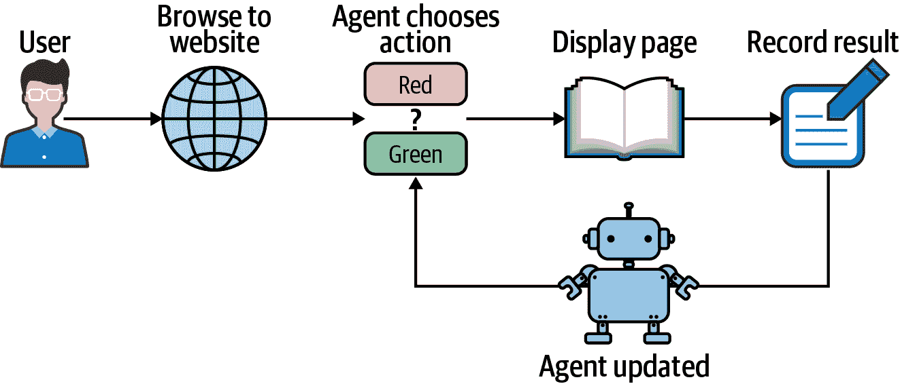

图 2-2 对比了超参数 `ϵ` 的三个不同值，我将其传入算法 2-1。每次模拟运行 `250` 步，这意味着算法有 `250` 次机会学习潜在的按钮颜色偏好（即模拟客户偏好红色按钮）并获取最大价值。每条线代表在 `1,000` 次重复实验中，智能体向访客展示最优按钮的时间百分比的平均值，以减少随机采样带来的噪声。

观察实验开始阶段，你可以看到每次运行都需要一些时间来学习最优按钮。这种学习速率取决于以下因素。当 `ϵ` 很高时，智能体大部分时间选择随机动作，从而有许多机会偶然发现最佳动作。当 `ϵ` 很低时，智能体探索的机会较少，你将不得不等待很长时间。换句话说，`ϵ` 影响学习速度。

观察实验结束阶段，不同的 `ϵ` 值会影响最终的最优奖励百分比。我之所以说“最终”，是因为每条曲线都是渐近的，意味着趋向于某个最终值。想象一下，你是一个 `ϵ` 为 `1` 的算法。这意味着你总是选择随机动作（展示随机按钮）。这意味着你能获得的最大奖励是 `50%`。如果你开始降低 `ϵ`，那么你就有部分时间能选择最优动作。最优动作的渐近值是 `1/n + (1-ϵ)/n = (2-ϵ)/n`，其中 `n` 是动作的数量。当 `ϵ = 1` 时，智能体总是选择随机动作，结果最优动作比例为 `0.5`。当 `ϵ = 0.1` 时，结果最优动作比例为 `0.95`。`ϵ` 影响算法选择最优动作的最终比率。

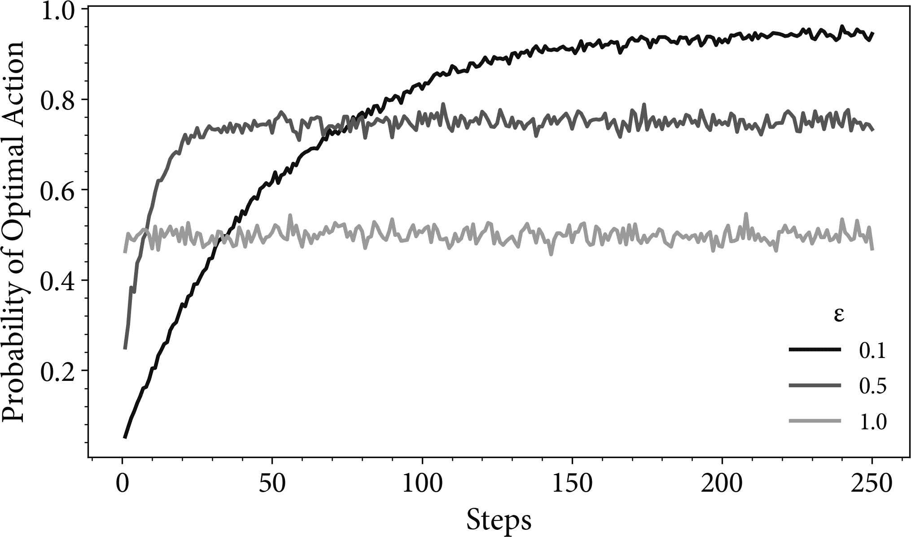

## 改进 `ϵ`-贪婪算法

所有算法从根本上都受限于它们探索的有效性和利用的速度。最好的算法能同时兼顾两者，但如何定义探索策略在很大程度上取决于具体问题。例如，迷宫问题和最优医疗排程问题需要不同的探索策略。

上一节展示了超参数 `ϵ` 控制着这种权衡。如果太高，智能体会做过多的搜索，导致选择糟糕的动作。如果太低，智能体搜索太少，需要很长时间才能找到新的最优动作。

### 提示

我想在这里提供一些关于其他简单探索方法的直观理解。更多细节请参阅“延伸阅读”中的文献。

模拟实验也影响着这一讨论。如果两个动作的奖励差异很小，智能体就需要对这两个结果进行大量采样。根据大数定律，随着观测次数增加，智能体对奖励的置信界会变小。

通常根据当前奖励分布的估计来选择动作会更好。换句话说，智能体不返回单个动作，而是返回每个动作的概率，这些概率由各状态的期望奖励加权。这被称为 `softmax` 函数。这提供了一个由当前奖励估计定义的自然探索函数。

如果最终目标是获取尽可能多的奖励，那么继续探索就没有意义了。你可以移除 `ϵ`-贪婪动作。但更常见的做法是随时间推移降低 `ϵ` 的值。这称为 `annealing`（退火/退火策略）。退火一词源自冶金学，意指缓慢加热和冷却金属，以增强强度并消除应力。

第三种流行的改进基于这样一个观点：随机探索没有意义，尤其是在简单的模拟中。智能体通过探索未见过的状态能学到更多。这些算法为采样不足的状态的每个动作添加一个 `bonus`（奖励加成），被称为 `upper-confidence-bound` (UCB) 方法（置信上界方法）。`UCB` 算法很有用，因为它们没有像 `ϵ` 这样的超参数（也没有 `ϵ` 衰减速率这样的退火参数）。

图 2-3 对比了这三种方法。我选择 `ϵ` 的值使其最终性能近似于其他方法。你可以看到，退火-softmax 和 `UCB` 策略比 `ϵ`-贪婪方法更快地学习到最优动作。`UCB` 还受益于无需调节参数。

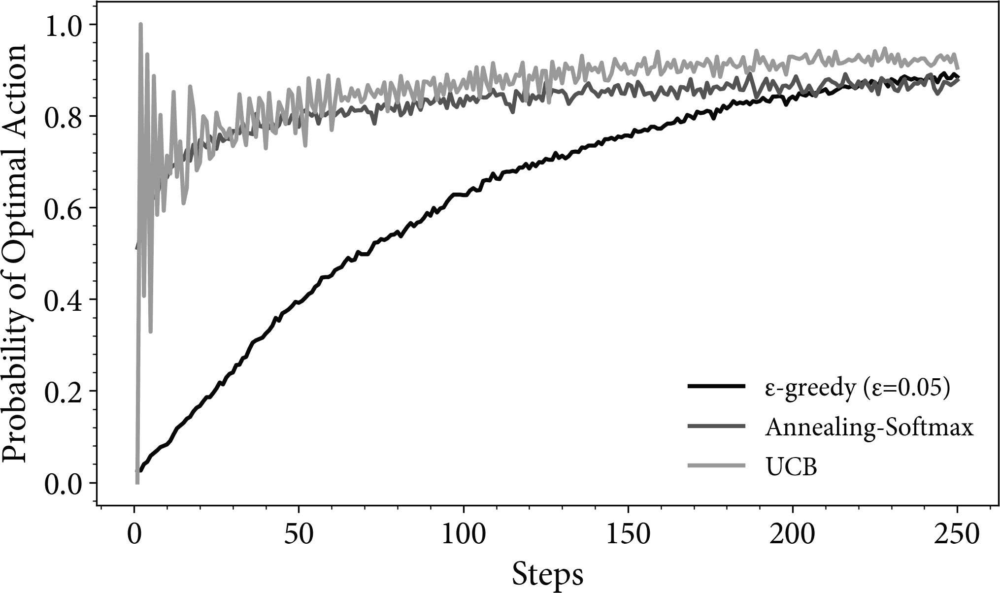

### 提示

提高算法学习速率是新强化学习算法的共同目标。

## 马尔可夫决策过程

马尔可夫决策过程（`MDP`）是对第 1 章中介绍的许多概念的数学形式化。`agent`（智能体）通过选择 `actions`（动作）来影响随机系统（`environment`，环境）的观测行为。目标是选择一组动作，使系统以最优方式运行，这由某个成功标准（`reward`，奖励）定义。

智能体永远无法完全了解环境。智能体接收一组有限的 `observations`（观测值），它们代表系统当前的 `state`（状态）。这两个词字面意思就是它们的含义。状态是环境在特定时刻所处的条件。观测是对该状态的遮挡视图。在许多环境中，状态可以被直接观测到。

数字智能体在离散时间点执行动作。这引出了时间 `step`（步）的概念。注意这并不妨碍使用连续动作，比如方向盘的角度。数字智能体的对立面是模拟智能体，类似于机械阻尼系统，理论上可行但我从未见过。也许是个有趣的业余项目？

因此，智能体和环境在一系列离散的时间步 `t` 中进行交互。在每个时间步，智能体接收状态的表示 `s`。基于环境的状态，智能体可以提出动作 `a`，并在一个时间步后接收代表奖励的值 `r` 和一组新的状态 `s'`。这里，`s` 上方的撇号用于表示 `next`（下一个）状态。你经常会看到带有 `t` 和 `t+1` 下标的符号，它们表示相同的含义。图 2-4 可视化了这些元素。


## 转移模型

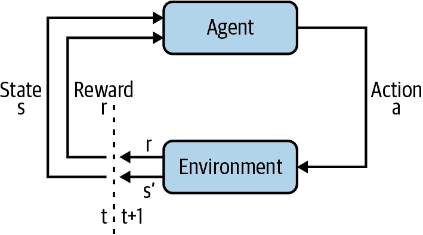

请记住，状态和奖励是随机变量，而非确定值，因为大多数环境是随机的。例如，你的智能体可能会选择在自动驾驶汽车中转动方向盘，但无法保证汽车真的会转向；它可能正处于冰面上。为了适应这种情况，引入了 `transition model`（转移模型）的概念。在某些书籍中，这也被称为 MDP 的 `dynamics`（动力学）。转移模型如公式 2-4 所示，是在给定先前状态和执行动作的情况下，到达新状态并获得奖励的概率。符号已简化以强调动作的因果效应。

### 公式 2-4. MDP 的转移模型

`p(s', r | s, a)`

公式 2-4 是 MDP 的关键。在马尔可夫决策过程中，转移模型描述了环境的动力学。下一个状态和奖励仅取决于先前的状态和动作。MDP 与传统马尔可夫链（也称为 `Markov process` 马尔可夫过程）的唯一区别在于增加了动作和奖励参数。动作是一种 `decision`（决策），这就是 MDP 中“D”的含义。

### 提示

我喜欢将 MDP 视为一个接口。它是智能体与环境之间的契约。智能体只能观察状态并建议一个动作。作为回报，环境会给你一个新状态和一个表示你表现如何的值。这听起来可能很受限，但它允许接口双方都有极大的灵活性。环境可以根据需要变得任意复杂。它可以是用户点击按钮的模拟、Atari 游戏，甚至是现实生活。智能体也可以根据需要变得任意复杂。它可以是决定显示绿色还是红色按钮、在游戏中向左还是向右移动，或者搬到乡下是否是个好主意。

我用撇号表示时间向前迈进一步。但该时间不必是固定间隔。它仅用于使动作区分开来。换句话说，每当你感到需要做决策时，那就是你迈步的时候。将动作视为航向修正，将时间视为时间戳的记录。

## 库存控制

用强化学习术语定义问题是数据科学背景人员常见的问题。在转向解决 MDP 的其他方法之前，在问题定义阶段积累更多经验是值得的。库存控制是一个很好的切入示例，因为它既实用又易于理解。该示例与定价、最优停止（出售资产）、维护等有直接类比关系。我从一个非常简单的示例开始，然后将其扩展为更复杂的版本。

想象你拥有一家小店。这家店非常小，你只有一种产品。每天顾客都会购买你的产品，所以你需要补货。如果缺货，你就无法销售产品赚钱；你不想缺货。你租用店铺，每平方米需要一定费用。你不想囤积数百万件商品，因为那需要更大的场所。我可以定义许多高层问题，比如场所的最佳大小，或最小化运费，但为简单起见，我将问题定义为决定最佳补货时机。

设 `s` 表示某天的库存数量。这是环境的状态。为尽可能保持简单，我假设有三种可能状态：无库存、一件库存、两件库存，`S ≐ {0,1,2}`（此处花体字母表示集合）。

给定当前状态，智能体可以执行一个动作。保持简单，假设智能体可以采取两种动作之一。要么 `restock`（补货），订购 1 件新产品，要么什么都不做：`A ≐ {restock, none}`。如果当前状态为 1 且智能体执行动作，下一个状态将变为 2。还假设当你处于满容量时无法订购任何库存。

公式 2-4 中缺失的下一项是转移概率。智能体从一个状态转移到另一个状态的概率是多少？既然你在模拟环境，你必须选择这些概率，但它们也可能来自你对店铺的观察。假设一天内发生单笔销售的概率 `p(sale)` 为 0.7。未来你可以预测售出的商品数量。但目前我再次使用伯努利分布。这意味着在每个状态下，有 70% 的概率发生销售，30% 的概率无销售。

### 注意

这是一个纯假设的例子。当然，现实中补货需要时间。简化是工程中必不可少的部分，尤其是在开发早期阶段。一旦你有了可工作的原型，就可以着手去除其中一些简化。

你需要的最后一项是奖励 `r`。你的店需要赚钱，所以每次卖出产品你都可以给自己奖励。但只有当产品当时有库存，或者你刚好及时补货时，销售才可能发生。这意味着奖励取决于当前状态和是否发生销售；无销售意味着无奖励。你可以在公式 2-5 中看到该定义的数学形式。

### 公式 2-5. 库存控制奖励定义

$$
r \doteq \begin{cases} 
1 & \text{if } s > 0 \text{ and a sale} \\
1 & \text{if } a = \text{restock} \text{ and a sale} \\
0 & \text{otherwise}
\end{cases}
$$

### 转移表

下一个任务是定义系统中所有可能的状态转移，你可以用三种不同的方式来做。第一种方式是将所有可能的组合呈现为表格，称为 `transition table`（转移表），如表 2-1 所示。

**表 2-1. MDP 转移表**

| s | a | s' | p(s'|s,a) | r |
|---|---|---|---|---|
| 0 | none | 0 | 1 - p(sale) | 0 |
| 0 | none | 0 | p(sale) | 0 |
| 0 | restock | 1 | 1 - p(sale) | 0 |
| 0 | restock | 0 | p(sale) | 1 |
| 1 | none | 1 | 1 - p(sale) | 0 |
| 1 | none | 0 | p(sale) | 1 |
| 1 | restock | 2 | 1 - p(sale) | 0 |
| 1 | restock | 1 | p(sale) | 1 |
| 2 | none | 2 | 1 - p(sale) | 0 |
| 2 | none | 1 | p(sale) | 1 |
| 2 | restock | 2 | p(sale) | 1 |

在表 2-1 中，每一行对应当前状态 `s`、动作 `a`、下一状态 `s'` 以及给定先前状态和动作下转移到该状态的概率 `p(s'|s,a)` 的每一种可能组合；进行该转移的奖励在最后一列 `r` 中。你可以使用此表来追踪智能体的 `trajectory`（轨迹）。

### 注意

状态 2（两件商品）只有三种可能的转移，因为我省略了最终补货且无销售的情况。我在说当库存已满时补货是不可能的。

### 转移图

表示该信息的另一种方式是通过有向图，称为 `transition graph`（转移图），如图 2-5 所示。

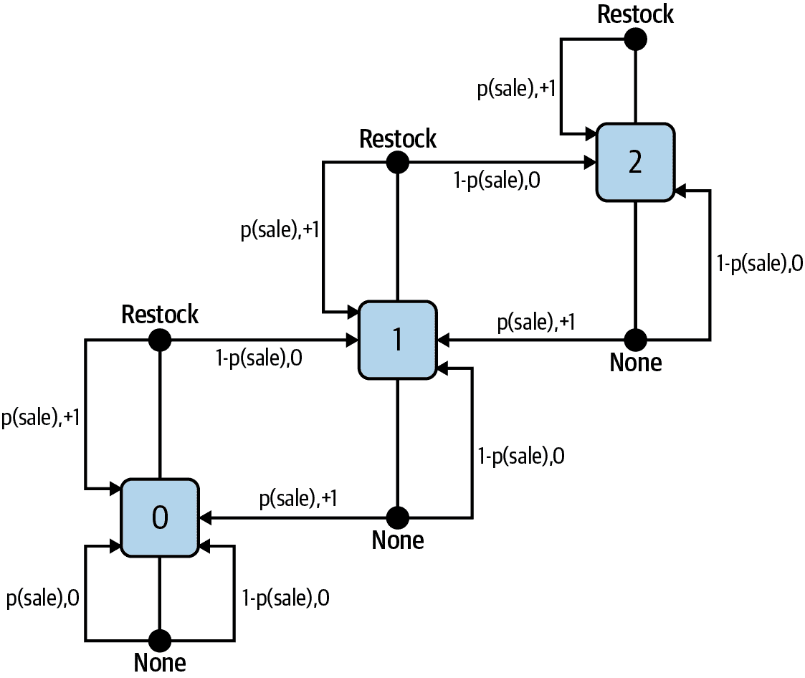

该图有两种类型的节点（称为顶点）：一种代表状态，用圆圈表示，圆圈内标注状态名称；另一种代表动作，用实心圆表示。它们通过链接（称为边）连接，边上标注了采取动作后沿该链接的概率（转移概率）以及沿该链接获得的奖励。

### 转移矩阵


表示转移概率的最后一种方法是为每个动作使用一个矩阵，称为 `transition matrix`。你可以像在 表 2-1 中那样构建矩阵。

$$
\begin{aligned}
{p\left( {s^{'},a = \text{none}} \right)} & {= \begin{bmatrix} 1 & 0 & 0 \\ {p\left( \text{sale} \right)} & {1 - p\left( \text{sale} \right)} & 0 \\ 0 & {p\left( \text{sale} \right)} & {1 - p\left( \text{sale} \right)} \\ \end{bmatrix}} \\
{p\left( {s^{'},a = \text{restock}} \right)} & {= \begin{bmatrix} {p\left( \text{sale} \right)} & {1 - p\left( \text{sale} \right)} & 0 \\ 0 & {p\left( \text{sale} \right)} & {1 - p\left( \text{sale} \right)} \\ 0 & 0 & 1 \\ \end{bmatrix}}
\end{aligned}
$$

每个单元格表示从当前状态（行中的 0、1 或 2）转移到新状态（列中的 0、1 或 2）的概率。请注意，每一行的总和必须为 1。例如，如果智能体选择不补货，动作 `a = none`，则使用上方的转移矩阵。如果商店有一件库存，即状态为 1（第二行），你可以看到有 `p(sale)` 的概率转移到状态 0（即售出了该商品），以及 `1 - p(sale)` 的概率在无销售后保持在同一状态。另请注意，你还需要一个单独的函数或矩阵来表示获得的奖励。

> **提示**
>
> 我更喜欢转移图，因为它允许你用手指追踪智能体采取的轨迹。但你只能将图可视化到少量的状态和动作。计算能力是限制转移矩阵的唯一因素，但肉眼难以解读它。

## 库存控制仿真

前几节介绍了构建仿真（环境）所需的所有要素。但智能体呢？你何时应该补货？

你已经设定了一个约束：如果库存已满则不能补货。这是一条硬性规则。但除此之外，最佳行动是什么？如果你纯粹从代表目标的奖励来看，只有销售才有正奖励。关键在于，下单没有负奖励。换句话说，根据奖励矩阵，持有库存不花费任何成本，订购新库存也是免费的。鉴于这种奖励结构，最佳策略是尽可能多地持续下单。

尽管在这种情况下策略显而易见，但你应该始终检验你的想法——这是科学方法。将你的理论与其他基线进行比较总是个好主意。

图 2-6 比较了三种不同的补货策略，即 `policies`。策略告诉智能体采取哪些行动，通常最好的策略能最大化总奖励。这些策略分别是：尽可能持续补货、仅当库存降至零时补货、或随机补货。线条代表每种策略的累积奖励。图例括号中显示了销售完成的比例。

在这种情况下，随机补货显然不是个好主意，因为经常出现顾客想买却无货的情况。这是因为销售概率（0.7）大于补货概率（0.5）。持续补货策略因在每个时间步都重新订购而跟上了需求。因此库存水平（状态）在 2 和 1 之间波动。零库存时重新订购的策略在 0–1 级别波动，因为它只有在降至零时才补货。实际上这两者在性能上没有差异，但请注意，你可能会认为持续购买策略是浪费的，因为你使用了超出所需的空间；或者认为它是安全的，以防出现抢购潮。这取决于你的高层视角和目标。

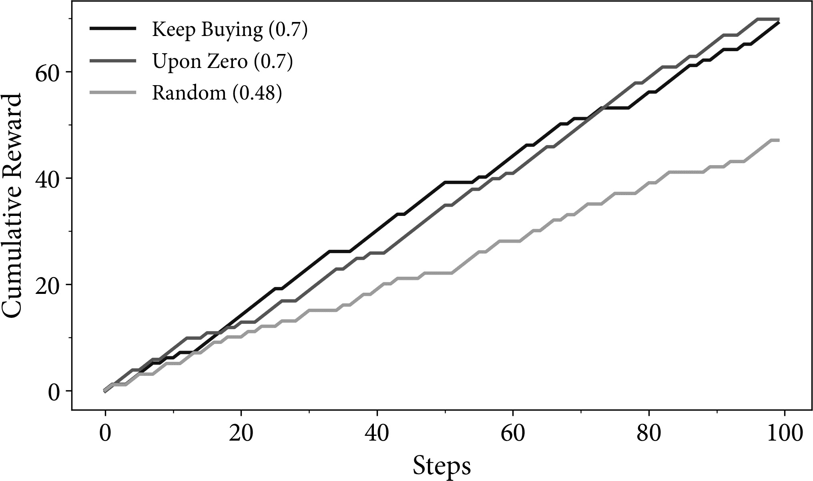

> **提示**
>
> 这是一个有趣的例子，说明完全相同的数据对不同人可能意味着不同的事情。你的老板可能讨厌浪费，也可能喜欢缓冲。两种立场都没错。

你刚刚推导出了你的第一组策略。我还没讨论如何学习最优策略——那将贯穿本书其余部分。但这是一个重要的结论：最优策略取决于 MDP 的所有组成部分。

改变环境以包含更多库存，或允许人们一次购买多件商品，都会影响最佳补货策略。通过引入订购惩罚（例如送货费）来改变奖励函数，也会改变最佳策略。在这些情况下，最好等到库存为零时再订购 2 单位的产品。奖励函数定义了你想解决什么问题，而不是如何解决它。

标准 MDP 要求状态完全可观。如果智能体无法观察到系统的真实状态，它如何选择最优动作？存在一种 MDP 模型的扩展，称为部分可观 MDP（POMDP）。在这里，你可以在观测值和实际状态之间引入额外的映射。换句话说，智能体需要学习如何将动作映射到观测值，而观测值又映射到它无法观察的状态，这是一种双重映射。正如你所想象的，这很难求解，因为未知数更多。在许多应用中，工程师通过将前几个时间步的更多信息输入当前时间步，将系统“欺骗”回标准 MDP。过去的知识可以帮助智能体弄清动作如何在更长时期内改变了感知状态。

我还想强调，重要的是对状态的观测，而不是环境本身。智能体不关心 MDP 接口背后发生了什么。只要不改变接口，你可以随意修改仿真。在库存示例中，如果你改变了顾客的购买行为，那只会影响最优策略，而不会改变智能体`how`学习。

阅读本书其余部分时请牢记这些要点。

## 策略与价值函数

策略类似于战略。例如，你无法完全确定对方足球队会做什么（对方的活动是随机的），但你可以大致预测他们的行动并指示你的队员做出相应反应。策略是从状态到潜在动作的映射。如何精确地进行这种映射，是大量强化学习算法的主要区别。但你最初为什么要建立映射？以及如何评估不同的策略？

## 折扣奖励

在许多问题中，包括库存和网站按钮示例，每一步的奖励都很容易推理。在每个时间步，智能体可能获得奖励，也可能不获得。经过多个步骤（如库存示例），智能体可能获得多个奖励。总体而言，挑战在于最大化你期望获得的总奖励。

`回报`，`G`，是从当前步骤到最后一个时间步（或无穷大）的总奖励。第一个点等号可以读作“我定义 G 为”。注意，智能体在转移到下一步后接收奖励。大多数实际实现同时返回状态和奖励，因此它们将初始奖励设为零。


## 使用状态价值函数预测奖励

公式 2-6 将所有未来奖励求和，直到最后一个时间步 `T`。这个最终状态被称为*终止状态*，仅出现在*情节式*任务中。一个情节代表从开始到自然终止点的一次完整运行过程。这可能是你的机器人掉下悬崖，或者游戏中的角色死亡。但当然，也可能存在永远持续下去的任务，比如库存示例——如果你允许我对零售市场的状态持乐观态度的话。在这种情况下，终止状态为 `T = ∞`，预期回报也可能是无限的。

### 公式 2-6. 回报

```
G ≐ r + r' + ⋯ + r[T]
```

为了缓解无限大的爆炸性威力，公式 2-7 引入了一个折扣因子，使未来奖励呈指数级衰减。

### 公式 2-7. 折扣回报

```
G ≐ r + γ r' + γ² r'' + ⋯ = ∑_{k=0}^{T} γ^k r_k
```

在公式 2-7 中，`T` 代表终止状态，可以是无穷大。`γ` 称为*折扣率*或*因子*。它控制未来奖励被忽略的速度，取值应在 0 到 1 之间（含边界）。换句话说，如果 `γ = 0`，则仅考虑当前奖励。如果 `γ = 1`，则这与公式 2-6 相同。通常你希望考虑未来奖励，以便解决奖励远在未来的问题。但具体数值取决于手头的问题。在大多数非平凡示例中，折扣率设置在 0.9 到 0.99 之间。

因此，你想构建一个能够产生最大*预期回报*的智能体。你可能会问，既然预期回报取决于未来奖励，该如何计算它？答案是通过迭代和学习，找出哪些状态和动作映射到最佳奖励。换句话说，你应该通过迭代来寻找最佳策略。

在“库存控制模拟”的库存示例中，我任意选择了三种补货策略。但我想自动优化动作选择以最大化预期回报。这就是*策略*的目的；它将状态映射到动作。形式上，它是在给定状态下选择某个动作的概率 `p(a|s)`，用 `π` 表示。

#### 提示

可以通过根据预期回报调整策略的梯度来改进策略。我将在第 5 章中回到这个话题。

你可以根据当前策略 `π` 从当前状态 `s` 开始获得的回报 `G` 来计算预期回报。这被称为策略的*状态价值函数*，如公式 2-8 所示。

### 公式 2-8. 状态价值函数

```
V_π(s) ≐ 𝔼_π[G | s] = 𝔼_π[∑_{k=0}^{T} γ^k r_k | s]
```

乍一看，我理解这个公式显得很复杂，所以让我带你逐步拆解。等式由等号分隔为三个部分。左边的 `V` 是表示价值函数的符号。

#### 提示

对于那些非数学专业出身的人，我发现将数学函数想象成软件中的函数会有所帮助。

第二部分，即函数的定义，是说价值函数是在遵循策略 `π` 的情况下，给定当前状态时回报的期望值。符号 `𝔼` 是期望算子（稍后详述）。它指示你计算括号内项的期望值。而下标 `π` 告诉你智能体应遵循该策略来计算该期望。

等式右边的第三部分是括号内项的展开。你已从公式 2-7 了解 `G` 的定义。并且你知道需要从当前状态开始。此时括号内的数学含义基本上是在说“从这一点向前求和所有奖励”。

公式 2-8 有两个重要点。第一是期望算子。大多数 RL 算法假设奖励服从正态分布，期望可以按样本均值计算。换句话说，期望算子的结果是从该给定状态获得的平均折扣奖励。某些应用中的奖励可能不服从正态分布。例如，你会选择：一个巨大的单次奖励，还是许多小奖励？在这两种情况下均值相同，但奖励的分布不同。奖励的细微差别可能被期望算子掩盖。事实上，最近许多研究都集中在尝试评估和使用奖励的分布（参见“分布式 RL”）。

第二个重要部分是策略。只有当你已有一个策略时，才能计算预期回报。但这个公式旨在帮助你量化策略的表现。这是一个经典的“鸡生蛋，蛋生鸡”问题，RL 通过从随机开始并迭代寻找改进来解决它。

### 使用状态价值函数进行模拟

我发现通过简单的模拟能增强我对公式的直觉。我开发了一个程序，模拟五个方格上的位置（即状态）。智能体从最左侧开始。在每个时间步，智能体可以向左或向右移动。如果智能体到达最右侧的方格 5（目标状态），或者智能体在方格 0 向左移动（掉下假想的悬崖），模拟结束。为了尽可能保持简单，策略是随机的，即在每个时间步随机选择向左或向右。

#### 提示

你应该持续考虑不同的环境。*过拟合*是指意外构建出仅适用于非常特定数据或情境的模型或算法的过程。例如，很容易将算法改进到过拟合你的模拟，却发现它在现实生活中行不通。工业级 RL 算法应当健壮，考虑不同环境是帮助算法*泛化*的一种方式。此外，使用不同环境是积累经验的重要途径。因此，我特意在整个示例中不断切换环境。

公式 2-8 的目标是计算每个状态的预期奖励。你可以通过记录智能体在每个*纪元*中的位置来做到这一点，纪元是指环境持续循环直到智能体到达终止状态。最终，你将获得一个奖励，然后你可以回溯查看沿途访问的所有状态。接着将奖励加到累积和中，并保持一个计数器，以计算访问所有那些状态后观察到的平均回报。

#### 提示

每当你进行实验时，设想一些理论期望或先验是明智的——定义假设是科学方法的核心。


想象你位于左侧的 1 号格子上。想象如何到达每个终止状态。你可以向左移动一格掉下悬崖，或者向右移动四格到达终点。你的第一个策略是随机策略；它以均匀概率随机选择一个新方向。它随机选择向左移动一格的频率高于向右移动四格。平均而言，只有 1/5 的尝试能到达右侧；其余都会掉下悬崖。如果你将奖励设为 5（以匹配格子数量），且不因掉出棋盘而施加惩罚，那么每个状态的期望奖励应该等于该格子的位置编号。

在本例中，从 1 号格子出发的期望回报应为 1。终止状态的期望奖励应为 5，因为无需再移动。在中间状态，由于智能体随机移动，它仍有可能随机移回悬崖方向。因此，即使位于距离奖励仅一步之遥的第 4 个格子，随机智能体平均每 5 次中也会有 1 次跌回悬崖。

如果这讲不通，可以想象只有两个格子，向右移动一步即可到达目标状态。然后增加格子数量。

请注意，在本例中你将折扣因子设为了 1。在更复杂的环境中，你应将其设为小于 1，因为回合早期的移动通常不如接近终止状态时的移动重要。但具体数值取决于奖励设置以及问题是否为连续的。

当我运行此模拟时，需要大量迭代才能稳定。第一次迭代后，智能体立即向左跳并“死亡”。因此第 0 次迭代的期望回报为 `[0.00, NaN, NaN, NaN]`，该数组中的位置代表 1 到 4 号格子。5 号格子未记录，因为在终止状态无动作可执行。十次迭代后，智能体已几次到达目标状态：`[0.77, 3.00, 5.00, 5.00]`。一千次迭代后，期望回报开始接近之前的估计值：`[1.04, 2.09, 2.93, 3.83]`。一万次随机实验后，结果非常接近：`[1.00, 1.97, 2.92, 3.92]`。运行的迭代次数越多，越会接近真实的期望值。该模拟结果可见于 图 2-7。

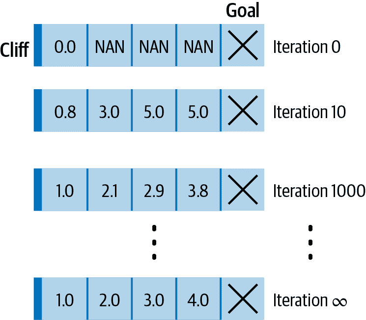

另一个有趣的实验是改变起始位置。一万次迭代后，结果相同（在随机波动范围内）。你可以尝试添加折扣或对掉下悬崖施加惩罚，看看会发生什么。我鼓励你编写自己的代码以获得直观理解，当然你也可以参考配套网站上的实战示例（参见 “补充材料”）。

#### 使用动作价值函数预测奖励

前面的示例展示了如何从给定状态预测期望回报，即之前访问该状态后观察到的平均奖励。但并非所有动作都是平等的。如果采取某个动作能让你更接近有奖励的状态，会怎样？许多算法利用此信息来帮助决定选择哪个最佳动作。这需要任意状态下任意动作的期望回报，如 公式 2-9 所示。

### 公式 2-9. 动作价值函数

$$Q\_{\pi}\left( s,a \right) \doteq {\mathbb{E}}_{\pi}\left\lbrack G \middle| s,a \right\rbrack = {\mathbb{E}}_{\pi}\left\lbrack {\sum\limits_{k = 0}^{T}\gamma^{k}r_{k}\left| s,a \right.} \right\rbrack$$

公式 2-9 是策略 `π` 的*动作价值函数*。你可以看到，它与 公式 2-8 几乎相同，区别在于该函数有两个参数：状态和动作。你可以想象这被实现为一个二维查找表，用于存储状态及其动作的奖励。为简洁起见，该函数常被称为 Q 函数。

图 2-8 展示了 “使用状态价值函数的模拟” 中相同模拟的结果，但使用的是动作价值函数。公式 2-9 增加了同时存储状态和动作期望回报的功能。一个结果是：从 0 号格子向左移动将始终获得 0 奖励；从 4 号格子向右移动将始终获得 5.0 奖励。

另一个有趣的结果是：所有向右动作的期望值均高于对应的向左动作。这是因为智能体向右移动得越远，实际到达目标状态的机会就越大。最后，让我提个问题。给定这些状态、动作和期望回报，你能想出一个对此环境而言最优的策略吗？你能想象自己作为智能体，在每个格子上做决策吗？你如何选择移动方向？

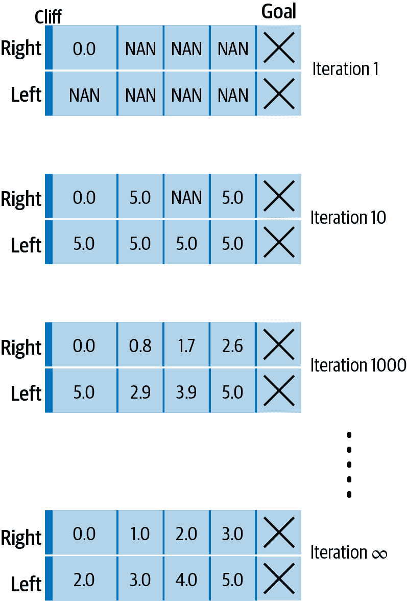

#### 最优策略

最优策略是指遵循该策略能产生最高可能的期望回报。这意味着至少存在一个策略提供最大回报，我将其记为 `π[*]`. 相应的最优状态价值函数和动作价值函数分别记为 `V*` 和 `Q*`。

状态价值函数和动作价值函数是相关的。它们都表示相同的信息，但粒度不同。状态价值函数是所有动作期望奖励的平均值，提供了哪些状态价值高的低分辨率视图。动作价值函数则提供了哪些动作和状态最好的高分辨率图景。

想象你已获得良好的期望值估计，例如因为你在环境中随机移动了很长时间。那么最优策略会建议让智能体朝向期望回报更高的动作移动。换句话说，最优策略就是选择具有最大回报动作的策略。

### 提示

大多数强化学习问题都以最大化回报为目标，但这并非严格必须。我建议坚持最大化目标，以避免混淆。

既然你有了最优策略，想象再次计算遵循该策略时的状态价值函数和动作价值函数。两者的值将完全相同。状态价值函数等于在动作价值函数中选择最佳动作。公式 2-10 以数学形式表达了这一思想，称为*贝尔曼最优方程*。

### 注意

官方的贝尔曼最优方程更为正式，它聚合了转移概率和策略选择动作的概率。更多信息请参见 “延伸阅读”。

### 公式 2-10. 最优价值函数

$$\begin{array}{cl} {V\_{\*}\left( s \right)} & {\doteq \operatorname{argmax}\limits_{a\_{s} \in \mathcal{A}{(s)}}Q\_{\pi\_{\*}}\left( s,a\_{s} \right)} \\ & {= \operatorname{argmax}\limits_{a\_{s} \in \mathcal{A}{(s)}}{\mathbb{E}}\_{\pi\_{\*}}\left\lbrack {\left. G \middle| s, \right.a\_{s}} \right\rbrack} \\ \end{array}$$


公式 2-10 复用了公式 2-9 中动作价值函数 `Q` 的定义，使用回报 `G`。它指出：在每一步选择使动作价值函数最大化的动作，等同于最优价值函数。让我重述一遍，因为这很重要。如果你反复选择具有最高预期回报的动作，就能获得最高的总奖励。

乍一看这可能讲不通，因为你可以想象在别处可能有更大的奖励。但请记住，方程拥有关于所有未来奖励的完整知识（看方程中的回报 `G`）。因此，动作价值函数（或状态价值函数）在其估计中已经考虑到了智能体将要访问那个有奖励状态的事实。

因此，为了回答 “用动作价值函数预测奖励” 末尾的问题，最优策略是反复选择奖励最高的动作。在那个例子中，奖励最高的动作总是在右侧，所以最优策略是每次都选择“右”。

## 蒙特卡洛策略生成

“使用状态价值函数进行模拟” 中的示例随机选择动作并记录奖励，但你不必这样做。相反，你可以穷举搜索每一种可能的移动排列并存储轨迹。然后，获得最高奖励的轨迹就是最优策略。

但在大多数情况下，这种策略不切实际。即使对于 图 2-7 中的简单示例，你也可以想象一种反复选择右然后左且永不终止的策略。你可以通过约束穷举搜索来帮助智能体，但总的来说，你需要使用其他方法。

正式来说，问题在于问题的高维性。能够愉快地处理高维采样问题的首选算法是*蒙特卡洛*（MC）。想象一个如 图 2-9 所示的黑盒环境，你在其中没有可见性。你控制呈现给环境的动作，因此你知道输入的分布。但你不知道输出的分布，因为环境不受你控制。刻画输出分布有助于你选择能带来最高回报（平均而言）的动作。

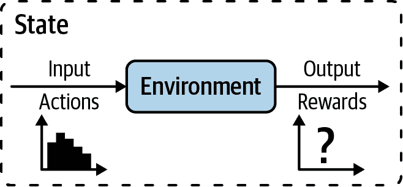

MC 技术随机采样输入以观察输出发生什么。在充分采样动作后，你可以刻画输出，从而确定奖励。该术语广泛用于包含任何包含显著随机成分的估计方法。但在强化学习中，它表示那些对整个轨迹返回的奖励进行平均的技术。你可以在 “延伸阅读” 中了解更多关于 MC 技术的信息。

现在我可以将这个想法转化为一个算法，该算法首先生成完整的轨迹，然后根据观察到的奖励更新动作价值函数。给定足够时间，策略将趋向于最优策略。算法 2-3 被称为 on-policy MC 算法，因为它 (a) 对完整轨迹进行采样，并且 (b) 同时估计策略的价值并用它来选择动作。

## 算法 2-3. On-policy MC 算法

```latex
\begin{array}{cl}
\text{1:} & \text{input: a policy function, } \pi(a|s, Q_\pi(s,a)) \\
\text{2:} & \text{Initialize } Q(s,a) \leftarrow 0, \text{ for all } s \in \mathcal{S}, a \in \mathcal{A}(s), \\
& \text{Returns}(s,a) \leftarrow [], \text{ for all } s \in \mathcal{S}, a \in \mathcal{A}(s) \\
\text{3:} & \text{loop:} \\
\text{4:} & \text{Generate full episode trajectory following } \pi \\
\text{5:} & \text{Initialize } G \leftarrow 0 \\
\text{6:} & \text{loop for each step of episode, } t \doteq T-1, T-2, \cdots, t_0: \\
\text{7:} & G \leftarrow \gamma G + r \\
\text{8:} & \text{if } (s,a) \text{ not in } (s_0,a_0), (s_1,a_1), \cdots, (s_{t-1},a_{t-1}): \\
\text{9:} & \text{Append } G \text{ to } \text{Returns}(s,a) \\
\text{10:} & Q(s,a) \leftarrow \text{average}(\text{Returns}(s,a)) \\
\end{array}
```

算法 2-3 在步骤 (1) 开始，通过传入一个策略的实现。该算法通常内置策略呈现，但我发现忽略策略的细节并将其作为依赖注入更简单。策略 `π(a|s,Q_π(s,a))` 使用本算法中填充的动作价值函数，为给定状态返回一个动作。步骤 (2) 初始化动作价值函数，并为与环境的所有交互创建一个缓冲区。

步骤 (4) 使用当前策略生成一个完整回合的轨迹。在我的代码中，我创建了一个选择具有最高预期回报动作的策略，就像在 公式 2-10 中一样，带有 `ϵ`-greedy 搜索。

步骤 (6) 逆序遍历回合中的每一步。这是一个重要的区别；智能体基于*未来*奖励选择动作。因此步骤 (6) 从末尾开始向后迭代，累加奖励。最终它会到达第一个状态，然后你就得到了从该状态开始的预期回报的一个预测。

步骤 (7) 将奖励折扣加到来自 公式 2-7 的预期回报中。如果当前状态-动作对在轨迹早期未被访问过 [步骤 (8)]，则步骤 (9) 将该对追加到缓冲区。这种*首次访问*实现将 `V_π(s)` 估计为从首次访问该状态开始的回报的平均值。*每次访问*实现将 `V_π(s)` 估计为从对某状态的每次访问获得的回报的平均值。两种实现得出相同的估计，但研究人员对首次访问算法研究得更深入，发现它的误差略小（每次访问的动作价值估计噪声更大——详见 “延伸阅读”）。

最后，在步骤 (10) 中，更新当前的动作价值预测。这为策略提供了任何状态-动作对的预期回报估计。该估计是所有轨迹观察到的平均折扣回报。使用平均值假设预期回报服从正态分布；这可能不成立，但在实践中效果很好。

如果你将 `ϵ`-greedy 参数设为仅探索，将折扣因子设为 1，算法 2-3 的结果将与 图 2-8 中的相同。

## 使用动态规划的价值迭代

在前几节中，我在回合结束时将奖励沿轨迹向后传播。但还有另一种方法。


想象一个向前扫描一步的算法。给定一个状态，智能体可以向前窥探一步以观察下一个预期回报。在终端状态提供奖励的环境中，如图 2-10 所示，在第 (1) 次迭代中，智能体将向前看一个状态并看到终端状态，因此它知道该采取哪个动作。在第 (2) 次迭代中，智能体看到终端状态之前的状态，并再次知道该采取哪个动作。这将持续直到策略稳定。

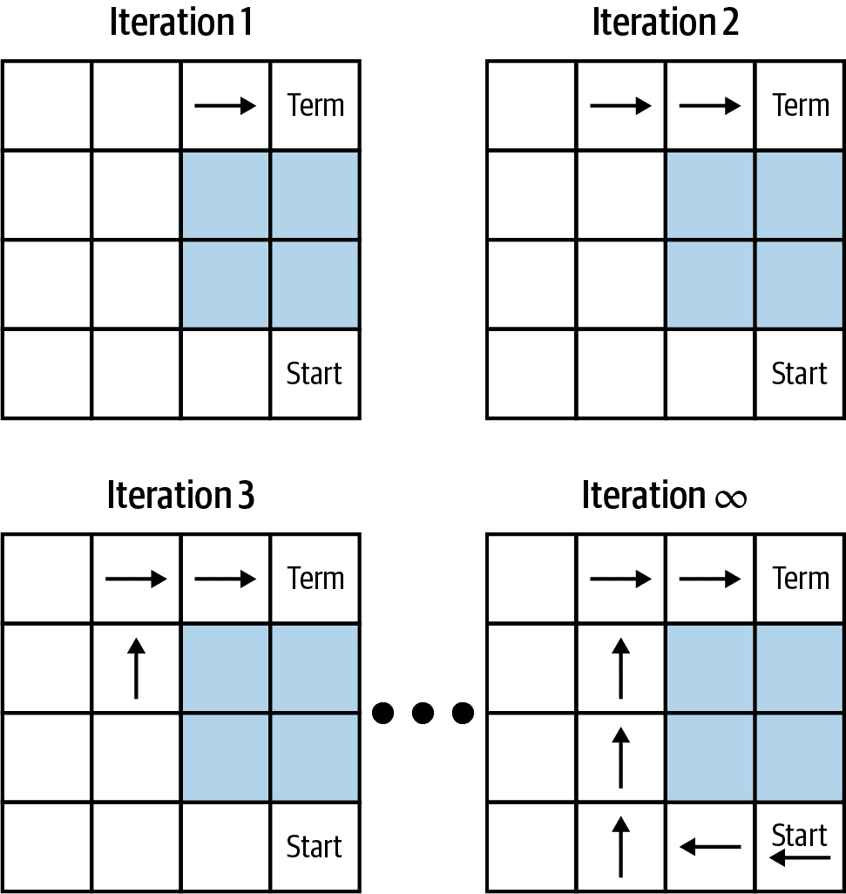

文献通常基于此过程创建两个抽象概念：**策略评估** 和 **策略改进**。*策略评估* 提供预期价值的估计。*策略改进* 更新策略以利用来自价值函数的新知识，例如一条新的有前景的探索路径。

当你将评估和改进结合起来时，这被称为 *广义策略迭代* (GPI)。实现方式因你在何种层面交织改进和评估而异。例如，你可以等到一个回合结束，再使用 MC 方法执行改进，如“蒙特卡洛策略生成”所示。

或者，你可以在每一步之后更新你的价值估计。*动态规划* 方法向前看一步并遍历所有动作。这与 MC 技术形成对比，后者选择单个动作，但必须模拟完整的回合。

图 2-11 通过所谓的 *备份图* 说明了状态价值函数的差异。空心圆代表状态，实心圆代表动作。在 DP 中，在给定状态下，它会搜索所有可能的动作。这使得在单步之后更新策略成为可能。MC 首先通过遵循策略生成完整的回合，然后更新策略。

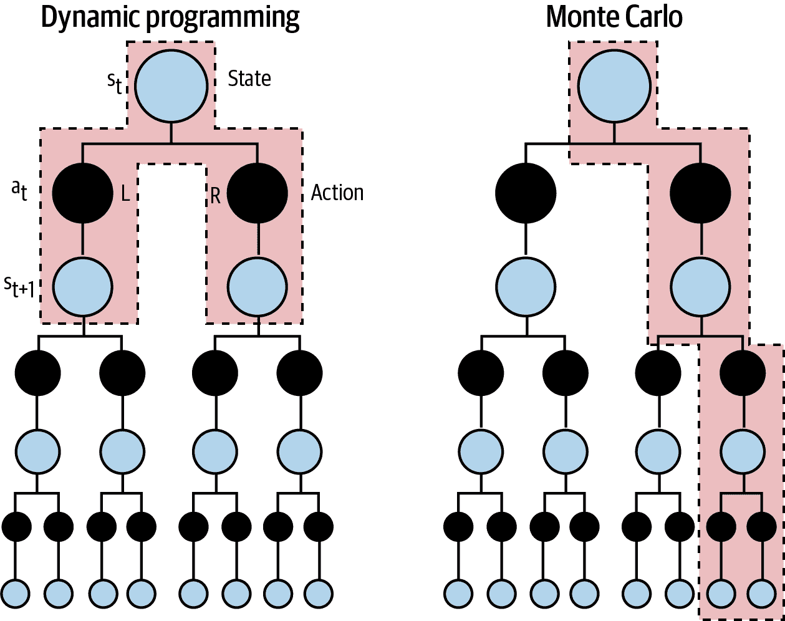

## 实现价值迭代

一种称为 *价值迭代* 的技术实现了 DP，但存在一个问题。价值迭代依赖于完全了解转移概率；你需要一个环境模型。这是因为智能体需要知道它被允许尝试哪些动作。例如，在二维网格中，你需要通过将这些概率设为零来告诉智能体它不能移出边界。

如果你控制环境的设计且问题足够简单，那么你可以预先指定转移概率，就像“库存控制”或“使用状态价值函数进行模拟”的示例那样。第 3 章 开发了当你没有完整环境模型时使用的通用算法。目前，假设你有模型并可以将其传递给算法 2-4。

### 算法 2-4. 用于生成最优策略的价值迭代

```latex
\begin{aligned} 
{\text{1:}} & {\mathbf{i}\mathbf{n}\mathbf{p}\mathbf{u}\mathbf{t}\text{:}\text{transition}\text{probabilities,} p\left( s^{'},r \mid s,a \right)\text{,}\text{stopping}\text{threshold,}\theta > 0} \\ 
{\text{2:}} & \left. \text{Initialize} V\left( s \right)\text{,}\text{for}\text{all} s \in \mathcal{S}\text{,}\nabla\leftarrow 0 \right. \\ 
{\text{3:}} & {\mathbf{d}\mathbf{o}:} \\ 
{\text{4:}} & {\mathbf{l}\mathbf{o}\mathbf{o}\mathbf{p}\text{for}\text{each} s \in \mathcal{S}\text{:}} \\ 
{\text{5:}} & \left. v\leftarrow V\left( s \right) \right. \\ 
{\text{6:}} & \left. V\left( s \right)\leftarrow\max\limits_{a}\sum\limits_{s^{'},r}p\left( s^{'},r \mid s,a \right)\left\lbrack {r + \gamma V\left( s^{'} \right)} \right\rbrack \right. \\ 
{\text{7:}} & \left. \nabla\leftarrow\max\left( {\nabla, \mid v - V\left( s \right) \mid} \right) \right. \\ 
{\text{8:}} & {\mathbf{w}\mathbf{h}\mathbf{i}\mathbf{l}\mathbf{e}\nabla > \theta} \\ 
{\text{9:}} & {\mathbf{o}\mathbf{u}\mathbf{t}\mathbf{p}\mathbf{u}\mathbf{t}\text{:}\text{an}\text{optimal}\text{policy,}\pi\left( s \right) \doteq \operatorname{argmax}\limits_{a_{s} \in \mathcal{A}{(s)}}\sum\limits_{s^{'},r}p\left( s^{'},r \mid s,a_{s} \right)\left\lbrack {r + \gamma V\left( s^{'} \right)} \right\rbrack} \\ 
\end{aligned}
```

在算法 2-4 的步骤 (1) 中，你需要指定转移概率和停止阈值。例如，在一个玩具网格环境中，除那些移出网格或被墙阻挡的动作（其转移概率为零）外，所有动作的转移概率相等。停止阈值控制价值估计细化的持续时间。

步骤 (2) 为所有状态初始化状态价值缓冲区，并初始化一个用于维护当前误差量的变量。步骤 (3) 进入一个 do-while 循环，步骤 (4) 遍历环境中的每个状态。步骤 (5) 存储当前状态价值估计的局部副本以供后续使用。

步骤 (6) 是核心所在。从左侧开始，它在尝试所有动作后找到最大的预期回报。求和项是对一个动作的所有潜在下一状态和奖励求和（因为即使你选择向左动作，最终可能还是会直行）。然后概率代表在给定当前状态和动作下，落入具有奖励的下一状态的几率。最后，这一系列事件的价值是动作的奖励加上下一状态的价值。

我建议你重读一遍该公式及其描述，因为步骤 (6) 在一行中压缩了大量信息。现在你已重读，让我给你一个我在图 2-12 中可视化的手工计算示例。

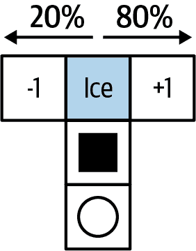

想象你站在一个网格中，由正方形表示，你只能向前或向后移动，且所有状态价值估计均为零。如果你向后退，移动是确定的，但你获得的奖励为 0。如果你向前迈进，你会在冰面上滑倒，有 20% 的几率向左跌落（价值为 -1），有 80% 的几率向右跌落（价值为 1）。

算法 2-4 的步骤 (6) 旨在找到任意动作的最高价值。该环境有两个动作：上和下。执行向下动作时转移到向下状态的概率为 1。奖励为 0，且由于所有价值估计均为零，向下动作的总和为 `1 × 0 = 0`。对于向上动作，两个结果有两个奖励。该和变为 `0.2 × -1 + 0.8 × 1 = 0.6`。因此，当前状态所有动作中的最大价值为 0.6。

前面的示例针对单个状态，但该计算依赖于其他状态。这就是为什么算法 2-4 需要遍历所有状态以填补空白。在第一遍遍历所有状态后，很可能需要再次更新它们，因为价值已经改变。步骤 (7) 记录最大误差，以便步骤 (8) 决定是否继续迭代。如果你感兴趣，可以在“延伸阅读”的参考文献中查找收敛证明。

最后，在步骤 (9) 中，算法输出一个确定性策略，选择具有最高预期回报的动作。

## 价值迭代的结果

算法 2-4 实现的结果如图 2-13 所示。使用了 0.9 的折扣因子来寻找之前遇到的简单悬崖问题的最优策略。

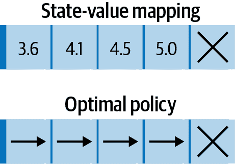


与 MC 版本一样，状态价值图很容易解释。智能体离目标越近，预期回报就越大。细微的差别在于，价值不取决于随机到达目标状态。如果你遵循一种策略，它就是奖励的折扣版本。然而，最终得到的策略是相同的。而且我也可以在 MC 算法中使用相同的策略评估技术。

如果我将 `Algorithm 2-4` (`ch02.html#alg_dp-policy`)（策略改进算法）插入智能体的交互循环（策略评估）中，那么你就可以在每个时间步改进策略。这与必须等到回合结束的 MC 技术形成对比。DP 改进策略的速度比 MC 快得多，这在处理长（或无限）回合的问题时非常重要。

但有四个注意事项阻止你在除最简单环境之外的所有环境中使用 DP。第一个要注意的事项是你必须使用折扣。如果不使用，所有状态的价值都将等于奖励。你必须使用折扣来引导智能体并抑制长轨迹。这是贯穿所有强化学习的一个共同主题：偏好较短的轨迹。

其次，`Algorithm 2-4` (`ch02.html#alg_dp-policy`) 在智能体更新完所有状态时结束。在迄今为止见到的玩具示例中这没问题，因为它们状态都很少。但一旦状态或动作的数量增加，使用 DP 就会变得计算上难以承受。

第三点，与前一点相关，是算法的*采样效率*。DP 需要访问所有状态和动作。这至少需要从环境中获取状态数乘以动作数那么多的样本。对于无法模拟的环境，这可能是个问题。其他基于模型的 RL 算法可能更高效，因为它们可以用更少的模拟来插值策略。MC 技术也更具采样效率，因为它们很可能不需要访问每一个状态就能找到产生最佳回报的状态区域。

最后，也是可能最大的问题，是你需要转移概率。你要么需要环境动力学的模型，要么可以通过采样方法学习一个模型。如果你多次执行一个动作，就可以估计落入任何状态的概率。你可以在下一章中期待这一点。

## 总结

本章首先演示了你以前可能用过的老虎机测试是一种 RL 形式。但它是有限的，因为大多数工业应用拥有更多的状态和延迟奖励。

马尔可夫决策过程（MDP）是构建所有问题的框架。你可以重新构建许多问题以适应 MDP 范式。MDP 的关键要素包括：一个暴露其状态观测的环境、一个表示成功或失败的奖励、以及改变环境内部状态的动作。

通过计算下一状态的期望价值，算法可以选择一个最大化总奖励的动作。你在库存控制模拟中看到了这一点。我对问题加以约束使其更简单，但你可以在文献中找到更复杂场景的示例。

最优策略是智能体可以遵循以获得高奖励的东西。寻找最优策略很困难，本书介绍的算法尝试用不同的方法来实现这一点。

最后，你发现了两种搜索环境状态以估计回报的方法：蒙特卡洛（MC）和动态规划（DP）。MC 方法适用于小状态空间且学习性能不重要的情况。但 DP 更高效，因为它可以立即学习前瞻性策略，而 MC 必须等到回合结束。

## 延伸阅读

*   **统计学：**
    *   Downey, Allen. 2014. *Think Stats: Exploratory Data Analysis*. O'Reilly Media.

*   **A/B 测试和老虎机算法：**
    *   White, John. 2012. *Bandit Algorithms for Website Optimization*. O'Reilly Media.
    *   `https://gitlab.com/winderresearch/rl/BanditsBook/`（我的老虎机模拟库的 Python 实现。）
    *   关于老虎机采样方法的详尽教程。^(`1`)

*   **MDP：**
    *   Puterman, Martin L. 2014. *Markov Decision Processes: Discrete Stochastic Dynamic Programming*. John Wiley & Sons.

*   **贝尔曼方程、DP 和 MC：**
    *   Sutton, Richard S., and Andrew G. Barto. 2018. *Reinforcement Learning: An Introduction*. MIT Press.

*   **其他领域的 MC 技术：**
    *   Hilpisch, Yves. 2018. *Python for Finance: Mastering Data-Driven Finance*. O'Reilly Media.

^(`1`) Russo, Daniel, Benjamin Van Roy, Abbas Kazerouni, Ian Osband, and Zheng Wen. 2020. [“Thompson 采样教程”](https://oreil.ly/N947v). `ArXiv:1707.02038`, July.
