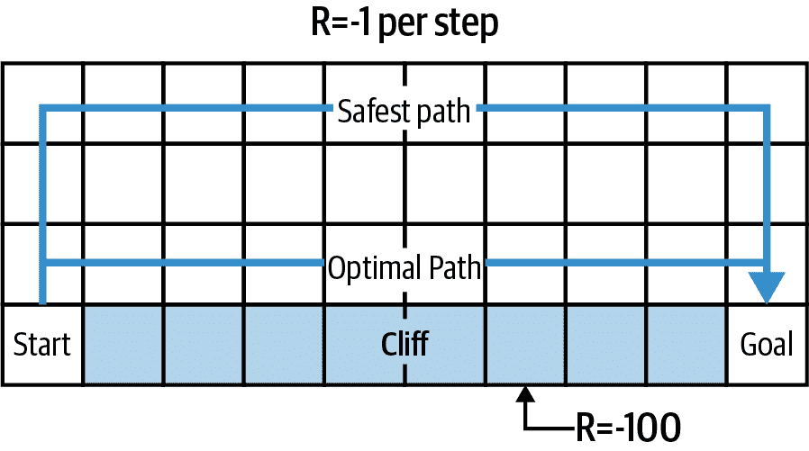
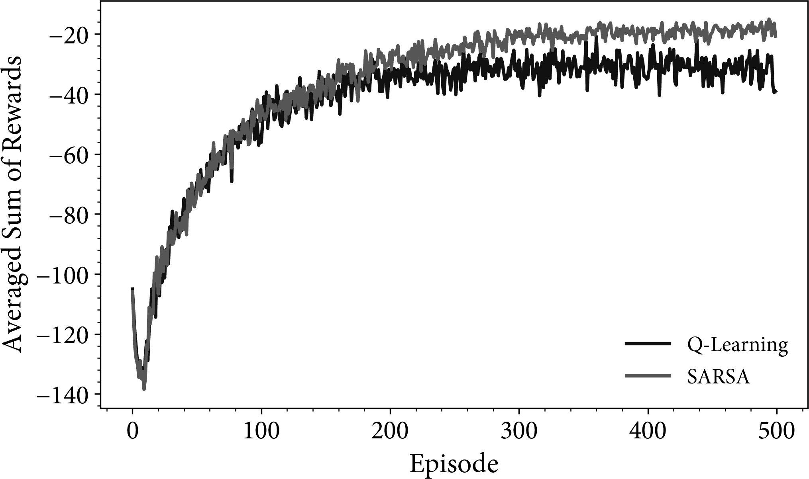
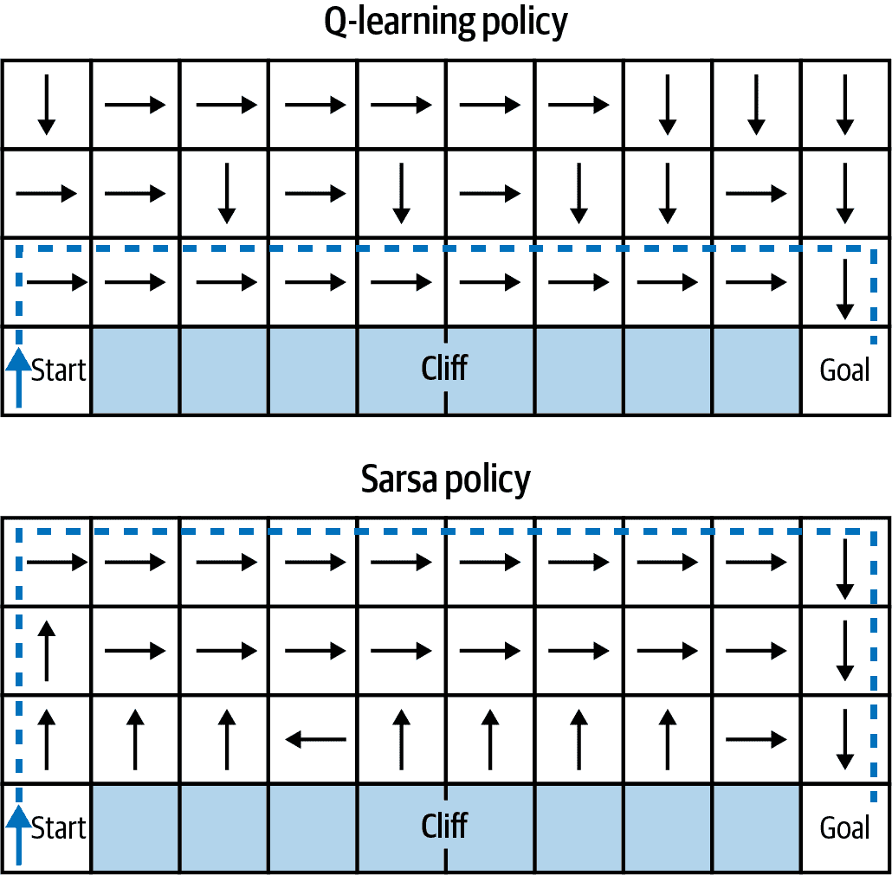
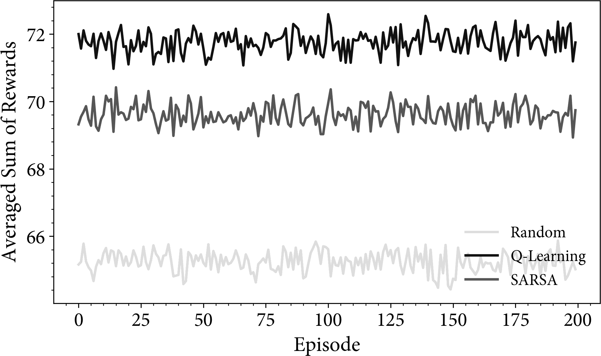
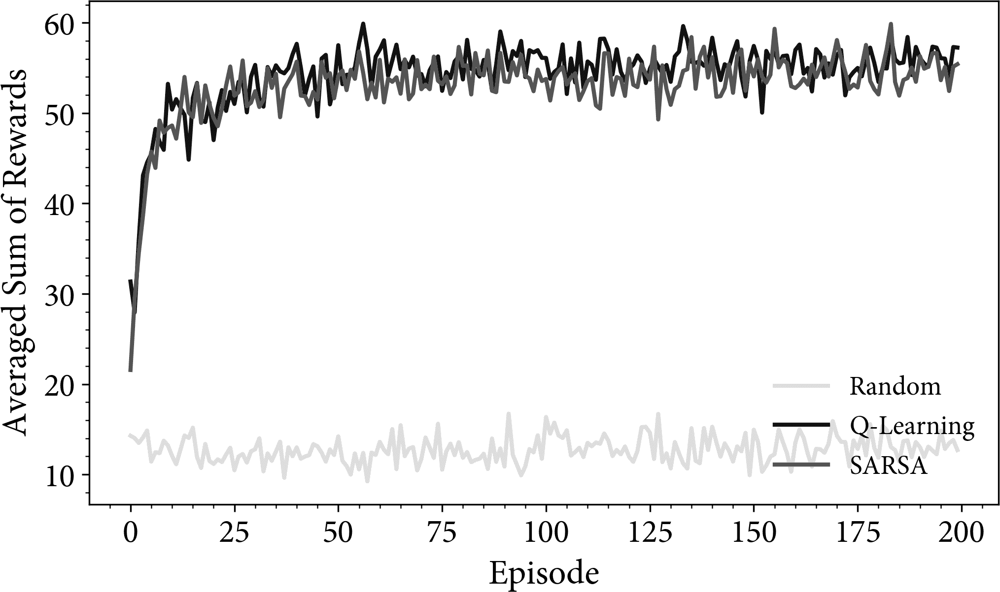
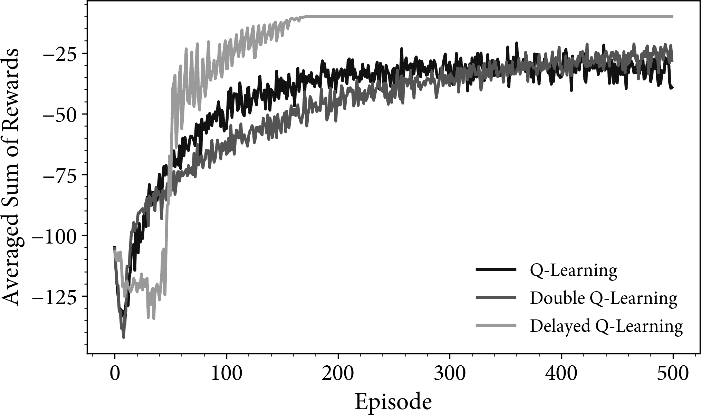
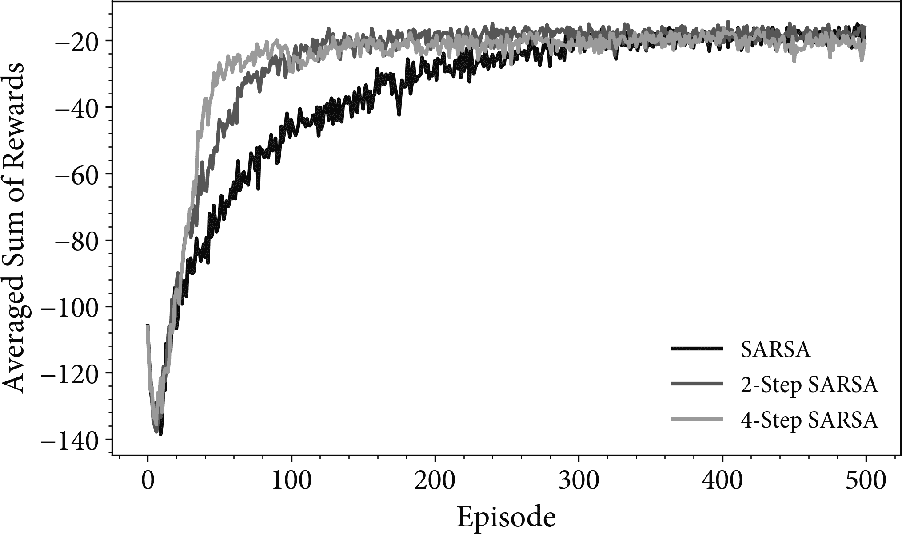
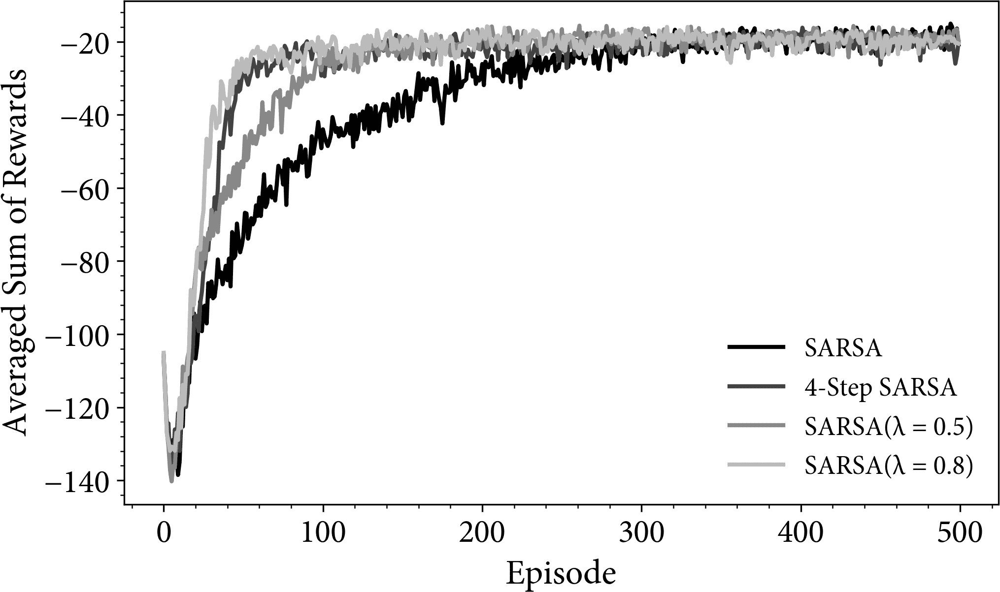

# 第 3 章. 时序差分学习、Q 学习和 n 步算法

`Chapter 2` (`ch02.html#ch_mdp-dp-mc`) 介绍了求解马尔可夫决策过程（MDP）的两个关键概念。蒙特卡洛（MC）技术试图通过采样来估计价值函数。它们可以在没有显式转移概率知识的情况下做到这一点，并能高效地采样大状态空间。但它们需要运行完整个回合，智能体才能更新策略。

相反，动态规划（DP）方法通过在单个时间步后更新策略来进行*自举*。但 DP 算法必须拥有完整的转移概率知识，并在找到最优策略之前访问每一个可能的状态和动作。

> **注意**
>
> 广泛的学科使用*自举*一词来表示实体可以“自我提升”。企业通过不贷款筹集现金来自举。电子晶体管电路利用自举来提高输入阻抗或工作电压。在统计学和 RL 中，自举是一种利用单个观测值来估计总体统计量的采样方法。

*时序差分*（TD）学习是这两种方法的结合。它通过采样直接从经验中学习，但也进行自举。这代表了能力的突破，使智能体能够在任何环境中学习最优策略。在此之前，学习太慢，以至于问题变得难以处理，或者你需要环境的完整模型。不要低估这些方法；有了本章介绍的工具，你可以设计复杂的自动化系统。本章推导了 TD 学习，并用它定义了各种实现。

## 时序差分学习的公式化

回想一下，策略依赖于预测状态价值（或动作价值）函数。一旦智能体有了预期回报的预测，它就需要选择使奖励最大化的动作。

> **提示**
>
> 请记住，“期望”值是该值的大量观测值的算术平均数（平均值）。目前，你可以计算过去访问该状态时观测到的所有回报的平均值。而在线版本的平均值是指数衰减移动平均。但本书后面我们将使用模型来预测期望回报。


公式 2-8 将状态价值函数定义为从给定状态开始的预期回报，你已经看到了如何在 公式 2-2 中将其转换为在线算法。公式 3-1 是蒙特卡洛（MC）状态价值函数估计的一种在线实现。关键部分是回报 `G` 的指数加权移动平均估计。随着时间的推移，你更新状态价值估计以使其更接近真实的预期回报，而 `α` 控制更新的速率。

### 公式 3-1. 在线蒙特卡洛状态价值函数

$$\begin{array}{cl} {V_{\pi}\left( s \right)} & {\doteq {\mathbb{E}}_{\pi}\left\lbrack G \middle| s \right\rbrack} \\ & \left. \leftarrow{\mathbb{E}}_{\pi}\left\lbrack {V_{\pi}\left( s \right) + \alpha\left( {G - V_{\pi}\left( s \right)} \right)\left| s \right.} \right\rbrack \right. \\ \end{array}$$

回想一下，`G` 是整条轨迹的总回报。因此，公式 3-1 的问题在于，你需要等到一个回合结束才能得到 `G` 的值。所以是的，它是在线的，因为它一次更新一步，但你仍然必须等到回合结束。

“动态规划中的价值迭代” 中的价值估计提供了状态价值函数略有不同的解释。你不需要等到回合结束来观察回报，而是可以使用下一步的折扣估计来迭代更新当前的状态价值估计。公式 3-2 展示了动态规划（DP）的一个在线版本。根据定义，它是在线的，因为它始终向前看一步。请注意，该公式从与 MC 版本相同的状态价值函数定义开始。

### 公式 3-2. 在线动态规划状态价值函数

$$\begin{array}{cl} {V_{\pi}\left( s \right)} & {\doteq {\mathbb{E}}_{\pi}\left\lbrack G \middle| s \right\rbrack} \\ & \left. \leftarrow\max\limits_{a}\sum\limits_{s^{'},r}p\left( s^{'},r \mid s,a \right)\left\lbrack {r + \gamma V\left( s^{'} \right)} \right\rbrack \right. \\ \end{array}$$

你已经知道这里的问题是你不知道转移概率。但请注意 公式 3-2 最后一行，DP 版本使用了一个有趣的 `G` 定义：`r + γV(s')`。这表示回报等于当前奖励加上下一状态预测的折扣值。换句话说，回报是当前奖励加上所有未来奖励的估计。能否在蒙特卡洛算法中使用这个 `G` 的定义，这样你就不必等到回合结束？可以！请看 公式 3-3。

### 公式 3-3. 时序差分状态价值函数

```
Vπ ≐ 𝔼[π]V[π + α(r + γVπ − Vπ) | s]
```

公式 3-3 是预期回报的 TD 估计。它结合了自举法的优势和 MC 滚动平均的采样效率。请注意，你可以重新构建此公式以估计动作价值函数。

最后，我可以将其转换为一个在线算法，该算法假设指数加权平均是期望算子的合适估计，从而得到 公式 3-4 中的在线 TD 状态价值估计。

### 公式 3-4. 在线时序差分状态价值函数

```
Vπ ← Vπ + α(r + γVπ − Vπ)
```

花点时间消化一下这些公式；试着用你自己的话来解释它们。它们表明，你可以根据任意的奖励定义，通过在环境中“穿梭”并根据 公式 3-3 迭代更新状态价值函数，来学习一个最优策略。对状态价值函数（进而对策略）的更新是即时的，这意味着你的下一个动作应该比之前的更好。

## Q-Learning

1989 年，一种称为 `Q-learning` 的 TD 学习实现使得数学家更容易证明收敛性。该算法被认为点燃了强化学习（RL）的热潮。你可以重新构建 公式 3-3 以提供动作价值函数（公式 2-9）。此外，公式 3-5 通过为给定状态有意选择最佳动作（方式同 公式 2-10）实现了一个简单的策略。

### 公式 3-5. 用于估计预期回报的 Q-learning 在线更新规则

$$\left. Q\left( s,a \right)\leftarrow Q\left( s,a \right) + \alpha\left( {r + \gamma\operatorname{argmax}\limits_{a_{s} \in \mathcal{A}{(s)}}Q\left( s^{'},a_{s} \right) - Q\left( s,a \right)} \right) \right\rbrack$$

回想一下，`Q(s,a)` 是动作价值函数，即 公式 2-9 中的那个函数，它告诉你每个动作的预期回报。公式 3-5 作为一个在线更新规则实现，这意味着你应该通过覆盖之前的估计来迭代优化 `Q(s,a)` 的估计。将 `α` 右侧的所有内容视为一个 `delta`，即估计值与实际发生情况相比有多错误的度量。而 delta 中实现的 TD 单步前瞻允许算法向前投射一步。这使得智能体能够询问：“哪个是最佳动作？”

这是最重要的改进。之前的尝试仅利用该状态的知识来估计每个状态的预期回报。公式 3-5 允许智能体向前看，以查看哪些未来轨迹是最优的。这被称为 `rollout`（展开/模拟）。智能体展开轨迹中的状态和动作（最多直到回合结束，类似于 MC 方法）。智能体可以创建不仅局部最优，而且在未来也是最优的策略。智能体可以创建能够预测未来的策略。

不过，这种动作价值函数的实现之所以特别，是因为一个简单的添加。公式 3-5 中的 `argmax` 告诉算法扫描该状态的所有可能动作，并选择预期回报最好的那个。

这种对智能体的主动引导被称为 Q-learning，并实现在 算法 3-1 中。

### 算法 3-1. Q-learning（离策略 TD）


## Q-learning 和 SARSA 算法

## 算法 3-1：Q-learning

### 算法

```latex
\begin{aligned}
{\text{1:}} & {\mathbf{i}\mathbf{n}\mathbf{p}\mathbf{u}\mathbf{t}\text{:}\text{a}\text{policy}\text{that}\text{uses}\text{the}\text{action-value}\text{function,}\pi\left( {a \mid s,Q\left( s,a \right)} \right)} \\
{\text{2:}} & \left. \text{Initialize} Q\left( s,a \right)\leftarrow 0,\text{for}\text{all} s \in \mathcal{S},a \in \mathcal{A}\left( s \right) \right. \\
{\text{3:}} & {\mathbf{l}\mathbf{o}\mathbf{o}\mathbf{p}\text{:}\text{for}\text{each}\text{episode}} \\
{\text{4:}} & {\text{Initialize}\text{environment}\text{to}\text{provide} s} \\
{\text{5:}} & {\mathbf{d}\mathbf{o}\text{:}} \\
{\text{6:}} & {\text{Choose} a\text{from} s\text{using}\pi\text{,}\text{breaking}\text{ties}\text{randomly}} \\
{\text{7:}} & {\text{Take}\text{action,} a\text{,}\text{and}\text{observe} r,s'} \\
{\text{8:}} & \left. Q\left( s,a \right)\leftarrow Q\left( s,a \right) + \alpha\left\lbrack {r + \gamma\operatorname{argmax}\limits_{a_{s} \in \mathcal{A}{(s)}}Q\left( s^{'},a_{s} \right) - Q\left( s,a \right)} \right\rbrack \right. \\
{\text{9:}} & \left. s\leftarrow s' \right. \\
{\text{10:}} & {\mathbf{w}\mathbf{h}\mathbf{i}\mathbf{l}\mathbf{e} s\text{is}\text{not}\text{terminal}} \\
\end{aligned}
```

### 说明

算法 3-1 展示了 `Q-learning` 的一种实现。你应该能认出该算法的大部分内容，因为它与 算法 2-3 和 算法 2-4 密切相关。和之前一样，步骤 (1) 首先传入一个策略，用于决定采取哪个动作的概率（例如，可能实现来自 算法 2-1 的 `ϵ-greedy` 探索）。步骤 (2) 初始化一个数组以存储所有动作-价值估计。这可以通过一个自动默认为设定值的映射来高效实现。

步骤 (3) 遍历所有回合，步骤 (5) 遍历回合中的每一步。步骤 (4) 初始化起始状态。环境通常提供一个函数来 "`reset`" 智能体到默认状态。

步骤 (6) 使用外部策略函数来决定采取哪个动作。选择概率最高的动作。我比文献中典型的表述更明确地说明这一点，因为我想清楚地表明：永远不存在单一的最优动作。相反，一系列动作都有一定概率是最优的。`Q-learning` 选择概率最高的动作，这通常源自最大的 `Q(s,a)` 值。例如，你可以通过在一定比例的时间内将所有动作设置为相同概率来实现 `ϵ-greedy`。

步骤 (7) 在环境中使用选定的动作，并观察奖励和下一状态。步骤 (8) 根据在环境中观察到的新行为，更新给定状态和动作的当前动作-价值估计。请记住，期望回报计算为当前奖励与下一状态期望值之和。因此，差值（delta）就是这个和减去当前状态的期望值。步骤 (8) 还使用 `α` 参数对差值进行指数衰减，这有助于对嘈杂的更新进行平均。

步骤 (9) 设置下一状态，最后步骤 (10) 重复此过程，直到环境发出状态为终止状态的信号。随着足够多的回合 [步骤 (3)]，动作-价值估计将趋近于正确的期望回报。

请看 算法 3-1 末尾的步骤 (8)。注意右边的 TD 误差项。`argmax_{a_s ∈ A(s)} Q(s', a_s)` 会检查该下一状态的所有可能动作，并选择期望回报最高的那个。这与步骤 (6) 中选择的动作无关。相反，智能体正在使用未来的动作规划一条路径。

这是一个 `off-policy`（离策略）智能体的首个实际示例。该算法是离策略的，因为更新仅影响当前策略。它不使用更新来指导智能体。智能体仍然必须从当前策略中推导出动作。这是一个微妙但至关重要的改进，直到最近才被利用。你可以在本书后面找到更多离策略算法的示例。

另一点值得注意的是步骤 (2) 中数组的使用。它在表中存储每个状态-动作对的期望价值估计，因此这通常被称为 `tabular`（表格型）方法。这一区别很重要，因为这意味着当你拥有连续状态或动作时，无法使用 算法 3-1，那会导致数组长度无限。你将在 第 4 章 中看到能原生处理连续状态的方法，或在 第 5 章 中看到处理连续动作的方法。你可以在 第 9 章 中学习如何将连续值映射为离散值。

## SARSA

`SARSA` 在 `Q-learning` 之后不久被开发出来，旨在为 `TD learning`（时序差分学习）提供一个更通用的解决方案。与 `Q-learning` 的主要区别在于差值（delta）中缺少 `argmax`。相反，它通过对所有运行进行平均（以在线方式）来计算期望回报。

从 公式 3-6 可以看出，这种特定 `TD learning` 实现的名称源于计算动作-价值函数所需的状态、动作和奖励。`SARSA` 的算法如 算法 3-2 所示。

### 公式 3-6：SARSA 动作-价值函数的在线估计

```latex
Q(s,a) ← Q(s,a) + α(r + γ Q(s',a') - Q(s,a))
```

算法 3-2 和 算法 3-1 都有超参数。第一个是 `γ`，即折扣期望回报的因子，在 公式 2-7 中引入。第二个是动作-价值学习率 `α`，其值应在 0 和 1 之间。较高的值学习更快，但平均效果较差。

### 算法 3-2：SARSA（On-policy TD，同策略时序差分）

```latex
\begin{aligned}
{\text{1:}} & {\mathbf{i}\mathbf{n}\mathbf{p}\mathbf{u}\mathbf{t}\text{:}\text{a}\text{policy}\text{that}\text{uses}\text{the}\text{action-value}\text{function,}\pi\left( {a \mid s,Q\left( s,a \right)} \right)} \\
{\text{2:}} & \left. \text{Initialize} Q\left( s,a \right)\leftarrow 0,\text{for}\text{all} s \in \mathcal{S},a \in \mathcal{A}\left( s \right) \right. \\
{\text{3:}} & {\mathbf{l}\mathbf{o}\mathbf{o}\mathbf{p}\text{:}\text{for}\text{each}\text{episode}} \\
{\text{4:}} & {\text{Initialize}\text{environment}\text{to}\text{provide} s} \\
{\text{5:}} & {\mathbf{d}\mathbf{o}\text{:}} \\
{\text{6:}} & {\text{Choose} a\text{from} s\text{using}\pi\text{,}\text{breaking}\text{ties}\text{randomly}} \\
{\text{7:}} & {\text{Take}\text{action,} a\text{,}\text{and}\text{observe} r,s'} \\
{\text{8:}} & {\text{Choose} a'\text{from} s'\text{using}\pi\text{,}\text{breaking}\text{ties}\text{randomly}} \\
{\text{9:}} & \left. Q\left( s,a \right)\leftarrow Q\left( s,a \right) + \alpha\left\lbrack {r + \gamma Q\left( s^{'},a' \right) - Q\left( s,a \right)} \right\rbrack \right. \\
{\text{10:}} & \left. s\leftarrow s',a\leftarrow a' \right. \\
{\text{11:}} & {\mathbf{w}\mathbf{h}\mathbf{i}\mathbf{l}\mathbf{e} s\text{is}\text{not}\text{terminal}} \\
\end{aligned}
```


算法 3-2 与 算法 3-1 几乎相同，因此我不会完整重复解释。一个区别是该算法在第 (8) 步中选择下一个动作 `a'`，然后才在第 (9) 步中更新动作价值函数。`a'` 更新策略并指导智能体进行下一步，这使其成为一个 `on-policy`（同策略）算法。

当应用函数近似时，`on-policy` 和 `off-policy`（异策略）算法之间的差异会被放大，我在 第 4 章 中使用了该技术。但这些细微差别真的会产生影响吗？让我测试这些算法，向你展示会发生什么。

## Q-Learning 与 SARSA

强化学习文献中的一个经典环境是 `Gridworld`（网格世界），一个由方格组成的二维网格。你可以在方格中放置各种障碍物。在第一个示例中，我在网格的一条边缘放置了一个深洞。这模拟了一个悬崖。目标是训练一个智能体从起点绕过悬崖导航到目标状态。

我设计奖励以鼓励智能体走最短路径到达目标。每一步的奖励为 −1，掉下悬崖的奖励为 −100，目标状态的奖励为 0。悬崖和目标状态都是终止状态（回合在此结束）。你可以在 图 3-1 中看到该环境的可视化。

为了演示差异，我在配套网站上实现了 `Q-learning` 和 `SARSA`。在那里你还可以找到当前 RL 框架的最新列表。我在 第 9 章 中详细讨论了实现 RL 的实用性。



如果我在 图 3-1 所描述的环境中训练这些智能体，我可以记录每个时间步的回合奖励。由于智能体的随机探索，我需要重复实验多次以平均掉噪声。你可以在 图 3-2 中看到结果，其中的图表显示了 100 次并行实验的平均奖励总和。



### 提示

回顾一下，一个回合是一个完整的实验，从起点到终止节点，在本例中即掉下悬崖或到达终点。图 3-2 中的 `x-axis`（x 轴）是回合编号。500 个回合意味着 500 次终止事件。

图 3-2 有两个有趣的区域。第一个是学习开始时的下降。第一个回合的表现比第五个回合好。换句话说，随机智能体的表现比训练了五个回合的智能体更好。原因在于奖励结构。我规定掉下悬崖的奖励为 −100。使用完全随机的智能体，由于起点非常靠近悬崖，你应该预期智能体几乎会立即掉下去。这解释了开始时接近 −100 的奖励。然而，经过几次尝试后，智能体已经学会掉下悬崖并不愉快，因此它试图避开。避开会导致每步 −1 的奖励，而且由于悬崖相当长，且智能体尚无太多到达目标状态的经验，它浪费步数后最终还是掉下了悬崖——命运多舛。因浪费步数产生的负奖励总和加上最终掉下悬崖的惩罚，导致奖励比开始时还低（约 −125）。

这是一个有趣的结果。有时你需要接受短期的较低奖励，以在长期找到更好的奖励。这是利用与探索问题的一个延伸。

第二个有趣的结果是 `SARSA` 的结果倾向于获得更大的奖励，且比 `Q-learning` 更稳定（噪声更小）。原因可以通过最终的策略来最好地描述。

图 3-3 展示了 `Q-learning` 和 `SARSA` 的示例策略。请注意，由于随机探索，具体策略在不同试验之间可能会发生变化。`SARSA` 智能体倾向于选择远离悬崖的“安全”路径。这是因为偶尔 `ϵ-greedy`（ε-贪婪）动作会随机将智能体踢下悬崖。回想一下，`SARSA` 计算的是*平均*预期回报。因此，平均而言，远离悬崖的预期回报更好，因为连续收到三次朝向悬崖的随机踢击的几率很小。

然而，`Q-learning` 算法并不预测预期回报。它预测的是从该状态能获得的*最佳可能回报*。在没有随机踢击的情况下，最佳回报是沿着悬崖边缘直走。这是一条有风险但根据奖励定义属于最优的策略。

这也解释了方差的差异。因为 `Q-learning` 形象地说走在刀尖上，它有时会掉下去。这会导致巨大但零星的损失。`SARSA` 策略远离悬崖边缘，很少掉落，因此奖励更稳定。



## 案例研究：自动扩缩应用容器以降低成本

软件 `containers`（容器）正在改变分布式应用在云中部署和编排的方式。其主要优势在于封装所有运行时依赖以及可部署单元的原子性。这意味着应用可以动态地进行水平扩缩（通过复制）和垂直扩缩（通过增加分配的资源）。传统的扩缩策略依赖于固定的、基于阈值的启发式方法，如 `CPU` 利用率或内存使用量，且很可能是次优的。使用 RL 提供扩缩策略可以降低成本并提高性能。

Rossi、Nardelli 和 Cardellini 提出了一项实验，同时使用 `Q-learning` 和基于模型的方法，为垂直和水平扩缩提供最优策略。^(2) 他们随后在实际的 `Docker Swarm` 环境中实现了这些算法。

Rossi 等人首先使用一个通用的 `black-box container`（黑盒容器）来执行任意任务。智能体通过 `Markov decision process`（马尔可夫决策过程）的约束与应用程序交互。

状态定义为 `containers`（容器）的数量、`CPU utilization`（CPU 利用率）以及分配给每个容器的 `CPU allocation`（CPU 分配量）。他们将连续变量量化为固定数量的箱。

动作定义为对应用的水平或垂直规模进行更改。他们可以增加或移除副本，增加或移除分配的 CPU，或两者兼施。他们进行了两个实验：第一个简化 `action space`（动作空间），仅允许单次垂直或水平更改；第二个允许两者同时进行。

奖励是一个相当复杂的函数，用于平衡部署更改的数量、延迟和利用率。这些指标具有任意的权重，以允许用户指定对其应用而言什么最重要。

虽然 Rossi 等人最初使用模拟器来开发他们的方法，但他们值得庆幸的是使用 `Docker Swarm` 在现实生活中测试了他们的算法。他们实现了一个 `controller`（控制器）来监控、分析、规划并执行应用程序的更改。然后他们使用变化的需求模式模拟用户请求，以对应用程序施加压力，并训练算法以最大化奖励。

该实验有几个有趣的结果。首先，他们发现当使用较小的 `action space`（动作空间）时，即智能体必须选择垂直或水平扩缩，而非两者兼施时，算法学习得更快。这是一个常见结果；较小的 `state`（状态空间）和 `action spaces` 意味着智能体需要探索的内容更少，从而能更快地找到最优策略。在简单实验中，`Q-learning` 和基于模型的方法表现相似。随着更复杂的 `action space`，基于模型的方法学习得更快，且结果好得多。


## 基于模型的方法结果

第二个有趣的结果是，使用专门为该挑战定制的模型可以改善学习和最终性能。他们的基于模型的方法将转移概率纳入价值近似中，这与你在“库存控制”中所做的非常相似，因此算法拥有关于动作效果的先验知识。然而，他们的模型隐式地将结果偏向于该模型本身。结果显示，基于模型的方法更倾向于垂直扩展而非水平扩展。在大多数现代编排器中，水平扩展容易得多，因此这将是一个劣势。寓意是：是的，基于模型的方法引入了先验知识并显著加快了学习速度，但你必须确保模型代表了系统的真实动态，且不存在对特定策略的隐式偏向。

无论哪种情况，最终结果都比静态的基于阈值的策略有了显著改进。两种算法都将利用率提高了一个数量级（这应转化为成本降低一个数量级），同时保持了相似的延迟水平。

你可以通过多种方式改进这项工作。我希望看到这个例子在 `Kubernetes` 上实现，也希望看到奖励函数使用实际使用的资源成本，而不是某些利用率指标。我还会改进状态和动作的表示：使用函数近似将消除离散化状态的需求，而连续动作可以选择更好的垂直扩展参数。我还倾向于拆分问题，因为垂直扩展和水平扩展的成本差异很大；至少在 `Kubernetes` 中，水平扩展容易得多。

## 工业案例：广告中的实时竞价

与广告商设定固定出价的赞助广告不同，在实时竞价（`RTB`）中，你可以为每个单独的展示设定出价。当用户访问支持广告的网站时，这会触发一场拍卖，广告商竞价争夺 `impression`（展示机会）。广告商必须在一段时间内提交出价，`100 ms` 是常见的限制。

广告平台向广告商提供上下文和行为信息以供评估。广告商使用自动化算法根据上下文决定出价多少。长期来看，平台的产品必须提供令人满意的体验以维持广告收入流。但广告商希望以最低成本最大化某个关键绩效指标（`KPI`）——例如展示次数或点击率（`CTR`）。

`RTB` 提供了明确的动作（出价）、状态（平台提供的信息）和智能体（竞价算法）。平台和广告商都可以使用 `RL` 来针对各自对奖励的定义进行优化。正如你所想象的，原始的出价级别展示数据很有价值。但在 2013 年，一家名为 iPinYou 的中国营销公司发布了一个数据集，希望研究人员能改进竞价算法的最先进水平。^(3)

## 定义 MDP

我将展示像 `Q-learning` 和 `SARSA` 这样简单的 `RL` 算法如何能为 `RTB` 问题提供解决方案。这些算法的主要局限性是它们需要一个简单的状态空间。大规模或连续状态不太适用，因为智能体需要大量样本才能形成对期望值的合理估计（根据大数定律）。连续状态因离散采样而导致进一步的问题。对于表格型算法，你必须简化和约束状态以使其可处理。

我提议创建一个 `RTB` 算法，在给定预算下最大化展示次数。我将数据分成批次，每个批次都有一个预算。状态由智能体在给定剩余拍卖次数下可出的平均出价组成。例如，如果预算是 `100` 且批次大小是 `10`，那么在第一次拍卖时状态是 `100/10 = 10`。该特征的目的是告知智能体，我希望将出价分散在整个批次中。我不希望智能体一次性花光预算。如果智能体赢得拍卖将获得 1 的奖励，否则为 0。为了进一步减少状态数量，我将实数四舍五入并截断为整数。稍后你将看到能够拟合函数以适应状态的智能体示例，这使它们能捕获复杂得多的数据。

这凸显了一个重要的教训。`MDP` 的构建是任意的。你可以想象在状态中包含许多不同的信息片段，或创建另一种奖励。你必须根据试图解决的问题，在算法的约束内设计 `MDP`。工业数据科学家很少更改机器学习算法的实现细节；它们是现成的。`RL` 从业者花费大部分时间改进状态表示（通常称为特征工程）和完善奖励定义。工业 `ML` 也类似，数据科学家花费大部分时间改进数据或重新构建问题。

## 实时竞价环境的结果

我创建了两个新环境。第一个是我为测试构建的静态 `RTB` 环境。每个回合是一批 `100` 次拍卖，我将预算固定为 `10,000`。如果智能体出价大于或等于 `100`，它将赢得拍卖。因此，该环境的最优策略是在每次拍卖中出价 `100` 以获得 `100` 的奖励。智能体可以将当前出价增加或减少 `50%`、`10%` 或 `0%`。你可以在图 3-4 中看到结果。

这不是很现实，但证明算法实现按预期工作。尽管学到了最优策略，但由于高 `ϵ`，这张图并未达到 `100` 的奖励。也就是说，在获得这些奖励时，智能体仍在采取随机（通常是错误的）动作。`SARSA` 和 `Q-learning` 之间也存在细微差别，因为 `SARSA` 倾向于稍微加价的更安全路径，这意味着它比 `Q-learning` 更快耗尽预算；这与你在“Q-Learning 与 SARSA”中看到的相同。

第二个环境使用真实竞价数据。如果你遵循 [`make-ipinyou-data`](https://oreil.ly/uZ-xk) 仓库中的说明，你将获得代表广告商的目录。这些文件包含预测的 `CTR`、用户是否实际点击了广告以及中标价格。批次大小和智能体的动作与之前相同。主要区别在于赢得拍卖的成本现在是可变的。目标和之前一样，是训练一个智能体在给定预算下赢得最多的展示。我还通过将智能体的初始出价设得太低来增加难度。智能体将不得不学会增加出价。你可以在图 3-5 中看到结果。

 

## 进一步改进

前面的例子约束了 `RTB` 问题，因为我需要简化状态空间。表格方法，如 `Q-learning` 和 `SARSA`，在状态空间很大时会遇到困难；智能体将不得不采样大量，甚至可能是无限数量的状态。稍后在本书中，你将看到构建状态空间模型的方法，而不是查找表。

另一个关注点是奖励的选择。我选择使用展示次数，因为这导致每个时间步都能学习，从而加快了学习速度。使用用户点击作为奖励信号可能更有益，因为广告商通常只有在用户实际点击其广告时才感兴趣。


## Q-Learning 的扩展

研究人员可以通过多种方式改进 TD 算法。本节探讨一些专门与 SARSA 和 Q-Learning 相关的最重要改进。某些改进更适合留到后面的章节再讨论。

## Double Q-Learning（双重 Q-Learning）

公式 3-5 利用最佳动作的概念来更新 `Q(s,a)`，在本例中，最佳动作是指产生最高预期奖励的动作。问题在于当前的最大值可能只是统计异常。考虑智能体刚开始学习的情况。智能体第一次获得正奖励时，会更新动作价值估计。后续回合将反复选择同一组动作。这可能会形成一个循环，导致智能体因最初的错误更新而持续做出次优决策。

解决此问题的一种方法是使用两个动作价值函数，即两个查找表。^(4) 智能体随后用一个来更新另一个，反之亦然。这能产生 `Q(s,a)` 的无偏估计，因为它不会反馈给自身。通常，选择更新哪种组合（例如用 `Q[2]` 的动作价值估计更新 `Q[1]`）是随机的。

## Delayed Q-Learning（延迟 Q-Learning）

在有史以来命名最贴切的计算理论中，`probably approximately correct`（PAC，概率近似正确）学习指出，对于给定的假设，需要特定数量的样本才能在可接受的误差范围内解决问题。2006 年，数学家基于这一原理开发了一种基于 Q-Learning 的算法，称为 `delayed Q-learning`（延迟 Q-Learning）。^(5)

该算法并非在智能体每次访问该状态-动作对时都更新动作价值函数，而是缓冲奖励。一旦智能体访问达到一定次数，它便会一次性大幅更新主动作价值函数。

其思想再次基于大数定律：对预期回报的单次估计可能包含噪声。因此，不应用潜在的错误值更新主动作价值表，因为智能体依赖它来指导未来的行为。应当等待一段时间，仅在获得有代表性的样本时才进行更新。

这种方法的缺点是，在开始获得良好结果之前会有一定的延迟。但一旦开始，学习速度非常快，因为智能体不再受噪声困扰。

从某种意义上说，这只是延长探索期的一种方式。如果你对 `ϵ-greedy` 中的 `ϵ` 进行退火，或使用 UCB（参见“改进 `ϵ-greedy` 算法”），会获得类似的效果。一种称为 directed delayed Q-Learning（定向延迟 Q-Learning）的类似实现，还为采样不充分的动作-状态对整合了探索奖励。^(6)

## 标准、双重与延迟 Q-Learning 的对比

图 3-6 对比了标准、双重和延迟 Q-Learning 在网格环境中的表现。如较高的平均结果所示，双重 Q-Learning 实现产生的策略优于标准 Q-Learning（如果给予更多时间，它将持续改进；可与图 3-2 对比）。对于延迟 Q-Learning 实现，明显的不连续性在鲁棒性方面令人担忧，但最终结果令人印象深刻。这是因为聚合许多更新提供了更稳健的动作价值函数估计。顶部的平坦区域是因为延迟 Q-Learning 在一定数量的更新后有意停止学习。



## Opposition Learning（对立学习）

在一个有趣的尝试中，Tizhoosh 试图通过有意采样策略选择动作的相反动作来提高学习性能。^(7) 这种被称为 Opposition-Based RL（基于对立的强化学习）的方法，其受 Q-Learning 启发的实现有意采样并更新相反动作以及当前策略选择的动作。这一想法的要点在于，相反动作可能揭示出革命性或反事实的举动，即策略绝不会推荐的动作。

如果存在自然的相反动作，这在早期阶段可能会产生更快的学习，因为它避免了最坏情况。然而，如果不存在，你不妨随机采样，这相当于一次正常更新和一次随机更新。如果这可以接受，我甚至可以作弊并采样所有动作。

主要问题在于，在许多环境中，你无法同时测试多个动作。例如，想象你尝试在机器人上使用此算法。它必须执行相反（或随机）动作，移回原位，然后执行策略动作。移回的动作可能不精确并引入误差。这也不适合连续域。更好的方法是倾向于使用多智能体或单独的关键策略来生成反向动作。

## n-Step Algorithms（n 步算法）

本章一直在考虑一步展望。但为什么止步于此？为什么不进行两步展望？或更多？这正是 `n-step`（n 步）算法的核心。它们提供了将预期价值估计 `unrolling`（展开/递推）到任意步数的泛化。这很有益，因为它弥合了动态规划和蒙特卡洛方法之间的鸿沟。


## 时序差分学习中的 n 步前瞻

对于某些应用，在做出选择前向前看几步是合理的。在网格示例中，如果智能体能看到当前轨迹将导致其掉下悬崖，智能体现在就可以采取规避行动，而不必等到为时已晚。从某种意义上说，智能体正在向更远的未来展望。

该想法的本质是扩展 TD 实现之一，例如 公式 3-3，使其能迭代任意数量的未来状态。回顾一下，展望功能源自 DP（公式 3-3），它将当前奖励与下一状态的预测相结合。我可以将其扩展为查看接下来的两个奖励以及之后状态的期望回报，如 公式 3-7 所示。

## 公式 3-7：2 步期望回报

$$G[t : t+2] \doteq r + \gamma r' + \gamma² Q(s'', a'')$$

我添加了额外的符号 `t+2`，以表示 公式 3-7 正在向前看两步。公式 3-3 等同于 `G[t : t+1]`。关键在于 公式 3-7 不仅使用下一个奖励，还使用再下一个奖励。同样，它不使用下一个动作价值估计，而是使用再下一个。你可以将其推广为 公式 3-8。

## 公式 3-8：n 步期望回报

$$G[t : t+n] \doteq r + \gamma r' + \cdots + \gamma^{n-1} r_{n-1} + \gamma^n Q(s_n, a_n)$$

你可以增强各种 TD 更新规则（例如 公式 3-6）以使用这种新的 DP 更新。公式 3-9 展示了动作价值更新函数的方程。

## 公式 3-9：n 步 TD 更新规则

$$Q(s,a) \leftarrow Q(s,a) + \alpha (G[t : t+n] - Q(s,a))$$

公式 3-9 展示了动作价值函数的 `n-step` 更新。你可以重写它以呈现状态价值函数，或通过在 `G[t : t+n]` 内添加 `argmax[a[s] ∈ A(s)]` 使其成为 Q 学习。在某些参考文献中，你会看到进一步的数学符号，用以表示动作价值估计 `Q` 的新值依赖于之前的估计。例如，你应该在使用 `Q′` 之前更新 `Q`。我省略了这些以简化方程。

但这个想法确实会导致一个问题。奖励只有在智能体转移到该状态后才可用。因此，智能体必须遵循轨迹，缓冲奖励，然后回溯更新 `t` 步前的原始状态。

当我的女儿们睡着做梦时，你能听到她们重温过去的一天。她们正在检索经验，在事后诸葛亮的优势下重新处理它，并从中学习。RL 智能体也能做同样的事。一些算法使用经验回放缓冲区，让智能体沉思其先前的动作并从中学习。这是当前回合轨迹的存储。智能体可以回顾以计算 公式 3-8。

算法 3-3 中的 `n-step` 算法在功能上与 算法 3-2 相同，但看起来更复杂，因为它需要在回放缓冲区上反向迭代，且只有在有足够样本后才能这样做。例如，在 2 步 SARSA 中，你需要等到第三步才能回溯更新第一步，因为你需要观察第二个奖励。

## 算法 3-3：n 步 SARSA

```latex
\begin{array}{cl}
\text{1:} & \mathbf{input: a policy that uses the action-value function, } \pi(a \mid s, Q(s,a)), \text{ step size } 0 < \alpha < 1, \text{ a positive integer } n \\
\text{2:} & \left. \text{Initialize } Q(s,a) \leftarrow 0, \text{ for all } s \in \mathcal{S}, a \in \mathcal{A}(s) \right. \\
\text{3:} & \mathbf{loop for each episode:} \\
\text{4:} & \left. \text{Initialize } T \leftarrow \infty, t \leftarrow 0, \text{ replay buffers for } S \text{ and } A, \text{ and initial state } s \right. \\
\text{5:} & \text{Choose } a \text{ from } s \text{ using } \pi, \text{ breaking ties randomly} \\
\text{6:} & \mathbf{do:} \\
\text{7:} & \mathbf{if } t < T: \\
\text{8:} & \text{Take action, } a, \text{ observe } r, s' \\
\text{9:} & \mathbf{if } s' \text{ is terminal:} \\
\text{10:} & \left. T \leftarrow t + 1 \right. \\
\text{11:} & \mathbf{else:} \\
\text{12:} & \text{Choose } a' \text{ from } s' \text{ using } \pi, \text{ breaking ties randomly} \\
\text{13:} & \left. \tau \leftarrow t - n + 1 \right. \\
\text{14:} & \mathbf{if } \tau \geq 0: \\
\text{15:} & \left. G \leftarrow \sum_{i \leftarrow \tau + 1}^{\min(\tau + n, T)} \gamma^{i - \tau - 1} r_i \right. \\
\text{16:} & \mathbf{if } \tau + n < T: \\
\text{17:} & \left. G \leftarrow G + \gamma^{n} Q(s_{\tau + n}, a_{\tau + n}) \right. \\
\text{18:} & \left. Q(s_{\tau}, a_{\tau}) \leftarrow Q(s_{\tau}, a_{\tau}) + \alpha \left[ G - Q(s_{\tau}, a_{\tau}) \right] \right. \\
\text{19:} & \left. t \leftarrow t + 1, s \leftarrow s', a \leftarrow a' \right. \\
\text{20:} & \mathbf{while } \tau \neq T - 1 \\
\end{array}
```

算法 3-3 看起来吓人，但我保证额外的伪代码只是为了迭代回放缓冲区。其想法与 SARSA 完全相同，只是它向前看多个时间步，这意味着你必须缓冲经验。撇号符号也有点失效，因为你必须索引之前的动作、状态和奖励。我认为这个算法凸显了这些算法中有多少实现复杂性——而这只是一个简单的算法。

## 算法演练

步骤 (1) 像往常一样开始，你必须传入一个策略和控制 `n-step` 步数及动作价值步长的设置。步骤 (2) 初始化动作价值表。步骤 (3) 遍历每个循环，步骤 (4) 初始化 `T` 变量，它表示回合结束时的步数，`t` 表示当前步数、回放缓冲区和默认回合状态 `s`。步骤 (5) 根据默认状态和当前策略选择第一个动作，步骤 (6) 是主循环的开始。

其中大部分与之前相同。步骤 (7) 的不同之处在于检查回合是否已经结束。如果结束了，你就不想再采取任何动作。在此之前，步骤 (8) 在环境中执行动作。步骤 (9) 和 (10) 检查该动作是否导致回合结束。如果是，则设置变量 `T` 以表示回合结束的步数。否则步骤 (12) 选择下一个动作。


步骤 (13) 更新一个指向 `n` 步之前的状态-动作对的变量。最初，这将在 `t` = 0 之前，因此它会进行检查以防止步骤 (14) 中出现索引越界错误。如果 `τ >= 0`，则 算法 3-3 开始使用预期回报更新动作-价值函数。

步骤 (15) 计算 公式 3-7 中定义的 `n` 步预期回报的奖励部分。步骤 (16) 检查算法是否已超过回合结束点加上 `n`。如果没有，则将下一状态的预测值加到预期回报中，正如 公式 3-7 右侧所定义的那样。

步骤 (18) 与之前相同；它使用 `n` 步预期价值估计来更新动作-价值函数。最后，步骤 (19) 增加步数计数器。在更新直到终止的所有步骤后，算法在步骤 (20) 返回主循环。

## 网格环境上的 n 步算法

我在网格环境上实现了一个 `n` 步 SARSA 智能体，并将步数设置为 2 和 4。所有其他设置与标准 SARSA 实现相同。您可以在 图 3-7 中看到标准 SARSA 与 `n` 步 SARSA 的区别。

从 图 3-7 中可以明显看出，`n` 步算法比其 `1` 步对应算法能更快地学习最优策略。这在直觉上讲得通。如果你能观察到“未来”（加引号是因为现实是你在延迟更新），那么你就能更早地学习到最优轨迹。`n` 的最优值取决于具体问题，应视为一个需要调整的超参数。这些方法的主要缺点是额外的计算和内存负担。

本节重点关注在线策略 SARSA。当然，你也可以实现离线策略和非 SARSA 的 `n` 步 TD 学习。您可以在 “延伸阅读” 中列出的书籍里阅读更多相关内容。



## 资格迹

“n 步算法” 开发了一种方法，以同时提供自举法和前向规划的优势。这一想法的延伸是对不同的 `n` 值进行平均，例如 `2` 步和 `4` 步 SARSA 的平均。你可以将这一想法推向极致，对所有 `n` 值进行平均。

当然，对不同的 `n` 步更新（公式 3-9）进行迭代会增加大量的计算复杂度。此外，随着 `n` 的增加，智能体在能够开始更新第一个时间步之前必须等待越来越长的时间。在极端情况下，这将像蒙特卡洛方法一样糟糕，必须等到回合结束才能进行任何更新。

迄今为止见到的算法的问题在于，它们试图向前看时间，这是不可能的，因此它们转而延迟更新，假装自己在向前看。一种解决方案是向后看时间，而不是向前。如果你试图以最快时间爬上一座山，你可以尝试几条路线，然后回顾你的行动以找到最佳轨迹。

换句话说，智能体需要一种新机制将状态-动作对标记为“已接触”，以便它能回来并用未来的更新来更新该状态。你可以使用*示踪剂*来标记感兴趣事物的位置。放射性示踪剂有助于诊断疾病和定向给药。地球物理学家在水力压裂过程中将它们注入岩石，以提供裂缝大小和位置的证据。你可以使用虚拟示踪剂来提醒智能体哪些状态-动作估计将来需要更新。

接下来，你需要用所有 `n` 步回报的平均值来更新状态-动作函数。一步更新是 TD 误差更新（公式 3-6）。你可以使用指数加权移动平均来近似平均值，这是平均值的在线等价形式（如 “策略评估：价值函数” 所示）。感兴趣的读者可以在 “延伸阅读” 中找到其等价于平均多个 `n` 步回报且收敛的证明。

将一步更新与移动平均相结合，再加上示踪剂的想法，提供了一种在线 SARSA，它具有零延迟（无直接 `n` 步前瞻），但拥有前向规划和自举法的所有好处。既然你已经见过这些数学原理，让我们直接深入了解 算法 3-4 中的算法。

### 算法 3-4. SARSA(λ)

```
\begin{array}{cl} {\text{1:}} & {\mathbf{input: a policy that uses the action-value function, } \pi(a \mid s, Q(s,a)), \text{ step size } 0 < \alpha < 1, \text{ a tracer decay rate } 0 \leq \lambda \leq 1} \\ {\text{2:}} & \left. \text{Initialize } Q(s,a) \leftarrow 0, \text{ for all } s \in \mathcal{S}, a \in \mathcal{A}(s) \right. \\ {\text{3:}} & {\mathbf{loop for each episode:}} \\ {\text{4:}} & \left. \text{Initialize } z(s,a) \leftarrow 0, \text{ for all } s \in \mathcal{S}, a \in \mathcal{A}(s), \text{ and default state } s \right. \\ {\text{5:}} & {\text{Choose } a \text{ from } s \text{ using } \pi, \text{ breaking ties randomly}} \\ {\text{6:}} & {\mathbf{do:}} \\ {\text{7:}} & {\text{Take action, } a, \text{ and observe } r, s'} \\ {\text{8:}} & {\text{Choose } a' \text{ from } s' \text{ using } \pi, \text{ breaking ties randomly}} \\ {\text{10:}} & \left. \delta \leftarrow r + \gamma Q(s',a') - Q(s,a) \right. \\ {\text{11:}} & \left. z(s,a) \leftarrow z(s,a) + 1 \right. \\ {\text{12:}} & {\mathbf{for each } s \in \mathcal{S}:} \\ {\text{13:}} & {\mathbf{for each } a \in \mathcal{A}(s):} \\ {\text{14:}} & \left. Q(s,a) \leftarrow Q(s,a) + \alpha \delta z(s,a) \right. \\ {\text{15:}} & \left. z(s,a) \leftarrow \gamma \lambda z(s,a) \right. \\ {\text{16:}} & \left. s \leftarrow s', a \leftarrow a' \right. \\ {\text{17:}} & {\mathbf{while } s \text{ is not terminal}} \\ \end{array}
```

算法 3-4 中的大部分代码重复了 算法 3-2，所以我就不重复了。不同之处始于步骤 (10)，它暂时计算一步 TD 误差以供后续使用。步骤 (11) 通过增加代表当前状态-动作对的表格中的单元格来实现示踪剂。这就是算法“记住”在轨迹中接触过哪些状态和动作的方式。

步骤 (12) 和 (13) 循环遍历所有状态和动作，以在步骤 (14) 中更新动作-价值函数。这里的新增部分是它用当前的示踪剂值对 TD 误差进行加权，该值在步骤 (15) 中呈指数衰减。换句话说，如果智能体很久以前接触过该状态-动作对，则更新幅度可忽略不计。如果它在上一个时间步接触过，则更新幅度较大。


## 资格迹的扩展

想一想。如果你很久以前上过大学，那对你今天的工作有多大贡献？它可能对你有一点影响，但不大。你可以用 `λ` 参数来控制影响的大小。

图 3-8 展示了该实现与标准 SARSA 的对比结果。注意 `λ` 参数的效果类似于改变 `n` 步 SARSA 中的 `n`。较高的值倾向于蒙特卡洛（MC）机制，此时平均的步数增加。较低的值倾向于纯时序差分（TD），这等同于原始的 SARSA 实现。



如果你好奇的话，`eligibility`（资格）一词源于这样的理念：示踪器决定动作价值函数中的特定状态-动作对是否有资格进行更新。如果某对的示踪器具有非零值，则它将获得一定比例的奖励。

`资格迹` 提供了一种计算效率高、可控的超参数，能在 TD 和 MC 之间平滑地变换学习机制。但这引出了一个问题：该把这个参数放在哪里？研究者尚未找到选择 `λ` 的理论依据，但经验提供了经验法则。在每回合包含许多步骤的任务中，不仅更新当前步骤，而且更新通向该点的所有步骤是合理的。就像保龄球道上的挡板引导球朝瓶子滚去一样，基于先前轨迹更新动作价值估计有助于引导未来智能体的移动。因此一般来说，对于非平凡任务，使用 `λ` > 0 是有益的。

然而，`λ` 的高值意味着早期的状态-动作对也会接收更新，即使它们不太可能对当前结果有贡献。考虑 `λ` ≈ 1 的网格示例，这使其等同于 MC 智能体。第一步将始终接收更新，因为那是它能移动的唯一方向。这意味着无论智能体最终到达哪里，第一个状态中的所有动作都将收敛到大致相同的值，因为它们都受到任何未来移动的影响。这阻碍了它学习任何可行的策略。在非平凡问题中，你应该保持 `λ` < 1。

唯一的缺点是额外的计算复杂度。示踪器需要另一个缓冲区。你还需要在每一步迭代所有状态和动作，以查看它们是否有资格更新。你可以通过使用一个小得多的资格列表来缓解这个问题，因为大多数状态-动作对的值将接近零。总的来说，收益超过了微小的计算负担。

## Watkins 的 Q(λ)

> **注意**
>
> 许多文献将 Q(λ) 实现为带有重要性采样的离策略算法。到目前为止，本书我只考虑了标准的、未经修正的离策略版本。这将在重要性采样中讨论。

对标准 `Q(λ)` 的一个简单经验改进——它在 TD 更新上实现了 `argmax`——是在智能体遇到第一个非贪婪动作时重置资格迹。这是合理的，因为你不想因为错误的转弯而惩罚之前的步骤，而那个转弯是探索新状态的一部分。注意，这在 SARSA 设置中讲不通，因为 SARSA 的全部目标是探索所有状态并对它们求平均。如果你实现了这一点，它的表现会比标准 `SARSA(λ)` 略差，因为你限制了更新的机会。

## Watkins 的 Q(λ) 中的模糊擦除

考虑一下，如果你在尝试新事物前擦除所有记忆，会发生什么？你认为这会导致最优学习吗？大概不会。每当智能体执行探索性移动时就擦除所有示踪器的记忆，就像 Watkins 的 `Q(λ)` 那样，是极端的。

模糊学习则尝试决定擦除是否是个好主意。^(8) 这项最近的工作提议使用决策规则来确定该状态-动作对的资格迹是否应被擦除。这感觉有点武断，所以我预计研究者很快会发现更新、更简单的替代方案。尽管方法强硬，但它似乎确实能加快学习速度。

## Speedy Q-Learning（快速 Q 学习）

Speedy Q-learning 类似于资格迹，但实现方式略有不同。^(9) 它通过指数衰减先前和当前 TD 更新的总和来更新动作价值函数。结果是对单步 TD 更新进行平均。但它不会用未来的奖励更新先前访问过的状态。换句话说，它在标准 `Q-learning` 的基础上提供了改进，但学习速度不会像那些能自适应地引导所有先前状态-动作对的方法那样快。

## 累积资格迹与替换资格迹

研究表明，累积资格迹的方法而非替换它们，可能会对学习性能产生一定影响。^(10) 累积示踪器类似于算法 3-4 中实现的那样。状态-动作对的示踪器按某个值递增。如果智能体反复访问该状态（例如该状态-动作对位于最优轨迹上），则示踪器会变得非常大。这代表了一个反馈回路，使未来的学习偏向于同一状态。从某种意义上说这是好的，因为它学得非常快，但从另一个意义上说是坏的，因为它会抑制探索。

但考虑环境不是 MDP 的情况，例如部分可观测 MDP，其中状态不可完全观测，就像你的智能体看不见拐角后面，或者 `半 MDP`，其中转移是随机的。我将在第 8 章回到这些内容。在这些情况下，盲目遵循相同路径可能不是最优的，因为轨迹可能包含噪声。相反，信任探索并因此替换示踪器而不是累积它是有意义的。话虽如此，实验结果表明性能差异很小，且对大多数应用可能无关紧要。实际上，超参数调优的影响大得多。

## 总结

本章总结了 20 世纪 90 年代和 21 世纪 00 年代发生的最重要的研究。特别是 `Q-learning`，是一种在当今工业界广泛使用的算法。它已被证明是稳健的、易于实现的且学习速度快。

`资格迹` 表现良好，在大多数情况下优于 `Q-learning`，并将在未来得到广泛应用。最近的研究表明，人类也利用资格迹作为解决信用分配问题的一种方式。^(11)

请记住，你可以结合任意数量的这些技巧或之前的技巧来创建新算法。例如，有双重延迟 Q-learning，正如你所想象的，它是双重和延迟 `Q-learning` 的组合。^(12) 你可以添加资格迹和模糊擦除以生成性能更好的算法。


本章算法的缺点在于它们使用表格来存储动作价值或状态价值估计。这意味着它们仅适用于离散状态空间。你可以通过特征工程（参见“策略工程”）来解决这个问题，但下一章将探讨如何通过函数逼近来处理连续状态空间。

## 延伸阅读

*   **n 步 TD 学习实现与资格迹证明：**
    *   Sutton, Richard S., and Andrew G. Barto. 2018. *Reinforcement Learning: An Introduction*. MIT Press.

^(1) 示例改编自 Sutton, Richard S., and Andrew G. Barto. 2018. *Reinforcement Learning: An Introduction*. MIT Press.

^(2) Rossi, Fabiana, Matteo Nardelli, and Valeria Cardellini. 2019. [“Horizontal and Vertical Scaling of Container-Based Applications Using Reinforcement Learning”](https://oreil.ly/tGvuN). In *2019 IEEE 12th International Conference on Cloud Computing (CLOUD)*, 329–38.

^(3) Zhang, Weinan, et al. 2014. [“Real-Time Bidding Benchmarking with IPinYou Dataset”](https://oreil.ly/l9O_v). ArXiv:1407.7073, July.

^(4) Hasselt, Hado V. 2010. [“Double Q-Learning”](https://oreil.ly/akRzg).

^(5) Strehl, et al. 2006. [“PAC Model-Free Reinforcement Learning”](https://oreil.ly/Z0mxa). *ICML ’06: Proceedings of the 23rd International Conference on Machine Learning*, 881–88.

^(6) Oh, Min-hwan, and Garud Iyengar. 2018. [“Directed Exploration in PAC Model-Free Reinforcement Learning”](https://oreil.ly/zM1E7). ArXiv:1808.10552, August.

^(7) Tizhoosh, Hamid. 2006. “Opposition-Based Reinforcement Learning.” JACIII 10 (January): 578–85.

^(8) Shokri, Matin, et al. 2019. [“Adaptive Fuzzy Watkins: A New Adaptive Approach for Eligibility Traces in Reinforcement Learning”](https://oreil.ly/8nW3P). *International Journal of Fuzzy Systems*.

^(9) Ghavamzadeh, Mohammad, et al. 2011. [“Speedy Q-Learning”](https://oreil.ly/oyIAo). In *Advances in Neural Information Processing Systems* 24.

^(10) Leng, Jinsong, et al. 2008. [“Experimental Analysis of Eligibility Traces Strategies in Temporal-Difference Learning”](https://oreil.ly/OOEF0). *IJKESDP* 1: 26–39.

^(11) Lehmann, Marco, He Xu, Vasiliki Liakoni, Michael Herzog, Wulfram Gerstner, and Kerstin Preuschoff. 2017. [“One-Shot Learning and Behavioral Eligibility Traces in Sequential Decision Making”](https://oreil.ly/syD_E). ArXiv:1707.04192, July.

^(12) Abed-alguni, Bilal H., and Mohammad Ashraf Ottom. 2018. “Double delayed Q-learning.” *International Journal of Artificial Intelligence* 16(2): 41–59.
