# 第 4 章 深度 Q 网络

表格型强化学习（RL）算法（如 Q 学习或 SARSA）在查找表（也称为 Q 表或 Q 值）中表示状态或状态-动作对的预期价值估计。你已经看到，这种方法对于小型离散状态效果很好。但随着状态数量的增加，表格大小呈指数级增长。对于连续变量，状态空间变得无限大。

动作也存在类似问题。在 Q 学习或 SARSA 的动作价值版本中，动作数量的增加会导致表格变大。同样，如果动作是连续的，表格就会变成无限大。但在许多应用中，连续动作是可取的。在“工业示例：广告实时竞价”中，如果智能体能直接建议出价值，而不是依赖预定义的一组离散调整，效果会更好。

解决这些问题最常用的方法是用近似函数替代表格。与其试图存储状态和动作如何改变预期回报的映射，不如构建一个函数来逼近它。在每个时间步，智能体查看当前的状态-动作对并预测预期价值。这是一个回归问题。

你可以从各种回归算法中选择来解决此问题。但状态-动作对往往高度非线性且常不连续。例如，想象一下悬崖环境的状态空间。预期价值应收敛，使得靠近目标的状态价值较高，而较远的状态价值按折扣和奖励方案成比例下降。但在悬崖旁边会存在巨大的不连续性。如果智能体使用线性模型来逼近状态价值函数，那么悬崖的巨大负奖励与状态空间的其余部分相比就像一个异常值，从而使模型产生偏差。

然而，简单模型在工业界往往更受青睐，因为它们易于理解、鲁棒且易于解释。如果你想使用简单模型，必须采取措施确保状态空间具有代表性。为此，你可以随机采样环境并存储状态。然后你可以离线执行回归，以评估模型对数据的拟合程度。

最常用的模型是*深度人工神经网络*。网络以环境状态作为输入，输出每个动作的预期价值。该近似能够处理巨大且复杂的状态空间。我将把关于连续动作的讨论推迟到本书后面。

## 深度学习架构

要创建*人工神经网络*（ANN，简称 NN），你可以创建一堆线性逼近器，并用非线性激活函数对每个进行变换。然后通过回归训练网络以找到最优权重。结果是一个能够逼近任意函数的模型。

这就是深度学习（DL）的承诺，“深度”指的是 ANN 的深层堆叠。艾伦·图灵可能会将它们描述为他的“通用计算机器”之一。通过改变 ANN 的结构和超参数，智能体可以建模任意状态空间。

我将简要回顾深度学习，为深度 RL 设定背景。但这不是一本关于深度学习或机器学习的书；如果你想了解更多，请参阅“延伸阅读”中的参考资料。

## 基础知识

神经网络由许多相互连接的函数（称为*神经元*）组成，它们协同工作以解决分类或回归问题。一层是一组具有输入和输出的神经元。你可以将层堆叠在一起，使 ANN 能够学习数据的抽象表示。连接数据的层是*输入层*。产生输出的层是*输出层*。中间的所有层都是*隐藏层*。

每个连接的值（连接存在于输入之间、其他神经元之间或输出之间）乘以一个*权重*。神经元对输入和权重的乘积求和（点积）。然后训练权重以优化误差函数，即 ANN 输出与真实值之间的差异。以这种方式呈现，ANN 完全是线性的。如果你在执行分类，那么简单的 ANN 就是一个线性分类器。回归也是如此。

每个神经元的输出通过一个非线性*激活*函数。函数的选择是一个超参数，但根据定义，所有激活函数都是非线性或不连续的。这使得 ANN 能够逼近非线性函数或进行非线性分类。


## ANN 通过改变权重的值来“学习”

每次更新时，训练程序会按误差函数梯度的比例微调权重。一个关键思想是，你通过反复刺激黑盒并修正其估计值，来迭代地更新权重。给定足够的数据和时间，ANN 将预测出准确的值或类别。

## 常见神经网络架构

深层 ANN 形态各异，大小不一。它们从根本上都基于堆叠神经元的思想。`Deep`（深度）指的是需要大量隐藏层来建模抽象概念。但具体架构往往取决于领域。

## `多层感知机` (MLPs)

`多层感知机` (MLPs) 是深度学习最简单且传统的架构。神经网络的多层是 `fully connected`（全连接）和 `feed-forward`（前馈）的；上一层每个神经元的输出都指向下一层的每个神经元。输入层的神经元数量与数据的大小相同。输出层的大小设置为类别的数量，通常通过将神经元传递给 `softmax` 函数来提供类别上的概率分布。

## `深度置信网络` (DBNs)

`深度置信网络` (DBNs) 类似于 MLPs，不同之处在于顶层两层（或更多）之间的连接是无向的；信息可以从第二层传回第一层。无向层是受限玻尔兹曼机 (RBMs)。RBMs 允许你对数据建模，而 MLP 层则基于该模型进行分类。这很有益，因为该模型能够提取 `latent`（潜在）信息；即无法直接观察到的信息。然而，RBMs 随着网络规模的增大，训练难度也会成比例增加。

## `自编码器`

`自编码器` 的架构向中间收窄，像沙漏一样。目标是在收窄约束下，尽可能好地重现输入数据。例如，如果中间有两个神经元且相应的重现效果可以接受，那么你就可以用这两个神经元的输出来表示你的数据，而不是原始数据。换句话说，这是一种压缩形式。许多架构将自编码器作为一种自动特征提取的形式纳入其中。

## `卷积神经网络` (CNNs)

`卷积神经网络` (CNNs) 在单个观测值局部相关的领域中效果很好。例如，如果图像中的一个像素是黑色的，那么周围的像素也很可能是黑色的。这意味着 CNN 非常适合处理图像、自然语言和时间序列。基本前提是 CNN 通过一组称为卷积的滤波器对数据进行预处理。经过几层滤波器后，结果被送入 MLP。训练过程针对当前问题优化滤波器和 MLP。主要优点是，只要训练数据中存在这些示例，滤波器就允许架构整体对时间、旋转和倾斜具有不变性。

## `循环神经网络` (RNNs)

`循环神经网络` (RNNs) 是一类将一个时间步的结果反馈到下一个时间步输入中的架构。鉴于时间相关的数据，如文本或时间序列，RNNs 能够“记住”过去并利用这些信息做出决策。RNNs 因反馈回路而臭名昭著地难以训练。长短期记忆 (LSTM) 和门控循环单元 (GRUs) 通过引入 `gates`（门控机制）来丢弃之前的“历史”并切断破坏性的反馈回路，从而改进了 RNNs，这就像涡轮增压发动机中的泄压阀。

## `回声状态网络` (ESNs)

`回声状态网络` (ESNs) 使用随机初始化的 RNN “池”将输入转换为更高维度。ESNs 的主要优点是你不需要训练 RNNs；你只需训练从高维空间转换回你的问题的映射，可能只需使用像逻辑分类器这样简单的东西。这消除了与训练 RNNs 和 NNs 相关的所有问题。

## 深度学习框架

我总是建议编写自己的简单神经网络库以辅助理解，但对于所有工业应用，你应该使用成熟的库。Intel、Mathworks、Wolfram 等都有专有库。但我将专注于开源库。

开源深度学习库分为两种形式：实现库和封装库。实现库负责定义神经网络（通常作为 `directed acyclic graph` (DAG，有向无环图)）、优化执行和抽象计算。封装库引入了另一层抽象，允许你用高层概念定义神经网络。

经过多年的激烈竞争，最流行、维护最活跃的深度学习实现框架包括 `TensorFlow`、`PyTorch` 和 `MXNet`。`TensorFlow` 足够灵活，可处理所有神经网络架构和用例，但它是低层级的、有强烈设计观点的且复杂的。它有较高的入门门槛，但支持良好，几乎可以在你能想到的任何地方运行。`PyTorch` 入门门槛较低，并有一个很酷的功能：能够在训练期间的任何时刻更改计算图。API 级别合理地高，这使得它更易于使用。`MXNet` 属于 Apache 基金会，这与前两者不同，后两者分别由公司（Google 和 Facebook）支持。`MXNet` 拥有多种语言的绑定，据报道其扩展性优于任何其他库。

`Keras` 可能是最著名的封装库。你可以使用高层 API 编写代码，其中每一行代码代表神经网络中的一层，然后你可以将其部署到 `TensorFlow`、`Theano` 或 `CNTK`（后两者现已停止维护）。一个单独的库也允许你使用 `MXNet`。`PyTorch` 有自己的封装库集合，`Ignite` 和 `Skorch` 是最流行的通用高层 API。`Gluon` 是 `MXNet` 的封装库。最后，`ONNX` 是一种不同类型的封装，旨在成为神经网络模型的标准化格式。它能够将训练好的模型从一个框架转换到另一个框架用于预测。例如，你可以在 `PyTorch` 中训练，在 `MXNet` 中部署服务。

> **提示**
>
> 如果非要我推荐，我建议先从像 `Keras` 或 `Gluon` 这样的封装库入手，然后进阶到 `PyTorch`（因为它也有高层 API）。但 `TensorFlow` 拥有强大的工业界认可度，所以那也是一个好选择。而 `MXNet` 因性能原因变得越来越流行。总之，任何库都可以。`ONNX` 因此可能成为未来模型的标准。

## 深度强化学习

深度学习如何融入强化学习？回顾 第 4 章 开头的内容，你需要模型来应对复杂的状态空间（`complex` 指连续或具有高维度）。

简单的模型，如线性模型，可以应对预期价值映射线性变化的简单环境。但许多环境要复杂得多。例如，再次考虑 “工业示例：广告实时竞价” 中的广告竞价环境。如果我们的状态是随时间变化的花费率，就像示例中那样，那么线性模型应该能很好地拟合。但如果你添加了一个高度非线性的特征，比如观看广告的人的年龄信息（如果你的广告只吸引特定年龄段），那么线性模型拟合效果会很差。

使用深度学习允许智能体接受任何形式的信息，并将建模工作委托给神经网络。如果状态基于图像怎么办？对于使用 CNN 的模型来说不是问题。时间序列数据？用某种 RNN。高维多传感器数据？用 MLP。深度学习实际上成为了一种将原始观测转化为动作的工具。强化学习不取代机器学习，它增强机器学习。


在 RL 中使用 DL 比在 ML 中使用它更难。在监督机器学习中，你通过针对真实标签优化性能度量来改进模型。在 RL 中，智能体往往需要等待很长时间才能收到任何反馈。DL 已经因需要大量数据来训练一个好的模型而臭名昭著，但将这一点与智能体必须随机碰巧遇到奖励这一事实结合起来，这可能需要永远的时间。出于这一原因以及其他更多原因，研究人员开发了一袋子技巧来帮助 DL 在合理的时间内学习。

## 深度 Q 学习

2013 年之前，研究人员意识到他们需要函数近似来解决具有大型或复杂状态空间的问题。他们已经证明，使用线性近似保留了与表格方法相同的收敛保证。但他们警告说，使用非线性函数近似器实际上可能会发散，而不是收敛。^(1) 因此，大部分研究都集中在改进线性近似方法上。

最终，作为禁果的 DL 对研究人员的诱惑太大了，他们设计了 `deep Q-network` (`DQN`)。^(2) 他们意识到主要问题是移动的目标。想象一下试图拍打一只苍蝇。苍蝇的运动如此随机，反应如此之快，以至于只有《龙威小子》才指望能在半空中抓住它。如果你等到苍蝇静止不动，你就有更大的机会预测苍蝇在 500 毫秒后会在哪里，因此也有更大的机会打中它。智能体面临同样的问题。除非数据是平稳的，否则它会发现很难收敛。在某些情况下，它实际上会发散，因为就像在一个破坏性的反馈回路中，下一个动作可能会让事情变得更糟。

一般来说，像随机梯度下降这样的模型优化器假设你的数据是独立同分布（IID）的随机变量。当你在时间上紧密采样时，数据很可能是相关的。例如，MDP 的定义表明下一个观测值依赖于先前的状态和采取的动作。这违反了 IID 假设，并可能导致模型无法收敛。

## 经验回放

解决这个问题的最初方案是使用 `experience replay`。这是一个包含观测值、动作、奖励和后续观测值的缓冲区，可用于训练 DL 模型。这允许你使用旧数据来训练模型，使训练更加样本高效，很像 “资格迹”。通过在训练时采取随机子集，你打破了连续观测值之间的相关性。

`experience replay` 缓冲区的大小很重要。Zhang 和 Sutton 观察到，调整不当的缓冲区大小会对性能产生巨大影响。^(3) 在最坏的情况下，当观测值从 `first in, first out` (`FIFO`) 缓冲区的末尾移出时，智能体可能会“灾难性地遗忘”经验，这可能导致策略发生巨大变化。理想情况下，训练数据的分布应与智能体观察到的分布相匹配。^(4)

## Q 网络克隆

在对原始 `DQN` 算法的更新中，同一批研究人员提出了克隆 `Q-network`。这导致了两个 `NN`：一个产生动作的 `online network` 和一个继续学习的 `target network`。经过一定数量的迭代后，预测网络从目标网络复制当前权重。研究人员发现这使得算法更稳定，不太可能振荡或发散。原因与之前相同。智能体获得的数据在有限时间内变得平稳。诀窍是将这个周期设置得足够小，以便你能快速改进模型，但又要足够长以保持数据平稳。^(5) 你也会注意到这与 “Double Q-Learning” 中提出的想法相同；两个估计比一个更稳定。

## 神经网络架构

使用随机采样的 `experience replay` 和 `target Q-network`，`DQN` 足够稳定，可以在复杂任务中表现良好。主要驱动因素是对建模并将观测值映射为动作的 `NN` 的选择。原始 `DQN` 论文从视频帧玩 Atari 游戏，所以使用 `CNN` 是显而易见的选择。但这并不妨碍你使用其他 `NN` 架构。选择在你的领域表现良好的架构。

`DQN` 的另一个有趣特性是选择预测状态价值函数。回想标准 `Q-learning`（或 `SARSA`）使用动作价值函数；`Q-values` 将状态和动作都作为参数。结果是对某个状态和单个动作的期望值估计。你可以为每个动作训练一个单独的 `NN`。相反，`NNs` 可以有多个 `heads` 同时预测所有动作的值。训练时，你可以将期望动作设为 1，非期望动作设为 0，这是动作的 `one-hot encoding`。

## 实现 DQN

表示 `DQN` 更新规则的方程类似于 “Q-Learning”。主要区别在于 `Q-value` 由一个函数近似，而该函数有一组参数。例如，要选择最优动作，选择具有最高期望值的动作，如 Equation 4-1 所示。

### Equation 4-1. 使用 DQN 选择动作

```
$$\\left. a\\leftarrow\\operatorname{argmax}\\limits\_{a\_{s} \\in \\mathcal{A}{(s)}}Q\\left( {s,a\_{s};\\theta} \\right) \\right.$$  
```

在 Equation 4-1 中，`Q` 表示用于从 `NN` 预测动作值的函数，`θ` 表示该函数的参数。所有其他符号与 Equation 3-5 中的相同。

要训练 `NN`，你需要提供一个损失函数。请记住，目标是预测动作价值函数。因此，损失函数的一个自然选择是实际动作价值函数与预测值之间的平方差，如 Equation 4-2 所示。这通常实现为 `mean squared error` (MSE)，但任何损失函数都是可能的。

### Equation 4-2. DQN 损失函数

```
L(θ) ≐ 𝔼[π][(y − Q(s, a; θ))²]
```

`NN` 优化器使用梯度下降来更新 `NN` 参数的估计。它们利用损失函数梯度的知识，将参数朝着最小化损失函数的方向轻推。底层 `DL` 框架会为你处理梯度的计算。但你也可以通过对 Equation 4-2 关于 `θ` 求导来写出它。

`DQN` 的实现很像 Algorithm 3-1 中的 `Q-learning`。不同之处在于动作直接从 `NN` 传递，经验需要缓冲，并且偶尔你需要传输或训练 `target NN` 的参数。魔鬼在于细节。你如何精确实现 `experience replay`，选择什么 `NN` 架构和超参数，以及何时进行训练，可能会决定是超人类性能还是算法爆炸。

在本章的其余部分，我选择使用一个名为 `Coach` 的库，由 Intel 的 Nervana Systems 开发。我喜欢它有三个原因：我发现它的抽象很直观，它实现了许多算法，并且支持许多环境。

## 示例：CartPole 环境上的 DQN

为了获得一些 `DQN` 的经验，我建议你使用一个简单的“玩具”环境，比如来自 `OpenAI Gym` 的 `CartPole` 环境。


## CartPole 环境与 DQN 分析

## 环境描述

该环境模拟在小车上平衡一根杆子。智能体可以向左或向右推动小车；这些就是动作。它用小车在 x 轴上的位置、小车的速度、杆尖的速度以及杆子的角度（0° 为竖直向上）来表示状态。智能体每走一步获得 1 的奖励。当杆子角度超过 ±12°、小车位置超过 ±2.4（显示区域边缘）或回合长度大于 200 步时，回合结束。要解决该环境，需要在连续 100 次试验中获得大于或等于 195 的平均奖励。

## Coach 预设与 DQN 配置

Coach 拥有[预设](https://oreil.ly/wDeC3)的概念，即已知有效的算法设置。[`CartPole_DQN`](https://oreil.ly/KTjRB) 预设提供了一个用 `DQN` 解决 `CartPole` 环境的方案。我采用了该预设并进行了一些修改，保留了以下参数：

*   每隔 100 个环境步骤，将目标网络权重复制到在线网络权重。
*   折扣因子设置为 0.99。
*   经验回放池的最大容量为 40,000 条经验。
*   使用恒定的 `ϵ`-greedy 策略，`ϵ` = 0.05（以使绘图结果一致）。
*   `NN` 使用基于 `MSE` 的损失函数，而非默认的 Huber 损失。
*   无环境“预热”来预填充经验池（以便从一开始就获得结果）。

在所有这些设置中，使用 `MSE` 损失（公式 4-2）产生的影响最大。Huber 损失将损失截断为阈值以上的线性误差，否则为零。在更复杂的环境中，像 Huber 损失这样的绝对值损失有助于减轻离群值的影响。如果你使用 `MSE`，离群值会被平方，巨大的误差会淹没所有其他数据。但在这种情况下，环境简单且无噪声，所以 `MSE` 因其平方特性，有助于 `NN` 更快地学习，因为初始误差确实很大。因此，Huber 损失往往是 RL 中使用的默认损失函数。

### 提示

一般来说，我建议在有噪声的环境中使用绝对值损失，在更简单、无噪声的环境中使用平方损失。

## 基准智能体

为了给 `DQN` 算法提供基准，我在 Coach 中实现了两个新智能体。随机智能体在每一步随机选择一个动作。`Q-learning` 智能体实现了 “Q-Learning” 中描述的 `Q-learning`。回想一下，表格型 `Q-learning` 无法处理连续状态。我通过将所有状态乘以 10、四舍五入到最接近的整数并转换为整数，成功用 `Q-learning` 解决了 `CartPole` 环境。我还仅使用杆子的角度和角速度（观测数组中的第三和第四个元素）。这导致 Q 值查找表中大约有 150 个状态。

图 4-1 展示了三个智能体的回合奖励。`DQN` 和 `Q-learning` 都能找到最优策略。随机策略能获得约 25 步的平均奖励。这是由环境物理特性决定的。杆子倒下需要那么长时间。`Q-learning` 智能体初期表现优于 `DQN`。这是因为 `DQN` 需要一定量的数据才能训练出一个合理的 Q 值模型。所需数据的确切数量取决于深度神经网络的复杂度和状态空间的大小。`Q-learning` 智能体有时表现不佳，是由于 `ϵ`-greedy 随机动作导致的。相比之下，`DQN` 能够泛化到未见过的状态，因此表现更稳定。

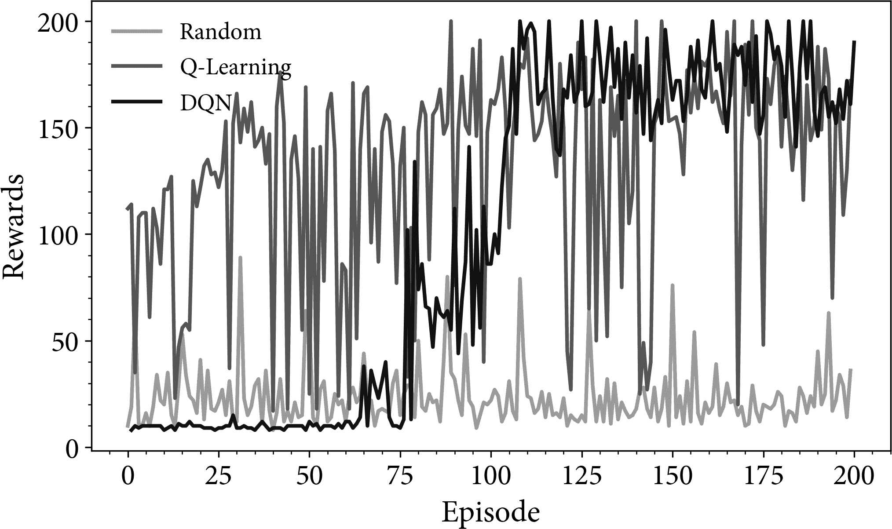

图 4-2 至 4-4 分别展示了随机、`Q-learning` 和 `DQN` 智能体的一个示例回合。`Q-learning` 和 `DQN` 的示例均持续 200 步，这是一个回合的最大步数。

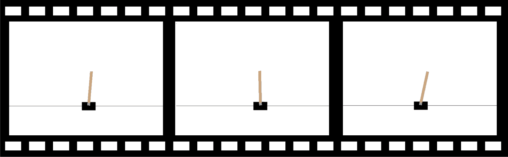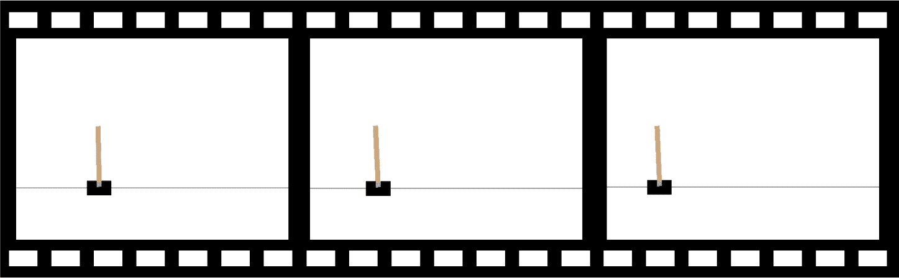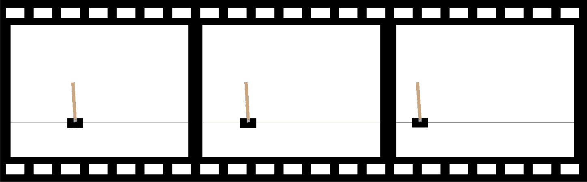

```html
<figure id="cartpole_example_random"> 
  <video controls="controls" style="margin: 0 auto; max-width: 100%;" src="videos/cartpole_random.mp4" loop="loop" autoplay="autoplay">The video element is not supported</video> 
  <figcaption>随机智能体在 CartPole 环境上的示例</figcaption> 
</figure> 
<figure id="cartpole_example_q_learning"> 
  <video controls="controls" style="margin: 0 auto; max-width: 100%;" src="videos/cartpole_q_learning.mp4" loop="loop" autoplay="autoplay">The video element is not supported</video> 
  <figcaption>Q-learning 智能体在 CartPole 环境上的示例。</figcaption> 
</figure> 
<figure id="cartpole_example_dqn">
  <video controls="controls" style="margin: 0 auto; max-width: 100%;" src="videos/cartpole_dqn.mp4" loop="loop" autoplay="autoplay">The video element is not supported</video> 
  <figcaption>DQN 智能体在 CartPole 环境上的示例。</figcaption> 
</figure>
```

## 为什么要在线训练？

此时你可能会问，为什么要在线训练。你可以从环境中生成并存储 200 个回合的数据，然后以监督学习的方式离线训练模型。对于简单环境这虽可行，但效率低下。生成数据时，智能体仍需遵循某个策略。你可以选择随机策略，但这不太可能生成长回合。以 `CartPole` 环境为例。你认为随机策略需要多少次尝试才能达到 200 个时间步？很多。在大多数应用中，智能体需要在线学习，以便观察后续状态。

第二个原因是智能体必须产生*反事实*动作（可能并非最优的动作），以确认它确实拥有最优策略。这是探索的核心。动作产生新的、未见过的轨迹。其中之一将是最优的。如果你没有序列环境，或者不需要探索来寻找最优策略，则使用标准机器学习。我在“从离线数据学习”中进一步讨论这一点。

## 哪个更好？DQN 对比 Q-learning

结果表明，标准 `Q-learning` 与 `DQN` 一样好。而且我没有应用 “Q-Learning 的扩展” 中看到的任何 `Q-learning` 改进。考虑到增加 `NN` 的复杂性，为什么要用 `DQN`？

为了让 `Q-learning` 奏效，我不得不大幅减少信息量。我移除了半数特征，并对剩余特征进行量化，仅留下约 150 个离散值。为了找到这些设置，我必须进行特征工程，包括尝试许多其他特征组合和量化级别——这项工作本身就能写成一本书。如果你想在生产环境中运行此类模型，这可能值得付出努力，因为简单性会使决策更易解释，模型也会更稳健、更高效、更稳定，等等。

使用 `DQN` 时，我什么都没改。`NN` 能够接收原始信息，弄清哪些特征重要，并告诉我哪个动作是最优的。模型可以融入连续值，使结果比表格方法更精细。如果你的领域更复杂且特征工程变得困难，`NN` 可以是一个高效的解决方案。但要注意所有常见的 `NN` 警示依然适用：它们需要大量数据，容易过拟合，对初始条件和超参数敏感，不具备韧性或鲁棒性，且易受对抗攻击（参见“安全 RL”）。

## 案例研究：降低建筑能耗


## 利用强化学习提高建筑能效

欧盟约 40% 的能源用于建筑供电和供暖，这占温室气体排放量的约 25%。^(6) 有一系列技术有助于降低建筑能耗，但其中许多具有侵入性且昂贵。然而，微调建筑供暖、通风和空调（HVAC）的控制适用于任何年代的建筑。Marantos 等人提出在智能恒温器中使用 RL 来提高建筑供暖系统的舒适度和效率。^(7)

## 马尔可夫决策过程定义

他们首先定义马尔可夫决策过程。状态由室外气象传感器（如温度和日照量）、室内传感器（如湿度和温度）、用于量化用量的能源传感器以及热舒适度指示拼接而成。

## 智能体动作

智能体可从三个动作中选择：维持温度、升高一度、降低一度。

## 奖励函数

奖励通过热舒适度和能源用量的组合来量化，该组合使用滚动均值和标准差进行缩放，从而无需使用任意缩放参数。由于这主要是一个连续问题，Marantos 等人引入了终止状态以防止智能体超出边界：如果智能体试图超出预定义的运行窗口，则会受到惩罚。

## 算法选择：NFQ

Marantos 等人选择使用神经网络拟合 Q 迭代（NFQ）算法，它是 DQN 的前身。DQN 与 NFQ 思路相同，只是额外包含了经验回放和目标网络。他们使用前馈多层感知机作为状态表示函数来预测二元动作。

## 评估结果

他们使用多项类似工作中采用的仿真来评估其实现。该仿真对应位于希腊克里特岛的一座实际建筑，使用公开的天气信息。与标准基于阈值的恒温器相比，智能体能将平均能耗降低高达 59%，具体取决于所选的舒适度水平。

## 嵌入式设备上的实现

一个不常见的有趣想法是，Marantos 等人在 `Raspberry Pi Zero` 上实现了该算法，并证明即使有神经网络，他们也拥有足够的计算资源来训练模型。

## 未来改进

如果我要帮助改进这个项目，首先考虑的是切换到 DQN 或其衍生算法之一，以提高算法性能。由于经验回放和目标网络，NFQ 明显弱于 DQN。这一变化将带来更好的样本效率，并受益于使用行业标准技术。我喜欢使用嵌入式设备进行计算，并会通过考虑整栋建筑中的多个智能体来扩展这一点。在这种多智能体设置中，智能体可以协作以优化不同区域的温度舒适度，例如卧室更凉爽，或客厅过夜时完全关闭。

最后，这不仅适用于供暖。智能体可以轻松提高照明效率、热水使用效率和用电效率，所有这些都有文档案例研究。您可以在[配套网站](https://rl-book.com/applications/?utm_source=oreilly&utm_medium=book&utm_campaign=rl)上找到更多信息。

## Rainbow DQN

作为 Q-learning 的衍生算法，您可以使用“Q-Learning 的扩展”中看到的扩展来改进 DQN。2017 年，研究人员利用六种扩展创建了 Rainbow DQN，每种扩展都解决了 Q-learning 和 DQN 的根本问题。研究人员还进行了实验，以查看哪种扩展对性能提升最大。^(8)

您已经看到了前两种改进：双 Q-learning（见“双 Q-Learning”），用于缓解最大化偏差；以及 `n` 步回报（见“n 步算法”），用于累积多个未来步骤的奖励。

## 分布式 RL

与标准 DQN 最根本的区别在于将概率重新引入智能体。所有 Q-learning 智能体都源自贝尔曼方程（公式 2-10），该方程将最优轨迹定义为使期望奖励最大化的动作。这里的关键词是*期望*。Q-learning 将其实现为指数衰减平均值。每当您使用汇总统计量时，都意味着对底层分布做出假设。通常，如果您选择均值作为汇总统计量，就会隐含假设数据服从正态分布。这正确吗？

例如，想象您在 `Cliffworld` 环境中站在悬崖边平衡。如果您掉下悬崖，会获得巨大的负奖励。但沿着悬崖边行走也有更大（但接近零）的奖励。“Q-Learning 与 SARSA” 表明 SARSA 遵循远离悬崖的平均“安全”路径。Q-learning 选择了靠近悬崖的冒险路径，因为到达目标的步骤较少，导致期望回报略高。`Cliffworld` 环境中的所有状态都导致两种结果。两种结果都有自己的分布，表示探索可能导致智能体达到替代结果的小概率。期望回报不服从正态分布。一般来说，奖励是*多模态*的。

现在想象一个类似 `Cliffworld` 的环境，其中成功与失败的差异没有那么大。假设成功奖励为 +1，失败奖励为 -1。那么，对于至少某些状态，期望回报将接近零。在这些状态下，平均期望值产生的动作没有任何差别。这可能导致智能体在无意义的状态中随机游荡（可将其与损失函数变得过于平坦时陷入平台期的梯度下降算法相比较）。这在图 4-5 中显示。一般来说，奖励分布要复杂得多。

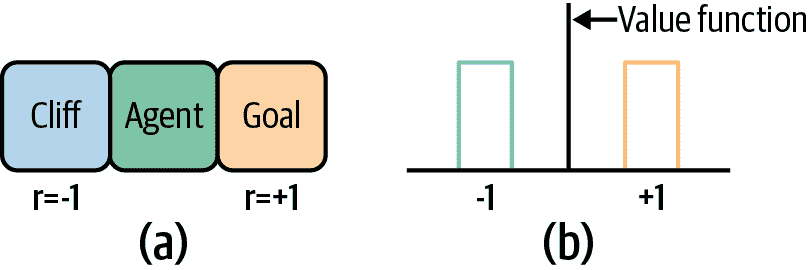

实际上，这会导致收敛问题。最坏的情况是智能体永远不收敛。当它收敛时，研究人员常将智能体描述为“抖动”。即智能体收敛但从未稳定。它可能像图 4-6 那样振荡，也可能更复杂。注意，这不是抖动的唯一原因。

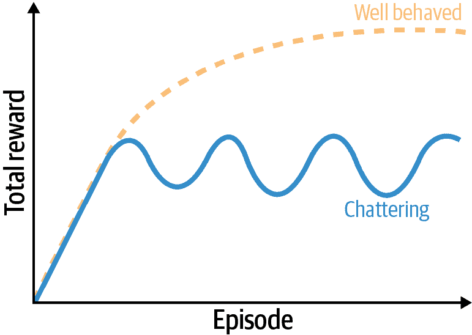

学习*奖励分布*可以带来更稳定的学习。^(9) Bellemare 等人重新表述了贝尔曼方程，以考虑您在公式 4-3 中看到的随机奖励，其中 `γ` 是折扣因子，`R` 是取决于状态和动作的随机奖励。

### 公式 4-3. 分布式贝尔曼方程

```
Z(s,a) ∼ R(s,a) + γZ(S′,A′)
```

这里我暂时打破本书惯例，使用大写字母表示随机变量。`Z` 表示奖励分布。`Z` 的期望是 Q 值。与 Q 值一样，`Z` 应根据接收到的奖励递归更新。关键区别在于强调期望回报 `Z` 是一个分布在所有未来状态 `S` 和未来动作 `A` 上的随机变量。换句话说，策略 `Z^π` 是从状态-动作对到期望回报分布的映射。这种表示保留了多模态性，Bellemare 等人认为这能带来更稳定的学习。我建议您观看[此视频](https://oreil.ly/vTVHj)，以查看 `Space Invaders` 游戏中学习到的奖励分布示例。


## C51

这个想法的第一个化身是一个称为 C51 的算法。它提出了两个关键问题。如何表示分布？如何为公式 4-3 创建更新规则？用于模拟回报的分布或函数的选择很重要。C51 使用离散参数分布，换句话说就是回报的直方图。C51 中的“51”指的是研究人员实现中选择的直方图箱数，并暗示性能与箱数成正比，尽管存在边际效应递减。

为了生成分布的估计，Bellemare 等人构建了一个具有 51 个输出“箱”的神经网络。当环境产生一个落入某个箱中的奖励时，智能体可以训练神经网络来预测该箱。这现在变成了一个监督分类问题，智能体可以使用交叉熵损失进行训练。C51 中的“C”指的是智能体正在预测类别。

## 优先经验回放

下一组改进与神经网络有关。在 DQN 中，转移是从经验回放缓冲区中均匀采样的（参见“深度 Q 学习”）。该批次很可能包含智能体已经见过多次的转移。最好包含那些有很多东西可学的区域的转移。*优先经验回放*以与时序差分更新的绝对误差成正比的概率对经验回放缓冲区进行采样（参见公式 3-6）。^(10) Schaul 等人修改了这一想法，引入了 `n` 步绝对误差，而不是单步。

## 噪声网络

在复杂环境中，`ϵ`-贪婪算法可能很难偶然发现成功的结果。一个称为*噪声网络*的想法是通过在神经网络中添加噪声来增强 `ϵ`-贪婪搜索。^(11) 回想一下，神经网络是给定状态下潜在动作的模型：一种策略。直接对神经网络施加噪声可以在当前策略的背景下进行随机搜索。当模型针对给定状态经历了足够多的转移时，它将学会忽略噪声（因为噪声是随机的）。但新状态将继续保持噪声，从而允许上下文感知探索和自动退火（参见“改进 `ϵ`-贪婪算法”）。

## 决斗网络

在 Q 学习算法中，期望值估计（Q 值）通常非常相似。甚至通常没有必要计算期望值，因为两种选择可能导致相同的结果。例如，在 `CartPole` 环境中，如果智能体已经学会在杆子倒下前挽救它，那么第一个动作不会有太大区别。因此，学习状态价值函数是有意义的，而不是像我自从“用动作价值函数预测奖励”以来一直使用的动作价值函数。这样每个观测就可以更新整个状态，这应该会导致更快的学习。然而，智能体仍然需要选择一个动作。

想象一下，如果你能准确预测状态价值函数。回想一下，这是该状态下所有动作的期望（平均值）。因此，我可以表示相对于该平均值的单个动作。研究人员称之为*优势函数*，它定义在公式 4-4 中。为了恢复 Q 学习所需的动作价值函数，你需要估计优势函数和状态价值函数。

### 公式 4-4. 优势函数

`A`^(`π`)(`s`,`a`) ≐ `Q`^(`π`)(`s`,`a`) − `V`^(`π`)(`s`)

*决斗网络*通过创建一个具有两个*头*的单一神经网络来实现这一点，这两个头是预测输出。一个头负责估计状态价值函数，另一个负责估计优势函数。神经网络重新组合这两个头以生成所需的动作价值函数。^(12) 创新之处在于两个头输出上的特殊聚合器，它允许将整个神经网络作为一个整体进行训练。好处是状态价值函数更快、更容易学习，从而导致更快的收敛。此外，在优势估计中减去基线的效果提高了稳定性。这是因为 Q 学习的最大化偏差可能导致单个动作价值估计发生大幅变化。

## 示例：Atari 游戏上的 Rainbow DQN

DQN 论文推广了使用 Atari 游戏的奖励作为衡量智能体性能的指标。在本节中，我通过训练智能体玩两个 Atari 游戏：*Pong*（乒乓）和 *Ms Pac-Man*（吃豆人女士），重现了其中一些结果。我再次使用 [Coach](https://oreil.ly/HLkqv) 框架及其 Atari 预设。

Atari 环境是 [OpenAI Gym](https://oreil.ly/DAe39) 的一部分，并暴露原始的 Atari 2600 帧。每一帧都是一个 210 × 160 像素的图像，具有 RGB 128 位调色板。为了减少大量输入带来的计算复杂度，一种预处理方法通过抽取、裁剪和转换为灰度图来转换 210 × 160 × 3 数组。这将输入维度的数量减少到 84 × 84。智能体将奖励裁剪在 +/– 1 处，以统一 Atari 游戏的回报。

Atari 游戏有很多移动实体：例如子弹或幽灵。智能体需要了解这些实体的轨迹以做出适当反应，躲避子弹或逃离幽灵。更高级的智能体结合了时间依赖记忆，通常使用循环神经网络。DQN 及其衍生算法不这样做，因此智能体通常通过展平图像并连接成一个大数组，将多帧堆叠成单个观测。此实现合并四帧，智能体对后续四帧重复使用相同的动作。

## 结果

由于训练智能体所需的时间量，我选择运行两个实验。我使用了 Coach 库预设中的默认超参数设置。这些包括对 250,000 帧进行 `ϵ`-贪婪探索退火和低人工神经网络学习率。我在 Google Cloud Platform 上使用连接到荷兰单个 Nvidia Tesla P4 GPU 的 `n1-standard-4` 虚拟机训练智能体。

训练时间和大致成本在表 4-1 中描述。DQN 智能体平均需要 4.8 小时，花费 5.80 美元来训练一百万帧。Rainbow 智能体需要 7.6 小时，花费 8.50 美元以达到类似结果。注意这些值只是指标。它们受超参数严重影响，而两个智能体的超参数不同。研究表明，在查看所有 Atari 游戏的性能时，Rainbow 远超 DQN 的性能。

表 4-1. 在 Coach 框架中使用 DQN 和 Rainbow 智能体将 Atari 游戏 Pong 和 Ms Pac-Man 训练到相似水平的时间和成本

| 智能体 | 游戏 | 百万帧 | 时间 (小时) | 成本 (约美元) |
| --- | --- | --- | --- | --- |
| DQN | Pong | 2 | 10 | 12 |
| DQN | Ms. Pac-Man | 3 | 14 | 17 |
| Rainbow | Pong | 2.5 | 19 | 22 |
| Rainbow | Ms. Pac-Man | 3 | 23 | 26 |

这些结果突显了复杂性的指数级增长，导致训练时间很长。尽管有证据表明 Rainbow 能在更短的时间内产生更好的策略，但背景和情况很重要。你必须设计解决方案以满足你的特定需求。例如，使用 Rainbow 获得的性能提升可能无法证明计算成本近乎翻倍的合理性。然而，底层人工神经网络的训练代表了大部分成本。如果你能简化、调整或加速人工神经网络架构，价格将大幅下降。


图 4-7 显示了训练玩 *Pong* 时获得的奖励。Rainbow 智能体需要额外 0.5 百万帧才能获得与 DQN 相似的结果。这可能是由于不同的超参数设置。学习率 `α` 对于 DQN 设置为 1e-4。Rainbow 为该值的三分之二，即 6.25e-5。DQN 使用 `ϵ-greedy` 探索，但 Rainbow 使用参数噪声探索。我确信，使用相似的超参数，Rainbow 在此示例中将表现得至少与 DQN 一样好。

图 4-8 显示了 Ms. Pac-Man 游戏的奖励。我用 100 帧的移动平均平滑了奖励。这是因为由于幽灵的随机起始位置，奖励噪声大得多。例如，单局游戏可能奖励较低，因为那次幽灵出生在危险位置。在其他游戏中可能较高，因为幽灵出生在安全位置。我建议您在随机环境中工作时考虑奖励的分布。

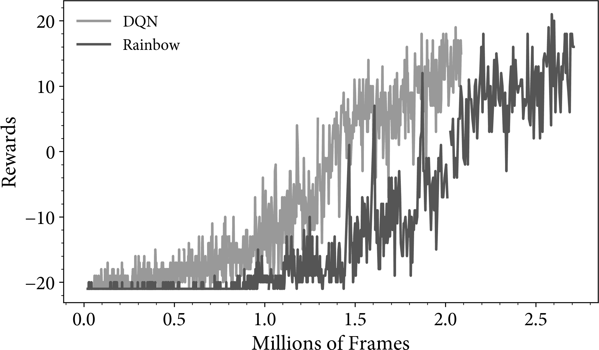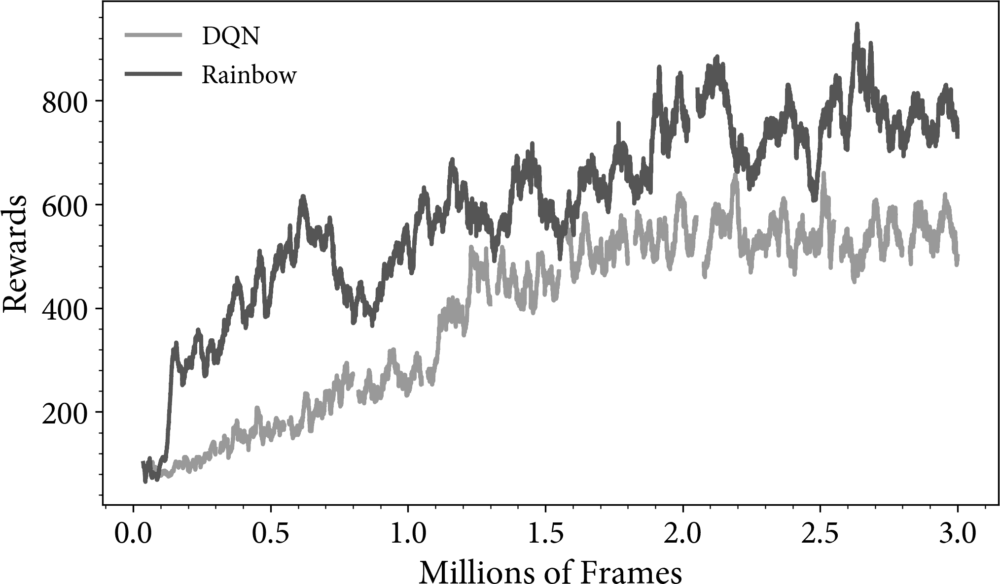

## 讨论

图 4-9 和 4-10 分别显示了 DQN 和 Rainbow 智能体在 *Pong* 中的一个完整回合。由于这些是单个回合，且训练每个智能体使用的超参数不同，你不应从结果中得出任何确定的结论。但你可以从人类的角度评论该策略。

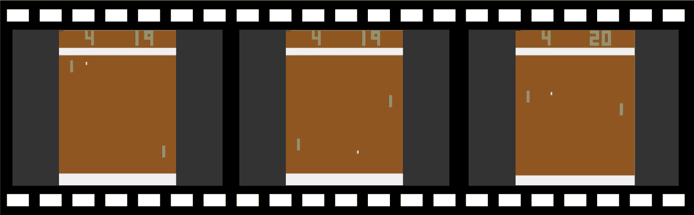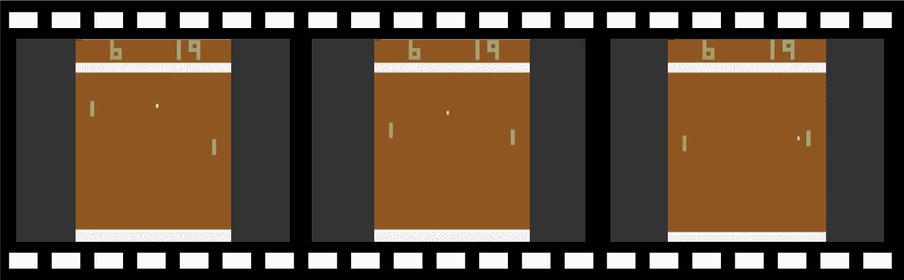

```html
<figure id="vid_pong_dqn"><video controls="controls" style="margin: 0 auto; max-width: 100%;" src="videos/pong_dqn_2m.mp4" loop="loop" autoplay="autoplay">The video element is not supported</video> <figcaption>An example of the trained DQN agent paying the Atari game Pong.</figcaption> </figure>
```

```html
<figure id="vid_pong_rainbow"><video controls="controls" style="margin: 0 auto; max-width: 100%;" src="videos/pong_rainbow_2_5m.mp4" loop="loop" autoplay="autoplay">The video element is not supported</video> <figcaption>An example of the trained Rainbow agent paying the Atari game Pong.</figcaption> </figure>
```

当我第一次给妻子看这些视频时，她的最初反应是“工作？得了吧！”但在我解释这是正经事后，她注意到当球不在附近时，挡板的移动是“躁动不安的”。这是因为动作对结果没有任何影响；Q 值几乎都相同，导致随机移动。当球靠近挡板时，智能体反应迅速，因为它已经学会了如果不靠近球就会输。

这两个智能体有细微的区别。DQN 倾向于用挡板边缘击球，而 Rainbow 倾向于挥拍击球。我怀疑这些行为是训练早停的产物。如果我运行这些实验达到 2000 万帧，我预测这些技术会趋于收敛，但那太昂贵了，所以我留作读者练习。

图 4-11 和 4-12 分别显示了 DQN 和 Rainbow 智能体在 Ms. Pac-Man 中的一个完整回合。两个智能体在躲避幽灵、收集豆子以及使用将 Ms. Pac-Man 传送到屏幕另一侧的传送门方面都做得值得称道。但总体而言，Rainbow 似乎表现优于 DQN。它还学会了寻找能量豆以便吃掉幽灵。Rainbow 几乎通关第一关，给予更多训练时间我确信它能做到。目前没有一个智能体学会吃水果获取额外分数，或在吃掉能量豆后主动猎杀幽灵，假设那确实是最优策略的话。

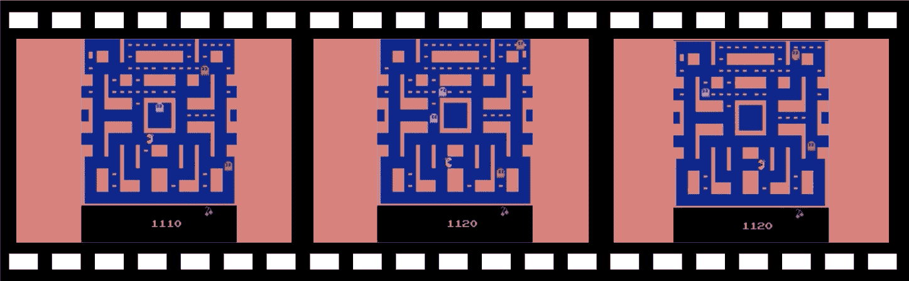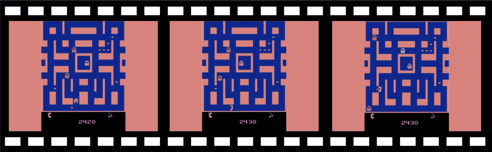

```html
<figure id="pacman_dqn"><video controls="controls" style="margin: 0 auto; max-width: 100%;" src="videos/ms_pacman_DQN_3m.mp4" loop="loop" autoplay="autoplay">The video element is not supported</video> <figcaption>An example of the trained DQN agent paying the Atari game Ms. Pac-Man.</figcaption> </figure>
```

```html
<figure id="pacman_rainbow"> <video controls="controls" style="margin: 0 auto; max-width: 100%;" src="videos/ms_pacman_rainbow_3m.mp4" loop="loop" autoplay="autoplay">The video element is not supported</video> <figcaption>An example of the trained Rainbow agent paying the Atari game Ms. Pac-Man.</figcaption> </figure>
```

## 其他 DQN 改进

**“Rainbow DQN”** 为 DQN 引入了六项改进。每个算法解决单一障碍，并概括了三个研究主题。(1) 神经网络应学习得更快并产生更有信息量的结果。(2) Q 学习不应不稳定或有偏差。(3) RL 应高效找到最优策略。你可以看到这些指的是三个不同的抽象层级。例如在 **Rainbow DQN** 中，优先经验回放试图改进神经网络的学习，双重 Q 学习有助于防止 Q 学习中的最大化偏差，分布式 RL 有助于在 RL 中学习更真实的奖励。在本节中，我将介绍其他专注于 DQN 的最新改进。

## 改进探索

`ϵ-greedy` 探索策略无处不在，旨在随机采样小型有限状态空间。但在复杂环境中，抖动方法（即随机扰动智能体）并不实用；它们需要呈指数增长的数据量。描述此问题的一种方式是想象由 Q 值表示的曲面。如果 Q 学习智能体反复选择次优状态-动作对，后续回合也会选择该对，就像智能体陷入局部最大值一样。一种替代方案是考虑其他采样方法。

“改进 `ϵ-greedy` 算法”引入了置信上界（`UCB`）采样，它使动作倾向于欠采样状态。这防止了对初始最优轨迹的过度采样。汤普森采样常用于 A/B 测试（见“多臂老虎机测试”），它维护表示期望值的分布。对 Q 学习而言，这意味着每个 Q 值是一个分布，而非期望。这与分布式 RL 背后的想法相同（见“分布式 RL”）。自举 DQN（`BDQN`）利用这一想法，训练一个具有多个头的神经网络来模拟 Q 值分布，即动作价值估计的*集成*。^(13) 这被分布式 `RL` 取代，后者能高效预测实际分布，而非粗略近似。但 Osband 等人巧妙地继续复用随机选择的策略以在未来也驱动探索。这引出了“深度探索”的想法。在复杂环境中，`ϵ-greedy` 像苍蝇一样移动，经常返回之前观察过的状态。深入寻找新的、未观察过的状态是合理的。在这里你也能看到与噪声网络的相似之处。


## 贝叶斯视角下的 Q 值

从贝叶斯视角来看，将`Q 值`建模为分布可以说是正确的方法，但通常计算复杂度较高。如果你将`神经网络`的每个`头`视为对同一`策略`的独立估计，那么你可以将它们组合成一个`集成`，并获得相似的性能。简而言之，`集成`是生成多个假设的算法组合。这种组合通常更稳健，且不易过拟合。以更高效的方式遵循独立策略（例如通过`UCB`采样）是实现“深度探索”的另一种途径。^(14,15) 另一个主要优势是，你可以遵循某个`头`提供的`策略`，从而在`状态空间`中搜索深度未探索区域并获益，随后再将这种学习成果共享给其他`头`。^(16) 更新的研究表明，尽管共享能加速学习，但更多样化的`头`能提升最终性能。^(17)

## 改进奖励

上一节使用单独的`策略`估计作为估计奖励分布的代理。`C51`（参见“分布式强化学习”）预测分布的`直方图`。这两种方法都不如直接逼近分布高效，例如在`C51`中选择`直方图`的边界和箱数。

一种更优雅的解决方案是估计目标分布的`分位数`。在选定`分位数`的数量后（这决定了估计的分辨率和`神经网络`中`头`的数量），`损失函数`会最小化预测`分位数`与实际`分位数`之间的误差。`自举 DQN`、`C51`、`集成 DQN`与该方法的主要区别在于`损失函数`。在采用`分位数回归`的`分布式强化学习`中，Dabney 等人用分位数等价物替换了`强化学习`中使用的标准`损失函数`（`Huber 损失`）。这使得在所有标准 Atari 游戏上的性能均有提升，但重要的是，它为你提供了奖励分布的高分辨率估计。^(18)

近期研究倾向于认为学习奖励分布是有益的，但原因并非你所预期。学习分布应提供更多信息，从而带来更好的策略。但研究人员发现，它对`神经网络`有正则化效应。换句话说，`分布式技术`可能有助于稳定学习，并非因为学习分布更数据高效，而是因为它约束了难以控制的`神经网络`。^(19)

## 从离线数据中学习

许多强化学习的工业应用需要从已收集的数据中学习。`批量强化学习`是在没有环境进一步交互的情况下，从固定数据集中学习`策略`的任务。这在交互昂贵、有风险或耗时的场景中很常见。使用数据库也能加快开发速度。该问题与通过示例学习密切相关，后者也称为`模仿学习`，详见“模仿强化学习”。

大多数`强化学习`算法通过与环境交互生成`观测值`。这些`观测值`随后存储在`缓冲区`中以供后续复用。这些算法能否在无交互的情况下工作，并完全`离线`学习？

在一个实验中，研究人员训练了两个智能体，一个通过交互学习，另一个仅使用第一个智能体的`缓冲区`。结果令人惊讶：在相同算法和相同数据集上训练时，`缓冲区训练智能体`的表现明显更差。

其原因源于统计学习理论：训练数据与测试数据不匹配。智能体生成的数据取决于其当时的`策略`。收集到的数据不一定代表整个`状态-动作空间`。第一个智能体能取得良好性能，是因为它拥有通过交互自我修正的能力。`缓冲区训练智能体`不具备这种能力，因此需要真正具有代表性的数据。

`优先经验回放`、`双 Q 学习`和`决斗 Q 网络`都通过使数据在最初更具代表性来缓解这一问题，但它们并未解决核心问题。`批量约束深度 Q 学习 (BCQ)` 提供了一个更直接的解决方案。实现相当复杂，但关键的新增点在于提供经验的不同方式。研究人员不是将原始`观测值`输入给`缓冲区训练智能体`，而是训练另一个`神经网络`，利用`条件变分自编码器`生成候选`动作`。这是一种允许你从特定类别生成`观测值`的`自编码器`。这通过仅生成通向`缓冲区`中状态的`动作`，起到了约束`策略`的作用。如果需要，他们还包含了通过向`动作`添加`噪声`来调整模型生成随机`动作`的能力。这有助于使最终的`策略`更稳健，通过填补采样后留下的`空白`。

最后一个修改是他们训练两个网络（类似`双 Q 学习`），以获得两个独立估计。然后对这些估计进行裁剪，生成低方差的`Q 值`更新，并由一个`超参数`加权。^(20)

图 4-13 对比了在`CartPole`环境中使用`Coach`进行的两个实验结果。首先，我使用标准`DQN`智能体生成一个转移`缓冲区`。然后将此`缓冲区`传入一个从不探索的第二个智能体。这模拟了你有一个在生产环境中运行的算法，并希望利用日志数据的情况。当你训练第二个智能体时，将无法探索，因为你无法执行动作。

在第一个实验中，我在`缓冲区`数据上训练了一个`DQN`智能体（灰线）。注意图(a)中奖励很差。原因是智能体不稳定，这由图(b)中发散的`Q 值`证明。智能体会尝试遵循`策略`到达不在`缓冲区`中的状态。`Q 学习`中的最大化步骤会导致对`Q 值`的过度乐观估计。因为智能体无法与环境交互，所以无法获取证据来反驳这一点。智能体将持续遵循错误的`Q 值`，且该值会不断增加。回想一下，在在线环境中，智能体可以对该状态进行采样以验证预期回报。这约束了`Q 值`。

在第二个实验中，我在`缓冲区`数据上训练了一个`BCQ`智能体（黑线）。注意图(a)中的奖励收敛和图(b)中稳定的`Q 值`。这主要归功于生成模型，它通过环境仿真（仿真的仿真）提供现实的回报估计，但在较小程度上也归功于独立`Q 值`估计的低方差采样。

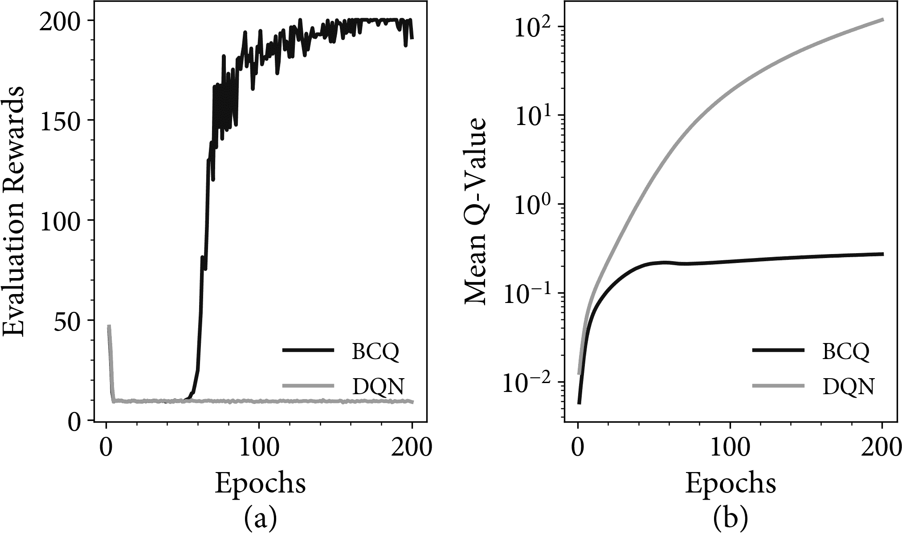

请注意，`自编码器`的使用增加了复杂性。对于`线性 Q 学习`等较简单的智能体，你可以利用更简单的生成模型，如`K 近邻`。^(21)

## 总结

在这次简要回顾中，你可以看到使用深度`神经网络`作为`函数逼近器`如何彻底改变并重振了 1991 年发布的`Q 学习`算法。我认为简要概述主要的`神经网络`架构很有用，但请参阅“延伸阅读”中的相关书籍以获取详细信息。


深度 Q 网络是突破性论文，但神经网络在强化学习中已应用许久。^(22) 鉴于神经网络的灵活性，你可以找到与深度学习论文数量相当的 DQN 改进方法。关键洞见在于：尽管非线性函数逼近器难以驾驭且可能不收敛，但它们拥有逼近任意函数的惊人能力。这为先前被认为过于复杂的应用打开了大门。

这种威力通过玩 Atari 游戏得到了展示，但如今你每天都能看到更多工业应用案例。本章标志着你对基础表格型方法探索的结束。在下一章中，我将重新定义寻找最优策略的问题。

#### 进阶阅读

### 机器学习

*   Provost, Foster, and Tom Fawcett. 2013. [*商业数据科学：数据挖掘与数据分析思维指南*](https://oreil.ly/gcJ09)。O’Reilly Media。
*   Raschka, Sebastian. 2015. *Python 机器学习*。Packt Publishing Ltd。

### 深度学习

*   Goodfellow, Ian, Yoshua Bengio, and Aaron Courville. 2016. *深度学习*。MIT Press。
*   Chollet, François. 2017. *Python 深度学习*。Manning Publications Company。

### 生成模型（自编码器等）

*   Foster, David. 2019. *生成式深度学习：教会机器绘画、写作、作曲与游戏*。O’Reilly Media。

## 参考文献

^(1) Tsitsiklis, J. N., and B. Van Roy. 1997. [“带函数逼近的时序差分学习分析”](https://oreil.ly/aK17s)。*IEEE 自动控制汇刊* 42 (5): 674–90。

^(2) Mnih, Volodymyr, Koray Kavukcuoglu, David Silver, Alex Graves, Ioannis Antonoglou, Daan Wierstra, and Martin Riedmiller. 2013. [“用深度强化学习玩 Atari”](https://oreil.ly/HOqeN)。ArXiv:1312.5602, December。

^(3) Zhang, Shangtong, and Richard S. Sutton. 2018. [“深入剖析经验回放”](https://oreil.ly/qnRKD)。ArXiv:1712.01275, April。

^(4) Isele, David, and Akansel Cosgun. 2018. [“用于终身学习的选择性经验回放”](https://oreil.ly/Wsk1d)。ArXiv:1802.10269, February。

^(5) Mnih, Volodymyr, et. al 2018. [“通过深度强化学习实现人类级别的控制”](https://oreil.ly/AU1td)。*自然* 518, 529–533。

^(6) [“聚焦欧盟能源：欧盟温室气体排放如何演变？”](https://oreil.ly/yLgeU)。n.d. Shedding Light on Energy on the EU. Accessed 12 September 2020。

^(7) Marantos, Charalampos, Christos P. Lamprakos, Vasileios Tsoutsouras, Kostas Siozios, and Dimitrios Soudris. 2018. [“面向即插即用智能恒温器的强化学习方法”](https://oreil.ly/ozLFF)。*In Proceedings of the Workshop on INTelligent Embedded Systems Architectures and Applications*, 39–44. INTESA 2018. New York, NY, USA: Association for Computing Machinery。

^(8) Hessel, Matteo, Joseph Modayil, Hado van Hasselt, Tom Schaul, Georg Ostrovski, Will Dabney, Dan Horgan, Bilal Piot, Mohammad Azar, and David Silver. 2017. [“Rainbow：深度强化学习改进的组合”](https://oreil.ly/wKDL4)。ArXiv:1710.02298, October。

^(9) Bellemare, Marc G., Will Dabney, and Rémi Munos. 2017. [“强化学习的分布视角”](https://oreil.ly/ODa3y)。ArXiv:1707.06887, July。

^(10) Schaul, Tom, John Quan, Ioannis Antonoglou, and David Silver. 2015. [“优先经验回放”](https://oreil.ly/0NPIN)。ArXiv:1511.05952, November。

^(11) Fortunato, Meire, Mohammad Gheshlaghi Azar, Bilal Piot, Jacob Menick, Ian Osband, Alex Graves, Vlad Mnih, et al. 2017. [“用于探索的噪声网络”](https://oreil.ly/TNcdO)。ArXiv:1706.10295, June。

^(12) Wang, Ziyu, Tom Schaul, Matteo Hessel, Hado van Hasselt, Marc Lanctot, and Nando de Freitas. 2015. [“用于深度强化学习的决斗网络架构”](https://oreil.ly/w4xRr)。ArXiv:1511.06581, November。

^(13) Osband, Ian, Charles Blundell, Alexander Pritzel, and Benjamin Van Roy. 2016. [“通过自举 DQN 进行深度探索”](https://oreil.ly/RmkiV)。ArXiv:1602.04621, July。

^(14) Lu, Xiuyuan, and Benjamin Van Roy. 2017. [“集成采样”](https://oreil.ly/7Bo99)。ArXiv:1705.07347, November。

^(15) Chen, Richard Y., Szymon Sidor, Pieter Abbeel, and John Schulman. 2017. [“通过 Q 集成进行 UCB 探索”](https://oreil.ly/c2e4v)。ArXiv:1706.01502, November。

^(16) Menon, Rakesh R., and Balaraman Ravindran. 2017. [“共享学习：增强 Q 集成中的强化”](https://oreil.ly/dYjc7)。ArXiv:1709.04909, September。

^(17) Jain, Siddhartha, Ge Liu, Jonas Mueller, and David Gifford. 2019. [“最大化整体多样性以改进深度集成中的不确定性估计”](https://oreil.ly/Ounz8)。ArXiv:1906.07380, June。

^(18) Dabney, Will, Mark Rowland, Marc G. Bellemare, and Rémi Munos. 2017. [“基于分位数回归的分布式强化学习”](https://oreil.ly/pLAuN)。ArXiv:1710.10044, October。

^(19) Lyle, Clare, Pablo Samuel Castro, and Marc G. Bellemare. 2019. [“期望与分布式强化学习的比较分析”](https://oreil.ly/jY6-f)。ArXiv:1901.11084, February。

^(20) Fujimoto, Scott, David Meger, and Doina Precup. 2019. [“无需探索的离线深度强化学习”](https://oreil.ly/6EdcI)。ArXiv:1812.02900, August。

^(21) Shah, Devavrat, and Qiaomin Xie. 2018. [“基于最近邻的 Q 学习”](https://oreil.ly/1VJH5)。ArXiv:1802.03900, October。

^(22) Gaskett, Chris, David Wettergreen, and Alexander Zelinsky. 1999. [“连续状态和动作空间中的 Q 学习”](https://oreil.ly/jMjWm)。In *Advanced Topics in Artificial Intelligence*, edited by Norman Foo, 417–28. Lecture Notes in Computer Science. Berlin, Heidelberg: Springer。
