# 第 5 章 策略梯度方法

第 2 章介绍了价值方法，它们允许智能体通过访问每个状态-动作对来学习期望回报。随后，智能体可在每个时间步选择最有价值的动作以最大化奖励。你了解了三种估计期望回报的不同方式——蒙特卡洛、动态规划和时序差分方法——但它们都试图量化每个状态的价值。

再思考一下这个问题。为什么要学习期望值？因为它们让你能迭代出最优策略。Q 学习通过反复最大化下一个期望值来寻找最优策略。但这是一条通往策略的间接路径。能否直接找到最优策略？答案是肯定的。基于策略的方法允许智能体在不查阅价值函数的情况下选择动作，并直接学习最优策略。

## 直接学习策略的优势


“最优策略”将策略定义为在给定状态下采取某个动作的概率。Q 学习通过驱动动作以产生最优策略来提供该策略。这种简化适用于确定性问题。以纸牌游戏二十一点（也称为 21 点或庞通）为例。你通过决定是否再抽一张牌来增加牌面数字的总和，或者不抽，即 `sticking` 保持现状来进行游戏。得分达到 22 分或更高，你就会因爆牌而输掉游戏。另一名玩家也这样做，得分最高者获胜。

一种确定性策略是达到 21 点时停牌，否则你每次都会输。价值法适合解决此类问题。但如果你的得分是 17，而另一名玩家看起来很紧张呢？在真实游戏中，你会根据对环境的观察做出预测，而在现实生活问题中，这种观察通常是随机的。确定性策略每次都会选择相同的动作，而不管对方虚张声势的可能性有多大。但随机策略可以根据随机观察作为倾向于某一方的证据，在两个选项之间随机选择。

使用随机策略提供了另一个好处；它完美地封装了探索困境。智能体可以根据任意概率选择动作，从而消除了对 `ϵ-greedy` 等强制探索策略的需求。对于包含函数近似（任何预测 `Q-values` 的算法）的问题，最佳近似策略可能是随机的。

另一个好处是随机策略的动作偏好会随时间平滑变化。动作-价值方法可能在两个几乎等概率的动作之间震荡，造成不稳定的转移。即使动作-价值估计相对稳定，这种情况也会发生；`Q-values` 的微小变化就足以显著改变策略。相比之下，随机策略提供了概率动作的能力，这可能产生更稳健的策略。

但关键区别在于策略可能更容易近似。工业问题往往涵盖一个范围。有时近似动作-价值函数更容易，有时直接获取策略更容易。在策略更容易近似的情况下，基于策略的方法学习速度会更快。

## 如何计算策略的梯度

本节的目标是建立一种推导最优策略的方法。通常情况下，你无法使用解析方法；策略可能是非线性的，且与环境的交互使得问题成为非平稳的（这意味着数据分布会发生变化）。第 4 章介绍了使用函数近似动作-价值估计的思想。之所以可行，是因为智能体可以存储与环境的先前交互以供后续使用。你可以利用类似的过程来寻找最优策略，但首先你需要定义你要解决的问题。

回顾一下，强化学习（RL）的目标是创建一个最优策略 `π*`，以最大化期望回报 `G`。如果你能完全观测所有可能的轨迹，就可以直接推导出最优策略。但通常排列组合的数量太大（对于连续状态或动作甚至是无限的）。相反，你可以创建一个策略的参数化模型，并调整参数直到找到一个好的策略。

例如，一种合理的长期指数买入策略可能是：市场上涨时持有，市场下跌时买入。这样当市场上涨时你获利，当市场下跌时你买入廉价资产。假设指数长期来看将继续上涨，这是一种安全、低波动的策略。此类策略的模型可以是一个描述指数当前趋势的线性系数。你可以通过测试线性参数的许多不同值来找到最优策略。但你该如何量化性能？

在优化领域，性能是一个函数 `J(θ)`，由模型的参数 `θ` 参数化。公式 5-1 在这种情况下是目标函数，即遵循策略 `π` 时总奖励的期望。

### 公式 5-1. 策略目标函数

```
J(θ) ≐ 𝔼_π[G|s,a]
```

### 公式 5-2. 标准梯度上升

```
θ←θ+α∇[θ]J(θ)
```

## 策略梯度定理

重述上一节，你试图计算相对于策略参数的总奖励梯度。这将告诉你如何调整参数以增加奖励。

但这取决于计算目标函数的梯度（公式 5-1）。这并不像看起来那么简单，因为求导需要一些稍微复杂的数学。但主要问题是梯度上升假设数据分布是平稳的。基于策略的智能体将在生成轨迹的同时更新策略。这就像试图在站在毯子上时拉动它。我稍后将解决非平稳问题；现在让我们继续进行梯度推导。

我认为让你看到梯度是如何推导出来的很重要，所以我努力将推导过程简化到极致。最好逐行阅读此推导，并参考下方的解释。你可以在“延伸阅读”中的资源里找到正式推导。我移除了对 `θ` 的引用；在所有情况下，策略 `π[θ]` 都由其参数 `θ` 定义。另请注意，此推导针对的是无折扣情况。该推导的结果如公式 5-3 所示。

### 公式 5-3. 策略的梯度

$$\begin{array}{rlr} {\nabla J\left( \theta \right) \doteq \nabla{\mathbb{E}}_{\pi}} & \left\lbrack {G \mid s,a} \right\rbrack & \text{(1)} \\ {= \nabla\sum\limits_{a \in \mathcal{A}}} & \left\lbrack {Q\left( s,a \right)\pi\left( a \mid s \right)} \right\rbrack & \text{(2)} \\ {\propto \sum\limits_{a \in \mathcal{A}}} & \left\lbrack {Q\left( s,a \right)\nabla\pi\left( a \mid s \right)} \right\rbrack & \text{(3)} \\ {\propto \sum\limits_{a \in \mathcal{A}}} & \left\lbrack {Q\left( s,a \right)\pi\left( a \mid s \right)\frac{\nabla\pi\left( a \mid s \right)}{\pi\left( a \mid s \right)}} \right\rbrack & \text{(4)} \\ {\propto \sum\limits_{a \in \mathcal{A}}} & \left\lbrack {Q\left( s,a \right)\pi\left( a \mid s \right)\nabla\ln\pi\left( a \mid s \right)} \right\rbrack & \text{(5)} \\ {\propto {\mathbb{E}}_{\pi}} & \left\lbrack {G\nabla\ln\pi\left( a \mid s \right)} \right\rbrack & \text{(6)} \\ \end{array}$$

目标是找到目标函数（公式 5-1）的梯度，我在步骤 (1) 中对此进行了描述。


在步骤 (2) 中，我用一个实现替换了期望回报。你可以选择任意一个，但如果你选择动作价值函数，数学推导会简单一些。期望回报等于每个动作的价值 `Q` 乘以访问该动作的概率（由策略 `π` 定义）。

> **警告**
>
> 方程 5-1 在步骤 (2) 和 (3) 之间包含大量数学推导。其结果形式上表明梯度依赖于状态分布。换句话说，梯度与处于某一状态的概率成正比；如果无法到达某个状态，则它不影响梯度。因此，梯度仅与策略的变化成正比。我决定隐藏这些步骤和状态分布，因为最终由于期望的回归，它们会相互抵消。如果你对形式化证明感兴趣，请参阅 “延伸阅读” 中的资源。

梯度是针对策略参数求取的，因此我可以在步骤 (3) 中将动作价值函数 `Q` 移到梯度计算之外。

步骤 (4) 使用了一个事后诸葛亮才显而易见的数学小技巧。我将整个方程乘以 `π(a|s)/π(a|s)`，其值等于 1，因此不改变方程。

步骤 (5) 使用了一个常见的数学恒等式 `∇ln x = ∇x/x`，用自然对数替换分数。这是一个常见的计算技巧，用于防止小概率相乘导致梯度趋于零（这被称为梯度消失问题）。

最后在步骤 (6) 中，回顾一下动作价值乘以动作概率的和正是我在步骤 (2) 开始时的内容。因此，我可以不求所有动作的和，而是让智能体遵循策略，并返回该特定动作随时间的期望。

这就是策略梯度算法的推导。总结一下结果：回报关于策略的梯度等于回报的期望值乘以策略的梯度。换句话说，期望回报放大了策略的梯度。这很合理，因为当期望值较高时，我们更倾向于大幅调整策略参数。

> **提示**
>
> 关键洞见在于回报 `G` 可以用多种方式估计。这也是许多著名策略梯度算法之间的唯一区别。我将在 “基础策略梯度算法比较” 中回到这个话题。

方程 5-3 中的步骤 (6) 是一个可以在每个时间步采样的量，其期望等于梯度。你可以将其代入梯度上升算法（方程 5-2）中，为智能体生成一个更新规则，如 方程 5-4 所示。

### 方程 5-4. 策略梯度更新规则

```math
θ ← θ + α G ∇ln π(a|s,θ)
```

## 策略函数

请参考 方程 5-4。策略梯度算法缺少两个关键细节。第一个是 `G` 的定义，我将在 “基础实现” 中讨论。

第二个是策略的梯度。我需要计算 `∇ln π(a|s,θ)`，为此我需要指定我的策略函数。

我必须承认，需要设计另一个模型让我感到绝望，但这个选择很重要。策略决定了你的智能体在环境中规划所有可能轨迹的能力。它需要足够复杂以处理复杂轨迹，但又要足够简单以便学习。已经有一些尝试试图自动化这一过程。^(1)

但主要优势，也是策略梯度方法流行的主要原因之一，是你可以选择*任意*函数，只要它输出概率分布且关于 `θ` 可微。如果模型是你的珍珠，那么世界就是你的牡蛎。

## 线性策略

如果你使用的库执行自动微分，如 `TensorFlow` 或 `PyTorch`（通过反向传播），那么你甚至不需要考虑导数。但我认为考虑一个简单的情况有助于提供直觉。

### 逻辑斯谛策略

你需要一个函数，给定状态预测动作：`πθ`。回顾一下，策略有两个要求：必须输出概率，且必须可微。想象一下，你正在解决一个具有两个离散动作的问题，比如 `CartPole` 环境，你必须决定将小车向左还是向右移动（有关环境描述请参见 “示例：CartPole 环境上的 DQN”）。该问题变成了给定某些输入预测两个类别之一的任务；它必须输出概率。这类问题的自然选择是逻辑斯谛函数，常用于分类，因为它简单、线性、易于微分，且自然输出概率估计（根据逻辑斯谛分布，其尾部比正态分布更厚）。以零为中心、最大值为 1 的逻辑斯谛函数如 方程 5-5 所示（也称为 *sigmoid 函数*）。

### 方程 5-5. 逻辑斯谛函数

```math
f(x) ≜ 1 / (1 + e^{-x})
```

`CartPole` 环境有四个状态，因此 `θ` 是一个包含四个权重的向量。要使用此策略函数，输入状态和权重的当前估计值，它将输出选择某个动作的概率。一开始，权重是随机分布的，训练过程中它们会被推向选择更好的动作。如果你习惯做监督机器学习，这些步骤听起来会很熟悉。

通常你可以使用多个逻辑斯谛函数来建模多类问题中的概率（这等同于我在 “Softmax 策略” 中使用的 `softmax` 函数）。但由于该环境只有两个动作，且 方程 5-5 的输出范围是 0 到 1，你可以将一类的概率设为 `f(θ,s)`，另一类的概率设为 `1 - f(θ,s)`。这是 *哑变量编码*，用于数据清洗。基于逻辑斯谛函数、给定状态 `s` 预测动作 `a` 的策略如 方程 5-6 所示。

### 方程 5-6. 逻辑斯谛策略

```math
π_θ(a|s) ≜ ( π_θ(a=0|s) , π_θ(a=1|s) )^T = ( 1/(1+e^{-θ_0^T s}) , 1 - 1/(1+e^{-θ_1^T s}) )^T
```

方程 5-4 提供了改进权重的方程，但你需要 方程 5-6 的梯度来实现这一点。结果如 方程 5-7 所示，完整计算请见 附录 A。

### 方程 5-7. 逻辑斯谛策略梯度

```math
∇ln π(a|s,θ) = ( s - s π(θ_0^T s) , -s π(θ_1^T s) )^T
```


梯度具有直观的解释。公式 5-7 表示观测状态与策略预期状态之间的差值。

## Softmax 策略

你可以将 softmax 函数视为 logistic 函数的多分类版本。这意味着你可以用它来表示从多个动作中选择某个动作的概率。Softmax 策略定义见 公式 5-8。

### 公式 5-8. Softmax 策略

```
\pi_{\theta}\left( a \mid s \right) \doteq \frac{e^{\theta^{\intercal}s}}{\sum_{a}e^{\theta_{a}^{\intercal}s}}
```

换句话说，公式 5-8 是一个类 logistic 函数，经过所有可能动作的归一化，以确保所有动作的概率之和为 1。对应的梯度如 公式 5-9 所示，完整推导过程见 附录 B。

### 公式 5-9. Softmax 策略梯度

```
\nabla\ln\pi\left( a \mid s,\theta \right) = s - \sum\limits_{a}s\pi\left( \theta^{\intercal}s \right)
```

与“Logistic 策略”类似，公式 5-9 中所示的梯度结果为观测特征向量与期望特征向量之间的差值。

## 任意策略

手动计算策略的导数让我能向你精确展示如何通过迭代改进策略。但总体而言，这一过程既繁琐又晦涩。相反，你可以通过以下三种方式计算导数：有限差分、自动微分和符号微分。

有限差分计算参数空间中一小步范围内策略的差值，`∇f(x) = (f(x+h)−f(x))/2h`。这很简单，但因步长 `h` 而容易产生数值误差。

自动微分工具（如 `JAX`，或 `TensorFlow`/`PyTorch`/`MXNet`/其他中的反向传播方法）试图追踪参数在方程中的使用情况以构建有向无环图（`DAG`）。`DAG` 库将每一步映射到相应的导数，并通过链式法则将它们组合起来。

符号微分（使用如 `SymPy` 等工具）实际上与自动微分相同，只是它通常单向工作（前向）。符号微分工具更强调重构，这可能产生更易理解的导数，而自动方法可能导致链式调用层层嵌套。

换句话说，如果你能利用库，我建议你不要手动求导。使用适合你用例的库。

## 基础实现

“策略函数”一节向你展示了如何提供 公式 5-4 所需的梯度函数。剩下的细节是 `G` 的用法。回顾一下，这是从某一点直到回合结束（如果是情节式任务）或永远（如果是持续式任务）的总奖励（参见“折扣奖励”）。

第 2–4 章展示了三种计算预期回报的不同方法，从蒙特卡洛、完整轨迹方法到近似、多步投影方法。这些实现细节是几种基础策略梯度实现（包括 `REINFORCE` 和 `actor-critic` 算法）之间的唯一区别。

## 蒙特卡洛 (REINFORSE)

第一个算法使用蒙特卡洛方法。它首先根据当前策略收集整个回合的轨迹。然后通过 公式 5-4 更新策略。

算法 5-1 展示了 `REINFORCE` 算法。在第 (6) 步中，`G` 指从时间 `t` 到回合结束的折扣奖励，类似于 算法 2-3。在第 (7) 步中，我使用 `G` 的值来加权策略的微分。微分计算的是由 `θ` 定义的选择某个动作概率需要调整的方向。`αγ^t G` 的集体加权定义了调整的幅度。我在第 (7) 步中也重新引入了折扣因子，它被从导数中提取出来，因为它不依赖于 `θ`。

### 算法 5-1. REINFORCE 算法

```
\begin{aligned} {\text{1:}} & {\mathbf{i}\mathbf{n}\mathbf{p}\mathbf{u}\mathbf{t}\text{:}\text{a}\text{differentiable}\text{parameterized}\text{policy}\pi\left( a \mid s,\theta \right)\text{,}\text{step}\text{size}\alpha > 0} \\ {\text{2:}} & {\text{Initialize}\theta\text{arbitrarily}} \\ {\text{3:}} & {\mathbf{l}\mathbf{o}\mathbf{o}\mathbf{p}\text{for}\text{each}\text{episode:}} \\ {\text{4:}} & {\text{Generate}\text{trajectory}\text{following}\pi\left( \cdot \mid \cdot ,\theta \right)} \\ {\text{5:}} & {\mathbf{f}\mathbf{o}\mathbf{r}\text{each}\text{step}\text{in}\text{episode} t\leftarrow 0,1,\cdots,T\text{:}} \\ {\text{6:}} & \left. G\leftarrow\sum\limits_{k = t + 1}^{T}\gamma^{k - t - 1}r_{k} \right. \\ {\text{7:}} & \left. \theta\leftarrow\theta + \alpha\gamma^{t}G\nabla\pi\left( a \mid s,\theta \right) \right. \\ {\text{8:}} & {\mathbf{e}\mathbf{n}\mathbf{d}\mathbf{f}\mathbf{o}\mathbf{r}} \\ \end{aligned}
```

### 示例：CartPole 环境上的 REINFORCE

策略梯度的优势体现在策略的低维度上。`CartPole` 环境有四个特征。线性策略有四个参数，分别加权每个特征的重要性。结果是对最佳行动方案的概率表示。如果杆子的角度接近倒下，则选择试图纠正该角度的动作的概率非常高。训练过程中获得的奖励如 图 5-1 所示。策略应着眼于更远的未来以获得良好的奖励，所以我设置 `γ` ≐ 0.99。我选择 `α` ≐ 0.01，因为在较高值下学习不稳定。

将此结果与“示例：CartPole 环境上的 DQN”中的表格实现进行比较。在那里，我必须使用神经网络来近似状态空间。而这里，我只用四个参数就实现了线性映射。其优雅性、实用性令人难以置信。

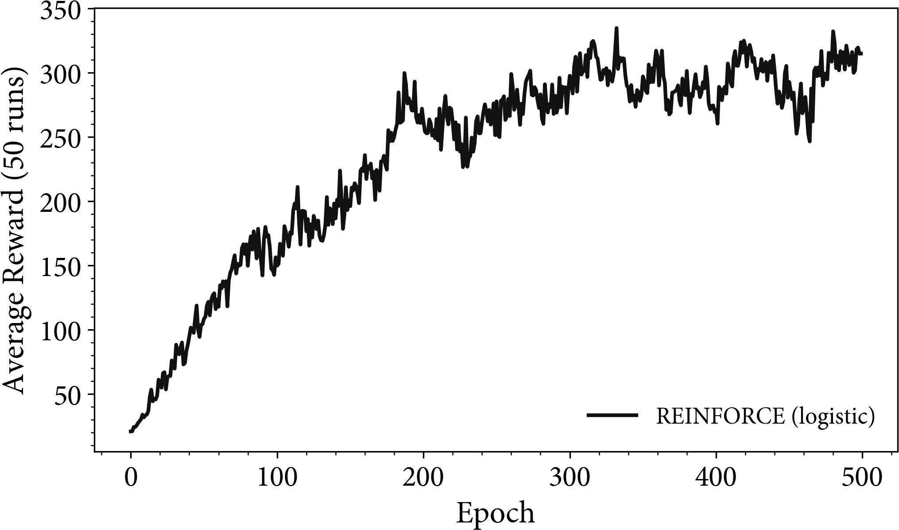

## 带基线的 REINFORCE

一种更常见的实现包含基线预期回报，如 “Dueling Networks” 中见到的优势函数（参见 公式 4-4）。这有助于改善因平均奖励大幅变化导致的梯度不稳定性。


## 带基线的 REINFORCE

想象一个场景（如 `CartPole`），它在每个时间步都给予奖励。这会在轨迹的早期时间步产生较高的期望回报。价值的巨大变化会导致梯度发生大幅更新（由公式 5-4 定义）。但智能体不应关心平均回报的运作机制；目标是找到最优动作。智能体应当学习每个动作相对于平均值如何提升期望回报。

优势算法通过维护给定状态下当前平均回报的预测来实现这一点，这等同于状态价值函数（参见公式 2-8）。和以前一样，你可以用多种不同的方式近似状态价值函数：表格方法或函数近似，例如。既然这是一个参数化的蒙特卡洛算法，那么以类似的方式更新参数化的状态价值估计是很自然的，即通过计算预测值与实际值之间的误差，并根据更新规则沿完整回合轨迹推动参数更新。

最终结果是学习稳定性的提高。减去基线意味着每次梯度更新不那么极端，从而导致梯度方差降低。从长远来看，你应该观察到学习过程中获得的奖励更加稳定。但这在很大程度上取决于状态空间的复杂性、是否可能预测状态价值函数以及动作的复杂性。在 `CartPole` 示例中，两者都非常简单，因此你应该预期与标准 `REINFORCE` 算法相比差异很小。

### 算法 5-2. 带基线的 REINFORCE 算法

```latex
\begin{array}{cl}
{\text{1:}} & {\text{输入：可微参数化策略 } \pi(a \mid s,\theta),} \\
& {\text{可微参数化状态价值函数 } V(s,w),} \\
& {\text{步长 } 0 < \alpha_w < 0 \text{ 和 } 0 < \alpha_\theta < 1} \\
{\text{2:}} & {\text{任意初始化 } \theta \text{ 和 } w} \\
{\text{3:}} & {\text{对每个回合循环：}} \\
{\text{4:}} & {\text{遵循 } \pi(\cdot \mid \cdot ,\theta) \text{ 生成轨迹：}} \\
{\text{5:}} & \left. \text{对回合中的每一步 } t\leftarrow 0,1,\cdots,T \text{：} \right. \\
{\text{6:}} & \left. G\leftarrow\sum\limits_{k = t + 1}^{T}\gamma^{k - t - 1}r_k \right. \\
{\text{7:}} & \left. \delta\leftarrow G - V(s,w) \right. \\
{\text{8:}} & \left. w\leftarrow w + \alpha_w\delta\nabla V(s,\alpha_w) \right. \\
{\text{9:}} & \left. \theta\leftarrow\theta + \alpha_\theta\gamma^{t}\delta\nabla\pi(a \mid s,\theta) \right. \\
{\text{10:}} & {\text{结束循环}} \\
\end{array}
```

### 示例：CartPole 环境上的带基线 REINFORCE

除实现算法 5-2 外，该实验与“示例：CartPole 环境上的 REINFORCE”中的实验几乎没有变化。主要的架构决策是状态价值估计 `V(s,w)` 的实现。在我的实验中，我一直难以找到一个简单的函数来拟合数据。这是因为底层状态出奇地复杂。

为了使实验尽可能简单，我决定使用先前观察到的奖励的滚动平均值；换句话说，就是平均奖励的在线实现。然后我重新训练智能体并保存状态和折扣奖励。接着我对状态执行主成分分析，将维度从四个降至一个，以帮助简化特征空间并实现绘图。

#### 注释

你可以在任何机器学习书籍中阅读更多关于降维和主成分分析的内容；一些推荐见“延伸阅读”。

图 5-2 显示了状态的主成分与折扣奖励的绘图。奖励在状态值零的周围形成三角形状。如果你保持状态值在零附近，预测值会更高。换句话说，如果状态值非零，通常会产生较低的总奖励，因为杆子正在倒下。我还发现有趣的是，这个图看起来很像一美元钞票背面的*天眸*。

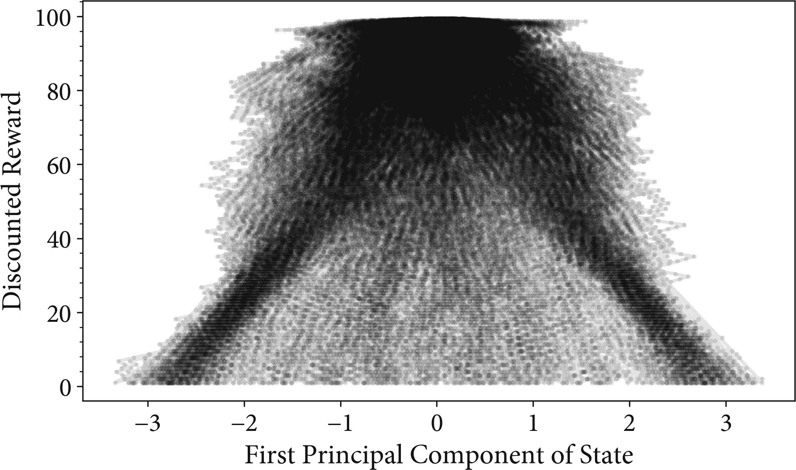

无论这种巧合的图像学意义如何，你都可以看到，简单的平均或线性近似无法很好地预测价值。此外，我仅展示了第一主成分用于绘图目的。数据在第二、第三和第四维度中也可能包含复杂性。

目前，我将坚持使用平均值的选择，并在“示例：CartPole 环境上的 n 步 Actor-Critic”中考虑更复杂的近似函数。但总的来说，考虑这种权衡很重要。你希望尽可能好地预测状态价值函数，但也希望函数近似是鲁棒的（意思是未见过的状态不应产生荒谬的结果）。

我的实验结果可见于图 5-3。我不得不在相同设置下运行 50 次不同的实验，才能获得具有统计显著性的结果。你可以看到，奖励最初跟踪标准 `REINFORCE` 算法，但后来发散。这表明基线算法稍微更稳定一些。在 `REINFORCE` 算法中，巨大的梯度更新意外地将智能体推回了更差的性能。基线智能体能够稳步继续提升性能。

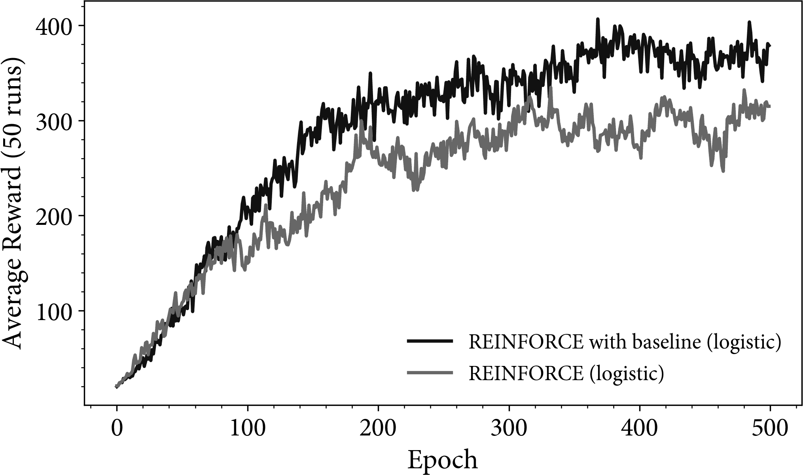

## 梯度方差降低

在“带基线的 REINFORCE”中，我陈述基线方法降低了梯度的方差。在 `REINFORCE` 或其他基本蒙特卡洛方法（参见“蒙特卡洛策略生成”）等算法中，目标是改变策略以最大化奖励。策略梯度方法通过向特定方向、以特定幅度推动策略来实现这一点。它们使用策略的导数计算方向。但对于 `REINFORCE`，幅度是当前的期望回报。


此问题在于后续样本在预期回报方面可能会经历巨大差异。例如，设想一种策略在 `CartPole` 环境中相当高效。杆子可能会因偶然因素在回合早期意外倒下。这将导致预期值出现巨大差异并引起大幅梯度更新。尽管该策略表现良好，智能体却被迫进行了大幅更新。

另一个例子是来自“示例：Atari 游戏上的 Rainbow DQN”的 `Pong` 环境。早期回合的奖励接近 –21。所有动作都导致负奖励。因为所有选项都很差，梯度更新会抑制所有动作。更好的解决方案是关注奖励的变化。智能体应使用动作与平均值相比的相对差异。

我记录了 `REINFORCE` 和 `REINFORCE with baseline` 算法单次运行的梯度更新。您可以在图 5-4 中看到梯度的标准差。请注意，经过一段时间的学习后，基线算法的标准差大幅下降，而 `REINFORCE` 算法仍持续产生改变策略的大梯度，即使在获得不错的奖励之后也是如此。文献中提到的“方差缩减”指的就是这一点：在不影响学习性能的前提下提高梯度稳定性的方法。

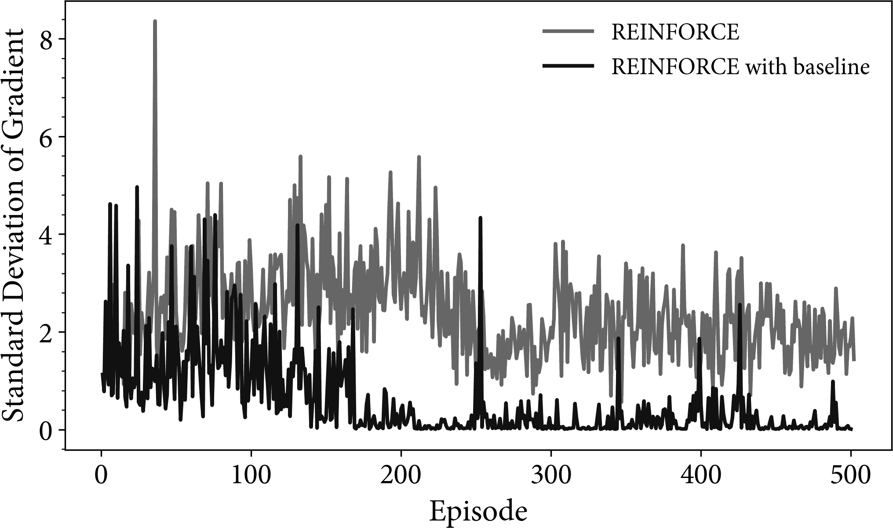

## n 步 Actor-Critic 与 Advantage Actor-Critic (A2C)

下一个改进遵循了表格方法所采取的路径。`Monte Carlo` 智能体不进行自举，这意味着它们必须等到回合结束才能进行任何学习。正如第 3 章所示，解决方案是采用时序差分方法直至 `n` 步方法。然而，基于策略梯度的 `n` 步算法有一种您以前未曾见过的有趣解释。

在深入之前，让我先描述一下 `n` 步实现，因为它与算法 5-2 有一处重大变化。在算法 5-3 的步骤 (5) 中，算法对每个时间步执行一次更新。这不再是 `Monte Carlo` 算法。自举（参见“n 步算法”）提高了学习速度，步骤 (8) 实现了自举，以提供单步更新 `G[t:t+1] ≐ r + γV(s',w)`，类似于公式 3-3。

### 算法 5-3：n 步 actor-critic

```
\begin{array}{cl} {\text{1:}} & {\text{input: a differentiable parameterized policy } \pi(a \mid s,\theta),} \\ & {\text{a differentiable parameterized state-value function } V(s,w),} \\ & {\text{step sizes } \alpha_w \text{ and } \alpha_\theta > 0} \\ {\text{2:}} & {\text{Initialize } \theta \text{ and } w} \\ {\text{3:}} & {\text{loop for each episode:}} \\ {\text{4:}} & {\text{Initialize } I\leftarrow 1, t\leftarrow 0, \text{ and } s} \\ {\text{5:}} & {\text{while } s \text{ is not terminal:}} \\ {\text{6:}} & {\text{Choose } a \text{ from } s \text{ using } \pi, \text{ breaking ties randomly}} \\ {\text{7:}} & {\text{Take action } a, \text{ observe } s', r} \\ {\text{8:}} & {\delta \leftarrow G_{t:t+n} - V(s,\theta)} \\ {\text{9:}} & {w \leftarrow w + \alpha_w \delta \nabla V(s,w)} \\ {\text{10:}} & {\theta \leftarrow \theta + \alpha_\theta I \delta \nabla \ln \pi(a \mid s,\theta)} \\ {\text{11:}} & {I \leftarrow \gamma I} \\ {\text{12:}} & {s \leftarrow s'} \\ \end{array}
```

算法 5-3 是对算法 5-2 的一种增量改进，引入了时序差分回报。但该算法远不止于此。您现在已经推导出一种算法，它可以在每一步同时学习策略及其状态价值函数，这与在整条轨迹上学习基线（受 `Monte Carlo` 启发的基线算法）形成对比。

这一区别很重要。策略学习并描述采取的最佳动作。在强化学习术语中，这被称为*演员*。`n` 步基线预测评价动作的后果，并用于更新策略。这就是*评论家*。它们共同构成了*actor-critic*（演员-评论家）算法的基础。注意，`Monte Carlo` 算法不被视为 actor-critic 算法，因为它们不是在每一步都更新。

这通常被称为优势演员-评论家（`A2C`）算法。我以这种方式呈现算法，是因为您熟悉第 3 章中的推导过程。但另一种建模问题的方式是将评论家视为相对于基线选择某个动作的收益度量。这正是公式 4-4 中优势函数的定义。

在策略梯度算法的背景下，唯一的区别是智能体按定义遵循当前最优策略，因此您无需计算每个动作的价值。您只需要策略即将访问的那些状态的价值。一种近似（在参考文献中已证明）呈现于公式 5-10 中。^(2)

### 公式 5-10：策略梯度算法的优势函数近似

```
\begin{array}{clr} {A^{\pi}(s,a)} & {\doteq Q(s,a) - V(s)} & \\ & {= r + Q(s',a') - V(s)} & {\text{(temporal-difference error)}} \\ & {\approx r + V_{\pi}(s') - V(s)} & {\text{(when the agent is following the optimal policy } \pi \text{)}} \\ \end{array}
```

可以直接估计优势函数或动作价值函数，但大多数实现使用状态价值版本以减少需要训练的模型数量。

另一个常见问题是算法 5-3 步骤 (11) 中 `I` 的必要性。当在策略梯度定理（公式 5-3）中包含折扣因子（参见“折扣奖励”）时，`γ` 是梯度计算外部的一个常数。但折扣因子取决于步数，在像这样的在线算法中，以这种方式实现是合理的，尽管如果您愿意，也可以简单地用 `γ^t` 替换它。

### 示例：CartPole 环境上的 n 步 actor-critic

此示例的目标是演示 `Monte Carlo`（参见“REINFORCE with Baseline”）与利用自举产生的时序差分策略梯度实现之间的差异。


回想一下，自举法需要一个函数来估计给定状态的期望回报。如果我像在“示例：CartPole 环境中的带基线 REINFORCE”中那样使用奖励的滚动平均值，那么 `V(s,w)` 和 `V(s′,w)` 的估计值将相同。这导致 `δ = r + (1-γ)V ≈ r`。在 `CartPole` 环境中，使用之前的基线会导致更新幅度为 1。换句话说，评论家没有意见。相反，你必须设计一个更能预测给定状态价值的函数。演员-评论家算法的学习性能取决于是否拥有准确的价值近似。

你在图 5-2 中看到，奖励是状态的复杂函数。状态和一些权重的简单线性组合无法建模这种复杂性。此时有一种趋势是直接跳到深度学习方法，但我仍然建议先尝试线性方法。它们更稳健，训练更快，也更难过拟合。在 `CartPole` 环境中，我可以对状态进行特征工程，以获得可通过权重线性组合学习的特征。

经过一些实验，我选择使用瓦片编码将最后两个状态（杆角度和角速度）转换为每个状态 10 个单元、重叠 5 个的网格（你可以在“转换为离散状态”中了解更多常见特征工程技术）。这产生了 605 个特征。我使用 605 个权重来学习这些特征的线性近似。设置与之前相同，除了权重的新衰减参数 `α[w] ≐ 0.1`。通常建议价值估计的学习率应大于或等于策略的学习率。换句话说，价值估计的学习速度应至少与策略一样快。

图 5-5 显示了有意将策略学习率 `α[θ]` 设置为与之前算法的最终学习性能相匹配的结果。

图 5-6 显示了将策略衰减率（针对演员-评论家和基线算法两者）增加到 `α[θ] ≐ 0.1` 后的结果。所有其他设置保持不变。衰减率的增加意味着对策略的更新幅度更大。策略变化更快。去掉“辅助轮”后，你可以看到 `n-step` 演员-评论家算法能够跟上。它在前 50 个回合中迅速增加奖励，并稳定在 400 左右的奖励（这取决于策略和状态价值函数的建模精度，而非学习率）。然而，基线算法无法学得更快。蒙特卡洛更新严重阻碍了学习性能。它们就像刹车一样；改变策略学习率没有效果（并可能影响长期稳定性）。

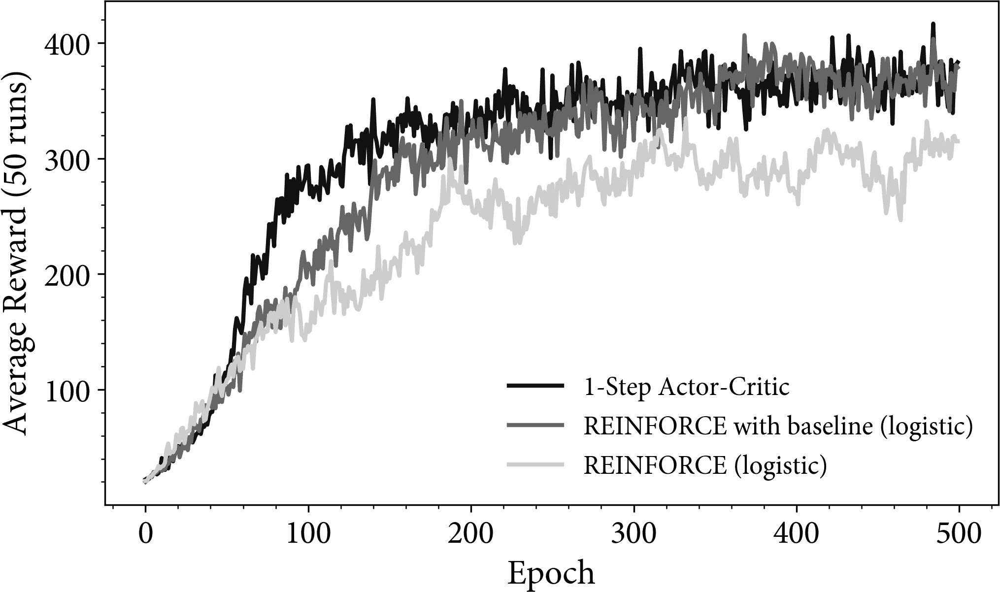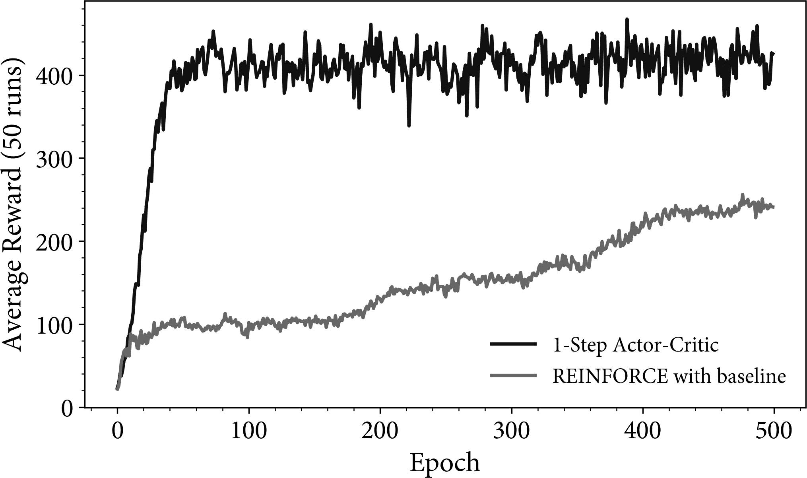

## 状态价值学习衰减率与策略衰减率

用 `α` 表示的衰减率参数调节更新中的跳跃幅度。既然这是一个梯度下降算法，选择衰减率要足够大以快速学习，但又要足够小以收敛到最优策略。但 `n-step` 策略梯度算法使用两个衰减率：一个用于估计状态价值函数的模型，另一个用于策略。

策略在其更新中使用状态价值估计，这引入了依赖性。将状态价值估计 `α` 设置为缓慢更新将限制策略。这是因为连续步骤中的时序差分误差将接近零，导致策略发生微小变化。将 `α` 设置为快速更新会导致时序差分误差发生过大变化，并导致策略发生剧烈变化。策略改变后，真实状态价值也会改变，状态价值估计将需要另一次大幅更新。最终结果是不稳定，智能体不太可能收敛。

图 5-7 中显示的结果来自 `CartPole` 环境中的一个实验，我在其中固定了策略衰减率 `α[θ] ≐ 0.1`，并改变了状态价值估计衰减率 `α[w] ≐ {0.01,0.1,0.5}`。结果表明最优衰减率约为 0.1，尽管从长远来看，0.01 的值可以榨取出更大的性能，因为较小的步长更接近全局最优。0.5 的值太大；它导致不稳定的更新并阻止收敛。

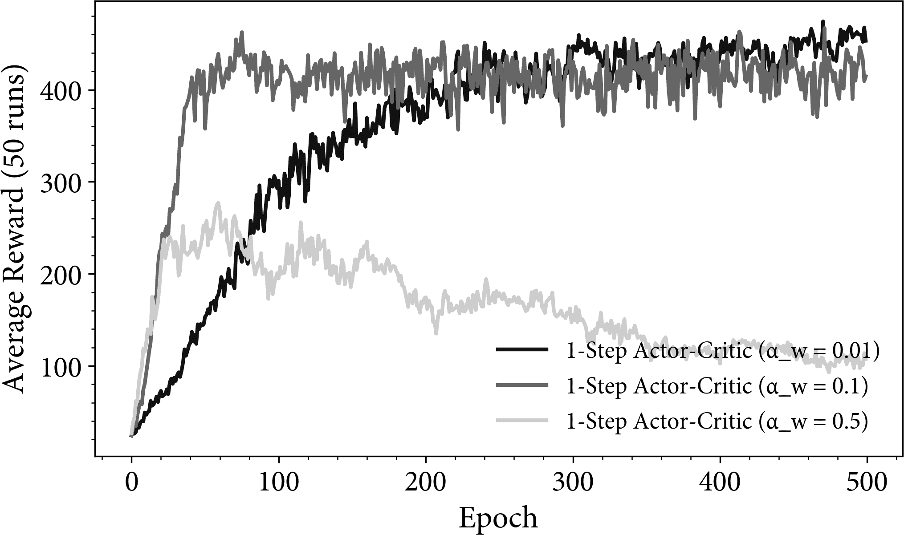

有一个著名的数学定理叫“免费午餐不存在”，我过度总结它为：没有单一的算法、实现或超参数适用于所有应用。同样，最优衰减率完全取决于问题和算法。你必须为每种新情况设计和调整智能体。^(3)

## 资格迹演员-评论家

继“资格迹”中的发展之后，算法 5-4 展示了一个基于资格迹的演员-评论家算法。和之前一样，它暴露了一个超参数，允许你控制自举的程度。迹衰减超参数的最优值取决于问题。较大的值更新远在过去经历过的权重。较小的值仅更新最近的权重。

算法 5-4 和 算法 5-3 的主要区别在于第 9 步和第 10 步中包含了跟踪要更新哪些状态的追踪器。这些最终会将价值估计权重 `w` 和策略权重 `θ` 朝着策略过去访问过的方向轻推。

### 算法 5-4. 带资格迹的演员-评论家


## 资格迹 Actor-Critic 算法

```latex
\begin{array}{cl} 
{\text{1:}} & {\mathbf{i}\mathbf{n}\mathbf{p}\mathbf{u}\mathbf{t}\text{:}\text{a}\text{differentiable}\text{parameterized}\text{policy}\pi\left( a \mid s,\theta \right),} \\ 
& {\text{a}\text{differentiable}\text{parameterized}\text{state-value}\text{function} V\left( s,w \right),} \\ 
& {\text{step}\text{sizes} 0 < \alpha_{w},\alpha_{\theta} < 1,\text{and}\text{trace-decay}\text{rates} 0 \leq \lambda_{\theta},\lambda_{w} \leq 1} \\ 
{\text{2:}} & {\text{Initialize}\theta\text{and} w\text{arbitrarily}} \\ 
{\text{3:}} & {\mathbf{l}\mathbf{o}\mathbf{o}\mathbf{p}\text{for}\text{each}\text{episode:}} \\ 
{\text{4:}} & \left. \text{Initialize} t\leftarrow 0,I\leftarrow 1\text{and} s, \right. \\ 
& \left. z_{w}\leftarrow 0\text{(same}\text{dimensionality}\text{as} w\text{)},\text{and} \right. \\ 
& \left. z_{\theta}\leftarrow 0\text{(same}\text{dimensionality}\text{as}\theta\text{)} \right. \\ 
{\text{5:}} & {\mathbf{w}\mathbf{h}\mathbf{i}\mathbf{l}\mathbf{e} s\text{is}\text{not}\text{terminal:}} \\ 
{\text{6:}} & {\text{Choose} a\text{from} s\text{using}\pi\text{,}\text{breaking}\text{ties}\text{randomly}} \\ 
{\text{7:}} & {\text{Take}\text{action} a\text{,}\text{observe} s^{'},r} \\ 
{\text{8:}} & \left. \delta\leftarrow r + \gamma V\left( s^{'},w \right) - V\left( s,\theta \right) \right. \\ 
{\text{9:}} & \left. z_{w}\leftarrow\gamma\lambda_{w}z_{w} + \nabla V\left( s,w \right) \right. \\ 
{\text{10:}} & \left. z_{\theta}\leftarrow\gamma\lambda_{\theta}z_{\theta} + I\nabla\ln\pi\left( a \mid s,\theta \right) \right. \\ 
{\text{11:}} & \left. w\leftarrow w + \alpha_{w}\delta z_{w} \right. \\ 
{\text{12:}} & \left. \theta\leftarrow\theta + \alpha_{\theta}I\delta z_{\theta} \right. \\ 
{\text{13:}} & \left. I\leftarrow\gamma I \right. \\ 
{\text{14:}} & \left. s\leftarrow s' \right. \\ 
\end{array}
```

### 示例：资格迹 Actor-Critic 在 CartPole 环境上的应用

我对“示例：CartPole 环境上的 n-step Actor-Critic”中的示例进行了微小修改，以加入衰减资格迹。该实验使用 `α_θ` = `α_w` = `λ_θ` = `λ_w` ≐ 0.1，你可以在图 5-8 中观察结果。

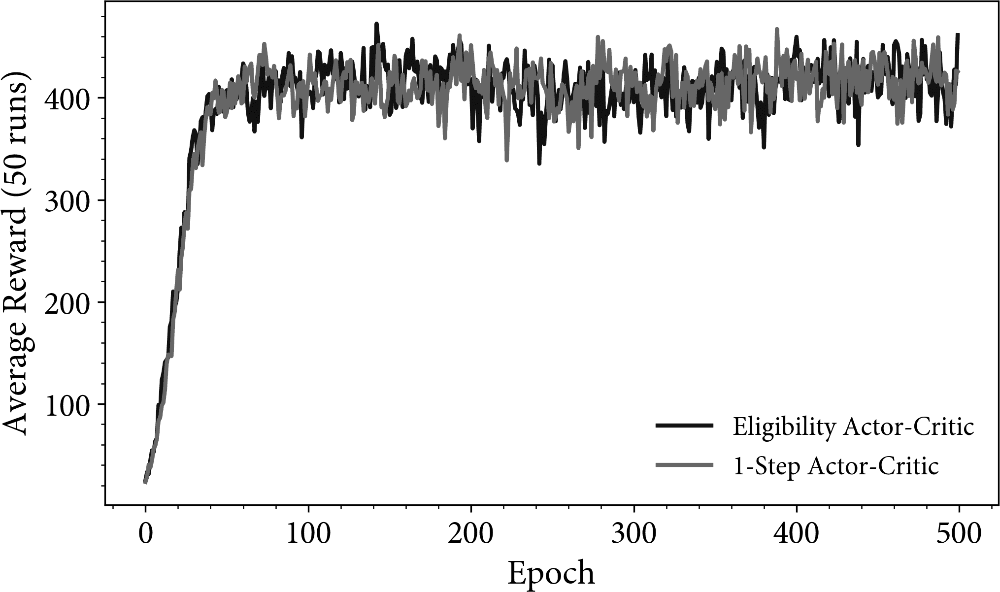

性能基本保持不变。这表明，在 `CartPole` 环境中，成功的智能体不需要远见。观察下一步潜在的失败就足够了。

改变 `λ` 的值影响不大，除了值为 0 的情况（此时没有时序差分更新）和值为 1 的情况（此时梯度爆炸）。在我的实验中，介于两者之间的所有值都导致了相似的结果。

在奖励稀疏或需要大量规划的环境中，多步时序差分估计表现出色。

## 基础策略梯度算法对比

本章介绍了策略梯度算法的四种不同实现。它们都使用梯度下降来迭代改进策略，但每种实现的价值估计方式不同。更好的价值估计能减少不必要的大幅更新；它能降低梯度的方差。

你可以在公式 5-11 中看到不同的形式。策略的梯度等于参数梯度乘以回报的期望。这些算法之间唯一的区别在于如何量化回报。我发现这种对策略梯度算法的高层解读很有启发性，因为它阐明了不同实现之间微妙的变化。

### 公式 5-11. 策略梯度算法的等价实现

```latex
\begin{array}{clr} 
{\nabla_{\theta}J\left( \theta \right)} & {\doteq {\mathbb{E}}_{\pi_{\theta}}\left\lbrack {\nabla_{\theta}\ln\pi_{\theta}\left( a \mid s \right)G} \right\rbrack} & \text{(REINFORCE)} \\ 
& {\doteq {\mathbb{E}}_{\pi_{\theta}}\left\lbrack {\nabla_{\theta}\ln\pi_{\theta}{\left( a \mid s \right)\left( G - \right.}V_{w}\left( s \right)} \right\rbrack} & {\text{(REINFORCE}\text{with}\text{Baseline)}} \\ 
& {\doteq {\mathbb{E}}_{\pi_{\theta}}\left\lbrack {\nabla_{\theta}\ln\pi_{\theta}\left( a \mid s \right)Q_{w}\left( s,a \right)} \right\rbrack} & \text{(Actor-Critic)} \\ 
& {\doteq {\mathbb{E}}_{\pi_{\theta}}\left\lbrack {\nabla_{\theta}\ln\pi_{\theta}\left( a \mid s \right)A_{w}\left( s,a \right)} \right\rbrack} & {\text{(Advantage}\text{Actor-Critic)}} \\ 
& {\doteq {\mathbb{E}}_{\pi_{\theta}}\left\lbrack {\nabla_{\theta}\ln\pi_{\theta}\left( a \mid s \right)\delta} \right\rbrack} & {\text{(Temporal-Difference}\text{Actor-Critic)}} \\ 
& {\doteq {\mathbb{E}}_{\pi_{\theta}}\left\lbrack {\nabla_{\theta}\ln\pi_{\theta}\left( a \mid s \right)\delta\left( \lambda \right)} \right\rbrack} & {\text{(Eligibility}\text{Actor-Critic)}} \\ 
\end{array}
```

## 工业示例：为客户自动采购产品

最近的一种商业模式趋势是自动向客户配送产品，并允许他们退回不感兴趣的商品。Stitch Fix 是订阅盒模式业务中最著名的公司之一。在提交了关于体型和个人偏好的大量初始信息后，Stitch Fix 的客户会收到一个装满新衣服的包裹。客户可以自由退回不喜欢的衣服，并为保留的商品付费（外加服务费）。

这个想法听起来可能很新颖，但公司早已通过“无承诺”订阅模式这样做了很长时间。例如，惠普会乐意以规定的费率为你的打印机配送墨水。你可以在亚马逊上订阅特定产品。Hello Fresh 会向你配送食材。无承诺模式与订阅盒模式的区别在于，如果客户选错了计划（例如，收到的墨水太多），他们很可能会取消订阅。惠普有动力以合适的速率配送墨水，以最大化客户终身价值。

我想强调这一挑战是多么令人印象深刻。在这里，一个无需人工干预的智能体可以自动向你发送产品，并迭代地学习你的偏好。你无需下单，就能在需要时收到商品。更妙的是，智能体知道你可能喜欢什么商品，即使你自己从未想过购买它们。从市场的角度来看，这展示了为什么强化学习可能如此有利可图。供应商能卖给你更多东西，而你会真心高兴它们做到了这一点！

## 环境：`Gym-Shopping-Cart`

该示例使用公开可用的数据来体现订阅盒模式。我创建了[一个环境](https://gitlab.com/winderresearch/gym-shopping-cart)，它使用 Instacart 的数据来模拟购买行为。


## Instacart 购物车环境

Instacart [从其购物平台开源了三百万订单](https://oreil.ly/-g1ix)。我执行了大量的数据清洗，得到的状态由 `one-hot` 编码的星期几和一天中的小时组成。它还包括距离上次订单以来的天数，归一化为值 1。动作是一个包含 50,000 个 `one-hot` 二进制编码产品的列表。要订购产品，你需将该产品的列设为 1。我保持奖励简单。每匹配一个客户实际订购的产品，你将获得 +1 的奖励。每订错一个产品，你将获得 -1 的奖励。目标是订购客户想要的东西，且仅订购这些东西。每个订单是一步，单个客户的所有订单构成一个回合。

这是对现实世界发生情况的简化。实际奖励不太可能像 +/– 1 这样简单。向客户推荐新产品可能会促使他们未来购买更多，而如果产品易腐烂且无法转售，一个错误可能代价高昂。我受限于数据集提供的特征。其他特征可能更有信息量。例如，Stitch Fix 拥有你的偏好库。你应该建立一个流程来收集用户关于食物喜好的偏好。

但最大的问题是模拟使用的是静态数据。理想情况下，智能体应该探索客户想要哪些产品。客户自己可能还不知道。但有了固定数据，你就是在优化求解一个静态解。换句话说，你可以使用标准机器学习技术。可执行的探索是 `RL` 的核心，而在这个例子中没有探索。`RL` 不仅仅是预测。

一个潜在的解决方案是对客户购买行为建模。例如，你可以构建一个 `generative adversarial network` 来模拟客户在模拟但动态环境中的购买行为。然后你可以将学到的策略迁移到实时环境中（参见“延伸阅读”）。为求简单，我使用静态数据。

## 预期

该环境中的状态和动作都是二进制的，所以你可以使用像 `Q-learning` 这样的表格技术。但为了延续本章的主线，我将使用 `eligibility actor-critic policy gradient algorithm`（参见“资格迹行动者-评论家”）。智能体必须生成与产品数量相同的二进制动作。我对每个动作使用带有 `logistic function` 的 `linear policy`。注意 `softmax` 不合适，因为它会将所有动作归一化为总值为 1。我还将 `value function` 建模为 `linear function`。两者都是为求简单。你可以使用更复杂的模型。

让我暂停一下，设定一些预期。购买产品的倾向是客户画像的函数。你可以想象，如果客户有婴儿，他们可能更倾向于购买婴儿用品。如果他们是素食者，他们不太可能订购肉类。如果他们年轻，他们购买的产品可能与老年人不同。所有这些都是潜在特征。它们无法直接从他们的行为中观察到。正是由于这个原因，线性模型在实际测试中不太可能表现得很好。线性模型将学习客户购买产品的频率，而忽略*为什么*购买它们。

### 提示

通过减少潜在特征的数量来简化问题。创建显式特征。

在实际应用中，如果你投资构建一个更复杂的模型来代表客户，而不仅仅是产品，将会大有裨益。给定足够的数据，你也应该考虑深度学习来表示这些高层特征。

另一个问题是线性模型没有记忆。当我大量囤积洗衣粉时，下次购物很少再买。例外是孩子们决定在泥里搭床单窝的时候。但线性权重看到我买了很多洗衣粉，可能会推荐更多。要了解人们以不同速率购买产品，你必须引入一些记忆。最简单的方法之一是将之前的订单包含在状态中。这就是 `DQN` 在 Atari 环境中表现如此出色的原因，例如。研究人员发现，四帧像素足以提供记忆的代理。更高级的解决方案包括使用有状态神经网络，如 `recurrent` 和 `long short-term memory` 神经元（参见“常见神经网络架构”）。

## 购物车环境的结果

同样，为求简单，我坚持使用线性实现。为了应对规模问题——50,000 个动作——我只允许智能体购买最受欢迎的产品。

你可以在图 5-9 中看到初步结果。在这个初始实验中，我将数据集限制为单个客户。我选择保留该客户最受欢迎的 15 种产品，并训练智能体 50 个回合。你也可以看到一个随机订购产品的智能体，作为参考。在这个例子中，该客户在 71 个订单中购买了 358 件热门产品。因此可能的最高奖励是 358。

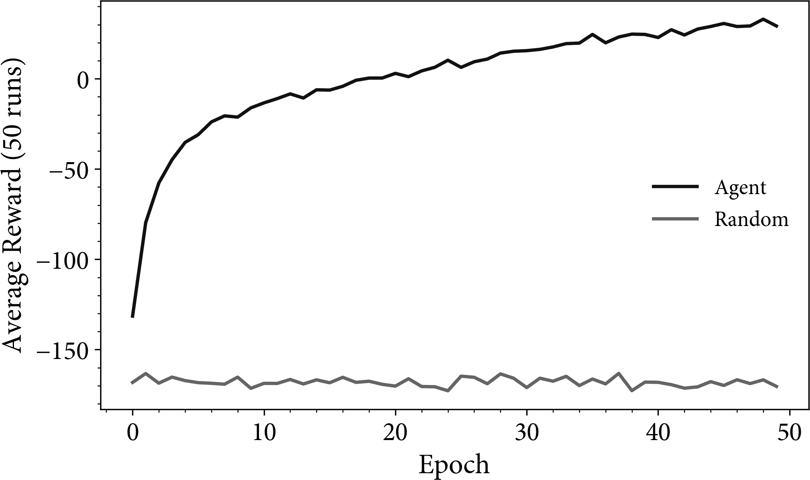

智能体获得的最高奖励是 57，表明智能体购买了客户真正想要的产品。但这远低于 358 件产品的最高可能奖励。随机智能体表现持续不佳，因为它反复订购客户不想要的产品。

在图 5-10 中，我重复相同的实验，但这次使用 50 位拥有不同订单数量的随机客户。换句话说，智能体无法过拟合单个客户。它必须尝试泛化到所有客户。这次智能体达到的最大奖励是 -1。与之前的实验相比，这有点令人失望。这表明智能体对于任何给定的随机客户，大致只能做到收支平衡。但你必须记住智能体有多简单。智能体只有少量的线性参数，但在有限程度上，它能够捕捉购物过程的复杂性。我发现这很了不起。

图 5-11 展示了当改变智能体可选产品数量时，同一智能体在随机客户上的表现。换句话说，我是在改变动作的数量。当产品数量增加时，智能体获得的奖励减少。然而，性能似乎是渐近的。随着训练时间增加，性能可能会收敛。

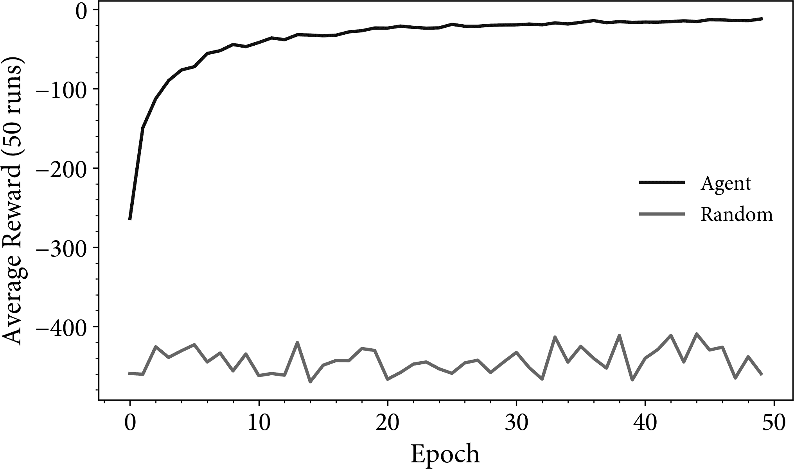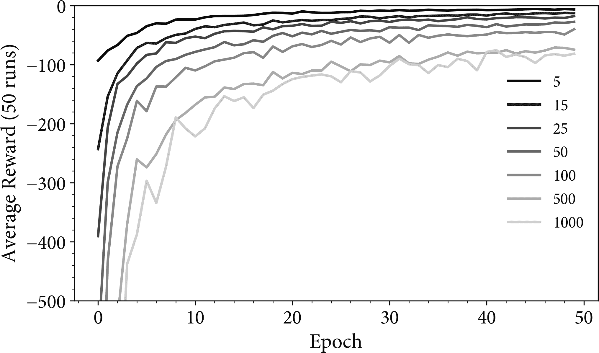

最后，我想演示一种称为 `transfer learning` 的东西。目标是训练一个模型解决一个问题，然后将同一个模型应用到一个不同但相关的问题上。这种范式在 `RL` 中效果很好，因为你可以潜在地从离线数据或模型中学习，并使用在线数据进行微调。

例如，我可以使用在随机客户上训练的购物车模型（图 5-10），然后将学到的模型迁移到新客户身上。图 5-12 展示了此类实验的结果。

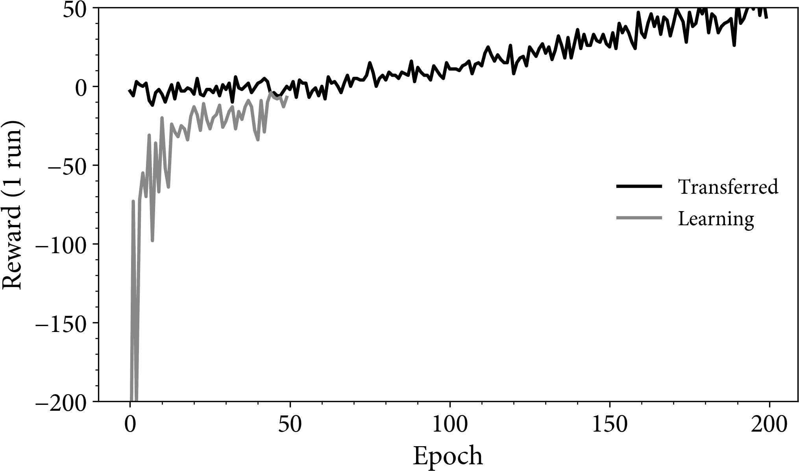


为了迁移模型，我复制了在随机客户上训练时学到的策略和价值估计权重，并将它们粘贴到另一个只有单个客户的智能体中。此外，这些结果仅来自单次运行。你可以想象，如果我重复 50 次，会得到一组更平滑的结果。如果你将此结果与图 5-9 进行比较，则可以看到没有初始的性能提升阶段，因为预训练权重已经非常好。

另一个观察是，单客户智能体需要很长时间（大约 200 个周期）才能达到图 5-9 中结果的类似性能。这是因为智能体已经学会了一个在所有客户平均情况下效果最好的策略。当我将该策略迁移到单客户数据的新智能体上时，它需要重新训练那些权重。但平均策略似乎降低了探索对该单个客户最重要的状态的概率。

换句话说，在图 5-9 中，智能体似乎对那个特定客户过拟合了。通常过拟合是坏事，因为模型无法泛化到其他客户。但在这个例子中，这正是重点。我希望智能体能贴合单个客户的偏好。

这里存在权衡。你希望从一个合理的策略开始，以便客户能快速获得好的推荐。但你不想等到 200 个订单之后它们才进入正奖励区域。解决这个问题的一个方法是将预训练周期数视为超参数并进行调优以获得满意的结果。

## 总结

在本章之前，我专注于基于价值的方法，即量化处于某状态价值的方法。策略是通过最大化每个状态的期望价值来推导的。但另一种方法是直接参数化策略，并改变参数化的权重以产生最大化期望回报的策略。你可以使用策略梯度方法来寻找优化策略所需的更新。

策略梯度方法有一系列优势。它们可以学习输出概率，从而消除了对像 `ϵ`-greedy 这样显式探索算法的需求。它们可以输出连续动作。而且有时建模策略比建模状态-动作价值更容易。

另一方面，策略梯度方法往往对模型的选择更敏感。对于价值方法，相当容易改变模型复杂度来预测期望价值函数，而策略模型则需要仔细选择。

本章遵循了与之前相同的推导过程，从蒙特卡洛方法到资格迹。尽管基于策略的方法优化的是略有不同的解，但期望价值估计仍然非常重要，正如你在 Actor-Critic 算法中所见。

我展示了一个简化的工业示例，目标是自动为用户订购产品。你可以想象对此有大量的改进，而这一思想的推广——推荐系统，是强化学习研究的一个活跃领域。我知道有几家组织正在将强化学习用于推荐目的。

## 延伸阅读

*   梯度下降：
    *   Ruder, Sebastian. 2017. [“梯度下降优化算法综述。”](https://oreil.ly/iAYEs) ArXiv:1609.04747, 6 月。
*   策略梯度推导：
    *   关于在线策略梯度的简明数学介绍：Kämmerer, Mattis Manfred. 2019. [“在线策略梯度。”](https://oreil.ly/1EAUY) ArXiv:1911.04817, 11 月。
    *   Sutton, Richard S., and Andrew G. Barto. 2018. *强化学习导论*。MIT Press。
*   构建生成模型：
    *   Foster, David. 2019. *生成式深度学习：教机器绘画、写作、作曲和游戏*。O’Reilly。

^(1) Houthooft, Rein, Richard Y. Chen, Phillip Isola, Bradly C. Stadie, Filip Wolski, Jonathan Ho, and Pieter Abbeel. 2018. [“进化策略梯度”](https://oreil.ly/IQPmY). ArXiv:1802.04821, 4 月。

^(2) Bhatnagar, Shalabh, Mohammad Ghavamzadeh, Mark Lee, and Richard S Sutton. 2008. [“增量自然 Actor-Critic 算法”](https://oreil.ly/9UYvm). 在 *神经信息处理系统进展* 20 中，由 J. C. Platt, D. Koller, Y. Singer, and S. T. Roweis 编辑，105–112。Curran Associates, Inc.

^(3) Wolpert, D. H., and W. G. Macready. 1997. [“优化的免费午餐定理”](https://oreil.ly/lpi8x). *IEEE 进化计算汇刊* 1(1): 67–82。
