# 第 6 章. 超越策略梯度

策略梯度（PG）算法广泛用于具有连续动作空间的强化学习（RL）问题中。第 5 章介绍了基本思想：用参数化概率分布 `π[θ] ≐ ℙ[a|s;θ]` 表示策略，然后沿着累积奖励更大的方向调整策略参数 `θ`。它们之所以流行，是因为替代方案（如 Q 学习中执行的动作价值函数的贪婪最大化）在动作连续时会变得棘手，因为这将涉及对无限多个动作的全局最大化。沿着更高期望回报的方向轻推策略参数可能更简单且计算上更具吸引力。

直到最近，具有收敛保证的实用在线 PG 算法一直局限于*在线策略*设置，即智能体从其正在执行的策略——*行为*策略中学习。在*离线策略*设置中，智能体学习的策略不同于行为策略。这一思想带来了新的研究机会和应用；例如，从离线日志学习、在执行探索策略的同时学习最优策略、从演示中学习，以及从单一环境并行学习多个任务。

本章探讨最先进的离线策略 PG 算法，首先深入研究尝试离线策略学习时出现的一些问题。

## 离线策略算法

### 离线策略算法

第 5 章中介绍的 PG 算法是在线策略的；你通过遵循当前策略——即你想要改进的同一个策略——来生成新的观察。你已经看到，这种方法，这种反馈循环，可能导致过于乐观的期望回报（参见“双 Q 学习”）。离线策略算法通过使用两个策略来解耦探索和利用：一个目标策略和一个行为策略。

迄今为止介绍的所有 RL 算法都执行类似最小二乘的优化，即将价值近似的估计与观察到的结果进行比较；如果你观察到一个令人惊讶的结果，则相应地更新估计。在离线策略设置中，目标策略永远没有机会测试其估计，那么如何执行优化呢？

### 重要性采样

在继续之前，我希望你理解一种称为重要性采样的东西，它是一些数学技巧的结果，允许你在不直接采样的情况下估计感兴趣的量。

我已经提过几次，随机变量 `X` 的期望是单个值 `x` 乘以获得该值的概率 `f(x)` 的积分，针对所有可能的 `x` 值。在连续概率分布中，这意味着 `𝔼[f][x] ≐ ∫[x] x f(x)`。在离散情况下，这是 `𝔼[f][x] ≐ ∑[x] x f(x)`。这被称为*总体均值*。


但是如果你不知道概率怎么办？好吧，如果你能从该环境中采样，仍然可以估计均值。例如，考虑一个骰子。你不知道掷出任何特定值的概率，但你知道有六个值。你可以通过掷骰子并计算 `sample mean` 来估计期望值。换句话说，你可以使用 `${\\mathbb{E}}\_{f}\\left\\lbrack x \\right\\rbrack \\approx \\frac{1}{n}\\sum\_{i = 1}^{n}x\_{i}$` 来估计期望。

现在想象一下，你有随机变量的第二个实例，例如第二个骰子，它产生相同的值，并且你知道这些值的概率，但你无法从中采样。请耐心听我解释——这不太现实，但这是问题的核心。假设你知道第二个骰子的加权方式，即 `g(x)`，但你无法掷它。也许它属于一个臭名昭著的朋友，他似乎掷出六点的次数多得离谱。在这种情况下，你可以用同样的方式表达期望：`𝔼[g][x] = ∑[x] x g(x)`。这些展示在公式 6-1 的步骤 (1) 和 (2) 中。

### 公式 6-1. 重要性采样

```
\\begin{array}{clr} 
{{\\mathbb{E}}\_{f}\\left\\lbrack x \\right\\rbrack} & {\\doteq \\sum\\limits\_{x}xf\\left( x \\right)} & \\left( 1 \\right) \\\\ 
{{\\mathbb{E}}\_{g}\\left\\lbrack x \\right\\rbrack} & {\\doteq \\sum\\limits\_{x}xg\\left( x \\right)} & \\left( 2 \\right) \\\\ 
& {= \\sum\\limits\_{x}\\frac{xg\\left( x \\right)}{f\\left( x \\right)}f\\left( x \\right)} & \\left( 3 \\right) \\\\ 
& {= {\\mathbb{E}}\_{f}\\left\\lbrack \\frac{xg\\left( x \\right)}{f\\left( x \\right)} \\right\\rbrack} & \\left( 4 \\right) \\\\ 
& {\\approx \\frac{1}{n}\\sum\\limits\_{i = 1}^{n}\\frac{x\_{i}g\\left( x\_{i} \\right)}{f\\left( x\_{i} \\right)}} & \\left( 5 \\right) \\\\ 
\\end{array}
```

接下来看步骤 (3)。这里有个技巧：我将步骤 (2) 乘以 `f(x)/f(x) = 1`。现在求和是关于 `f(x)` 的，而不是 `g(x)`，这意味着如果你想象 `x` 现在变成了 `x g(x)/f(x)`，我就可以代入步骤 (1)，从而得到步骤 (4)。在步骤 (5) 中，你可以使用样本均值来计算这个期望。如果你集中注意力，大概能跟上逻辑，但我希望你从高层面理解这意味着什么。这意味着你可以利用第一个概率函数的经验，计算第二个概率函数的期望。这是离策略学习的关键要素。

为了演示公式 6-1 背后的思想，我模拟了掷两个骰子：一个均匀，一个有偏。我知道骰子的概率分布，但我只能掷均匀骰子。我可以记录均匀骰子生成的数字并绘制直方图。我还可以在每次掷骰后测量样本均值。你可以在图 6-1(a)中看到结果。给定足够多的掷骰次数，直方图趋于均匀，样本均值趋近于总体均值 3.5。

在图 6-1(b)中，你可以看到（关键的）已知的有偏骰子的理论直方图。它是理论上的，因为我无法掷它。但，这里就是奇迹所在，使用公式 6-1，我可以估计样本均值，你可以看到它趋向于 4.3，这是有偏骰子的正确样本均值。让我再重申一遍，以使其绝对清晰。你不能直接计算第二个变量的总体均值，因为你无法从中采样。重要性采样允许你在不必从第二个变量中采样的情况下估计其期望值。

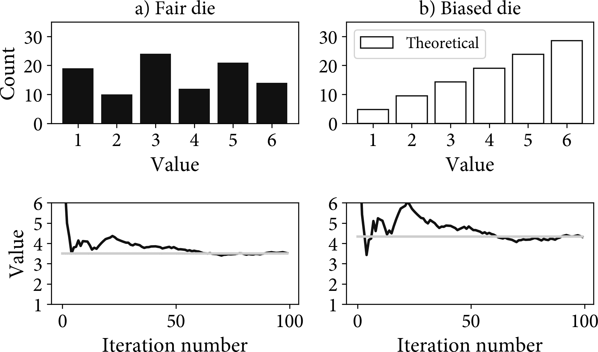

## 行为策略与目标策略

如果你有两个策略，一个可以采样，另一个不能，你仍然可以获得两者的期望值。一个类比就是通过观察别人开车来学开车。这种计算为真正的离策略算法打开了大门，其中一个策略驱动智能体进行探索，而其他策略可以做其他事情，比如开发一个更精细的策略。

在强化学习中，“离策略学习”一词指的是使用由 `behavior policy`（行为策略）生成的数据来学习一个最优策略，称为 `target policy`（目标策略）。将行为策略从寻找最优策略的负担中解放出来，从而允许更灵活的探索。我将在本章中进一步展开这一想法。

目标策略获得信息的方式就像我的鸡被喂食一样；它们不在乎食物从哪来。数据可能来自其他智能体，例如之前的策略或人类。或者在获取新数据困难或昂贵但存储旧数据容易的环境中（如机器人学），数据可能来自离线存储。

另一个有趣的研究方向，我稍后会回到这个话题，就是你可以从单个行为策略生成的单个数据流中学习多个目标策略。这使你能够为不同的子目标学习最优策略（请参阅“分层强化学习”）。

## 离策略 Q 学习

离策略学习的关键之一是使用动作价值函数和策略的近似。但传统的离策略方法（如 Q 学习）无法立即利用线性近似，因为它们是不稳定的；对于任何正步长，近似值都会发散到无穷大。但在 1999 年，Richard Sutton 及其团队首次表明，如果使用正确的目标函数和梯度下降，稳定性是可能的。^(1) 这些方法是你稍后将看到的高级离策略算法的基础。

## 梯度时序差分学习

在许多问题中，状态数量太大而无法近似，例如存在连续状态时。线性函数近似使用函数 `ϕ(s)` 将状态映射到特征向量。换句话说，该函数接受状态并输出一组维度不同的抽象值。

然后你可以使用线性参数 `θ` 通过 `Vπ ≈ θ^⊺ ϕ(s)` 来近似状态价值函数（有关策略工程的更多详情，请参阅“策略工程”）。根据这个定义，你可以推导出如公式 6-2 所示的 TD 误差新方程。

### 公式 6-2. 参数化线性 TD 误差

```
δ ≐ r + γ θ^⊺ ϕ(s′) − θ^⊺ ϕ(s)
```

这与公式 3-3 相同，其中线性预测是显式的。注意，在文献中 `ϕ(s)` 常简写为 `ϕ`。重排此方程以求解 `θ` 所需的步骤很复杂，但解决方案令人耳目一新地简单：将 TD 误差作为当前参数错误程度的代理，找到梯度，将参数朝向降低误差的方向轻推，并迭代直到收敛。

如果你对推导感兴趣，请参考该论文。生成的算法如算法 6-1 所示。^(2)

### 算法 6-1. GTD(0) 算法


## 算法 6-1. GTD

$$\\begin{array}{cl} {\\text{1:}} & {\\mathbf{i}\\mathbf{n}\\mathbf{p}\\mathbf{u}\\mathbf{t}\\text{:}\\text{a}\\text{policy}\\text{that}\\text{uses}\\text{the}\\text{parameterized}\\text{action-value}\\text{function,}} \\\\ & {\\pi\\left( {a \\mid Q\\left( s,a;\\theta \\right)} \\right)\\text{,}\\text{learning}\\text{rate}\\text{parameters,} 0 > \\alpha > 1\\text{and} 0 > \\beta > 1} \\\\ {\\text{2:}} & {\\text{Initialize}\\theta\\text{and} u\\text{arbitrarily}} \\\\ {\\text{3:}} & {\\mathbf{l}\\mathbf{o}\\mathbf{o}\\mathbf{p}\\text{:}\\text{for}\\text{each}\\text{episode}} \\\\ {\\text{4:}} & {\\text{Initialize} s} \\\\ {\\text{5:}} & {\\mathbf{w}\\mathbf{h}\\mathbf{i}\\mathbf{l}\\mathbf{e} s\\text{is}\\text{not}\\text{terminal:}} \\\\ {\\text{6:}} & {\\text{Choose} a\\text{from} s\\text{using}\\pi\\text{,}\\text{breaking}\\text{ties}\\text{randomly}} \\\\ {\\text{7:}} & {\\text{Take}\\text{action,} a\\text{,}\\text{and}\\text{observe} r,s'} \\\\ {\\text{8:}} & \\left. \\delta\\leftarrow r + \\gamma\\theta^{\\intercal}\\phi\\left( s' \\right) - \\theta^{\\intercal}\\phi\\left( s \\right) \\right. \\\\ {\\text{9:}} & \\left. u\\leftarrow u + \\beta\\left( \\delta\\phi\\left( s \\right) - u \\right) \\right. \\\\ {\\text{10:}} & \\left. \\theta\\leftarrow\\theta + \\alpha\\left( \\phi\\left( s \\right) - \\gamma\\phi\\left( s' \\right) \\right)\\phi\\left( s \\right)^{\\intercal}u \\right. \\\\ {\\text{11:}} & \\left. s\\leftarrow s' \\right. \\\\ \\end{array}$$

总体布局类似于标准 Q 学习。步骤 (9) 和 (10) 是计算 TD 误差梯度及其导出的更新规则的结果。如果你有毅力自己推导数学公式，就会得到这个结果。`u` 是用于更新参数 `θ` 的中间计算量。

值得注意的是，该算法不使用重要性采样，理论上这能提供方差更低的更新。在同一篇论文及后续更新（GTD2）中，Sutton 等人引入了另一种加权方式来修正梯度更新中的偏差。^(3)

## Greedy-GQ

Greedy-GQ 是一种类似的算法，它为目标策略引入了第二个线性模型，这与 GTD 中单一的行为策略和目标策略形成对比。为目标策略拟合第二个模型的好处是提供了更多自由度。目标策略不再受限于可能不合适的行为模型。理论上，这提供了更快的学习潜力。实现方式与算法 6-1 相同，因此我仅在算法 6-2 中更新后续阶段的新更新规则。`w` 是目标策略的权重。^(4)

### 算法 6-2. Greedy-GQ 算法

$$\\begin{array}{rc} \\cdots & \\\\ {\\text{9:}} & \\left. w\\leftarrow w + \\beta\\left\\lbrack {\\phi\\left( s' \\right) - \\phi\\left( s \\right)^{\\intercal}w} \\right\\rbrack\\phi\\left( s \\right) \\right. \\\\ {\\text{10:}} & \\left. \\theta\\leftarrow\\theta + \\alpha\\left\\lbrack {\\delta\\phi\\left( s \\right) - \\gamma\\left( w^{\\intercal}\\phi\\left( s \\right) \\right)\\phi\\left( s' \\right)} \\right\\rbrack \\right. \\\\ {\\text{11:}} & \\left. s\\leftarrow s' \\right. \\\\ \\end{array}$$

你也可以用资格迹来扩展此算法和其他 TD 衍生算法。^(5)

## 离策略 Actor-Critic 算法

梯度时序差分（GTD）算法具有线性复杂度且能收敛，即使在使用函数近似时也是如此。但它们有三个重要局限。首先，目标策略是确定性的，这在存在多模态或随机价值函数时是个问题。其次，对于大型或连续动作空间，使用贪婪策略会变得棘手。第三，动作价值估计的微小变化可能导致策略的剧烈变化。你可以结合前面讨论的技术来解决这些问题。但 Degris 等人将 GTD 与策略梯度结合，一次性解决了这些问题。^(6)

第 5 章中的 REINFORCE 和普通 Actor-Critic 算法是在线策略的。离策略 Actor-Critic（Off-PAC）是最早证明可以使用参数化 Critic 的算法之一。如果你还记得，要使用策略梯度算法，必须计算策略的梯度。增加参数化（或表格型）Critic 会增加导数的复杂度。Degris 等人证明，如果你用基于梯度下降的优化器近似策略梯度并忽略 Critic 的梯度，策略最终仍会收敛到最优策略。

结果是一个几乎与算法 5-3 相同的算法。你可以在公式 6-3 中看到更新方程，主要新增的是重要性采样项 `πθ/βθ`。`β` 代表行为策略，`π` 是目标策略。可以把重要性采样看作一个转换因子。智能体从行为策略采样，因此需要将这些经验转换为目标策略可用的形式。我还加入了特定符号，表明状态按行为策略生成的轨迹分布（`s ∼ ρ[β]`，其中 `ρ` 是状态分布），动作按行为策略的选择分布（`a ∼ β`）。

### 公式 6-3. 离策略策略梯度估计

$$\\nabla\_{\\theta}J\_{\\beta}\\left( \\pi\_{\\theta} \\right) = {\\mathbb{E}}\_{s \\sim \\rho\_{\\beta},a \\sim \\beta}\\left\\lbrack {\\frac{\\pi\_{\\theta}\\left( a \\mid s \\right)}{\\beta\_{\\theta}\\left( a \\mid s \\right)}\\nabla\_{\\theta}\\ln\\pi\_{\\theta}\\left( a \\mid s \\right)Q\_{\\pi}\\left( s,a \\right)} \\right\\rbrack$$

总之，公式 6-3 计算的是目标策略的梯度，由动作价值估计加权，并按行为策略分布。该梯度告诉你以多大幅度、朝什么方向更新目标策略。论文看起来更复杂，因为它们使用了资格迹，并为两个策略都引入了参数化线性函数的梯度。

Degris 等人提供了一个虽小但重要的理论注记，关于各策略更新率的取值。他们建议 Actor 的更新率应小于 Critic，且比 Critic 更快退火至零。换句话说，行为策略比目标策略更稳定很重要，因为行为策略生成轨迹。机械牛难骑是因为它随机移动；骑马容易因为它轨迹一致。作为工程师，你需要让目标策略尽可能容易地近似动作价值函数。

## 确定性策略梯度

在本节中，我将回溯时间线，讨论另一条研究路线，其核心思想是策略不必是随机的。所有 PG 算法的一个主要问题是智能体必须同时在状态空间和动作空间采样。只有那样才能确定智能体找到了最优策略。反之，能否推导出确定性策略——即每个状态对应一个单一、特定的动作？如果可以，那将大幅减少估计此类策略所需的样本数。如果运气好，智能体一次动作尝试就能找到最优策略。理论上，这应能带来更快的学习速度。

## 确定性策略梯度


## 确定性策略梯度

策略梯度算法通过将策略表示为概率分布，在状态下随机选择动作，广泛应用于连续动作空间问题。该分布经过参数化，使得智能体可以通过随机梯度下降来改进策略结果。

像 `Off-PAC` 这样的离线策略梯度算法（参见“离线策略 Actor-Critic”）很有前景，因为它们让 Actor 专注于探索，而 Critic 可以离线训练。但 Actor 使用行为策略，仍然需要在所有动作上进行最大化以选择最佳轨迹，这在计算上可能变得棘手。此外，智能体必须充分采样动作分布，以产生其下降估计。

相反，Silver 等人提议将行为策略朝着动作价值估计最大的方向移动，而不是直接最大化它。本质上，他们使用了策略梯度算法将目标策略推向更高期望回报的同一个技巧，但这次是将其应用于行为策略。因此，最优动作变成了使用当前行为策略的简单计算。给定相同的参数化，它是确定性的。他们称该算法为确定性策略梯度（`DPG`）。^(7)

研究人员证明 `DPG` 是标准随机 `PG` 的一个受限版本，因此所有常用工具和技术（如函数逼近、自然梯度和 `actor-critic` 架构）以相同方式工作。

然而，`DPG` 不产生动作概率，因此没有天然的探索机制。想象一个基于 `DPG` 的智能体刚刚成功了。后续运行将产生相同的轨迹，因为行为策略反复生成相同的动作。

结果是一组熟悉的算法，但梯度计算略有变化。对于像 `REINFORCE` 或 `actor-critic` 这样的原版 `PG` 算法，目标是找到目标函数的梯度。在 `DPG` 的情况下，目标包含一个确定性函数，而不是随机策略。

#### 公式 6-4. 离线策略原版 Actor-Critic 与确定性 Actor-Critic 目标函数梯度对比

```latex
\begin{array}{clr} 
{\nabla_{\theta}J_{\beta}\left( \pi_{\theta} \right)} & {= {\mathbb{E}}_{s \sim \rho_{\beta},a \sim \beta}\left\lbrack {\frac{\pi_{\theta}\left( a \mid s \right)}{\beta_{\theta}\left( a \mid s \right)}}\nabla_{\theta}\ln\pi_{\theta}\left( a \mid s \right)Q_{\pi}\left( s,a \right) \right\rbrack} & {\text{(Off-Policy AC)}} \\ 
{\nabla_{\theta}J_{\beta}\left( \mu_{\theta} \right)} & {= {\mathbb{E}}_{s \sim \rho_{\beta}}\left\lbrack {\nabla_{\theta}Q_{\mu}\left( s,\mu_{\theta}\left( s \right) \right)} \right\rbrack} & \\ 
& {= {\mathbb{E}}_{s \sim \rho_{\beta}}\left\lbrack {\nabla_{\theta}\mu_{\theta}\left( s \right)\nabla_{a}Q_{\mu}\left( s,a \right)} \right\rbrack} & {\text{(Off-Policy Deterministic AC)}} 
\end{array}
```

论文其余部分讨论了使用参数化函数时 `Q-learning` 发散的常见问题，以及动作价值函数梯度不完美的问题。他们最终在 Critic 中采用 `GTD` 算法，在 Actor 中采用 `PG` 算法，整个框架看起来与 `Off-PAC` 非常相似，只是没有重要性采样和资格迹。

导数仍然依赖于 Actor 和 Critic 的参数化。如果你愿意，可以遵循第 5 章中看到的类似过程手动计算它们。但我看到的大多数应用直接跳入深度学习，部分原因是它们足够复杂以建模非线性，但主要是因为这些框架将通过反向传播执行自动微分。

总之，你不必对每一个动作进行采样就能获得好的策略，就像 `Q-learning` 在第 3 章中所做的那样。这很可能会加快学习速度。而且你仍然可以利用策略梯度来解决大动作空间问题。但当然，有些问题具有高度复杂的动作价值函数，受益于随机策略。总的来说，尽管随机策略学习较慢，但它们可能带来更好的性能。一切取决于环境。

## 深度确定性策略梯度

离线策略 `DPG` 算法的下一个合乎逻辑的扩展是引入深度学习（`DL`）。正如预期的那样，深度确定性策略梯度（`DDPG`）遵循 `DQN` 开辟的相同路径。

但我不想低估该算法的重要性。`DDPG` 过去是且仍然是 `RL` 中最重要的算法之一。其流行源于它能够同时处理复杂的高维状态空间和高维连续动作空间。

此外，在 `DDPG` 中表示 Actor 和 Critic 的神经网络是一种有用的抽象。之前的算法使数学变得复杂，因为研究人员将梯度计算混入了算法中。`DDPG` 将 Actor/Critic 的优化卸载给 `DL` 框架。这极大地简化了架构、算法和最终实现。其灵活性源于修改 `DL` 模型以更好地适应 `MDP` 的能力。通常你不需要触碰 `RL` 组件就能解决各种问题。

但当然，使用 `DL` 也带来了新问题。你不仅需要成为 `RL` 专家，还要成为 `DL` 专家。所有常见的 `DL` 陷阱也都适用于此。复杂的 `DL` 模型增加了巨大的计算负担，许多应用在它们上花费的时间和金钱比在底层 `RL` 算法或 `MDP` 定义上还要多。尽管存在这些问题，考虑到架构和操作上的优势，我仍然推荐 `DDPG`。

### DDPG 推导

2015 年，Lillicrap 等人使用与 `DPG` 相同的推导提出了 `DDPG`。他们训练一个模型直接预测动作，而无需最大化动作价值函数。他们从一开始就使用 `DPG` 的离线策略版本。^(8)

新颖之处在于将 `DL` 同时用于 Actor 和 Critic，以及他们如何处理非线性逼近器引起的问题。首先，他们解决了收敛问题。像 `DQN` 一样，他们引入经验回放缓冲区来去相关状态观测。他们还使用 Actor 和 Critic 网络权重的副本（参见“Double Q-Learning”）并缓慢更新它们以提高稳定性。

第二个添加是 `batch normalization`（批量归一化），它使用均值和方差的运行平均值来归一化每个特征。你也可以确保输入特征经过适当缩放。


第三项也是最后一项添加的是建议在动作预测中使用噪声，以激励探索。他们指出噪声的概率分布取决于具体问题，但在实践中，简单的高斯噪声往往效果很好。此外，向神经网络参数添加噪声比向动作添加噪声效果更好（另请参阅“Noisy Nets”）。^(9)

## DDPG 实现

所有强化学习框架都有 DDPG 的实现。正如你可能猜到的，它们各不相同。不要指望不同的实现能得到相同的结果。差异范围涵盖从神经网络初始化到默认超参数。

图 6-2 展示了架构的简化版。照常，环境将状态观测反馈给智能体。演员根据其确定性策略决定下一个动作。状态、动作、奖励和下一状态的元组也存储在经验回放缓冲区中。因为 DDPG 是一种离策略算法，它从经验回放缓冲区采样元组来测量误差并更新评论家的权重。最后，演员利用评论家的估计来测量其误差并更新其权重。算法 6-3 给出了完整算法，这与原始论文中定义的算法略有不同。此版本使用了我的符号，并更符合典型实现。

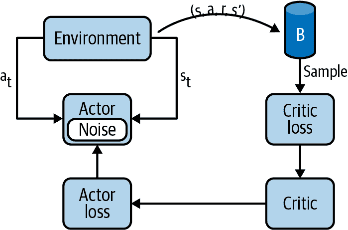

算法 6-3 提供了完整的 DDPG 实现。

### 算法 6-3. DDPG 算法

```latex
\begin{array}{cl} 
{\text{1:}} & {\text{input: an actor neural network, }\mu_{\theta_{\mu}}(s)\text{, with weights }\theta_{\mu}\text{,}} \\ 
& {\text{a critic neural network, } Q_{\theta_{Q}}(s,a)\text{, with weights }\theta_{Q}\text{,}} \\ 
& {\text{a replay buffer, } B\text{,}} \\ 
& {\text{the size of a training minibatch, } N\text{,}} \\ 
& {\text{the network update rate, }\tau\text{,}} \\ 
& {\text{the discount-rate parameter, }\gamma\text{,}} \\ 
& {\text{and a noise function for exploration, }\mathcal{N}} \\ 
{\text{2:}} & {\text{Initialize }\theta_{\mu}\text{, }\theta_{Q}\text{, } R\text{,}} \\ 
& {\text{and the target weights, }{\theta_{\mu}^{'}}\leftarrow\theta_{\mu}\text{, }{\theta_{Q}^{'}}\leftarrow\theta_{Q}} \\ 
{\text{3:}} & {\text{loop: for each episode}} \\ 
{\text{4:}} & {\text{Initialize } s} \\ 
{\text{5:}} & {\text{while } s\text{ is not terminal:}} \\ 
{\text{6:}} & {a\leftarrow\mu_{\theta_{\mu}}(s) + \mathcal{N}} \\ 
{\text{7:}} & {\text{Take action, } a\text{, and observe } r,s'} \\ 
{\text{8:}} & {\text{Store }(s,a,r,s^{'})\text{ in } B} \\ 
{\text{9:}} & {\text{Sample a random minibatch of } N\text{ transitions, }(s_{i},a_{i},r_{i},s_{i}^{'})\text{, from } B} \\ 
{\text{10:}} & {y_{i}\leftarrow r_{i} + \gamma Q_{\theta_{Q}^{'}}(s_{i}^{'},\mu_{\theta_{\mu}^{'}}(s_{i}^{'}))\text{(Note the target weights and buffer data)}} \\ 
{\text{11:}} & {\text{Update the critic by minimizing: }\frac{1}{N}\sum_{i}(y_{i} - Q_{\theta_{Q}}(s_{i},a_{i}))^{2}} \\ 
{\text{12:}} & {\text{Update the actor by minimizing: }\frac{1}{N}\sum_{i}(\nabla_{\theta_{\mu}}Q_{\theta_{Q}}(s_{i},\mu_{\theta_{\mu}}(s_{i})))^{2}} \\ 
{\text{13:}} & {\theta_{Q}^{'}\leftarrow\tau\theta_{Q} + (1 - \tau)\theta_{Q}^{'}} \\ 
{\text{14:}} & {\theta_{\mu}^{'}\leftarrow\tau\theta_{\mu} + (1 - \tau)\theta_{\mu}^{'}} \\ 
{\text{15:}} & {s\leftarrow s'} \\ 
\end{array}
```

要在应用程序中使用算法 6-3，首先需要定义一个与你的问题相匹配的神经网络架构。你需要两个网络，一个用于 `actor`（策略），一个用于 `critic`（动作价值函数近似）。例如，如果你处理原始像素，则可能在 `critic` 中使用卷积神经网络。如果你处理客户信息，则可能使用多层前馈网络。对于策略，请记住 DDPG 是确定性的，因此你希望为给定状态预测单个动作。因此，输出的数量取决于你的动作空间。网络的超参数也非常重要。网络应有足够的容量来逼近领域的复杂性，但你不希望过拟合。学习率直接影响学习过程的稳定性。如果你试图学得太快，可能会发现它不收敛。算法 6-3 步骤 (1) 中的其余输入包含控制学习的超参数和用于探索的噪声函数。

步骤 (2) 和 (3) 初始化网络权重和经验回放缓冲区。经验回放缓冲区必须存储新元组，并在缓冲区满时潜在地弹出历史元组。它还需要能够从该缓冲区随机采样以训练网络。你可以用不同方式初始化网络权重，它们会影响稳定性和学习速度。^(10) 步骤 (3) 初始化 `critic` 和 `actor` 网络的副本，文献中称为 `target` 网络，以提高稳定性。在算法的其余部分中，副本用 `′` 字符表示。这是为了节省空间，但容易被忽略。如果你创建自己的 DDPG 实现，请仔细检查是否使用了正确的网络。实现通常将原始网络称为 `local`。

步骤 (6) 使用确定性策略预测动作。这是原始算法向该决策引入噪声的地方。但你可能需要考虑以不同方式添加噪声（例如，请参阅“Noisy Nets”）。

步骤 (8) 将当前元组存储在经验回放缓冲区中，步骤 (9) 对其采样一个批次以准备训练。许多实现会延迟网络的首次训练，以获得更具代表性的样本。

步骤 (10) 标志着网络训练过程的开始。首先，它使用 `target` 网络和当前奖励预测下一状态的动作价值。然后步骤 (11) 使用 `local` 权重训练 `critic` 来预测该值。如果你将步骤 (10) 和 (11) 结合起来，可以看到这是时序差分误差。

步骤 (12) 使用 `local` 权重训练 `actor` 网络，通过最小化使用 `actor` 策略时动作价值函数的梯度。这是应用链式法则将策略梯度从动作价值函数中移出之前的公式 6-4 形式。实现使用此版本是因为你可以通过调用深度学习框架的梯度函数获得动作价值估计的梯度。否则，你将不得不计算动作价值函数的梯度和策略的梯度。


最后，步骤 (13) 和 (14) 将目标权重复制到本地权重。它们通过对更新进行指数加权来实现这一点；你不希望更新权重过快，否则智能体将永远无法收敛。

## 双延迟 DDPG

顾名思义，*双延迟深度确定性策略梯度* (TD3) 是 DDPG 的一种增量改进。与 Rainbow 算法类似，Fujimoto 等人证明了三个新的实现细节能显著提升 DDPG 的性能和鲁棒性。^(11)

### 延迟策略更新 (DPU)

第一个也是最有趣的提议是 Actor-Critic 架构受隐式反馈回路的困扰。例如，如果生成轨迹的策略是次优的，价值估计就会很差。但如果价值估计不准确，策略就无法改进。在这个经典的“先有鸡还是先有蛋？”场景中，Fujimoto 等人建议在重新训练网络*之前*等待稳定的近似值。统计理论指出，在能够稳健地估计一个量之前，你需要一个有代表性的样本。这里也是如此；通过延迟更新，你可以提升性能（另请参阅“延迟 Q 学习”）。

如果你降低网络重新训练的频率，性能会提升。从长远来看，训练得*更少*而非更多反而更好。起初这听起来违反直觉，但我有一个类比。当我处理复杂项目时，有时会有根本性因素影响工作，例如资金。在这些情况下，我了解到本能反应不太可能是最优的。它们是由情绪驱动的，基于不确定、嘈杂的信息。相反，我只是倾听并收集信息。我将任何决定推迟到稍后的时间。我发现，通过等待几天让尘埃落定，我对局势会有清晰得多的认识。延迟的信息方差更低，因此我的行动预测变得更加确定。

这在 Actor-Critic 架构中也会发生。隐式反馈回路增加了更新的方差。当网络发生变化时，动作和轨迹的结果变化是不确定的。你需要等待一段时间来观察效果如何。一个简单的解决方案是延迟更新。在指定的时间过后重新训练你的深度学习神经网络。

### 裁剪双 Q 学习 (CDQ)

第二项改进实现了双 Q 学习（参见“双 Q 学习”）。如果你将动作价值估计与真实价值对比绘图，你会发现贪婪方法倾向于高估。双 Q 学习通过拥有两个动作价值估计来解决这个问题。当你重新训练这些估计时，你使用另一个的权重。但在深度架构中，这效果不佳，因为估计值不是独立的。它们使用相同的回放缓冲区，且都耦合到生成策略。一个简单的解决方案是选择最低的动作价值估计。这通过主动低估来防止高估。尽管这种方法很“重手”，但研究人员发现它在实践中效果很好。

CDQ 在 Ant 环境中显著提升了性能，这表明动作价值估计很可能被严重高估了。我推测原因在于奖励（通常是蚂蚁的速度）并不完全取决于那个单一的动作。蚂蚁有四条腿，所以如果其中一条腿产生了不良动作，其他三条腿可以补偿并可能带来良好的奖励。这会错误地给那个不良动作分配正奖励。CDQ 通过报告任意状态-动作对的最低可能值来缓解这个问题，但你也可以通过设计奖励来隔离每条腿（或关节）以提升性能。我怀疑如果你能使动作-奖励分配更加独立，在 Ant 环境中，或任何具有耦合动作的环境中，都可能进一步提升性能。

### 目标策略平滑 (TPS)

最后一项也是意义最小的改进是在预测动作价值估计时给动作添加噪声。因为策略是确定性的，所以很容易反复采样到相同的状态和动作。这会导致动作价值曲面出现峰值。研究人员建议在预测价值前给动作添加噪声，以平滑这些峰值。其他人则建议直接平滑动作价值估计，并直接给网络权重添加噪声。

证据表明，单独添加 TPS 并不能显著改善结果。然而，从 TD3 算法中移除它确实会产生显著影响。我推测原因是它改善了探索。如果动作价值估计中存在峰值，那么需要大量访问邻近的状态-动作对来平滑该峰值，考虑到巨大的动作空间，这不太可能发生。平滑使得策略更容易改变主意。

### TD3 实现

TD3 的实现如算法 6-4 所示。这与 DDPG 的实现类似，只是增加了处理双 Q 学习和延迟策略更新的额外逻辑。符号与本书其余部分保持一致，这意味着算法看起来与原始论文略有不同。你可以看到，由于各种数据和参数副本的存在，术语开始变得复杂。这非常容易导致实现错误，所以请小心。

#### 算法 6-4. TD3 算法


## TD3 算法伪代码

```
\begin{array}{cl} 
{\text{1:}} & {\text{input: an actor neural network, } \mu_{\theta_{\mu}}(s) \text{, with weights } \theta_{\mu} \text{,}} \\ 
& {\text{two critic neural networks, } Q_{\theta_{1}}(s,a), Q_{\theta_{2}}(s,a) \text{, with weights } \theta_{1}, \theta_{2} \text{,}} \\ 
& {\text{a replay buffer, } B \text{,}} \\ 
& {\text{the size of a training minibatch, } N \text{,}} \\ 
& {\text{the network update rate, } \tau \text{,}} \\ 
& {\text{the discount-rate parameter, } \gamma \text{,}} \\ 
& {\text{a noise clipping threshold, } c \text{,}} \\ 
& {\text{and a noise function for exploration, } \mathcal{N}} \\ 
{\text{2:}} & {\text{Initialize } \theta_{\mu}, \theta_{1}, \theta_{2} \text{,}} \\ 
& {\text{and the target weights, } \theta_{\mu}' \leftarrow \theta_{\mu} \text{, } \theta_{1}' \leftarrow \theta_{1} \text{, } \theta_{2}' \leftarrow \theta_{2}} \\ 
{\text{3:}} & {\text{loop: for each episode}} \\ 
{\text{4:}} & {\text{Initialize } s} \\ 
{\text{5:}} & {\text{while } s \text{ is not terminal:}} \\ 
{\text{6:}} & {a \leftarrow \mu_{\theta_{\mu}}(s) + \mathcal{N}} \\ 
{\text{7:}} & {\text{Take action, } a \text{, and observe } r, s'} \\ 
{\text{8:}} & {\text{Store } (s, a, r, s') \text{ in } B} \\ 
{\text{9:}} & {\text{Sample a random minibatch of } N \text{ transitions, } (s_i, a_i, r_i, s_i') \text{, from } B} \\ 
{\text{10:}} & {\tilde{a}_i \leftarrow \mu_{\theta_{\mu}'}(s_i') + \operatorname{clip}(\mathcal{N}, -c, c) \text{ (Target policy smoothing)}} \\ 
{\text{11:}} & {y_i \leftarrow r_i + \gamma \min_{j=1,2} Q_{\theta_j'}(s_i', \tilde{a}_i) \text{ (Clipped double Q-learning)}} \\ 
{\text{12:}} & {\text{Update both critics, } \theta_j \leftarrow 1,2 \text{, by minimizing: } \frac{1}{N} \sum_i (y_i - Q_{\theta_j}(s_i, a_i))²} \\ 
{\text{13:}} & {\text{if } t \bmod d \text{ then: (Delayed policy update)}} \\ 
{\text{14:}} & {\text{Update the actor by minimizing: } \frac{1}{N} \sum_i (\nabla_{\theta_{\mu}} Q_{\theta_1}(s_i, \mu_{\theta_{\mu}}(s_i)))²} \\ 
{\text{15:}} & {\text{Update both critics, } \theta_j \leftarrow 1,2 \text{: } \theta_j' \leftarrow \tau \theta_j + (1 - \tau) \theta_j'} \\ 
{\text{16:}} & {\theta_{\mu}' \leftarrow \tau \theta_{\mu} + (1 - \tau) \theta_{\mu}'} \\ 
{\text{17:}} & {\text{end if}} \\ 
{\text{18:}} & {s \leftarrow s'} \\ 
\end{array}
```

## 算法说明

在步骤 (1) 中，你现在需要传入两个评论家网络，分别用参数 `θ₁` 和 `θ₂` 表示。大多数实现期望你传入两个独立的深度学习网络，通常它们具有完全相同的架构。但不要因此而阻止你尝试不同的架构，或者可能的多头架构。

原始算法会裁剪动作噪声，以使结果保持接近原始动作。其意图是防止智能体选择无效动作。大多数实现将此值设置为与环境的动作空间匹配。我暂时建议，因为你控制噪声函数的设计，所以裁剪是不必要的。选择一个与你的动作空间和平滑目标相匹配的噪声函数，然后复用 DDPG 中的标准确定性动作函数 [步骤 (6)]。

在步骤 (11) 中请注意，预测值是来自目标网络的两个评论家中的最小值。换句话说，选择最低的动作价值估计；由于高估偏差，这更有可能是正确的。步骤 (12) 使用这个折扣奖励的预测来更新两个评论家。这有助于抑制那个正在高估的网络。

步骤 (13) 之后的内部循环每 `d` 次迭代发生一次；这延迟了策略更新。第 (14) 行很有趣，因为它使用第一个评论家来更新策略，而不是使用具有最小值的评论家。我怀疑这里的推理是：因为高估的网络受到步骤 (12) 的约束，从长远来看，无论你选择网络一还是网络二都没有区别。任一网络都同样可能高估。但你可能会发现，通过更智能地选择使用哪个网络，可以获得微小的性能提升。

所有其他行与 DDPG 相同。

### 提示

始终参考原始论文，并添加足够的监控代码来验证你的实现。我发现展开循环并手动计算是验证代码是否按预期工作的最佳方法。

## 案例研究：基于评论的推荐

在信息过载的时代，用户越来越依赖推荐算法来推荐相关内容或产品。最近，YouTube 和 TikTok 等服务开始利用交互式推荐系统，根据用户的反馈持续向个别用户推荐内容。最先进的非强化学习方法试图构建将用户映射到物品的模型，利用卷积滤波器挖掘局部相关模式，或使用基于注意力的序列预测模型。其中，序列模型表现最好，因为它们能适应反复的反馈。但这些方法在离线训练，且必须经常重新训练以提供最新的推荐。加上深度学习模型的复杂性，这导致了巨大的训练成本。

强化学习天然适合这类问题，因为反馈可以直接通过奖励定义来适应。Wang 等人提出了一个例子，他们通过建议使用文本作为反馈机制，而不是通常的点赞或点踩，使问题更有趣。他们建议，在现实世界中，稀疏投票会严重降低性能。相反，他们建议像评论和物品描述这样的文本信息包含更多信息，且对稀疏性不那么敏感。^(12)

Wang 等人使用马尔可夫决策过程来形式化该问题，其中状态是用户与推荐系统之间的交互，动作是推荐的物品数量，奖励由用户反馈决定。

正如其他推荐论文所指出的，主要问题是用户和物品的巨大数量带来的高维度。Wang 等人采用词嵌入将物品文本和用户评论映射为特征向量，然后使用聚类方法将特征向量减少为可管理数量的组。


## 信任域方法

Wang 等人随后选择 `DDPG` 作为其首选算法，以便能够在高维连续动作空间中学习策略。他们需要预测连续动作的能力，以配合连续的用户嵌入空间。然后，他们将物品集合与动作相结合，生成一个有序的物品列表，准备呈现给用户。随着时间的推移，策略会学习在给定用户和候选物品作为状态的情况下，哪些动作（即用户-物品嵌入）是受偏好的。随着新的用户反馈或物品被加入，策略能够改变以满足用户的新需求或推荐新的物品。

不幸的是，Wang 等人仅在模拟环境中测试了这一点。他们使用了一个包含评论的亚马逊产品数据集。他们用评论分数来表示好评或差评，并根据用户好评的物品是否在顶部结果中来给予奖励。他们的方法产生的结果击败了所有其他最先进的 ML 实现。

我喜欢引入文本信息作为减少问题稀疏性的一种方式。但我希望他们能在真实环境中测试这一点。当然，并非每个人都能接触到 YouTube 或 Amazon 来测试这些东西。只有那样我们才能看到这到底表现如何。我猜测它的表现至少应该不亚于任何高度调优的 ML 推荐系统，甚至可能击败它，且具有不需要重新训练的额外优势。请记住，这甚至不需要任何特殊调优或花哨的神经网络。该策略只是一个普通的多层感知机。我也相信还有改进的空间。其他研究人员已经正面解决了维度灾难问题，无需执行聚类即可生成推荐。^(13)

您可能也对 [RecSim](https://oreil.ly/Dg_xB) 感兴趣，这是一个用于推荐系统的可配置模拟平台。^(14)

## DPG 的改进

您可以应用前几章中看到的许多基础改进，比如不同的探索策略，或表示预期回报的不同方式。这些都能影响并提升性能。例如，Barth-Maron 等人提出的分布式分布式确定性策略梯度，不仅引入了并行性（参见“扩展 RL”），还增加了分布式 `RL`（参见“分布式 RL”）和 `n` 步更新（参见“n 步算法”）。^(15) Cai 等人提出的确定性价值-策略梯度证明了您可以将确定性算法用于无限时域环境，并像蛋糕上的樱桃一样加上了 `n` 步更新。^(16)

但还有一个根本问题尚未解决，至少在此背景下尚未解决。尽管有诸多优势，离策略算法就像三角翼喷气式飞机（如“台风”战斗机）一样：它们天生不稳定。没有人工控制，它们就会发散并坠毁。“台风”战斗机依靠复杂的飞行控制系统实现这一点。离策略算法则通过降低神经网络中参数更新的速率来实现这一点，甚至主动跳过更新。这肯定会减慢学习速度。有没有更好的方法？

## 信任域方法

`PG` 算法通过遵循策略朝向更高预测值的梯度（按某种预期回报度量加权）来学习做出更好的选择。以下方法都使用优势函数 `A(s,a)`，但您也可以合理地选择任何 `PG` 解释（参见“基本策略梯度算法比较”）。

公式 6-5 以损失函数的形式呈现了 `A2C` 更新，其中 `Aπ ≐ Qπ − Vπ`。优势函数具有直观的解释。价值估计大于零的动作优于平均水平。平均而言，它们将带来良好的表现。低于零的动作平均而言将导致糟糕的表现。

### 公式 6-5. 优势演员-评论家策略梯度

```
L^(PG)(θ) ≐ 𝔼[π[θ]]ln π[θ Aw]
```

将优势函数与策略梯度结合使用，迫使策略倾向于产生表现更好的动作，并远离表现差的动作。将其与使用动作价值函数进行比较。对于许多问题，所有动作都可能具有正值；如果您随机游走，最终会偶然发现奖励。所以如果您像在普通的演员-评论家中那样使用它，它将以不同的速率将策略推向所有这些可能性。这可能导致价值估计无限增加，并在接近最优时变得不稳定，这就是为什么您需要使用折扣因子。优势函数提供了一种天然的阻尼。如果策略走得太远，比如犯了一个大错，优势函数会将其拉回正轨。策略中的一个糟糕举动会表现为产生负优势的不良结果，从而产生负梯度，将策略推回更好的表现。

但您必须小心，不要更新策略太快。优势函数是一个近似值（一个监督模型），所以您必须对结果持保留态度。它是有噪声的，您不希望因为单一的糟糕步骤而毁了您的策略。这引出了一个问题：我们如何量化步长的大小？

普通的优势演员-评论家提升产生正优势的轨迹；它试图最大化未来回报。它通过使用一个优化函数来实现这一点，该函数沿着策略的梯度向上移动，而策略梯度本身取决于优势。这个梯度是复杂非线性函数的局部线性估计。您不能直接从当前位置跳到想去的位置，因为您很可能会陷入无人区。

这就像徒步旅行时，您仅在开始时进行一次指南针读数来确定方向。您最终会偏离目的地数英里，因为您无法足够精确地确定方位。为了解决这个问题，您每隔一公里左右进行一次新的读数。您引入步长并迭代地进行测量。在这个类比中，步长是欧几里得距离，三角形的斜边，以米为单位。随机梯度上升/下降使用相同的欧几里得距离，但单位更难解释。代价函数的单位是策略参数，而策略参数本身与状态有复杂的相互作用以产生动作概率。

一个相关的问题是，您用于训练模型的数据是非平稳的。例如，考虑一种常见情况，即您有稀疏奖励（您的策略长时间观察不到奖励）。当策略在探索时，您可能不想过多地改变它，所以步长应该很小。但当您确实发现奖励时，您想显著更新策略，以利用这些新知识。但要大多少？如果您犯了错，更新过度，那么策略可能会变得如此之差，以至于再也无法找到好的奖励。

这些问题使得很难选择一个在所有情况下都适用的单一步长。从业者通常将其视为超参数，并在一系列值上进行扫描。换句话说，暴力搜索。


信任区域方法试图通过指定参数空间中可信任梯度步长的区域来解决此问题。您可以利用此信息动态调整步长，以便在梯度可信时参数快速变化，在不可信时缓慢变化。然后您可以找到量化该信任度的方法，第一种方法基于使用 Kullback-Leibler 散度（KL 散度）来衡量两个策略之间的差异。

## Kullback-Leibler 散度

Kullback-Leibler (KL) 散度通常被描述为比较两个分布时的“惊讶度”度量。当分布相同时，KL 散度为零。当分布截然不同时，KL 散度很大。

它也可用于计算在给定一个分布的情况下描述新分布所需的额外比特数。如果分布相同，则无需额外比特来区分新分布。如果分布不同，则需要许多新比特。

例如，如果您有一枚特殊的硬币，它永远只会落在正面朝上，那么您需要零比特来表示硬币的状态。只有一种状态——永远是正面——所以您只需要零比特，即值零，来编码该状态。如果将其与一枚均匀硬币进行比较，您现在有两种状态，因此需要一个完整的比特来表示这些状态。在这个假设示例中，这两个分布之间的 KL 散度为 1（之所以说是假设，是因为当一个状态趋近于零时，KL 散度算法中的除法将产生 `nan`）。

公式 6-6 给出了散度计算。∥ 代表散度算子，指示您计算此分布与彼分布之间的散度。您可以使用任何底数作为对数，但大多数人使用以 2 为底（`log2`），它代表比特数。

### 公式 6-6. Kullback-Leibler 散度

```
D_{KL}\left( P\left. \parallel Q \right) \doteq \right.\sum\limits_{x \in \mathcal{X}}P\left( x \right)\log\left( \frac{P\left( x \right)}{Q\left( x \right)} \right)
```

### KL 散度实验

考虑以下两个实验，我抛硬币和掷骰子。KL 散度衡量分布有多不同，因此掷两个均匀骰子应导致散度为零。然后我模拟一枚偏向反面的有偏硬币。

在第二个实验中，我模拟三个六面骰子。第一个是标准的均匀骰子。第二个是均匀骰子，但产生的值是标准六面骰子的两倍。换句话说，概率相似但分布不重合。第三个骰子产生标准值，但有偏向，产生 6 的次数比预期多。

图 6-3 显示了这些实验的直方图，其中括号内显示了 KL 散度。正如预期的那样，两个均匀硬币之间的 KL 散度接近零。然而，与有偏硬币比较时，散度非零。

比较均匀骰子和有偏骰子产生相同的非零结果。但请注意均匀骰子与产生超出均匀骰子取值范围的值的骰子之间比较的结果。KL 散度接近零。这是因为在重叠处，它们具有相同的均匀分布。这是因为 KL 散度不衡量分布之间的展宽；如果您对这一点感兴趣，请改用总方差散度。

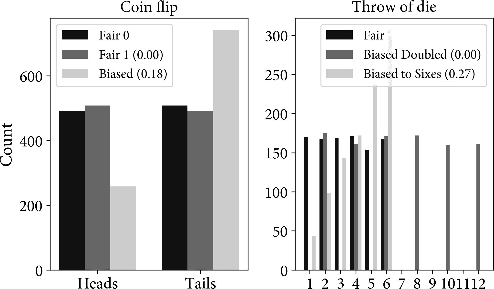

## 自然策略梯度和信任区域策略优化

自然策略梯度（NPG）引入了这样一种思想：您可以不根据策略参数空间，而是根据基于当前策略与梯度步长更新后策略之间距离的度量来量化步长。^(17)

图 6-4 展示了标准策略梯度与自然策略梯度之间差异的示例。等高线代表特定状态的值，箭头显示由梯度计算类型定义的梯度方向。这表明当您相对于不同特征计算微分时，梯度会改变方向。

您可以通过使用多种统计度量之一来比较生成轨迹的分布，从而估计两个策略之间的距离。但信任区域策略优化（TRPO）算法使用 KL 散度。^(18) 回想一下，优化算法通过参数空间中的欧几里得距离来衡量步长；步长的单位是 `δθ`。TRPO 建议您可以根据策略的变化来约束或限制此步长。您可以告诉优化算法，您不希望概率分布发生大幅变化。请记住，之所以可能，是因为策略是动作-概率分布。

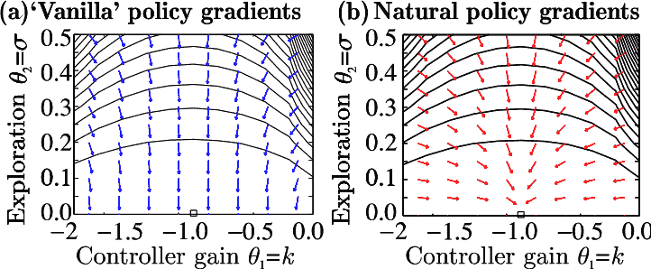

公式 6-7 给出了 A2C 策略梯度的轻微重新表述。如果您查看 公式 5-3 中策略梯度定理的推导，最后我引入了对数以简化数学运算。严格来说，此梯度是使用从旧策略采样的轨迹计算的。因此，如果您撤销最后一步（链式法则），您将得到相同的方程，但旧策略参数的使用更加明确。

### 公式 6-7. 重新表述的优势 Actor-Critic 损失函数

```
\begin{array}{cl} {\nabla J\left( \theta \right)} & {= {\mathbb{E}}_{\pi_{\theta}}\left\lbrack {\nabla\ln\pi_{\theta}\left( a \mid s \right)A_{w}\left( s,a \right)} \right\rbrack} \\ & {= {\mathbb{E}}_{\pi_{\theta}}\left\lbrack {\frac{\nabla\pi_{\theta}\left( a \mid s \right)}{\pi_{\theta_{\text{old}}}\left( a \mid s \right)}A_{w}\left( s,a \right)} \right\rbrack} \\ \end{array}
```

接下来，因为您可以将梯度计算委托出去，所以可以用目标函数来重写 公式 6-7，该目标是通过改变策略参数 `θ` 来最大化期望优势。您可以在 公式 6-8 中看到结果。

### 公式 6-8. 以目标最大化形式呈现 A2C

```
\begin{aligned} {\operatorname{maximize}\limits_{\theta} L^{PG}\left( \theta \right)} & {= {\mathbb{E}}_{\pi_{\theta}}\left\lbrack {\frac{\pi_{\theta}\left( a \mid s \right)}{\pi_{\theta_{\text{old}}}\left( a \mid s \right)}A_{w}\left( s,a \right)} \right\rbrack} \\ \end{aligned}
```

公式 6-8 的另一种解释是，这是对优势的重要性采样（而非梯度，如 “离策略 Actor-Critic” 中所示）。期望优势等于由旧策略采样的轨迹的优势，经重要性采样调整后，得出使用新策略所能获得的结果。

公式 6-9 显示了 NPG 算法的损失函数，正如您所见，它与 公式 6-8 相同，但带有一个*约束*（一种限制其上方方程值的数学工具）。NPG 使用基于新旧策略 KL 散度的约束。此约束防止散度大于 `δ`。

### 公式 6-9. 自然策略梯度优化损失函数


$$
\begin{aligned}
{\operatorname{maximize}\limits_{\theta} L^{TRPO}\left( \theta \right) = {\mathbb{E}}_{\pi_{\theta}}} & \left\lbrack {\frac{\pi_{\theta}\left( a \mid s \right)}{\pi_{\theta_{\text{old}}}\left( a \mid s \right)}A_{w}\left( s,a \right)} \right\rbrack \\
{\operatorname{subject}\operatorname{to}{\mathbb{E}}_{\pi_{\theta}}} & {\left\lbrack {\text{KL}\left\lbrack {\pi_{\theta_{\text{old}}}{\left( \cdot \mid s \right) \parallel}\pi_{\theta}\left( \cdot \mid s \right)} \right\rbrack} \right\rbrack \leq \delta}
\end{aligned}
$$

一切看似顺利，但主要问题是你无法使用随机梯度下来优化带约束的非线性损失函数。相反，你必须使用共轭梯度下降，它类似于标准梯度下降，但可以包含约束。

`TRPO` 增加了一些额外的技巧，比如额外的线性投影，以再次确认该步骤确实改善了目标函数。

然而，主要问题是实现涉及寻找共轭梯度的复杂计算，这使得算法难以理解且计算复杂度高。还有其他问题，比如你无法使用具有多头结构的神经网络，例如当你同时预测动作概率和状态价值估计时，因为 `KL` 散度无法告诉你该如何更新状态价值预测。因此在实践中，它对于那些良好的复杂状态价值空间估计很重要的问题（如 Atari 游戏）效果不佳。

这些问题阻碍了 `TRPO` 的普及。你可以在“延伸阅读”建议的资源中阅读更多关于 `NPG` 和 `TRPO` 推导的内容。幸运的是，有一个简单得多的替代方案。

## 近端策略优化

`NPG` 和 `TRPO` 的主要问题之一是使用了共轭梯度下降。回顾一下，目标是防止策略发生大的变化，换句话说，防止动作概率分布发生大的变化。`NPG` 和 `TRPO` 通过优化上的约束来实现这一点，但另一种方法是惩罚大步长。

公式 6-8 是一个最大化问题；它试图促进最大的优势估计，因此你可以在损失函数内部添加一个负项，每当策略变化过大时，任意地降低优势值。公式 6-10 展示了这一点，其中约束被移至一个取反项和一个额外项 `β`，`β` 控制施加在优势上的惩罚比例。

主要好处是你可以再次使用标准梯度上升优化算法，这极大地简化了实现。然而，你很难选出一个在各方面表现都一致良好的 `β` 值。应该施加多大的惩罚？这是否应根据智能体正在做的事情而变化？这些是本节开头提出的相同问题，这使得这种实现并不比为 `A2C` 选择步长好多少。

#### 公式 6-10. 惩罚策略的大幅变化

$$
\begin{aligned}
{\operatorname{maximize}\limits_{\theta}{\mathbb{E}}_{\pi_{\theta}}} & \left\lbrack {\frac{\pi_{\theta}\left( a \mid s \right)}{\pi_{\theta_{\text{old}}}\left( a \mid s \right)}A_{w}\left( s,a \right) - \beta\text{KL}\left\lbrack {\pi_{\theta_{\text{old}}}{\left( \cdot \mid s \right) \parallel}\pi_{\theta}\left( \cdot \mid s \right)} \right\rbrack} \right\rbrack \\
\end{aligned}
$$

但不要绝望；公式 6-10 强调了一个重要思想。它表明你可以添加任意函数来影响优化算法中步长的大小和方向。这打开了潘多拉魔盒般的可能性，你可以想象添加一些东西，比如（更简单的）函数来防止步长过大，在需要更多探索时增加步长的函数，甚至改变方向以尝试探索策略空间中的不同区域。近端策略优化（`PPO`）就是这样一种实现，它添加了一个更简单的惩罚项、一个允许多头网络的集成函数，以及一个基于熵的附加项以改善探索。^(20)

### PPO 的截断目标

Schulman 等人提出，虽然 `TRPO` 在技术上更正确，但没有必要如此花哨。你可以使用重要性采样比率作为策略变化大小的估计。不接近 1 的值表明智能体想要对策略做出巨大改变。一个简单的解决方案是对该值进行 `clip`（截断），这将策略的变化限制在一个小范围内。这导致了一个新的截断损失函数，如公式 6-11 所示。

#### 公式 6-11. 根据重要性采样比率截断策略的大幅变化

```
L^CLIP(θ) ≐ 𝔼[min(r(θ)A(s,a), clip(r(θ), 1-ϵ, 1+ϵ) â(s,a))]
r(θ) ≐ πθ / πθ_old
```

是重要性采样比率。在期望算子内部有一个 `min` 函数。`min` 的右侧包含一个重要性采样比率，每当该值偏离 1 超过 `ϵ` 时就会被截断。`min` 函数的左侧是正常的未截断目标。使用 `min` 的原因是使目标产生这些参数下可能的最坏损失，这被称为*下界*或*悲观界*。

乍一听这似乎违反直觉。在这种情况下，我发现通过想象用不同输入测试函数时会发生什么很有用。请记住，优势函数可以有正值和负值。图 6-5 显示了优势为正（左）和负（右）时的截断损失。

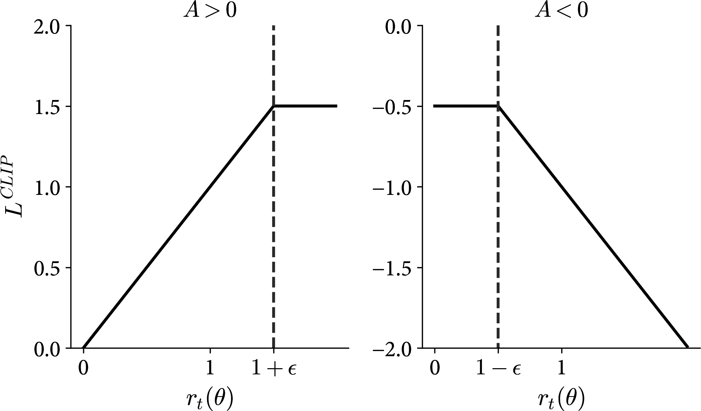

正优势（左）表明策略对结果的影响比预期更好。正损失值会将策略参数推向这些动作。随着重要性采样比率 `r(θ)` 增加，`min` 函数的右侧将在 1 + `ϵ` 处截断并产生最低损失。这有效地限制了最大损失值，从而限制了参数的最大变化。当改进时，你不希望参数变化太快，因为跳跃太大可能会把你推回糟糕的表现。大多数时候比率会接近 1。`ϵ` 允许一点改进的空间。

负优势表明策略对结果的影响比预期更差。负损失值会将策略参数从这些动作处推开。在高比率下，`min` 函数的左侧将占主导地位。巨大的负优势会将智能体推回更有希望的动作。在低比率下，`min` 函数的右侧再次占主导地位，并被截断在 1 − `ϵ`。换句话说，如果分布具有低比率（意味着旧策略和新策略有显著差异），则策略参数将继续以相同的速率变化。

但为什么？为什么要这样做？为什么不直接使用原始优势？Schulman 等人旨在建立并改进性能的下界，即最坏情况。如果你能设计一个保证改进的损失函数（他们做到了），那么你就不需要那么关心步长了。


## TRPO 和 PPO 的下界

图 6-6 是使用 TRPO 符号对该问题的描述。`θ` 是当前策略的参数。理想情况下，你想观察标记为 `η(θ)` 的曲线，它是使用参数 `θ` 的真实性能。但你无法做到，因为在每一步估计那条复杂的非线性曲线会花费太长时间。一个更快的方法是计算该点的梯度，显示为标记为 `L(θ)` 的直线。这是 `A2C` 损失的梯度。如果你沿着这个梯度迈出大步，可能会得到过冲或欠冲最大值的参数。标记为 `L(θ) - βKL` 的曲线是 `TRPO` 下界。它是减去 `KL` 散度后的 `A2C` 梯度。你可以看到，无论你选择什么步长，你最终都会落在 `η(θ)` 内的某个位置；即使智能体迈出了一步非常糟糕的步子，它也被约束在该下界内的某个位置，这还不算太糟。

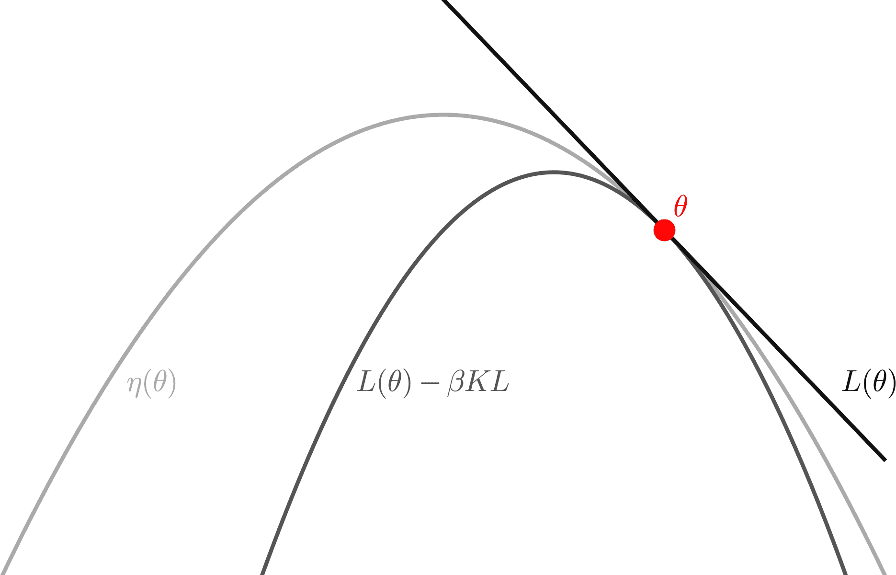

### PPO 的价值函数与探索目标

大多数计算优势的技术都使用近似来估计状态价值函数。此时你可能已经决定使用神经网络，因此使用同一个网络来预测策略动作和状态价值函数是合理的。在这种情况下，`PPO` 在最终目标中包含一个平方损失项，以允许 `DL` 框架在学习策略的同时学习状态价值函数：`L^VF(θ) ≐ (Vθ - V^target)²`。

`PPO` 还在最终目标中包含一个计算策略熵的项，`H[π[θ]](s)`。^(21) 这通过阻止过早收敛到次优确定性策略来改善探索。换句话说，它主动阻止确定性策略并强制智能体探索。你将在 第 7 章 了解更多关于这个想法的内容。

你可以在 公式 6-12 中看到最终的 `PPO` 目标函数。`C[1]` 和 `C[2]` 是超参数，分别控制归因于状态价值损失和熵损失的损失函数比例。

#### 公式 6-12. PPO 的最终目标函数

```
L^CLIP+VF+S(θ) ≐ E[L^CLIP(θ) + C[1]L^VF(θ) + C[2]H[π[θ]](s)]
```

算法 6-5 展示了 Schulman 等人原始论文中看似简单的伪代码。^(22) 它忽略了策略和价值函数近似等实现细节，尽管它确实假设基于深度学习的实现以提供自动微分。注意，算法确实包含一个隐式的延迟更新；它迭代 `T` 个时间步后再重新训练权重。但它不涉及任何其他扩展（例如，确定性、经验回放缓冲区、单独的训练网络、动作/奖励分布等）。这些中的任何一个都可能提高你特定问题的性能。

有趣的是步骤 (2) 中使用了多个智能体。我没有过多讨论异步方法，但这是一种提高学习速度（按墙钟时间计算）的简单方法。多个智能体可以观察不同的情况并将其反馈给中央模型。我在 “异步方法备注” 中更深入地讨论了这个想法。

Schulman 等人对散度裁剪超参数 `ϵ` 使用了 0.1 到 0.3 之间的值。超参数 `C[1]` 取决于你是否使用同一个神经网络来预测策略和状态价值函数。Schulman 等人在某些实验中甚至不需要使用熵奖励，并将 `C[2] = 0`。没有标准答案，所以请使用超参数搜索来找到适合你问题的最优值。

#### 算法 6-5. 异步 PPO 算法

```latex
\begin{aligned}
{\text{1:}} & {\mathbf{f}\mathbf{o}\mathbf{r}\text{iteration} \doteq 0,1,\cdots\text{:}} \\
{\text{2:}} & {\mathbf{f}\mathbf{o}\mathbf{r}\text{agent} \doteq 0,1,\cdots,N - 1\text{:}} \\
{\text{3:}} & {\text{Run}\text{policy}\pi_{\theta_{old}}\text{in}\text{environment}\text{for} T\text{time}\text{steps}} \\
{\text{4:}} & {\text{Compute}\text{advantage}\text{estimates} A_{0},\cdots,A_{T - 1}} \\
{\text{5:}} & {\text{Optimize} L\text{with}\text{respect}\text{to}\theta\text{,}\text{for} K\text{epochs}\text{and}\text{minibatch}\text{size} M \leq NT} \\
{\text{6:}} & \left. \theta_{old}\leftarrow\theta \right. \\
\end{aligned}
```

## 示例：使用舵机实现现实版 Reacher

你可能已经注意到，大多数 `RL` 示例都使用仿真。这主要是出于实际目的；在仿真环境中训练要容易、廉价和快速得多。但你可以轻松地将 `RL` 应用于具有现实直接接口的问题。工业中 `RL` 最常见的例子之一是机器人控制，因为 `RL` 特别适合为复杂任务推导高效策略。

学术界一直试图标准化机器人平台以提高可复现性。[ROBEL 平台](https://oreil.ly/Kki8B) 是一个显著的例子，包含三个简单的标准化机器人，能够演示一系列复杂的动作。^(23) 但即使它们“相对便宜”，`D’Claw` 3500 美元的成本也是一笔难以证明合理的大额开支。

这两个挑战，即缺乏现实版 `RL` 示例和成本问题，是下一个实验的基础。我想在现实中重现一个典型的 `RL` 实验，这让我回到了经典的 `CartPole` 和 `Reacher` 问题。其次，`D’Claw` 的高成本主要归因于昂贵的舵机电机。对于这个实验，我只需要一个舵机电机和驱动器，两者加起来不到 20 美元即可购买。硬件设置的完整细节可以在配套网站上找到（参见 “补充材料”）。

## 实验设置

该实验包含一个仿真舵机和一个现实舵机，我驱动它们朝向预设目标。舵机类似于标准直流电机，只是它们有额外的齿轮和控制装置以提供精确控制。我使用的舵机还具有位置反馈，这是廉价舵机所不具备的。图 6-7 显示了舵机在训练过程中的视频。

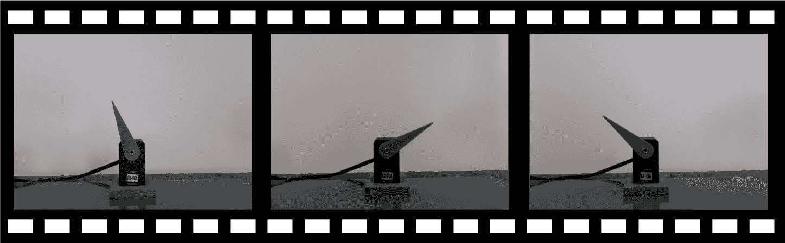

状态由舵机的当前位置和每个回合都会改变的固定目标表示。有一个动作：舵机的位置。状态和动作被归一化到 -1 到 1 的范围内。奖励是到目标的负欧几里得距离，这是一个经典的目标距离度量，用于许多机器人示例中。当舵机移动到目标位置 5% 范围内时，回合结束。因此目标是训练一个智能体，推导出一种策略，以最少的移动次数移动到目标的确切位置。

这个问题陈述与 `CartPole` 或 `Reacher` 并不完全相同。但训练机器人移动以达到期望目标的想法是一个常见需求。单个舵机使问题更容易解决，你甚至可以手写策略。但这种简单性使其易于理解，更复杂的变体只是同一想法的延伸。


<figure id="real-life-reacher-video">
<video controls="controls" style="margin: 0 auto; max-width: 100%;" src="videos/random_moves.mp4" loop="loop" autoplay="autoplay">The video element is not supported</video>
<figcaption>PPO 智能体训练伺服电机运动的视频。</figcaption>
</figure>

## RL 算法实现

> **提示**
>
> 始终尝试解决下一个最简单的问题。RL 特别难以调试，因为存在许多反馈回路、超参数和环境细节，它们从根本上改变了训练效率。最好的缓解方法是循序渐进，在转向更复杂的问题之前，先验证较简单的问题是否有效。

我解决这个问题的第一次尝试是试图学习朝向一个在所有回合中完全固定的目标移动。我想为此示例使用 `PPO`。我选择了 –1 作为值，因为随机初始化往往会意外导致一种每一步都移动到 0 的策略。这意味着智能体必须学习一个极其简单的策略：始终预测动作 –1。很简单，对吧？

令人难以置信的是，它没有收敛。如果我没那么执着，我早就挂起工程师的帽子退休了。一般来说，我发现大多数问题都涉及大脑和键盘之间的错误。所以我开始通过绘制预测价值函数和策略、给定观测值下实际预测的动作来进行调试，我发现过了一段时间后，价值函数预测了正确的值，但策略却卡住了。它完全不动。结果发现，默认学习率（`stable-baselines`，`PPO2`，`2.5e-4`）对于这样一个简单的问题来说小得太多了。并不是智能体学不会，只是学得太慢了。

在将学习率大幅提高（`0.05`）以匹配问题的简单性后，它仅用了几次更新就解决了问题。

下一个问题是当我开始摆弄每次更新的步数和小批量大小时出现的。每次更新的步数表示在重新训练策略和价值近似器之前采样了多少观测值。小批量大小是传递给训练的随机样本数量。

请记住，根据论文实现，`PPO` 没有任何类型的经验回放缓冲区。每次更新的步数代表用于训练的小批量大小。如果设置得太低，样本将会是相关的，策略将永远不会收敛。

你希望将步数参数设置为大于小批量大小（这样样本相关性较低），并理想地捕获多个回合以再次去相关。另一种思考方式是，更新期间捕获的每个回合就像拥有多个独立工作者。更多的独立工作者允许智能体对独立观测进行平均，从而打破相关性，但收益递减。

小批量大小影响策略和价值近似梯度的准确性，因此较大的值为该样本提供更准确的梯度。在机器学习中，这被认为是一件好事，但在 RL 中它可能导致各种稳定性问题。策略和价值近似仅对该探索阶段有效。例如，在具有大状态空间的复杂问题上，第一个样本不太可能代表整个环境。如果你使用大的小批量大小，它将强化当前的策略行为，而不是将策略推向更好的策略。相反，最好使用较低的小批量大小以防止策略过拟合到某条轨迹。然而，最佳小批量大小取决于具体问题和算法。^(24)

对于当前的问题，我将小批量大小设得非常低，在大多数实验中为 2 或 4，以便能够频繁重新训练并快速解决问题，将步数设为 32 或 64。智能体很容易能在如此少的步数内解决环境，因此一个更新内很有可能包含多个回合。

最后，由于最终策略非常容易学习，我大幅减小了策略和价值函数网络的规模。这对两者都起到了约束作用，并防止了过拟合。`stable-baselines` 中前馈多层感知器的默认实现没有任何 dropout，所以我还通过使用类自编码器的扇入结构，强制网络学习数据的潜在表示。

图 6-8 展示了最终策略，我通过针对固定目标 –1 请求所有位置观测值的预测动作来生成它。仅在电机运行 20 步后，`PPO` 就学会了一个对所有观测值都产生动作 –1 的策略。

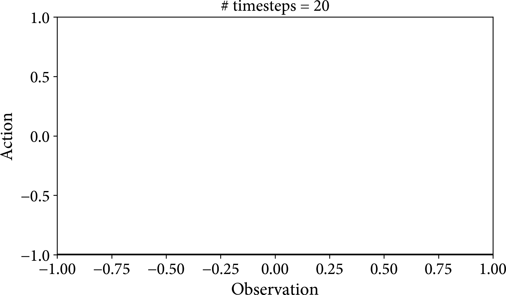

## 增加算法复杂度

现在我已经验证了硬件工作正常，且智能体能够学习到可行的策略，是时候迈出下一步，解决一个稍微困难一点的问题了。

我现在通过在每个回合生成随机目标来扩展问题。这更具挑战性，因为智能体将需要观察许多不同的回合，从而观察多个目标，以学习它需要移动到预期位置。在遇到不同目标之前，智能体不会知道存在不同的目标。

智能体还需要泛化。目标被均匀选择为位于 –1 和 1 之间。这是一个连续变量；智能体永远不会观察到每一个单独的目标。

但目标仍然很简单。智能体必须学习移动到目标建议的位置。这是一一映射。但这给 RL 智能体带来了一个小挑战，因为它们不知道这一点。智能体擅长映射非常复杂的函数。所以与之前类似，我需要将探索约束到当前问题上。

从技术角度来看，这是一个有趣的实验，因为它凸显了环境动力学与智能体超参数之间的相互作用。尽管这是一个容易学习的函数（直接映射），但智能体的探索和交互给该过程增加了大量噪声。你必须小心地将这些噪声平均掉。特别是，如果学习率太高，智能体倾向于持续更新其价值和策略网络，导致策略到处乱跳。

步数也很重要。以前，完成一个回合很容易，因为总是只有一个目标。但现在目标可能在任何地方，所以在训练早期，一个回合可能需要更长的时间。这加上高学习率，可能导致样本快速变化。

我可以通过约束智能体使用更简单的模型（例如线性模型）来解决这个问题。另一种方法是优化超参数。我选择了后者，以便能继续使用标准的多层感知器方法。

我发现少量小批量配合快速更新率学习最快，但以长期训练稳定性为代价。如果你训练的是执行更重要任务的模型，则应降低学习率以使训练更稳定、更一致。

## 仿真中的超参数调优


## 使用模拟器进行调优

但我并没有直接用 `servos` 进行所有这些调优。当问题变得更难时，进行 `hyperparameter` 搜索会变得越来越困难。这主要是因为在真实 `environment` 中执行一个 `step` 所需的时间，但也存在安全和磨损的担忧。在这些实验中，我仅用 5 天开发时间就成功损坏了一个 `servo`；其 `positional feedback` 失效了。图 6-9 是损坏 `servo` 的图片，这提醒我们在现实生活中过度运动会导致磨损。

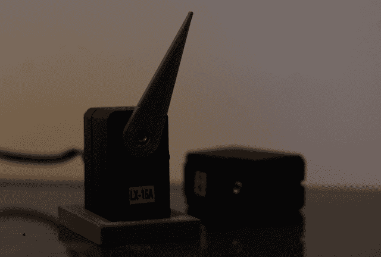

因此，构建一个 `simulator` 来进行初始 `tuning` 是合理的。它评估起来可能比真实环境快得多、便宜得多。所以我添加了一个基本的 `servo` `simulation` 并进行了一些 `hyperparameter tuning`。

以下是 `tuning` 时的一些提示：

*   `learning rate` 与所需的 `training time` 成反比。较小、较慢的 `learning rates` 需要更长的训练时间。
*   规模较小的 `minibatches` 泛化效果更好。
*   尝试在每次 `update` 中包含多个 `episodes`，以打破 `sample correlation`。
*   独立调优 `value estimation` 和 `policy networks`。
*   不要 `update` 过快，否则 `training` 会震荡。
*   `training speed` 和 `training stability` 之间存在权衡。如果你想要更稳定的 `training`，就要降低学习速度。

但老实说，对于这个问题，你使用什么 `hyperparameters` 并不重要。任何算法都能解决。我们在这里所做的一切只是试图控制 `learning` 的稳定性并提高速度。即便如此，仍然需要大约 1,000 个 `steps` 才能获得一个相当稳定的 `policy`。主要因素是 `learning rate`。你可以降低它以获得更快的 `training`，但 `policy` 倾向于震荡。

#### 最终策略

图 6-10 展示了在 `simulated environment` 上 `training` 四个不同阶段（250、500、750 和 1,000 `environment steps`，对应 `servo` 的模拟移动）的训练 `policy`。你可以通过让 `policy` 预测给定 `goal`（`x-axis`）和 `position`（`y-axis`）`observation` 下的 `action`（值由 `shading` 表示）来生成这样的图表。完美的 `policy` 应该看起来像平滑的垂直条纹，之所以平滑是因为这是 `continuous action`，之所以垂直是因为我们想要一个直接映射到请求 `goal` 的 `action`；`position observation` 是无关的。

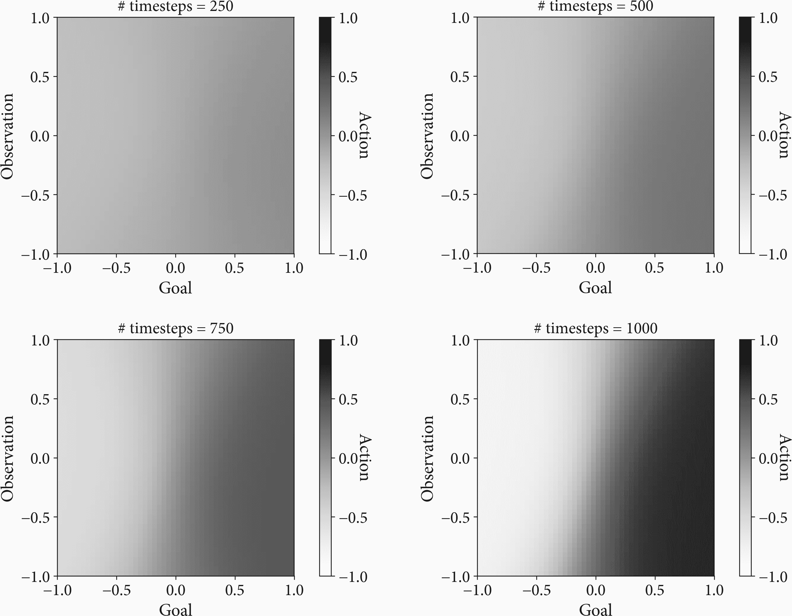

在 `training` 开始时，所有预测均为零。随着时间的推移，`agent` 学会了在 `goal` 较高时向上移动，在 `goal` 较低时向下移动。最终 `policy` 中存在一条微妙的对角线，因为 `model` 有足够的自由度做出这种选择，而各种 `random samples` 共同导致了这种 `policy` 而非完美的 `policy`。给予更多的 `training time` 并进行平均，这最终会变得完美。

图 6-11 展示了当让 `agent` 在真实 `servo` 上训练时非常相似的结果。对角线更明显，但这可能只是由于选定的特定 `random samples` 所致。但 `actions` 也不是那么明显。黑色不那么黑，白色不那么白。就好像在现实生活中，正确 `action` 存在更多的不确定性，我将其归因于请求的移动并不完美。例如，如果我请求 `position` 为 0.5，它实际上会移动到 0.52。我认为这种 `positional error` 表现为略微不确定的 `policy`。

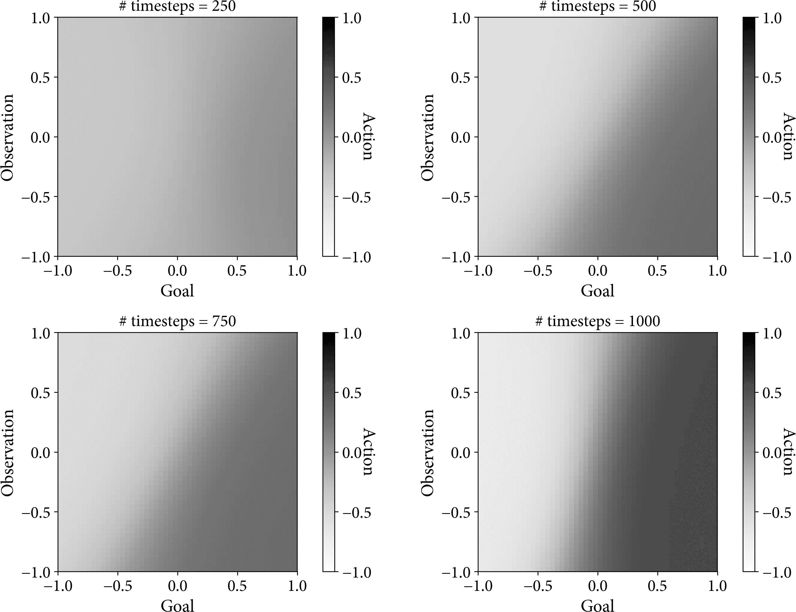

当然，和以前一样，给予更多的 `training time` 并进行平均，将会产生一个完全可行且有用的 `policy`。

## 其他策略梯度算法

`Policy gradients`，尤其是 `off-policy PG algorithms`，是一个热门研究领域，因为直接从经验中学习 `policy` 具有内在吸引力。但在某些 `environments` 中，尤其是具有复杂 `state spaces` 的 `environments` 中，性能落后于 `value methods`。在本节中，我将介绍两条主要研究路线：稳定 `off-policy updates` 的其他方法，你已经看到了 `TRPO` 和 `PPO` 的形式；以及 `emphatic methods`，它们试图使用 `Bellman error` 的梯度，而不是 `advantages`。

## Retrace(λ)

`Retrace(λ)` 是一种早期的 `off-policy PG algorithm`，它使用加权和裁剪的 `importance sampling` 来帮助控制 `update` 中包含多少 `off-policy` 成分。^(25)

Munos 等人将 `importance sampling ratio` 截断为最大值 1，这类似于 `TRPO/PPO` 中的悲观界，并约束了对 `policy` 的改进。在最好的情况下，差异很小，因此 `update` 是标准的 `A2C`。在最坏的情况下，`update` 可以忽略不计，因为两个 `policies` 差异太大。裁剪的原因是防止 `variance explosion`（重复的高值导致 `policy` 发生剧烈变化）。缺点是这会增加 `bias`；结果更稳定，但探索能力变弱。

回报还由 `λ` 加权，即来自“资格迹”的 `eligibility traces`。这根据之前的访问更新 `policy`，提供了一个 `hyperparameter` 来控制 `bias–variance trade-off`。

## 具有经验回放的 Actor-Critic (ACER)

`ACER` 通过包含 `experience replay`、`trust region policy optimization` 和 `dueling network architecture` 的组合来扩展 `Retrace(λ)`。^(26)

首先，Wang 等人重新构建 `Retrace(λ)` 以补偿截断 `importance sampling` 引入的 `bias`。换句话说，`Retrace(λ)` 防止 `policy` 发生大幅变化，这使其更稳定（偏差更大），但探索能力变弱。`compensating factor` 按照 `Retrace(λ)` 中 `truncation` 的比例来补偿这种探索损失。

他们还包含一个更高效的 `TRPO` 实现，它维护一个由 `neural network` 预测的 `average policy`。如果你将 `KL divergence` 编码为惩罚项而非约束条件，则可以使用 `DL framework` 的 `auto-differentiation`。

最后，他们使用 `experience replay`（见“经验回放”）提高样本效率。对于 `continuous action spaces`，他们包含 `dueling architecture`（见“决斗网络”）以减少 `variance`。这导致了两个独立的算法：一个用于 `discrete actions`，一个用于 `continuous`。

结果是一种算法，其性能接近带有 `prioritized experience replay`（见“优先经验回放”）的 `DQN`，但也能适用于 `continuous action spaces`。然而，所有的修正导致算法相当复杂，因此 `neural network architecture` 也很复杂。

## 使用 Kronecker 分解信任区域的 Actor-Critic (ACKTR)

在“自然策略梯度和信任区域策略优化”中，你已经看到使用 `natural policy gradient` 并通过 `KL divergence` 约束是有益的，因为 `gradient` 独立于 `approximating function` 的 `parameterization`，且 `KL constraint` 提高了稳定性。然而，计算 `gradient` 需要昂贵的计算来计算 `Fisher information matrix`。`TRPO` 的 `linear projection` 是另一个低效来源。

2017 年，Wu 等人提出使用近似来加速计算。^(27) 他们使用 `Kronecker-factored approximation (K-FAC)`，即 `Fisher information matrix` 的一种近似，来提高计算性能，并使用该近似的 `rolling average` 代替 `linear projection`，以减少 `agent` 与 `environment` 交互的次数。


此外，因为你可以将 `K-FAC` 用于卷积神经网络（如 `PPO`），这意味着 `ACKTR` 可以处理离散的、视觉的状态空间，例如 `Atari 基准测试`。

自 2017 年以来，独立评测表明 `ACKTR` 与 `TRPO` 的性能高度依赖于环境。例如，在高度不稳定的 `Swimmer-v1` `MuJoCo` 环境中，`TRPO` 优于大多数算法。但在 `HalfCheetah-v1` 环境中，`TRPO` 的表现明显更差。^(28) 在原始论文中，Henderson 等人展示了 `Swimmer-v1` 的结果，显示 `A2C`、`TRPO` 和 `ACKTR` 表现相似（参见“我应该使用哪种算法？”）。据传闻，从业者更倾向于 `ACKTR` 而非 `TRPO`，因为两者的思路和最终性能相似，但 `ACKTR` 的计算效率得到了显著提升。

## 强调法

梯度时序差分方法（参见“梯度时序差分学习”）引入了使用函数逼近状态价值函数，并直接计算投影贝尔曼误差的梯度以避免逼近发散的想法。然而，它们需要两组参数和两个学习率，这使得它们在实践中难以使用。为了解决这个问题，Sutton 等人提出了强调时序差分方法。^(29,30)

在其最一般的形式中，强调时序差分学习使用一个函数来根据当前策略量化对特定状态的兴趣。这与重要性采样一起呈现，以补偿离策略智能体。然而，确定一个函数已被证明很困难，且与投影相关的性能问题阻碍了其取得突破性成功。^(31)

一个特别有趣的强调提议称为广义离策略行动者-评论家（`Geoff-PAC`），建议使用反事实目标的梯度。^(32) `反事实` `推理` 是质询未观测到的数据的过程；例如，基于过去收集的数据，询问新策略的奖励会是多少。虽然细节超出了本书范围，但其思路是你可以通过预测 `密度比` 来学习强调函数的逼近（当然是使用神经网络），这类似于重要性采样的连续版本。结果很有希望，但尚未获得广泛普及。

## 策略梯度算法的扩展

贯穿全书，你已经看到了一系列算法增强，原则上你可以将它们应用于任何算法。每隔几年，研究人员就会发布一篇论文，将这些增强结合起来，在基准环境中产生最先进的结果并引起媒体关注。但从从业者的角度来看，随附的消融研究往往更有趣，因为它能向你展示哪些调整可能最适合你的问题。为了演示这种方法，这里有一个如何将分布式 RL 添加到 PG 算法的示例。

## 策略梯度算法中的分位数回归

Richter 等人演示了如何以大致相同的方式将分布式 RL 纳入策略梯度算法，就像“改进奖励”为价值方法所做的那样。^(33) 他们使用神经网络来预测每个动作的分位数。和以前一样，这很有用，因为从动作到奖励的映射通常是随机的，并且许多环境具有多峰分布。本文的关键区别在于对策略梯度算法的适配。他们从标准的 `A2C` 损失函数（`公式 6-8`）开始，不再学习优势函数，而是用分位数估计来替代它。接下来，他们做了一系列近似来分解出分位数估计，从而得到一个版本，该版本根据温度超参数迭代地更新分位数估计。他们实现了该算法的 `on-policy` 版本，在某些基准测试中击败了 `TRPO`（他们没有将其与 `PPO` 进行比较），并建议以类似的方式将其用于 `off-policy`。

## 总结

在本篇相当广泛的章节中，你看到了各种最先进的策略梯度算法，重点关注 `off-policy` 行动者-评论家方法。第 5 章介绍了将策略评估和策略改进抽象为行动者-评论家架构的想法。本章的目的是解释和演示 `off-policy` 学习的威力。

`Off-policy` 学习前景广阔，智能体可以学习多种不同于行为策略的策略。`Off-policy` 学习使智能体从探索-利用权衡的暴政中解脱出来，允许行为策略自由探索。由于最优策略是分离的，你可以使用离线数据日志或从人类演示中学习。但主要优势是你可以随意重新训练你的逼近函数，因为没有环境成本。这导致算法具有更高的样本效率，尽管以计算复杂度为代价，特别是如果你涉及神经网络的话。

## 我应该使用哪种算法？

研究人员也清楚你对哪种算法最好感到困惑。已经有许多研究试图给出答案，但转述一个总结的话，研究人员很容易展示可能并不完全稳健的投机结果。^(34) 举个具体例子，原始 `ACKTR` 论文展示了许多其他人难以复现的环境结果。当然，这可能是由于实现细节或一组幸运的超参数。但这确实凸显了这个问题。不过，我可以提出一些通用建议：

*   优先选择 `TD3` 而非 `DDPG`
*   在动态不稳定的环境中优先选择信任域方法，这种情况下策略的微小变动可能导致灾难性后果
*   在动态稳定的环境中优先选择确定性方法
*   如果性能或鲁棒性是考量因素，请考虑更简单的算法和更小的神经网络，如 `PPO` 或 `TD3`

## 关于异步方法的说明

`Off-policy` 算法的另一个重要特性是它让你不必使用单个评论家。我还没提到这一点（参见“`扩展 RL`”），但因为评论家是从经验回放缓冲区学习的，所以没有理由不让许多重复的评论家都学习单独的策略。在这些 `异步方法` 中，你需要在某个时刻将这些知识重新组合回行为策略，但这可以显著提高算法的实际运行时性能。我还没有讨论它，因为我认为这是一个实现细节，且取决于是否有一个需要更快学习以证明额外开销合理的问题。对于工业问题，我首先建议你考虑简化问题或领域以消除对这种方法的需求，因为它增加了大量的操作复杂性和成本。

## 延伸阅读

*   自然策略梯度和 `TRPO`（参考文献中的论文）：
    *   [John Schulman 简短而精彩的讲座](https://oreil.ly/eOhYM)
    *   [CMU 10703 幻灯片](https://oreil.ly/-Ys4X)
    *   [Sergey Levine 的讲座](https://oreil.ly/604zI)
    *   [Xander Steenbrugge 的讲解视频](https://oreil.ly/AzF9z)
*   数值优化：


## 参考文献

1. Nocedal, Jorge, and S. Wright. 2006. [*数值优化*](https://doi.org/10.1007/978-0-387-40065-5). 第 2 版. 运筹学与金融工程丛书. 纽约: 施普林格出版社.

2. Sutton, Richard S., Hamid R. Maei, and Csaba Szepesvári. 2009. [“一种用于带线性函数近似的离策略学习的收敛 `O(n)` 时序差分算法”](https://oreil.ly/iq9Pg). 见 *神经信息处理系统进展* 21, D. Koller, D. Schuurmans, Y. Bengio, and L. Bottou 编, 1609–1616. Curran Associates, Inc.

3. Sutton, Richard S., Hamid Reza Maei, Doina Precup, Shalabh Bhatnagar, David Silver, Csaba Szepesvári, and Eric Wiewiora. 2009. [“用于带线性函数近似的时序差分学习的快速梯度下降方法”](https://oreil.ly/aprqz). 见 *第 26 届国际机器学习会议论文集*, 993–1000. ICML 09. 加拿大魁北克蒙特利尔: 计算机协会.

4. Sutton, Richard S., Hamid Reza Maei, Doina Precup, Shalabh Bhatnagar, David Silver, Csaba Szepesvári, and Eric Wiewiora. 2009. [“用于带线性函数近似的时序差分学习的快速梯度下降方法”](https://oreil.ly/qpk-g). 见 *第 26 届国际机器学习会议论文集*, 993–1000. ICML 09. 加拿大魁北克蒙特利尔: 计算机协会.

5. Maei, Hamid Reza, Csaba Szepesvári, Shalabh Bhatnagar, and Richard S. Sutton. 2010. “面向带函数近似的离策略学习控制.” 见 *第 27 届国际机器学习会议论文集*, 719–726. ICML’10. 以色列海法: Omnipress.

6. White, Adam, and Richard S. Sutton. 2017. `GQ(λ)` [“快速参考与实现指南”](https://oreil.ly/pj7Wc). `ArXiv:1705.03967`, 5 月.

7. Degris, Thomas, Martha White, and Richard S. Sutton. 2013. [“离策略 Actor-Critic”](https://oreil.ly/zcR5K). `ArXiv:1205.4839`, 6 月.

8. Silver, David, Guy Lever, Nicolas Heess, Thomas Degris, Daan Wierstra, and Martin Riedmiller. 2014. [“确定性策略梯度算法”](https://oreil.ly/PU2hT). 见 *国际机器学习会议*, 387–95.

9. Lillicrap, Timothy P., Jonathan J. Hunt, Alexander Pritzel, Nicolas Heess, Tom Erez, Yuval Tassa, David Silver, and Daan Wierstra. 2019. [“基于深度强化学习的连续控制”](https://oreil.ly/D_Zjm). `ArXiv:1509.02971`, 7 月.

10. Plappert, Matthias, Rein Houthooft, Prafulla Dhariwal, Szymon Sidor, Richard Y. Chen, Xi Chen, Tamim Asfour, Pieter Abbeel, and Marcin Andrychowicz. 2018. [“用于探索的参数空间噪声”](https://oreil.ly/klLak). `ArXiv:1706.01905`, 1 月.

11. Salimans, Tim, and Durk P. Kingma. 2016. [“权重归一化：一种加速深度神经网络训练的简单重参数化方法”](https://oreil.ly/LFWvR). 见 *神经信息处理系统进展* 29, D. D. Lee, M. Sugiyama, U. V. Luxburg, I. Guyon, and R. Garnett 编, 901–909. Curran Associates, Inc.

12. Fujimoto, Scott, Herke van Hoof, and David Meger. 2018. [“解决 Actor-Critic 方法中的函数近似误差”](https://oreil.ly/r0qaN). `ArXiv:1802.09477`, 10 月.

13. Wang, Chaoyang, Zhiqiang Guo, Jianjun Li, Peng Pan, and Guohui Li. 2020. [“一种用于交互式推荐的基于文本的深度强化学习框架”](https://oreil.ly/32vIS). `ArXiv:2004.06651`, 7 月.

14. Ie, Eugene, Vihan Jain, Jing Wang, Sanmit Narvekar, Ritesh Agarwal, Rui Wu, Heng-Tze Cheng, et al. 2019. [“面向列表式推荐系统的强化学习：一种可处理的分解与实用方法论”](https://oreil.ly/lPePY). `ArXiv:1905.12767`, 5 月.

15. Ie, Eugene, Chih-wei Hsu, Martin Mladenov, Vihan Jain, Sanmit Narvekar, Jing Wang, Rui Wu, and Craig Boutilier. 2019. [“RecSim：一个可配置的推荐系统仿真平台”](https://oreil.ly/ZnQs6). `ArXiv:1909.04847`, 9 月.

16. Barth-Maron, Gabriel, Matthew W. Hoffman, David Budden, Will Dabney, Dan Horgan, Dhruva TB, Alistair Muldal, Nicolas Heess, and Timothy Lillicrap. 2018. [“分布式分布式确定性策略梯度”](https://oreil.ly/Uz0S5). `ArXiv:1804.08617`, 4 月.

17. Cai, Qingpeng, Ling Pan, and Pingzhong Tang. 2019. [“确定性价值-策略梯度”](https://oreil.ly/AXfzI). `ArXiv:1909.03939`, 11 月.

18. Kakade, Sham M. 2002. [“一种自然策略梯度”](https://oreil.ly/yQkbV). 见 *神经信息处理系统进展* 14, T. G. Dietterich, S. Becker, and Z. Ghahramani 编, 1531–1538. MIT Press.

19. Schulman, John, Sergey Levine, Philipp Moritz, Michael I. Jordan, and Pieter Abbeel. 2017. [“信任域策略优化”](https://oreil.ly/d4qxR). `ArXiv:1502.05477`, 4 月.

20. Peters, Jan, Sethu Vijayakumar, and Stefan Schaal. 2005. [“自然 Actor-Critic”](https://oreil.ly/Ks5mV). 见 *机器学习：ECML 2005*, João Gama, Rui Camacho, Pavel B. Brazdil, Alípio Mário Jorge, and Luís Torgo 编, 280–91. 计算机科学讲义. 柏林, 海德堡: 施普林格.

21. Schulman, John, Filip Wolski, Prafulla Dhariwal, Alec Radford, and Oleg Klimov. 2017. [“近端策略优化算法”](https://oreil.ly/HDdBG). `ArXiv:1707.06347`, 8 月.

22. Mnih, Volodymyr, Adrià Puigdomènech Badia, Mehdi Mirza, Alex Graves, Timothy P. Lillicrap, Tim Harley, David Silver, and Koray Kavukcuoglu. 2016. [“深度强化学习的异步方法”](https://oreil.ly/x84W3). `ArXiv:1602.01783`, 6 月.

23. Schulman, John, Filip Wolski, Prafulla Dhariwal, Alec Radford, and Oleg Klimov. 2017. [“近端策略优化算法”](https://oreil.ly/-QFNj). `ArXiv:1707.06347`, 8 月.

24. Ahn, Michael, Henry Zhu, Kristian Hartikainen, Hugo Ponte, Abhishek Gupta, Sergey Levine, and Vikash Kumar. 2019. [“ROBEL：用于低成本机器人学习的机器人基准测试”](https://oreil.ly/yJsP2). `ArXiv:1909.11639`, 12 月.

25. Song, Xingyou, Yilun Du, and Jacob Jackson. 2019. [“关于 RL 泛化的超参数及其相互依赖性的实证研究”](https://oreil.ly/LDusn). `ArXiv:1906.00431`, 6 月.

26. Munos, Rémi, Tom Stepleton, Anna Harutyunyan, and Marc G. Bellemare. 2016. [“安全高效的离策略强化学习”](https://oreil.ly/29RAJ). `ArXiv:1606.02647`, 11 月.

27. Wang, Ziyu, Victor Bapst, Nicolas Heess, Volodymyr Mnih, Remi Munos, Koray Kavukcuoglu, and Nando de Freitas. 2017. [“带经验回放的样本高效 Actor-Critic”](https://oreil.ly/4dMmv). `ArXiv:1611.01224`, 7 月.

28. Wu, Yuhuai, Elman Mansimov, Shun Liao, Roger Grosse, and Jimmy Ba. 2017. [“使用克罗内克分解近似的深度强化学习可扩展信任域方法”](http://arxiv.org/abs/1708.05144). `ArXiv:1708.05144`, 8 月.


## 参考文献

^(28) Henderson, Peter, Riashat Islam, Philip Bachman, Joelle Pineau, Doina Precup, and David Meger. 2019. "重要的深度强化学习". ArXiv:1709.06560，1 月。

^(29) Sutton, Richard S., A. Rupam Mahmood, and Martha White. 2015. "针对离策略时序差分学习问题的强调方法". ArXiv:1503.04269，4 月。

^(30) Zhang, Shangtong, Wendelin Boehmer, and Shimon Whiteson. 2019. "广义离策略演员-评论家". ArXiv:1903.11329，10 月。

^(31) Gelada, Carles, and Marc G. Bellemare. 2019. "通过自举协变量偏移进行离策略深度强化学习". ArXiv:1901.09455，1 月。

^(32) Zhang, Shangtong, Wendelin Boehmer, and Shimon Whiteson. 2019. "广义离策略演员-评论家". ArXiv:1903.11329，10 月。

^(33) Richter, Oliver, and Roger Wattenhofer. 2019. "通过分位数回归学习策略". ArXiv:1906.11941，9 月。

^(34) Henderson, Peter, Riashat Islam, Philip Bachman, Joelle Pineau, Doina Precup, and David Meger. 2019. "重要的深度强化学习". ArXiv:1709.06560，1 月。
