# 第 7 章 使用熵方法学习所有可能的策略

深度强化学习（RL）因其处理和逼近复杂观测的能力而成为标准工具，这会产生精细的行为。然而，许多深度 RL 方法优化的是确定性策略，因为如果拥有完全可观测性，则只存在一种最优策略。但通常期望学习随机策略或概率行为，以提高鲁棒性并应对随机环境。

## 什么是熵？

`Shannon entropy`（以下简称 `entropy`）是衡量随机变量所包含信息量的指标，其中信息量按编码所有可能状态所需的比特数计算。公式 7-1 以方程形式展示了这一点，其中 `X` ≐ {`x`[0],`x`[1],⋯,`x`[`n` − 1]} 是随机变量，`H` 是熵，`I` 是信息量，`b` 是所用对数的底数（`b` ≐ 2 时常用比特，`b` ≐ 10 时用班，`b` ≐ `e` 时用纳特）。比特是最常用的底数。

### 公式 7-1. 随机变量的信息量

```
\mathcal{H}\left( X \right) \doteq {\mathbb{E}}\left\lbrack I\left( X \right) \right\rbrack = - \sum\limits_{x \in X}p\left( x \right)\log_{b}p\left( x \right)
```

例如，硬币有两种状态，假设它不会竖立着落地。这两种状态可用 0 和 1 编码，因此以比特为单位的熵衡量的硬币所含信息量为 1。骰子有六种可能状态，因此需要三个比特来描述所有这些状态（真实值为 2.5849…）。

最优控制的概率解是随机策略。为了准确表示动作-概率分布，必须采样足够多的状态和动作。你可以测量已访问的状态和动作数量，就像在 `UCB` 中那样（参见“改进 `ϵ`-贪婪算法”）。但这并不直接耦合到策略；`UCB` 是一种探索策略，而非策略的一部分。相反，你可以使用策略分布均匀程度的代理指标（如熵），并将其作为惩罚项包含在目标函数中。

## 最大熵强化学习

最大化策略的熵会迫使智能体访问所有状态和动作。策略不再旨在寻找最大化奖励的确定性行为，而是可以学习*所有*行为。换句话说，智能体不再学习执行任务的最佳方式，熵项迫使智能体学习解决任务的*所有*方法。这产生的策略能够直观地探索，并在面对对抗性攻击时（例如向机器人扔砖头）提供更鲁棒的行为。请参阅 PPO 博客文章中的视频 以获取一些趣味内容。我在第 10 章中详细讨论这一点。

公式 7-2 展示了最大熵 RL 的目标函数，其中 `α` 是一个超参数（称为 `temperature`，关联回熵的热力学定义），它决定了熵项相对于奖励的重要性，并控制最优策略的随机性。

### 公式 7-2. 最大熵目标函数

```
\begin{array}{r} {\pi^{\*} \doteq \operatorname{argmax}\limits_{\pi}\sum\limits_{s \in \mathcal{S},a \in \mathcal{A}}{\mathbb{E}}\left\lbrack {r + \alpha\mathcal{H}\left( \pi\left( a \mid s \right) \right)} \right\rbrack} \\ \end{array}
```

公式 7-2 表明，最优策略被定义为使由策略熵正则化的回报最大化的策略。这类似于最优策略的标准定义，不同之处在于它增加了一个奖励项以促进非确定性策略，这与确定性策略梯度截然相反。

`α` 超参数允许你控制奖励项的大小。接近零的值倾向于确定性，较大的值则促进非确定性动作，从而鼓励更多探索。

## 软演员-评论家

软演员-评论家（`SAC`）算法是最大熵目标函数的离策略策略梯度近似。^(1) “软”一词用于强调算法中的非确定性元素；不含熵项的标准贝尔曼方程可视为“硬”，因此 `Q-learning` 和 `DDPG` 是相应的“硬”算法。

Haarnoja 等人首先将评论家定义为早期论文中提出的动作价值函数的软近似。^(2) 回顾一下，目标是生成一个最大化熵的策略，这意味着智能体应比其他状态更重视高熵状态。根据公式 7-2，公式 7-3 表明，状态的价值等于动作价值加上该新状态熵的奖励。我简化了符号以匹配本书其余部分；公式 7-3 假设你正在遵循某个策略，但我隐藏了该信息以使数学表达更易理解。`V` 和 `Q` 分别代表状态价值函数和动作价值函数。

### 公式 7-3. 最大熵状态价值函数

```
\begin{array}{cl} {V\left( s \right)} & {= {\mathbb{E}}\left\lbrack {Q\left( s,a \right) + \alpha\mathcal{H}\left( {\pi\left( a \mid s \right)} \right)} \right\rbrack} \\ & {= {\mathbb{E}}\left\lbrack {Q\left( s,a \right) - \alpha\log\pi\left( a \mid s \right)} \right\rbrack} \\ \end{array}
```


使用公式 7-3，公式 7-4 展示了动态规划中对应的动作价值函数。

### 公式 7-4. 最大熵动作价值函数

`Q(s,a) ≐ 𝔼[r + γ𝔼[V(s′)]]`

为了处理复杂的状态空间，你可以训练一个函数来近似公式 7-4，为此你需要一个目标函数（公式 7-5）。

### 公式 7-5. 最大熵动作价值目标函数

```
J_Q(θ) = 𝔼[½(Q_θ(s,a) - Q(s,a))²]
       = 𝔼[½(Q_θ(s,a) - (r + γ𝔼[V_θ(s′)]))²]
```

你可以推导公式 7-4 的梯度（稍后你将看到），但 `SAC` 实现通常利用深度学习库附带的自动微分框架。接下来，你需要一个用于 Actor 的策略和一个类似的目标函数。可以从解析上推导出软策略梯度。^(3) 但 `Haarnoja et al.` 选择改为最小化 `Kullback–Leibler (KL)` 散度（参见“Kullback–Leibler 散度”）。原因在于 `Liu and Wang` 开发了一种称为 `Stein 变分梯度下降` 的方法，这是 `KL` 散度梯度的一个解析解，其推导超出了本书的范围。^(4) `Haarnoja et al.` 将该技术应用于软策略，从而得到了公式 7-6 中所示的策略目标，你可以使用自动微分来求解。

### 公式 7-6. SAC 策略目标函数

```
J_π(φ) = 𝔼[α log(π_φ(a|s)) - Q_θ(s,a)]
```

## SAC 实现细节与离散动作空间

推导中的一些细节会影响实现。首先，性能对温度参数的选择高度敏感。你需要进行超参数扫描，以确定每个问题的最佳温度。其次，由于对温度超参数敏感，这也意味着它对奖励的尺度敏感。例如，大奖励会淹没较小的温度值。请重新缩放奖励以缓解此问题。这两个问题在下一个算法中得到了修复。

最后，`Haarnoja et al.` 假设动作服从 `Gaussian` 分布，这使得问题变得易于处理（称为 `重参数化技巧`），并允许其用于连续动作空间。^(5) `SAC` 开箱即用时不支持离散动作空间。

`Christodoulou` 提出的 `SAC` 算法增加了这一能力，它重新表述了具有离散动作的最大熵问题——差异很小。^(6) 你可能会问为什么要在离散动作空间上使用策略梯度算法而不是像 `DQN` 这样的算法。在离散动作空间上使用 `SAC` 的主要好处是，它可以在学习性能上与价值方法竞争，但无需超参数调整。`SAC` 通过后续算法自动调整温度来实现这一点。

## 自动调整温度

`Haarnoja et al.` 的一篇后续论文提出了一种通过将问题转化为约束而非惩罚来自动调整 `SAC` 温度参数的方法。他们约束当前策略的熵高于解的预期最小熵。然后他们发现可以迭代地更新温度参数模型，以最小化当前策略熵与预期熵之间的差异，如公式 7-7 所示，其中 `α` 是温度参数，`H̄ ≐ -dim(A)` 是预期熵，等同于动作数量的负值。^(7)

### 公式 7-7. SAC 温度参数目标函数

```
J_α = 𝔼[-α log(π(a|s)) - αH̄]
```

`Haarnoja et al.` 在原始 `SAC` 算法中添加了这一行，将其转变为一个无超参数的离策略策略梯度算法。这是一个诱人的特性，因为它减轻了开发者偏见并加快了开发速度，同时拥有最先进的性能。当然，你仍然需要调整：神经网络结构、状态工程、动作类别等。但这是朝着正确方向迈出的一步。

## 案例研究：减少排队的自动化交通管理

没有什么比乘客在接近交通拥堵时发出的同步呻吟更普遍了。施工区域和事故产生的瓶颈是非周期性拥堵和次生事故最重要的原因之一。“智能”高速公路旨在通过建议用户何时汇入空闲车道来提高高密度流中的平均速度。自动驾驶的最新发展，如自适应巡航控制（匹配你与前车的速度），允许车辆在保持较小间距的情况下高速行驶。但这并未利用其他车道或后方车辆的信息。未来，车辆将能够获取更多的局部信息，这将可能允许车辆之间进行协作。如果车辆能够协作，那么你可以使用 `RL` 推导出一个全局最优策略，以提高速度和密度，从而减少拥堵和次生事故的数量。

`Ren, Xie, and Jiang` 开发了一种 `RL` 方法来解决这个问题。他们首先将道路分割成多个区域，其中一个是汇入区，车辆被强制汇入空闲车道。前一个区域允许车辆加速或减速，以便与空闲车道上的交通对齐。^(8)

`MDP` 的状态是该区域内的速度和加速度矩阵，以及受控车辆的局部信息。这些被输入到一个相当复杂的神经网络中，该网络包含卷积、全连接和循环元素。

动作是对单个车辆速度的控制，以将其定位在安全间隙内。他们遍历当前位于控制区域内的所有车辆。

奖励很复杂，但旨在促进成功汇入（无碰撞且保持安全距离）和提高速度。

他们选择 `SAC` 作为首选算法，因为其支持连续动作、具有离策略采样效率，且在探索过程中表现稳定。

他们在名为 [`VISSIM`](https://oreil.ly/48EpL) 的交通仿真工具中模拟了这一公式，并将 `RL` 实现与常见的基于路标的汇入策略进行了比较，后者要么指示车辆提前汇入空闲车道，要么指示晚汇入。`RL` 解决方案显著优于基础算法，将延迟降低了一个数量级。它也安全得多，整个队列中密度稳定且数值较低，而基础算法则助长了危险的向后形成的冲击波。


尽管取得了令人印象深刻的结果，但仍有很大的改进空间。首先，这是一个仿真。如果能有一些真实场景的结果那将是很棒的，尽管我从经验中知道，针对此类潜在危险环境进行开发极其困难。我还希望看到更真实的观测。例如，车辆位置和局部信息可以从视频摄像头推断得出。没有必要假设车辆或预言机拥有周围车辆的完美知识。最后，我担心对于一个相当简单的状态空间，策略模型过于复杂。我不认为需要这么多复杂性，状态表示应该被委托处理。我有信心，策略本身——用于选择合适的速度以插入间隙——实际上非常容易学习。

## 最大熵方法的扩展

SAC 开箱即用地为你提供了一个简单且高性能的离策略算法，但与其他算法一样，研究人员仍在不断提出改进，以追求最大性能。和往常一样，这些改进并不能保证对你的特定问题有更好的表现；你必须亲自测试它们。

## 其他熵度量（及集成）

香农熵只是衡量熵的一种方式。还有其他形式会改变 SAC 惩罚策略以偏好或忽略无前途动作的方式。Chen 和 Peng 尝试了 Tsallis 熵和 Rényi 熵，发现这些能提升基线算法的性能。^(9) 他们还演示了策略集成的用法，即同时训练多个策略。在每个新回合开始时，智能体从该集成中随机选择一个策略来选取动作。这种方法源自引导式 DQN，旨在改进探索（参见“改进探索”）。

## 利用双 Q 学习上界进行乐观探索

类似于双 Q 学习对动作价值估计建立下界（参见“双 Q 学习”），Ciosek 等人提出将悲观界用作目标策略（带有一个使其看起来类似标准 SAC 的熵项），但将*上界*（即高估奖励的动作价值）用于行为策略。^(10) 他们建议这有助于防止因依赖下界而导致的*悲观探索不足*。实证上，在标准 MuJoCo 环境上的结果有所提升，但幅度不大。如果你在智能体难以充分探索的环境中工作，可能需要考虑这种方法。

## 调整经验回放

正如“优先经验回放”所述，你选择用于学习的经验会影响学习性能。Wang 和 Ross 证明，添加优先经验回放可以在某些环境中改进 SAC，但过采样更新的经验能在所有环境中持续改进结果。^(11) 这是一个简单的添加，值得一试，但要警惕*灾难性遗忘*（参见“经验回放”），即智能体忘记之前的经验。大容量的回放缓冲区可以缓解这种影响。

## 软策略梯度

与其通过熵度量进行惩罚，为什么不推导一个受熵启发的软策略梯度呢？Shi、Song 和 Wu 引入了软策略梯度方法，据报道该方法比 SAC 更具原则性且更稳定。^(12)

Shi 等人从最大熵强化学习的定义出发，对策略求导，得出了一个令人惊讶的简单梯度计算，如公式 7-8 所示。这比使用自动微分框架更有效，因为你可以直接观察和操作梯度，所以他们选择直接裁剪梯度，而不是应用信任域优化，以防止灾难性更新。这导致了更简单的实现和更好的稳定性。如果这在未来成为“默认”的最大熵解释，我不会感到惊讶。

### 公式 7-8. 深度软策略梯度

$$
\begin{array}{r}
{\nabla J_{\pi}\left( \phi \right) = {\mathbb{E}}\left\lbrack {\left( {Q_{\theta}\left( s,a \right) - \log\pi\left( a \mid s \right) - 1} \right)\nabla_{\phi}\log\pi\left( a \mid s \right)} \right\rbrack} \\
\end{array}
$$

## 软 Q 学习（及其衍生算法）

你也可以将最大熵强化学习应用于 Q 学习。Haarnoja 等人首次展示了可以推导基于熵的价值和动作估计。^(13) 其他人将相同的想法应用于计算优势函数，发现它在具有离散动作空间的复杂、潜在连续环境中效果很好。^(14) 我可以想象，将这些估计集成到其他算法（如 PPO）中可能会带来积极结果。

## 路径一致性学习

Nachum 等人提出的*路径一致性学习*（PCL）与 SAC 相关，因为它认识到熵鼓励探索，并推导出与软 Q 学习相同的软状态和动作价值函数。然而，PCL 探索使用了回溯，采用 `n` 步算法的风格，从而得出一个不需要任何修正（例如重要性采样）的 `n` 步离策略算法。^(15) 后续的一篇论文实现了一个基于 KL 散度的信任方法（Trust-PCL），其性能超过了 TRPO。^(16) 这凸显了即使结合深度学习和离策略采样技术，你仍然可以融入对底层时序差分算法的改进。尽管如此，SAC 往往能大幅超越 PCL 方法。

## 性能对比：SAC 与 PPO

房间里有一头大象，它在整个强化学习领域横行霸道：对于连续控制任务，PPO 还是 SAC 更好？普遍认为 SAC 及其衍生算法优于 PPO。但事实并没有那么清晰。正如我之前提到的，研究人员用不同的方式衡量性能，实现细节会严重改变性能。^(17) 本节的主要问题是研究人员大多不发布学习曲线的原始数值。而且他们经常甚至不在表格中报告数值，只在图表中展示。这使得在论文之间比较结果变得极其困难。

表 7-1. SAC 和 PPO 在连续控制基准测试中的性能结果

| 环境 | SAC^(a) | SAC^(b) | SAC†^(c) | SAC-auto*^(d) | PPO^(e) | PPO†^(f) | SAC-auto^(g) | PPO^(h) |
| --- | --- | --- | --- | --- | --- | --- | --- | --- |
| MuJoCo Walker | 3475 | 3941 | 3868 | 4800 | 3425 | 3292 | | |
| MuJoCo Hopper | 2101 | 3020 | 2922 | 3200 | 2316 | 2513 | | |
| MuJoCo Half-cheetah | 8896 | 6095 | 10994 | 11000 | 1669 | | | |
| MuJoCo Humanoid | 4831 | | 5723 | 5000 | 4900 | 806 | | |
| MuJoCo Ant | 3250 | 2989 | 3856 | 4100 | | | | |


## SAC 性能基准测试

### MuJoCo Swimmer

| 环境 | Col2 | Col3 | 分数 1 | Col5 | 分数 2 | Col7 | Col8 | Col9 |
|---|---|---|---|---|---|---|---|---|
| MuJoCo Swimmer | | | 42 | | 111 | | | |

### PyBullet 环境

| 环境 | Col2 | Col3 | Col4 | Col5 | Col6 | Col7 | 分数 1 | 分数 2 |
|---|---|---|---|---|---|---|---|---|
| AntBulletEnv-v0 | | | | | | | 3485 | 2170 |
| BipedalWalker-v2 | | | | | | | 307 | 266 |
| BipedalWalkerHardcore-v2 | | | | | | | 101 | 166 |
| HalfCheetahBulletEnv-v0 | | | | | | | 3331 | 3195 |
| HopperBulletEnv-v0 | | | | | | | 2438 | 1945 |
| HumanoidBulletEnv-v0 | | | | | | | 2048 | 1286 |
| InvertedDoublePendulumBulletEnv-v0 | | | | | | | 9357 | 7703 |
| InvertedPendulumSwingupBulletEnv-v0 | | | | | | | 892 | 867 |
| LunarLanderContinuous-v2 | | | | | | | 270 | 128 |
| MountainCarContinuous-v0 | | | | | | | 90 | 92 |
| Pendulum-v0 | | | | | | | -160 | -168 |
| ReacherBulletEnv-v0 | | | | | | | 18 | 18 |
| Walker2DBulletEnv-v0 | | | | | | | 2053 | 2080 |

## 参考文献

^(a) Haarnoja, Tuomas, Aurick Zhou, Pieter Abbeel, and Sergey Levine. 2018. ["软演员-评论家：基于随机演员的离线策略最大熵深度强化学习"](https://oreil.ly/JjjwB). ArXiv:1801.01290, August.^(b) Wang, Tingwu, Xuchan Bao, Ignasi Clavera, Jerrick Hoang, Yeming Wen, Eric Langlois, Shunshi Zhang, Guodong Zhang, Pieter Abbeel, and Jimmy Ba. 2019. ["基于模型的强化学习基准测试"](https://oreil.ly/9ZBoU). ArXiv:1907.02057, July.^(c) Wang, Che, and Keith Ross. 2019. ["增强软演员-评论家：强调近期经验而不忘记过去"](https://oreil.ly/eigQt). ArXiv:1906.04009, June.^(d) Haarnoja, Tuomas, Aurick Zhou, Kristian Hartikainen, George Tucker, Sehoon Ha, Jie Tan, Vikash Kumar, et al. 2019. ["软演员-评论家算法及应用"](https://oreil.ly/s3apP). ArXiv:1812.05905, January.^(e) Dhariwal, Prafulla, Christopher Hesse, Oleg Klimov, Alex Nichol, Matthias Plappert, Alec Radford, John Schulman, Szymon Sidor, Yuhuai Wu, and Peter Zhokhov. 2017. [OpenAI Baselines](https://oreil.ly/9642Z). GitHub Repository.^(f) Logan Engstrom et al. 2020. ["实现细节在深度策略梯度中很重要：基于 PPO 和 TRPO 的案例研究"](https://oreil.ly/pOPdK). ArXiv:2005.12729, May.^(g) Raffin, Antonin. (2018) 2020. Araffin/Rl-Baselines-Zoo. Python. [`oreil.ly/H3Nc2`](https://oreil.ly/H3Nc2)^(h) Raffin, Antonin. (2018) 2020. Araffin/Rl-Baselines-Zoo. Python. [`oreil.ly/H3Nc2`](https://oreil.ly/H3Nc2)

---

你首先注意到的将是结果的方差。一些 SAC 实现和实验的表现远比其他的差。在这些情况下，较差的超参数调整很可能导致了较差的性能。这就是为什么 SAC 的自动温度变体如此重要。它无需调整即可取得良好结果。如果你浏览所有数字，会发现 SAC 在 MuJoCo 环境中大多优于 PPO。查看开源 PyBullet 结果也表明，总体而言自动温度 SAC 表现更好，但在许多环境中性能相似。

不过，这些数字并不能讲完整个故事。它们无法告诉你如果继续训练，性能是否会继续提升。它们也仅代表平均性能；这无法告诉你训练运行有多稳定。正如我已经多次建议的那样，始终要针对你的具体问题亲自重新测试算法和实现。你的结果可能与发布的基准不符。

## 熵如何鼓励探索？

最大熵强化学习鼓励探索，但如何做到的？公式 7-2 增加了一个与状态中动作熵成比例的奖励，这意味着智能体观察到的人工奖励高于实际奖励。额外奖励的大小由温度值和动作的熵决定。

想象一个孩子在糖果店里。你可以用熵来衡量孩子对糖果的期待；选择越多，快乐越大。在店铺中央，孩子可以向数百个不同的方向移动并得到新的糖果。但在门口，就在边缘，只有少数几个选择。熵表明，如果孩子向店铺中心移动，将会有更多的选择。

通过将奖励与熵奖励相结合，你正在鼓励那些并非严格最优的动作。这有助于确保所有状态都得到充分采样。

为了演示，我创建了一个简单的网格环境，目标位于右上角，起点在中间。智能体可以向任何方向移动（包括对角线），当智能体到达目标时获得稀疏奖励 1。如果智能体在 100 步内未到达目标，回合以零奖励结束。

我使用了一个 `\`ϵ\``-greedy Q-learning 智能体作为基线。图 7-1 展示了运行该智能体的结果，动作值以像素绘制；白色代表高动作值，黑色代表低动作值。箭头表示策略的最优轨迹（无探索）。你可以看到它找到了一条通往目标的路径，但在步数方面是次优的（记住，我没有惩罚步数，且探索依赖于随机种子），而且智能体没有探索状态空间的其他区域。如果你改变智能体的起始位置，它将无法找到通往目标的路径。这不是一个鲁棒的策略。

一个简单的增强解释了 SAC 性能的很大一部分，即将动作值用作分布，而不是依赖 `\`ϵ\``-greedy 的随机采样进行探索。当通过使用 `\`softmax()\`` 函数将动作值转换为概率，将这种粗糙的概率方法应用于 Q-learning 算法时，探索能力显著提高，正如你在图 7-2 中所见。我还将每个状态最可能的动作绘制为箭头，其方向和大小基于动作值的加权组合。注意方向箭头都指向最优轨迹，因此无论智能体从哪里开始，它总能到达目标。该策略比之前的智能体更加鲁棒，并探索了更多的状态空间。

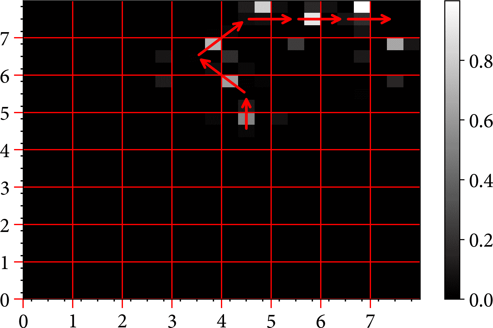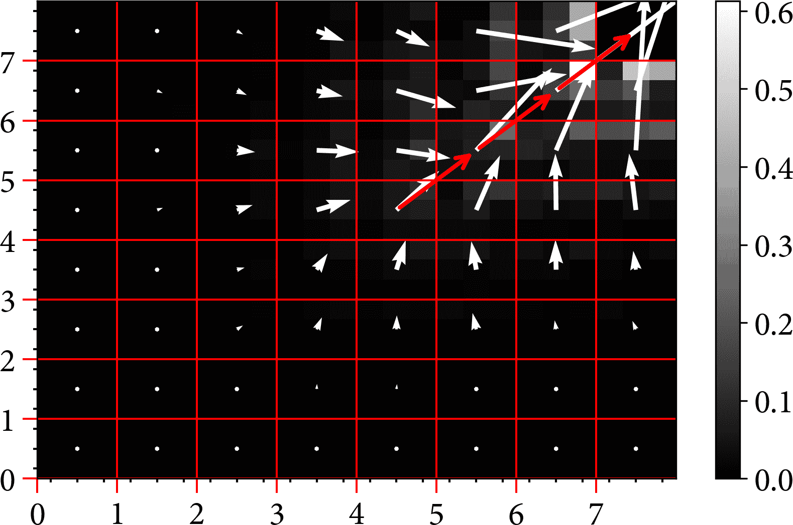

> **提示**
>
> 鲁棒策略的性能在逆境面前应优雅地降低。在最优轨迹附近存在未探索区域的策略是不鲁棒的，因为微小的偏离都可能导致进入未定义策略的状态。

接下来我实现了软 Q-learning（参见"软 Q-Learning（及其衍生算法）"）并将温度参数设为 0.05。你可以在图 7-3 中看到结果。最优策略平平无奇，尽管它们通常指向正确的方向。但如果你仔细观察，会发现动作值和方向箭头在图的 Q-learning 那一侧较小或不存在。软 Q-learning 访问了最优轨迹以外的状态。你还可以看到，代表较大动作值的白色颜色在软 Q-learning 的图像中向中心偏移。原因可以用糖果店的例子解释；熵促进拥有最多选择的状态。

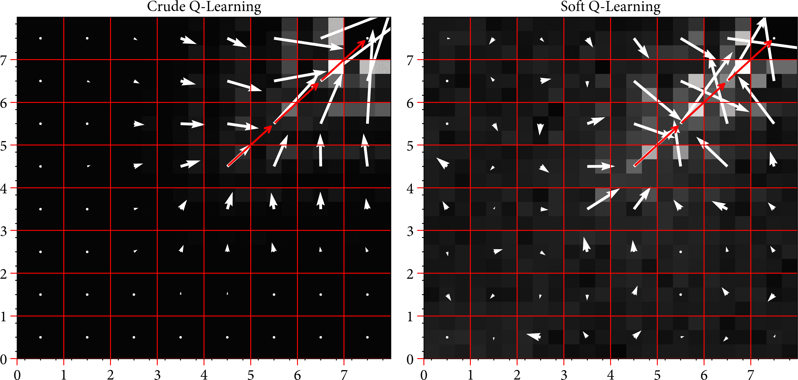


如果您记录每个智能体访问每个动作的次数，Q-learning 智能体缺乏探索的现象会更加明显，正如我在图 7-4 中所做的那样。您可以看到，软 Q-learning 智能体对状态的采样更加均匀。这就是熵有助于在更复杂的状态空间中进行探索的原因。

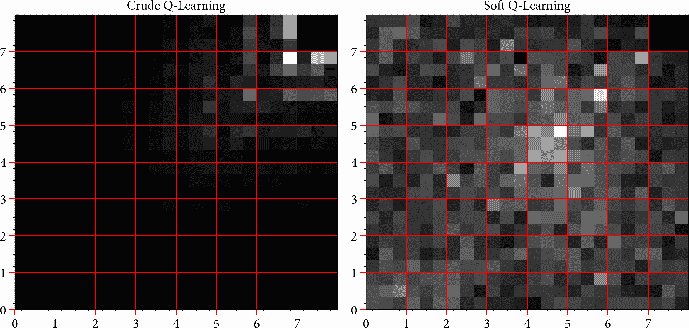

## 温度参数如何改变探索？

软 Q-learning (`SQL`) 或 `SAC` 算法高度依赖温度参数。它控制探索的程度，如果您过度加大熵的权重，智能体因探索获得的奖励将高于达成目标获得的奖励！

针对这个问题有两种解决方案。最简单的是*退火*。通过随时间降低温度参数，这迫使智能体在早期进行探索，但在后期变得确定性。第二种方法是自动学习温度参数，这被大多数 `SAC` 实现所采用。

在图 7-5 的实验中，我增加了温度值以促进更多探索。正如您从动作值的大小所见，熵项现在大到足以压倒奖励（其值为 1）。因此，最优策略是移向熵最高的状态，即中间的状态，就像在糖果店里一样。

为了解决这个问题，您可以随时间降低温度来引导孩子，我是说智能体，朝向目标。在图 7-6 所示的实验中，我将温度参数从 0.5 退火至 0.005。请注意，原始 `SAC` 论文使用了退火。

该实验演示了退火如何帮助智能体在早期回合中进行探索。这在需要大量探索的复杂环境中极其有用。温度的变化使智能体变得更像 Q-learning，并锁定最优策略。

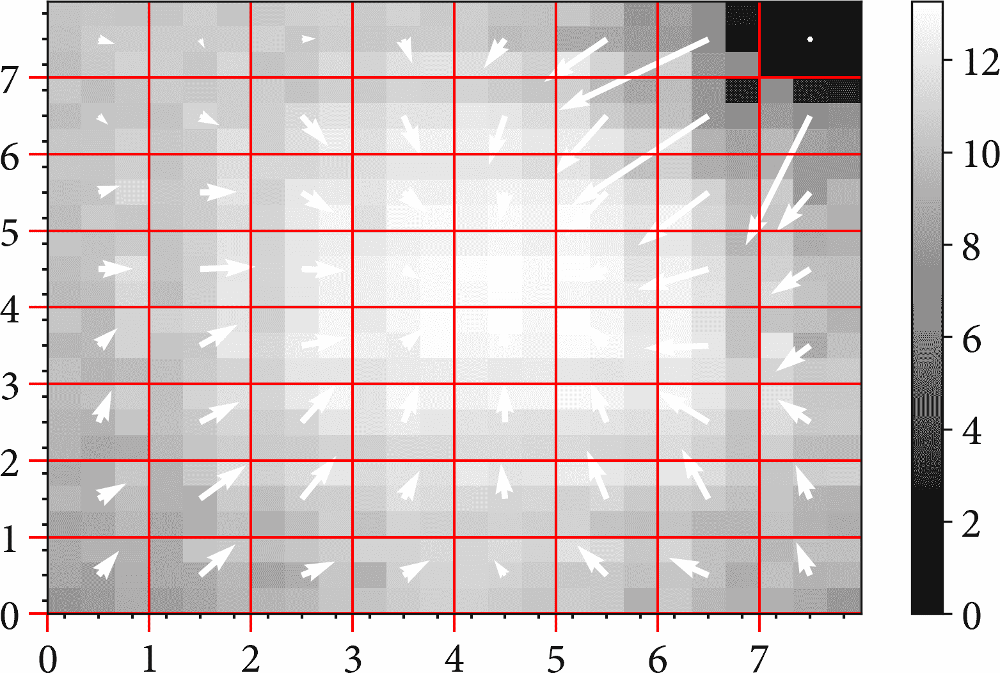
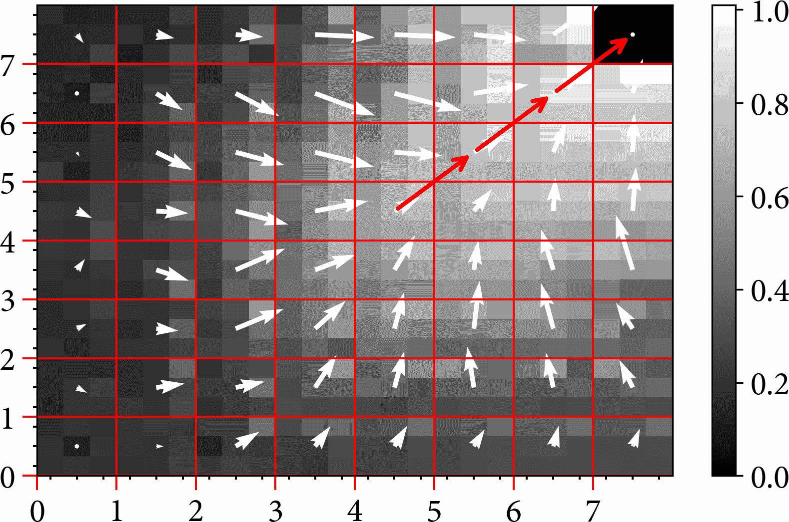

然而，起始、停止和退火速率参数很重要。您需要根据您的环境仔细选择这些参数，并在鲁棒性与最优性之间进行权衡。

## 行业示例：使用遥控车学习驾驶

`Donkey Car` 最初是一个基于开源 `Raspberry Pi` 的遥控车，并大胆地仅包含*单个*传感器；一个广角视频摄像头。所有控制均源自单张图像，这给强化学习带来了重大挑战和机遇。之所以取名为 Donkey（驴），是为了降低预期。但别被名字骗了；这件简单直接的硬件通过先进的机器学习焕发生机。请查看[Donkey Car 网站](https://www.donkeycar.com)上的一些令人印象深刻的成果并了解更多。

`Donkey Car` 爱好者 Tawn Kramer 基于 `Unity` 框架开发了一个仿真环境。^(18) 您可以将其作为一个快速开发平台来开发新的自动驾驶算法。在 `Stable Baselines` 系列库的核心贡献者之一 Antonin Raffin 的启发下，^(19) 我决定亲自尝试一下。在本示例中，我演示了基于 `SAC` 的强化学习方法能够生成一个可行的策略。

## 问题描述

状态由视频摄像头的观测表示。视频分辨率为 160×120，具有 8 位 `RGB` 颜色通道。动作空间看似简单，仅允许输入油门量和转向角。环境会在每个时间步奖励智能体的速度和保持在车道/赛道中心的行为。如果汽车偏离车道太远，会获得负奖励。目标是以最快的时间到达赛道终点。

有多条赛道。最简单的是一条车道清晰且一致的沙漠公路。最难的是城市赛车模拟，智能体必须在没有清晰边界的赛道上避障并导航。

`Unity` 仿真[以二进制文件形式提供](https://oreil.ly/2B3Nl)。`Gym` 环境通过 `websocket` 连接到仿真，并支持多连接以允许强化学习驱动的竞技比赛。

## 最小化训练时间

每当您处理基于像素的数据时，您大部分的训练时间都将被特征提取占用。快速开发此类项目的关键在于拆分问题；您拆分得越细，改进单个组件就越快、越容易。是的，直接从像素学习可行策略是可能的，但这会减慢开发迭代且成本高昂。您的钱包会感谢您。

一个显而易见的切入点是分离视觉处理部分。RL 智能体不在乎状态是展平的图像还是一组高层特征。但性能受特征信息量的影响；信息量越大的特征能带来更快的训练和更鲁棒的策略。

一种计算机视觉方法可以是尝试分割图像或检测赛道边界。使用透视变换可以补偿道路的前视视角。分割算法或训练好的分割模型可以帮助您识别道路。您可以使用 `Hough` 或 `Radon` 变换来查找图像中的线条，并利用物理假设找到最近的车道。您可能还能想出更多方法。请记住，目标是使观测数据更具信息量。

另一种（或共生的）方法是训练一个自编码器（参见“常见神经网络架构”），将特征数量限制在最具信息量的那些特征上。这涉及使用一个形状像沙漏的卷积神经网络，从数据集中分解和重建图像，直到中间极少数的神经元可靠地编码图像的所有必要信息。这是一个独立于 RL 的离线过程。预训练好的低维表示随后被用作 RL 的观测。

图 7-7 和 7-8 分别展示了训练变分自编码器 1,000 步后的原始观测和重建结果。请注意，此时存在模糊的相似性。

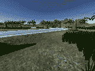
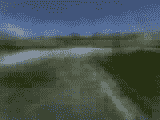

图 7-9 和 7-10 展示了训练 10,000 步后的另一个观测及其重建。请注意重建中现在包含了多少细节，这表明隐藏的神经网络嵌入已经学习到了良好的潜在特征。


图 7-11 对比了 `Donkey Car` 上 `RGB` 摄像头的观测视频与低维观测的重建视频，后者是 `SAC` 算法的输入。

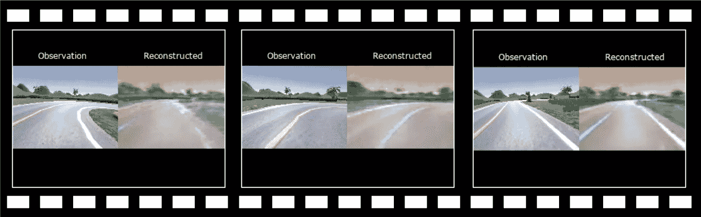

```html
<figure id="fig_vae_video"> 
  <video controls="controls" style="margin: 0 auto; max-width: 100%;" src="videos/vae_video.mp4" loop="loop" autoplay="autoplay">The video element is not supported</video> 
  <figcaption>A reconstruction of the DonkeyCar simulation through the eyes of a variational autoencoder. The video on the left shows the raw video feed from the simulation. On the right is the reconstructed video from a low-dimensional state. This reconstructed video has been cropped to remove the sky region, which is unnecessary for this problem.</figcaption> 
</figure>
```


减小状态空间（即强化学习算法的输入）将可靠地将 RL 训练时间从数天缩短到几分钟级别。我在“变换（降维、自编码器和世界模型）”中详细讨论了这一点。

## 显著动作

在某些环境中，可以施加显著改变环境的动作。以 `DonkeyCar` 为例，转向动作的大数值会导致赛车旋转、打滑或以其他方式偏离最优轨迹。但当然，赛车需要转向，有时还需要通过急弯。

但这些动作及随后的负面奖励可能导致训练陷入停滞，因为它持续打滑，永远无法捕获足够的优质观测值。在 `DonkeyCar` 环境中，当允许动作出现大幅跳变时，这种影响会变得更糟。例如，当你骑自行车时，你知道在高速下急转方向在技术上是可能的，但我怀疑你从未尝试过。你可能尝试过幅度小得多的转向并有过糟糕的体验，因此你永远不会尝试类似将方向转 90 度这样的操作。图 7-12 展示了保持原始动作空间不变时的一些训练示例画面。

```
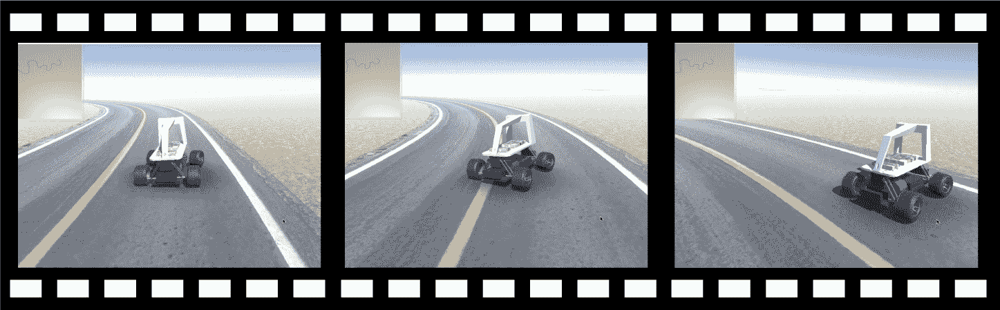<figure id="fig_original_action_space"> <video controls="controls" style="margin: 0 auto; max-width: 100%;" src="videos/original_action_space.mp4" loop="loop" autoplay="autoplay">The video element is not supported</video> <figcaption>A video of DonkeyCar training when the action space is left unaltered.</figcaption> </figure>
```

你可以通过在 RL 模型中包含这些先验信息来影响智能体的训练。你可以修改奖励信号以鼓励（或抑制）特定状态。或者，如本例所示，你可以过滤智能体的动作，使其表现得更安全。

如果你尝试使用完整范围的转向角度来训练智能体（试试看！），你会发现经过很长一段时间后，它学会了避开边缘，但方式过于猛烈，导致赛车陷入三轮漂移。尽管这看起来很酷，但无助于完成赛道。你需要让转向平滑过渡。

约束智能体行为最简单的方法之一是修改动作空间。就像在机器学习中一样，约束问题会使其更易求解。在图 7-13 所示的训练中，我将油门限制在最大 0.15（原为 5.0），将转向角限制在绝对最大 0.5（原为 1.0）。低速防止赛车打滑，较小的转向角有助于缓解转向突变。请注意，训练性能极大地受这些参数影响。请自行尝试修改它们。

```
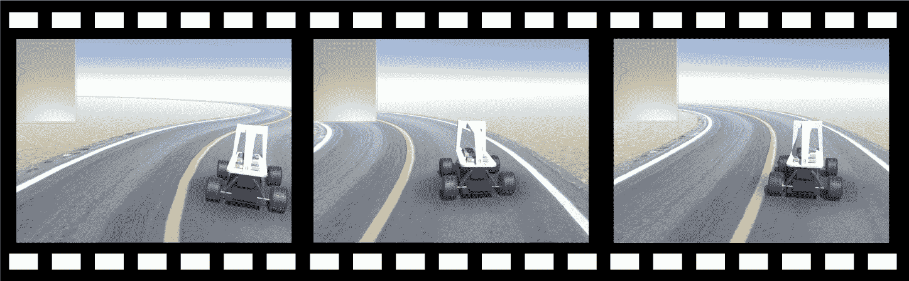<figure id="fig_simplified_action_space"> <video controls="controls" style="margin: 0 auto; max-width: 100%;" src="videos/simplified_action_space.mp4" loop="loop" autoplay="autoplay">The video element is not supported</video> <figcaption>A video of DonkeyCar training after simplifying the action space.</figcaption> </figure>
```

## 超参数搜索

最大油门和转向设置是问题的超参数；它们不会被直接调优。问题定义的变化往往对性能影响最大，但 `SAC` 算法还有许多其他超参数，如策略模型的架构。目标是找到能带来最佳奖励的参数组合。为此，你需要执行超参数搜索，编写代码遍历所有排列并重新运行训练。你可以在“超参数调优”中阅读更多相关内容。

我使用 `optuna` 库运行了优化的网格搜索来调优 `SAC` 算法的超参数，并在 `TensorBoard` 中查看了所有结果。我发现可以将学习率提高一个数量级，从而略微加快学习速度。调整熵系数也有帮助；默认情况下 `stable-baselines` 实现从 1.0 开始并学习最优值。但在本例中，智能体训练步数很少，没有时间学习最优系数。从 0.1 开始并学习最优系数效果更好。但总体而言，我对超参数对性能的影响程度感到失望（这是件好事！）。变分自编码器的超参数修改和动作空间的改变对性能的影响大得多。

## 最终策略

完成所有工程工作、代码编写和超参数搜索后，我现在获得了一个可行的策略，其训练环境步数在 5,000 到 50,000 之间，具体取决于环境以及你希望策略多完美。这在我的旧款 2014 Macbook Pro 上大约耗时 10–30 分钟。图 7-14 和 图 7-15 分别展示了 `donkey-generated-track-v0` 和 `donkey-generated-road-v0` 环境的示例策略。

```
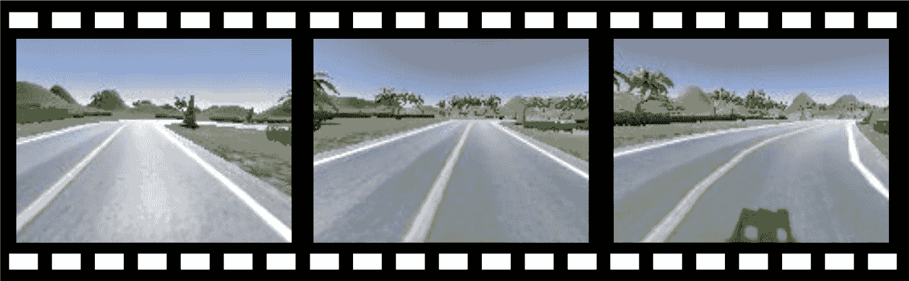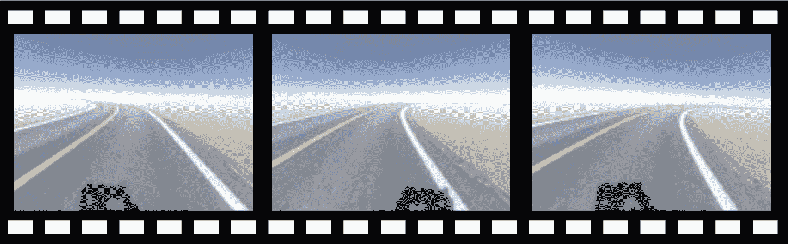<figure id="fig_final_policy_track"> <video controls="controls" style="margin: 0 auto; max-width: 100%;" src="videos/final_policy_track.mp4" loop="loop" autoplay="autoplay">The video element is not supported</video> <figcaption>A video of the final DonkeyCar policy for the `donkey-generated-track-v0` environment.</figcaption> </figure> <figure id="fig_final_policy_road"> <video controls="controls" style="margin: 0 auto; max-width: 100%;" src="videos/final_policy_road.mp4" loop="loop" autoplay="autoplay">The video element is not supported</video> <figcaption>A video of the final DonkeyCar policy for the `donkey-generated-road-v0` environment.</figcaption> </figure>
```

但请注意，整个过程中我几乎未涉及 RL 算法本身。所有艰苦的工作都投入到了特征工程、超参数搜索以及约束问题以使其简化上。这些正是工业 ML 项目中耗时最多的任务。同样像 ML 一样，RL 算法将随时间变得标准化，这将导致你完全不需要接触 RL 算法的局面。

## 进一步改进

你可以对该策略进行多方面的改进。等你读到这些文字时，其他工程师早已将我这微薄的努力远远甩在身后。你可以花时间改进自编码，或尝试“最小化训练时间”中建议的其他想法。你可以进一步修改动作空间，比如增加最大动作直到其失效。我曾想尝试退火动作空间限制，即动作空间开始时很小，并在训练过程中逐渐增加到最大值。你也可以尝试修改奖励；也许速度不应获得过高奖励。惩罚突变（jerkiness）也很有意义。

你大概能想象出更多改进，但如果你在解决工业问题，则需要更谨慎：小步快跑，确保评估正确，确保操作安全，拆分问题，约束问题，并进行更多测试。你可以在第 9 章中阅读更多相关内容。

## 总结

RL 旨在寻找一种策略，以最大化从采样状态、动作和奖励中获得的期望回报。这一定义意味着不顾后果地最大化期望回报。研究表明，对策略更新进行边界约束或限制能带来更稳定的学习和更全面的策略。


## 基于熵的算法和正则化马尔可夫决策过程

第 6 章通过约束更新来解决这个问题，使其不会显著改变策略。但这仍可能导致脆弱、过度稀疏的策略，即除最优轨迹外，大多数动作的价值为零。本章介绍了基于熵的算法，它们修改了马尔可夫决策过程（MDP）回报的原始定义，以重新缩放或*正则化*回报。这引出了其他熵的定义可能表现更好的提议，因为香农熵不够稀疏。我认为可以通过调整温度参数来产生适合你自己问题的策略。但另一种熵度量很有可能在你的特定问题上表现更好。

这一论点的合乎逻辑的结论是使用任意函数。这由 Li、Yang 和 Zhang 在*正则化马尔可夫决策过程*中提出，并规定了该函数必须遵循的几条理论规则，例如它应该严格为正、可微、凹函数，并在 0 到 1 范围之外降为零。他们建议其他基于指数的函数和三角函数是有趣的提议。^(20)

无论实现如何，用探索奖励增强价值函数对生产环境实现都是有益的。你希望你的智能体对变化具有鲁棒性。小心不要过拟合到你的环境。

## 策略梯度与软 Q 学习的等价性

为了结束本章，我想回到价值方法与策略方法的比较。简单来说，`Q-learning`和策略梯度方法都试图强化导致更好奖励的行为。`Q-learning`增加动作的价值，而策略梯度增加选择动作的概率。

当你加入基于熵的策略梯度（或等价形式）时，你会按动作价值的某个函数比例提高动作的概率（参考公式 7-2）。更简洁地说，策略与`Q 值`的某个函数成正比。因此，策略梯度方法解决的问题与`Q-learning`相同。^(21)

即使从经验上看，`Q-learning`和策略梯度方法的比较也得出性能相似的结论（看 ACER 论文中的图 4，策略梯度和`Q-learning`方法几乎相同）。^(22) 考虑到样本效率或并行性等外部改进时，许多差异可以被解释。Schulman 和 Abbeel 甚至将`Q-learning`和基于策略梯度的算法归一化为等价，并证明它们产生相同的结果。^(23)

## 这对未来意味着什么？

从中可以得出的结论是，随着时间的推移，价值方法和策略梯度方法之间的差别将很小。这两个学科将会融合（它们已经在一定程度上通过`actor-critic`范式融合了），因为策略改进和价值估计是密不可分的。

## 这对现在意味着什么？

但目前很明显，没有单一的实现适用于所有问题，这是*没有免费午餐*定理的经典解释。你必须考虑多种实现以确保优化了性能。但要确保选择解决你问题的最简单方案，特别是如果你在生产环境中运行。这些算法积累的工业知识和经验也有帮助。例如，你不会默认选择一些晦涩的算法而不是`SAC`，因为人们、平台和公司对`SAC`有更多经验。

## 参考文献

^(1) Haarnoja, Tuomas, Aurick Zhou, Pieter Abbeel, and Sergey Levine. 2018. ["软演员-评论家：基于随机演员的离线策略最大熵深度强化学习"](https://oreil.ly/7sUno). ArXiv:1801.01290, August.

^(2) Haarnoja, Tuomas, Haoran Tang, Pieter Abbeel, and Sergey Levine. 2017. ["基于深度能量策略的强化学习"](https://oreil.ly/zBwzW). ArXiv:1702.08165, July.

^(3) Shi, Wenjie, Shiji Song, and Cheng Wu. 2019. ["用于最大熵深度强化学习的软策略梯度方法"](https://oreil.ly/j-5Pg). ArXiv:1909.03198, September.

^(4) Liu, Qiang, and Dilin Wang. 2019. ["斯坦因变分梯度下降：一种通用贝叶斯推断算法"](https://oreil.ly/_PHaF). ArXiv:1608.04471, September.

^(5) Haarnoja, Tuomas, Aurick Zhou, Pieter Abbeel, and Sergey Levine. 2018. ["软演员-评论家：基于随机演员的离线策略最大熵深度强化学习"](https://oreil.ly/PE_dM). ArXiv:1801.01290, August.

^(6) Christodoulou, Petros. 2019. ["离散动作设置下的软演员-评论家"](https://oreil.ly/6sVHP). ArXiv:1910.07207, October.

^(7) Haarnoja, Tuomas, Aurick Zhou, Kristian Hartikainen, George Tucker, Sehoon Ha, Jie Tan, Vikash Kumar, et al. 2019. ["软演员-评论家算法及应用"](https://oreil.ly/8GIoC). ArXiv:1812.05905, January.

^(8) Ren, Tianzhu, Yuanchang Xie, and Liming Jiang. 2020. ["基于连接和自动化环境中强化学习的协作高速公路施工区汇入控制"](https://oreil.ly/p6kSZ). ArXiv:2001.08581, January.

^(9) Chen, Gang, and Yiming Peng. 2019. ["集成中的离线策略演员-评论家：在深度强化学习中实现最大广义熵和有效环境探索"](https://oreil.ly/M7mW-). ArXiv:1902.05551, February.

^(10) Ciosek, Kamil, Quan Vuong, Robert Loftin, and Katja Hofmann. 2019. ["用乐观演员-评论家实现更好的探索"](https://oreil.ly/2m-c-). ArXiv:1910.12807, October.

^(11) Wang, Che, and Keith Ross. 2019. ["增强软演员-评论家：强调近期经验而不忘记过去"](https://oreil.ly/1f1sl). ArXiv:1906.04009, June.

^(12) Shi, Wenjie, Shiji Song, and Cheng Wu. 2019. ["用于最大熵深度强化学习的软策略梯度方法"](https://oreil.ly/AcQXD). ArXiv:1909.03198, September.

^(13) Haarnoja, Tuomas, Haoran Tang, Pieter Abbeel, and Sergey Levine. 2017. ["基于深度能量策略的强化学习"](https://oreil.ly/8Kn1_). ArXiv:1702.08165, July.

^(14) ["自动驾驶系统中的端到端学习"](https://oreil.ly/gi7ZM). EECS at UC Berkeley. n.d. Accessed 5 May 2020.

^(15) Nachum, Ofir, Mohammad Norouzi, Kelvin Xu, and Dale Schuurmans. 2017. ["弥合基于价值和基于策略的强化学习之间的差距"](https://oreil.ly/2lhFk). ArXiv:1702.08892, November.

^(16) Nachum, Ofir, Mohammad Norouzi, Kelvin Xu, and Dale Schuurmans. 2018. ["Trust-PCL：一种用于连续控制的离线策略信任区域方法"](https://oreil.ly/dplSx). ArXiv:1707.01891, February.

^(17) Engstrom, Logan, Andrew Ilyas, Shibani Santurkar, Dimitris Tsipras, Firdaus Janoos, Larry Rudolph, and Aleksander Madry. 2020. ["实现细节在深度策略梯度中很重要：基于 PPO 和 TRPO 的案例研究"](https://oreil.ly/mznN4). ArXiv:2005.12729 Cs, Stat, May.


1. Kramer, Tawn. 2018. [Tawnkramer/Gym-Donkeycar](https://oreil.ly/64YPf). Python.

2. Raffin, Antonin and Sokolkov, Roma. 2019. [*Learning to Drive Smoothly in Minutes*](https://oreil.ly/XvPVj). GitHub.

3. Li, Xiang, Wenhao Yang, and Zhihua Zhang. 2019. [“A Regularized Approach to Sparse Optimal Policy in Reinforcement Learning”](https://oreil.ly/iXHx4). ArXiv:1903.00725, October.

4. Schulman, John, Xi Chen, and Pieter Abbeel. 2018. [“Equivalence Between Policy Gradients and Soft Q-Learning”](https://oreil.ly/ZjQ67). ArXiv:1704.06440, October.

5. Mnih, Volodymyr, Adrià Puigdomènech Badia, Mehdi Mirza, Alex Graves, Timothy P. Lillicrap, Tim Harley, David Silver, and Koray Kavukcuoglu. 2016. [“Asynchronous Methods for Deep Reinforcement Learning”](https://oreil.ly/QeJ1M). ArXiv:1602.01783, June.

6. Schulman, John, Xi Chen, and Pieter Abbeel. 2018. [“Equivalence Between Policy Gradients and Soft Q-Learning”](https://oreil.ly/gw2Nd). ArXiv:1704.06440, October.
