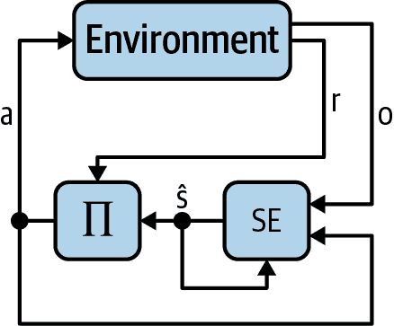
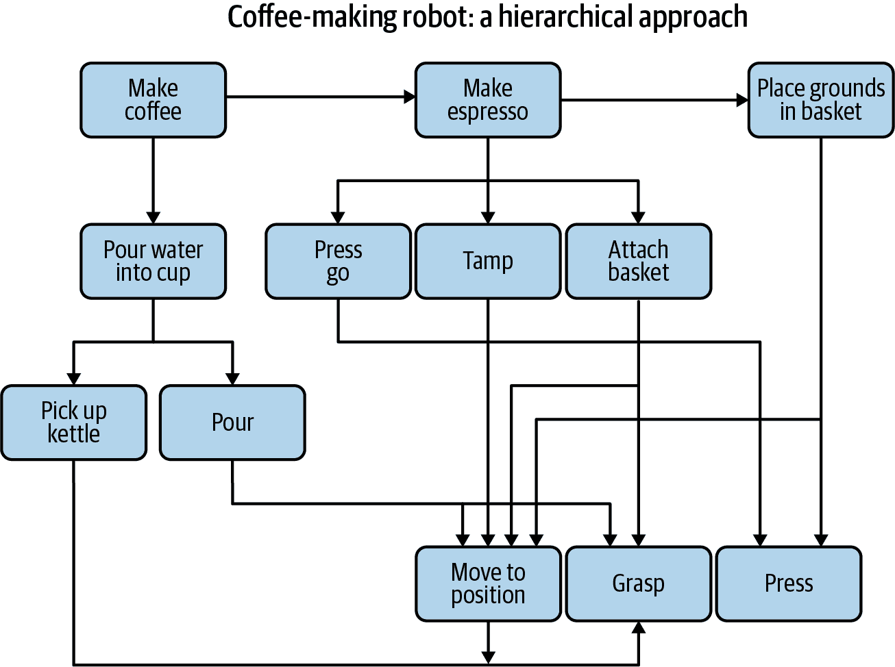
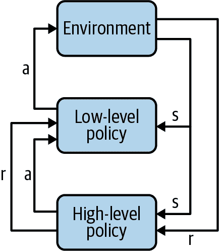
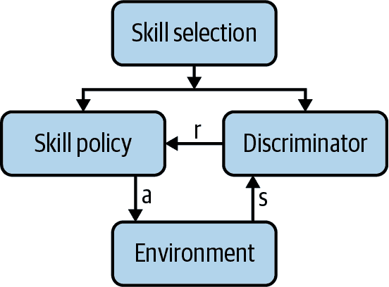
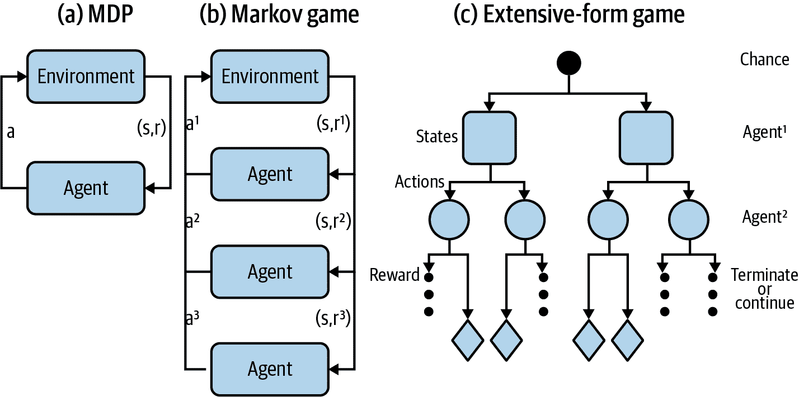
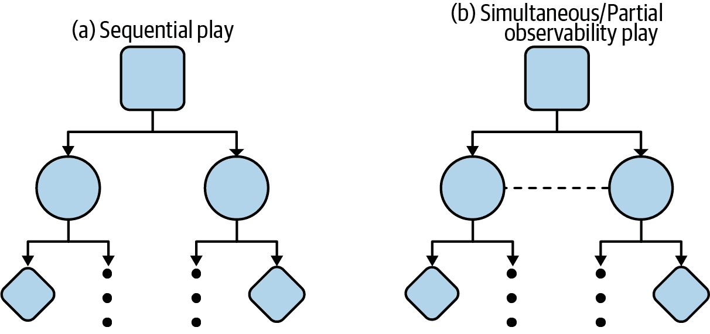
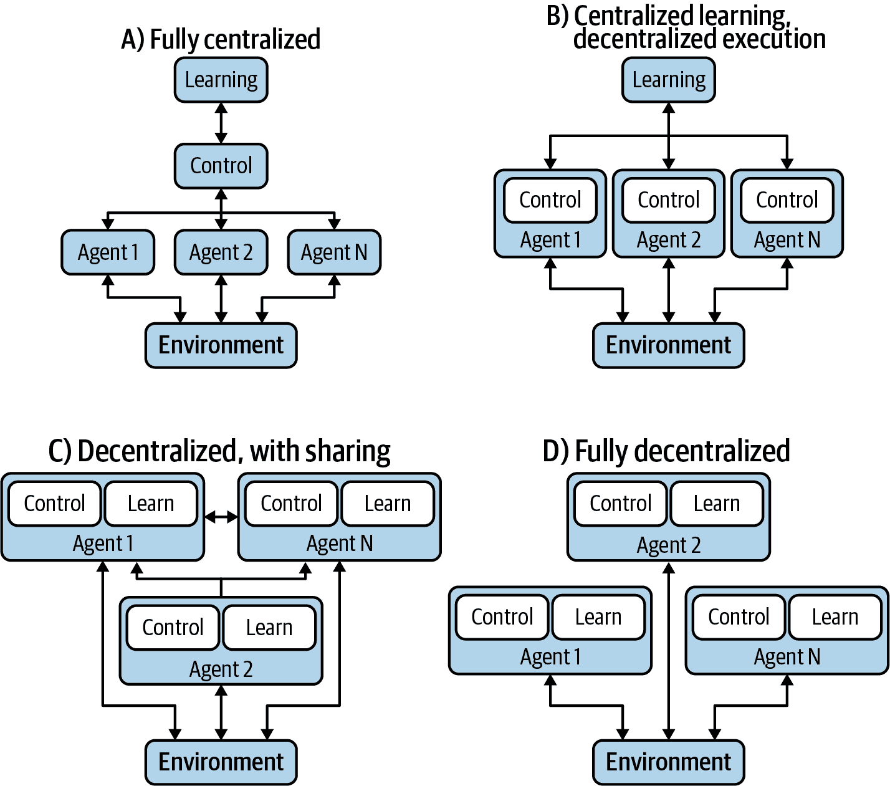
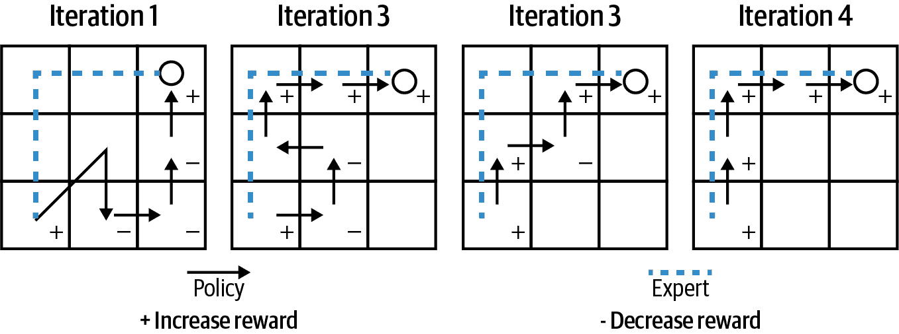

# 第 8 章 改进智能体的学习方式

复杂的工业问题通常可以分解为**有向无环图**（DAG）。这有助于提高开发效率，因为它将一个漫长的项目拆分为许多更容易解决的小项目。这也有助于强化学习（RL），因为较小的组件通常更容易、更快地训练，且可能更加稳健。“分层强化学习”展示了一种常见的形式化方法，即推导出一个策略层级，其中低层策略负责细粒度的“技能”，而高层策略进行长期规划。

到目前为止，本书中我仅考虑了单智能体问题。某些问题需要智能体团队，或者至少可能有多个智能体在同一环境中运行。“多智能体强化学习”将向你展示智能体如何通过全局或局部奖励进行合作或竞争，以解决多智能体问题。

强化学习另一个快速发展的领域是重新定义你应如何思考奖励。传统上，利用奖励信号学习策略是智能体的唯一责任。但你可以通过以专家指导的形式提供额外的、潜在的外部信息来增强这一过程。“专家指导”讨论了如何将专业知识融入策略，最终通过改进探索来加速学习。甚至可以*学习*最优奖励，旨在消除对奖励工程的需求。

但首先，强化学习通过贝尔曼方程与马尔可夫决策过程（MDP）密不可分，所有强化学习算法在进行序列决策时都依赖 MDP 的最优性理论保证（你可能需要复习“马尔可夫决策过程”）。但各种现实场景会打破 MDP 的底层假设，这往往导致贝尔曼方程所作假设的静默失效，表现为无论怎么调整超参数，策略都无法收敛。下一节将探讨基本 MDP 的变体，以适应这些场景。

## 注记

本章总结了最新技术进展。我认为最重要的四个主题是：如何定义 MDP、分层 RL、多智能体 RL 以及提供专家指导。但所有这些都可被视为“进阶”内容，若要全面讨论足以写成另一本书。不过，我认为提供一个概览很有用，这样你就知道这些内容的存在，若有需要可深入研究。一如既往，“延伸阅读”中的引用和推荐能提供大量额外信息。

## 重新思考 MDP

利用 MDP 框架及贝尔曼方程所得保证的 RL 算法，假设底层环境是马尔可夫的。尽管对智能体动作的效果可能存在大量不确定性，但对环境状态的感知必须是完美的。智能体随后利用这种全知的知识，根据当前策略 *π*(*a*∣*s*) 选择下一个动作。

但如果状态表示不完美怎么办？如果你指示舵机移动到某个位置，它却移动到了围绕该位置随机分布的某个位置怎么办？又或者存在潜在的隐藏特征，代表用户点击推荐的可能性有多大？在这些情况下，状态无法被完全观测，马尔可夫假设被打破。

### 部分可观马尔可夫决策过程

解决这种**部分可观性**的一个方法是拆分状态的表示。部分可观马尔可夫决策过程（POMDP）在 MDP 基础上增加了额外参数，以包含智能体可经历的有限观测集合 *Ω*，以及一个将状态和动作映射到动作概率分布的**观测函数** *O*。随后，你可以通过近似观测函数的逆函数，并用它将观测转换回状态，将问题转换回 MDP。

图 8-1 显示 POMDP 是 MDP 的扩展，其中智能体无法直接观测环境的当前状态。取而代之的是，它利用观测以及关于先前动作和状态的信息来生成当前状态的预测 *ŝ*。状态的预测通常称为**信念状态** *b*，你可以将其描述为“这是我认为环境所处的状态”。

#### 预测信念状态

那么什么是信念状态，以及如何预测它？考虑一个试图指导机器人穿越简单迷宫的例子。智能体不知道迷宫的布局，但它可能足够聪明，能够检测到前方有一个“T 型路口”，并需要决定朝哪个方向走。一个朴素的策略会过拟合训练环境，并收敛到每次都建议单一决策的地步。

如图 8-1 中的循环所示，解决此问题的一个简单方法是根据过去的经验来确定最佳动作。我指的不是训练意义上的过去经验，不是经验回放缓冲区，而是当前回合和环境的过去经验。例如，如果你知道机器人已经尝试过向左但走进了死胡同，那么迷宫的隐藏状态（最佳路线）很可能是向右的选项。

许多复杂的示例利用这一简单想法，将过去的动作和观测包含在状态表示中。例如，Atari 基准测试总是堆叠四帧像素观测，以保留环境的一些“历史”。这使智能体能够预测乒乓球的轨迹或敌人的移动。许多机器人示例也包含先前的动作和状态，以帮助解决定位不准的问题并使移动更平滑。

尽管这一想法在许多情况下有帮助，但总体上并不充分。为了最优地行动，智能体需要主动考虑它对当前情况的不确定程度。一个更复杂的解决方案是使用能够学习时序依赖特征的近似器来建模状态估计器。

解决此问题有多种选项。你可以尝试跟踪信念状态；简单版本可以使用卡尔曼滤波器，尽管较新的方法尝试构建神经网络以推导最优贝叶斯滤波器。^(1) 你可以使用支持记忆的预测器或信念跟踪器，将信念模型的近似直接纳入策略模型中。^(2,3)

但最简单（前文引用的论文有 24 位作者！）且最常见的方法是在状态表示函数的末端拼接一个循环神经网络（RNN）。视问题而定，RNN 不需要太复杂，它们允许智能体根据过去的观测做出推理决策。这使你能够使用标准技术和工具来训练 RNN。

作为一个概念性示例，请考虑“工业示例：使用遥控车学习驾驶”中的实验，其中我使用变分自编码器来表示状态。我可以在状态表示的输出端添加一个 RNN，并通过预测未来的观测来训练它。最终它将能够提供给定特定动作会发生什么的预测，从而打破部分可观测性问题。策略将拥有所有可能未来观测的完全可观测性，因此你可以使用标准 RL 方法优化 MDP。

## 案例研究：在自动驾驶汽车中使用 POMDP

你可能会认为前面的例子过于牵强，不适用于现实生活。但令人惊讶的是，大量现实场景完美契合前面的模型。自动驾驶汽车就是一个这样的例子。

一项常见的自主任务是决定车辆何时移动是安全的；例如，通过带有停车标志的十字路口或环岛是常见的驾驶情况。到达时，智能体必须完美地把握动作时机以避免撞击其他车辆。然而，如果车辆等待太久，宝贵的时间就会浪费，路口的效率也会降低。

车辆对道路的视野有限。车载传感器（如摄像头或激光雷达模块）是视线传感器，无法看到障碍物周围的情况。这使得问题仅具有部分可观测性，因为智能体无法感知此空间之外的重要特征，例如冲向路口的超速车辆。

传统算法试图量化碰撞时间，但准确估计时间并处理意外情况很困难，且不够可靠，无法用于自主操作。

通过将问题建模为 POMDP，你可以使用 RL 学习最优策略。Qiao 等人（在仿真中）证明了，具有 LSTM 策略的智能体能够学习何时从四向路口起步左转、右转或直行。^(4) LSTM 策略能够通过适当设计的奖励，学习哪些部分观测情况会导致碰撞，并避免它们。你可以[在 YouTube 上查看该实验的结果](https://oreil.ly/ivbfj)。

Qiao 等人进一步在前一个模型中加入了分层 RL，以更好地建模高层动作（或低层子任务，取决于你如何理解），如启动、停止、跟随前车等。^(5) 你可以在“分层强化学习”中阅读更多关于分层 RL 的内容。

## 上下文马尔可夫决策过程

存在许多问题，其底层 MDP 相同，但上下文情况不同。例如，想象你正在训练一个智能体，根据糖尿病患者的血糖水平给药。对每位患者而言，底层 MDP 相同，血糖水平是观测值，给药是动作。但观测值受外部变量影响，如患者的性别或年龄。^(6)

这听起来类似于 POMDP 的情况，但有一个关键区别。这些上下文变量不会随每次测量而改变。通过将上下文建模为一组固定参数，你限制了智能体必须搜索的空间，这可以带来更稳健的模型和更快的学习。^(7)

当面临每个回合步数很少（短马尔可夫链）但独立回合数量巨大的问题时，这种扩展至关重要。这正是推荐算法所处的境地，这也是为什么大多数上下文 MDP（CMDP）研究由推荐或排序应用驱动的原因。^(8)

## 动作集变化的 MDP

某些应用具有变化的动作集，研究沿着两条通向相似结果的路径展开。第一类研究集中在动作并非总是可用的情况。例如，在车辆或数据包路由等路径规划应用中，路径可能因损坏或维护而关闭；在广告投放中，广告选择可能随一天中的时间而变化。^(9)

其前提是随机动作集（SAS），它包含某一时刻可用的动作集，建模为随机变量。解决此问题的常见方法是仅从该特定状态观测到的动作中学习策略。Boutilier 等人表明，随后可以利用标准 Q 学习变体。^(10) Chandak 等人将该思路扩展以纳入策略梯度方法。^(11)

第二类但更通用的研究更侧重于终身学习或持续学习。在这里，动作集因问题和优先级的变化而改变。例如，你可能想为机械臂添加新功能，或引入一组新广告，而无需重新训练模型并失去那些宝贵的经验。这里的主要问题是维度灾难，潜在动作集不断增长，却缺乏数据来采样这些动作。理论上，增加更多动作就像将它们添加到 MDP 中一样简单。但创建一个能处理此类变化的架构颇具挑战。

Chandak 等人通过将策略拆分为两部分，证明了这是可行的。第一部分负责基于状态做决策，但其输出位于元空间而非动作空间。第二部分随后将该元空间映射到动作空间。二者共同构成一个完整的策略。^(12)

好处是你可以修改元动作模型参数以适应新动作，而无需触碰状态表示部分。然后你可以在经验回放缓冲区上使用标准监督学习来训练新的元动作模型。这将从实时环境中所需的重新训练量限制在仅影响新动作的模型部分。

## 正则化 MDP

值得再次提及的是，包含正则化项的那类算法也是 MDP 的一种重新表述。如果你还记得的话（参见“总结”），SAC 和其他类似算法试图寻找一个最大化折扣回报的最优策略，这与任何基于 MDP 的算法一样，但它们也包含一个正则化项。这里的思路是，你可以利用这一项来强制鲁棒性，这类似于正则化项影响线性回归的方式。但这一添加从根本上改变了贝尔曼等式，这意味着会对底层 MDP 产生影响。值得庆幸的是，Li 等人证明了无论你应用什么正则化，只要遵循定义正则化函数的一些规则，算法仍将收敛。^(13)

## 分层强化学习

一系列问题利用原子性且重复的低级行为；它们涉及掌握“简单”技能，如拾取物体或推荐单个产品。涉及多层推理或组合多种技能的问题则复杂得多。

在工程中，将挑战拆分为更小的组件有助于简化复杂问题。`分层强化学习`（HRL）利用这一思想，将问题分解为子任务，其中求解每个子任务比整体求解更容易或更好。这可以带来计算效率的提升、更强的鲁棒性、更大的灵活性，有时还能获得更好的性能。这也是缓解“维度灾难”的一种方式，通过减小搜索空间。例如，在学习走路时，搜索包含用手走路的动作空间毫无意义，除非你是体操运动员。

通过策略层级，仅让低级策略与环境交互，你可以训练高级策略在更长的时间尺度上进行规划或做出战略决策。另一个吸引人的想法是封装策略以擅长执行某一任务，这样你就可以在其他问题中复用它们；形成一个策略库。

然而，你必须考虑一系列挑战。如何定义和生成封装良好的低级策略？如何训练高级策略以及如何设计层级？以及如何在合理的时间内训练所有这些内容？

## 朴素 HRL

你应该考虑手动设计层级，因为在许多问题中，关注点分离很明显。例如，教复杂机器人移动显然不同于教它做咖啡，富有成效的对话取决于对话中使用的词语和表达，而教育课程的成功完成取决于其中的内容。^(14,15) 通过低级的定制技能优化这些高级目标，可以得到灵活、鲁棒且高性能的策略。

在较简单的情况下，手动设计抽象（从而设计层级）可能更可取。然后你可以设计一个定制的 RL 实现，利用这种手工设计的、特定于问题的模型。图 8-2 展示了将一个概念性的制作咖啡任务分解为行为层级的示例。

这种方法的主要优势在于，它可能比更复杂的通用方法更鲁棒、更简单。这有点像让神经网络从照片中预测汽车价格；构建能够识别品牌和型号、定位车牌以进行自动车牌识别等的子网络，并将它们输入到预测价格的高级模型中，你将获得更大的成功。从实用角度来看，这也有助于你专注于整齐、小规模的问题，而不是一个大的成败攸关的“独角兽”项目。

但这种方法只能带你走这么远。在许多问题中，层级中的边界划分本身就是一个挑战，任意划线很可能是次优的。例如骑自行车时，“踩踏板”是一个基础技能，还是应该是“用右脚向下踩”？你需要一种自动发现这些技能的方法。

## 基于内在奖励的高低层级 (HIRO)

迈向自动化 HRL 解决方案的第一步是拆分策略。低级策略负责像往常一样通过状态和动作与环境交互，但它不接收奖励。高级策略建议一个高级动作，并用一个针对所请求目标的内在奖励来奖励低级策略。当环境产生奖励时，奖励会给到高级策略。图 8-3 展示了这一想法，Nachum 等人对此进行了全面解释。^(16)

例如，高级策略会告诉低级策略尝试移动到特定状态，并根据低级策略接近的程度给予奖励。高级策略的采样速率比低级策略慢，以提供时间抽象。

你可以以任何喜欢的方式参数化低级奖励函数。但研究人员提出，状态距离奖励有助于加快学习。

下一个挑战是，虽然你可以开箱即用地使用 PPO 等在线策略算法，但你可能想使用经验回放池来提高样本效率。问题在于高级经验回放池将包含来自之前低级策略的观测值，比如在低级策略是随机的最开始阶段。这意味着经验回放池不具备代表性，会导致收敛问题。一个简单的解决方案是对随机采样加权，使其偏好更近期的观测值，这是一种优先经验回放的形式。

但 Nachum 等人选择动态地 `relabel`（重标记）高级动作/目标，以匹配实际发生的动作。例如，再次设想咖啡示例，智能体有一个装满“抓取咖啡”技能的经验回放池，但当前正在训练的目标是“按按钮”。在他们的实现中，从该经验回放池采样的高级智能体会动态地改变目标以适应请求的技能。在本例中，它会将目标改为“抓取咖啡”，以匹配池中的内容。

这可能感觉像是在事后粉饰结果，让当前的高级策略看起来更好。但环境给出的奖励往往能抵消重标记带来的一些偏差。在最坏的情况下，这就像复制经验回放池中已有的观测值。理想情况下，你想要大量不相关、随机分布的转移。但如果做不到，随机采样有助于使其看起来更随机。

[结果显示](https://oreil.ly/x7FIC)，一种复杂的腿式仿真机器人既能学会走路，又能学习高级任务，如推块、寻找隐藏目标和资源收集。

## 学习技能与无监督 RL

前述 HRL 解释的一个主要问题是，这仍然是一个针对手头特定问题进行优化的闭环系统。没有泛化能力。你无法在任何其他情境中使用它。它过拟合了环境。

但你知道，例如机械臂，对于每个任务的移动方式都是相似的。“移动到位置 x”这样的指令特定于机器人及其构造方式，而非环境。一直以来，我描述智能体时仿佛它隐含于问题之中，但其实它是一个独立的实体。那么，如何教授与智能体相关而非与环境相关的策略，或 `skills`（技能）呢？

研究人员建议应训练智能体执行各种各样的技能，甚至包括那些无法产生正奖励的技能。然后，另一个更高层级的策略可以选择使用哪些技能来解决问题。训练无人机（UAV）做后空翻可能不利于稳定的通信网络，但在 [Metallica 演唱会](https://oreil.ly/HZyeo) 上可能很有用。

*多样性就是一切* (DIAYN) 是一个新颖的想法，它促进了低层级策略的无监督发现。Eysenbach 等人提出技能应该是可区分的，因此它们应旨在产生访问不同状态的策略，并且由此产生的技能应尽可能多样化。为了鼓励随机性，你可以最大化以状态、动作或两者为条件的熵度量。图 8-4 展示了该过程的简化描述。^(17)

[结果是一组多样化的策略](https://oreil.ly/m68lG)，它们可能对解决问题有用，也可能没用。但这种多样性就像垫脚石，有助于解决更复杂的问题。我特别喜欢 `HalfCheetah` 环境的结果，它 [展示了奔跑、爬行和坐下](https://oreil.ly/wVVYT)。

## 在 HRL 中使用技能

给定一个技能库，如何训练 HRL 算法来解决特定问题？我可以想象，预训练的技能可以通过让几乎所有 RL 算法专注于环境探索，而不是探索如何探索，从而提供帮助。这在智能体本身具有大量复杂性的环境中尤其如此。

*基于优势奖励的 HRL* (`HAAR`) 是一种利用预训练技能显著改善初始探索从而加速学习的算法。Li 等人还引入了使用优势作为奖励信号的想法，而不是像 `HIRO` 那样使用到状态的欧几里得距离。原因在于状态空间不一定映射到到达目标的真实距离。例如，如果你使用摄像头，像素距离不等于物理距离。因此，他们提议使用高层策略的优势估计来重新训练和奖励低层技能。这样，产生正优势的技能——即在高层任务中表现良好的技能——会比那些表现不好的技能得到更多提升。^(18)

另一个有趣的想法是逐渐减少每个技能重复的时间量，以进一步鼓励长距离探索。

## HRL 总结

当你的问题足够复杂，以至于拆分策略能获益时，构建策略层级是有用的。从工程角度来看，如果你能想象拆分策略有助于简化问题或构建更稳健的抽象，那么 HRL 可能很合适。分层策略的潜力很难发现。寻找智能体必须操纵复杂领域的情况。机器人技术是一个显而易见的例子，但其他领域同样复杂，比如处理文本的智能体。^(19) 相反，在许多现实问题中，复杂的是环境而非智能体，因此 HRL 可能无益。

在极端情况下，HRL 类似于一个图问题，其中微子策略之间的连接形成一个大图。最近的研究尝试将状态视为图，并将拓扑特征与图卷积神经网络结合使用，以帮助解决基于网格的问题。^(20)

#### 提示

即使你不处理复杂智能体，我认为 HRL 表明无监督学习在 RL 中扮演着重要角色。而这只是刚刚开始引起研究人员的关注。^(21) 花点时间考虑一下你的问题是否能从初始技能库或预训练中受益；这可能会显著提高学习速度。

另一个有趣的问题是你需要对策略施加多大影响？HRL 生成的技能不是由专家决定的，因此它们可能会产生陌生的、意想不到的，甚至是不想要的动作序列。当然，它们是由无监督或有监督奖励的定义指导的，所以你可以通过这种方式影响技能。但一个开放性问题——这可能取决于具体问题——是你应该干预以产生人类“构想”的策略，还是允许智能体自行发现。我怀疑在大多数现实问题中，这两者是结合的。你不想过于规定性，因为那正是 RL 的重点——你无法在复杂问题中手工编写最优策略。但你也需要约束问题并限制智能体，以免它过拟合而变得脆弱。

## 多智能体强化学习

贯穿全文，我一直考虑的是单个智能体。但许多问题涉及不止一个玩家/智能体，如果你系统地从多智能体角度建模问题，很有可能提高性能。

多智能体强化学习 (MARL) 解决的是多个自主智能体在共同环境中运行的序贯决策问题。每个智能体试图通过与环境和其他智能体交互来优化长期回报。

MARL 应用主要分为三大类：合作、竞争或两者的混合。在合作设定中，智能体试图协作以优化共同的长期目标。例如，合作 MARL 可以模拟并优化税收政策。^(22) 在竞争设定中，全局奖励通常总和为零，因为智能体只能以牺牲另一个智能体为代价来改进自己的策略。这种情况常见于包含价格竞价的领域，如交易和广告。最后，环境可能同时包含前两种情况。例如，广告市场希望同时最大化全局收入和长期用户参与度，这意味着合作模型是最优的，但广告商希望以最少的钱获得最高的影响力，这给环境增加了竞争因素。

文献通常在游戏背景下讨论 MARL，通常是国际象棋或扑克等传统游戏，越来越多的是计算机游戏。像标准 RL 一样，使用游戏的原因是它们易于模拟和验证。现实生活或工业案例较少见，但正在涌现。例如，应用包括使用 MARL 正式定义政府政策、低层 TCP 数据包拥塞缓解和多机器人人机协作辅助。^(23,24,25)

## MARL 框架

文献倾向于用两种方式之一来建模 MARL 问题，你可以在 图 8-5 中看到。

看 图 8-5(a)，首先回顾一下 `MDP` 被建模为一个作用于环境的智能体，环境作为回报产生新状态和奖励。如果环境是回合制的，环境还会产生一个终止信号。

图 8-5(b) 说明了第一个 MARL 框架是 `MDP` 的一种扩展，称为 `马尔可夫博弈` (`MG`)，其中多个智能体并行运行。智能体提交唯一的动作并接收唯一的奖励，但环境的状态是全局的。在 RL 背景下，这是对 `MDP` 最明显的扩展。

### 广义博弈

图 8-5(c) 展示了第二种也是更常见的模型，即 `extensive-form game`（EFG，广义博弈），其中机会、状态和动作被表示为一棵树，非常类似于 `MDP` 的展开。`EFG` 仍然通过动作改变环境的状态，尽管这并未显式展示。例如，如果你在扑克游戏中选择下注，那么你的对手就被迫跟注或弃牌。你的动作正在影响游戏的状态。但你可以看到，智能体之间的顺序动作要明确得多。在 图 8-5(c) 中，很明显智能体 2 在智能体 1 完成其回合之前无法行动。这种场景在 `MG` 中是不可能发生的。请注意，`EFGs` 总是从其中一个智能体的视角来考虑。

同步动作（如 `MG`）或不完全信息（如 `POMDP`）可以用 `information sets`（信息集）来表示，信息集是属于单个智能体的一组节点，该智能体不知道已到达哪个节点。这些通常用虚线或一个包围圆圈来表示。你可以在 图 8-6 中看到一个例子。

举个例子，考虑剪刀石头布游戏。这是一个经典的同步博弈，两人同时出这三个动作之一以获得奖励。要将其映射为 `EFG`，你可以让参与者在纸上写下动作，然后同时揭晓选择。智能体在不同时间行动，且第二个智能体无法观察到第一个玩家的动作。这意味着，从智能体 2 的角度来看，游戏处于三种潜在状态之一，但它不知道是哪一种。

`EFGs` 更具普遍性，理论家们更偏爱它。但直觉上，我仍然喜欢用 `MGs` 作为我的心智模型，因为绝大多数工业场景可以被设计为使用同步动作，而且我发现递归图的简单性比展开的树负担更小。许多研究者赞同这一点，并在他们的应用中使用 `MGs`。

## 集中式还是分布式

除了合作/竞争的区别，最重要的决定是你的问题是否会从集中式或分布式学习中受益。图 8-7 描绘了四个具有不同智能体独立程度的场景。

在集中式学习中，或者更典型的集中式学习与分布式执行中，经验被反馈给单个学习器，并返回策略供本地执行。这种方法的主要优势是你可以从多个行动者的经验中创建策略。例如，如果一个孩子能通过他人的经验进行集中式学习，他们将受益于大量且多样化的经验。同样，利用一组截然不同智能体的经验，能让它们更快地搜索状态-动作空间。本质上，独立经验有助于探索，而集中式学习确保所有智能体拥有相似且可行的策略。

在分布式模型中（通常称为 `DEC-MDP`），执行*和*学习都在本地发生。这更具可扩展性，因为引入多少智能体都无所谓。例如，想象一下如果每个人都“驾驶”一辆自动驾驶汽车。单一的集中式学习过程不太可能对所有驾驶条件都是最优的。本地学习允许智能体适应其对环境的局部感知。例如，靠左行驶的策略很可能与靠右行驶的策略有细微差别。

另一个问题是智能体可能具有不同的能力。例如，骑行者的经验与汽车的经验同样有效，但以集中式方式结合这些经验是困难的。机器人可能有不同的配置。分布式学习允许智能体学习使用其可用的动作。

另一个好处是，分布式模型潜在地允许你使用标准的单智能体 `RL` 算法，因为你可以独立地对待每个智能体。

## 单智能体算法

解决 `MARL` 问题的第一条也是最明显的途径，是假设每个智能体是独立的，并应用本书中讨论的任何单智能体 `RL` 方法。不幸的是，传统的 `RL` 算法（如 `Q-learning` 或策略梯度）不适合多智能体环境。主要顾虑在于，训练期间其他智能体正在交互并改变环境状态。这使得从任何单个智能体的角度来看，环境都是非平稳的。当环境不断变化时，这会阻碍智能体创建稳定的策略。这也意味着常见的 `RL` 附加组件（如基本的经验回放）无济于事。但这并不意味着它们完全失败。智能体可以在简单环境中学习稳定的策略，但这些策略通常是次优的，并且当环境复杂度增加时往往无法收敛。

从技术上讲，可以使用基于模型的策略梯度算法，因为模型为你提供了环境动态的完美描述，但对于许多问题来说模型是不可用的。

## 案例研究：在无人机中使用单智能体分布式学习

使用 `UAVs`（通常称为无人机）在空间覆盖重要但难以实现的应用中变得越来越普遍。`UAVs` 可以飞入未知环境以监测山火、执行搜救任务并建立通信网络。^(26,27,28) 它们受欢迎的原因在于运营成本低、传感器阵列丰富以及应用灵活。

由于缺乏准确的模型，尝试手工编写控制器来执行任务是不切实际的。`RL` 提供了一种天然的无模型解决方案，能够在困难环境中导航。有各种示例使用 `RL` 来学习低级 `UAV` 基本动作，如飞行、移动和避障。但 `UAVs` 在协作解决问题时大放异彩。

Cui、Liu 和 Nallanathan 使用模拟的 `UAVs` 机群为覆盖有限的地区提供无线基础设施。`UAVs` 在这种情境下特别有用，因为通常容易建立视距。研究人员使用 `MARL` 解决了一个复杂的优化问题，以最大化网络性能。

他们的工作假设智能体独立，并利用了简单的单智能体解决方案。他们使用 `Q-learning` 来学习连接哪个用户、子信道和功率电平的最优选择。注意，该工作中的位置是固定的。他们基于质量指标开发了一个奖励函数，并在三个 `UAVs` 的仿真中求解。注意，没有对环境和智能体的非平稳性进行修正，智能体必须竞争奖励。

因此有很大的改进空间。更好的分布式技术可以解释环境的不稳定性。或者既然它们有网络，集中式技术会让开发更容易。而更复杂的智能体可以处理复杂得多的状态空间，如空间定位，这将有助于解决方案扩展。有了这些修复，在现实生活中运行应该是可行的。当今研究受赞扬方式的问题在于，它只宣扬成功，不宣扬失败。Cui、Liu 和 Nallanathan 很可能尝试过其中一些想法，但时间用尽了。

尽管如此，我依然乐观，并能想象出一组更稳定的算法，能够学习更复杂的行为（如最优多智能体定位）。

## 集中式学习，分布式执行

## 多智能体行动者-评论家

通过将 `RL` 的改进与集中式学习的样本效率相结合，近期取得了一系列成功。其中一种广为人知的算法将 `DDPG`（“深度确定性策略梯度”）与一种称为 `multi-agent DDPG`（`MADDPG`，多智能体 DDPG）的集中式学习、分散式执行方法相结合。^(29)

`DDPG`（或 `TD3`/`PPO`/其他）提供了骨干架构，使智能体能够在没有环境模型的情况下学习策略。策略梯度算法为结合多个智能体的梯度提供了理论基础，这与价值方法形成对比，在价值方法中，全局动作价值函数不能代表局部情况。在训练期间使用集中式学习方法可以提高样本效率并加快学习速度。在评估期间，智能体使用独立的策略和局部观测。

这种方法的主要动机在于：如果你知道所有智能体的动作，就有可能预测或追踪环境的变化。就像在量子力学中，如果你知道宇宙中所有原子的状态和动作，那么生活就是静止的，你可以预测未来（或过去）。

要计算个别智能体策略的价值，你需要知道该智能体策略的结果以及环境中预测的价值。但环境受所有其他智能体影响，因此你需要提供所有其他智能体动作的信息。回顾不同的策略梯度实现（公式 5-11），显然行动者-评论家范式自然地考虑了智能体的动作，因此你只需将其扩展以考虑所有智能体的动作，这从环境中有 `N` 个其他智能体的单个智能体视角展示在公式 8-1 中。

### 公式 8-1. 多智能体行动者-评论家

$$\\begin{array}{clr} {\\nabla\_{\\theta}J\\left( \\theta \\right)} & {= {\\mathbb{E}}\_{\\pi\_{\\theta}}\\left\\lbrack {\\nabla\_{\\theta}\\ln\\pi\_{\\theta}\\left( a \\mid s \\right)Q\_{w}\\left( s,a \\right)} \\right\\rbrack} & \\text{(行动者-评论家)} \\\\ & {= {\\mathbb{E}}\_{\\pi\_{\\theta}}\\left\\lbrack {\\nabla\_{\\theta}\\ln\\pi\_{\\theta}\\left( a \\mid s \\right)Q\_{w}\\left( s,a\_{1},a\_{2},\\cdots,a\_{N} \\right)} \\right\\rbrack} & {\\text{(多智能体}\\text{行动者-评论家)}} \\\\ \\end{array}$$

这引出了这样一个想法：我们可以拥有一个局部独立的行动者，但一个集中式的评论家。有趣的是，因为每个智能体都学习一个行动者和评论家，智能体可以拥有不同的策略和奖励，这意味着这既适用于合作环境也适用于竞争环境。接下来，我将其作为课后练习留给读者，你可以将各种改进应用于原始策略梯度算法，从而得到标准行动者-评论家 `RL` 算法的多智能体版本。

大多数行动者-评论家算法需要策略为动作价值函数的训练生成下一个动作。请参考任意行动者-评论家算法。一个简单的解决方案是要求每个智能体将策略或所有下一个动作（取决于算法）传回集中式评论家。这会导致同步和延迟问题，从而阻碍效率，但实现起来相当简单。

`MADDPG` 采取的方法是在其他智能体学习的同时学习它们的策略。这显然是非平稳性的一个来源。为了限制非平稳性的影响，`MADDPG` 通过更新有限的随机策略子集来降低学习率。这虽非理想，但行之有效。详见论文。

## 分散式学习

如果你无法使用集中式模型，则需要稳定分散式学习的方法。时序差分滞后是一种根据时序差分误差的大小使用两种不同学习率的技术。^(30) 如果时序差分误差低于通常设为零的阈值，意味着智能体获得的奖励低于预期，则应用较慢（较小）的更新率。它假设糟糕的回报是因为智能体在探索——如果你做蠢事，你不希望你的孩子模仿你。当误差为正时，智能体使用正常的学习率。本质上，它使算法倾向于更乐观，这本身可能导致问题，但通常可以通过学习率超参数来控制。然而，关键在于它有助于应对环境的非平稳性；智能体不会仅仅因为几次由环境变化引起的糟糕更新就恢复一个潜在的好策略。

分散式学习的第二个挑战是部分可观测性。经典且最简单的解决方案是包含一个循环层来记录历史，尽管也有其他方法。我预计更正式的方法即将出现。

最后的挑战是无法使用标准回放缓冲区。问题在于，尽管智能体并发学习，但经验在独立采样时是局部且非平稳的。该时间点的局部视角不太可能代表未来时间点的环境。一个相关问题是，从回放缓冲区的不同部分随机采样可能具有完全不同的环境状态，在最坏的情况下，可能导致两个具有完全相同局部条件的智能体产生完全不同的策略。有许多潜在的方法可以改进这一点，但 Omidshafiei 等人实现了一个在所有智能体上同步的回放缓冲区。并发经验回放往往导致局部相关性，这通常是坏事，通过随机采样解决，但在这种情况下却有帮助，因为它强制所有智能体关注当前的回放，而这些回放应都具有相同的环境条件。例如，如果两个智能体具有相似的局部条件，那么从缓冲区的同一点采样应产生相似的经验，从而导致相似的策略。在这个特定实例中，经验是轨迹，以便训练循环神经网络。这种 `DQN`、滞后和同步回放缓冲区的组合称为 `Dec-HDRQN`。^(31)

请注意，这只是解决更新期间非平稳性、经验回放期间不同局部最优以及部分可观测性问题的众多潜在方法之一。你可以用其他实现替换上述任何组件，尽管它们会有自己的特性。

## 其他组合

集中式和分散式范式可以通过多种方式混合在一起以适应应用。例如，你可以使用集中式评论家，配合一个与智能体共享以供远程执行的集中式策略。或者，你可以使用带有分散式评论家和策略的智能体，这些策略与其直接邻居共享。许多排列组合已被研究，很可能有一种算法适合你的用例。对这一多样化领域的详细调查超出了本书的范围，但在“延伸阅读”中有一些很棒的资源。

对我来说，MARL 凸显了问题设计的重要性。排列组合的数量之多，加上 RL 算法的数量，再加上神经网络可能性的数量，意味着在计算上很难实现自动化或执行大规模超参数扫描。你必须选择一小部分算法和架构，使反馈周期足够小，以便在合理的时间内产出成果。这意味着拥有正确且稳健的问题定义至关重要；否则，如果你对问题做一丁点修改，都可能对实现产生巨大影响。在最坏的情况下，你可能不得不抛弃所有工作和所有研究，重新开始。

### 提示

本书讨论的缓解措施之一是在定义问题和后续建模时多花时间。你的模型需要足够简单以便求解和推理，但也必须能代表真实问题。这就像软件一样：最好的代码简单明了，却似乎能处理大多数情况。但不要以为简单就意味着容易；简洁源于努力、尝试和无数错误。

## MARL 的挑战

尽管取得了显著进展且研究量巨大，MARL 依然很难。这并不意味着它不可能，我也不想劝阻你走这条路；研究表明解决方案完全可行。但我希望你了解需要警惕的挑战，其中包括：

### 问题的多样性

你需要准确建模环境，决定是协作还是竞争、是否共享策略、是顺序还是同时行动，你还需要考虑所有常规的 MDP 问题，如基于价值还是策略、全可观测还是部分可观测。一旦有了可靠的模型，你就需要深入挖掘，找到一个在模型假设下工作的合适算法。MARL 是一个复杂得多的问题，因此潜在的解决方案也多得多。

### 多维且多模态的目标

由于环境的局部条件，一个智能体的目标可能与另一个显著不同。这会使共享策略变得具有挑战性。

### 可扩展性

在许多任务中，同步信息很重要，无论是外部信息（如智能体的当前状态）还是内部信息（如当前策略），这在大规模部署中会导致通信效率问题。

### 不稳定性

由于智能体主动改变环境，从另一个智能体的角度来看，环境是非平稳的。这打破或失效了 MDP 提供的一些基本假设，导致缺乏稳定性。

### 最优性

除最简单的示例外，很难精确定义最优性，这意味着对于非平凡环境不存在收敛保证。

这些挑战是 MARL 独有的，但它们建立在 RL 的所有标准挑战之上，如部分可观测性和样本效率。随着时间的推移，随着研究人员找到解决 RL 的不同方法，这些挑战的严重程度可能会降低。

## MARL 总结

MARL 是 RL 令人兴奋且快速发展的延伸。我预计重大改进即将到来。例如，仅在 2020 年 6 月，arXiv 上就有 50 多篇新的 MARL 研究论文。但即使现在，也可以利用 MARL 解决各种商业上可行的用例，其中一些你可以在 `https://rl-book.com/applications` 上看到。

在 MARL 的这一简要概述中，我忽略了大部分游戏相关文献。从研究和理论角度来看，它仍然非常重要，但超出了本书的范围。

## 专家指导

在本书呈现的许多示例或情境中，我都谈到了从头教会智能体一种策略。但人类拥有领域知识，可以指导、鼓励并改进智能体的学习方式。例如，儿童入学年龄因国家而异。在美国和英国，孩子四五岁左右入学，但在塞尔维亚、新加坡、南非和瑞典等许多国家，孩子要到七岁才入学。支持晚入学的观点是，孩子有更多时间随机探索，在被迫学习任意的高层抽象概念之前，微调低层情感和运动技能。而反方观点认为，孩子在随机探索上浪费时间，最好用课程微妙地引导他们。RL 也是如此；专家指导可能提供有价值的信息，但智能体也需要自行探索。两者没有正确的比例之分。

但我可以肯定地说，问题可以从一定程度的专家教导中受益。本节介绍如何将这种专业知识融入你的策略中。

### 行为克隆

将专家策略融入的传统方法是使用监督学习，最大化智能体在遇到的状态下选择与专家相同动作的可能性。这被称为*行为克隆*，但不受欢迎，因为它会过拟合专家演示。如果智能体发现自己处于未被演示过的状态，则不知道该做什么。由于复杂问题的高维性，这种情况极有可能发生，因此使用能继续从自身动作中学习的算法很重要，即使这些动作未被演示过。^(32)

### 模仿 RL

2017 年，Hester 等人提出，在许多现实情境中，精确模拟不可用或不可行；唯一的可能性是就地训练智能体。但存在已使用可行策略的外部来源，如先前的控制器或人类指导。开发将知识从这些专家迁移到智能体的解决方案，为演示常见但精确模拟器不存在的问题提供了一系列解决方案。^(33)

首先，专家（人类或机器）在环境中生成轨迹。然后，将监督损失纳入贝尔曼更新中，以衡量专家动作与智能体动作之间的差异。随着时间的推移，智能体学会生成与专家相似的轨迹。

该方法的问题在于，你不希望智能体模仿专家，因为专家的策略很可能是次优的。*从演示中进行深度 Q 学习 (DQfD)* 通过一系列正则化项尝试防止过拟合专家轨迹，从而解决了这个问题。*生成式对抗模仿学习 (GAIL)* 建议了一种类似的方法，通过对抗性地扰动动作分布使其趋向专家。但这无法回答或提供一个直观的旋钮来调整*使用多少*专家建议。^(34)

## 软 Q 模仿学习 (SQIL)

*软 Q 模仿学习 (SQIL)* 提供了一种思路，同时通过改变标准算法使用经验回放的方式，简化了 DQfD 和 GAIL。Reddy 等人发现：(a) 仔细控制驻留在回放缓冲区中的轨迹，(b) 为这些轨迹重构奖励信号，以及 (c) 使用一种允许探索但又保持接近专家轨迹的损失函数，即使没有外部奖励信号，也能让智能体从经验中学习。由此产生的算法大体上类似于行为克隆，不同之处在于它允许偏离到未被演示的状态。它通过正则化惩罚这些状态，并引导智能体回归专家行为。你甚至可以通过加权正则化来控制使用专家建议的量。因此我可以设想一个退火版本，它最初使用专家演示，并随时间推移趋向于纯强化学习。但其主要卖点在于简单性，并且可以适配任何离策略算法，无论离散还是连续。^(35)

## 逆向强化学习

模仿强化学习的问题在于，无法保证专家演示的是最优策略。例如，假设你正在训练你的汽车“开好车”，为了帮助你的算法，你记录了自己的驾驶并将其作为专家演示提交。你真的是专家司机吗？即使你是，智能体真的应该从你有偏见的驾驶观点中学习吗？

另一种方法是忽略轨迹，专注于目标。然而，为“开好车”产生奖励很难量化。你可以建议想要在最短时间内到达目的地，并将总用时作为奖励，但这忽略了安全到达。你可以迭代地建立所有主要关注点，但该如何给它们加权？一般来说，为复杂领域设计奖励很困难，那么为什么不学习奖励呢？

*逆向强化学习* (IRL) 试图在给定环境演示的情况下，预测奖励会是什么样子。^(36) 总体目标是基于演示轨迹找到一个任意奖励函数，来解释专家行为。设计奖励函数是强化学习的一大挑战，IRL 承诺用演示来替代手动指定，而演示可以说偏见更少、更容易指定。也有人认为，从演示中学习更稳健，因为它们不对底层环境做任何假设。

大多数 IRL 方法符合以下模式：

1.  假设专家的演示是马尔可夫决策过程 (MDP) 的一个解
2.  使用参数化模型作为奖励函数
3.  使用当前奖励函数求解 MDP
4.  更新奖励函数，以最小化专家轨迹与学习到的轨迹（或策略，如果可用）之间的差异
5.  重复直到稳定

图 8-8 描绘了这一过程在一个简单的 3×3 离散网格中的情况。一个强化学习智能体被训练用参数化奖励函数求解 MDP。每当 MDP 学到一个最优策略，就会将其与专家轨迹进行比较。如果学到的策略访问了专家也访问过的状态，则增加该状态的奖励（或改变等效的奖励参数）。随着时间的推移，奖励函数趋向于专家轨迹。

IRL 的大多数问题源于专家轨迹很可能是有噪声且次优的。研究人员开发了各种算法，将这一基本过程进行调整，以提高对噪声的鲁棒性（参见基于熵的或概率 IRL 算法），或者大致引导学习趋向最优性，而不是匹配专家轨迹，后者往往更针对特定问题。

另一个主要问题是，这些方法要求你反复重新训练强化学习算法，正如你所知，这可能需要很长时间。这意味着 IRL 无法扩展到除最简单状态空间之外的任何场景。不过一切并未失去希望；你可以使用像自编码或哈希这样的降维技术，将高维状态压缩成 IRL 能够处理的形式。^(37,38)

最后我想指出一点：当研究人员在论文中谈论专家指导时，他们倾向于假设专家在其所做的事情上是成功的。失败比成功常见得多，没有理由不能在 IRL 中包含灾难性轨迹；只需降低这些轨迹的奖励即可。Shiarlis 等人建议，生成失败演示甚至比生成好的演示更容易。^(39)

## 课程学习

当你学习科学、航海或单板滑雪时，都有一个定义明确的一系列步骤或测试，你必须在进入更高级阶段之前完成它们。在单板滑雪中，你首先训练腿部肌肉控制刃，然后训练核心转移重心以转弯，最后学习如何扭转身体以进行刻滑和旋转。在科学中，你先学原子后学核聚变，先学牛顿运动定律后学流体动力学，先学细胞结构后学 DNA。这些都是课程，高层的元学习指南，展示了学习高级策略的常用策略。

课程可用于强化学习，以帮助减少智能体需要执行的探索量。你可以指定一系列通向主要目标的更简单的子目标。这听起来非常类似于“模仿强化学习”，且课程学习旗帜下的几种技术都使用模仿技术来推导课程子任务。

马尔可夫博弈（或其他多智能体强化学习框架）是课程学习的重要用例。你通常可以改变问题的形式化表述，让智能体之间进行*自我博弈*。自我博弈最明显的形式是备受关注的棋类游戏示例，但研究人员已将相同思路应用于稍微现实一些的环境，如迷宫或机器人运动。^(40,41) 设计自我博弈中的交互有很多选项，但一种常见形式是使用一个智能体实例作为教师，另一个作为学生。教师通过在环境中执行“任务”（从而生成轨迹）来建议“任务”，学生通过尝试执行相同的“任务”来解决该任务。我说“任务”，因为在实践中它们只是移动到特定状态，这可能转化为人类认为的任务，也可能不转化。奖励经过塑造，通过增加教师的路径长度，鼓励学生随时间应对更复杂的任务。另一种常见形式是结合类似模仿的技术，自动对技能进行分类，并反复要求正在训练的智能体练习技能。^(42)

## 残差强化学习与课程学习

另一个有趣的想法，它同时类似于模仿学习和课程学习，那就是策略的组合。`Residual RL`（残差强化学习）定义了一种结合两个策略来解决单一任务的方法。它并未被呈现为分层强化学习，但也可被视为如此。其思路是：如果你拥有任务中某部分的精确模型（这在机器人学中很常见，例如），那么你可以将该策略与另一个策略结合，从而完成那些难以建模的任务，如抓取或触碰。这是通过策略相加来引入的。我喜欢这个想法，因为它非常简单。你已经看过许多通过任意添加奖励或惩罚来修改奖励函数或损失函数的例子，但这是首个结合动作的例子。直觉上，我认为这远比初看时更有深度。我可以想象一个更通用的动作修改框架，适用于强化学习的其他领域（例如安全强化学习）。^(43)

课程学习是另一个热门话题，因为它是一条有望帮助强化学习和机器学习扩展到真正复杂问题的途径。你可以设计你的问题，使其存在一种无监督解决方案来学习一系列重要技能，甚至可能是解决方案本身，这个想法极具吸引力。更多信息请参阅“延伸阅读”中的最新综述。

## 其他范式

研究人员喜欢创造新术语。这可能导致大量其他范式涌现，使其难以理解。其中一些会成为流行术语，如 Q-learning，而另一些未来可能会变得重要，但也可能不会，如元学习。我将其与迁移学习一起介绍于此，因为它们不太适合放在其他地方。它们本身就是大话题，但我认为它们相当高级，因此详细讨论超出了本书的范围。

## 元学习

`Meta-learning`（元学习），或称“学会学习”，旨在开发一个优化学习性能的通用框架。换句话说，如果你知道最好的学习方式，你就能推导出一个针对你任务的最优算法。

元学习最重要的应用之一是在观测稀少或事件罕见时量化或提升学习性能。人类能够通过迁移过往经验或其他领域的知识，从少量观测中学习模式和策略。

`meta-RL`（元强化学习）的问题在于它太过抽象，以至于你可以想象出许多提升学习性能的方法。例如，一些实现引入了人工好奇心和厌倦感。^(44) 其他则使用遗传、进化或对抗方法。^(45) 甚至有些将模仿学习和逆强化学习也混合进去。^(46)

所有这些嘈杂的方法使得难以准确定义什么是 meta-RL 以及它将走向何方。以以往的研究为参考，meta-RL 将继续是强化学习和机器学习技术的大杂烩，目标是用更少的数据、更快地解决问题。

## 迁移学习

将一个智能体的经验迁移到另一个智能体显然极具吸引力。如果你能在仿真中训练机器人，然后将这些知识最优地迁移到现实世界，你就能人为地提高强化学习算法的样本效率。历史上，迁移学习被单独研究，但如今它倾向于被纳入元学习中。然而，它对工业应用仍然很重要。

将面向研究的强化学习算法转化为工业应用时的一个常见问题是，几乎所有研究论文都从头开始训练。但大多数时候，类似的问题已经被解决了，这在文献中或你以往的工作中都有体现。丢弃所有那些经验和由此产生的策略是毫无意义的。

然而，与 meta-RL 一样，你有许多方法可以将过往经验重新融入新模型。你可以通过经验回放池重用原始经验，复制/粘贴自编码器，利用先前的策略通过课程学习来帮助引导新策略，或者拼凑出某种合作多智能体强化学习解决方案。可能性是无穷的，没有唯一的正确方法。

从根本上说，迁移有三种类型。第一种，也是最常见的，是尝试迁移用于同一领域同一任务的策略。在仿真中预训练就是一个例子。第二种是在同一领域迁移策略以完成略微不同的任务。这是课程学习的目标，常见于单个智能体能解决多个任务的应用中，如机器人学。第三种是跨领域边界迁移策略，此时可能存在不同的状态和动作。这常因部分可观测性而意外发生，但一个经典例子是尝试训练一个强化学习算法玩 Atari 游戏 `Pong`，然后让同一个策略去玩 `Breakout`。

我认为这对工业应用仍是一个重要课题，因为它允许你以更高样本效率的方式构建解决方案和训练算法，这通常是实际应用中的瓶颈。但这超出了本书范围，所以如果你感兴趣，我在“延伸阅读”中提供了一些切入点。

## 总结

强化学习的目的是学习最优策略，因此纳入尽可能多的额外信息以帮助更好、更快地解决问题是完全合理的。这段旅程的第一步是确保你的基本假设有效，并检查问题定义是否可以改进。这通常始于质疑马尔可夫决策过程（MDP）的有效性，并引向潜在解决方案的新途径。经典例子是许多现实领域是部分可观测的，但很少被如此建模。接受部分可观测性可以引导你找到那些能妥善处理不确定性的解决方案。

分层强化学习（HRL），特别是技能感知强化学习，有潜力显著扩展工业解决方案。如果原始设备制造商或供应商能够提取并复用“技能”，这可能帮助他们利用相同的流程、硬件和软件提供更多解决方案。这将有助于开拓新用例并实现收入来源多元化。基于这些原因，我相信 HRL 在工业界将扮演非常重要的角色。

多智能体强化学习（MARL）是一个非常热门的研究课题，因为它提供了解决分布式问题的好方法。例如，丛林火灾在数量和强度上都在增加，因此拥有此类地理空间问题的智能解决方案有助于应对这一挑战。^(47) 在技术层面上，利用同一环境中多个智能体的经验（或许是合作地）来解决探索问题也是合理的。竞争场景在许多领域中出现，尤其是涉及金钱的领域。

利用专家建议指导策略是另一种无需解释的模式。复杂工业问题的主要问题之一是约束问题定义，从而约束探索空间。工业界期望并要求更高的性能和更高的效率，达到这一目标的最佳方法之一是自举，就像 `n`-步方法在第 3 章中所做的那样。在战略层面，自举本质上是一个复制成功策略的过程，无论这些策略来自专家指导还是其他模型。一旦你提取了那些专业知识，就可以利用标准强化学习技术对其进行微调。

最后，RL 是一个快速扩展的主题，随着抽象层级越来越高，它们往往会向着奇特而美妙的方向发展。其中一些将成为下一个大热门，而另一些则会静静地躲在角落里。我认为，例如在强化学习中使用元学习，将随着工程师获得更多强化学习实践经验而变得更加重要。我认为我们现在处于*是什么*阶段，很快工程师就会开始问*为什么*。随着采用的深入，这将转向*怎么做*，而元强化学习提供了一组回答该问题的思路。但顾名思义，这个主题非常哲学化，且难以界定。我相信随着时间的推移情况会有所改善，前提是这确实是正确的前进方向。

## 延伸阅读

## 分层强化学习

*   [Doina Precup 关于技术难点的精彩概述视频。](https://oreil.ly/v9qm3)

## 多智能体强化学习

*   Schwartz, H. M. 2014. *《多智能体机器学习：一种强化学习方法》。* John Wiley & Sons。
*   Oroojlooy 和 Hajinezhad 撰写的一篇聚焦 RL 的近期优秀综述。^(48)
*   Zhang 等人撰写的另一篇涵盖博弈和 EFGs 的综述。^(49)

    ### 去中心化 MARL

    *   Christopher Amato 的一篇精彩[去中心化 MARL 简介](https://oreil.ly/z7WOr)，以及 Oliehoek 和 Amato 合著的配套书籍。^(50)

### 专家指导

*   一篇近期的逆向 RL 综述。^(51)

### 课程学习

*   两篇近期综述。^(52,53)
*   [Lillian Weng 的博客](https://oreil.ly/IstUv)始终是一份宝贵的资源，其中有一篇关于课程学习的精彩概述。

### 元强化学习

*   Huimin Peng 勇敢地撰写了一篇关于元强化学习的优秀综述。^(54)

### 迁移学习

*   Alessandro Lazaric 有一篇精彩的章节从高层面阐述迁移学习。^(55)
*   一篇有趣的近期迁移学习通用综述（非 RL 专用）。^(56)

## 参考文献

^(1) Karl, Maximilian, Maximilian Soelch, Justin Bayer, and Patrick van der Smagt. 2017. ["深度变分贝叶斯滤波器：从原始数据中无监督学习状态空间模型"](https://oreil.ly/ixzns)。ArXiv:1605.06432，3 月。

^(2) Hefny, Ahmed, Zita Marinho, Wen Sun, Siddhartha Srinivasa, and Geoffrey Gordon. 2018. ["循环预测状态策略网络"](https://oreil.ly/ThHPZ)。ArXiv:1803.01489，3 月。

^(3) Wayne, Greg, Chia-Chun Hung, David Amos, Mehdi Mirza, Arun Ahuja, Agnieszka Grabska-Barwinska, Jack Rae, et al. 2018. ["目标导向智能体中的无监督预测记忆"](https://oreil.ly/778pX)。ArXiv:1803.10760，3 月。

^(4) Qiao, Zhiqian, Katharina Muelling, John Dolan, Praveen Palanisamy, and Priyantha Mudalige. 2018. ["用于路口自动驾驶的连续动作 POMDP 与分层选项 MDP"](https://oreil.ly/w3rv8)。2018 年第 21 届智能交通系统国际会议 (ITSC)，2377–82。

^(5) Qiao, Zhiqian, Zachariah Tyree, Priyantha Mudalige, Jeff Schneider, and John M. Dolan. 2019. ["用于自动驾驶车辆行为规划的分层强化学习方法"](https://oreil.ly/VmupK)。ArXiv:1911.03799，11 月。

^(6) Hochberg, Irit, Guy Feraru, Mark Kozdoba, Shie Mannor, Moshe Tennenholtz, and Elad Yom-Tov. 2017. ["一个鼓励糖尿病患者进行体育活动的强化学习系统"](https://oreil.ly/g0jLx)。*《医学互联网研究杂志》* 19 (10): e338。

^(7) Hallak, Assaf, Dotan Di Castro, and Shie Mannor. 2015. ["情境马尔可夫决策过程"](https://oreil.ly/jiudo)。ArXiv:1502.02259，2 月。

^(8) Ie, Eugene, Chih-wei Hsu, Martin Mladenov, Vihan Jain, Sanmit Narvekar, Jing Wang, Rui Wu, and Craig Boutilier. 2019. ["RecSim：推荐系统的可配置仿真平台"](https://oreil.ly/GjSoP)。ArXiv:1909.04847，9 月。

^(9) Chandak, Yash, Georgios Theocharous, Blossom Metevier, and Philip S. Thomas. 2020. ["并非所有动作始终可用时的强化学习"](https://oreil.ly/gGau0)。ArXiv:1906.01772，1 月。

^(10) Boutilier, Craig, Alon Cohen, Amit Daniely, Avinatan Hassidim, Yishay Mansour, Ofer Meshi, Martin Mladenov, and Dale Schuurmans. 2018. ["随机动作集下的规划与学习"](https://oreil.ly/Y6Any)。ArXiv:1805.02363，5 月。

^(11) Chandak, Yash, Georgios Theocharous, Blossom Metevier, and Philip S. Thomas. 2020. ["并非所有动作始终可用时的强化学习"](https://oreil.ly/JnQgq)。ArXiv:1906.01772，1 月。

^(12) Chandak, Yash, Georgios Theocharous, Chris Nota, and Philip S. Thomas. 2020. ["动作集变化下的终身学习"](https://oreil.ly/sYCBs)。ArXiv:1906.01770，5 月。

^(13) Li, Xiang, Wenhao Yang, and Zhihua Zhang. 2019. ["强化学习中稀疏最优策略的正则化方法"](https://oreil.ly/Ha65T)。ArXiv:1903.00725，10 月。

^(14) Saleh, Abdelrhman, Natasha Jaques, Asma Ghandeharioun, Judy Hanwen Shen, and Rosalind Picard. 2019. ["用于开放域对话的分层强化学习"](https://oreil.ly/fY01Z)。ArXiv:1909.07547，12 月。

^(15) Zhou, Guojing, Hamoon Azizsoltani, Markel Sanz Ausin, Tiffany Barnes, and Min Chi. 2019. ["用于教学策略诱导的分层强化学习"](https://oreil.ly/rrzsW)。*《教育中的人工智能》*，Seiji Isotani、Eva Millán、Amy Ogan、Peter Hastings、Bruce McLaren 和 Rose Luckin 编，544–56。计算机科学讲义。Cham: Springer International Publishing。

^(16) Nachum, Ofir, Shixiang Gu, Honglak Lee, and Sergey Levine. 2018. ["数据高效的分层强化学习"](https://oreil.ly/prP31)。ArXiv:1805.08296，10 月。

^(17) Eysenbach, Benjamin, Abhishek Gupta, Julian Ibarz, and Sergey Levine. 2018. ["多样性就是你所需要的一切：无需奖励函数学习技能"](https://oreil.ly/HSs_I)。ArXiv:1802.06070，10 月。

^(18) Li, Siyuan, Rui Wang, Minxue Tang, and Chongjie Zhang. 2019. ["基于优势辅助奖励的分层强化学习"](https://oreil.ly/r0zu7)。ArXiv:1910.04450，10 月。

^(19) Saleh, Abdelrhman, Natasha Jaques, Asma Ghandeharioun, Judy Hanwen Shen, and Rosalind Picard. 2019. ["用于开放域对话的分层强化学习"](https://oreil.ly/_nkHe)。ArXiv:1909.07547，12 月。

^(20) Waradpande, Vikram, Daniel Kudenko, and Megha Khosla. 2020. ["基于图状态表示的深度强化学习"](https://oreil.ly/PX_BB)。ArXiv:2004.13965，4 月。

^(21) Sharma, Archit, Shixiang Gu, Sergey Levine, Vikash Kumar, and Karol Hausman. 2020. ["动力学感知的无监督技能发现"](https://oreil.ly/BRM9C)。ArXiv:1907.01657，2 月。

## 参考文献

[22] Zheng, Stephan, Alexander Trott, Sunil Srinivasa, Nikhil Naik, Melvin Gruesbeck, David C. Parkes, and Richard Socher. 2020. [“AI 经济学家：利用 AI 驱动的税收政策提升平等与生产力”](https://oreil.ly/230sL)。ArXiv:2004.13332，4 月。

[23] Cox, Tony. 2019. [“在管理大规模不确定风险中摸索前行与深度学习”](https://oreil.ly/ms1Yu)。《收益-成本分析杂志》 10(2): 226–50。

[24] Xiao, Kefan, Shiwen Mao, and Jitendra K. Tugnait. 2019. [“TCP-Drinc: 基于深度强化学习的智能拥塞控制”](https://oreil.ly/w4-pt)。《IEEE Access》 7: 892–904。

[25] Xiao, Yuchen, Joshua Hoffman, Tian Xia, and Christopher Amato. 2020. [“通过中心化 Q 网络学习多机器人去中心化基于宏动作的策略”](https://oreil.ly/RgXHj)。ArXiv:1909.08776，3 月。

[26] Pham, Huy X., Hung M. La, David Feil-Seifer, and Matthew Deans. 2017. [“用于无人机编队动态山火追踪的分布式控制框架”](https://oreil.ly/CtE3Q)。ArXiv:1704.02630，4 月。

[27] Tomic, Teodor, Korbinian Schmid, Philipp Lutz, Andreas Domel, Michael Kassecker, Elmar Mair, Iris Lynne Grixa, Felix Ruess, Michael Suppa, and Darius Burschka. 2012. [“迈向全自主无人机：室内外城市搜救研究平台”](https://oreil.ly/L34Rn)。《IEEE 机器人与自动化杂志》 19(3): 46–56。

[28] Cui, Jingjing, Yuanwei Liu, and Arumugam Nallanathan. 2018. [“用于无人机网络的基于多智能体强化学习的资源分配”](https://oreil.ly/7in8V)。ArXiv:1810.10408，10 月。

[29] Lowe, Ryan, Yi Wu, Aviv Tamar, Jean Harb, Pieter Abbeel, and Igor Mordatch. 2020. [“面向混合合作-竞争环境的多智能体 Actor-Critic 算法”](https://oreil.ly/yTYdm)。ArXiv:1706.02275，3 月。

[30] Matignon, Laetitia, Guillaume J. Laurent, and Nadine Le Fort-Piat. 2007. [“滞后 Q 学习：用于合作多智能体团队去中心化强化学习的算法”](https://oreil.ly/ZSWmT)。《2007 年 IEEE/RSJ 国际智能机器人与系统会议》，64–69。

[31] Omidshafiei, Shayegan, Jason Pazis, Christopher Amato, Jonathan P. How, and John Vian. 2017. [“部分可观测性下的深度去中心化多任务多智能体强化学习”](https://oreil.ly/2I9aX)。ArXiv:1703.06182，7 月。

[32] Ross, Stephane, Geoffrey J. Gordon, and J. Andrew Bagnell. 2011. [“将模仿学习和结构化预测归约为无懊悔在线学习”](https://oreil.ly/md4Pd)。ArXiv:1011.0686，3 月。

[33] Hester, Todd, Matej Vecerik, Olivier Pietquin, Marc Lanctot, Tom Schaul, Bilal Piot, Dan Horgan, et al. 2017. [“基于演示的深度 Q 学习”](https://oreil.ly/ENvFp)。ArXiv:1704.03732，11 月。

[34] Ho, Jonathan, and Stefano Ermon. 2016. [“生成式对抗模仿学习”](https://oreil.ly/N0pWb)。ArXiv:1606.03476，6 月。

[35] Reddy, Siddharth, Anca D. Dragan, and Sergey Levine. 2019. [“SQIL：通过稀疏奖励强化学习进行模仿学习”](https://oreil.ly/6s1Oy)。ArXiv:1905.11108，9 月。

[36] Ng, Andrew Y., and Stuart J. Russell. 2000. “逆强化学习算法。”《第十七届国际机器学习会议论文集》，663–670。ICML 2000。加利福尼亚州旧金山：Morgan Kaufmann Publishers Inc.

[37] Tucker, Aaron, Adam Gleave, and Stuart Russell. 2018. [“用于视频游戏的逆强化学习”](https://oreil.ly/yssiM)。ArXiv:1810.10593，10 月。

[38] Cai, Xin-Qiang, Yao-Xiang Ding, Yuan Jiang, and Zhi-Hua Zhou. 2020. [“基于 HashReward 的像素级演示模仿学习”](https://oreil.ly/06bk4)。ArXiv:1909.03773，6 月。

[39] Shiarlis, Kyriacos, Joao Messias, and Shimon Whiteson. 2016. “从失败中进行逆强化学习。”《2016 年国际自主代理与多智能体系统会议论文集》，1060–1068。AAMAS 2016。新加坡：国际自主代理与多智能体系统基金会。

[40] Sukhbaatar, Sainbayar, Zeming Lin, Ilya Kostrikov, Gabriel Synnaeve, Arthur Szlam, and Rob Fergus. 2018. [“通过非对称自我博弈实现内在动机与自动课程”](https://oreil.ly/Y7oEa)。ArXiv:1703.05407，4 月。

[41] Laux, Melvin, Oleg Arenz, Jan Peters, and Joni Pajarinen. 2020. [“用于物体解缠的深度对抗强化学习”](https://oreil.ly/wA_3s)。ArXiv:2003.03779，3 月。

[42] Jabri, Allan, Kyle Hsu, Ben Eysenbach, Abhishek Gupta, Sergey Levine, and Chelsea Finn. 2019. [“视觉元强化学习的无监督课程”](https://oreil.ly/O_A7w)。ArXiv:1912.04226，12 月。

[43] Johannink, Tobias, Shikhar Bahl, Ashvin Nair, Jianlan Luo, Avinash Kumar, Matthias Loskyll, Juan Aparicio Ojea, Eugen Solowjow, and Sergey Levine. 2018. [“用于机器人控制的残差强化学习”](https://oreil.ly/m1l7m)。ArXiv:1812.03201，12 月。

[44] Alet, Ferran, Martin F. Schneider, Tomas Lozano-Perez, and Leslie Pack Kaelbling. 2020. [“元学习好奇心算法”](https://oreil.ly/azstP)。ArXiv:2003.05325，3 月。

[45] Wang, Rui, Joel Lehman, Jeff Clune, and Kenneth O. Stanley. 2019. [“配对开放式开拓者（POET）：无限生成日益复杂多样的学习环境及其解决方案”](https://oreil.ly/rGJoo)。ArXiv:1901.01753，2 月。

[46] Paine, Tom Le, Sergio Gómez Colmenarejo, Ziyu Wang, Scott Reed, Yusuf Aytar, Tobias Pfaff, Matt W. Hoffman, et al. 2018. [“一次性高保真模仿：利用强化学习训练大规模深度网络”](https://oreil.ly/Q-u9W)。ArXiv:1810.05017，10 月。

[47] Pham, Huy X., Hung M. La, David Feil-Seifer, and Matthew Deans. 2017. [“用于无人机编队动态山火追踪的分布式控制框架”](https://oreil.ly/1YSSS)。ArXiv:1704.02630，4 月。

[48] OroojlooyJadid, Afshin, and Davood Hajinezhad. 2020. [“合作多智能体深度强化学习综述”](https://oreil.ly/p98r_)。ArXiv:1908.03963，6 月。

[49] Zhang, Kaiqing, Zhuoran Yang, and Tamer Başar. 2019. [“多智能体强化学习：理论与算法选择性综述”](https://oreil.ly/rnl2q)。ArXiv:1911.10635，11 月。

[50] Oliehoek, Frans A., and Christopher Amato. 2016. *去中心化 POMDP 简明教程*。第 1 版。Springer Publishing Company。

[51] Arora, Saurabh, and Prashant Doshi. 2019. [“逆强化学习综述：挑战、方法与进展”](https://oreil.ly/ZolV1)。ArXiv:1806.06877，8 月。

## 参考文献

^(52) Narvekar, Sanmit, Bei Peng, Matteo Leonetti, Jivko Sinapov, Matthew E. Taylor, and Peter Stone. 2020. [“Curriculum Learning for Reinforcement Learning Domains: A Framework and Survey”](https://oreil.ly/_uqkd). ArXiv:2003.04960, March.

^(53) Portelas, Rémy, Cédric Colas, Lilian Weng, Katja Hofmann, and Pierre-Yves Oudeyer. 2020. [“Automatic Curriculum Learning For Deep RL: A Short Survey”](https://oreil.ly/Rq2uZ). ArXiv:2003.04664, May.

^(54) Peng, Huimin. 2020. [“A Comprehensive Overview and Survey of Recent Advances in Meta-Learning”](https://oreil.ly/0lt2U). ArXiv:2004.11149, June.

^(55) Lazaric, Alessandro. 2012. [“Transfer in Reinforcement Learning: A Framework and a Survey”](https://oreil.ly/qFqhC). *Reinforcement Learning: State-of-the-Art*, edited by Marco Wiering and Martijn van Otterlo, 143–73. Adaptation, Learning, and Optimization. Berlin, Heidelberg: Springer.

^(56) Zhuang, Fuzhen, Zhiyuan Qi, Keyu Duan, Dongbo Xi, Yongchun Zhu, Hengshu Zhu, Hui Xiong, and Qing He. 2020. [“A Comprehensive Survey on Transfer Learning”](https://oreil.ly/xaQxM). ArXiv:1911.02685, June.
