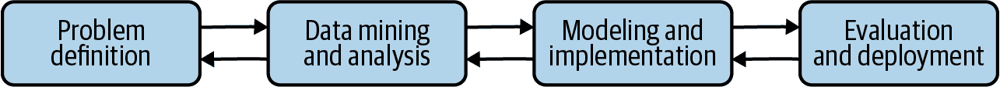
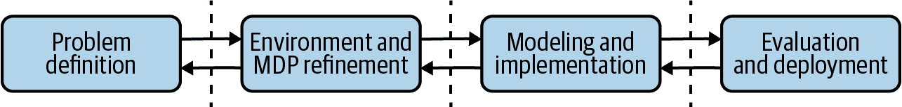
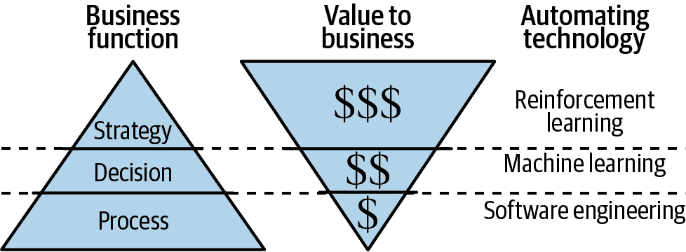
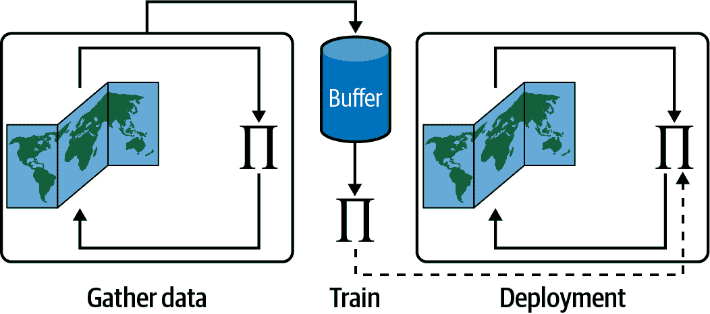
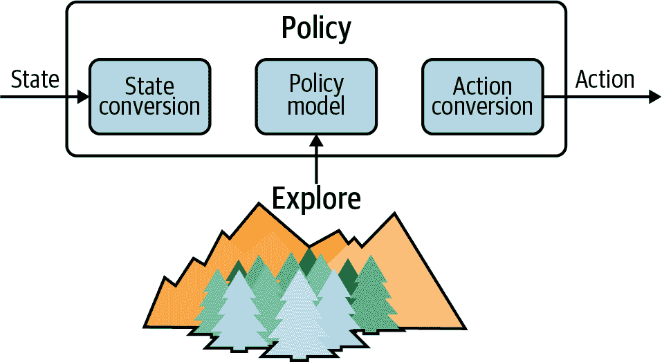
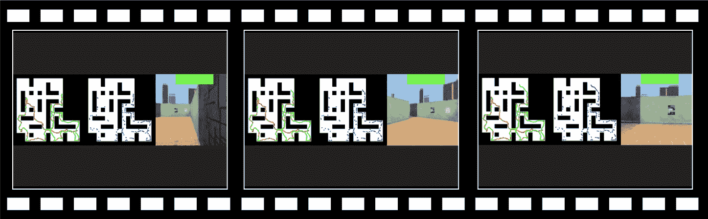

# 第 9 章 实用强化学习

强化学习（RL）是一个古老的学科；它已有几十年的历史。直到最近，它才获得足够的关注，走出学术界。我认为这部分原因是尚未有足够的工业知识普及。绝大多数文献讨论的是算法和人为设计的模拟，直到现在。

研究人员和业界人士开始意识到 RL 的潜力。这带来了 2015 年无法获得的丰富经验。框架和库也随之跟进，这提高了认知度并降低了入门门槛。

在本章中，我想少谈一些繁琐的算法细节，多谈谈流程。我想回答这样一个问题：“一个真实的 RL 项目包含什么？”首先，我将概述 RL 项目的样子，并提出一个构建工业 RL 产品的新模型。在此过程中，我将教你如何识别 RL 问题，以及如何将其映射到学习范式。最后，我将描述如何从简单的起点设计、架构和开发一个 RL 项目，指出所有你需要注意的领域。

## RL 项目生命周期

典型的 RL 项目从一开始就设计为由 RL 来解决，通常是因为先前的工作，但有时是因为设计者欣赏问题的序列性质。RL 项目也可能源于机器学习（ML）项目，当时工程师正在寻找建模问题或提高性能的更好方法。无论哪种方式，RL 项目的生命周期与 ML 截然不同，与软件工程也大相径庭。软件工程之于 RL，犹如砌砖之于造桥。

RL 开发往往遵循一系列你可能熟悉的感受。这种过山车般的体验正是工程成为如此充实职业的原因。大致如下：

1.  *乐观*：“RL 太神奇了，它能控制机器人，所以肯定能解决这个问题？”
2.  *压力与沮丧*：“为什么这不行？它能控制机器人，为什么做不了这个？是我的问题吗？”
3.  *领悟*：“哦，对了。这个问题比控制机器人难得多。但我用的是深度学习，所以最终会行的（？）。我要买更多 GPU 来加速。”
4.  *恐惧*：“为什么还是不行？这不可能！”
5.  *简化*：“如果我移除/替换/修改/增强真实数据会怎样？”
6.  *惊喜*：“哇。它在我的笔记本上只用了 5 分钟就收敛了。自我提醒，别再浪费钱买 GPU 了……”
7.  *欣喜*：“太好了，现在跑通了，我会告诉项目经理我快完成了，但我还需要一个冲刺……”
8.  *GOTO 1*

以更一般的形式来看，这适用于我参与过的任何项目。我发现了一个简单的技巧，有助于管理压力水平并提高项目速度。如果你只从这本书中带走一个想法，那就让它是这个：

*   *从简单开始*

就是这样。从简单开始迫使你思考问题最重要的方面，即 MDP。它帮助你创建真正的大抽象；细节可以稍后填充。抽象有帮助，因为它们释放了本将耗费在琢磨细节上的心智资源；它们让你能在没有繁琐技术细节的情况下与他人交流概念。

我不懂神经科学或心理学，但我发现开发过程中的压力（我认为这不同于正常压力）与在问题上花费的心力成正比，与成功概率成反比。如果我度过了漫长的一天高强度专注（因为该死的东西不正常工作而不得不如此），当我见到家人时，我会更加压力大和暴躁。拥有一个更简单的问题，从而带来更多成功，似乎有助于降低我的压力水平。

项目速度是开发进展的速度。这是过程教练编造的一个虚构度量。当比较你或你团队在一段时间内的速度（而不是团队之间或人员之间）时，外部人员更容易发现临时问题。在个人层面，速度很重要，原因见上段。如果你卡住了，你必须强迫自己更努力地解决问题，如果没有成功，你会陷入绝望的螺旋。

典型的基于点数的速度度量的一个问题是它不考虑任务复杂度或风险。一周你可能在做一些样板软件，燃烧掉大量单点任务（例如 5 × 1 点），下一周你可能在做模型并撞墙（1 × 5 点）。它们可能有完全相同的估算点数，但第二周压力大得多。

为了缓解这个问题，这是我的第二个建议：

*   *保持开发周期尽可能小*

我认为开发周期是从我第一次敲击键盘到事情按我预期工作的时间点之间的间隔。一个代表性指标是`git`提交之间的时间，如果你用提交来代表工作代码。这些周期越长，非工作代码的机会就越大，压力也越大。此外，长周期意味着你必须等待很长时间才能得到反馈。这在用大量数据训练大模型时尤其麻烦。如果你必须等两天才能知道代码是否工作，那你做错了。你的时间太宝贵了，不能坐在那里无所事事那么久。毫无疑问，你会发现错误并不得不取消它。减少周期或运行之间的时间以提高效率，如果必须，让那些长训练会话在夜间运行；早上看到新模型出炉，就像圣诞节早晨的孩子一样兴奋。

这两个想法都不新，但我发现它们在做 RL 时非常重要——至少为了我自己的理智。很容易陷入一次性解决问题的漩涡，一个意图的漩涡。可能的结果是由于问题与 MDP 或模型与数据之间的不匹配而导致失败，所有这些都是由于复杂性过高和理解不足造成的。遵循前两个建议，你就有机会成功。

## 生命周期定义

除了 MDP 范式的成果外，机器学习中使用的许多工具和技术可以直接迁移到 RL。甚至过程也相似。

### 数据科学生命周期

图 9-1 展示了我在 Winder Research 与同事合作时所见的数据科学项目四个主要阶段的示意图。它在很大程度上遵循了 90 年代经典的跨行业数据挖掘标准流程，但我对其进行了简化，并强调了其迭代性质。

所有项目都始于问题定义，而这通常是错误的。当定义发生变化时，会极大地影响工程工作，因此你必须确保它既能解决业务挑战，又在技术上可行。这是导致*表面上*失败的最常见原因之一——之所以说是*表面上*，是因为从技术上讲项目可以按预期工作，但它们并不能解决真正的业务挑战。通常需要几次迭代来完善定义。

接下来是数据挖掘和分析。数据科学家大约有三分之二的时间花在这个阶段，他们试图发现和揭示可能有助于解决问题的新信息，然后分析和清洗数据以准备建模。

在建模和实现阶段，你构建并训练模型来尝试解决你的问题。

最后，你使用定量和定性的性能指标来评估解决问题的效果，并将解决方案部署到生产环境中。

在上述任何一个阶段，你可能都会发现有必要退回一步进行重新设计。例如，你可能会在 `Jupyter notebook` 中开发一个概念验证，以快速证明存在可行的技术解决方案，但随后又回过头来构建可用于生产的软件。或者你可能会发现在初步评估期间，没有足够的正确数据来令人满意地解决问题。更糟的是，你有了一个解决方案并向利益相关者汇报，结果却发现你解决的是错误的问题。

## 强化学习生命周期

图 9-2 展示了一个典型 `RL` 项目流程的描述。你首先注意到的是这些阶段是多么相似。目标是相同的（利用数据解决业务挑战），因此合理地预期流程也会相似。但这种相似性仅存在于表面。当你深入研究每个阶段时，任务却截然不同。

在 `ML` 项目中，你不太可能有能力从根本上改变问题定义。你或许可以调整性能规格，例如，但从根本上说，你试图解决的问题是由业务定义的。然后你会搜索并定位业务中已存在的任何数据，获得使用许可，并部署技术以访问它。如果没有数据，你可以尝试收集新数据或使用外部数据源。一旦你拥有了可用的数据，你就会花时间分析、理解、清洗和增强数据以帮助解决问题。这代表了数据科学流程的前两个框。

在 `RL` 中，情况截然不同，有时甚至显得乖谬。首先，你会面临一个业务挑战。该问题具有战略性，相比于“正常”的数据科学问题处于更高的抽象层级，并且拥有像利润、订阅者数量或点击量这样的现实成功定义。然后，是的，是你，拿起那个成功定义，仔细地将问题设计为适应 `MDP` 并设计奖励函数。直到出现一种在所有情况下都有效的 `逆向 RL`（参见“逆向 RL”）算法，你都需要自己设计奖励。这是一个沉重的负担，压在你的肩上。你拥有决定如何用现实术语量化性能的权力。在某种意义上这很好，因为它直接以人类可读的术语（如挽救的生命数，而不是准确率或 `F1-score` 等）揭示了项目如何影响业务。但这也给工程师带来了更大的负担。想象一个选择业务方向的战略级智能体，却导致了糟糕的结果。历史上，这种风险由公司的高管承担——因此他们薪水丰厚——但在未来，它将委托给由工程师设计的 `RL` 等算法。我没有看到任何证据表明这将如何影响许多公司中存在的层级控制结构，但我预计会发生剧变。股东为生产力买单，当生产力由设计算法的工程师驱动时，这是否也意味着他们来经营公司？

流程的下一阶段是决定如何最好地学习。在机器学习中，你只需要对现有数据进行迭代。但在 `RL` 中，因为它依赖于交互和序列决策，你永远不会拥有生成真实回合所需的所有数据。在绝大多数情况下，构建模拟环境以加快开发反馈周期是合理的，而不是使用实时环境。一旦你有了可行的解决方案，就可以推向现实生活。

注意这里的区别。要么你在生成人工观测值，要么在你主动使用算法之前没有真实数据。如果有人对我说，在收集*任何*数据之前，我必须将我花哨的 `deep learning` 模型部署到生产环境，我大概会在内心哭泣。

但这正是 `RL` 中的情况，也是状态、动作和奖励工程如此重要的原因。除非你完全理解你的状态和动作以及它们如何影响奖励，否则无法指望构建一个稳健的解决方案。试图用 `deep learning` 解决一个你不理解的问题，就像买了一根 1000 美元的高尔夫球杆却指望成为职业高尔夫球手。

还有更多内容，我将在本章中讨论。但我要强调的是，尽管存在相似之处和可迁移的技能，`RL` 完全是另一种生物。图 9-2 中的前两个框，问题定义和环境/`MDP` 完善，我将在本章讨论。我将把最后两个框留到下一章讨论。

## 问题定义：什么是 RL 项目？

我想到现在你对 `RL` 的定义已经有了相当好的理解，但我想用这一节来谈谈将 `RL` 应用于日常挑战。回顾一下，你应该基于马尔可夫决策过程（`MDP`，参见第 2 章和“重新思考 MDP”）来建立模型。问题应该有唯一的状态，这些状态可以是离散的，也可以是连续的——我发现将其视为离散状态通常有帮助，即使它是连续的。在每个状态下，都应该有一定的概率转移到另一个状态（或自身）。而动作应该改变环境的状态。

虽然这个定义几乎涵盖了一切，但我发现从直觉上用状态和转移概率来思考很困难。所以我将尝试描绘一幅不同的图景。

### RL 问题是序列的

`RL` 问题是序列的；`RL` 智能体在多个步骤中优化轨迹。仅这一点就将 `RL` 与 `ML` 区分开来；后者是单步决策的首选范式。`ML` 无法为长期奖励优化决策。这在许多业务挑战中至关重要。我不认为任何有一丝人性的 CEO 会*现在*就榨取潜在客户的每一分钱。相反，他们知道管理关系、管理销售的方式和时机以优化长期客户支持，是通往可持续业务的最佳途径。

## 强化学习哲学与战略应用

这种哲学直接映射到您解决工业界、以客户为中心的问题的方式。您不应该使用机器学习模型来优化广告投放或推荐购买哪个产品，因为它们优化的目标是错误的。就像贪婪的幼儿一样，它们看不见更大的图景。机器学习模型被训练为在当时做出最佳决策，而不顾未来的后果。例如，机器学习模型非常擅长优化产品推荐，但它们可能会包含产品界的“标题党”：获得大量点击但最终令人失望的产品。随着时间的推移，这种短视的观点很可能会惹恼用户，并最终损害利润、留存率或其他重要的业务指标。

强化学习算法非常适合存在多个决策需要制定、或环境在您做出决策后不会重置的情况。这开启了大量可能性，其中一些您已在“RL Applications”中见过。这些可能是新问题，也可能是已经有机器学习部分解决方案的问题。从某种意义上说，已部分解决的问题比新项目更好，因为工程师很可能已经非常熟悉该领域和数据。但请注意，在算法改进期间，初期的强化学习结果可能会在短期内产生更差的结果。访问[配套网站](https://rl-book.com/applications/?utm_source=oreilly&utm_medium=book&utm_campaign=rl)以获取更多应用灵感。

## 强化学习问题具有战略性

我喜欢将软件工程视为自动化流程的方式，而机器学习可以自动化决策。强化学习则可以自动化策略。

图 9-3 深刻阐述了这一观点。现代企业由三大核心职能构成。企业拥有大量流程，从绩效考核到打印机的使用。执行任何单一流程很少直接创造价值，但它们往往频繁发生。由于频率高，且人工执行流程耗时费力（因此花钱），用软件自动化流程是合理的。

业务决策比业务流程少见，但仍相当频繁。决定实施心肺复苏、致电意向客户或拦截可疑交易，可以挽救生命、创造利润、防止欺诈。所有这些挑战都可以用机器学习解决。这些行动具有可量化的价值，但正如我之前所说，它们的生命周期有限。它们刻意关注单一的过渡性事件。决策需要流程来支撑其实施。

业务战略构成公司的核心。它们发生得很少，主要是因为设计和实施战略的人数有限（甚至只有一人）。它们是严守的机密，指引着大量未来的人员、决策和流程。它们影响深远，如国家的医疗体系或公司的年利润。这就是最优战略如此宝贵、强化学习如此重要的原因。

想象一下，将公司/医疗/国家的运营托付给强化学习。听起来如何？您怎么看？

您可能会认为这是痴人说梦，但我向您保证并非如此。税收问题正在用 `MARL` 解决。^(1) 医疗用例显而易见，且有数千个参考文献。^(2) 企业必须自动化以变得更具竞争力，这并非新鲜事——企业自动化已有一个多世纪的历史。

因此，未来掌握在工程师手中，即那些懂得如何构建、调整和约束算法，使其稳健、实用、最重要的是安全的人。

## 底层强化学习指标

前两点建议——强化学习问题是序列性的和战略性的——属于高层视角。在较低层面，您应该寻找问题的各个组成部分。

### 实体

寻找实体，即与环境交互的具体事物或人。视问题而定，实体可能位于环境接口的两侧。例如，查看推荐的人是实体，但他们属于环境的一部分。其他时候人是模拟智能体，如税收示例中那样。

### 环境

用领域驱动设计的语言来说，环境应是一个限界上下文。它应是一个封装情境所有复杂性的接口。您不应关心接口背后是模拟还是现实；接口处的数据应保持一致。警惕环境过大或过复杂，因为这会影响问题的可解性。拆分或简化环境会让其更易处理。

### 状态

发现状态最简单的方法是观察或想象状态变化时会发生什么。您可能不认为这是一种变化，但请仔细观察。股价变化是因为所有投资者的底层状态发生了变化。机器人的状态变化是因为它从位置 A 移动到了位置 B。展示推荐后，目标用户的状态可能从“忽略推荐”变为“点击推荐”。

您能观察到环境（可能包含实体）的哪些方面？哪些特征最相关、最有信息量？像机器学习一样，您需要小心，只包含干净、有信息量、不相关的特征。您可以根据需要添加、移除或增强这些特征，但倾向于尽量减少特征数量，以减小探索空间、提高计算效率和鲁棒性。别忘了您可以融合来自其他来源的上下文信息，如一天中的时间或天气。

状态的域因应用而异，差异巨大。例如，它可以是图像、表示地理空间网格的矩阵、表示传感器读数的标量、文本片段、购物车中的商品、浏览历史等。请记住，从智能体的角度来看，状态可能是不确定或隐藏的。时常提醒自己：智能体看到的不是您能看到的，因为您拥有对问题的“上帝视角”。

### 动作

当您施加一个动作时，环境会发生什么？环境的内部状态应有改变的潜力（可能不变，因为动作是“原地不动”或是个坏动作）。理想情况下，您希望观察到这种状态变化；如果观察不到，考虑寻找能暴露此信息的观测值。同样，尽量限制动作数量以减小探索空间。

### 量化成功或失败

在此环境中，您如何定义成功或失败？能想出量化的方法吗？该数值应映射到问题定义，并使用您和利益相关者都能理解的单位。如果您致力于提高利润，则用货币价值量化。如果您试图提高某事物的点击率，请回头尝试为该点击找到现金价值。思考一下您的客户/老板/利益相关者对您做这个项目感兴趣的真实原因。如何用他们理解和欣赏的术语量化结果？

## 学习类型

智能体的目标是学习一个最优策略。本书其余部分将探讨智能体*如何*通过各种基于价值和基于策略梯度的算法进行学习。但*何时*学习呢？

### 在线学习

绝大多数示例、文献、博客文章和框架都假设你的智能体正在进行*在线*学习。这意味着智能体与真实或模拟环境交互，并同时进行学习。到目前为止，本书我只讨论了这种模式。这种方法的主要问题之一是样本效率，即学习最优策略所需与环境交互的次数。在过去的几十年里，研究人员一直在通过改进探索和学习保证来追求样本效率。但从根本上说，探索始终会带来开销、由随机近似导致的采样延迟，以及至关重要的稳定性问题。直到最近，他们才开始考虑从日志中学习。

## 离线或批量学习

直到最近，人们认为所有学习都必须在线进行，因为智能体的动作与环境的反应之间存在内在耦合。^(3)但研究人员发现，可以从存储数据的*批次*中学习，就像经验回放缓冲区中的数据一样。因为这些数据不再与环境交互，所以这也被称为*离线*学习或*批量*学习。图 9-4 展示了这一想法。首先，使用某个策略（可能是随机的）在线生成数据并保存在缓冲区中。然后离线地，在缓冲区的数据上训练一个新策略。最后将新策略部署使用。

离线学习的主要优势是提高了样本效率。你可以采集或记录一组数据，并随意用它训练模型任意次数，而对环境零影响。在采集新样本昂贵或不安全的许多领域中，这是一个极其重要的特性。

但等等。如果我收集并基于数据的静态快照进行训练，那这不就是纯监督学习吗？答案是肯定的，某种程度上。从某种意义上说它是监督的，因为你拥有一批带有标签转移和奖励的数据。但这并不意味着你可以使用任何旧的回归或分类算法。这些数据（假设）是由马尔可夫决策过程（MDP）生成的，因此设计用于寻找 MDP 最优策略的算法仍然有用。主要区别在于它们无法再进行探索。

如果智能体无法探索，就无法尝试通过“填补空白”来改进策略，而这是过去十年强化学习快速进步的主要原因。类似的论点是，这阻止了智能体针对动作提出反事实问题。同样，这是一种理论方法，通过允许智能体提出“如果……会怎样”的问题来提供更稳健的策略。从根本上说，训练数据（针对状态、动作和奖励）的分布与部署时观察到的分布不同。想象一下这会如何影响典型的监督学习算法。

原则上，通过移除算法中的探索部分，*任何*离策略 RL 算法都可用作离线 RL 算法。然而，由于多种原因，这在实践中是有问题的。基于价值的方法举步维艰，因为它们依赖准确的价值估计。但许多状态或动作不会出现在缓冲区中，因此估计充其量只是不准确。策略梯度方法因分布偏移而举步维艰，这充其量会产生指向错误方向的梯度，最坏的情况会导致梯度爆炸。当你使用过度指定的模型（如深度学习）时，这些问题会变得更糟。^(4)

在撰写本书时，研究人员正在努力解决这些问题，以在样本效率上取得下一个重大突破。一个研究方向是进一步完善基础 RL 算法的稳定性保证，使它们在遇到不稳定分布或欠采样的状态或动作时不会表现异常。在使用深度学习时提供更好的理论保证，是一个显而易见的方向，将极大地改善现状。其他方法尝试使用模仿学习等技术来学习产生正奖励的策略。^(5)一个更简单的方法是在缓冲区上训练一个自编码器，以创建一个智能体*可以*在其中探索的模拟环境。^(6)实际上，这些技术已被应用并显示出令人印象深刻的结果，尤其是在[机器人学](https://oreil.ly/cXXDc)领域。^(7)从实践角度来看，你可能会发现 [DeepMind RL Unplugged 基准测试](https://oreil.ly/hdtXK) 是一个寻找或原型化想法的有用工具。^(8)

## 并发学习

文献中包含了一系列介于多智能体 RL (MARL) 和多进程框架之间的学习技术，但它们足够有趣，值得在此提及。

反馈周期的长度由问题的复杂性决定；挑战越难，解决所需的时间越长。这在一定程度上是由于模型复杂性的增加，但主要是一个探索问题。大规模状态和动作空间需要更多探索来“填补空白”。

许多研究人员专注于改进单智能体情况下的探索，这效果显著。但这只能扩展到一定程度。最终智能体仍然需要访问整个状态-动作空间。一种选择是同时运行多个智能体（参见“扩展 RL”），但如果它们使用相同的探索算法，往往会探索相同的空间，随着状态-动作空间扩大，这又会抵消效率。

相反，为什么不*并发*地探索，让智能体团队共同承担探索状态-动作空间的*联合*任务。但要注意，这个术语被过度使用了；研究人员用*并发*一词来表示从协作 MARL 到 RL 并发编程的任何含义。^(9,10)我用这个术语来表示对同一环境进行协调探索的目标，这最早于 2013 年提出。^(11)

这一想法的实现在一定程度上取决于领域。举个例子，许多公司并行地与成千上万或数百万客户交互，并试图最大化针对该客户的局部奖励，如终身价值或忠诚度。但这些客户处于同一环境的范围内；公司只有有限的库存产品，且你拥有每个客户大致相同的人口统计信息。从一个客户那里获得的经验应迁移给其他客户，这意味着要么集中学习，要么至少共享参数。

我认为没有唯一的标准答案，因为有许多小挑战需要独特的适配。例如，如果你引入了通过电子邮件或广告重定向客户的能力，会发生什么？这会改善性能指标，但奖励可能会延迟。所以你必须构建“跳过”动作的能力并处理部分可观测性。

Dimakopoulou 和 Van Roy 于 2018 年形式化了这一想法，并证明了协调探索既能提高学习速度，又能扩展到大量智能体。^(12)他们的解决方案出奇地简单：确保每个智能体都有一个能最大化探索的随机种子。这种方法的好处是你可以使用标准 RL 算法，且每个智能体都独立致力于寻求最优性能。它也能很好地适应新数据，因为初始条件被反复随机化。然而，挑战在于最优种子采样技术因问题而异。

在并发学习中，智能体是独立的且不进行交互。智能体可能对环境有不同的看法，就像不同的客户对你的产品有不同的看法一样。尽管名称不同，这与集中式学习的 MARL（多智能体强化学习）非常相似。因此，如果你正在处理一个符合此描述的问题，请确保同时研究 MARL 和并发 RL。

### 无重置学习

绝大多数示例和算法中都隐含地使用了“回合”，这意味着环境可以被“重置”。对于起始位置已知、固定或易于识别的某些环境来说，这讲得通。但现实生活不允许“重来一次”，尽管我有时希望它能，那将需要全知全能的监督。为了避免《土拨鼠之日》那种奥威尔式的版本，许多应用需要某种方法来避免指定重置。

早期的解决方案建议智能体可以学习如何重置。^(13) 智能体控制自己的动作，因此你可以将之前的动作存储在缓冲区中。要回到起点，你可以“撤销”这些动作。这在许多领域行之有效，因为动作空间具有天然的相反动作。但动作的不确定性和不自然的“撤销”阻碍了这种方法的普遍适用性。

另一个想法是预测终止、重置或不安全行为何时会发生，并在发生前阻止它。^(14) 但这同样需要监督，所以另一个建议是将预测重置何时发生的函数学习作为学习过程本身的一部分。^(15) 从术语上看，这带有元学习的暗示。但这些方法都不是真正的无重置；为什么不完全消除重置呢？

从技术上讲，你可以永远不重置，并使用小于 1 的折扣因子来防止价值估计趋向无穷大。但重置比你意识到的更重要。它允许智能体重新开始，就像你辞去枯燥的工作，开启激动人心的工程师生涯一样。探索型智能体很容易陷入困境，并在相似状态中花费大量时间。摆脱困境的唯一办法是有人或某物给它一脚。重置是解决此问题的完美方案，因为它给了智能体另一次尝试不同路径的机会。

一个相关的问题是，当智能体能够达到目标或全局最优时，最好的下一个动作就是原地不动，贪婪地享受目标带来的奖励。同样，你需要重置或一脚来探索更多次优状态，以使策略更加鲁棒。

因此，与其学习如何重置，不如学习如何鼓励智能体远离目标和容易陷入的区域。或者提供一个简单的控制器来打乱环境，就像 Zhu 等人所做的那样，从而在无重置的情况下实现了鲁棒的机器人策略。^(16)

总之，无重置学习在某些简单应用中是可行的，但你的智能体很有可能会陷入困境。在某个时刻，你需要考虑是否能够操纵环境将智能体移至不同状态。你或许也能让智能体自行移至不同状态。同样，不同的问题领域会有不同的解决方案。

## RL 工程与精炼

RL 问题与任何工程问题一样，都有高层和低层方面。改变高层设计会影响低层实现。由于缺乏更好的术语，我将高层分析和设计称为*架构*关注点。这些包括精炼马尔可夫决策过程模型、定义接口、定义组件间的交互以及智能体将如何学习。这些决策会影响实现，即*工程*细节。

我已经谈了很多关于高层架构方面的内容，所以在本节中我想讨论实现细节。我力求涵盖尽可能多的主要关注点，但许多实现细节取决于具体领域和问题。一般来说，我建议你搜索文献以寻找相关示例，然后仔细研究实现细节以获取有趣的要点。这些细节在研究人员的报告中往往被一笔带过，但它们能提供至关重要的洞察，让你知道什么有效、什么无效。

## 流程

在深入细节之前，我认为有必要从总体上解释一下我是如何进行这项工程工作的。我发现，工程中的大多数任务，无论抽象层级如何，往往都遵循观察、定向、决策、行动（OODA）循环的某种变体。这表面上是科学方法，OODA 循环是一种简单的四步解决问题的方法，由美军推广普及。其理念是你可以迭代该循环以利用上下文并快速做出决策，同时认识到随着更多信息的获得，决策可能会改变。图 9-5 以工程术语展示了该循环，我建议使用*分析*、*设计*、*实现*和*评估*这些词更为恰当，但它们本质上是一回事。

最重要的方面是这是一个永无止境的过程。在循环的每次迭代中，你评估当前状况，如果不够好，就分析哪里可以改进。然后你挑选下一个最佳改进并实现它。

没有任何单一改进能完全解决问题，总还有下一个改进可以做。你必须小心不要陷入这个循环，你可以通过记住帕累托分布来做到这一点：80% 的解决方案只需 20% 的时间，反之亦然。考虑到你本可以用那段时间提供的所有其他价值，实现最后那 20% 是否真的值得。

## 环境工程

我发现 RL 项目最高效的第一步是创建一个*环境*。贯穿全书，我用这个术语来表示智能体运行所在世界的抽象。它是实际发生的事情与智能体想要的东西之间的接口（参见“强化学习”）。

但现在我具体指的是该接口的实现。无论你是在现实生活中提交真实交易，还是在创建风力涡轮机的仿真，你都需要环境接口的实现。

首先专注于此的好处是，你将深入熟悉数据。这对应于 CRISP-DM 模型中的“数据理解”步骤。理解你的环境对于高效解决工业挑战至关重要。如果你不理解，往往会发生我所谓的“改进散弹枪”现象。向问题扔一堆不同的想法，你可能会碰巧击中目标，但大多数会落空。这种工作既无成效、低效，也不智能。

相反，充分理解环境，提出科学且工程上稳健的问题，并实现回答这些问题的功能。随着时间的推移，你将深入了解问题，并能解释改进*为什么*重要，而不仅仅是陈述它们重要。

### 实现

## OpenAI Gym

OpenAI 的 `Gym` 已自然而然地成为强化学习社区事实上的环境接口标准。^(17) 事实上，它是有史以来被引用次数最多的强化学习论文之一。你可能以前遇到过它，但以防万一你没见过，`Gym` 是一个用于表达环境的 Python 框架。它暴露了诸如动作和状态空间表示定义等有用的基元，并通过一个应能适应大多数应用的接口强制执行一组简单的功能。它还附带一大组示例环境，这些环境在互联网上被广泛用作玩具示例。

从工业界的角度来看，该接口是建模问题并帮助优化 MDP 的绝佳方式。而且因为它非常流行，所以你很可能可以快速测试不同的算法，因为大多数算法都期望 `Gym` 接口。

## Tip

我不会详细讲解实现示例，因为这超出了本书的范围，但你可以通过快速搜索或访问 [`Gym` GitHub 网站](https://oreil.ly/Geupc) 找到许多优秀的示例。

### 仿真

仿真旨在捕捉现实问题中最重要的方面。仿真并不意图成为完美的再现，尽管许多研究人员和企业投入了大量时间使仿真更加逼真。拥有仿真的好处在于，在仿真范围内操作比在现实生活中更容易、更便宜、更快捷。这缩短了开发反馈周期的长度并提高了生产力。但具体的收益取决于问题；有时在现实生活中学习比构建仿真更容易、更简单。

你应该首先搜索一下，看是否有人已经尝试构建过仿真。理解问题的基本方面、物理、生物或化学原理，往往比解决问题本身更困难，尽管构建仿真肯定会提高你对该主题的了解，所以仅为此理由可能就值得去做。市面上有许多商业仿真器，如 MuJoCo 或 Unity，但它们价格昂贵。你必须决定这笔费用对于你的问题是否物有所值。一般来说，我建议评估该仿真是否是你业务或产品的竞争差异化因素。如果是，投资开发可能值得；如果不是，买现成的产品能省去大量时间。我发现这些供应商非常乐于助人且专业，所以要向他们寻求帮助。你的想法或业务成功符合他们的利益，因为这意味着他们未来的收入。

如果你确实决定自己实现仿真器，那么你需要构建模型来模拟问题，并决定暴露哪些方面。这就是 MDP 设计发挥关键作用的地方。一般来说，你应该尝试暴露现实生活中可观察到的相同问题方面。否则，当你尝试将学习成果迁移到现实生活时，你会发现智能体的表现不符合预期。

同样，许多研究人员尝试获取在仿真中训练的模型并将其应用于现实任务。这当然是可能的，但完全取决于仿真的代表性如何。如果这是你的意图，那么你应该隐式地耦合仿真和现实生活的实现。绝大多数算法和模型不喜欢你改变底层的状态或动作空间。

仿真非常适合概念验证项目，用于验证一个想法在技术上是否可行。但要小心，不要对仿真寄予过高期望，因为无法保证智能体推导出的策略在现实生活中是可行的。现实项目即使在仿真中运行完美，也极有可能惨遭失败。更多时候，仿真会遗漏某些关键方面或信息。

### 与现实交互

如果你对仿真的体验令人鼓舞，或者你决定跳过仿真更容易，那么下一步就是构建另一个 (`Gym`) 接口来与现实交互。此类实现的开发通常容易得多，因为你不需要理解和实现底层机制；大自然会为你完成这些。但使你的算法适应问题，完全取决于对数据的理解和控制。

现实实现的主要关注点在于运维方面，如扩展、监控、可用性等。但架构和设计仍发挥着重要作用。例如，在现实中存在明显的安全顾虑，而这些在仿真中是不存在的。在某些领域，必须投入大量时间来确保安全可靠的运行。其他常见问题包括部分可观测性，这在全知的仿真中不存在，以及过量的随机性；你可能会认为电机会移动到你指定的位置，但通常情况并非如此。

我认为这一小节远不足以表达现实世界实现可能投入的工程时间量。当然，实现因领域而异，但主要问题是这项工作几乎纯属研究。很难准确估计工作需要多长时间，因为无论是你还是世界上其他任何人，以前都没有解决过这个确切的问题。你是一名数字探险家。请提醒你的项目经理这一事实。并记住本章开头的流程。`从简单开始`。生活已经够难了，别让它变得更难。

## 状态工程或状态表征学习

在数据科学中，`特征工程` 是改进原始数据以使其更具信息量并更能代表手头任务的艺术/行为。一般来说，更具信息量的特征会使问题更容易解决。在概念验证之后，花费大量时间用于清洗、移除和添加特征，以提高性能并使解决方案更稳健。

我倾向于使用类似的术语来指代状态的工程，尽管我没在别处见过多少这种用法。`状态工程`，常被称为 `状态表征学习`，是一系列旨在改进观测如何表征状态的技术的集合。换句话说，目标是设计出更好的状态表征。做这件事没有标准的正确方法，因此你主要由性能和稳健性等指标来指导。

尽管存在相似之处，但这不是特征工程。目标不是通过提供更简单、更具信息量的特征来解决问题。目标是尽可能创建环境状态的最佳表征，然后让策略来解决问题。原因在于，在大多数工业挑战中，你极不可能能够设计出能与最优多步策略竞争的特征。当然，如果你能做到，那么你应该考虑使用标准的监督学习技术。

与特征工程一样，领域专业知识很重要。一个看似简单的特征的添加可以显著提高性能，其效果远超尝试不同算法。例如，Kalashnikov 等人发现，在他们的机器人实验中，使用图像作为状态表征时，添加一个简单的“夹爪高度”测量值，使机器人抓取未见物体的能力提高了惊人的 12%。^(19) 这表明，尽管研究人员一直在尝试从像素中学习，但简单、可靠的真实测量值是更好的状态表征。

## 状态工程

请注意，互联网上许多论文和文章将状态工程和策略/动作工程归为同一类。但我确实认为它们是独立的任务，因为状态工程的目标是专注于状态的更好表示，而不是改进策略如何生成动作。

### 学习前向模型

在某些情况下，可能暂时获得真实值，例如在高度仪器化的实验室实验中，但通常情况下无法获得。你可以构建一个监督模型，从观测值预测状态，并将其部署到现场智能体中。这也被称为学习`前向模型`。

### 约束

约束状态空间有助于限制智能体所需的探索量。通常，当状态被重复访问时，策略会得到改进，因此限制状态数量可以加快学习速度。

通过使用`先验`（即已知为真并由概率分布正式定义的信息）来应用约束。例如，如果你知道特征应该严格为正，那么要确保你的策略知道这一点，并不会尝试去到达那些状态。

### 变换（降维、自编码器和世界模型）

降维是数据科学中的一项任务，旨在在不丢失信息的情况下减少特征数量。传统技术在强化学习中也很有用。例如，使用主成分分析可以减小状态空间，从而减少学习时间。^(20)

但状态工程中的瑰宝是各种形式的自编码器，用于重构观测值。其思想很简单：给定一组观测值，训练一个神经网络形成内部表示并重新生成输入。然后你利用该内部表示并将其作为新的状态。

通常，实现会尝试通过使用逐步压缩状态空间的神经网络架构来降低输入的维度。这种约束倾向于迫使网络学习更高层次的抽象，并希望获得重要的状态表示。然而，有建议称`增加`维度可以提高性能。^(21) 我对这一说法仍持一定怀疑态度，因为它主动鼓励过拟合。

学习单个观测值的表示是一回事，但 MDP 是序贯的，因此重要的时间特征被锁在其中。一类受 MDP 启发的新型自编码器开始更多地将其视为预测问题。给定一组有序的观测值，这些自编码器尝试预测未来会发生什么。这迫使自编码器学习时间特征以及状态特征。具体实现因领域而异，但核心思想保持不变。^(22,23)

术语`世界模型`源自同名论文，指的是尝试从离线数据构建环境模型的目标，以便智能体能像在线交互一样进行交互。这一想法对于难以在实时数据上学习的实际实现显然很重要，因此该术语已变得流行，用于描述任何尝试对环境建模的方法。^(24) Ha 和 Schmidhuber 值得额外的赞誉，因为他们提供了论文的优秀[交互版本](https://oreil.ly/wHT_w)。我将这项工作视为状态工程的一种具体实现，根据你的情况可能有用也可能没用，但它是一个非常有用的工具，有助于分割强化学习过程。

这些技术可能会因部分可观测性等 MDP 问题而变得复杂，但总体而言，自编码器研究可以直接应用于强化学习问题。如果这对你的应用很重要，我建议你深入研究这些论文。框架也开始认识到状态表示的价值，例如[`SRL-zoo`](https://oreil.ly/Gfr5r)，这是一个面向 PyTorch 的表示学习方法集合，你可能会觉得它很有用。

## 策略工程

强化学习策略负责将状态的表示映射到动作。虽然这听起来很简单，但在实践中，你需要对实现这种映射的函数做出仔细的决策。就像在机器学习中一样，函数的选择决定了性能的极限和策略的鲁棒性。它也影响学习性能；使用非线性策略可能导致发散，并且通常需要更长的训练时间。

我将这项工作概括为`策略工程`，其目标是在给定一组约束的情况下，设计一个能最好地解决问题的策略。绝大多数强化学习文献都致力于寻找定义策略的改进方法或改进其理论保证。

策略从根本上受限于贝尔曼更新，因此除非发生重大的理论变革，否则所有策略都有相似的目标。研究人员通过固定表示状态的新方法、改进探索或惩罚其他某些约束来引入新颖性。在底层，所有强化学习算法都是基于价值的或基于策略的。

鉴于所有算法之间的这种相似性，我将策略可视化为具有三个不同的任务，如图 9-6 所示。首先，它必须将状态的表示转换为内部模型可用的格式。内部模型是决策引擎，学习它所需学习的一切，以便将状态转换为可能的动作。策略必须进行探索，你可以对该过程进行大量控制。最后，策略必须将隐藏表示转换为适合环境的动作。

工程挑战在于设计函数，以高效且鲁棒的方式执行这三个阶段。策略模型的定义一直是本书大部分内容的主题。在以下小节中，我将描述如何使用离散或连续的状态和动作。

### 离散状态

`离散`特征只允许取特定值，但可以拥有无限范围。绝大多数数据都是由模数转换器量化后接收的形式，因此你可以认为大多数数据是离散的。但在实践中，当人们说“离散空间”时，通常指基于整数的状态空间，即状态只能取整数值。大多数时候，量化数据会被转换为浮点数并被视为连续的。

离散状态输入因其简单性而有用。智能体需要探索的状态更少，因此可以减少甚至预测训练性能和时间。状态空间较小的问题比较大的问题收敛得更快。

离散状态空间是任何类`GridWorld`的环境。地理空间问题是一个很好的例子。尽管位置可以用经纬度等连续度量来编码，但将地图转换为网格通常在计算上和直觉上更简单，就像 Chaudhari 等人在优化纽约市网约车路由策略时所做的那样。^(25)

具有离散状态空间的问题被认为更容易解决，主要是因为调试和可视化非常容易。离散域通常易于推理，这使得制定准确的理论先验和基线成为可能。你可以直接将策略与这些假设进行比较，从而轻松监控训练进度并修复出现的问题。另一个好处是价值函数可以存储在字典或查找表中，因此你可以利用数据库等工业级稳健技术。

## 连续状态

一个*连续*特征是实数值的无限集合。它们可能是有界的，但相邻值之间没有“步长”。例如自动驾驶车辆的速度或熔炉的温度。连续状态空间被认为比离散空间稍微难处理一些，因为这会导致无限多的潜在状态，从而使得无法使用简单的查找表（例如）。

连续状态的策略必须能够为给定状态预测最佳的下一个动作或价值，这意味着策略必须进行近似，而不是期望已知状态。你可以使用任何标准机器学习技术提供近似，但函数近似器最为常见。由于统一的方法和工具，神经网络越来越受欢迎。

关于连续状态空间的主要担忧是，只有在使用线性近似器时，它们才被证明是收敛的。截至 2020 年，不存在非线性近似器的收敛证明，这意味着任何“深度”算法都不能保证收敛，即使它是一个好模型，尽管经验证据表明它们确实收敛。线性近似可以通过域变换建模大量的复杂性。简单性、稳定性和可配置的复杂程度意味着，就像在机器学习中一样，线性方法非常有用。一般来说，提供近似有三种方法：

### 线性近似

直接基于输入特征学习一组线性权重，可能是处理连续状态最简单的方法之一。这实际上等同于线性回归。你也可以通过任何标准的线性回归扩展来提高回归质量，例如那些减少异常值影响的扩展。线性策略被证明是收敛的。

### 非参数近似

如果合理，你可以使用类分类的模型来预测值。例如，最近邻算法和基于树的算法能够提供稳健、可扩展的预测。同样，它们的简单性和普及性催生了大量开箱即用、稳健的工业级实现，你可以利用这些实现使你的实现更具扩展性和稳健性。不保证非参数策略会收敛。

### 非线性近似

非线性近似以统一的包（神经网络）提供灵活数量的复杂性。你可以通过网络架构控制复杂程度。神经网络在许多领域取得了最先进的结果，因此在你的问题中评估它们是明智的。不保证非线性策略会收敛。

可证明的收敛保证是线性近似的一个强特性。并且你可以在将数据传递给线性近似之前对其进行变换，从而获得令人惊讶的模型复杂度。以下是一系列流行技术，它们在保持线性方法的简单性和保证的同时增加模型复杂度：

### 多项式基

多项式展开是生成不超过指定幂次的所有可能特征组合。多项式在价值空间中表示曲线，这比线性方法能实现稍多的复杂性。

### 傅里叶基

傅里叶展开在价值空间中生成振荡。这些振荡可以以任意方式组合以生成复杂形状，类似于声音由音调叠加而成。傅里叶基是完备的，意思是它们可以在给定复杂度水平下近似任何（良态）函数，该水平由基函数的阶数控制。它们在一系列领域中效果良好。^(26) 然而，傅里叶基在存在不连续性的环境中表现吃力，比如 `Cliffworld` 环境。

### 径向基

径向基函数通常是高斯形状的变换（存在其他径向基），用于测量状态与基中心之间的距离，相对于基的宽度。换句话说，这些是参数化的类高斯形状，可以移动和调整大小以近似价值函数。径向基函数（和其他平铺方案）的主要问题是你必须选择基的宽度，这实际上固定了“平滑”的程度。最优轨迹倾向于在价值函数中产生“尖峰”，所以你最终不得不使用相当窄的宽度，这可能导致有问题的局部最优。尽管如此，径向基函数仍然有用，因为宽度超参数提供了一种简单有效的方法来控制“复杂度”。

### 其他变换

信号处理提供了广泛的其他变换，可用于生成不同的特征特性，例如希尔伯特变换或小波变换。但它们不太流行，通常是因为大多数强化学习研究者具有数学或机器学习背景。例如，具有电子工程背景的人会非常乐意使用这些“传统”技术。

有关线性变换的更多详细信息，请参阅延伸阅读中的额外资源。

## 转换为离散状态

你可能需要考虑将你的领域离散化。在存在领域自然网格状表示（如地图）的情况下，转换连续状态尤为常见。离散化的主要好处是它可能消除对函数近似器的需求，因为状态空间的大小是固定的。这意味着可以使用简单、快速且稳健的基于 Q-learning 的算法。即使你仍然需要函数近似器，离散化也会降低数据的表观分辨率，使智能体更容易探索，模型更容易拟合。这已被证明能提高困难连续问题（如 `Humanoid` 环境）的原始性能。^(27) 以下列表概述了离散化的可能性（更多信息见延伸阅读）：

### 分箱

固定特征的范围并将其量化为箱，就像直方图一样。这简单易懂，但你会损失精度。你可以用一系列非均匀的方式放置箱边界，例如等宽、等频或对数方式。

### 瓦片编码

将重叠的瓦片映射到连续空间，如果观测值落在该瓦片的范围内，则将该瓦片设为 1。这类似于分箱，但由于瓦片重叠，提供了更高的精度。瓦片通常是正方形，但可以是任何形状且非均匀定位。

### 哈希

当特征是无界的，例如 `IP` 或电子邮件地址时，你可以通过 `hashing`（哈希）将特征强制约束到一组有限的桶中，而不会丢失信息（但由于 `binning`（分箱）仍会存在精度损失）。

## 监督方法

在某些领域，你可能拥有对强化学习问题很重要的标记数据。你可能需要考虑构建一个分类模型，并将结果传递给 RL 算法。有各种各样的算法适用于此目的。^(28)

## 无监督方法

如果你没有标签，可以使用无监督机器学习方法，如 `k-means`，将桶放置在更好的位置。^(29)

## 混合状态空间

如果你拥有混合状态空间，则有三种选择：

1.  通过转换统一状态空间
2.  将离散空间转换为连续空间，并继续使用连续技术
3.  将状态空间拆分为独立的问题

选项 1 和 2 不言自明。大多数 `functional approximators`（函数逼近器）都能愉快地处理 `discretized values`（离散化值），尽管这可能不是最优或最高效的。

然而，选项 3 很有趣。如果你能将状态拆分为与问题领域中的有界上下文相匹配的不同组件，这可能表明使用 `submodels`（子模型）或 `subpolicies`（子策略）会更高效。例如，一种粗略的方法可能是将连续状态和离散状态分开，将它们输入两个独立的 `RL algorithms`（RL 算法），然后将它们组合成一个 `ensemble`（集成模型）。^(30) 正如你所见，这涉及到了 `hierarchical RL`（分层 RL），所以一定要利用那里的思想。

## 将策略映射到动作空间

在尝试定义策略如何指定动作之前，请退一步，考虑哪种类型的动作最适合你的问题。问自己以下问题：

*   *你的动作可以取什么值类型？* 是二元的？是离散的？是有界还是无界的？是连续的？还是混合的？
*   *同时动作是否可能？* 是否可以同时选择多个动作？你能否加快迭代速度并交错执行单个动作，以逼近同时选择多个动作的效果？
*   *何时需要做出动作？* 动作选择是否包含时间因素？
*   *是否存在元动作？* 你能想到任何可能有助于学习或处理时间因素的高层动作吗？
*   *你能将动作拆分为子问题吗？* 你的动作中是否存在明显的有界上下文？这些能否拆分为独立的问题？这是一个分层问题吗？
*   *你能从另一个角度看待你的动作吗？* 例如，与其移动到一个连续值的位置，你能否考虑一个“向前移动”的动作？反之亦然？

所有这些决定都会对你的工作产生重大影响，所以做决定时要小心。例如，将动作从连续改为离散可能会迫使你更换算法。或者意识到你的智能体需要同时动作，可能会让你的问题难解得多。

### 二元动作

二元动作可能是最容易处理的，因为它们易于优化、可视化、调试和实现。策略预期输出一个映射到其想要选择的动作的二元值。在只允许单个动作的问题中，选择最大期望回报（针对 `value methods`（价值方法））或概率最高的动作（针对 `policy gradient methods`（策略梯度方法））是一种简单的实现。

正如“温度参数如何改变探索？”中所见，你可以通过让策略输出概率，或可解释为概率的值，来鼓励广泛的探索。智能体随后可以根据分配的概率从该动作空间中随机采样。对于 `value methods`，你可以将最高概率分配给最高期望值。我建议使用 `advantages`（优势函数），而不是直接使用 `values`（价值），以避免偏差。推荐使用 `exponential softmax function`（指数 Softmax 函数）将价值转换为概率。在 `policy gradient methods` 中，你可以训练模型直接预测概率。

### 连续动作

连续动作非常常见，例如确定舵机的位置或指定广告竞价金额。在这些情况下，使用某种近似函数为给定状态输出连续预测是最自然的（就像回归一样）；`deterministic policy gradients`（确定性策略梯度）就是这样做的。但研究人员发现，将输出建模为 `random variable`（随机变量）有助于探索。因此，他们不直接预测输出值，而是预测分布的 `mean`（均值），例如 `Gaussian`（高斯分布）。然后从分布中采样一个值。分布的其他参数，如 `Gaussian` 的 `standard deviation`（标准差），也可以被预测。然后你可以在开始时将 `standard deviation` 设得较高，以鼓励探索，并允许算法在学习过程中将其缩小。我喜欢把这看作是一种将概率建模粗略地融入其中的尝试。当然，这假设你的动作服从正态分布，这可能不准确，所以要仔细考虑你应该为你的动作选择什么分布。

另一种选择是利用基于 `Q-learning` 但已适应逼近连续函数的新方法：`continuous action Q-learning`（连续动作 Q 学习）。^(31) 这绝不像使用 `policy gradient methods` 那样常见，但声称效率更高。

最后我想提一个在简单示例中有用的技巧，称为 `dimension scaling trick`（维度缩放技巧）。当使用需要预测多个输出的 `linear approximators`（线性逼近器），如 `mean` 和 `standard deviation` 时，你可以为每个动作设置不同的参数，并单独更新所选动作的参数。这实际上是一个 `dictionary of parameters`（参数字典），其中 `key`（键）是动作，值是连续映射的参数，如 `mean` 和 `standard deviation`。

### 混合动作空间

同时包含离散和连续动作的空间相对常见，例如决定是否购买以及花费多少，并且处理起来可能很棘手。首先考虑是否可以拆分问题。如果是分层问题，优先走那条路。接下来考虑是否可以仅使用连续或仅使用离散动作来解决。你可能会损失一点粒度，但这可能会让你更容易跑通流程。

新算法正在涌现，它们学习何时根据所需的动作空间选择连续算法或离散算法。`Parameterized DQN`（参数化 DQN）就是一个例子，但这个想法可以应用于任何算法。^(32) 另一种称为 `action branching`（动作分支）的方法，只是在 `neural network`（神经网络）上创建更多具有不同激活函数和训练目标的头，这看起来像是一个不错的工程解决方案。^(33) 这种 `multihead architecture`（多头架构）还支持 `simultaneous actions`（同时动作）。从某种意义上说，这只是 `hierarchical RL`（分层 RL）的一种手工制作形式。

### 何时执行动作

这里有个难题：如果你想输出“无动作”怎么办？这实际上比听起来难得多，因为从 `Bellman equation`（贝尔曼方程）到 `neural network` 训练，一切设置都预期在每一步都有一个动作。`Atari` 游戏实现了 `frame skipping`（帧跳过），而没有真正考虑跳过多少帧；直接默认跳过 4 帧。但研究人员发现，你可以优化 `skipped frames`（跳过帧数）的大小以提高性能。^(34)

一种更通用的方法是使用 `options` 框架，它包含一个终止条件。这些方法不仅学习 `how`（如何）最优地行动，还学习 `when`（何时行动）。^(35,36) 一个潜在的更简单的解决方案是添加一个动作，使智能体重复之前的动作；我见过这在机器人学中被用来减少电机的磨损。也可以学习尽可能跳过更多动作，以减少与动作相关的成本。^(37)

一如既往，最佳解决方案取决于具体问题。通常我建议尽可能停留在“正常”强化学习的范畴内，以简化开发。

## 大规模动作空间

当状态空间变得太大时，你可以使用 `state engineering`（状态工程）将其缩减到合理的大小。但如果你拥有大规模动作空间该怎么办，比如要向客户推荐数百万产品中的一个？例如，YouTube 的语料库中有 10⁸ 个项目。^(38)

`Value-based methods`（基于价值的方法）如 `Q-learning` 会遇到困难，因为你必须在每一步最大化一组可能的动作。显而易见的挑战是，当你拥有连续动作时，需要最大化的动作数量是无限的。但即使在离散设置中，动作也可能多到执行最大化操作需要不可接受的长时间。`Policy gradient methods`（策略梯度方法）克服了这个问题，因为它们从分布中采样；不需要最大化。

解决此问题的方法包括使用 `embeddings`（嵌入）将动作总数减少到一个动作空间。^(39) 由于 `embeddings` 在其他机器学习挑战（如自然语言处理）中的成功，这种方法极具直观吸引力。如果你的动作空间类似于 `embeddings` 曾取得成功的问题，那么这可能是一个好方法。另一种方法是将最大化视为一个优化问题，并学习预测最大化动作。^(40)

一个相关问题是需要从动作空间中选择固定数量的项目。这会导致组合爆炸，是一个足够常见的问题，从而吸引了研究投入。存在大量近似解决方案，如 `hierarchical models`（分层模型）和 `autoencoders`（自编码器）。^(41,42) 一个更通用的解决方案是通过插入虚拟哑状态并使用跨多步预测的组合动作来生成推荐选择，将动作空间的复杂性转移到状态空间中。^(43) 一个更简单且更稳健的解决方案是假设用户只能选择单个动作。然后你只需要对 top-*k* 动作进行排序并选择，而不是试图决定哪种动作组合最好。该解决方案已被证明能提高 YouTube 上的用户参与度。^(44)

### 注

考虑到 Google（拥有 YouTube）拥有世界上最先进的数据科学家团队之一，请结合这一背景来看待这个结果。这个算法与其高度调优的推荐模型具有竞争力，后者（很可能）花费了由经验丰富的数据科学家组成的团队多年时间才完善。令人难以置信。

## 探索

孩子们以一系列有时令人惊讶的方式提供个人和职业灵感，比如当我正在准备演示文稿或新的抽象概念时，我通常会尝试向孩子们解释。如果我无法以一种至少听起来对他们连贯的方式解释清楚，那对我来说就是一个信号，表明我需要更努力地改进我的表达。书籍 [*The Illustrated Children’s Guide to Kubernetes*](https://oreil.ly/bz90V) 是这一想法的可爱佐证。

孩子们还为探索的改进提供了方向。这是必要的，因为我在这本书的大部分篇幅中都在解释，大多数问题都是探索问题：复杂的状态、大规模动作空间、收敛、最优解等。所有这些问题都可以通过更好的探索来改进。最近的研究表明，孩子们从很小的时候起就拥有天生的能力，为了获取知识而主动探索环境。他们可以进行简单的实验并检验假设。他们能将多源信息编织在一起，构建丰富的世界心智模型，并将这些知识投射到新情境中。^(45)

另一方面，强化学习算法主要由误差驱动，学习几乎是随机的。没有目标时，智能体会在环境中跌跌撞撞，就像一只烦人的苍蝇，似乎无法飞回它进来的那扇敞开的窗户。

看来孩子们倾向于使用一种接近 `depth-first`（深度优先）搜索的算法。他们喜欢坚持执行动作，直到感知到某个阻挡当前路径的状态，比如迷宫中的死胡同。令人难以置信的是，这在没有任何目标的情况下也能奏效，这意味着他们正在从先前的经验中迁移关于状态的知识。当给这些孩子一个目标时，他们能利用探索产生的心智地图，显著改进对目标的初始搜索。将此与通常依靠偶然发现目标的当前强化学习算法形成对比。

为此，有大量工作研究如何改进探索，尤其是在奖励稀疏的问题中。但首先考虑你是否能通过改进算法（如用其他方法替换 `ϵ-greedy` 方法）、中间奖励（如到目标的距离度量），或使用类似 `imitation RL`（模仿强化学习）的方法来主动引导智能体，从而提供专家指导。还要考虑修改问题定义，使奖励更频繁。所有这些都能在不诉诸以下方法的情况下提高学习速度和/或探索效率。

### 内在动机就是探索吗？

研究人员试图通过开发受人类启发的随机移动替代方案来解决探索问题，这导致了大量带有人名名称的提案涌现，如 surprise（惊讶）、curiosity（好奇心）或 empowerment（赋能/能力感）。尽管名字可爱，但人类的探索方法过于复杂，无法编码进简单的强化学习算法，因此研究人员试图通过对优化函数进行数学修改来产生类似行为。

这凸显了所有这些方法的问题；没有标准答案。我相信你能想象出几种鼓励探索的数学解决方案，比如 `soft actor-critic`（软演员-评论家）中的 `entropy bonus`（熵奖励），但如果没有先验经验，它们永远无法接近真正的人类式探索。这就是为什么我认为这个领域仍处于早期阶段，以及为什么“好奇心”或 `intrinsic motivation`（内在动机）等词是不好的称呼，因为它们暗示探索全在于尝试新动作。并非如此。探索*就是*强化学习。你利用先验知识基于对未来奖励的预期来探索新状态。

想象一个经典的强化学习游戏，你的智能体正面对着一堵墙。如果它对墙有任何了解，就永远不应该探索靠近墙的状态，因为这样做没有任何好处。所有强化学习算法都忽略了不能穿墙这一简单的物理规则，因此它们浪费时间字面意义上地“撞墙”。但有趣的是，这些假设也可能阻止我们发现意想不到的状态，比如《超级马里奥》系列中那些讨厌的隐形方块。

## 内在动机与探索方法

因此，如果你想执行最优探索，则需要先验经验。我认为在问题间迁移知识是解决这一问题的关键，而无监督强化学习提供了一个潜在的解决方案。随着算法开始使用先验知识的“库”，反事实推理将变得愈发重要。

内在动机及接下来讨论的方法，其实并不完全关乎探索。它们试图改善 `cold start`（冷启动）问题。当你在稀疏奖励下毫无知识时，如何鼓励深度探索？

## 访问计数（采样）

提高探索效率最简单的方法之一，是确保智能体不会过多地访问某个状态。反之，则鼓励智能体更频繁地访问那些很少被访问的状态。上置信界方法试图防止智能体过于频繁地访问状态（参见“改进 `ϵ-greedy` 算法”）。汤普森采样是此类问题的最优采样技术，而基于价值函数或策略预测的概率随机采样，可以作为一个有用的代理。

## 信息增益（惊讶度）

`Information gain`（信息增益）在机器学习中广泛用作熵减少的度量。例如，基于树的算法利用信息增益在特征空间中寻找能减少类别间熵的分裂点；一个好的分裂能产生纯净或清晰的类别，因此信息增益很高。^(46)

许多研究者尝试利用信息增益引导智能体朝向更具“惊讶度”的区域。相较于原始采样技术，其主要优势在于能够融合策略的内部表征，而非依赖于对智能体移动的外部观测。

其中一个例子是 `variational information maximizing exploration`（变分信息最大化探索，VIME），它利用观测轨迹与参数化模型预期轨迹之间的散度（参见“Kullback–Leibler 散度”）作为奖励函数的附加项。^(47) 注意这一想法与“信任域方法”中讨论的思想的相似性。这导致探索表现为似乎在状态空间中“扫荡”前进。

## 状态预测（好奇心或自我反思）

`Curiosity`（好奇心）是一种人类特质，它奖励寻找并发现令人惊讶的信息。前一种方法侧重于鼓励令人惊讶的轨迹，但你可能不想要这个，因为有趣的路径极有可能导致一个一点也不令人惊讶的结果。请考虑这在你的问题是否重要。例如，你可能在寻找实现同一结果的新方法，在这种情况下这会非常有用。然而在许多问题中，重要的是结果，而非你如何到达那里。

因此，与其鼓励不同的路径（如上学的不同路线），另一种解决方案是鼓励新的情境（如去一所不同的学校）。一个例子是创建一个模型，尝试基于当前状态和动作预测下一个状态，然后根据预测的错误程度给予奖励。^(48) 该方法的问题在于，由于环境的随机性和动态性，预测未来状态以其困难著称。如果这那么容易，你就可以用机器学习来解决你的问题了。因此，它们尝试仅建模影响智能体的那些状态部分。它们通过训练一个神经网络从两个连续状态预测动作，从而创建策略的内部表征，然后根据预测内部表征`应该是什么`的模型与访问该状态后实际是什么之间的差异给予奖励。一种更简单、类似的方法是使用延迟自编码器，将隐藏表征与观测到的表征进行比较。

## 好奇心的挑战

在现实世界中，新颖状态时刻被遇到。正如前一种方法所建议的，我们构建长期模型来预测什么是新颖的。这意味着我们也学会了如何忽略噪声。想想你开车的时候。你以某种方式学会了自动忽略周围 99% 的无关信息，专注于危险。但如果视野内放一块电视屏幕或手机，你的目光就会被吸引过去。这种以牺牲发现危险为代价、去看新事物的承诺，正是开车玩手机或平板如此危险的原因。

研究者发现，在强化学习中存在类似的问题。图 9-7 展示了一个滑稽的场景，墙上挂着一台电视。^(49) 状态好奇心驱动的智能体会持续获得奖励，因为它无法预测电视下一秒会播放什么。显然，这个结果有点人为制造；这些模型的初衷是过滤掉此类噪声，如果你理解该领域，这应该相当容易做到。但总的来说，研究者需要更多地关注改进全局探索，而非局部探索。

<figure id="vid_tv_distracted">
<video controls="controls" style="margin: 0 auto; max-width: 100%;" src="`videos/watching_tv.gif`" loop="loop" autoplay="autoplay">The video element is not supported</video>
<figcaption>使用观测作为惊讶来源可能导致智能体陷入嘈杂状态。改编自 © Deepak Pathak 的视频，基于 CC BY 2.0 许可使用。</figcaption>
</figure>

## 随机嵌入（随机蒸馏网络）

克服“吵闹电视”问题（即智能体对随机状态着迷）的一个想法是使用随机嵌入。`Random distillation networks`（随机蒸馏网络）是一对神经网络，其中一个随机初始化且此后永不改动。随机网络用于生成随机嵌入。第二个网络被训练来预测这些随机嵌入。在 Burda 等人的工作中，随机嵌入与预测嵌入之间的误差被用作“新颖性”度量；误差越大，意味着这种类型的观测在缓冲区中表示得不够好，因此未来应再次访问。该误差值被附加到奖励上，以促进访问新状态。^(50)

这种方法的主要优势在于，它不是在预测下一个观测；它只是将下一个观测与其当前的环境模型进行比较。这意味着，随机状态的静态视图（如电视上的单张图像）可以被建模得相当好，因此智能体不会因为当“沙发土豆”而获得奖励。

我发现很难理解使用随机初始化的神经网络作为嵌入这一想法。但想象一下，如果你的视觉受到某种随机变换的困扰。给足时间，你的大脑会学会补偿这一点，并发展出新的抽象概念；中风幸存者就必须经历这一磨难。另一个好处是，这种架构更简单，因为只有一个网络需要训练。但探索仍然纯粹是局部的；它不促进深度探索。另一个问题是，拥有一个能在该领域产生有效嵌入的架构至关重要。卷积神经网络在基于图像的领域显然效果很好，但其他领域呢？这些情况需要你的领域知识和建模专长。^(51)

## 到新颖性的距离（情景好奇心）

促进全局探索的一个有趣研究方向是利用状态间的距离作为衡量新颖性的更好指标。Savinov 等人提出使用经验缓冲区来记录新颖状态，这些状态由嵌入向量编码表示。缓冲区在每个回合开始时被清空。当智能体遇到一个新状态时，会估算缓冲区中的状态与当前状态之间的距离。如果新状态距离缓冲区中的状态仅几个环境步长之内，则不认为它是新颖的，并会给予惩罚。如果新状态距离缓冲区中的状态超过几个步长，则奖励智能体发现了新颖状态。这鼓励智能体以回合为基础去寻找新状态。^(52)

图 9-8 展示了一个回合中轨迹的走向。它显示了奖励的符号以及嵌入观测被放入缓冲区的时刻。可以看到，该算法的效果是迫使智能体持续移动，从而促进深度优先探索，防止智能体变成“沙发土豆”（只待在原地不动）。

实现过程相当复杂。首先，图像通过卷积神经网络利用 `siamese` 网络的一半转换为隐藏嵌入向量，`siamese` 网络是一种用于图像匹配任务的神经网络架构。^(53) 我不喜欢这个名字，但文献就是这样称呼它的。接下来，将当前嵌入向量与缓冲区中的所有嵌入向量进行比较，从而得出与所有其他观测的距离度量。最后，执行聚合操作以找到到最近状态的距离，这代表了该观测的新颖性，并用于计算奖励。

<figure id="vid_episodic_curiosity">
<video controls="controls" style="margin: 0 auto; max-width: 100%;" src="videos/episodic_curiosity.gif" loop="loop" autoplay="autoplay">视频元素不受支持</video>
<figcaption>带有情景好奇心的 DMLab 环境一个回合的轨迹。左侧框显示智能体在该状态获得的奖励（绿色表示正奖励，红色表示负奖励）。中间框表示“记忆”被添加到情景缓冲区的时刻。右侧框是智能体的第一人称视角。视频改编自 Savinov 等人。</figcaption>
</figure>

## 探索总结

我们知道人类会利用先验知识进行深度探索。将这一想法迁移到强化学习中极其困难，因为在不打破马尔可夫决策过程（MDP）假设的前提下，没有显而易见的方法来引导探索。感觉存在一个鸿沟，MDP 无法填补，其中部分问题纯粹是监督式的，就像复习考试，而另一部分则完全是机缘巧合式的，就像在异文化中度过一段时间。

这是一个亟待解决的重要问题，因为稀疏状态在强化学习中经常出现，这是由目标驱动工程的性质决定的。稀疏奖励难以处理，因为它们难以发现。创建一个鼓励任意探索策略的替代伪奖励是一种解决方案，但在许多问题中，手动设计适合你问题的奖励（参见“奖励工程”），或修改问题定义以使其更容易，都是相对直接的。

目前自动化探索的尝试采取局部的、情景式的视角，并不考虑全局或长期的探索目标。事实上，研究人员观察到，促进新颖性会主动鼓励危险状态，比如在悬崖边缘行走，因为这些状态难以接近，且在智能体的过往经验中极少出现。^(54)

所有努力都是通过增广奖励函数来鼓励探索，而非通过引导动作选择。这与课程学习和逆强化学习有明显的相似之处，这些领域可能改善这一现状。可以肯定的是，未来的探索研究将致力于要么通过允许某种高层协调来改变 MDP 的基本定义（从而打破马尔可夫假设），要么融合其他领域在强化学习中的成果以鼓励长时域规划。

## 奖励工程

设计一个解决你问题的奖励，可以说是强化学习中最重要的任务。作为工程师，你的工作是将问题定义转化为一个指标，引导智能体走向解决方案。这至关重要。你的定义决定了解决方案，很容易意外导致智能体解决错误的问题。图 9-9 是一个极好的视觉化例子。Unity 框架中的一个智能体被鼓励到达目标，它可以利用箱子跳过墙。然而，由于环境边缘有一点边缘空间，智能体却学会了从侧面溜过去。尽管拥有一个合理的奖励，智能体却以你无法想象的方式利用了环境漏洞。

<figure id="vid_cheat">
<video controls="controls" style="margin: 0 auto; max-width: 100%;" src="videos/cheat.mp4" loop="loop" autoplay="autoplay">视频元素不受支持</video>
<figcaption>这个来自 Unity 的例子中，目标是通过鼓励智能体靠近目标来训练其利用箱子跳过墙。相反，它学会了作弊，从边缘溜过去。改编自 Danny Lange 的演示，© Unity Technologies, 经许可使用。</figcaption>
</figure>

在机器学习中，你直接定义算法来解决问题。因此，只要你对问题有合理的掌握（这本身就是一个问题），就很容易观察到项目何时偏离轨道。但在强化学习中，你必须等到训练完成才能看到智能体如何解决问题。这极大地延长了反馈回路的长度，也证明了理解最终策略为何如此重要。

更糟糕的是，奖励还决定了算法的最终性能及其达到该性能的速度。奖励应当帮助引导智能体，提供的引导越多，学习速度理应越快。然而，许多问题是稀疏的，即只有在任务完成时才有奖励。研究人员提出了许多缓解稀疏性的方法，但你能做的最简单的事是设计一个你想完成的任务的代理奖励。但请记住，没有奖励就没有最优策略，而你的奖励会改变最优策略。

### 奖励工程指南

每个领域都有其特定的问题，这使得很难制定关于如何指定奖励的铁律。但在本节中，我想概述几个适用于任何情况的高层目标。奖励应当做到以下几点：

**计算快速**：奖励函数计算应当快速，因为在复杂环境中它们会被调用数百万次。

**与“真实”奖励相关**：代理奖励应当与真实奖励相关，否则你就有解决错误问题的风险。这意味着它们应当等同于或近似问题领域中使用的术语；例如，货币价值、客户数量、挽救的生命数。

**去噪**：代理奖励可能包含噪声，意味着它们不能完美关联真实奖励。考虑组合不同的代理奖励以减少奖励方差。

**编码非功能性需求**：考虑添加映射到非功能性需求的奖励代理，如安全性、效率或速度。

**考虑时间**：折扣因子迫使智能体变得更加或更不 `myopic`；它控制着在优化短期或长期奖励上放置多少重视程度。在塑造奖励时考虑这一点。

**防止平台期**：

您的奖励应在状态之间提供强烈的区分度，且差异应大于 Q 值的噪声。如果状态具有非常相似的奖励，智能体往往会原地打转。

**平滑性**：要产生“平滑”的行为，策略需要从平滑的奖励中学习。奖励空间中的不连续性可能在策略中表现为“生硬”、“突兀”的动作。

**保持简单**：像强化学习中的其他事物一样，复杂性会让理解变得更难。如果奖励简单，策略就易于理解。如果复杂，您将看到意想不到的策略。

## 奖励塑形

这可能是一句显而易见的话，但仍值得一提。策略受奖励幅度的影响，因为智能体旨在最大化总奖励。既然您在设计奖励，当目标达成时，您也必须指定奖励的大小。当存在子目标、多个目标或必须避免的情况时，平衡各类奖励可能极其痛苦。在这种情况下，您可能想尝试拆分问题或研究层级强化学习。

一般来说，您可以任意改变奖励的*形状*以鼓励特定行为或提高学习速度。设计奖励时，您应该：

**归一化奖励**：对奖励的尺度要非常小心。一般来说，所有算法都受益于归一化奖励，因为它们能减少策略或价值函数优化中梯度的方差。

**裁剪奖励**：裁剪奖励是一种常见的归一化形式，但截断可能会丢失信息。例如，DQN 建议将奖励裁剪到 +/–1，但在游戏*吃豆人*中，这会将豆子和水果视为具有相同的奖励，这并不符合事实；水果产生的分数高得多（这种代理奖励与真实奖励不相关）。如果您改为在*吃豆人*中归一化奖励，DQN 智能体会变成猎手-采集者，学会主动猎杀幽灵和寻找水果，而不仅仅是收集豆子。^(55)

**变换奖励**：改变奖励的梯度有助于平滑策略，并在智能体远离目标时提供更大的鼓励。例如，线性奖励无论智能体当前处于状态空间的何处，都提供相同数量的紧迫感。您可以让奖励通过一个函数，使得当智能体远离目标时奖励变化迅速。这是一条滑坡路，因为奖励的变换可能在策略中产生意想不到的表现。

**建模奖励**：许多领域的环境允许进行一定程度的建模，至少是局部的，因此可能推导出一种能有效编码领域知识的代理奖励。例如，在机器人问题中，您可能包含一些先验知识，比如机器人必须先站起来才能跑；您可以包含一个测量机器人离地高度的传感器。一般来说，包含此类真实情况可提高性能。

## 常见奖励

检查是否有与您的问题相似的已发布问题。常见领域倾向于坚持经过验证的奖励定义。以下是常见奖励类型列表：

**稀疏奖励**：许多任务仅在到达特定状态时才算完成，有时需要按特定顺序到达多个状态。任务完成时给予大额奖励很常见，但它们难以求解，因为奖励无法引导智能体朝向目标。

**到目标的距离**：到目标距离指标是非常强的奖励代理，因为它们不仅与真实奖励高度相关，而且无论智能体在状态空间的何处，都能引导智能体朝向目标。这改善了探索并加快了学习速度。

**惩罚步数**：对智能体采取的每个动作进行惩罚，会鼓励它尽可能少地采取步骤。

**惩罚破坏性或危险行为**：对破坏性行为给予强负奖励是常用手段，但要小心，这不要对最优奖励路径产生不利影响，比如为了避开悬崖而绕行一英里，而实际上绕行 10 米就足够了。

**基于图像的奖励**：奖励通常基于低维状态。但越来越多的研究人员使用图像等高维观测来定义目标状态。例如，Zhu 等人使用一组图像作为目标状态的定义，并同时使用随机网络蒸馏和自编码器产生的潜在模型。这在许多现实应用中非常强大，因为您只需收集一批代表目标状态的图像，其余工作就交给强化学习完成。^(56)

## 奖励总结

指定一个能解决问题定义、促进快速学习并产生最优策略的奖励，是一项极其困难的任务。我建议在许多应用中，这份问题清单也按优先级排序，以至于只要问题定义正确，工程师往往不太担心最优性或快速学习，因为您可以使用其他技术来解决这些问题。但如果您能找到平衡点，结果将是更简单、更高效的算法。

同样，您可能已经注意到，一些建议与其他主题相关。确实，自动奖励生成是内在动机、无监督强化学习甚至元学习的全部目标。您必须全面审视这些技术，并在正确的时间选择使用它们，以解决正确的问题。否则，您可能会使问题过度复杂化，这往往导致时间浪费甚至彻底失败。

有更多研究尝试将其中一些想法结合成统一算法。例如，一个有趣的想法表明奖励塑形可能导致难以跳出的局部最优。Trott 等人使用两个独立的反事实回溯来检查是否存在比当前更优的最优解。^(57)

## 总结

尽管强化学习已有数十年历史，但直到最近才作为一种工业上可行且实用的工具崭露头角。我认为这种延迟并非技术原因。我认为主要问题是，以一种易于理解的方式抽象技术细节是很困难的。在不听起来像“机器人将统治世界”的情况下，定义什么是“策略”以及它如何帮助业务已经够难了。这个想法很强大，但作为工程师，您有责任以一种能引起利益相关者共鸣的方式转化这种潜力（以及注意事项）。

在本章中，我较少关注繁杂的细节，更多关注流程。但请记住，这是一个新领域，充满新机遇。我提出了我认为合理的观点，但您可能有更好的想法。不要害怕定制您的方法以适应您的问题。这也意味着这些最佳实践将随时间不断演进。当您在工业项目中使用强化学习时，我非常乐意听闻您的经历！

希望您现在拥有足够的知识至少开始一个强化学习项目。如果没有，请与我联系（详见关于作者获取联系方式），我会尽力提供帮助。现在您知道流程是什么样的，以及在强化学习项目中该寻找什么。您也了解了使项目可行并进而达到最优所需的工程工作量。互联网上还有大量免费的研究资料可能直接对应您的问题，我在“延伸阅读”中也收录了一些我在研究过程中发现有用的重要资料。

## 延伸阅读

*   离线强化学习：

## 参考文献与延伸阅读

## 通用背景

*   略显陈旧，但仍具参考价值的章节。^(58)
*   关于挑战的近期综述。^(59)

## 无重置学习

*   一篇专注于机器人领域的终身学习综述。^(60)

## 状态工程

*   一篇关于状态表示的优秀综述。^(61)

## 策略工程

*   Sutton 和 Barto 的书中有一节简洁而稳健地介绍了线性近似与变换。其中关于连续动作参数化的细节也很不错。^(62)
*   一篇虽旧但相关的机器学习离散化技术综述。^(63)
*   我发现这个[关于高斯策略的视频](https://oreil.ly/VWfLm)非常有帮助。

## 探索

*   心理学内在动机与计算方法的有趣对比。^(64)
*   汤普森采样的综合教程。^(65)

## 参考文献

1.  Zheng, Stephan, Alexander Trott, Sunil Srinivasa, Nikhil Naik, Melvin Gruesbeck, David C. Parkes, and Richard Socher. 2020. [“AI 经济学家：利用 AI 驱动的税收政策提升平等与生产力”](https://oreil.ly/hXqcT)。《ArXiv:2004.13332》，4 月。
2.  Håkansson, Samuel, Viktor Lindblom, Omer Gottesman, and Fredrik D. Johansson. 2020. [“学习高效搜索因果近似最优疗法”](https://oreil.ly/hX-GL)。《ArXiv:2007.00973》，7 月。
3.  Lange, Sascha, Thomas Gabel, and Martin Riedmiller. 2012. [“批量强化学习”](https://oreil.ly/yAHBp)。《强化学习：前沿进展》，Marco Wiering 和 Martijn van Otterlo 编，45–73 页。适应、学习与优化系列。柏林、海德堡：Springer。
4.  Levine, Sergey, Aviral Kumar, George Tucker, and Justin Fu. 2020. [“离线强化学习：教程、综述与开放问题展望”](https://oreil.ly/R_vjH)。《ArXiv:2005.01643》，5 月。
5.  Chen, Xinyue, Zijian Zhou, Zheng Wang, Che Wang, Yanqiu Wu, and Keith Ross. 2020. [“BAIL：面向批量深度强化学习的最佳动作模仿学习”](https://oreil.ly/tYOKM)。《ArXiv:1910.12179》，2 月。
6.  Dargazany, Aras. 2020. [“基于模型的 Actor-Critic：GAN + DRL (Actor-Critic) ⇒ AGI”](https://oreil.ly/UC65B)。《ArXiv:2004.04574》，4 月。
7.  Mandlekar, Ajay, Fabio Ramos, Byron Boots, Silvio Savarese, Li Fei-Fei, Animesh Garg, and Dieter Fox. 2020. [“IRIS：大规模无交互隐式强化学习，用于从离线机器人操作数据中学习控制”](https://oreil.ly/RP5Q5)。《ArXiv:1911.05321》，2 月。
8.  Gulcehre, Caglar, Ziyu Wang, Alexander Novikov, Tom Le Paine, Sergio Gomez Colmenarejo, Konrad Zolna, Rishabh Agarwal, et al. 2020. [“RL Unplugged：离线强化学习基准”](https://oreil.ly/Lxpf0)。《ArXiv:2006.13888》，7 月。
9.  Banerjee, Bikramjit, Sandip Sen, and Jing Peng. 2004. [“在线并发强化学习”](https://oreil.ly/5caMf)。《实验与理论人工智能杂志》16(4)：245–60。
10. Marthi, Bhaskara, Stuart Russell, David Latham, and Carlos Guestrin. 2005. “并发分层强化学习。”《第 19 届国际人工智能联合会议论文集》，779–785 页。IJCAI ’05。苏格兰爱丁堡：Morgan Kaufmann Publishers Inc.
11. Silver, David, Leonard Newnham, David Barker, Suzanne Weller, and Jason McFall. 2013. [“基于客户交互的并发强化学习”](https://oreil.ly/BD4R-)。《国际机器学习会议》，924–32 页。
12. Dimakopoulou, Maria, and Benjamin Van Roy. 2018. [“并发强化学习中的协同探索”](https://oreil.ly/Cd72Q)。《ArXiv:1802.01282》，2 月。
13. Han, Weiqiao, Sergey Levine, and Pieter Abbeel. 2015. [“在未知动力学下学习复合多步控制器”](https://oreil.ly/z2S9L)。《2015 IEEE/RSJ 国际智能机器人与系统会议 (IROS)》，6435–6442 页。
14. Richter, Charles, and Nicholas Roy. 2017. [“通过深度学习与新奇性检测实现安全视觉导航”](https://oreil.ly/C6Bi_)。《MIT 网络域》，7 月。
15. Eysenbach, Benjamin, Shixiang Gu, Julian Ibarz, and Sergey Levine. 2017. [“不留痕迹：学习重置以实现安全自主强化学习”](https://oreil.ly/p2nwJ)。《ArXiv:1711.06782》，11 月。
16. Zhu, Henry, Justin Yu, Abhishek Gupta, Dhruv Shah, Kristian Hartikainen, Avi Singh, Vikash Kumar, and Sergey Levine. 2020. [“现实世界机器人强化学习的要素”](https://oreil.ly/kaodL)。《ArXiv:2004.12570》，4 月。
17. Brockman, Greg, Vicki Cheung, Ludwig Pettersson, Jonas Schneider, John Schulman, Jie Tang, and Wojciech Zaremba. 2016. [“OpenAI Gym”](https://oreil.ly/tnnqe)。《ArXiv:1606.01540》，6 月。
18. Ruiz, Nataniel, Samuel Schulter, and Manmohan Chandraker. 2019. [“学习仿真”](https://oreil.ly/jwxX0)。《ArXiv:1810.02513》，5 月。
19. Kalashnikov, Dmitry, Alex Irpan, Peter Pastor, Julian Ibarz, Alexander Herzog, Eric Jang, Deirdre Quillen, et al. 2018. [“QT-Opt：面向视觉机器人操作的可扩展深度强化学习”](https://oreil.ly/Mchmp)。《ArXiv:1806.10293》，11 月。
20. Karakovskiy, Sergey, and Julian Togelius. 2012. [“马里奥 AI 基准与竞赛”](https://oreil.ly/6KKCf)。《IEEE 计算智能与游戏 AI 事务》4(1)：55–67。
21. Ota, Kei, Tomoaki Oiki, Devesh K. Jha, Toshisada Mariyama, and Daniel Nikovski. 2020. [“增加输入维度能否改善深度强化学习？”](https://oreil.ly/_JNf9)。《ArXiv:2003.01629》，6 月。
22. Hafner, Danijar, Timothy Lillicrap, Jimmy Ba, and Mohammad Norouzi. 2020. [“梦想控制：通过潜在想象学习行为”](https://oreil.ly/2T1oB)。《ArXiv:1912.01603》，3 月。
23. Hafner, Danijar, Timothy Lillicrap, Ian Fischer, Ruben Villegas, David Ha, Honglak Lee, and James Davidson. 2019. [“从像素中学习潜在动态以进行规划”](https://oreil.ly/fRp2X)。《ArXiv:1811.04551》，6 月。
24. Ha, David, and Jürgen Schmidhuber. 2018. [“世界模型”](https://oreil.ly/rrPrn)。《ArXiv:1803.10122》，3 月。
25. Chaudhari, Harshal A., John W. Byers, and Evimaria Terzi. 2020. [“学会赚取：实现网约车车队内部的协调”](https://oreil.ly/L57Kf)。《ArXiv:2006.10904》，7 月。
26. [“使用傅里叶基的强化学习价值函数近似”](https://oreil.ly/FmeN3)。《第二十五届 AAAI 人工智能会议论文集》。无日期。访问于 2020 年 7 月 18 日。
27. Tang, Yunhao, and Shipra Agrawal. 2020. [“为在线策略优化离散化连续动作空间”](https://oreil.ly/cukso)。《ArXiv:1901.10500》，3 月。

^(28) Gonzalez-Abril, L., F. J. Cuberos, F. Velasco, and J. A. Ortega. 2009. [“Ameva: 一种自主离散化算法”](https://oreil.ly/eb7oY). *专家系统及其应用：国际期刊* 36 (3): 5327–5332.

^(29) Dougherty, James, Ron Kohavi, and Mehran Sahami. 1995. “连续特征的有监督与无监督离散化。” *第十二届国际机器学习会议论文集*, 194–202. ICML’95. 美国加利福尼亚州塔霍城: 摩根·考夫曼出版公司。

^(30) Seijen, Harm van, Bram Bakker, and L. J. H. M. Kester. 2017. [“在强化学习中在不同状态表示之间切换”](https://oreil.ly/eJ1go). 11 月。

^(31) Ryu, Moonkyung, Yinlam Chow, Ross Anderson, Christian Tjandraatmadja, and Craig Boutilier. 2020. [“CAQL：连续动作 Q 学习”](https://oreil.ly/G_AOF). ArXiv:1909.12397, 2 月。

^(32) Xiong, Jiechao, Qing Wang, Zhuoran Yang, Peng Sun, Lei Han, Yang Zheng, Haobo Fu, Tong Zhang, Ji Liu, and Han Liu. 2018. [“参数化深度 Q 网络学习：具有离散-连续混合动作空间的强化学习”](https://oreil.ly/z2kSN). ArXiv:1810.06394, 10 月。

^(33) Tavakoli, Arash, Fabio Pardo, and Petar Kormushev. 2019. [“用于深度强化学习的动作分支架构”](https://oreil.ly/iLcmj). ArXiv:1711.08946, 1 月。

^(34) Khan, Adil, Jiang Feng, Shaohui Liu, Muhammad Zubair Asghar, and Ling-Ling Li. 2019. [“最优跳过率：使用深度强化学习通过细粒度控制训练智能体”](https://oreil.ly/GfKDp). *2019 年机器人期刊* (1 月)。

^(35) Sutton, Richard S., Doina Precup, and Satinder Singh. 1999. [“MDP 与半 MDP 之间：强化学习中时序抽象的框架”](https://oreil.ly/1iEJc). *人工智能* 112(1): 181–211。

^(36) Khetarpal, Khimya, Martin Klissarov, Maxime Chevalier-Boisvert, Pierre-Luc Bacon, and Doina Precup. 2020. [“关注选项：基于兴趣函数的时序抽象”](https://oreil.ly/KDyb9). ArXiv:2001.00271, 1 月。

^(37) Biedenkapp, A., R. Rajan, F. Hutter, and M. Lindauer. 2020. “迈向 TempoRL：学习何时行动。” 见 *RL 中归纳偏置、不变性与泛化研讨会* (BIG@ICML ’20)。

^(38) Ie, Eugene, Vihan Jain, Jing Wang, Sanmit Narvekar, Ritesh Agarwal, Rui Wu, Heng-Tze Cheng, et al. 2019. [“基于列表的推荐系统的强化学习：一种可处理的分解与实用方法论”](https://oreil.ly/y7Fpd). ArXiv:1905.12767, 5 月。

^(39) Dulac-Arnold, Gabriel, Richard Evans, Hado van Hasselt, Peter Sunehag, Timothy Lillicrap, Jonathan Hunt, Timothy Mann, Theophane Weber, Thomas Degris, and Ben Coppin. 2016. [“大规模离散动作空间中的深度强化学习”](https://oreil.ly/BeS1T). ArXiv:1512.07679, 4 月。

^(40) Van de Wiele, Tom, David Warde-Farley, Andriy Mnih, and Volodymyr Mnih. 2020. [“通过分摊近似最大化在巨大动作空间中的 Q 学习”](https://oreil.ly/Rjmv9). ArXiv:2001.08116, 1 月。

^(41) Mehrotra, Rishabh, Mounia Lalmas, Doug Kenney, Thomas Lim-Meng, and Golli Hashemian. 2019. [“联合利用意图与交互信号预测用户对列表推荐的满意度”](https://oreil.ly/py0m8). *万维网大会*, 1256–1267. WWW 2019. 美国加利福尼亚州旧金山: 计算机协会。

^(42) Jiang, Ray, Sven Gowal, Timothy A. Mann, and Danilo J. Rezende. 2019. [“超越贪婪排序：通过 List-CVAE 进行列表优化”](https://oreil.ly/aOeNP). ArXiv:1803.01682, 2 月。

^(43) Metz, Luke, Julian Ibarz, Navdeep Jaitly, and James Davidson. 2019. [“用于深度 RL 的连续动作离散序列预测”](https://oreil.ly/i7OAG). ArXiv:1705.05035, 6 月。

^(44) Ie, Eugene, Vihan Jain, Jing Wang, Sanmit Narvekar, Ritesh Agarwal, Rui Wu, Heng-Tze Cheng, et al. 2019. [“基于列表的推荐系统的强化学习：一种可处理的分解与实用方法论”](https://oreil.ly/o-qVT). ArXiv:1905.12767, 5 月。

^(45) Kosoy, Eliza, Jasmine Collins, David M. Chan, Sandy Huang, Deepak Pathak, Pulkit Agrawal, John Canny, Alison Gopnik, and Jessica B. Hamrick. 2020. [“探索探索：在统一环境中比较儿童与 RL 智能体”](https://oreil.ly/dqM6q). ArXiv:2005.02880, 7 月。

^(46) Murphy, Kevin P. 2012. *机器学习：概率视角*. MIT 出版社。

^(47) Houthooft, Rein, Xi Chen, Yan Duan, John Schulman, Filip De Turck, and Pieter Abbeel. 2017. [“VIME：变分信息最大化探索”](https://oreil.ly/fHafR). ArXiv:1605.09674, 1 月。

^(48) Pathak, Deepak, Pulkit Agrawal, Alexei A. Efros, and Trevor Darrell. 2017. [“基于自监督预测的好奇心驱动探索”](https://oreil.ly/3a5RL). ArXiv:1705.05363, 5 月。

^(49) Burday, Yuri, Harry Edwards, Deepak Pathak, Amos Storkey, Trevor Darrell, Alexei A. Efros. [“好奇心驱动学习的大规模研究”](https://oreil.ly/9zP22). 无日期. 访问于 2020 年 7 月 22 日。

^(50) Burda, Yuri, Harrison Edwards, Amos Storkey, and Oleg Klimov. 2018. [“通过随机网络蒸馏进行探索”](https://oreil.ly/w3UVl). ArXiv:1810.12894, 10 月。

^(51) Saxe, Andrew M., Pang Wei Koh, Zhenghao Chen, Maneesh Bhand, Bipin Suresh, and Andrew Y. Ng. 2011. “关于随机权重与无监督特征学习。” *第二十八届国际机器学习会议论文集*, 1089–1096. ICML ’11. 美国华盛顿州贝尔维尤: Omnipress。

^(52) Savinov, Nikolay, Anton Raichuk, Raphaël Marinier, Damien Vincent, Marc Pollefeys, Timothy Lillicrap, and Sylvain Gelly. 2019. [“基于可达性的情景式好奇心”](https://oreil.ly/GGuyL). ArXiv:1810.02274, 8 月。

^(53) Zagoruyko, Sergey, and Nikos Komodakis. 2015. [“通过卷积神经网络学习比较图像块”](https://oreil.ly/UpYiy). ArXiv:1504.03641, 4 月。

^(54) Burda, Yuri, Harrison Edwards, Amos Storkey, and Oleg Klimov. 2018. [“通过随机网络蒸馏进行探索”](https://oreil.ly/w3UVl). ArXiv:1810.12894, 10 月。

^(55) Hasselt, Hado van, Arthur Guez, Matteo Hessel, Volodymyr Mnih, and David Silver. 2016. [“跨多个数量级学习价值”](https://oreil.ly/mTaNn). ArXiv:1602.07714, 8 月。

^(56) Zhu, Henry, Justin Yu, Abhishek Gupta, Dhruv Shah, Kristian Hartikainen, Avi Singh, Vikash Kumar, and Sergey Levine. 2020. [“现实世界机器人强化学习的要素”](https://oreil.ly/ArO_j). ArXiv:2004.12570, 4 月。

^(57) Trott, Alexander, Stephan Zheng, Caiming Xiong, and Richard Socher. 2019. [“Keeping Your Distance: Solving Sparse Reward Tasks Using Self-Balancing Shaped Rewards”](https://oreil.ly/tNsJD). ArXiv:1911.01417, November.

^(58) Lange, Sascha, Thomas Gabel, and Martin Riedmiller. 2012. [“Batch Reinforcement Learning”](https://oreil.ly/QSSBK). *Reinforcement Learning: State-of-the-Art*, edited by Marco Wiering and Martijn van Otterlo, 45–73. Adaptation, Learning, and Optimization. Berlin, Heidelberg: Springer.

^(59) Levine, Sergey, Aviral Kumar, George Tucker, and Justin Fu. 2020. [“Offline Reinforcement Learning: Tutorial, Review, and Perspectives on Open Problems”](https://oreil.ly/BZxIP). ArXiv:2005.01643, May.

^(60) Wong, Jay M. 2016. [“Towards Lifelong Self-Supervision: A Deep Learning Direction for Robotics”](https://oreil.ly/iIJ-H). ArXiv:1611.00201, November.

^(61) Lesort, Timothée, Natalia Díaz-Rodríguez, Jean-François Goudou, and David Filliat. 2018. [“State Representation Learning for Control: An Overview”](https://oreil.ly/B7LML). *Neural Networks* 108 (December): 379–92.

^(62) Sutton, Richard S., and Andrew G. Barto. 2018. *Reinforcement Learning: An Introduction*. MIT Press.

^(63) Dougherty, James, Ron Kohavi, and Mehran Sahami. 1995. “Supervised and Unsupervised Discretization of Continuous Features.” *Proceedings of the Twelfth International Conference on International Conference on Machine Learning*, 194–202. ICML’95. Tahoe City, California, USA: Morgan Kaufmann Publishers Inc.

^(64) Oudeyer, Pierre-Yves, and Frederic Kaplan. 2007. [“What Is Intrinsic Motivation? A Typology of Computational Approaches”](https://oreil.ly/Hi5yn). *Frontiers in Neurorobotics*. 1 November.

^(65) Russo, Daniel, Benjamin Van Roy, Abbas Kazerouni, Ian Osband, and Zheng Wen. 2020. [“A Tutorial on Thompson Sampling”](https://oreil.ly/t4DUY). ArXiv:1707.02038, July.
