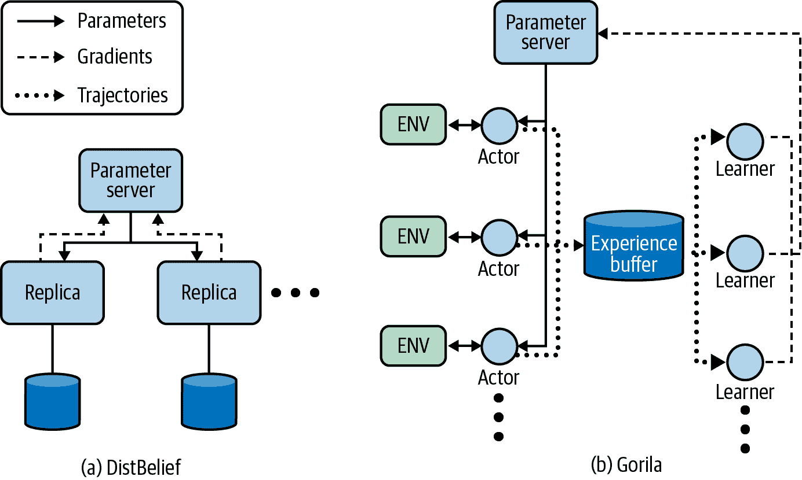
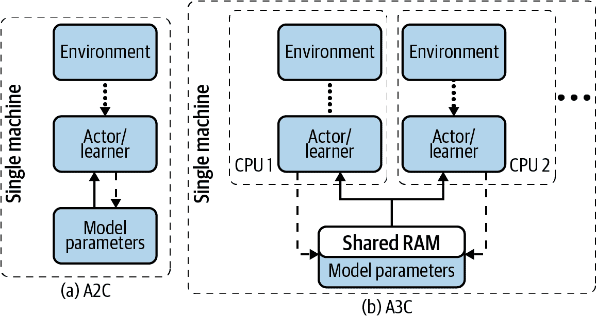
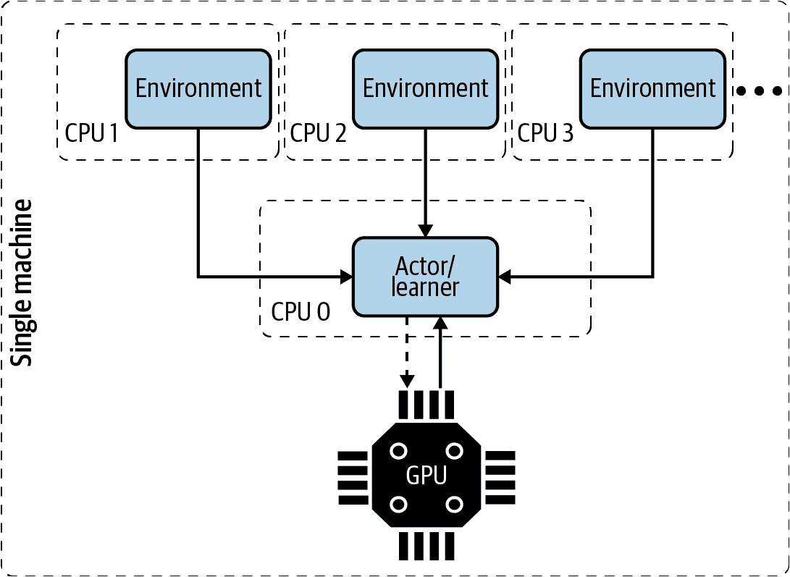
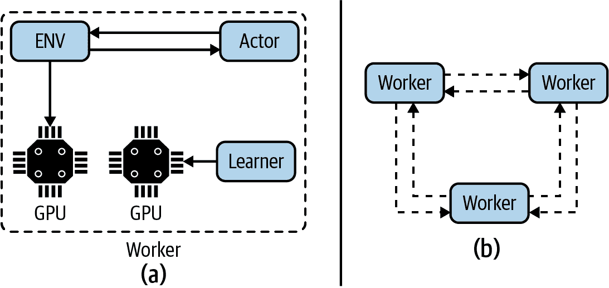
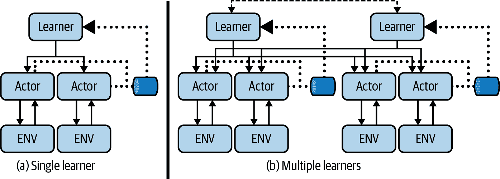
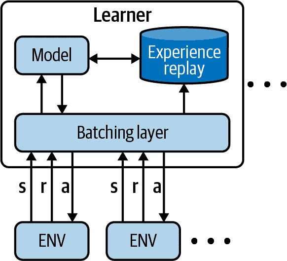
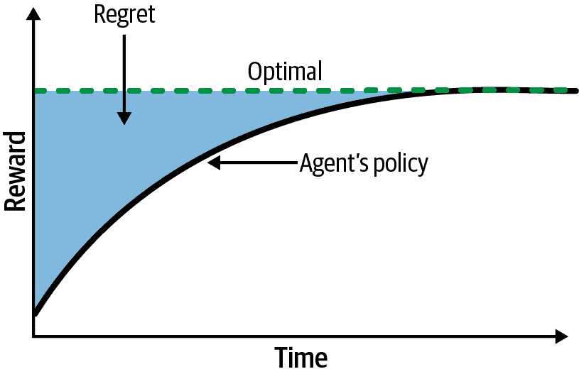
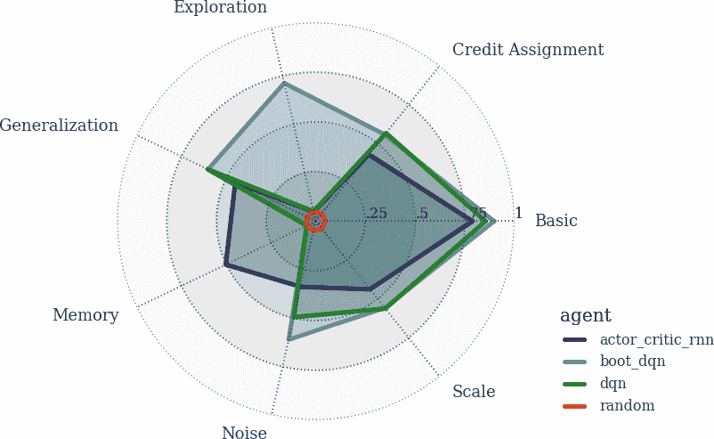
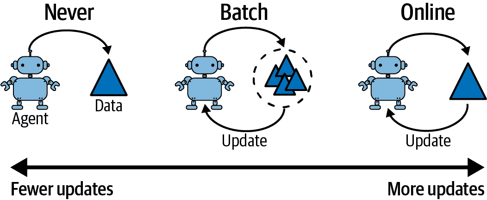

# 第 10 章 运维强化学习

越接近部署，越接近边缘。之所以称之为“前沿”，自有其理由。让你的强化学习（RL）项目走到这一步已经够难了，但生产实现和运维部署又增加了一整套新的挑战。

据我所知，这是第一次有书籍尝试将运维 RL 知识汇聚在一处。你可以在研究人员的杰出成果和业界最聪明大脑的诸多书籍中找到这些信息，但它们分散各处，从未集中在一起。

在本章中，我将引导你完成将概念验证推向生产的过程，详述 RL 项目的实现和部署阶段。最后我希望这些理念能引起共鸣，并让你拥有足够广博的知识至少能入门，且明白需要在哪些方面深入钻研。通过本章，当然还有整本书，我的目标是将 RL 引入工业界，并证明生产级工业 RL 不仅可行，而且利润丰厚。

前半部分我回顾 RL 项目的实现阶段，深入探讨可用框架、抽象层以及如何扩展。如何评估智能体也是重中之重，因为依赖临时拼凑或统计上站不住脚的性能衡量标准是不可接受的。

后半部分关注运维 RL 以及将智能体部署到生产环境。我将讨论稳健架构和构建稳健智能体所需的必要工具。最后，但可能是最重要的，有一节关于如何使 RL 安全、可靠且合乎道德；请务必阅读这一节。

## 实现

就我个人而言，我认为机器学习/人工智能/大数据/{此处插入流行词} 项目的实现阶段是整个生命周期中最迷人、最有趣的部分之一。这是你需要谨慎对待所写代码的阶段，因为这些代码可能存活数十年，甚至更久。GitHub 刚刚在北极建立了一个档案库，将所有活跃项目存储在胶片上，预计至少能保存 1000 年。^(1) 有些人有幸谈论遗产，但对世界上绝大多数工程师来说，这已经是最好的结局了。如果你曾向一个颇受欢迎的 GitHub 仓库提交过代码，恭喜你，3000 年的人类可能会读到你的代码。

听起来很令人谦卑，但高质量代码的首要原因是减轻维护负担。每一行代码都增加了一个潜在的错误源。你可以通过简洁性、测试和更多人的代码审查来降低错误概率。高质量代码的另一个原因是它更易于使用。项目范围可能迅速扩大，因此遵循基本的软件质量准则有助于使这种过渡更容易。

上述主题并非 RL 特有；有许多优秀的软件工程书籍我建议每位工程师都阅读，其中一些我会在“延伸阅读”中推荐。本节专注于 RL 特有的方面。

### 框架

开发高质量 RL 应用最快的方法之一是使用框架。工程师们投入了大量时间，让你更轻松地开发项目。

#### RL 框架

开源 RL 框架受益于使用它们的人数。知名度越高，意味着测试越多，完善项目的动力也越大。检查公开源代码的能力极其宝贵，尤其是当你遇到棘手的 bug 时。

知名度的问题在于，它往往与市场营销预算和感知专业度成正比。例如，任何与 Google 有关系的代码库（寻找那个标志性的“非 Google 官方产品”，通常意味着它是在工作时间开发的，但不被官方支持）往往极其受欢迎，即使实际用户寥寥无几。对 OpenAI 也可以做类似的观察。

考虑开源框架的目标是否与你的目标一致。例如，现有的许多框架严重偏向研究，因为它们是由以研究为职业的个人或组织开发的。它们并非设计用于产品或运维环境。[OpenAI 的 baselines 项目](https://oreil.ly/Zkbbp)就是一个典型例子，它仍然是最流行的 RL 代码库之一，但从营销角度来看知名度低得多的开源项目 [Stable Baselines](https://oreil.ly/4hDLC)，根据我的经验，使用起来容易得多，也更稳健。^(2,3)

那么你应该寻找什么？这取决于你想做什么。如果你想快速在你的问题上测试不同算法，你的需求就会与需要在生产环境中运行框架的人不同。你应该根据你的情况和需求对因素进行优先级排序和加权，但以下列表列出了我关注的一些方面：

#### 抽象层

框架是否有良好的抽象层，使替换 RL 组件变得更容易？比如策略模型、探索技术、经验回放缓冲区类型等。开发适合你问题的新组件有多容易？这往往是最难评估的，因为你真正尝试之前根本不知道。

#### 简洁性

## RL 框架选择与扩展

## 评估标准

代码库是否足够简单以便于浏览？它是否讲得通且直观？还是说它太庞大或抽象层太多，以至于你需要花费数周仅仅为了弄清楚如何安装它？

**可观测性**

: 是否包含日志记录和监控？如果没有，在需要时是否容易添加？

**可扩展性**

: 当你需要扩展时，它能否扩展？

**最小依赖**

: 它对其他软件的依赖程度如何？是否被锁定在特定框架中，例如某个特定的深度学习库？如果是，你是否认可这些底层库？

**文档与示例**

: 项目文档是否完善？不仅仅是 API 文档：是否有示例？它们是否是最新且经过测试的？是否有架构文档？用例文档？算法文档？

**内置算法**

: 是否自带算法实现？这些算法是否有完善的测试和示例覆盖？切换算法有多容易？

**辅助算法**

: 是否提供各种其他场景的代码，如逆向 RL、分层学习、不同的经验回放实现、探索算法等？

**支持**

: 是否有支持？是否有社区？在众包自助网站上是否有良好表现？支持是友善的还是咄咄逼人的？

**商业产品**

: 是否有公司支持（不一定是好事，但至少你能找人沟通）？是否有机会获得商业支持？

存在各种 RL 框架，它们都在上述列表的不同要素上有所侧重。软件演进迅速，关于特定框架的任何评论都会很快过时。请访问[配套网站](https://rl-book.com/rl-frameworks)以查找许多 RL 框架的最新评测。

## 其他框架

仅靠 RL 框架是不够的。你需要各种其他框架来构建解决方案。RL 算法的许多部分已被抽象化，例如策略模型和价值近似中使用的各种深度学习框架。[`PyTorch`](https://pytorch.org) 和 [`TensorFlow`](https://oreil.ly/01Uno) 往往是最常见的，我倾向于偏好 `PyTorch`，因为其 API 更简单直观，但 [`Keras`](https://keras.io) API 可以弥补这一差距。大多数深度学习框架都很成熟且功能集相似，但它们的 API 差异很大。这是一个重要的锁定来源，所以要谨慎选择。

也有越来越多的库抽象了 RL 的其他常见组件。例如，经验回放对许多算法很重要。[`Reverb`](https://oreil.ly/CxJAZ) 是一个专门设计用于处理优先经验回放等实现的队列库。^(4) [`Apache Bookkeeper`](https://oreil.ly/1RM4z)（一种分布式账本）是一个生产级工具的示例，可作为操作架构的一部分被用作日志。

我确实想强调，你需要仔细考虑操作架构，并评估有哪些可用工具来帮助解决该问题（参见“架构”）。你可以在本书的[配套网站](https://rl-book.com)上找到关于工具的更多最新信息。

## 扩展 RL

复杂领域更难解决，因此需要更复杂的模型和复杂的探索。这转化为增加的计算复杂度，以至于在单台机器上训练智能体变得不可行。

在开发过程中，反馈周期时间是最重要的监控指标，因为你等待结果的所有时间都是没有花在改进智能体上的时间。你可以并行运行实验，但这在这一点上影响有限（参见“实验跟踪”）。在 RL 研究的早期阶段，最大的改进来自快速、重复的改进周期。因此我建议你最初通过过度简化问题、使用仿真以及大幅降低模型复杂度来限制工作范围。当你有了可运行的代码，再进行扩展。

但如何扩展？与其他机器学习技术不同，提供更多算力并不一定能提高训练速度或性能。以下是需要专用算法来扩展 RL 的原因列表：

**顺序性**

: 智能体的动作必须有序，这使得跨机器扩展单个智能体变得困难。

**经验合并**

: 如果你使用多个智能体，则需要同步它们，否则你会得到许多无法共享经验的独立副本。*何时*同步会对训练速度和聚合性能产生巨大影响。网络带宽和延迟也可能成为问题。

**独立性**

: 智能体独立性意味着某些智能体可能会卡住或永远不会结束，如果同步需要等待智能体完成，这会导致阻塞。

**环境复杂性**

: 某些环境（如 3D 模拟器）非常复杂，以至于它们本身就需要加速，如果编排不当，会导致 GPU 资源争用。

**成本效率**

: 扩展成本高昂，所以你要确保充分利用硬件。创建能更好地利用 GPU 和 CPU 计算优势的架构和算法是必要的。

最后一项——成本，是机器学习总体上的一个大问题。例如，OpenAI 最近的 [`GPT-3` 语言模型](https://oreil.ly/KtNHP) 从头训练一次，按当前云厂商的标价计算，成本在 1000 万美元左右。而且这还假设是一次成功的运行。想象一下当你发现一个 Bug 时的恐怖！

这显然是一个极端的例子。Espeholt 等人最近的一篇论文测量了在 `DeepMind Lab` 和 `Google Research Football` 环境中运行 10 亿帧的成本。这两个环境都为一系列任务提供 3D 模拟。他们测试了名为 `IMPALA` 和 `SEED` 的两种算法（稍后讨论），发现单次运行（10 亿帧）的总成本分别为：`DeepMind Lab` 环境下 $236 和 $54，`Google Research Football` 环境下 $899 和 $369。在企业 IT 项目的背景下，这些数字不是天文数字，但值得考虑。^(5)

### 分布式训练 (Gorila)

## 早期的 RL 扩展尝试

早期的 RL 扩展尝试集中在创建并行 Actor，以更好地利用多核机器或多机器集群。最早的尝试之一是 `通用强化学习架构` (`Gorila`)，它通过基于 `DistBelief` 的 `深度 Q 网络` (`DQN`) 分布式版本进行了演示，`DistBelief` 是一个用于训练神经网络的分布式系统。^(6,7) `DistBelief` 由两个主要组件组成：一个中心化的参数服务器和模型副本。中心化的参数服务器维护并提供模型的主副本，负责从副本接收新梯度来更新模型。副本分布在各个核心或机器上，负责为给定的一批数据计算梯度，将其发送给参数服务器，并定期获取新模型。要在 RL 环境中使用此架构，`Gorila` 进行了以下更改。中心化的参数服务器维护并提供模型参数（这些参数取决于所选的 RL 算法）。Actor 进程获取当前模型并在环境中生成轨迹。它们的经验被存储在一个中心化的经验回放缓冲区中（如果算法适用）。Learner 进程使用采样的轨迹学习新的梯度并将其交还给参数服务器。该架构的优势在于，它为学习过程中构成瓶颈的部分提供了扩展的灵活性。例如，如果你的环境计算成本高昂，则可以扩展 Actor 进程的数量。或者，如果你拥有大型模型且训练是瓶颈，则可以扩展 Learner 的数量。图 10-1 以组件图的形式描绘了这两种架构。

### 单机训练 (`A3C`, `PAAC`)

在 `Atari` 环境中使用 `Gorila` 取得了比单独使用 `DQN` 快 20 多倍的性能（墙钟时间），但研究人员发现，尽管分布式架构灵活，却需要快速网络；传输轨迹和同步参数开始成为瓶颈。为了限制通信成本并简化架构，研究人员证明了在一种名为 `异步优势 Actor-Critic` (`A3C`) 的算法中，使用单台多核机器进行并行化是一种可行的替代方案。^(8) 这是 `优势 Actor-Critic` 算法 (`A2C`) 的并行版本。由于更新驻留在同一台机器内，Learner 可以共享内存，这得益于快速的 `RAM` 读/写，极大地降低了通信开销。有趣的是，他们在跨线程写入共享内存时没有使用锁，这通常是一件极其危险的事情，他们使用了一种称为 `Hogwild` 的技术。^(9) 他们发现更新是稀疏且随机的，因此覆盖和争用不是问题。图 10-2 展示了 `A2C` 和 `A3C` 算法的区别，两者均在单机上运行。

令人惊讶的是，使用一台配备 16 个 `CPU` 核心且无 `GPU` 的单机，`A3C` 在八分之一的时间内（1 天）获得了与 `Gorila` 相当的结果，并在约一半的时间内（4 天）获得了更好的结果。这清楚地表明，同步和通信开销是一个大问题。

不使用 `GPU` 的简洁性限制了 `A3C` 的发展。`GPU` 很可能会加速任何“深度”模型的训练，当然成本也会更高。`并行优势 Actor-Critic` (`PAAC`) 实现（这个名字不太好，因为你可以将此架构用于任何 RL 算法）恢复了使用 `GPU` 的能力。它使用单个 Learner 线程，能够使用单个连接的 `GPU`，以及在任意数量环境中的多个 Actor。从某种意义上说，这是一个有意降低扩展性的版本，兼具 `Gorila` 和 `A3C` 的特点，但它在八分之一的时间内（又是八分之一！）产生了与 `A3C` 相当的结果，根据神经网络架构的不同，大约在 12 小时内为许多 `Atari` 游戏创建了高效的策略。该实现表明，通过独立环境增加探索是减少墙钟训练时间的非常好的方法；训练时间与你能探索的状态-动作空间量成正比。与 `A3C` 类似，该实现表明数据传输和同步是瓶颈，如果你的问题允许，你将受益于将组件尽可能靠近，最好在同一台物理机器内。这也很简单，因为没有编排或网络方面的顾虑。但显然，这种架构可能不适合所有问题。图 10-3 展示了此架构。^(10)

### 分布式经验回放 (`Ape-X`)

在分布式环境中使用其他类型的经验回放缓冲区，只需增强 `Gorila`（或其他）的架构即可。`Ape-X` 就是一个这样的例子，其中通过带有环境的分布式 Actor 进行更多探索获得了更好的结果，因为收集到了更多样化的经验。在 `Atari` 环境上的性能指标比 `A3C` 高约三倍，比 `Gorila` 高约四倍。但这些分数是在 16 倍数量的 `CPU` 上训练得到的（`Ape-X` 为 256 个，`A3C` 为 16 个），这导致与环境的交互量增加了两个数量级。在使用相同数量的环境/`CPU` 时性能是否有差异尚不清楚。^(11)

### 同步分布式 (`DD-PPO`)

尝试使用配备多个 `CPU` 的单机来训练 RL 算法（如 `PAAC` 或 `A3C`），因其架构的简洁性而极具吸引力。但缺乏 `GPU` 成为一个限制因素，当你的问题使用需要 `GPU` 以获得性能的 3D 模拟器时。同样，带有单个 `GPU` 的单个参数服务器（如 `Gorila` 或 `PAAC`/`A3C` 中）在你尝试训练大规模深度学习架构（例如 `ResNet50`）时，也会成为限制因素。这些因素呼吁一种能够利用多个 `GPU` 的分布式架构。

`去中心化分布式近端策略优化` (`DD-PPO`) 的目标是去中心化学习，这很像去中心化的协作多智能体 RL。该架构在收集经验和优化模型之间交替进行，然后同步地与其他 Worker 通信以分发模型更新（梯度）。Worker 使用来自 `PyTorch` 的分布式并行梯度更新，并通过简单聚合所有其他 Worker 的梯度来合并它们。结果表明，`DD-PPO` 能够通过增加 Worker 的数量近似线性地扩展 `GPU` 性能，测试规模高达 256 个 Worker/`GPU`。该实现的主要问题是，直到所有智能体都收集完各自的批次之前，更新无法发生。为了缓解这种阻塞，Wijmans 等人实现了一个抢占式截止机制，强制一部分落后的 Worker 提前退出。图 10-4 总结了这一架构，Wijmans 等人建议可以实现任何 RL 算法。^(12) 其他研究人员也提出了类似的架构。^(13)

### 提高利用率 (`IMPALA`, `SEED`)

## 重要性加权 Actor-Learner 架构 (IMPALA)

**重要性加权 Actor-Learner 架构** (IMPALA) 类似于 Gorila 和 DD-PPO 的结合体。关键进展在于它利用队列消除了同步更新的需要。Actor 反复生成经验并将数据推入队列。一台独立的机器（或机器集群）从队列读取数据并重新训练模型。这意味着更新是离策略的；Learner 使用的是过去的数据。因此 IMPALA 使用了修改版的 Retrace 算法（参见“Retrace(λ)”）来补偿策略更新的滞后。这也使得可以使用经验回放缓冲区，从而提高性能。

Espeholt 等人证明，基本的离策略 Actor-Critic（参见“离策略 Actor-Critic”）效果几乎一样好，这暗示像 TD3 这样更复杂的版本可能效果更好。确实，OpenAI 在其 Dota 2 视频游戏比赛中使用了一个受 IMPALA 启发的框架结合 PPO。^(14)

单 Learner 多 Actor 通常运行在单台机器上。你可以复制该架构以增加 Learner 的数量，并使用类似 DD-PPO 的分布式训练。如图 10-5 所示，与 A3C 相比，该架构将训练速度提高了一个数量级，但与集群中的硬件数量成正比（他们在实验中使用了 8 块 GPU）。Espeholt 等人还声称该架构可以扩展到数千台机器。^(15)

尽管 IMPALA 效率高且能达到最先进水平，但架构中仍有部分可优化。一个问题是神经网络参数的通信。在大型网络中，这些参数由多达数十亿个浮点数表示，传输数据量巨大。另一方面，观测值通常小得多，因此通信观测值和动作可能更高效。此外，环境和 Actor 有不同的需求，将它们放在同一个 CPU 或 GPU 上可能效率低下。例如，Actor 可能需要 GPU 进行快速预测，而环境只需要 CPU（反之亦然）。这意味着 GPU 在很大一段时间内不会被利用。

## 具有加速中心推理的可扩展高效深度强化学习 (SEED)

**具有加速中心推理的可扩展高效深度强化学习** (SEED) 旨在实现一种架构：环境是分布式的，但向一个中心的分布式模型请求动作。这使模型参数靠近模型，并允许你选择直接映射到环境模拟或模型训练和预测的硬件。这提高了利用率，并略微缩短了训练时间（在相似条件下约减半）。图 10-6 描绘了该架构的简化版本。^(16)

SEED 论文的一个有趣之处在于，它凸显了架构与性能的紧密耦合。为了产生结果，研究人员不得不将每个 CPU 的环境数量*和* CPU 数量视为超参数。通常更多副本能在更短时间内产生更高分数，但精确配置可能取决于环境，因此难以确定。另一点是，SEED 在软件层面也做了大量优化，使用了二进制通信协议 (gRPC) 和编译型 C++。

IMPALA 和 SEED 都能像 A3C 和 PAAC 一样在单机上运行，并且由于利用率更高，通常性能更强。

### 扩展性结论

前述算法在短时间内达到了最先进水平。但这些对比是在玩具环境中进行的——主要是 Atari 环境，有时也包括 `Google Research Football` 等更连续的环境。你可以将这些环境的结果外推到现实场景，但现实是你必须自己测试才能确定。

研究人员对这些环境经验丰富，所以不必花太多时间调优，且已知要避开的陷阱。但他们也追求标题性结果，如最先进的性能或速度。高度关注利用率和超大规模，这有时是有代价的。例如，像 DD-PPO 那样的完全分布式部署可能实际上更适合运维使用，因为它易于实现自愈（只需组建一定数量的分布式组件集群），从而提高鲁棒性和高可用性。这可能不是你应用关心的，但我的观点是最快不总是最好。还有其他重要方面。

同样，你也能看到边际效益递减。早期改进使训练速度降低了一个数量级。IMPALA 和 SEED 之间的差异约为一半。研究人员不得不深入挖掘以榨取更多性能，如静态编译代码和使用二进制协议。同样，这可能不适合你的问题。例如，如果你必须用 C++ 而不是 Python 编写代码，你的时间成本或机会损失可能大于代码级优化带来的收益。

最后，这些架构中的一些往往模糊了框架中出现的抽象。通常有 Agent、环境、经验回放缓冲区等抽象，但这些架构强制规定了这些抽象的位置，这从设计角度看可能不理想。例如，在 SEED 架构中将模型、训练、经验回放缓冲区和一些自定义批处理逻辑捆绑到 Learner 中可能会变得混乱。如果它们是物理上独立的组件，如分布式队列和账本，那将会很棒。显然没有什么能阻止你实现类似的东西，但这通常不是这种性能驱动研究的优先事项。

## 评估

为了给产品、服务或策略增加价值，你和你的利益相关者需要仔细考虑你试图实现的目标。这听起来抽象且高层，但很容易在一个问题上努力工作，最后却发现你优化的东西并不符合目标。原因是工程师可能会忘记，甚至忽略将工作与目标联系起来。

心理学家和神经学家深入研究了多任务处理。他们发现人类用于任务的精神能量有限，在多个任务间切换会严重影响表现。但在解决工程问题时，在抽象层级间切换同样困难。你的大脑必须卸载当前的思维栈，将其保存到短期记忆，加载一个用于不同抽象层级的新心智模型，并启动思维过程。这种切换，加上维持短期记忆的努力，消耗大量脑力。这是为什么在处理低层日常挑战时更容易忽略高层目标的原因之一。

另一个原因是，即使在 DevOps 兴起之后，工程成功仍被视为取得前向进展：新产品、新功能、更好性能等。后退被视为缺乏进展；我想明确指出这并非如此。“回到绘图板”不是失败的标志，而是表明你已吸取重要教训，并正利用它们设计更好的解决方案。

尽管这很难，但试着抽出时间在开发流程中移动，并在抽象层级间上下穿梭，以确保它们都朝着你试图实现的目标对齐。

### 提示

这是我用来强迫自己切换抽象层级或上下文的一个技巧：问“为什么？”以向上移动一个抽象层，问“怎么做？”以向下移动。

回到手头的任务，在评估你的工作时，你最初应该问*为什么*要衡量性能。这是为了向利益相关者解释结果吗？还是为了使其更高效？这个问题的答案将有助于指导你*如何*实现。

## 策略性能度量

RL 智能体的有效性可以用两个抽象指标来描述：*策略性能* 和 *学习性能*。策略性能衡量策略解决问题的效果如何。理想情况下，你应该使用映射到问题领域的单位。学习性能衡量你训练智能体以产生最优策略的速度有多快。

在具有*有限时域*的问题中（意味着存在终止状态），策略性能最自然地用奖励之和来表示。这是最优策略的经典描述。在*无限时域*问题中，你可以引入折扣因子以防止奖励趋向无穷大。折扣因子也常用于有限问题，但这可能会导致策略出现细微差别，因此在计算最终性能度量时，你应该考虑将其移除。例如，你的利益相关者可能对折扣利润不感兴趣；他们想讨论的是利润。

另一种选择是最大化和测量平均奖励。在*平均奖励*模型中，你必须小心确保均值是你奖励分布的合适汇总统计量。例如，如果你的奖励是稀疏的，那么平均奖励就是一个糟糕的汇总统计量。相反，你可以选择其他更稳定的汇总统计量，如中位数或某个百分位数。如果你的奖励符合特定分布，那么你可能想使用该分布的参数。

测量智能体学习最优策略的速度也是一个重要指标。它决定了你的反馈周期时间，因此如果你使用能更快学习的算法，就能更快地迭代和改进。在智能体在线学习的问题中，例如如果你正在为特定个体微调策略，快速学习对于减轻因次优策略而错失良机的成本非常重要。

训练性能最简单的度量是智能体达到最优所需的时间。然而，最优通常是一个渐近结果，因此*收敛至近似最优的速度*是一个更好的描述。你可以随意定义什么构成你问题中的“近似”，但你应该根据奖励分数中的噪声量来设定它；你可能需要执行平均操作以减少噪声。

你可以用几种不同的方式定义时间，具体取决于对你的问题而言什么最重要。对于仿真，使用环境中的步数是一个很好的时间度量，因为它独立于混杂因素，且环境交互往往代价高昂。如果你关心反馈周期时间并能限制环境交互次数，则可以使用墙钟时间。模型训练步数是分析模型训练性能的一个有趣的时间维度。如果你想提高算法效率，计算时间可能很重要。

你对时间维度的选择取决于你想要实现的目标。例如，你可能最初使用环境步数来提高样本效率。然后，当你准备加速训练时，可能会开始关注墙钟时间。最后，你可能通过关注进程时间来榨取任何剩余的性能。通常，你会使用所有这些维度来获得性能的全貌。

*遗憾值* 在在线机器学习中用于衡量智能体在事后看来表现最优时的奖励与随时间获得的实际奖励之间的总差异。它是一个正值，表示最优回合奖励与实际奖励之间的面积，如 图 10-7 所示。想象你经营一座太阳能发电厂。你在一个回合（可能是一天）内产生的总功率有一个固定的最大值，取决于阳光量和太阳能电池板的转换效率。但你正在训练一个策略来改变电池板的俯仰角以最大化功率输出。在这种情况下，遗憾值将是理论最大功率输出与你的策略动作结果在一段时间内的总和之差。

研究人员在策略算法的构建过程中曾将遗憾值用作数学工具，此时策略通过优化来限制遗憾值。这通常采用正则化项的形式，或对奖励进行某种调整以促进统计上高效的探索（例如，参见 “延迟 Q 学习”）。遗憾值在概念上也很重要，因为人类会复用经验来推断因果关系，并质疑长期决策的效用。^(17)

你也可以将遗憾值用作性能度量，但即使在事后，你如何决定什么是最优策略，取决于训练环境。例如，你可能无法获得理论上的最优策略，或者它可能是非平稳的。如果策略在非平稳环境中运行，则方法包括尝试在一个小区间内计算遗憾值。在较简单的问题中，你可能能够在事后确定最佳动作是什么，并将其作为最优奖励。在更复杂的问题中，你应该能够使用另一个算法作为基线，并将所有比较都针对该基线进行。如果可能，你可以使用自我博弈来记录对手的位置，然后在游戏结束后查看是否有更好的动作可供选择。目前还没有一种简单的统一方法来计算任何问题的遗憾值。

## 统计策略比较

每当你进行比较时，我总是建议你先进行可视化。统计学充满了警告和假设，很容易让你以为自己做对了，结果却被一个更擅长数学的人指出，你所做的只在非常特定的情况下才讲得通。可视化性能要容易得多，因为它是直观的。你可以利用一生中学到的视觉近似和模型。例如，用肉眼拟合线性回归模型，即使有噪声和异常值，对人类来说也比数学公式暗示的要容易得多。同样，比较两个算法的性能，就像将两个指标绘制在一起并判断哪一个始终优于另一个一样简单。

然而，有时你确实需要统计证据来证明一个算法优于另一个。例如，如果你想自动化寻找更好模型的过程，就不想查看成千上万张图表。或者如果你想要一个是/否的答案（考虑到警告！）。以下是在比较两个分布时可能用到的统计检验列表，并简要说明了它们的假设：

### 学生 t 检验

假设正态分布和方差相等。

### 韦尔奇 t 检验

与学生 t 检验相同，但放宽了方差相等的假设。

### 威尔科克森-曼-惠特尼秩和检验

比较中位数，是非参数检验，因此不对分布形状做假设。但假设它们是连续的且具有相同的形状和分布范围。

### 秩 t 检验

比较中位数，先进行排序再送入 t 检验。结果本质上与威尔科克森-曼-惠特尼秩和检验相同。

### 自助法置信区间检验

从分布中随机采样，测量百分位数的差异，并重复多次。需要非常大的样本量，大约大于 10³。无其他假设。

**排列检验**：从分布中随机采样，随机将它们分配给假设，测量百分位数的差异，并重复多次。类似于自助法置信区间检验，但它是检验它们是否相同，达到某个置信水平。同样需要非常大的样本量。

你可以看到有很多不同的假设，这使得很容易意外地使用错误的检验。而当你这样做时，它们会静默失败。结果不会显示你做错了什么。所以在执行这些检验时，拥有强烈的预期（对数据分布特性的预判）非常重要。如果结果讲不通，你很可能犯了错。

这些统计假设有什么问题？

*   强化学习（RL）通常产生不符合正态分布的结果。例如，智能体可能 100 次中有 1 次卡在迷宫里，从而产生一个异常值。
*   奖励可能被截断。例如，可能存在一个硬性的最大奖励，导致结果分布出现不连续性。
*   不同算法运行的标准差不相等，甚至可能不平稳。例如，不同算法可能使用不同的探索技术，导致结果变化不同。而在单个算法的评估过程中，可能会发生一些偶发事件，比如一只鸟飞进了机械臂。

Colas 等人写了一篇专门针对比较 RL 算法的统计检验的优秀论文。他们比较了 `TD3` 和 `SAC` 在 `Half-Cheetah-v2` 环境上的表现，发现需要至少重新运行 15 次训练，才能获得统计学上显著的证据证明 `SAC` 在该环境上优于 `TD3`。他们建议针对该环境，奖励倾向于近似正态分布，因此对于小样本量，Welch's t 检验往往是最稳健的。非参数检验假设最少，但需要大样本量才能接近假设分布的检验效力。^(18) 他们还有一个有用的[代码库](https://oreil.ly/b_ZeC)，你可以在实验中利用它。

你可能会问，“重新运行是什么意思？”这是个好问题。如果你读过足够多的 RL 算法论文，最终会看到一个通用的评估主题。研究人员重复实验 5 次或 10 次，然后绘制学习曲线，其中一次实验代表在单个环境上对算法的一次完整重新训练。每次重复时，他们会改变各种随机数生成器的 `random seed`（随机种子）。

这听起来很简单，但我发现在实践中相当棘手。理论上，如果在同一个算法上使用相同的种子，应该产生相同的结果。但通常并非如此。我经常发现代码库中还有另一个随机生成器藏在深处，我没有设置它。如果你使用典型的 RL 库训练算法，你必须为 `Python`、`Numpy`、`Gym`、你的深度学习框架（可能在多个地方）、RL 框架，以及你可能使用的任何其他框架（如经验回放缓冲区）设置随机数生成器的种子。所以首先检查你能否在两次运行中获得完全相同的结果。然后你可以用不同的 `random seed` 值重复多次训练。这会产生一系列性能曲线，（希望）它们服从正态分布。

问题在于，研究人员倾向于使用少量的固定重复次数，因为训练成本高昂。如果两个分布之间有很大的差异，那么小样本——仅足以确信均值和标准差——就足够了。但当性能差异很小时，你需要大得多的样本量才能确信性能确实不同。Colas 等人的另一篇论文建议，你应该先进行一项试点研究来估算算法的标准差，然后利用它来估算证明该算法优于另一种算法所需的最终试验次数，达到指定的显著性水平。^(19)

最后，统计性能指标是量化策略鲁棒性的一种方法。获得奖励的标准差是判断你的策略能否经受住真实生活中频繁发生的观测自然漂移的一个好指标。但我建议更进一步，主动扰动状态、模型和动作，看看策略到底有多鲁棒。对抗技术在这里很有用，因为如果你无法击垮你的模型，那么真实生活也不太可能击垮它——生活最终会击垮一切。^(20)

### 算法性能指标

我建议在大多数工业问题中，你只有一个或少量的目标问题，因此只有少量的环境。然而，如果你更多地涉及纯研究，或者试图调整你的实现以泛化到不同问题，那么你应该考虑更抽象的性能指标，来解释它在 RL 特有挑战上的表现如何。

到目前为止，最有用的解决方案之一是 Osband 等人提出的 `behavior suite`（行为套件）。他们描述了七个基本的 RL 挑战：信用分配、基础（能力测试，如多臂老虎机问题）、可扩展性、噪声、记忆、泛化和探索。智能体在一组精心挑选的、对应挑战的环境中接受测试。智能体随后会获得每个挑战的最终聚合分数，可以用雷达图表示，如图 10-8 所示。^(21)

### 问题特定的性能指标

还有各种针对特定领域任务或具有特别棘手问题的任务的基准测试。例如，有针对[离线 RL](https://oreil.ly/i6csS)、[机器人学](https://oreil.ly/N27IC)和[安全性](https://oreil.ly/008IE)的基准。^(22,23,24) 还有更多优秀的基准测试。

当你知道你的领域也存在相同的通用问题，并且确信基准测试中的改进能转化为现实世界中的更好性能时，这些基准会很有用。

### 可解释性

数据科学过程中的一个新兴阶段是 `explainable artificial intelligence`（可解释人工智能，XAI），你会使用技术尝试描述模型是如何以及为什么做出决策的。一些算法，如基于树的模型，天生具备提供解释的能力，而另一些，如标准神经网络，则必须依赖 `black-box`（黑盒）方法，即你用已知输入探测并观察输出发生了什么。

可解释性有几个重要原因。一是信任；你不应该部署任何你不信任的东西。在软件工程中，这种信任是通过测试建立的，但模型和 RL 的复杂性意味着“覆盖率”永远很低。另一个原因可能是出于监管或商业原因需要解释决策，如欧盟《通用数据保护条例》或 Facebook 的帖子推荐解释功能。能够解释一个动作或决策也有助于调试和开发。

## 可解释性

在强化学习中，可解释性比在机器学习中更难，因为智能体选择的连续动作其效应会在长时间内相互作用并累积。某些强化学习算法具有内在的解释能力。例如，分层强化学习将策略分解为子策略，这些子策略组合起来描述高层行为。但大多数研究集中在黑箱、训练后的可解释性上，因为它的适用性更广。

黑箱技术倾向于在全局或局部层面上运作。全局方法试图推导并描述所有状态下的行为，而局部方法只能解释特定的决策。

全局方法倾向于训练其他天生具有可解释性的简单模型，如树模型或线性模型。例如，`linear model U-trees` 模型使用树结构来表示价值函数，在每棵树的叶节点处使用线性逼近器以改善泛化能力。从该模型中，你可以提取整个状态空间的特征重要性和指示性动作。^(25)

局部方法包含两个主要思想。“局部”一词通常意指在状态空间的一个小区域内评估的全局方法。例如，Yoon 等人使用强化学习来指导训练局部近似的过程。^(26) 其他思想通过考虑 `counterfactual`（反事实），即相反的动作或本可以发生的情况，扩展了全局方法的预测性质。Madumal 等人通过训练一个模型来表示因果图，该因果图近似环境转移动力学，从而实现了这一点。这听起来很有前景，但仅适用于离散状态。^(27)

与解释决策类似，指示状态的哪些部分影响决策也很有用。对于具有视觉观测的问题，或具有位置或邻接概念的状态，你可以使用 `saliency maps`（显著性图）来突出显示对动作选择重要的区域。^(28)

### 评估结论

评估是生活固有的一部分，从空手道段位到美食评论家。在工业应用中，评估你的工作有助于你决定何时完成。在软件工程中，这通常是在验收测试通过时。在机器学习中，可接受的性能通常由评估指标定义。但在强化学习中，由于决策的战略性质，很难界定何时算“足够好”。你总能赚取更多利润，总能挽救更多生命。

一般来说，智能体的性能由策略获得的奖励及其达到该奖励的速度来定义。但如果你想在生产环境中训练并使用一个稳定、鲁棒的策略，还应考虑一系列其他指标。这也包括解释策略决策的能力，这在高影响力的应用中可能至关重要。

## 部署

这里的 `deployment` 是指你将应用投入生产或使其投入运行的阶段。项目会达到一个大家都认为既可行又有价值的阶段，但要保持可行和有价值，它们需要是可靠的。本节讲述如何将你初具规模的强化学习概念验证推向大舞台，以便服务真实用户。

棘手的部分在于，关于运行强化学习 (RL) 应用的先前工作不多。因此，其中很多内容必须从运行软件和机器学习应用、我运营 Winder Research 的经验，以及许多大佬记录的自身经验中推断出来。

## 目标

在深入部署细节之前，我认为考虑该阶段的目标很重要。这将帮助你关注自己的情况，并决定什么对你很重要，因为没有单一的想法或架构能适应所有情况。

### 开发不同阶段的目标

首先，考虑部署优先级如何根据你所处的开发阶段而变化。有三个阶段需要你能够部署智能体：开发期、强化期和生产期。

在开发期间，拥有一个允许你快速测试新想法的架构很重要；灵活性和速度胜过所有其他需求。这是因为在项目早期，证明潜在的可行性和价值很重要。无限扩展或完全可复现并不重要；那是后话。最大的收益来自快速且多样化的实验，因此此时最大的成本是反馈循环的长度。

一旦项目被证明可行且有价值，就会进入强化阶段。这涉及改进维护策略相关流程的鲁棒性。例如，离线策略或辅助模型必须经过训练，这可能需要大量计算资源，而代码库或模型的溯源（来源）对于确保你知道生产环境中将运行什么至关重要。

最后，策略和模型被部署到生产环境，供真实的人员或流程使用。因为强化学习优化的是动作序列，所以你不太可能通过定期批量处理数据来重新训练策略（这是生产环境机器学习系统的主流技术），因此必须小心保留策略的状态。这一阶段鼓励开发和采用复杂的监控和反馈机制，因为策略很容易发散（或者至少不收敛）。

当将强化学习解决方案部署到产品或服务中时，执行任务的价值会发生变化。早期，提取价值最快的方式是通过快速实验和研究；后期，可靠性、性能和鲁棒性变得更重要。这导致了一系列在不同时间点重要的最佳实践。

### 最佳实践

机器学习运维 (MLOps) 是对运行生产级模型所需的最佳实践和适当工具的新兴描述。这种需求的出现是因为机器学习模型与传统软件项目相比有不同的运营要求，但从根本上说，核心需求完全相同。我喜欢将这些需求总结为三个主题：可靠性、可扩展性和灵活性。

`Reliability`（可靠性）是现代软件工程的核心。已有数千本书写过这个话题，这些思想直接适用于机器学习和强化学习，如测试、持续集成和交付、架构和设计。转向机器学习，构建数据管道、溯源和可重复性等思想都旨在巩固并进一步保证模型将来继续有效工作。强化学习带来了自己的挑战，随着时间的推移，我预计会出现新的最佳实践。

例如，我最近联系了一位老同事，询问我们以前合作的一些项目。我曾在 2012 年左右开发了一些算法来执行交通和拥堵监控，这些算法被部署在英国一些主要道路的专用硬件上。我得知硬件已经故障了两次，但我的算法（用 Java 编写！）在近 10 年后依然运行良好。这一事实并非归功于我的算法，而是归功于我同事的软件工程专业知识和对可靠软件的承诺。

## RL 部署中的可扩展性与灵活性

## 可扩展性

*可扩展性* 对机器学习和 RL 尤为重要，可以说比典型软件更重要，因为它们需要强大的算力来完成工作。如果你考虑所有曾经编写的软件，绝大多数应用程序可能都能在标准笔记本电脑提供的资源上运行。只有极少数情况下，你需要构建像全球消息传递或银行系统那样具有可扩展性的系统。但在机器学习和 RL 中，几乎每一个产品都需要远超笔记本电脑所能提供的资源。我断言，RL 产品的平均计算需求比软件产品高出几个数量级。我故意模糊表述，因为我没有硬性事实支持这一点。但我认为我的假设是合理的，这也是为什么可扩展性是在部署 RL 时的一个重要因素。

## 灵活性

我认为 *灵活性* 是最被低估的最佳实践之一。在工业界，可靠软件是 21 世纪第一个十年的主题，软件架构、测试驱动开发和持续集成是全球会议上的热门话题。在第二个十年，可扩展性成为宠儿，并导致了云采用及随后对编排的需求等重要变化。我认为第三个十年（我忽略人工智能、RL 和机器学习等具体主题）将聚焦于灵活性，纯粹因为我看到行业正趋向于超级责任制，即最有价值的工程师由其在企业环境中履行从业务开发到运维等所有预期角色的能力来定义。DevOps 领域只会扩大；永远不会缩减回两个独立的角色。

对于当今变化的速度，也可以提出类似的论点。工程师们持续创造新技术，很难预测哪些能经受住时间的考验。但我发现，当工具试图强制执行固定的、不灵活的或专有的工作方式时，它们很快就会变得笨重难用，并迅速过时。不，灵活性是为系统、流程和解决方案提供面向未来保障的唯一途径。

## 需求层级

马斯洛需求层级理论是一个早期的心理学模型，它以层级模型描述人类必需品；为了拥有安全，你需要获得空气和水；为了拥有友谊，你需要安全，依此类推。RL 也有类似的需求层级。

要拥有一个可行的 RL 问题，你需要一个可以在其中观察、行动并获得奖励的环境。你需要根据观察决定行动的计算能力。这些是必需的，如果你不具备它们，就无法进行 RL。

再往上是那些有价值但非严格必需的东西。例如，以统一、可靠的方式转换数据的管道可以防止数据错误。能够准确指定生产环境中运行的内容——溯源——在运维层面很有用。

这一层之上代表了一种最优状态，在许多情况下这更多是概念性的而非实用的，因为解决其他问题或开发新功能在短期内可能更有价值。在这里，你可能会考虑完全自动化你正在做的事情的端到端流程，或引入复杂的反馈机制，使你的产品能够自动改进自身。

表 10-1 展示了一些你可能面临的实现和部署挑战示例。我想强调的是，这些挑战有一系列解决方案，自动化程度各不相同。但每个自动化层级的价值取决于你或你的利益相关者对其他迫切需求的评估。仅仅因为存在更复杂的解决方案，并不意味着你现有的方案不够好。首先把基础打好。

**表 10-1.** 不同实现挑战的需求层级示例：底行代表基本要求，中行代表一定程度的自动化，顶行代表最先进水平

| | 基础设施 | 状态表示 | 环境 | 学习 | 算法改进 |
|---|---|---|---|---|---|
| **最优** | 自愈 | 持续学习 | 组合 | 元学习 | 自动化 |
| **有价值** | 自动化部署 | 模型驱动的降维 | 真实生活 | 离线 | 暴力选择 |
| **必需** | 手动部署 | 固定映射 | 仿真 | 在线 | 手动 |

## 架构

关于通用 RL 架构的研究还不多，我能想到几个原因来解释这一点。首先，RL 目前还未被普遍接受为解决工业问题的有用工具。希望本书能开始改变这一现状。这意味着缺乏设计此类系统的综合经验，因此也未能向更广泛的受众传播。其次，研究人员，尤其是学术研究人员，往往更专注于开创性研究，因此你很少能找到相关论文。第三，我认为不存在放之四海而皆准的方法。例如，比较单智能体和多智能体 RL 的区别。最后，部署架构主要是软件工程关注的问题。当然存在 RL 特有的需求，但我认为典型的软件架构最佳实践非常契合。

话虽如此，上下文老虎机领域有一些可用文献。它不具备普遍适用性，但因为工业界采用该技术更快，所以已经吸取了许多教训。导致架构影响的两个最大问题是：智能体只能观察部分反馈，以及奖励通常是延迟的，甚至在最坏情况下是稀疏的[²⁹]：

- 机器学习被认为更简单，因为反馈或真实标签是完整的。标签代表单一正确答案（如果多个正确则为多个答案）。RL 只能观察单个动作的结果；无法从未探索的动作（可能是无限的）中学到任何东西。
- 智能体观察到的奖励通常是延迟的，延迟范围从竞价竞赛中的毫秒级到涉及人类时的数天不等。即便如此，奖励也可能是稀疏的，因为动作序列在一段时间内不会带来真实奖励，比如购买行为。

有些问题与机器学习的先前工作有关，但被 RL 放大了。例如，在线学习或持续学习在某些机器学习学科中很重要，但 RL 将其推向了一个全新的水平，因为决策影响深远且策略是非平稳的。即使你采用批量 RL，拥有低延迟的学习循环也很重要。可复现性也成为一个大问题，因为策略和环境都在不断变化。

所有这些方面导致了以下可能对你的问题有用的架构抽象范围：

**服务接口**

: 就像个性化购物助手一样，一种抽象应包含提供动作建议和嵌入探索的能力。这应实现马尔可夫决策过程接口并与更广泛的系统或环境通信。这是系统的入口和出口点，是将 RL 与更广泛部署解耦的绝佳位置。

**日志**

:

## RL 系统架构

就像消息总线队列一样，能够保留状态至关重要，原因有几点。首先是为了灾难恢复；你可能需要重放交互以将策略更新至最后已知状态。其次是它可作为更广泛的批量学习或迁移学习工作的一部分来改进模型。第三，它充当队列来缓冲潜在缓慢的在线更新。

### 参数服务器

一个用于存储模型参数的地方，类似于数据库，会出现在多智能体 RL 中，但在需要复制单智能体策略以处理更大负载的情况下也很有用。

### 策略服务器

由于 RL 算法往往针对特定问题进行定制，因此拥有一个封装实现细节的抽象层是合理的。在更简单、更静态的问题中，你或许能将模型参数直接烘焙进封装层，否则你可以利用参数服务器。你可以复制策略服务器以增加容量。

### 经验回放缓冲区

许多算法利用经验回放缓冲区来提高样本效率。这可能是日志的增强形式，也可能是一个专用数据库。

### 演员与评论家

你可能需要考虑将策略服务器拆分为更小的组件。

### 学习

理想情况下，你应该使用相同的策略代码来学习或训练，就像用于服务推理一样。这能保证训练和服务之间不存在差异。

### 数据增强

你的算法可能有部分依赖增强数据；例如状态表示算法。这些应作为传统的服务化 ML 模型存在，并拥有其关联的持续集成和学习流水线。

以上所有抽象或一个都没有都可能出现在你的架构设计中。遗憾的是，它们非常依赖领域和应用，因此强制实施这些抽象并不合理。此外，更多的抽象通常会增加维护负担；毕竟，从单一代码库工作更容易。相反，应提供工具和技术，以便根据每个应用的情况启用这些架构能力。

## 辅助工具

我犹豫是否详细讨论工具，因为行业变化太快；我在这里描述的组件等到本书付印时可能就已过时。相反，我将抽象地谈论工具组的功能，并提供一些（历史上的）示例。请回顾 “RL 框架” 以了解针对 RL 工具的具体讨论。

### 自建与采购

我认为传统的“自建与采购”建议在 RL 领域同样适用。如果感兴趣的工具代表核心竞争力或价值主张，则应自建，以便保留知识产权、拥有更大的技术深度，并完全控制定制化。另一种思考方式是问自己：你的客户付钱让你做什么？

但如果该工具不代表你的核心竞争力，或者不提供竞争差异化，则应考虑采购或使用现成组件。也存在一个中间地带，你可以利用开源项目完成 80% 的工作，然后对其进行调整或拼装组件来完成剩余部分。

### 监控

当你的产品投入生产时，你应该投资于监控。这单方面地为你提供了影响算法信任度问题的预警。信任很重要，因为与传统软件直接停止工作不同，机器学习和 RL 受到的审视就像赛车手评判赛车操控性一样。如果用户收到奇怪或意外的结果，这会动摇他们的信心。有时模拟一个损坏的产品比提供糟糕的预测或推荐要好。

我曾与一家游戏公司的技术负责人交谈，他说如果用户对战的自动化代理不符合他们的社交规范，他们会做出负面反应。例如，如果代理利用游戏中的一个机会让用户处于劣势，用户会认为这是不道德的行为并停止游戏。他们经常不得不“降调”代理，让其故意做出糟糕的选择，让用户感觉自己有获胜的机会。在这方面 RL 可以提供帮助，优化用户留存等重要指标，而非单纯的原始性能。

“评估” 谈到了一系列你可以在监控方案中实施的 RL 专用性能指标。这除了你可能监控的所有标准机器学习统计数据和底层数据的低级统计指标之外。当然，软件级别的监控至关重要。这形成了一个指标层级，你应该考虑实施它以获得运维洞察，并在用户之前发现问题。

### 日志记录与追踪

日志是一个重要的调试工具。它在开发期间最为重要，帮助你调优和调试代理，以及在故障发生后进行事后分析。传统软件中的 Bug 出现在程序状态以意想不到的方式发生变化时。因此记录这些状态变化是在问题发生时追踪问题的好方法。但在 RL 中，与代理的每一次交互都是一次状态变化，因此这很快会变成海量信息。这就是为什么我建议设置专用日志记录马尔可夫状态变化，以减轻软件的这一负担。

RL 中最常见的 Bug 之一是由于运行时数据形状与预期形状不一致导致的。记录这些形状是个好主意，也许记录在低级调试日志中，这样当差异发生时你能快速定位。有些人甚至将这些作为断言，一旦发现异常立即停止代码。第二常见的源于数据，但我不会直接将数据保存到基于文本的日志中。数据量太大了。将其汇总并作为指标保存在监控中，或转储到专用目录供离线检查。

由于轨迹可能很长，通过日志追踪决策可能相当棘手。一个糟糕的推荐可能不是由前一个动作引起的。很久以前的一个动作可能导致了这个糟糕的状态。这个问题非常类似于微服务部署中用于跨服务边界追踪活动的追踪系统。这些系统使用关联标识符（唯一键）在所有调用间传递；该键用于关联活动。类似的方法可用于关联轨迹。

还有其他状态变化来源：策略变更、用户反馈或基础设施变更等。尝试捕获所有这些，以便在出问题时能还原全貌。如果你确实遇到了故障却不知原因，请务必添加适当的日志记录。

### 持续集成与持续交付

*持续集成* 是一种标准的软件工程实践，通过构建自动化流水线来部署解决方案。流水线执行测试以维护产品质量。*持续交付* 的理念是，如果你对质量关卡有足够的信心，则可以在每次提交时发布新版本软件。

`CI/CD` 是生产部署的重要且必要的工具，但它仅作用于离线、静态制品（如软件包）。它无法保证流入、流经或流出代理的数据是有效的。

你可以通过测试解决内部部分。你可以监控并对流出的数据发出警报。但即使你能监控流入的数据，它仍可能导致灾难性故障。

## 安全、保障与伦理

要处理传入数据的问题，你需要对其进行测试。我称之为“数据单元测试”。思路是你以模式的形式指定期望传入数据的样子，并测试其是否符合。如果不符合，你可以纠正它，或告知用户其数据有问题。你必须做出架构决策，决定在哪里执行此测试。最简单的地方是在服务代理中，但这可能会使代码膨胀。你也可以设置一个集中式哨兵来管理此过程。

## 实验跟踪

在开发期间，你将执行大量实验。即使在此阶段之后，你也需要在收集新观测值时持续跟踪和监控代理或模型的性能。做到这一点的唯一一致方法是跟踪性能指标。

其根本目标与监控相似：维护质量并提升性能。但监控仅提供关于代理当前实例化的信息。实验跟踪旨在提供更长期的整体视角，着眼于潜在改进。

思路是，对于代理的每一次运行，你都应该记录并跟踪性能。随着时间推移，随着数据演变，你将开始看到代理性能的趋势。你可以将其与其他实验进行对比。

但它重要的主要原因是训练有时需要数天，因此为了保持效率，你必须并行运行实验。例如，假设你设计了一个推荐代理，并假设为老年人学习策略更容易，因为他们知道自己想要什么。于是你按年龄对训练数据进行分段，并在几个不同的数据集上开始训练。你不应等待每一个完成，而应并行运行所有实验，并跟踪其结果。是的，由于获取假设反馈需要时间，你的效率降低了，但至少你能同时获得所有结果。因此，你应该使用外部系统跟踪这些实验，以便将时间有效地花在别处——或者休一天假，由你决定。

实际上，你想要跟踪指标、你正在监控的事物，并将它们存储在数据库中。TensorBoard 是一种常见解决方案，适用于简单实验，但扩展性不佳。即使对个人而言，组织不同实验也可能变得困难。当多人使用同一实例时，情况会更糟。存在专有系统，但许多针对传统机器学习而非强化学习，且因其专有性质，难以改进或扩展。

## 超参数调优

超参数调优的前提很简单：为超参数选取值，训练并评估代理，然后对不同的超参数值重复此过程。主要问题再次是暴力破解所需的时间，即穷举测试每种排列组合，因为单次运行耗时很长。

你对问题的洞察很可能会引导出一组精心挑选的参数子集，使得暴力破解足以应对。但存在更新的方法，试图建立性能与超参数值的模型，以更快地迭代向最优模型。如果它们预见最终性能将不佳，也可以提前终止训练运行。我为此使用过 [Optuna](https://optuna.org)，当超参数连续且性能度量稳健时效果很好。你可能会遇到问题，比如超参数减缓学习速度，框架认为结果不佳，但长期来看可能带来更好性能。

拥有支持自动扩缩容的良好基础设施对于减少超参数实验耗时很重要。

## 部署多个代理

微服务架构模式非常适合机器学习和强化学习。由于工具进步允许创建高级部署，在生产环境运行多个代理比以前容易。以下是可能的部署策略列表：

### 金丝雀发布

将一定比例的用户路由到新代理，并随时间调整比例。确保你有能力提供 `stickiness`，以便用户的轨迹由同一代理决定。这通常使用与追踪相同的思路实现。

### 暗影部署

在后台隐蔽运行其他代理，使用真实数据，但不向用户提供结果。这很难验证，因为隐藏代理不允许探索。

### A/B 测试与强化学习

是的，你可以使用多臂老虎机或强化学习来最优地选择你的 RL 代理。同样，确保 `stickiness`。^(30)

### 集成

这更多属于算法开发范畴，但可以使用 RL 代理集成来做决策。^(31) 理论表明，如果代理具有多样性，结果动作应更稳健。

## 部署策略

部署新策略涉及重大风险，因为很难保证它在在线学习时不会变得次优或发散。监控和告警有帮助，但另一个视角是从 `deployment efficiency` 角度看待此问题。

类似于衡量样本效率，你可以在训练期间统计策略需要更新多少次才能变得最优。需要较少更新的策略在生产环境中可能更稳健。Matsushima 等人在其工作中研究了这一点，并提议仅当当前策略与候选策略轨迹的差异变大时才更新策略。这限制了策略更新频率，从而缓解部分部署风险。^(32)

考虑何时更新策略是个有趣的练习。你会发现你的代理处于一个连续体上的某处，范围从持续学习（每次交互更新）到批量学习（按计划更新），直到永不更新，如 图 10-9 所示。没有标准答案，取决于你的问题。但我建议你尽可能接近永不更新策略，因为这限制了你必须监控部署错误或发散的频率。^(33)

我建议你尽量使部署无状态且不可变。如果你更新模型参数，这被称为调用函数的 `side effect`。这些被认为是不好的，因为副作用可能导致意外故障，并使灾难恢复变得困难。例如，实现不可变性的一种方法是努力将策略更新视为新部署，并像验证代码变更一样验证它们。这很极端，但非常稳健。

“部署多个代理” 中的传统部署技术也有助于限制面向用户的问题，方法是将每个新策略实例化（由策略参数定义）视为单独的部署。自动化 A/B 测试可确保新参数不对用户产生不利影响。

RL 智能体有时会控制危险设备，如机器人或汽车，这增加了做出错误选择的风险。一个称为*安全 RL*的子领域试图应对这一风险。RL 智能体也面临攻击风险，就像任何联网系统一样。但 RL 在传统软件和机器学习漏洞之外，又增加了几个新的攻击向量。我认为工程师是应对伦理问题的第一道防线，并且应该主动考虑这些问题，所以我认为在这里讨论它很重要。

### 安全 RL

安全 RL 的目标是在预定义的安全约束内运行，同时学习一个能最大化奖励的策略。这些约束在训练和运行期间可能存在，也可能不存在。这个定义的问题在于，它包含了关于防止灾难性更新的想法，从奖励的角度来看。已经设计出了一些算法来内在地解决这个问题，例如信任域方法（参见“信任域方法”）。另一种研究形式涉及外在方法，防止某些动作造成物理伤害、金钱损失或任何其他导致不良后果的行为，这正是我将在此总结的内容。显而易见的切入点是从本书中已经描述过的技术开始。^(34)

如果你的问题存在安全顾虑，且可以自然地描述为约束，那么你可以使用任何执行约束优化的算法。`TRPO` 和 `PPO` 是不错的选择，你可以调整优化函数以纳入你问题的约束。例如，如果你正在训练一个算法来部署 Web 服务的副本以满足需求，它部署的数量不应超过基础设施的可用容量。此信息可以作为约束提供给优化函数。Ha 等人展示了一个使用受约束版本的 `SAC` 训练机器人防止跌倒的好例子。^(35)

同样，你可以通过塑造奖励来惩罚特定行为。例如，机械臂在完全伸展时会承受巨大的应力。为了延长机器人的寿命，你应该防止可能导致金属疲劳的伸展动作。你可以在奖励函数中加入一个惩罚伸展的元素。

这两种方法的问题在于它们是硬编码的，在更复杂的问题中很可能是次优的。更好的方法可能是使用模仿学习或逆向 RL，从专家那里学习最优的约束动作。

然而，所有上述方法都无法保证安全，尤其是在学习期间。只有在充分训练后，安全性才能得到近似保证。从根本上说，这些方法是通过执行不安全行为来学习如何安全行事的，就像一个孩子——或成年人——触摸热杯子，尽管你告诉他们杯子是热的。

一组较新的方法通过定义一个超级*安全状态集*来使用安全的外部定义。例如，你可以定义机器人允许操作的最大范围，或跟车算法中车辆之间的最小允许距离。鉴于此定义，外部过滤器可以评估动作是否安全并予以阻止。

一个粗糙的过滤器可以完全阻止动作，并因智能体采取该动作而对其进行惩罚，这基本上与奖励塑造相同，不同之处在于你阻止了危险动作的发生。但这并没有将安全集的知识纳入优化过程。采用这种方法，例如，在你确定某些动作不安全之前，你必须从树的各个高度跳下来——允许我建议用根安全绳。

更务实的方法是构建能够中止并安全重置智能体的模型。你通常可以通过定义来设计训练，以避免不安全动作。例如，Eysenbach 等人制造了一个腿足机器人，并通过将目标设定为远离不安全状态来训练它行走。例如，如果它向左移动太远，目标就会被改为在右侧。他们还学习了一个重置控制器，以提供一种自动化方法来返回安全状态。^(36)

研究人员已经研究了多种纳入此信息的方法。一个建议是使用 rollout（展开/模拟轨迹）来预测不安全事件的概率，并偏好那些导致安全轨迹的动作。^(37) 这可以通过将价值近似参数推向安全状态来纳入基于价值的 RL 算法，并通过将梯度步骤引向安全状态（并进行修正以解释有偏策略生成）来纳入策略梯度方法。^(38)

另一组称为*形式约束 RL*的建议试图通过数学定义来保证安全，但这些方法往往依赖于不安全状态的完美符号表示，而这仅在玩具示例中才可能。Hunt 等人的一个实际实现采用了模型驱动的动作过滤技术。^(39) 毫无疑问，这仍然是一个开放性问题，我预计未来会有更多改进。

### 安全性 RL

如果攻击者能够篡改应用程序的源代码，他们就能注入恶意代码。这被称为*白盒*攻击。软件部署通过代码库上的严格访问控制机制来缓解这一风险。但如果开发者将软件暴露在公共互联网上，则面临攻击者可能探测并发现弱点从而改变应用程序运行的风险。这种外部方法被称为*黑盒*攻击。

机器学习或任何数据驱动过程也容易受到攻击。这些攻击大致分为针对*训练阶段*或*预测阶段*的攻击。在训练阶段，攻击者可能能够篡改或操纵训练数据，以便利用这些数据产生已知结果。这通常被称为*投毒*。例如，如果攻击者能将一封带有错误标签的垃圾邮件引入公共垃圾邮件数据集，那么攻击者可能会重复使用类似的邮件来推销据称能增强性欲的药丸，而基于该数据训练的任何模型都会将其分类为非垃圾邮件。

预测攻击通过提供或增强输入数据来产生无效结果。许多方法是白帽技术，并假设了解底层模型。^(40) 但最近研究人员发现了黑盒技术，例如攻击者可以创建一个与第一个模型相似的第二个模型。一旦训练完成，攻击者就可以为第二个模型生成白帽攻击，并用它们来攻击第一个模型。这种方法表明攻击是可迁移的。^(41) 这些统称为*对抗攻击*。

RL 智能体也可能以所有相同的方式受到攻击。你的第一步应该是打好基础。如果攻击者能在你的服务器上发现开放的 `SSH` 端口，或者有人的 GitHub 凭证被钓鱼窃取而你未启用多因素认证，他们就不会费心去创建一个训练好的副本模型。接下来，确保你建立了稳健的数据完整性测试和监控；使用速率限制和拒绝服务保护来限制黑盒攻击者能探索模型的程度。确保你的模型尽可能简单且鲁棒。考虑进行一次研究探索，以调查如何改进为你的 ML 模型设置的对抗措施。

## RL 安全风险与缓解

由于攻击面的增加，RL 面临更大的风险。ML 模型通常只有一个入口点（输入）和一个响应（输出）。而在 RL 中，攻击者可能针对环境、环境的观测、奖励或动作。成功篡改其中任何一项都可能导致策略倾向于不同的结果。如果攻击者有权访问内部系统，他们还可能针对辅助服务，如经验回放缓冲区或参数服务器。

防止或缓解此类攻击的方法正在积极研究中。其中一个分支提醒我们，模型鲁棒性是安全策略的核心，并与安全 RL 密切相关。如果你拥有一个在逆境下仍能良好工作的模型或策略，它就不太可能屈服于外部攻击。Behzadan 和 Munir 建议在训练期间扰动智能体，以教会它们更稳健地抵抗预测攻击，这是一种强化 ML 模型的常用策略。^(42)

Liu 等人提出的另一种方法是尝试检测对抗攻击并在其造成损害前将其阻止。RL 是序列化的且通常随时间相关，因此你可以构建一个模型，根据当前观测预测下一个状态。如果你计算预测与实际发生情况之间的差异，并将其与“正常”行为（典型差异分布的模型）进行比较，就可以构建一个算法，在观测到较大差异时发出警告。^(43)

你可以考虑通过引导智能体的动作朝向会导致最大对抗收益的状态来指导探索。^(44) 甚至可以通过将问题视为层级化来缓解对抗训练样本；对抗投毒在“外观”上很可能与正常交互截然不同，因此层级 RL 应能将其视为一个子策略。随后可以分析这些子策略以确保其合法性并移除投毒数据。^(45)

正如你所见，有许多想法来应对许多潜在的攻击向量。但问题也在于此：潜在。投入时间、精力和金钱来缓解这些攻击，必须权衡它们首先发生的概率。例如，如果你有一个在内部网络运行且从未暴露于公共互联网的智能体，鉴于攻击概率极低，我认为这种程度的缓解措施是对时间的不良利用。这就是为什么你必须针对你的特定情况进行风险分析。

攻击缓解也存在边际效应递减，因为实施攻击所需的知识和资源呈指数级增长。根据赛门铁克 2019 年互联网安全威胁报告，高达 65% 的所有定向攻击是由网络钓鱼造成的，23% 由未修补的软件造成，5% 由虚假软件更新造成。只有在榜单底部，你才会发现直接与暴露的 RL 智能体相关的漏洞利用：2% 的 Web 服务器漏洞利用和 1% 的数据存储漏洞利用。这些统计数据表明，基本安全实践对公司的价值高于 RL 甚至可能高于 ML 攻击缓解技术。澄清一下，我并非建议 RL 安全不重要，只是要先把基础工作做好。^(46)

### 伦理 RL

这可能不完全符合词典对该术语的定义，但我喜欢将*伦理*视为个人道德的专业共识。这是一个重要的区别，因为你认为对与错的不一定是我认为的对与错。但我希望认为存在一种我们都能接受的妥协。因此，道德代表信仰的分布，而均值代表伦理标准。工程师通常没有统一的方式或场所来定义伦理准则，因此重要的是你至少在概念层面上意识到它们的存在，并且你的观点只是众多观点之一。

我说这些不是为了说教哲学或宗教，而是为了提醒你，你身处一个权力的位置。你拥有不仅自动化决策（机器学习）而且自动化整个策略（RL）的权力和权威。每当你实施这些技术时，实际上都在剥夺人类做决策的机会。如果决策是琐碎或繁重的，这可能是好事，但有时并非如此。有时决策至关重要，*必须*由人类来做，以便他们能为该决策负责，无论对错。他们可以自由使用算法提供的信息，但这并不免除他们的责任。其他时候，决策在全球范围内可能不那么重要，但在人类层面上可能很重要；如果一个人失去了做决策的能力，他们可能会感到失落或无力。

不幸的是，你的系统的利益相关者（包括用户和所有者）通常无法或无法独立评估影响。他们可能缺乏抗议的权力或机会，或者被阻止了解技术细节。你有能力防止这种情况发生。你可以用简单的语言解释你的解决方案的优缺点，以一种与他们个人相关的方式。你可以倾听他们的问题并解决他们的顾虑。你可以解释你的系统何时有效、何时无效，以及你在此过程中做出的所有假设。

至于你，你很幸运，可能有能力选择做什么工作，或者至少主动决定不从事违背你道德原则的工作或为这样的人工作。这是机会、教育和工程带来的一个未言明的益处。你能阅读这本书本身就是一项了不起的成就。你可以通过积极考虑什么对你很重要以及你的工作如何影响世界来偿还这份债。以下是一份清单，其中的项目对你可能重要也可能不重要。每当你开发一个应用程序时，问问自己：

**偏见**  
: 该解决方案是否对某些群体的影响大于其他群体？你的数据中是否存在可能意外引入偏见的方面？

**个人影响**  
: 这如何影响个人？当他们看到/使用你的解决方案时会有什么感受？如果人们会受到影响，是否有办法缓解？你能否让人类参与决策循环？

**气候**  
: 你的解决方案如何影响气候？该应用是否足够有价值，值得其能源成本？

**非预期用途**  
: 你的应用还能如何被使用？如果它被用于某些行业，你会感到不安吗？你能防止这种情况发生吗？

**恶意用途**  
: 你的解决方案是直接还是间接地将被用于你不同意的活动？

**合法性**  
: 这合法吗？在某些司法管辖区或国家是否可能被视为非法？

**人权**  
: 你的解决方案是否可能侵犯法律或你定义的人权？例如，是否可能影响个人隐私？

**合理性与可解释性**  
: 你如何为算法的行为辩护？它们需要提供多少解释才能被视为值得信赖？

**性能误导**  
: 你是否以最清晰、最独立的方式解释了算法的效果或潜在性能？其他人是否有可能误解你的结果并受到不当惩罚？

从技术前沿来看，目前正致力于将其中一些理念直接融入机器学习与强化学习（RL）中。例如，`ML-fairness-gym` 是一套组件，用于构建简单模拟以评估决策系统在社会环境中的长期影响。在世界各地，信用评分被用于衡量个人偿还债务的可能性。但企业使用这一指标的事实，鼓励个人通过信用利用率等技巧，甚至在申请中夸大偿付能力指标，来人为抬高信用评分。反过来，这使得那些不采用这些策略、没有能力或机会获取此类信息的人，在需要时更难获得信贷。^(47)

长期后果极难预测，以至于你可能会考虑根本不做。但请等一下，你拥有一个能够监控并优化长期序列奖励的框架。是的，就是 RL。研究者甚至建议利用 RL 来优化并做出符合伦理的决策，甚至考虑将奖励塑形作为*伦理塑形*的代理。^(48,49) 也许 RL 将拯救世界？

## 总结

据我所知，本章是首次就如何实现和部署 RL 智能体提供连贯且全面的建议。研究论文中散落着许多碎片化的技巧，但平均而言，工程师们在生产环境中使用 RL 的经验仍显不足。我希望本章乃至全书能开始改变这一现状。

当然，这也意味着我是基于个人经验和我认为重要的观点来撰写。请随意采纳、调整或完全忽略这些建议，视你的具体情况而定。应用领域的广泛性意味着项目的具体情境应决定这些理念如何应用及其价值。

尽管与机器学习相比，RL 在生产环境中的应用尚少，但已有大量框架助你快速上手。这些框架涵盖从算法层面到运维层面，还包括实现 RL 问题特定部分的专用辅助框架。但特别是在进入生产环境时，你仍可能需要大量定制代码，因为 RL 仍处于早期阶段。在训练端，框架已支持 RL 的扩展；传统软件栈和编排工具则助你实现生产环境的扩展。

评估智能体至关重要，本可放入第 9 章。但我将其留到此处，因为只有当你准备部署首个智能体时，评估才真正变得关键。在概念验证阶段，通常只需临时采用标准指标和特定环境的调试即可。

当你确实想将项目部署到供他人使用的环境时，应退一步考虑运行 RL 的运维层面。花时间明确目标，并构建支持这些目标的架构。不妨明确指出某些方面不重要以节省时间，但前提是已权衡风险。为支持部署，你需要利用广泛的软件工程和机器学习工具。善用这些工具并将其适配到你的 RL 流程中。

安全 RL 对于与现实世界交互并能直接影响算法实现的智能体至关重要。请尽早识别这一需求，因为流行算法可能看似效果良好，实则不安全。保障应用安全在此如同在任何项目中一样重要，且存在 RL 特有的攻击向量需警惕。但基本安全实践应优先，因为大多数攻击聚焦于此。

最后，从行业视角考量伦理问题，从个人视角考量道德问题。随着决策层级的提升，这变得更重要也更难。伦理机器学习本就难以做对，而 RL 自动化的是整个策略，可能产生长期且深远的后果。

## 延伸阅读

## 软件工程

*   Martin, Robert C. 2008. *Clean Code: A Handbook of Agile Software Craftsmanship*（《代码整洁之道：敏捷软件工匠指南》*). Pearson Education.
*   McConnell, Steve. 2004. *Code Complete*（《代码大全》*). Pearson Education.
*   Hunt, Andrew, and David Thomas. 1999. *The Pragmatic Programmer: From Journeyman to Master*（《程序员修炼之道：从小工到专家》*). Addison-Wesley Professional.

## 心理学

*   Kahneman, Daniel. 2012. *Thinking, Fast and Slow*（《思考，快与慢》*). Penguin UK.
*   Baumeister, Roy F., and John Tierney. 2012. *Willpower: Rediscovering Our Greatest Strength*（《自控力：重塑人生最强大的力量》*). Penguin UK.

## 评估

*   Provost, F., and T. Fawcett. 2013. [*Data Science for Business: What You Need to Know about Data Mining and Data-Analytic Thinking*（《商业数据科学：数据挖掘与数据分析思维指南》*)](https://oreil.ly/xh5ya). O’Reilly Media.
*   我发现这篇旧论文是了解传统 RL 评估方法的有用资源。^(50)

## 可解释性

*   一篇不错的可解释性综述，虽偏向医学领域。^(51)
*   查看 [`PyTorch Captum`](https://oreil.ly/AsYTe) 和 [`TensorFlow tf-explain`](https://oreil.ly/lUpRf) 项目，了解黑盒可解释性的实现。
*   RL 可解释性的最新综述。^(52)

## 微服务与部署策略

*   Newman, Sam. 2021. [*Building Microservices: Designing Fine-Grained Systems*（《构建微服务：设计精细化系统》*)](https://oreil.ly/96Tc1). O’Reilly.

## 持续集成与部署

*   Duvall, Paul M., Steve Matyas, and Andrew Glover. 2007. *Continuous Integration: Improving Software Quality and Reducing Risk*（《持续集成：改善软件质量与降低风险》*). Pearson Education.
*   Humble, Jez, and David Farley. 2010. *Continuous Delivery: Reliable Software Releases through Build, Test, and Deployment Automation*（《持续交付：通过构建、测试和部署自动化实现可靠的软件发布》*). Pearson Education.

## 安全 RL

*   一份详尽的综述，但略显过时。^(53)
*   Pfleeger, Charles P., and Shari Lawrence Pfleeger. 2012. *Analyzing Computer Security: A Threat/Vulnerability/Countermeasure Approach*（《计算机安全分析：威胁/漏洞/对策方法》*). Prentice Hall Professional.
*   Vahid Behzadan 关于该主题的优秀学位论文。^(54)

## 伦理

*   Nielsen, Aileen. 2020. [*Practical Fairness*（《实用公平性》*)](https://oreil.ly/yjc_K). O’Reilly.
*   [`Institute for Ethical AI & ML`](https://ethical.institute) 正在该领域开展开创性工作。
*   我深受这篇论文启发，探讨 ML 如何应对气候变化。^(55)

^(1) [`GitHub Archive Program`](https://oreil.ly/GzE9T). n.d. GitHub Archive Program. 访问于 2020 年 7 月 26 日.

^(2) Dhariwal, Prafulla, Christopher Hesse, Oleg Klimov, Alex Nichol, Matthias Plappert, Alec Radford, John Schulman, Szymon Sidor, Yuhuai Wu, and Peter Zhokhov. 2017. [`OpenAI Baselines`](https://github.com/openai/baselines). GitHub 代码库. GitHub.

^(3) Hill, Ashley, Antonin Raffin, Maximilian Ernestus, Adam Gleave, Anssi Kanervisto, Rene Traore, Prafulla Dhariwal, et al. 2018. [`Stable Baselines`](https://github.com/hill-a/stable-baselines). GitHub 代码库. GitHub.

^(4) Albin Cassirer, Gabriel Barth-Maron, Thibault Sottiaux, Manuel Kroiss, Eugene Brevdo. 2020. [`Reverb`](https://github.com/deepmind/reverb): 面向机器学习研究的高效数据存储与传输系统。

## 参考文献

[5] Espeholt, Lasse, Raphaël Marinier, Piotr Stanczyk, Ke Wang, and Marcin Michalski. 2020. [“SEED RL：采用加速中心推理的可扩展高效深度强化学习”](https://oreil.ly/6wbbU)。ArXiv：[1910.06591](https://arxiv.org/abs/1910.06591)，二月。

[6] Nair, Arun, Praveen Srinivasan, Sam Blackwell, Cagdas Alcicek, Rory Fearon, Alessandro De Maria, Vedavyas Panneershelvam, 等. 2015. [“用于深度强化学习的大规模并行方法”](https://oreil.ly/pviAX)。ArXiv：[1507.04296](https://arxiv.org/abs/1507.04296)，七月。

[7] Dean, Jeffrey, Greg Corrado, Rajat Monga, Kai Chen, Matthieu Devin, Mark Mao, Marc’aurelio Ranzato, 等. 2012. [“大规模分布式深度网络”](https://oreil.ly/RRh-I)。*神经信息处理系统进展* 25，由 F. Pereira, C. J. C. Burges, L. Bottou, 和 K. Q. Weinberger 编辑，1223–1231。Curran Associates, Inc.

[8] Mnih, Volodymyr, Adrià Puigdomènech Badia, Mehdi Mirza, Alex Graves, Timothy P. Lillicrap, Tim Harley, David Silver, 和 Koray Kavukcuoglu. 2016. [“用于深度强化学习的异步方法”](https://oreil.ly/wplVP)。ArXiv：[1602.01783](https://arxiv.org/abs/1602.01783)，六月。

[9] Niu, Feng, Benjamin Recht, Christopher Re, 和 Stephen J. Wright. 2011. [“HOGWILD!：一种无锁并行化随机梯度下降的方法。”](https://oreil.ly/fbJ_i) ArXiv：[1106.5730](https://arxiv.org/abs/1106.5730)，十一月。

[10] Clemente, Alfredo V., Humberto N. Castejón, 和 Arjun Chandra. 2017. [“用于深度强化学习的高效并行方法”](https://oreil.ly/gHuxR)。ArXiv：[1705.04862](https://arxiv.org/abs/1705.04862)，五月。

[11] Horgan, Dan, John Quan, David Budden, Gabriel Barth-Maron, Matteo Hessel, Hado van Hasselt, 和 David Silver. 2018. [“分布式优先经验回放”](https://oreil.ly/nR8_I)。ArXiv：[1803.00933](https://arxiv.org/abs/1803.00933)，三月。

[12] Wijmans, Erik, Abhishek Kadian, Ari Morcos, Stefan Lee, Irfan Essa, Devi Parikh, Manolis Savva, 和 Dhruv Batra. 2020. [“DD-PPO：从 25 亿帧中学习近乎完美的 PointGoal 导航器。”](https://oreil.ly/sHcgQ) ArXiv：[1911.00357](https://arxiv.org/abs/1911.00357)，一月。

[13] Stooke, Adam, 和 Pieter Abbeel. 2019. [“深度强化学习的加速方法”](https://oreil.ly/Id0xg)。ArXiv：[1803.02811](https://arxiv.org/abs/1803.02811)，一月。

[14] OpenAI. 2018. [“OpenAI Five”](https://oreil.ly/k8Zwo) 2018。

[15] Espeholt, Lasse, Hubert Soyer, Remi Munos, Karen Simonyan, Volodymir Mnih, Tom Ward, Yotam Doron, 等. 2018. [“IMPALA：采用重要性加权行动者-学习者架构的可扩展分布式深度强化学习”](https://oreil.ly/IU2-T)。ArXiv：[1802.01561](https://arxiv.org/abs/1802.01561)，六月。

[16] Espeholt, Lasse, Raphaël Marinier, Piotr Stanczyk, Ke Wang, 和 Marcin Michalski. 2020. [“SEED RL：采用加速中心推理的可扩展高效深度强化学习”](https://oreil.ly/2CMLU)。ArXiv：[1910.06591](https://arxiv.org/abs/1910.06591)，二月。

[17] Hung, Chia-Chun, Timothy Lillicrap, Josh Abramson, Yan Wu, Mehdi Mirza, Federico Carnevale, Arun Ahuja, 和 Greg Wayne. 2019. [“通过价值传递优化长时间尺度上的智能体行为”](https://oreil.ly/hX1ep)。*自然通讯* 10(1): 5223。

[18] Colas, Cédric, Olivier Sigaud, 和 Pierre-Yves Oudeyer. 2019. [“强化学习算法统计比较指南”](https://oreil.ly/f-_z0)。ArXiv：[1904.06979](https://arxiv.org/abs/1904.06979)，四月。

[19] Colas, Cédric, Olivier Sigaud, 和 Pierre-Yves Oudeyer. 2018. [“需要多少随机种子？深度强化学习实验中的统计功效分析”](https://oreil.ly/49cDY)。ArXiv：[1806.08295](https://arxiv.org/abs/1806.08295)，七月。

[20] Lee, Xian Yeow, Aaron Havens, Girish Chowdhary, 和 Soumik Sarkar. 2019. [“学习应对对抗攻击”](https://oreil.ly/0vN_I)。ArXiv：[1906.12061](https://arxiv.org/abs/1906.12061)，六月。

[21] Osband, Ian, Yotam Doron, Matteo Hessel, John Aslanides, Eren Sezener, Andre Saraiva, Katrina McKinney, 等. 2020. [“强化学习行为套件”](https://oreil.ly/Lfqfj)。ArXiv：[1908.03568](https://arxiv.org/abs/1908.03568)，二月。

[22] Gulcehre, Caglar, Ziyu Wang, Alexander Novikov, Tom Le Paine, Sergio Gomez Colmenarejo, Konrad Zolna, Rishabh Agarwal, 等. 2020. [“RL Unplugged：离线强化学习基准”](https://oreil.ly/F3PKn)。ArXiv：[2006.13888](https://arxiv.org/abs/2006.13888)，七月。

[23] James, Stephen, Zicong Ma, David Rovick Arrojo, 和 Andrew J. Davison. 2019. [“RLBench：机器人学习基准与学习环境。”](https://oreil.ly/N8ubF) ArXiv：[1909.12271](https://arxiv.org/abs/1909.12271)，九月。

[24] Leike, Jan, Miljan Martic, Victoria Krakovna, Pedro A. Ortega, Tom Everitt, Andrew Lefrancq, Laurent Orseau, 和 Shane Legg. 2017. [“AI 安全网格世界”](https://oreil.ly/HfuRk)。ArXiv：[1711.09883](https://arxiv.org/abs/1711.09883)，十一月。

[25] Liu, Guiliang, Oliver Schulte, Wang Zhu, 和 Qingcan Li. 2018. [“迈向基于线性模型 U 树的可解释深度强化学习”](https://oreil.ly/2ck-z)。ArXiv：[1807.05887](https://arxiv.org/abs/1807.05887)，七月。

[26] Yoon, Jinsung, Sercan O. Arik, 和 Tomas Pfister. 2019. [“RL-LIM：基于强化学习的局部可解释建模。”](https://oreil.ly/fDoKK) ArXiv：[1909.12367](https://arxiv.org/abs/1909.12367)，九月。

[27] Madumal, Prashan, Tim Miller, Liz Sonenberg, 和 Frank Vetere. 2019. [“通过因果视角实现可解释强化学习”](https://oreil.ly/-4imX)。ArXiv：[1905.10958](https://arxiv.org/abs/1905.10958)，十一月。

[28] Atrey, Akanksha, Kaleigh Clary, 和 David Jensen. 2020. [“探索而非解释：深度强化学习显著性图的反事实分析”](https://oreil.ly/eo4mI)。ArXiv：[1912.05743](https://arxiv.org/abs/1912.05743)，二月。

[29] Agarwal, Alekh, Sarah Bird, Markus Cozowicz, Luong Hoang, John Langford, Stephen Lee, Jiaji Li, 等. 2017. [“以低技术债务做出上下文决策”](https://oreil.ly/0Xj1M)。ArXiv：[1606.03966](https://arxiv.org/abs/1606.03966)，五月。

[30] Merentitis, Andreas, Kashif Rasul, Roland Vollgraf, Abdul-Saboor Sheikh, 和 Urs Bergmann. 2019. [“用于强化学习智能体最优选择的多臂老虎机框架”](https://oreil.ly/V5Afb)。ArXiv：[1902.03657](https://arxiv.org/abs/1902.03657)，二月。

[31] Lee, Kimin, Michael Laskin, Aravind Srinivas, 和 Pieter Abbeel. 2020. [“SUNRISE：深度强化学习中集成学习的简单统一框架”](https://oreil.ly/GncZJ)。ArXiv：[2007.04938](https://arxiv.org/abs/2007.04938)，七月。

[32] Matsushima, Tatsuya, Hiroki Furuta, Yutaka Matsuo, Ofir Nachum, 和 Shixiang Gu. 2020. [“通过基于模型的离线优化实现部署高效的强化学习”](https://oreil.ly/nUg_v)。ArXiv：[2006.03647](https://arxiv.org/abs/2006.03647)，六月。

[33] Tian, Huangshi, Minchen Yu, 和 Wei Wang. 2018. [“Continuum：一个面向成本感知、低延迟持续学习的平台。”](https://oreil.ly/weHtP) *ACM 云计算研讨会论文集*，26–40。SoCC ’18。纽约，美国：计算机协会。

[34] García, Javier, 和 Fernando Fernández. 2015. “安全强化学习综述。”*机器学习研究期刊* 16(1): 1437–1480。

[35] Ha, Sehoon, Peng Xu, Zhenyu Tan, Sergey Levine, 和 Jie Tan. 2020. [“以最少人工干预学习在现实世界中行走”](https://oreil.ly/Ezr_4)。ArXiv：[2002.08550](https://arxiv.org/abs/2002.08550)，二月。

## 参考文献

1. Eysenbach, Benjamin, Shixiang Gu, Julian Ibarz, and Sergey Levine. 2017. ["不留痕迹：学习重置以实现安全自主的强化学习。"](https://oreil.ly/JfDIW) ArXiv:1711.06782，11 月。

2. Wabersich, Kim P., Lukas Hewing, Andrea Carron, and Melanie N. Zeilinger. 2019. ["基于学习控制的概率模型预测安全认证。"](https://oreil.ly/dmjmF) ArXiv:1906.10417，6 月。

3. Gros, Sebastien, Mario Zanon, and Alberto Bemporad. 2020. ["通过在安全集上投影实现安全强化学习：如何达到最优？"](https://oreil.ly/6vaDf). ArXiv:2004.00915，4 月。

4. Hunt, Nathan, Nathan Fulton, Sara Magliacane, Nghia Hoang, Subhro Das, and Armando Solar-Lezama. 2020. ["面向端到端强化学习的可验证安全探索"](https://oreil.ly/lKX7i). ArXiv:2007.01223，7 月。

5. Goodfellow, Ian J., Jonathon Shlens, and Christian Szegedy. 2015. ["解释与利用对抗样本。"](https://oreil.ly/6dXk-) ArXiv:1412.6572，3 月。

6. Papernot, Nicolas, Patrick McDaniel, Ian Goodfellow, Somesh Jha, Z. Berkay Celik, and Ananthram Swami. 2017. ["针对机器学习的实用黑盒攻击"](https://oreil.ly/dnIgv). ArXiv:1602.02697，3 月。

7. Behzadan, Vahid, and Arslan Munir. 2017. ["凡是不能毁灭深度强化学习的，终将使其更强大"](https://oreil.ly/WcQ8j). ArXiv:1712.09344，12 月。

8. Lin, Yen-Chen, Ming-Yu Liu, Min Sun, and Jia-Bin Huang. 2017. ["利用视觉预见性检测神经网络策略上的对抗攻击"](https://oreil.ly/haYxX). ArXiv:1710.00814，10 月。

9. Behzadan, Vahid, and William Hsu. 2019. ["DQN 智能体中对抗训练的分析与改进：对抗引导探索（AGE）"](https://oreil.ly/PHjCj). ArXiv:1906.01119，6 月。

10. Havens, Aaron J., Zhanhong Jiang, and Soumik Sarkar. 2018. ["未知对手存在下的在线鲁棒策略学习"](http://arxiv.org/abs/1807.06064). ArXiv:1807.06064，7 月。

11. [*互联网安全威胁报告*](https://oreil.ly/rdW_8)（第 24 卷）。2019。Symantec。

12. Milli, Smitha, John Miller, Anca D. Dragan, and Moritz Hardt. 2018. ["策略性分类的社会成本。"](http://arxiv.org/abs/1808.08460) ArXiv:1808.08460，11 月。

13. Abel, David, James MacGlashan, and Michael L Littman. 2016. "强化学习作为伦理决策制定的框架。" *第三十届 AAAI 人工智能会议研讨会*。

14. Yu, Han, Zhiqi Shen, Chunyan Miao, Cyril Leung, Victor R. Lesser, and Qiang Yang. 2018. ["将伦理融入人工智能"](https://oreil.ly/Xw5D1). ArXiv:1812.02953，12 月。

15. Kaelbling, L. P., M. L. Littman, and A. W. Moore. 1996. ["强化学习：综述"](https://oreil.ly/w6Ffn). ArXiv:Cs/9605103，4 月。

16. Tjoa, Erico, and Cuntai Guan. 2020. ["可解释人工智能（XAI）综述：面向医疗 XAI"](https://oreil.ly/1Az_5). ArXiv:1907.07374，6 月。

17. Puiutta, Erika, and Eric MSP Veith. 2020. ["可解释强化学习：综述"](https://oreil.ly/CIh1I). ArXiv:2005.06247，5 月。

18. García, Javier, and Fernando Fernández. 2015. "安全强化学习综述。" *机器学习研究杂志* 16(1): 1437–1480。

19. Behzadan, Vahid. 2019. ["深度强化学习的安全性。"](https://oreil.ly/gS4WB) 美国堪萨斯州曼哈顿：堪萨斯州立大学。

20. Rolnick, David, Priya L. Donti, Lynn H. Kaack, Kelly Kochanski, Alexandre Lacoste, Kris Sankaran, Andrew Slavin Ross, et al. 2019. ["利用机器学习应对气候变化。"](https://oreil.ly/VIeiJ) ArXiv:1906.05433，11 月。
