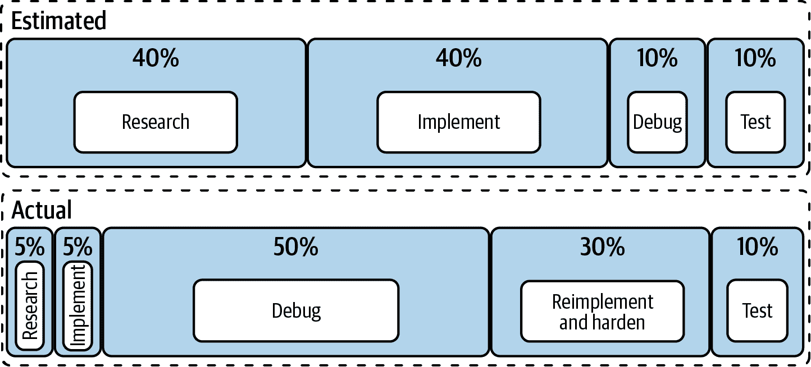

# 第 11 章 结论与未来

此时，你可能正期待着（并为此感到高兴）本书已接近尾声。事实并非如此，因为在撰写本书的过程中，我收集了大量碎片化的技巧和面向未来工作的构想。在前半部分，我将深入探讨一些我积累的、未能归入本书其他章节的技巧与窍门。在后半部分，我将概述当前的挑战，并为未来的研究指明方向。

## 技巧与窍门

我已经说过几次了：在现实生活中，强化学习（RL）之所以困难，是因为它底层依赖于机器学习和软件工程。但序列随机性通过延迟和隐藏问题，又增加了一个维度的复杂性。

### 问题建模

通常，你会面临一个新的工业问题，其中马尔可夫决策过程的组成部分充其量只是模糊不清。你的目标应该是细化概念，并证明（至少在概念上）使用强化学习解决该问题的可行性。

首先，尝试想象一个随机策略在概念环境中的表现。它会去向何处？会与什么交互？何时会做正确的事？它多快能找到正确的做法？如果你的随机策略从不做正确的事，那么强化学习大概率也无法提供帮助。

尝试过随机策略后，试着自己解决这个问题。想象*你*就是智能体。在探索完每个状态后，你能做出正确的决策吗？你能利用观测值来指导决策吗？什么会让你的工作变得更容易或更困难？你能从这些观测值中生成什么特征？同样，如果你在概念上都无法想出可行的策略，那么强化学习（乃至机器学习）大概率也不会奏效。

使用基线来界定性能。从随机智能体开始。然后使用交叉熵方法（这是一种简单的算法，它从随机探索中回溯最佳的先前轨迹）。接着尝试简单的 Q 学习或策略梯度算法。每当你实现一个新算法时，都要像对待科学实验一样对待它：有一个理论，测试该理论，从实验中学习，并用它来指导未来的实现。

尽最大人力简化任务，然后优先解决简化后的任务。争取速胜。*简化*的含义是尽可能减小状态空间和动作空间。你可以为此手工设计特征，或利用领域知识剔除那些讲不通的状态部分。同时也要简化目标或问题定义。例如，与其试图让机器人抓取物体，不如先训练它移动到某个位置。奖励也要简化。始终尝试通过使用诸如到目标距离之类的度量来消除稀疏性，而不是仅在智能体到达目标时给予正奖励。尽量让奖励平滑。移除任何异常值或不连续点；这些会增加模型拟合的难度。

问问自己，是否需要记住之前的动作以采取新的动作。例如，如果你需要钥匙开门，那么你就需要记住自己已经捡起了钥匙。如果你想把物品放进盒子，你必须先把它捡起来。这些情况包含必须按特定顺序访问的状态。为了提供这种能力，你应该引入工作记忆，一种常见的实现方式是通过循环神经网络。

## 避免混淆：动作与记忆

不要将其与两个动作混淆。很容易陷入认为需要记忆的陷阱，但实际上你拥有直接到达这些状态的动作。例如，你可能会想在汽车前进前需要先启动发动机。这听起来又像是有序任务，但事实并非如此，因为你可能有单独的动作来启动汽车和前进。没有记忆的智能体完全能够学会保持汽车启动状态以便前进。这也凸显了一种消除对记忆需求的方法。如果你能找到一个提供到达该状态捷径的动作，则可能完全不需要工作记忆。

此时也请记住分层策略。考虑你的应用是否拥有可以学习以解决问题的不同“技能”。如果可以，考虑独立解决它们，这在概念和实践上都比使用分层强化学习更简单，最终结果可能相同。

## Your Data

我认为绝大多数开发时间都花在调整超参数或修改特征后重新训练模型上。因此，这几乎不言而喻，你应该尝试第一次就把事情做对。这只能靠经验：强化学习的一般经验、你领域的经验以及你问题的经验。但这里有几个技巧能提供一些捷径。

像机器学习一样，缩放和相关性非常重要。并非所有算法都*需要*重缩放（例如树模型），但大多数需要，且大多数期望正态分布数据。因此通常你应该始终将观测值重缩放为均值为零、标准差为一。你可以用滚动均值和标准差这样简单的方法，或者如果输入是平稳或有界的，可以使用那些观测到的极限。注意数据的统计特性可能随时间变化，使你的问题变得非平稳。

还要尝试去相关并清洗观测值。模型不喜欢时间上或特征间的相关性，因为它们代表复杂的偏差和重复信息。你可以使用`z-transform`、主成分分析，甚至观测值间的简单差分来对单个特征去相关。运用你的数据分析技能来发现并移除观测值间的相关性。

监控数据的所有方面。查看奖励分布；确保没有异常值。查看输入数据，再次绘制分布或可视化，确保输入数据不异常。查看模型各部分做出的预测。价值函数预测得好吗？梯度呢？它们太大了吗？查看动作空间的熵：探索得好，还是卡在某些动作上？查看`Kullback–Liebler`散度：太大还是太小？

考虑增加离散化程度，换句话说，增加动作间的时间间隔。这能让训练更稳定，因为受随机噪声影响更小，也能加快训练，因为要计算的动作更少。Atari 环境中事实上的帧跳过就是一个例子。一个好的经验法则是想象自己选择动作；你需要以什么频率做决策才能产生可行的策略？

## Training

训练可能是个相当令人沮丧的过程。你以为有个好主意，结果发现毫无作用，却花了一天时间实现和重训。但至少这是可见的。目前强化学习最大的问题之一是，很容易将算法的开发过拟合到特定环境，从而产生泛化能力差的策略。

尝试针对一系列环境开发算法。很容易将开发过拟合到用于临时测试的环境。这需要自律，但要尝试维护一组具有代表性的环境，从简单到真实，且具有不同设置，如更大或更小、更易或更难、全可观测或部分可观测。如果你的算法在所有环境中都表现良好，那就能让你有信心它能泛化。

使用不同的种子。我有时以为在某环境表现不错，结果发现某个特定种子严重过拟合，纯粹靠运气碰巧找到了可行策略。使用不同种子能强制智能体以略微不同的方式探索。当然，你的算法理应无论种子值如何都表现相似，但如果不相似也别惊讶。

测试超参数的敏感性。同样，你应该追求鲁棒且优雅降级的算法。如果只有极特定的超参数集才有效，这又是过拟合的迹象。

尝试学习率调度。固定值很少效果好，因为它鼓励策略改变，即使策略表现良好。这可能把智能体从最优策略推开。

## Evaluation

评估往往是问题最少的阶段，因为训练期间的所有监控应该已让你对进展有很好的了解。但仍有足够的“燃料”让你烧伤自己。

比较算法得出结论时要非常小心。你可以用统计量化改进（参见“Statistical policy comparisons”），但我发现可视化性能时犯错更少。基本思路是：如果能看到显著的性能提升，且在许多不同种子下性能曲线间有明显间隙，则很可能更好。如果没看到间隙，则用更多种子跑更多实验，或者干脆不信。这听起来很简单，但在真正复杂的环境中并非如此。往往并非你算法的错，却可能遇到一次极差的运行。这可能发生在复杂环境中，糟糕的初始探索导致了很难逃离的状态。看看智能体选择探索的状态；你可能想改变探索策略。

没有单一指标或图表能真正证明性能。我发现，对该领域和环境的经验、以及对算法*应该*如何表现的直觉的整体结合，决定了我是否相信性能有变化。这就是为什么要有基线对比很重要，因为它提供了另一块证据。

记住有些策略默认是随机的——例如许多策略梯度算法——所以如果想要纯性能度量，请用这些策略的确定性版本评估。同样，如果你的策略有任何随机探索——例如`ϵ`-greedy——确保禁用它。即使评估时禁用了它，如果最优策略可能随时间变化，考虑在真实环境中保留随机性。

## Deployment

我认为快速开发成功应用的关键在于将现成组件和模块组合以解决特定问题的能力。这需要一定的可组合性，主要通过良好的编码实践在软件层面驱动。思路是：审视你的问题，挑选有帮助的组件——例如内在动机或经验回放缓冲区——通过良好封装的接口将它们粘合在一起，并协同部署。不幸的是，目前这个梦想还很遥远。任何生产部署都将涉及大量的软件工程和 DevOps 专业知识。

框架在这里也有帮助，因为许多框架都渴望具备可组合性。但这通常意味着它们只能在其代码库的范围内进行组合。由于缺乏标准，框架往往难以与外部组件交互。OpenAI 的 `Gym` 是一个显而易见的例外。

所以要认真思考你的架构，因为我认为这是成功部署和运营实际产品的关键。

## 调试

尽管 RL 算法推动了围绕人工智能的大部分宣传热潮，但深度 RL 方法却“脆弱、难以复现、多次运行结果不可靠，有时甚至不如简单的基线。”^(1) 主要原因在于算法的组成部分未被充分理解：实现的各个部分如何影响行为和性能？

实现细节至关重要。Engstrom 等人发现，看似微小的修改（如代码级优化）可以解释许多流行算法的大部分性能表现。例如，尽管有人声称 `PPO` 之所以表现良好是因为更新裁剪或约束，但这些研究人员证明，代码级优化对性能的提升*超过*了算法选择本身（他们对比了 `TRPO` 和 `PPO`）。^(2)

这导出了一个显而易见的结论：Bug 会影响性能。例如，在 OpenAI 的随机网络蒸馏研究中（参见“随机嵌入（随机蒸馏网络）”），Cobbe 等人注意到，看似微小的细节决定了智能体是陷入停滞，还是能解决一个困难的 Atari 游戏。他们发现了一个问题：价值函数近似在充分训练后本应稳定，却在振荡。结果发现，他们意外地将一个用于生成好奇心奖励的数组归零了，这导致价值函数在每个回合开始时被拉低。这解释了振荡现象，一旦修复，由于价值估计变得稳定，性能得到了显著提升。^(3)

那么问题来了，如何预防这些 Bug？嗯，每一行代码都引入了 Bug 的可能性，所以消除所有 Bug 的唯一办法就是完全没有代码。我在 Winder Research 的产品化项目中经常宣扬这一信条，这还有一个额外的好处，就是减轻运维负担。显然你需要代码，但我的观点是：越少越好。如果你有现成的库或组件可用，就用它，即使它不完全满足你的所有需求。同样，如果你在编写代码或开发框架，应倾向于少代码，而非花哨的设计。这就是我喜欢 `Go` 或 `Python` 等语言的原因。它们积极提倡简洁，因为它们不具备 `C++` 或 `Java` 等语言那些所谓的“复杂性”。

除此之外，追踪、可视化数据、测试和 `print` 语句等常规调试实践将成为你 RL 日常工作的主旋律。从本质上讲，调试只是科学方法的一种体现：你观察到一些异常现象（可视化非常重要），你提出理论来解释该行为，你设计方法来验证该理论（`print` 语句），然后评估结果。如果你想了解更多，可以阅读一本关于软件调试的书；一些推荐见“延伸阅读”。

RL 是序列化的，这意味着 Bug 可能不会立即显现；RL 是随机的，这意味着 Bug 可能被学习过程的噪声掩盖。将这一点与机器学习和软件工程的底层依赖性结合起来，你最终会得到一个充满沸腾 Bug 的动荡“女巫大锅”。

如果你和项目经理交谈，估算为新问题开发算法需要多长时间，你可能会估算出类似图 11-1 顶部的情况；大部分时间花在研究和实现上，对吧？不。绝大部分时间花在调试上，试图弄清楚为什么你的智能体连最简单的问题都解决不了。图 11-1 底部展示了更具代表性的情况，其中包括了重新正确实现代码（整洁代码和测试）所需的额外时间。我选取的度量是任意的，但根据我的经验，它们具有代表性。

## ${ALGORITHM_NAME} 无法解决 ${ENVIRONMENT}!

尽管这些算法能取得惊人的成就，甚至有你可能认为具有智能的例子，但重要的是要记住，它们不是魔法。它们无法解决所有问题，当然也不会自动解决。

如果你在工业界使用 RL，必须采取整体视角。你很有可能通过某些手段大幅简化问题。RL 方法失败的主要原因不是算法不够好，而是问题不适合用这种方式求解。例如，`MountainCar-v0` 环境以难以被 RL 算法求解而闻名，尽管其概念很简单。这不是算法的问题；价值函数出奇地简单。这是一个探索和信用分配问题。如果你开发了更好的探索方式，或修改奖励以鼓励向上移动，这些算法中的任何一个都能迅速解决该问题。

解决环境问题也没有单一的解决方案。有时问题出在观测空间，有时是探索，有时是超参数。欢迎来到 RL 的世界，在这里智能体有时能自动化复杂的战略目标。我唯一的建议是利用本书指导你，一次一个实验，朝着可处理的问题迈进。如果非要我选一个，我会从简化问题或观测空间入手。把它简化到足以让你直观了解发生了什么，然后解决那个简单问题。有了这个基础，你大概率会有足够的领域知识来了解更复杂版本的问题所在。

## 用于调试的监控

用于运维目的的生产环境监控，无法提供足够的低层信息来帮你调试 RL 算法。在开发智能体时，你会想要记录、绘图和可视化尽可能多的内容。以下是一些技巧列表，可在你需要更多信息时提供帮助：

*   记录并可视化观测、动作和奖励。动作应具有高熵以鼓励探索。状态的奖励不应相同；如果相同，智能体就无法分辨哪些状态更有价值。检查呈现给智能体的观测；很容易意外丢弃重要信息。例如，检查图像的灰度变换是否保留了图像内的特征；红绿灯在颜色上截然不同，但在灰度图中却不那么明显。

*   评估状态空间不同部分的价值函数。如果可以，可视化整个空间。如果不行，选取一些有代表性的状态并绘制它们。是否过拟合了？

*   随时间绘制价值函数（针对合理数量的状态）。它如何变化？会卡住吗？会振荡吗？单次运行中的方差是多少？多次运行间的方差是多少？估计值应随时间变化然后稳定下来。记住，当策略改变时，完美的价值函数也会改变。价值函数近似应保持足够稳定以应对非平稳性，但又要足够灵活以对变化做出反应。

## RL 实施的最佳实践

*   拙劣或有缺陷的神经网络实现会让 RL 名声受损。从简单的东西开始，比如线性近似器或等效的单层神经网络。在尝试更复杂的网络之前，确保一切按预期工作。参考一本好的深度学习实战书籍以获取帮助（请参阅“延伸阅读”）。
*   在扩展到多种子或多线程/多节点运行之前，确保一切在固定种子和单线程下都能正常工作。
*   从您过往其他实现经验中已知效果良好的超参数开始。

## 强化学习的未来

目前对 RL 的看法如何？这让我想起了 Andrew Ng 关于实用深度学习的那场近乎开创性的演讲，他在演讲中完美地平衡了健康的短期悲观主义与长期乐观主义。^(5) 这让我领会到了该主题的复杂性，尤其是在工业界实施方面，但同时乐观情绪让这些问题感觉只是过程的一部分。挑战客观存在，所以接受它们，以最好的方式应对它们，然后继续前进。有时深度学习讲不通，这也没关系。但当它奏效时，模型与数据的融合美不胜收。

我认为 RL 目前正处于这个位置。我们正处于工业化产品化和运营化成为可能但棘手的临界点。在许多情况下，更简单的算法仍然优于 RL；例如，如果您能够离线运行环境，那么您可以直接使用蒙特卡洛树搜索 (MCTS) 算法（如 AlphaGo）来评估可能的走法。例如，2014 年的一个实验使用 MCTS 碾压了 DQN 的性能，RL 方法花了一段时间才追上来。^(6) 但这没关系。RL 不是银弹，就像机器学习还没有诞生出人工智能一样。它只是一个工具。就像木匠一样，您应该为您的工作使用最好的工具。

## RL 市场机遇

深度学习已成为主流，因此即使是我的企业客户也在投资运营化。我相信 RL 将在未来几年内跟进。这开辟了新的市场和机遇。不幸的是，与机器学习一样，RL 是一种跨行业技术，而非解决方案。您将需要领域专业知识、特定行业的市场洞察力，以及一点灵感来利用 RL。

然而，已经有迹象表明 RL 特别适合特定领域。机器人技术是一个显而易见的例子。但自动竞价和推荐是其他可能在全球收入方面超越机器人技术的领域。目前还没有针对 RL 的全行业研究，但如果 RL 成功，这将会到来。

市场研究公司 Gartner 认为 RL 仍处于炒作曲线的上升期，三分之一的企业希望到 2023 年实现战略决策自动化（他们称之为决策智能）。^(7,8) 他们对市场价值含糊其辞，尤其是在量化特定技术影响方面，但据报道，其对全球商业的价值每年达数万亿美元。^(9) 有趣的是，在 Gartner 的一些可视化图表中，他们开始将“智能体”和“决策自动化”与其他更传统的机器学习形式（他们称之为“决策支持/增强”）分开，以便清晰地看到优化序贯决策的新兴价值。

这一前景意味着运营领域存在价值和机遇。公司将无法使用当前这一批机器学习即服务产品，因为大多数不太适合持续学习和序贯决策。当然，一些会适应调整，但这也为公司填补这一空白提供了机会。

开源项目也不会落后太远，甚至在许多情况下可能处于领先地位。有一种观点认为，只有开源项目才能真正成功，因为像机器学习一样，全球采用需要开放协作。否则，您的需求和挑战可能会与专有流程和观点发生冲突。如果您正在考虑这一点，请确保将您的产品定位在大型供应商可能感兴趣的领域之外。并确保思考您和全球社区如何从开源开发中互利共赢。

这也意味着公司在未来很长一段时间内都将需要 RL 支持和专业知识。RL 成为大宗商品可能需要长达 10 年的时间。因此，拥有可证明的 RL 专业知识的顾问和工程师（如我公司的那些）将备受追捧。如果您正考虑将 RL 作为职业专长，我认为这不会是一个坏决定，因为刚才讨论的明显机遇和预测。但不要因此而麻痹大意，产生虚假的安全感。RL、ML 和软件工程都很难，尤其是当您尝试将这些东西投入生产时。而且像任何知识型行业一样，目标桩不断移动。您必须接受这一点并随之变动，以确保在这个竞争激烈的领域中拥有长期的立足之地。要投入这么多精力，您真的必须热爱它。您必须享受这门技艺和逆境的挑战，享受面对前所未有的特定工业情境的挑战。

## 未来的 RL 与研究方向

RL 面临许多挑战，正如我全书所讨论的。不要让这些阻碍您探索 RL 的潜力，因为我真诚地相信，下一级人工智能将由这些思想驱动；它们只是在等待突破性的应用。但希望我已清楚地标明了 RL 的哪些部分会在解决工业问题时拖慢您的进度或导致您跌倒。这些问题大多转化为未来的研究机会。

研究方向大致可分为两类：工业研究和学术研究。工业研究由改进开发和运营效率的方法组成，由业务需求驱动。学术研究更侧重于改进或重新定义基础理解，由同行定义的理论上的新颖性或进步概念驱动。这意味着学术研究人员不会投入时间来提高代码的可读性，例如。同样，工业研究人员不太可能偶然发现真正开创性的东西。但当然，也有人处于两者之间。

### 警告

我认为目前学术机器学习界存在一个问题。学术成功的主要场所是会议和期刊。最受欢迎的场所可以挑三拣四，因此审稿人拥有很大权力来主导当前和未来的内容。不幸的是，应用被认为不如（例如）新颖的算法改进有价值。例如，Hannah Kerner 最近谈到了她试图将以应用为中心的论文推向会议的经历，结果却发现“其对机器学习社区的意义似乎有限”。^(10) 当然，基础改进是学术界和科学发现的总体主要目标，但我感觉天平倾斜得太厉害了。

### 工业界研究

从工业界的角度来看，我认为以下领域存在研究机会和动力：

**运营化与架构**
：

## 强化学习：未来方向与研究挑战

强化学习的应用越来越广泛，很快将会有大量应用投入生产。我认为目前的机器学习框架都不具备这种能力，而强化学习框架往往专注于开发，而非生产。当然，也有少数例外，但在架构方面尤其还有很大的改进空间。

## 强化学习的设计与实现

该领域已有大量工作——例如各类强化学习框架——但许多框架往往关注错位的问题。许多框架试图实现强化学习算法，但这并非工业界问题的目标。目标是针对业务挑战寻找、优化并构建强化学习解决方案。这意味着特征工程、奖励塑形以及前两章列出的其他所有内容同样重要，甚至可能比算法本身更重要。框架需要将重心从算法开发转移到应用开发上。

## 环境策划与仿真

模拟器显然对初始开发至关重要。精准的仿真提供了将知识迁移到现实世界的能力。随着更复杂的工业问题被尝试，这些问题将受益于更逼真的仿真。这在 3D 仿真引擎中已是现状，它们能模拟出令人惊叹的现实世界表现。但对于所有其他领域，体面且逼真的模拟器却很难获得。原因之一是它们包含大量专有信息。驱动仿真的模型通常基于公司拥有的数据构建，因此公司知道这代表了竞争优势。研究在这方面的一个助力方向是改进环境的策划与开发流程。这规避了数据问题，但仍将有助于这一关键开发阶段。

## 监控与可解释性

围绕强化学习智能体监控的工具与支持匮乏，这归因于缺乏运营化落地。投入生产时，你需要确信你的策略是鲁棒的，而确信这一点的唯一途径是通过充分的监管。某些应用甚至要求可解释性，这目前相当棘手，尤其是在生产环境中。但不仅如此，你还需要工具来辅助调试应用开发，让你能窥见智能体内部发生了什么。问题在于这往往取决于具体算法和领域，但这仍是一个值得攻克的挑战。

## 安全性与鲁棒性

这也是学术研究的热门话题，但研究的影响力只有在应用于实际应用时才能体现。证明模型的鲁棒性对每个应用都很重要，因此我预见将会出现库和工具来帮助解决该问题。安全性则是一个大得多的顾虑。我不太担心技术层面，因为我有信心工程师能设计出本质安全的解决方案。我担心的是法律和监管层面的影响，因为此时这更多地变成了一个伦理问题。谁来负责？需要多安全？如何测试其安全程度？

## 应用

当然，企业付费是为了强化学习的应用。此处讨论的研究方向有助于交付这些应用。将会有大量兴趣并因此产生研究，致力于将强化学习应用于业务挑战。难点在于，像任何技术一样，如何将技术映射到业务挑战。这比听起来难得多，因为强化学习太通用了；存在许多可能的应用。所以请利用“问题定义：什么是强化学习项目？”中提出的建议来寻找可行的强化学习问题，再按商业价值进行优先级排序。

## 学术界的研究

从学术角度看，强化学习令人振奋，因为感觉我们距离真正革命性的突破仅几步之遥：一个能像人类一样胜任学习任何任务的智能体。这一时刻如同一个舱壁；一旦被突破，将开启一个充满可能性的全新世界，多为美好，也有少许惊悚。

目前机器学习的应用，以及强化学习在较小程度上的应用，都受限于其无法利用科学方法并以智能方式保留知识。如果智能体能发展自己的理论、检验自己的信念，并应用这些知识发现新理论，我认为那才是我们将强化学习泛化至任意序列问题、任意数据的时刻。我觉得我们快到了。但具体而言，从应用视角阻碍这一目标的挑战有：

### 离线学习

这可能是最大的挑战。我们需要模拟器的主要原因是智能体必须通过尝试动作来学习策略。如果我们能脱离这一机制，在无交互的情况下训练策略，这意味着我们可以完全移除模拟器。只需采集日志数据并在此基础上训练，就像机器学习那样。研究者已开始改进这一过程；例如回顾第 8 章。但仍有很大提升空间。直觉上，我认为设想一种算法能理解环境的随机性、观察最优轨迹的示例，再应用模型拟合出泛化轨迹以适配数据，这并非不合理。这应能在寻找最优策略与保留对日志中未观测状态的足够不确定性之间提供折中。

### 样本效率

提高算法的样本效率是可取的，因为应用通常希望在最少的交互次数内获得最优策略。以购物车为例：如果我没有宠物，我真的不想收到狗粮和猫粮。它学习这一偏好的速度越快，我就越不恼火。同样，这里有一系列研究方向，从改进探索到巩固知识（如集成方法），但这些往往由领域驱动。如果存在某种通用的、理论上的效率保证供算法追求，那将是极好的。

### 高维效率

大规模状态空间和动作空间仍是难题。大规模状态空间之所以棘手，是因为将其降维为有用表示所需的计算量巨大。我设想对于特定领域，可使用预训练的 Transformer 或嵌入来简化状态空间，而无需训练降维模型。大规模动作空间更成问题，因为智能体必须持续主动采样所有可用动作以确保拥有最优策略。当动作相关联时这较容易。例如，单个连续动作虽无限，但因可用分布建模而易于求解。但众多离散动作造成的问题更大，主要是因为这产生了更困难的探索问题。

### 奖励函数敏感性

监督学习之所以容易，是因为目标明确。我*非常希望*在强化学习中也有如此简单的目标定义方式。强化学习奖励往往稀疏、多目标且高度多维。至今定义奖励函数仍主要是一个详尽的手动过程，即使有内在奖励等技术。未来我仍预期需要人工干预来定义高层目标，但我期望以侵入性更小的方式进行；我不该需要塑形奖励。当奖励延迟时，这变得更为重要。

### 结合不同类型的学习

有没有办法将多智能体强化学习的探索优势、分层强化学习的泛化能力以及专家指导结合起来？你能将进化或遗传学习与这些强化学习技术结合吗？

## 预训练智能体与改进课程学习

我曾在某处读到过（不记得具体出处），学习只有在“知道”与“不知道”的差距很小时才可能发生。我认为这在强化学习中同样适用。我不指望一个孩子能开车；同样，你也不应指望一个未经训练的智能体能做到。而过度拟合单一任务的训练并非解决之道，因为开车不仅仅是学习如何融合复杂的立体视觉和转动方向盘。智能体需要广博的知识，这可以通过在特定课程上预训练的智能体来提供。如果你愿意，甚至可以在最后给它们打个分。

## 更加关注实际应用与基准测试

我认为学术界理解实际应用的可取性，但我希望看到更多重视这一点的工作。我看到一些算法过度拟合 Atari 基准测试，这属于刻意为之，目的是为了宣称达到最先进性能。

## 伦理标准

伦理或道德的机器学习与强化学习跨越了工业界和学术界。似乎大家都渴望推动这一讨论，但这证明是困难的。也许是因为它总演变成哲学辩论，又或许是因为每个人拥有不同的道德准则或语境，导致难以就伦理结论达成一致。这是一个非常敏感的主题，我不觉得自己有资格评论。但这不意味着你不应考虑它；你应该。在你所做的每一件事中都要考虑。

关于未来，我感觉甚至连尝试定义伦理标准都未获得广泛支持，更遑论解决它们。《通用数据保护条例》（GDPR）是政府试图定义个人数据伦理使用的一个例子。虽然我完全赞同其理念，但在实践中它过于模糊，且充斥着过多的法律术语，以至于毫无用处。例如，GDPR 第 7 条“同意条件”规定：

> 同意应以一种与其他事项明显区分的方式呈现，采用清晰明了且易于获取的形式，使用清晰通俗的语言。

这还算合理。但在同一页面的第 4 款却写道：

> 在评估同意是否自由给予时，应最大程度地考虑合同的履行（包括服务的提供）是否以同意处理履行该合同并非必要的个人数据为条件，*inter alia*（以及其他事项）。

清晰通俗的语言？作为对该法律条文完全被无视的证据，第 32 号澄清序言“同意条件”指出“预先勾选的复选框或不作为因此不应构成同意。”我大胆猜测，几乎所有网站的 GDPR 选择加入表单都提供一个“接受全部”框，这当然会在你有机会阅读它们是做什么的之前就勾选所有框。

这种伪安全也有代价。我总是烦恼于不得不寻找叉号来关闭弹窗（顺问一下，关闭按钮到底是“接受全部”还是“拒绝全部”？）。这就像回到了 90 年代，Geocities 网站塞满了弹窗。

那么 GDPR 与机器学习和强化学习伦理标准有什么关系？它代表了政府主导的首次且最大规模的尝试，旨在遏制一种被其视为不道德的与数据相关的实践。它奏效了吗？也许有一点。它遏制了一些大公司或政府试图操纵关于民主和自由的重要对话的剥削行为。但代价是什么？有更好的方式吗？大概有，但我不认为存在单一的正确答案。

对于机器学习和强化学习更普遍的应用，我感觉这将是一个缓慢燃烧的过程；直到它像气候变化一样打在人们脸上才会变得重要。不过我认为在基层层面会有成功，有点像道德黑客迫使公司投资数字安全。所有企业都想安全可靠，但需要挑战才会真正采取行动。数据及其衍生模型也将如此。个人或松散关联的群体将充满激情地尝试追究企业或政府的责任。

然后还有像你这样的人。实践者。工程师。构建这些解决方案的人。你是观察自己工作影响的第一线，因此你肩负着巨大的责任，去决定你的算法是否符合伦理。这是知识的负担；请明智地使用它，做出正确的决定。

## 结束语

我觉得颇具讽刺意味：我以一句要求你做出良好决策的结束语，来收尾一本关于优化序贯决策的书。谁知道呢，也许未来我们可以用强化学习来为我们做伦理决策。

直到最近，强化学习主要还是学术界感兴趣的课题。本书的目标是试图将其中一些知识带给工业界和商业界，继续通过自动化提高生产力的旅程。强化学习有潜力利用直接源自业务指标的目标，优化战略层面的决策过程。这意味着强化学习可能影响整个业务结构，从车间工人到首席执行官。

这带来了独特的技术和伦理挑战。比如决策可能产生当时未知的长期后果，以及自动化策略如何影响人。但这不应阻止你尝试强化学习如何在你的情境中提供帮助。它真的只是一个工具；如何使用它才是关键。

## 后续步骤

你可能有很多问题。这很好。收集这些问题发给我（详见 `#colophon01.html#ch_about_author` 联系方式）。但总体上我建议你不要止步于此。尝试寻找一个实际问题来解决，最好是在工作中。如果你能说服公司支持你的研究，也许利用 20% 的时间，或者作为一个完整的限时概念验证，这能给你时间和动力去应对你将面临的现实挑战。如果你坚持玩具示例，恐怕对你来说太容易了。如果你无法在工作时间做这件事，就找一个你感兴趣的问题，也许与另一个爱好相关。你可能得不到任何专门的时间来做这件事，因为生活会介入，但希望它能带来回报并给你一些实践经验。

除了实践经验，我建议你继续阅读。显然强化学习高度依赖机器学习，所以任何关于数据科学或机器学习的书都很有用。还有一些其他强化学习书籍，也非常好，能提供另一种视角。如果你想全栈发展，则提升你的通用软件和工程技能。

为了巩固你所学的一切，你需要使用它。经验是我已经提到的一种方式，但指导、教学和演示也是另一种极好的学习方式。如果你必须向别人解释某事，尤其是当形式正式时（如演示），这会迫使你整合想法，并将你的模型和概括记入记忆。不要陷入认为自己经验不足而无法谈论它的陷阱。你有资格；你是你所经历过的经验的专家。你的某些经验很可能能泛化到强化学习，以一种无人能及的方式帮助应用、解释或教授这些概念。试一试吧！

## 现在轮到你了

说完这些，我把发言权交给你。

正如您所知，您可以在[配套网站](https://rl-book.com)上找到更多资源。但我也想听听您的声音。我想了解您正在从事的项目、面临的挑战、您的技巧和窍门，以及您对强化学习未来的想法。如果您正考虑在工业界应用强化学习，或者正为某个问题苦恼，我尤其想与您交谈。我可以提供解决方案、技巧和评估，帮助您减少工作量、降低风险、提升性能，让您的生活更轻松。我的完整联系方式印在关于作者中。

祝好运！

## 延伸阅读

## 调试

*   Agans, David J. 2002. *《调试：寻找最棘手软硬件问题的 9 条不可或缺的规则》*. AMACOM。
*   Fowler, Martin. 2018. *《重构：改善既有代码的设计》*. Addison-Wesley Professional。
*   Feathers, Michael C. 2004. *《高效处理遗留代码》*. Prentice Hall PTR。

## 深度学习调试

*   Goodfellow, Ian, Yoshua Bengio, and Aaron Courville. 2016. *《深度学习》*. MIT Press。

## 强化学习调试

*   一个精彩的 Reddit 讨论串，提供了大量相关信息。^(11)
*   John Schulman 精彩的核心实操演讲。^(12)
*   Matthew Rahtz 的典型经验分享。^(13)

## 研究方向

*   许多想法受到 Dulac-Arnold 等人论文的启发。^(14)
*   离线强化学习。^(15)
*   我个人非常喜欢 Max Tegmark 关于 AI 未来的著作。^(16)

## 参考文献

^(1) Engstrom, Logan, Andrew Ilyas, Shibani Santurkar, Dimitris Tsipras, Firdaus Janoos, Larry Rudolph, and Aleksander Madry. 2020. ["深度策略梯度中的实现细节至关重要：基于 PPO 和 TRPO 的案例研究"](https://oreil.ly/8DR7T). ArXiv:2005.12729, May.

^(2) 同上。

^(3) Cobbe, Karl 等. ["基于预测奖励的强化学习"](https://oreil.ly/9VV5z). OpenAI. 2018 年 10 月 31 日.

^(4) ["复现深度强化学习论文的经验教训"](https://oreil.ly/OPnQm). n.d. 访问于 2020 年 8 月 17 日.

^(5) Ng, Andrew. ["深度学习应用的核心实操"](https://oreil.ly/qEz3Z). 2016.

^(6) Guo, Xiaoxiao, Satinder Singh, Honglak Lee, Richard L Lewis, and Xiaoshi Wang. 2014. ["使用离线蒙特卡洛树搜索规划进行实时 Atari 游戏的深度学习"](https://oreil.ly/dl-az). *《神经信息处理系统进展》* 27, edited by Z. Ghahramani, M. Welling, C. Cortes, N. D. Lawrence, and K. Q. Weinberger, 3338–3346. Curran Associates, Inc.

^(7) ["2019 年数据科学与机器学习炒作周期"](https://oreil.ly/s7kEo). n.d. Gartner. 访问于 2020 年 8 月 17 日.

^(8) ["Gartner 2020 年数据与分析十大趋势"](https://oreil.ly/nYjE_). n.d. 访问于 2020 年 8 月 17 日.

^(9) ["Gartner 预测 AI 增强将在 2021 年创造 2.9 万亿美元商业价值"](https://oreil.ly/OjbkG). n.d. Gartner. 访问于 2020 年 8 月 17 日.

^(10) ["太多 AI 研究者认为现实世界的问题不相关"](https://oreil.ly/B0k1N). n.d. *《麻省理工科技评论》*. 访问于 2020 年 8 月 20 日.

^(11) ["深度强化学习实用技巧"](https://oreil.ly/rSrgg). R/Reinforcementlearning, n.d., Reddit. 访问于 2020 年 8 月 17 日.

^(12) ["深度强化学习训练营第 6 讲：深度强化学习实验的核心实操"](https://oreil.ly/PjuAc). 2017.

^(13) ["复现深度强化学习论文的经验教训"](https://oreil.ly/SNSVk). n.d. 访问于 2020 年 8 月 17 日.

^(14) Dulac-Arnold, Gabriel, Daniel Mankowitz, and Todd Hester. 2019. ["现实世界强化学习的挑战"](https://oreil.ly/WKoG5). ArXiv:1904.12901, April.

^(15) Levine, Sergey, Aviral Kumar, George Tucker, and Justin Fu. 2020. ["离线强化学习：教程、综述与开放问题展望"](https://oreil.ly/Kae6m). ArXiv:2005.01643, May.

^(16) Tegmark, Max. 2017. *《生命 3.0：人工智能时代的人类命运》*. Penguin UK.
