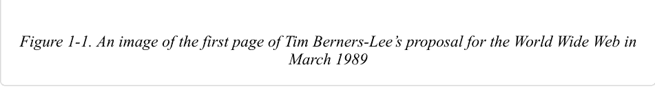

# 第 1 章 介绍 RESTful Web 微服务

> **致早期版本读者的一点说明**
>
> 通过 Early Release 电子书，您可以在书籍正式发布之前，就阅读到它们最早期的形式——即作者写作时的原始未编辑内容——从而提前了解这些新技术。
>
> 这将是最终版书籍的第一章。请注意，GitHub 仓库将在稍后启用。
>
> 如果您对如何改进本书中的内容和/或示例有任何意见，或者您发现本章节中有遗漏的内容，请通过 mca@amundsen.com 联系作者。

在序言中，我指出本书这个充满流行词的标题是一个值得关注的点。在这里，我们将探讨“RESTful Web 微服务”背后的思考，以及为什么我认为使用这种标题并深入理解其含义非常重要。

> **警告**
>
> 我知道有些读者习惯跳过像这样的书籍前言部分，所以在我们开始探索我为这本书收集的 70 多个秘诀的旅程之初，我恳请您稍微包容一下。

首先，我将谈谈“RESTful Web 微服务”这个短语的确切含义，以及为什么我选择了一个看似充满流行词的标题。接下来，我们会花一些时间讨论我所说的能够在开放 Web 上驱动有韧性和可靠微服务的关键技术——超媒体。最后，有一个简短的章节探讨实现和使用基于 Web 的微服务的一个共享原则——它指导了本书中模式和秘诀的选择与描述。

通过这三个概念，我希望能够让您（读者）参与思考我们今天如何构建和使用微服务，以及如何通过稍微改变视角和方法，来更新这些服务的设计和实现，从而提高它们的可用性，降低创建和访问它们的成本，并增强服务生产者和消费者构建和维持可行的 API 驱动业务的能力——即使我们依赖的某些服务不可靠或不可用。

首先，我们将探讨本书标题背后的含义。

### 1.1 什么是 RESTful Web 微服务？

几年来，我在文章、演示和培训材料中一直使用“RESTful Web 微服务”这个短语。有时这个术语会引发困惑，甚至怀疑，但几乎总是能激起好奇心。这三个词“在一起”是做什么的？这三个概念结合起来整体上意味着什么？为了回答这些问题，花点时间澄清它们各自的含义会有所帮助。

因此，在本节中，我们将探讨：

- Fielding 的 REST
- Tim Berners-Lee 的 Web
- Lewis 与 Fowler 的微服务
- Alan Kay 的极致后期绑定

是的，我在这里偷偷加入了第四个要点。我需要它来完善整个故事，但我认为将 Kay 的概念作为本书标题中的另一个元素，可能会有点，怎么说呢，*极致*。

### Fielding 的 REST

早在 1998 年，Roy T. Fielding 就在微软园区做过一次演讲¹（待确认微软园区），解释他提出的 *表述性状态转移*（即现在众所周知的 REST）概念。在那次演讲以及两年后他的博士论文（“架构风格与基于网络的软件架构设计”）² 中，Fielding 提出了一个观点：存在一组独特的适用于基于网络实现的软件架构，而他概述的六种风格之一——REST——特别适合万维网。

> **提示**
>
> 多年前我学到一句话：“经常被引用，从未被阅读。”这句嘲讽的话似乎非常适用于 Fielding 在 2000 年的论文。我鼓励任何致力于创建或维护基于 Web 软件的人花时间阅读他的论文——而不仅仅是臭名昭著的第 5 章（“表述性状态转移 (REST)”）。他对通用风格的分类准确地识别出了后来被称为 gRPC、GraphQL、事件驱动、容器等风格。

Fielding 的方法，即识别理想的系统级属性（如可用性、性能、简单性、可修改性等），以及选择一组推荐的约束（如客户端-服务器、无状态性、可缓存性等）来*诱导*这些属性，在二十多年后的今天，仍然是一种思考设计需要保持稳定和功能正常的软件的宝贵方式。

总结 Fielding 的 REST 风格的一个好方法来自论文本身：

**什么是 REST？**

> “REST 提供了一组架构约束，当整体应用时，它强调组件交互的可扩展性、接口的通用性、组件的独立部署，以及通过中间组件来减少交互延迟、加强安全性并封装遗留系统。”
> — Roy Fielding，2000 年³

本书中包含的秘诀旨在引导设计和构建具有 Fielding 许多“关键架构属性”的服务，包括：

### Tim Berners-Lee 的 Web

万维网（WWW）借鉴了 Ted Nelson 的思想，他通过“链接”将相关文档连接起来，并创造了“超文本”一词，后来又通过“表单”提示用户输入数据，然后将数据发送到世界各地的服务器。这些服务器可以使用免费软件在普通台式电脑上快速轻松地搭建。WWW 的设计遵循了“最小权力原则”（后来在 W3C 的同名文档中被正式化⁵）。这为任何希望加入 WWW 社区的人设置了“低进入门槛”，并推动了其在 20 世纪 90 年代和 21 世纪初的迅猛普及。

**万维网的目标**

> 在奠定“Web”基础的文档中，Berners-Lee 和 Cailliau 写道：
>
> “我们应该努力建立一个通用的链接信息系统，其中通用性和可移植性是最重要的。”
> — Tim Berners-Lee 与 Robert Cailliau，1990 年⁶

在 WWW 上，任何文档都可以被编辑以链接（指向）Web 上的任何其他文档。这无需在链接两端进行任何特殊安排。本质上，人们可以自由地建立自己的连接，收藏自己喜欢的文档，并创作自己的内容——无需获得其他任何人的许可。所有这些内容都通过页面内的链接和表单来实现，创造了独特的路径和体验——而原始文档作者（被连接的一方）对此一无所知。

*正是 WWW 的这两个方面，我们将在本书的所有秘诀中加以运用。最小权力原则，以及 Web 上的任何服务都可以与其他任何服务相连接，以创建独特且有用的解决方案——而单个服务对此毫不知情。所有这些都无需两端服务进行任何特殊的定制或修改。*

### Lewis 与 Fowler 的微服务

2014 年初，James Lewis 和 Martin Fowler 发表了一篇详尽的文章：“微服务——这个新术语的定义。”⁷ 在那篇文章中，Lewis 和 Fowler 列出了微服务概念的多个同期来源⁸，这些来源可以追溯到 2011 年。这种新方法的动机来自于安全有效地处理随时间变化所带来的挑战——将大型应用拆分使得修改现有代码更容易，并且能以更可靠的方式进行扩展。

**微服务：一个定义**

> “[微服务架构风格是将单个应用程序开发为一套小型服务的方法，每个服务运行在自己的进程中，并使用轻量级机制进行通信...”
> — James Lewis 与 Martin Fowler，2014 年⁹

值得注意的是，在 2014 年，Lewis 和 Fowler 将微服务描述为由“一套小型服务”构建的“单个应用程序”。当时隐含的意思是，*单个公司*在创建一个应用程序，而这套服务也是由同一个公司创建（或至少托管和管理）的。然而，您在这些秘诀中将会发现的是对“应用程序”更扩展的定义，以及对谁在托管这些组成部分的不同看法。

在 Web 上，单一阅读体验可以跨越由许多人托管和管理的多台机器上的许多页面——其中许多人从未见过彼此。这就是我们在这本合集里处理服务概念的方式。要实现这一点，我们需要重新思考连接服务的方式、服务之间共享的数据（和元数据），以及我们如何*跨服务*编排多步骤工作流以创建新的解决方案。这正是我们的秘诀将帮助我们解决的问题。

微服务使得更精准地调整服务变更、限制运行系统中不必要的副作用成为可能。这是我们的方案中的一个关键要素——即便这些变更涉及分布在世界各地多个机器上的服务，也能实现更精准的调整和更有限的副作用。

## 艾伦·凯的极端后期绑定

构建能够“活在网络上”的可靠、有韧性的微服务，另一个重要方面来自美国计算机科学家艾伦·凯¹⁰。人们通常认为他在20世纪90年代推广了“面向对象”编程的概念。

> ### 艾伦·凯谈面向对象
> 
> 2003年，凯在一个邮件列表中解释他对面向对象编程（OOP）的看法时写道：“对我而言，OOP只意味着消息传递、本地保留与保护、对状态过程的隐藏，以及对一切事物的极端后期绑定。”¹¹

2019年，柯蒂斯·波写了一篇博客文章¹²，探讨凯对OOP的解释。波在其中指出：“极端后期绑定之所以重要，是因为凯认为，它使你不必过早地固守于解决问题的*唯一正确方式*（从而更容易改变这些决策），同时还能让你构建出*在运行过程中*也可以更改的系统。”（强调为波所加）

> ### 提示
> 
> 若想更直接地探讨罗伊·菲尔丁的REST与艾伦·凯的OOP之间的联系，可参阅我2015年的文章《凯与菲尔丁的远见：可延续数十年的可成长系统》

正如凯以OOP方式看待编程一样，网络——互联网本身——**始终在运行**。而我们安装在联网机器上的任何服务，实际上都是在系统运行过程中对系统进行更改。这就是我们在为网络创建服务时需要牢记的一点。

超媒体的历史可以追溯近100年，它在20世纪关于心理学、人机交互和信息论的著作中就已经出现。它为伯纳斯-李的万维网（见“蒂姆·伯纳斯-李的万维网”）提供动力，同样也能为我们的“服务之网”提供动力。正因如此，它值得在此做更深入的探讨。

## 超媒体历史

通过信息将人们连接起来的想法早已存在。20世纪30年代，比利时的保罗·奥特勒¹³设想了一种机器，让人们能够搜索并选择自定义混合的音视频和文本内容，并在任何地方查看结果。将近100年后，流媒体革命终于到来。

奥特勒在1940年绘制的构想（见下方图1-2）中，展示了他家中的机器如何连接到各种新闻、娱乐和信息来源——他称之为“万维网络”。这与泰德·尼尔森（见下文）和蒂姆·伯纳斯-李（见“蒂姆·伯纳斯-李的万维网”）后来对连接世界的想象非常相似。

图1-2. 保罗·奥特勒1940年绘制的“物种万类馆”——又称万维网络

在美国曼哈顿计划担任管理者期间，万尼瓦尔·布什注意到，当团队在创造性环境中一起解决问题时，他们常常互相“激发”想法，从一个研究思路跳到另一个，在科学论文之间建立新的联系。他在1945年7月的文章《诚然，我们可以思考》¹⁴中写下了这些观察，并描述了一个与奥特勒类似的信息工作站，它依赖于缩微平片和安装在阅读者头上的“指点”装置。

阅读这篇文章激发了一位驻扎在东亚的初级军官思考如何将布什的工作站变为现实。将近二十年后，在1968年，这位军官——道格拉斯·恩格尔巴特——带领团队演示了他们一直在研究的东西，这就是如今众所周知的“万演示之母”¹⁵。那场演示展示了当时闻所未闻的“交互式计算机”，操作员可以用指点设备高亮文本并点击以跟随“链接”。恩格尔巴特不得不发明“鼠标”指针来让他的演示成功。

## 万维网之母

恩格尔巴特的“万演示之母”发生在50多年前，1968年12月的旧金山大型机大会上，它为你今天看到的硅谷演示设定了标准。恩格尔巴特独自在台上90分钟，坐在一把特别设计的伊姆斯椅（如今Aeron椅的原型）上，使用他定制的键盘、鼠标和一组“拨片”，同时通过一个看起来像是麦当娜现代音乐视频里道具般的头戴式麦克风平静地叙述他的操作。恩格尔巴特展示了第一块实时交互式计算机屏幕，演示了剪切-复制-粘贴、超链接、多光标编辑（与数百英里外的同事通过画中画视频通信）、版本控制，以及其他一些在十多年后仍未普及的概念。如果你还没看过完整视频，我强烈推荐。

与恩格尔巴特同时代的泰德·尼尔森早在1965年¹⁶就开始撰文论述个人计算的力量，并使用他创造的新词，如超链接、超文本、超数据和超媒体。到1974年，他的著作《梦想机器 | 计算机解放》¹⁷描绘了一个由通过互联网相互连接的个人电子设备驱动的世界。与此同时，艾伦·凯（见“艾伦·凯的极端后期绑定”）描述了一种名为Dynabook¹⁸的设备，它与今天的小型笔记本电脑和平板电脑非常相似。

所有这些关于信息如何链接和共享的早期探索都有一个核心思想：正是事物之间的连接才能赋力于人，激发创造力和创新。到20世纪80年代末，蒂姆·伯纳斯-李构建了一个成功的系统，体现了所有前人想法的精髓。伯纳斯-李的万维网让文档页面的链接变得安全、简单且可扩展。

## 吉布森的仿生

大约在泰德·尼尔森将“超文本”一词引入世界的同时，另一个人也在创造词语。心理学家詹姆斯·J·吉布森在他1966年的著作《作为知觉系统的感官》¹⁹中，探讨了人类和其他动物如何感知并与其周围世界互动。吉布森创造了“示能”（affordance）这个术语。对吉布森而言：

> “环境的示能就是环境为动物提供的东西，是它所供给或配备的。”²⁰

詹姆斯·J·吉布森

吉布森的示能支持动物与环境之间的互动，正如尼尔森的超链接允许人们与网络上的文档互动一样。而吉布森的同时代人唐纳德·诺曼则在1988年的著作《设计心理学》²¹中推广了“示能”一词。诺曼被视为人机交互（HCI）运动的教父，他用这个术语来指代软件设计者理解和促进人机交互的方式。我们对软件可用性的大部分认识都来自诺曼及该领域其他学者的工作。

超媒体依赖于示能。超媒体元素，如链接和表单，是网络响应中能够提供额外操作的东西，例如搜索现有文档、向服务器提交数据以进行存储等。吉布森和诺曼代表了计算机交互中的心理和社会层面，我们在方案中会依赖这些层面。因此，你会发现许多方案都涉及使用链接和表单来跨多个服务修改应用状态。

## 消息的价值

正如本章前面所见，艾伦·凯将面向对象编程视为根植于*传递消息*的概念（见[“艾伦·凯的极端后期绑定”]）。蒂姆·伯纳斯-李在1992年提出以消息为中心的HTTP协议时，也采纳了同样的观点，并在次年帮助定义了超文本标记语言（HTML）的消息格式。

通过为传递消息（而不是传递*对象*或*函数*）创建协议和格式，网络的未来得以确立。基于消息的方法更容易约束，更容易随时间修改，并且能为未来的增强提供更可靠的基础，这些增强包括全新的格式（XML、JSON等）和协议的修改用法（文档、网站、网页应用等）。

> **一些不那么成功的例子**
> 
> HTTP的封装消息方法甚至允许了“不那么成功”的创新，如Java Applet、Flash和XHTML。尽管该协议本设计为支持这类偏离以消息为中心的HTML的“失败”替代品，但这些替代格式寿命有限，将它们从生态中移除并未对HTTP协议造成长期损害。这证明了HTTP在应用层通信方法上的韧性和灵活性。

以消息为中心的在线解决方案在物理世界中也有相应的例子。以没有等级或领导著称的白蚁和蚂蚁等昆虫群体，使用基于信息素的系统进行通信。大约在尼尔森谈论超媒体、吉布森谈论示能的同一时期，美国生物学家和博物学家E·O·威尔逊（与威廉·布罗塞特合作）正在撰写关于蚂蚁群体的文章。

以及它们利用信息素来管理庞大而复杂的社群。
考虑到这一切，你大概不会惊讶地发现，本书中的所有配方都依赖于一种以消息为中心的方法来在机器之间传递信息。

## 词表的威力

基于消息的方法作为平台是可行的。但即便是像 HTML 这样通用的消息格式，也需要以可理解的方式承载有意义的信息。1998年，大约在罗伊·菲尔丁（见“菲尔丁的REST”）构思其面向网络应用的REST方法的同时，彼得·莫维尔和他的同事路易斯·罗森菲尔德出版了《信息架构》一书25。这本书被认为是开启了“信息架构”运动。

密歇根大学教授丹·克莱恩解释道：

> “信息架构使用三个关键要素：本体论（特定的含义）、分类法（部分的排列）和编排（部分之间交互的规则）。”
> 丹·克莱恩

这三者都是网络应用词汇的一部分。值得注意的是，在万维网取得成功后不久，蒂姆·伯纳斯-李便通过其资源描述框架（RDF）26倡议，将注意力转向了网络上的词表挑战。RDF以及诸如JSON-LD等相关技术，都是在消息内部关注语义的实例，而我们在本书的配方中也会这样做。

就我们的工作而言，编排是由超媒体链接和表单驱动的。通过这些超媒体元素在机器之间传递的数据即是本体论。而分类法是网络上各服务之间的联系，从整体上看，这些联系构成了我们试图创建的分布式应用。

## 理查德森的成熟度模型

这里值得再提的一个元素是，在创建网络服务并与之交互时，本体论的使用及其威力。尽管所有应用都需要自己连贯、一致的术语（例如 `givenName`、`familyName`、`voicePhone` 等）是有道理的，但同样重要的是要记住，这些术语本质上就是伦纳德·理查德森在2015年出版的《RESTful Web APIs》一书中所称的“魔法字符串”。

> **用魔法字符串弥合语义鸿沟**
>
> 理查德森解释了在应用之间使用共享术语以弥合组件之间含义“语义鸿沟”的重要性。他还指出，即使在专注于创建机器对机器服务的情况下，人类仍然参与其中——即使这仅限于编程层面。在《RESTful Web APIs》中，他说：“……名称对人类来说相当重要。虽然计算机将是你的API的消费者，但它们是在代表人类工作，而人类需要理解这些*魔法字符串*的含义。这就是我们弥合语义鸿沟的方式。”（强调为笔者所加）

属性名称标识符的力量早已得到认可。整个RDF运动（见“词表的威力”）就是建立在创建网络范围内对定义明确的术语的共识之上。在应用层面，埃里克·埃文斯2004年的著作《领域驱动设计》花了大量篇幅解释“通用语言”（所有团队成员用来连接应用内所有活动）和“限界上下文”（一种将大型应用模型分解为术语被充分理解的连贯子部分的方法）的概念。

埃文斯写这本书的时候，正值菲尔丁完成其博士论文。两人都关注如何在大型应用中建立并保持稳定的理解。埃文斯专注于单个代码库*内部*的连贯性，而菲尔丁则致力于在*跨*独立代码库间实现同样的目标。

这种跨独立构建和维护的服务间的共享上下文，是本书各配方中的一个关键因素。我们正试图通过设计和实现网络服务来弥合理查德森所说的“语义鸿沟”。

在本节中，我们探讨了一百多年来为利用机器在服务网络中更好地交流思想所付出的思考与努力（见“超媒体历史”）。我们看到了社会工程学和心理学如何认识到可供性（见“吉布森的可供性”）的力量，将其作为在超媒体消息中支持行动选择的一种方式（见“消息的价值”）。最后，我们讨论了定义明确且维护良好的词表（见“词表的威力”）对于实现和支持网络间语义理解的重要性和威力。

这些概念构成了一种工具包或一套指导方针，用于在本书中创建有用的配方。在深入探讨每个模式的细节之前，还有一次值得绕道而行，它为我们这里的所有内容提供了一个单一的指导原则。

## 1.3 面向网络可扩展服务的共享原则

为了结束这节引言，我想指出一些基础层面的共享原则，它们在我选择和定义本书收录的配方时起到了指导作用。对于这个集合，我将指出一个单一的指导原则：

*利用全球影响力，去解决你未曾想过的问题，服务你从未谋面的人。*

我们可以将这个原则进一步分解为三个组成部分。

### 利用全球影响力……

世界上有许多富有创造力的人，其中有数百万人可以接入互联网。当我们在构建服务、定义问题空间或实施方案时，通过网络触手可及的是大量的智慧和创造力。然而，很多时候我们的服务模型和实现工具限制了我们的触达范围。找到我们所寻找的东西可能非常困难，即使在确实找到别人对问题的创造性解决方案的情况下，将其发明纳入我们自己的工作也可能过于昂贵和复杂。

对于本书中的配方，我试图以一种能增加他人找到你解决方案的可能性，并降低将你的方案用于其他项目门槛的方式来选择和描述它们。这意味着设计和实现细节强调将特定于上下文的词表应用于相对易于访问和实现的标准消息与协议这一理念。

*好的配方能扩大我们的全球影响力。既能分享我们的解决方案，也能找到并使用他人的解决方案。*

### ……解决你未曾想过的问题……

我们指导方针的另一个重要部分是这样的理念：我们试图创建的服务，可以被用来构建解决我们自己尚未想到的问题的方案。这并不意味着我们试图创建某种可以被他人使用的“通用服务”（例如，作为服务的数据存储或访问控制引擎）。是的，这些也是需要的，但这不是我在这里所想的。

引用唐纳德·诺曼的话（出自他1994年的视频）29：

> *一个精心设计的对象的价值在于，它具有如此丰富的可供性，以至于使用它的人可以用它做出设计师从未想象过的事情。*
>
> *唐纳德·诺曼（1994年）*

我常常把这些配方视为工匠工作坊中的工具。无论你在做什么工作，当你拥有“恰到好处的工具”时，事情通常会进行得更好。对于本书，我试图挑选那些能为你工具包增添深度和些许满足感的配方。

*好的配方使精心设计的服务能够以我们未曾想到的方式为他人所用。*

### ……服务你从未谋面的人……

最后，由于我们的目标是构建能够在网络上运行的服务——一个具有全球影响力的地方——我们需要承认，我们可能永远无法见到那些将使用我们服务的人。因此，仔细且明确地定义我们的服务接口，并配以连贯一致的词表，就显得尤为重要。我们需要在服务间应用埃里克·埃文斯的通用语言。我们需要让人们无需听我们解释也能轻松理解服务的意图。我们的实现需要，借用菲尔丁的话说，是“无状态的”——它们需要携带理解并成功使用该服务所需的全部上下文。

*好的配方使得“陌生人”（服务或人）能够安全、成功地相互交互以解决问题。*

### 应对时间尺度

我们还需考虑的另一个因素是，系统有自己的生命周期，并按自己的时间尺度运行。互联网自20世纪70年代初就已存在。尽管其本质底层特性没有改变，但互联网本身却以鲜有人能预料的方式随着时间演变。这是诺曼上面那句“精心设计的对象……”名言的一个绝佳例证。

大规模系统不仅演进缓慢，即使是很少使用的功能也会持续相当长的时间。HTML语言的一些功能（例如 `<applet>`）已被弃用，但今天你仍然可以在网上找到小程序。事实证明，一旦某样东西上了互联网，就很难再把它去除。我们今天所做的事情可能会对未来多年产生长期影响。

> **数十年尺度的设计**
>
> 我们可以在设计和实现中利用长时间尺度。例如，Fielding 曾说过：“REST 是数十年尺度的软件设计：每一个细节都旨在促进软件的长期存活和独立演化。”³⁰。

*好的秘诀能在数十年尺度上促进长期存活和独立演化。*

## 这一切终将改变

最后，值得说明的是，无论我们做什么，无论我们如何谋划和计划，这一切终将改变。互联网在数十年间以出人意料的方式演化。这就是 HTTP 协议和最初 HTML 消息格式所扮演的角色。那些我们可能以为会永远存在的软件（待定????）已经不复可用，而那些曾被认为是一次性使用的应用至今仍在使用（待定????）。

我们构建的任何东西都可能被未知的人以出人意料的方式使用，来解决闻所未闻的问题。对于那些致力于创建网络级软件的人来说，这就是我们的命运——被自己努力的结果所惊讶（无论惊喜与否）。

我曾参与过一些项目，花了十多年才被人注意并发挥作用。我也曾拼凑出一些短期修复，却运行了二十多年。对我来说，这是我工作的乐趣之一。我不断感到惊讶，始终惊叹，很少失望。即使事情不如计划那样发展，我也可以振作起来，因为最终，这一切终将改变。

*好的秘诀认识到没有什么是永恒的，事物总会随时间改变。*

有了所有这些想法作为背景，并以我们新的首要原则为指导，让我们终于转向手头的具体内容——一本包含 70 多个设计、实现、发现和组合可扩展、可靠的 *RESTful Web 微服务* 的秘诀集。

1. https://roy.gbiv.com/talks/webarch_9805/index.htm
2. https://www.ics.uci.edu/~fielding/pubs/dissertation/top.htm
3. https://www.ics.uci.edu/~fielding/pubs/dissertation/rest_arch_style.htm#sec_5_5
4. https://www.w3.org/History/1989/proposal.html
5. https://www.w3.org/2001/tag/doc/leastPower.html
6. https://www.w3.org/History/1989/proposal.html
7. https://martinfowler.com/articles/microservices.html
8. 除了 Lewis 自己 2012 年关于微服务的演讲之外，他们还提到了 Fred George、Adrian Cockcroft、Joe Walnes、Daniel Terhorst-North、Evan Botcher 和 Graham Tackley 的类似观点。
9. https://martinfowler.com/articles/microservices.html
10. https://en.wikipedia.org/wiki/Alan_Kay
11. http://userpage-fu-berlin.de/~ram/pub/pub_jf47ht81Ht/doc_kay_oop_en
12. https://ovid.github.io/articles/alan-kay-and-oo-programming.html
13. http://www.catalogingtheworld.com/
14. https://www.theatlantic.com/magazine/archive/1945/07/as-we-may-think/303881/
15. https://en.wikipedia.org/wiki/The_Mother_of_All_Demos
16. https://dl.acm.org/doi/10.1145/800197.806036
17. https://computerlibbook.com/
18. https://en.wikipedia.org/wiki/Dynabook
19. https://www.worldcat.org/title/senses-considered-as-perceptual-systems/oclc/193299
20. https://www.worldcat.org/title/ecological-approach-to-visual-perception/oclc/1000427293
21. https://www.worldcat.org/title/design-of-everyday-things/oclc/869723425
22. https://www.w3.org/Protocols/HTTP/HTTP2.html
23. https://www.w3.org/MarkUp/HTMLPlus/htmlplus_1.html
24. http://www.n3cat.upc.edu/papers/Bossert1963.pdf
25. https://www.worldcat.org/title/information-architecture-for-the-world-wide-web/oclc/38540954
26. https://www.w3.org/RDF/
27. https://www.worldcat.org/title/restful-web-apis/oclc/962505355
28. https://www.worldcat.org/title/domain-driven-design-tackling-complexity-in-the-heart-of-software/oclc/927193017
29. https://www.youtube.com/watch?v=NK1Zb_5VxuM
30. https://roy.gbiv.com/untangled/2008/rest-apis-must-be-hypertext-driven#comment-724
