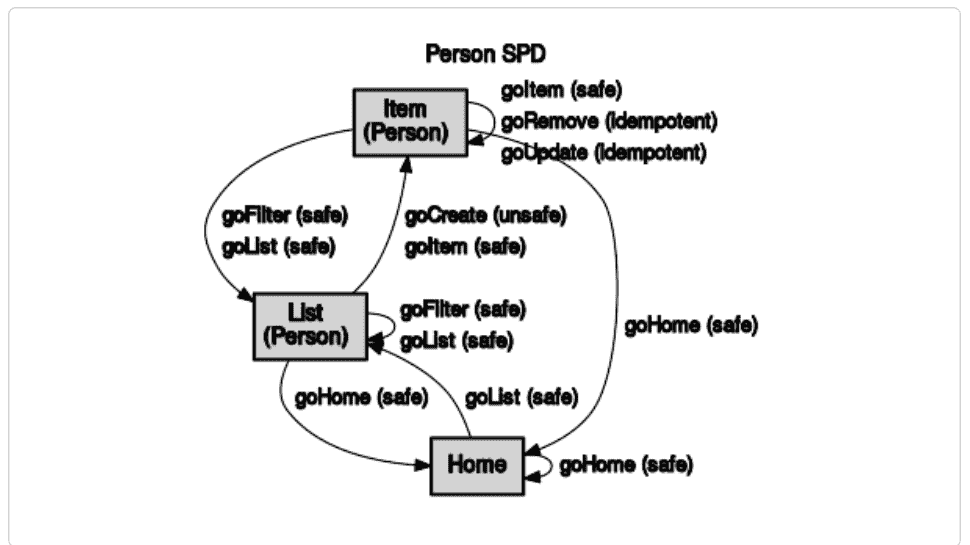

# 第 2 章 超媒体设计模式

### 早期发布读者须知

借助“早期发布”电子书，你可以在这些书正式发布之前很久就接触到它们的最早形态——作者写作时的原始未编辑内容——从而提前利用这些技术。

这是最终图书的第二章节。请注意，GitHub 仓库稍后才会启用。

如果你对我们如何改进本书内容和/或示例有任何评论，或者你注意到本章缺少某些内容，请通过 mca@amundsen.com 联系作者。

> 这个问题本质上就是科幻作家们讨论过的问题：“在两个完全不相干的‘智慧’生物之间，你如何让通信开始？”
>
> J.C.R. 利克莱德，1966 年

任何系统级设计的基础要素都是一组关于系统各部分如何交互的共享原则或共识。而这正是我们在本章要解决的总体问题——如何设计系统，让由素未谋面的不同人所构建的机器能够成功相互交互。

对于 Web 内部的通信而言，HTTP 是这种共识的核心。正是 HTTP 为服务之间发送数据设定了规则——以及预期。尽管 HTTP 的历史可以追溯到 20 世纪 80 年代中期，但在 30 多年后，它仍然无处不在且至关重要。

重要的是要记住，HTTP 是网络上机器之间的“高层”协议约定。较低层的协议——如 TCP/IP¹、² 和 UDP³——提供了传输比特的骨干。我发现这个“低层”通信系统最有趣的一点是，它之所以有效，*是因为*通信组件并不理解它们所传输数据的含义。意义与消息是分离的。

信息可以独立于用来共享该信息的消息进行处理，这一观念是使机器间通信能够“大规模”进行的关键理解。并且，在其自身层次上处理信息也很重要。HTTP 通过使用媒体类型提供了一个很好的例子。我可以将公司销售数据放在 HTML 消息中发送给你；也可以将同样的信息放在 CSV 消息中发送；或纯文本消息，等等。*数据*独立于媒体类型。

你会在本章的所有秘诀中看到这种分离观念。虽然协议和媒体类型是成熟的分离形式，但本章的秘诀还依赖于另一种形式——将*词汇*与消息格式分离。词汇是我们用来沟通重要事物的一组规则。当我们双方共享相同的词汇时，沟通效果最好。例如，你可以想象两台动画机器在互相交谈：

> > “嘿，机器1，让我们使用 HL7 FHIR Release 4 词汇来讨论医疗保健系统吧⁴。”
> >
> > “好的，机器2。但我们能用 RDF 来发送消息，而不用 XML 吗？”
> >
> > “当然，机器1。只要我们能使用 HTTP 而不是 MQTT。”
> >
> > “同意！”

> **提示**
>
> 值得注意的是，FHIR 平台认识到 FHIR 信息可以使用 XML、JSON 和 RDF 消息格式共享——这清楚地表明了将领域特定信息与用于共享该信息的格式分离的重要性。

对于可扩展系统，另一个重要的共识是‘我们如何把事情办成’。在这里，事情‘办成’的方式就是通过超媒体。超媒体控件（如链接和表单）用于表达完成任务所需的运行时元数据。控件本身是服务端和客户端都提前理解的结构化对象。然而，控件的内容——元数据属性的值——是在运行时提供的。例如某个特定操作所需的数据属性、执行该操作要使用的协议方法以及该操作的目标 URL。这些都是在运行时决定的。客户端不需要记住它们，而是在消息中接收它们。基本上，超媒体控件是另一个层次的分离。事实上，JSON-LD⁵ 消息格式依赖于一个单独的词汇表（Hydra⁶）来表达 JSON-LD 消息中的超媒体信息。你会在这里看到一些承认超媒体对 RWM 重要性的秘诀。你还会在后续章节中找到几个具体的超媒体秘诀，涵盖特定的实现模式。

最后，你会看到一些专门针对 HTTP 上成功通信的秘诀。这些秘诀涵盖网络承诺（安全性和幂等性），以及在长距离不可靠连接上支持机器间通信的现实问题。幸运的是，HTTP 非常适合解决连接中断的问题——它设计和构建的时期，大多数 HTTP 对话都是在相对较慢的语音电话线上进行的。然而，要让 HTTP 真正发挥良好作用，客户端和服务器都需要就消息元数据（例如 HTTP 头）的正确使用达成一致，并额外提供一些支持以应对网络级错误发生时的处理。

因此，本章（设计章节）聚焦于这样的秘诀：承认通信各分离层的威力、超媒体在传达*事情如何完成*方面的作用，以及在错误发生时如何确保可靠通信的一些共识。

但在我们深入探讨这些秘诀之前，让我们先探索超媒体、信息架构和网络通信作为基础——


我们设计配方中的要素。

## 通过超媒体设计奠定基础

本章设计配方背后有三个总体思想：

- 一种约定的通信格式，用于处理联网机器之间的连接
- 一种将数据解释为信息的模型
- 一种在运行时告诉机器哪些操作有效的技术

本书中的所有配方都致力于实现一个想法：在联网机器上运行的应用服务之间建立有用的连接。如今，最常见的做法是在数据包层面使用 TCP/IP，在消息层面使用 HTTP。美国国防部最初设计并资助了第一批机器对机器网络（ARPANET），该网络最终成为我们今天使用的互联网，这背后有一段有趣的历史。而这段历史还牵涉到外太空的外星人。在20世纪60年代，美国发展计算机通信时，正是可能遇到外星人的设想推动了机器间通信的某些设计选择。

除了机器间通信的约定通信格式之外，在机器之间组织和共享数据的工作也是本章的另一个主题。为此，我们将稍微深入信息架构（IA），并了解本体、分类法和编排的价值。IA的历史大约始于罗伊·菲尔丁（Roy Fielding）开发其REST软件架构风格的同一时期，并且深受蒂姆·伯纳斯-李（Tim Berners-Lee）基于HTTP和HTML的万维网兴起的影响。在本章中，我们将把IA作为组织要素，指导我们如何使用共享词汇模式来描述服务能力。

最后，我们将直接切入核心问题：由从未谋面的不同开发者构建的机器，如何在开放网络上实时成功交互——即使用“超媒体作为应用状态的引擎”。使用超媒体来描述并允许对网络中的其他机器执行操作，正是让RESTful Web 微服务得以运作的原因。通过HTTP建立的可靠连接和使用词汇表进行的一致建模是交互的先决条件，而超媒体正是实现这种交互的技术。本章中的配方将指出设计超媒体交互的方法，而后续章节将包含如何使这些设计持续一致地发挥作用的细节。

那么，让我们看看外太空外星人的可能性、信息架构和超媒体如何汇聚在一起，塑造RESTful Web 微服务的设计。

### 利克利德的外星人

1963年，J.C.R. “利克”·利克利德——一位在美国国防部工作的默默无闻的文职人员——给当时在被称为“高级研究计划局（ARPA）”工作的同事们写了一份办公室内部备忘录。几年之内，这个小组将负责创建ARPANET⁷——当今互联网的前身。然而，在这个早期阶段，利克利德的受众被称为“星际网络成员及附属机构”⁸。他的备忘录专注于计算机器如何能够连接在一起——它们如何能够成功地相互通信。

在备忘录中，利克利德提出了两种确保计算机协同工作的总体方法。他们可以 a) 确保地球上所有计算机使用相同的语言和编程工具；或者 b) 建立一种共享的网络级控制语言，允许机器使用自己“偏好的”本地工具和语言，然后在网络上通信时使用另一种“共享的”语言。第一种选择会让机器易于连接，但难以让它们变得专门化。第二种选择会让计算机设计者专注于优化本地功能，但会给机器互联编程工作增加复杂性。

最终（对我们来说很幸运！），利克利德和他的团队决定采用一种既有利于本地机器偏好语言，又有利于独立共享网络级语言的方法。这在今天看来也许显而易见，但在当时并不明确。而且，在今天看来突出的并不是利克利德的决定本身，而是他独特的推理——即有可能遇到来自外太空的外星人。要知道，当ARPA正致力于将计算时代变为现实时，美国的另一个机构NASA正在与苏联展开征服外太空的竞赛。

以下是利克利德备忘录中将20世纪60年代的太空竞赛与计算革命联系在一起的引文：

> *这个问题本质上正是科幻小说作家讨论过的那个问题：“你如何让完全互不关联的‘智慧’生命之间开始通信？”*
> 
> *J.C.R. 利克利德，1966年*

利克利德当时在推测，我们的卫星（或地面发射器）也许会如何着手解决与来自外太空的其他智慧生命通信的问题。并且，他推断，我们可以通过协商式通信的过程来实现这一目标——来回传递控制消息或“元消息”（关于我们如何发送消息的消息），直到双方都理解游戏规则。十年后，20世纪70年代的TCP⁹和IP¹⁰协议印证了利克利德的推测，并构成了我们今天所享用的互联网的主干。

#### 利克利德协议

在利克利德推测与外星机器通信四十年后，互联网工程任务组（IETF）的成员完成了一项星际通信传输协议的工作。该协议被命名为利克利德传输协议（LTP），并在IETF文档RFC5325¹¹、RFC5326¹²和RFC5327¹³中有所描述。

今天，在地球上，利克利德关于如何与外星人通信的思想实验，正是让RESTful Web 微服务（RWM）成为现实的核心。当我们设计并实现网络上相互通信的服务时，我们同样需要采用“元消息”方法。当我们考虑到我们工作的目标之一是“让完全互不关联的服务之间开始通信”时，这一点尤为重要。本着我们的指导原则（见配方1.3）的精神，人们应该能够自信地设计和构建服务，这些服务将能够与由素未谋面的其他人构建的服务对话，无论这些服务是昨天、今天还是未来构建的。

本节中的配方都旨在使实现“利克利德级别”的服务成为可能。你尤其会在*设计协商*和*设计变通*等部分看到这一点。

### 莫维尔的信息架构

20世纪90年代对互联网支持者来说是一个令人振奋的时代。蒂姆·伯纳斯-李的万维网和HTTP/HTML（见“蒂姆·伯纳斯-李的万维网”）已经投入运行，罗伊·菲尔丁正在定义他的REST架构风格（见“菲尔丁的REST”），理查德·索尔·沃尔曼¹⁴则创造了一个新术语：“信息架构师”。在1996年出版的《信息架构师》¹⁵一书中，沃尔曼给出了这样的定义：

> *信息架构师：1) 组织数据中固有模式、让复杂变得清晰的人；2) 创建信息结构或信息地图、使他人能够找到通往知识的个人路径的人；3) 面向清晰、人类理解和信息组织科学这一时代需求而兴起的新世纪职业。*
> 
> *理查德·索尔·沃尔曼，1996年*

沃尔曼受过建筑设计师的训练，1984年创办了技术、娱乐与设计（TED）大会。他是一位多产作家，撰写了近100本各种主题的书，包括艺术、旅行，以及（对我们的关注点很重要的）信息设计。图书馆学家彼得·莫维尔是接受沃尔曼信息架构理念的人之一。莫维尔被认为是信息架构运动的“奠基人”之一，撰写了几本关于该主题的著作。他最著名的书于1998年首次出版，书名就叫《信息架构》¹⁶，目前已经出到第四版。

莫维尔的书聚焦于人类如何与信息互动，以及如何设计和构建大规模信息系统，以最好地支持持续增长、管理和易用性。他指出，一个信息架构（IA）良好的系统能帮助系统用户理解：1) 他们在哪里，2) 他们找到了什么，3) 他们周围还有什么，4) 他们可以期待什么。这些也是我们的RWM系统所需要的特性。我们在这里要做的是，利用能够为机器对机器交互实现同样目标的配方。

#### 解释信息架构

“理解集团”（TUG）的创始人丹·克莱恩有一个非常棒的短视频，名为“解释信息架构”，展示了本体、分类法和编排如何协同工作，共同形成信息架构（IA）模型。

我们将用于组织RWM实现的信息架构的方法之一，是使用由三部分组成的建模方法：1) 本体，2) 分类法，3) 编排（见“词汇表的力量”）。本章中有几个专门讨论信息架构的配方，包括配方2.3、配方2.4和配方2.5。

### 超媒体与“先验设计”

我之所以以“设计”这个话题来开始这组配方的编写，原因之一在于，设计信息系统的行为从一开始就会确立一些规则。正如我们在前一章讨论的指导原则（见配方1.3）为信息系统决策奠定基础一样，设计配方则使这一基础成为现实。正是这第一组配方，影响并在许多方面支配着本书其余部分的所有配方。


这样，提出这些首批方法就成了一种“*先验*设计”方法。《韦氏词典》中*先验*的一个定义是“预先形成的或预先构想的”，而这正是我们在这里所做的。我们预先设定了系统的各个要素。采用这种*先验*设计方法还有一个好处：它让我们能够定义系统的稳定要素，并在此基础上构建服务并实现它们的交互。

创建设计方法意味着我们需要一个适用于多种解决方案的模型。例如，一种只适用于内容管理系统（CMS）而不适用于客户关系管理系统（CRM）的方法，并不是很有用的设计方法。我们直觉上知道这两个截然不同的解决方案有很多共同点（无论是在设计层面还是技术解决方案层面），但往往需要一些努力才能将这些相似之处提炼成一套连贯的原则——一套设计原则。

当我们想要创建能随时间变化的解决方案时，这尤其具有挑战性。这些解决方案既要保持稳定，又要能添加新功能、实施新技术解决方案，并随着时间推移创建服务器和客户端应用等更多资源来与系统交互。我们所需要的是一个基础设计要素，它既能提供稳定性，又能支持变化。

在这套方法中，这个基础要素就是使用超媒体，即链接和表单（参见[方法1.2](#)），作为服务间通信的机制。菲尔丁称超媒体为“应用状态引擎”¹⁷。超媒体提供了利克莱德所识别出的那种元消息传递（参见[“利克莱德的外星人”](#)）。正是超媒体的使用，实现了凯所说的“极端后期绑定”（参见[“艾伦·凯的极端后期绑定”](#)）。

你会发现本书中的大多数方法都严重依赖超媒体，以实现机器之间的连接和一般通信。在本章中，[方法2.5](#)、[方法2.1](#)和[方法2.6](#)特别旨在将超媒体确立为这种*先验*设计中的关键要素。支持这种设计方法的另一个关键要素是利用信息架构的三大支柱（参见“莫维尔的信息架构”）。

那么，我们如何利用设计方法来创建基于三部分信息架构、由超媒体驱动、并符合利克莱德愿景的共享“先验”理解呢？让我们看看下面的方法示例。

## 2.1 使用注册媒体类型创建互操作性

建立稳定可靠系统的关键是确保服务之间的长期互操作性。这意味着过去创建的服务能够成功与未来创建的服务交换消息。

### 问题

你如何设计出在未来仍具有高度互操作性的服务？

### 解决方案

确保服务之间高水平长期互操作性的最佳方法是建立稳定的信息交换规则。在网络上，最佳做法是选择并记录对一种或多种开源媒体类型格式的支持，用于数据交换。长期稳定媒体类型的一个良好来源是互联网号码分配局（IANA）。为RWM提供长期支持的可行候选媒体类型包括XML和JSON等非结构化媒体类型，以及HTML、Collection+JSON、UBER、HAL和Siren等结构化媒体类型。请参阅附录C，了解本书发布时可行的媒体类型列表。

> **注意**
>
> 有关结构化媒体类型和非结构化媒体类型之间的区别，请参见[方法2.2](#)。

### 讨论

创建服务时，你应该记录你的服务支持哪些注册媒体类型（RMT）。建议你的服务支持多种RMT，并允许服务消费者发现你的服务支持哪些RMT，以及他们在交换消息时如何表明偏好（参见*设计协商*）。

> **提示**
>
> 我发布服务时，几乎总是将HTML添加为指定的消息格式之一。它已经存在30多年了；你可以使用任何常用浏览器作为该服务的客户端（非常适合测试），并且有足够的解析器和其他HTML工具，使你的服务消费者能够相对容易地与你交换数据。

关于候选媒体类型的其他建议如下：

- 它们应支持消息中的超媒体（参见[方法2.5](#)）。
- 它们应支持自定义扩展（例如，你能够在不破坏任何现有应用程序的情况下安全地向格式添加新功能）。

当你不幸需要支持一种已不受欢迎的格式，并且需要进行一些修改以延长服务寿命时，最后一点会派上用场。

你还可以为你的服务创建自己的媒体类型格式。在以下情况下可行：

- a) 你的服务API消费者范围相对有限（例如，在公司内部），
- b) 你的服务API消费者范围非常大（例如谷歌、Facebook、亚马逊等），或
- c) 你的服务在某个垂直领域处于领先地位（例如文档管理、金融服务、医疗保健等）。

如果你的情况不属于以上任何一类，我建议你**不要**创建自己的媒体类型。

### 那么，你想创建自己的媒体类型，嗯？

如果你决定创建自己的自定义媒体类型，你应该将其视为将来可能流行的公共格式。这意味着要对其进行恰当的文档记录和注册。你还需要准备好支持围绕你的媒体类型格式发展起来的任何社区——包括示例应用和其他工具。最后，你需要承诺长期坚持这项工作。另外，请记住，有些人可能会使用你的格式构建自己的服务，他们在未来理应获得适当的支持。

多年来，我创建了近十几种原创媒体类型。只有少数引起了广泛关注。但我仍然努力履行对它们全部的责任。

### 相关方法

- 方法2.2
- *设计协商*

## 2.2 使用结构化媒体类型（SMT）确保未来兼容性

RWM设计中的一个重要基础要素是支持未来兼容性。这意味着让过去编写的服务能够在未来与更多服务继续交互。这也意味着要设计交互方式，使得未来对已部署服务的更改不太可能*破坏*其他现有服务或客户端。

### 问题

你如何设计机器对机器的交互，使之能够支持对生产中的服务进行修改，同时又不破坏现有的服务消费者？

### 解决方案

为了支持对现有服务进行非破坏性更改，你应该使用*结构化媒体类型*（SMT）来来回传递信息。SMT使得即使在消息的*内容*（例如记录的属性、操作列表等）发生变化时，仍然能够发出稳定、非破坏性的消息。关键在于设计交互方式，使机器之间共享的消息在数据变化时仍保持相同的结构。

结构化媒体类型（SMT）提供了一种强类型格式，这种格式不会根据所表示的数据而变化。这与XML和JSON等非结构化消息格式相反。详见示例。

在交互中使用公认的媒体类型是一个好主意。通过互联网号码分配局（IANA）注册的媒体类型是不错的选择。例如，HTML就是SMT的一个很好的例子。其他可行的一般用途SMT格式包括Collection+JSON和UBER。更多可考虑的媒体类型列表，请参见*附录C*。

### 示例

结构化媒体类型（SMT）提供了一种强类型格式，这种格式不会根据所表示的数据而变化。下面是一个用HTML表示的简单消息示例

```html
<ul name="Person">
  <li name="givenName">Marti</li>
  <li name="familyName">Contardi</li>
</ul>
...
<ul name="Person">
  <li name="givenName">Marti</li>
  <li name="familyName">Contardi</li>
  <li name="emailAddress">mcontardi@example.org</li>
</ul>
```

上述消息的*结构*可以（用过于简化的方式）表达为“由单个ul元素包含的一个或多个li元素”。注意，添加更多内容（例如电子邮件地址）不会改变消息的*结构*（你可以使用相同的消息验证器），而只是改变了*内容*。

将上述示例与以下JSON对象进行对比：


{ "Person" : {
  "givenName": "Marti",
  "familyName": "Contardi"
}
}
...
{ "Person" : {
  "givenName": "Marti",
  "familyName": "Contardi",
  "emailAddress": "mcontardi@example.org"
} }

JSON 结构可以表述为“一个具有两个键（givenName 和 familyName）的 JSON 对象”。向消息中添加电子邮件地址将导致 JSON 消息的结构发生变化（例如，需要新的 JSON Schema 文档），同时内容也会发生变化。

## 讨论

本方案的关键在于保持消息内容与结构之间的松耦合。这样，消息消费应用程序可以更轻松、一致地验证传入消息——即使这些消息的内容随时间发生变化。

思考此解决方案的另一种方式是：假设消息消费应用程序的首要任务是确保消息格式良好（well-formed）——即消息符合构造消息的基本规则。然而，确保消息有效（valid）则是另一项任务——即消息内容遵循既定规则，明确消息中需要出现哪些信息（例如“所有 Person 消息必须包含 givenName、familyName 和 emailAddress 属性”）。

为确保未来兼容性，第一步是确保协商消息即使在有效消息的规则随时间变化时也能保持格式良好。

## 相关方案

- 方案 2.3
- 方案 2.4
- 方案 2.5
- *设计协商*

## 2.3 通过已发布词汇表共享领域特定内容

正如你需要支持已注册的结构化媒体类型，以确保服务的长期兼容性和可靠性，你同样需要支持稳定一致的领域特定内容，以确保服务生产者和消费者的长期可行性。

### 问题

如何确保你的服务的数据属性名称能够被其他服务理解——即使这些服务并非由你创建？

### 解决方案

为了确保你的服务用于交换信息的数据属性能够被广泛的其他服务（甚至包括那些并非由你创建的服务）充分理解，你应该采用有良好文档记录且广为人知的数据属性名称，作为外部接口（API）的一部分。这些名称应当是已发布的数据词汇表中已定义的名称；如果尚未发布，你应当发布你的数据词汇表，以便其他创建类似服务的人能够找到并使用相同的术语。

一个适用于 Web 的通用已发布词汇表的好来源是 Schema.org 网站。它拥有数百个定义良好的术语，适用于广泛的用例，并且以良好治理的方式持续增长。

还有其他治理良好的词汇表来源，如 Microformats.org 和 Dublin Core。

### 警告

提醒一句。有些词汇表，尤其是行业特定的词汇表，并非完全开源（例如，你必须为访问和参与付费）。我还要指出，一些词汇表计划，甚至一些开源计划，其目标不仅仅是提供一个简单的共享词汇表。它们包含架构、平台，甚至 SDK 的建议和/或约束。

要建立对互操作性的长期支持，最好的办法是确保你使用的任何词汇表术语与任何其他软件或硬件依赖关系无关。

在撰写本文时，也有一些行业特定的公共词汇表值得考虑。例如：支付领域的 PSD2、医疗保健领域的 FHIR、保险领域的 ACORD。

发布服务时，你还应发布一份文档，列出服务使用或产生的所有词汇表术语，并附上适当定义的链接。有关如何正确记录和发布词汇表文档的更多信息，请参阅方案 2.4。

### 示例

拥有良好管理的词汇表的服务更可能被他人理解，因此更可能获得更广泛的采用。当你有选择时，你应该在服务的外部 API 中使用众所周知的术语，即使你自己的内部数据存储系统使用本地或公司特定的术语。

例如，下面是一条反映典型美国公司内部所用术语的 Person 记录：

```json
{ "collection" : {
  "links": [
    {"rel": "self", "href": "http://api.example.org/persons"}
  ],
  "items" : [
    {
      "href": "http://api.example.org/persons/q1w2e3r4",
      "data" : [
        {"name": "fname", "value": "Dana"},
        {"name": "lname", "value": "Doe"},
        {"name": "ph", "value": "123-456-7890"}
      ]
    }
  ]
}
```

这是同一条记录，已更新为使用 schema.org 词汇表中可用的术语：

```json
{
  "collection": {
    "links": [
      {"rel": "self", "href": "http://api.example.org/persons"},
      {"rel": "profile", "href": "http://profiles.example.org/persons"}
    ],
    "items": [
      {
        "href": "http://api.example.org/persons/q1w2e3r4",
        "data": [
          {"name": "givenName", "value": "Dana"},
          {"name": "familyName", "value": "Doe"},
          {"name": "telephone", "value": "123-456-7890"}
        ]
      }
    ]
  }
}
```

注意第二个示例中使用了 `profile` 链接关系。详见**方案 2.4**。

### 讨论

本方案基于这样的理念：确保数据属性术语与消息格式不强耦合。本质上，它是**方案 2.2** 的另一面。采用众所周知的、松耦合的词汇表，也是保护你的服务免受内部数据模型随时间变化影响的绝佳方式。

> **提示**
>
> 关于处理 RWM 数据的更多方案，请参阅*第 5 章*

限制你的外部接口仅使用众所周知的、有良好文档记录的属性名称，是确保服务互操作性的最佳做法之一。这一点，加上发布语义配置文件（参见方案 2.4），构成了大规模信息系统管理的支柱。然而，这项工作绝非易事。它需要关注细节、细致的文档和持续的支持。管理和执行社区词汇表的团队正在做重要而有价值的工作。

本方案的一个挑战是，你的服务的*公共*词汇表很可能与*私有*词汇表不同。私有名称集通常与古老的内部实践有关，可能是单个团队自己的设计美学，甚至是长期以前购买的商业现货（COTS）软件所决定的。要解决这个问题，服务需要实现所谓的“防腐蚀层”¹⁸。无需修改现有的数据存储模型或服务。

记录并共享你的服务词汇表非常重要。一个好的做法是，在一个地方发布所有“魔法字符串”（参见“理查德森的魔法字符串”）的列表，并附上简短描述，以及尽可能提供描述来源的参考（以 URL 形式）。我使用应用程序级配置文件语义（ALPS）格式来实现这一点（参见方案 2.4）。

下面是一个 ALPS 词汇表文档示例：

```json
{
  "alps": {
    "descriptor": [
      {
        "id": "givenName",
        "def": "https://schema.org/givenName",
        "title": "Given name. In the U.S., the first name of a Person.",
        "tag": "ontology"
      },
      {
        "id": "familyName",
        "def": "https://schema.org/familyName",
        "title": "Family name. In the U.S., the last name of a Person.",
        "tag": "ontology"
      },
      {
        "id": "telephone",
        "def": "https://schema.org/telephone",
        "title": "The telephone number.",
        "tag": "ontology"
      },
      {
        "id": "country",
        "def": "http://microformats.org/wiki/hcard#country-name",
        "title": "Name of the country associated with this person.",
        "tag": "ontology"
      }
    ]
  }
}
```

在创建 RWM 词汇表时，一个好的做法是为术语定义确定一个首选来源，以及一个或多个“备用”来源。例如，你的词汇表治理文档指南可以这样写：

> “只要有可能，优先使用 Schema.org 中的术语。如果找不到可接受的术语，接下来到 Microformats.org 和 Dublin Core 中查找可能的术语。最后，如果在这些地方都找不到可接受的术语，请在 [some-url] 的公司级词汇表仓库中创建一个新术语。”

词汇表编写者指南示例

一些额外说明：

### 混合术语

在单一术语集中混合引用不同词汇表是完全可接受的。你可以从上面的示例中看到，我包含了三个来自 Schema.org 的术语和一个来自 Microformats.org 的术语。

### 限制同义词

就像现实生活中一样，可能有多个术语表示同一事物。例如 `tel`（来自 Microformats）和 `telephone`（来自 Schema.org）。只要可能，就应采用单一术语用于所有外部用途，以限制同义词的使用。


## 发布词汇表

有关如何发布本文档并在网上检索它，请参阅方法 2.4。

### 相关方法

- 方法 2.2
- 方法 2.4
- TK 来自第5章（数据）的一些方法？

## 2.4 使用语义配置文件描述问题空间

除了将定义良好的数据属性词汇表与消息结构解耦之外，还需要努力定义数据属性如何来回传递。这就是“描述问题空间”的工作。问题空间在游戏和互动艺术作品中用于为一组相关活动设置“护栏”。可以这么说，问题空间就是“游戏规则”。RWM 也依赖“游戏规则”。

### 问题

你如何以在设计和运行时都可用的一种方式，提供服务支持的所有可能数据属性、对象和动作的详细描述？

### 解决方案

为了确保开发者能够快速准确地理解你的服务支持的数据交换和动作，你可以发布语义配置文件文档（SPD）。SPD 包含服务支持的所有数据属性、对象和动作的完整列表。

```
"descriptor": [
    {"href": "#href"},
    {"href": "#identifier"},
    {"href": "#givenName"},
    {"href": "#familyName"},
    {"href": "#telephone"}
]
},
{"id": "Home", "tag": "taxonomy",
    "descriptor": [
        {"href": "#goList"},
        {"href": "#goHome"}
    ]
},
{"id": "List", "tag": "taxonomy",
    "descriptor": [
        {"href": "#Person"},
        {"href": "#goFilter"},
        {"href": "#goItem"},
        {"href": "#doCreate"},
        {"href": "#goList"},
        {"href": "#goHome"}
    ]
},
{"id": "Item", "tag": "taxonomy",
    "descriptor": [
        {"href": "#Person"},
        {"href": "#goFilter"},
        {"href": "#goItem"},
        {"href": "#doUpdate"},
        {"href": "#doRemove"},
        {"href": "#goList"},
        {"href": "#goHome"}
    ]
},
{"id": "goHome", "type": "safe", "tag": "choreography", "rt": "#Home"},
{"id": "goList", "type": "safe", "tag": "choreography", "rt": "#List"},
{"id": "goFilter", "type": "safe", "tag": "choreography", "rt": "#List"},
{"id": "goItem", "type": "safe", "tag": "choreography", "rt": "#Item"},
{"id": "doCreate", "type": "unsafe", "tag": "choreography", "rt": "#Item"},
{"id": "doUpdate", "type": "idempotent", "tag": "choreography", "rt": "#Item"},
{"id": "doRemove", "type": "idempotent", "tag": "choreography", "rt": "#Item"}
]
} 
}
```

### 图表

以下是上面所示的 `person-alps.json` 文件的工作流图（*编排*）。



你可以在本书关联的 GitHub 仓库（TK）中找到此语义配置文件的完整 ALPS 渲染（ALPS 文件、图表和文档）。

### 讨论

采用语义配置文件文档（SPD）是创建可用 RWMS 的重要部分。然而，这种方法相对较新，尚未被广泛使用。尽管 ALPS 和 DCAP 已经存在了大约十年，但关于语义配置文件的工具并不多，书面指导也有限。不过，我自己使用 ALPS 的经验让我认为你会看到更多关于语义配置文件的内容（即使在未来的某些形式中不是 ALPS 和 DCAP）。

### 在所有响应中共享语义配置文件

在每个协议响应中返回语义配置文件的 URI 是一个好主意。有关如何执行此操作的详细信息，请参阅*第3章*和*第4章*。

### 限制对已发布语义配置文件的更改

由于客户端和/或服务可能会对已发布的语义配置文件产生逻辑依赖，因此一旦发布 SPD，最好不要对其进行任何破坏性更改。如果你需要更改，最好在新的 URI（例如 `api.example.org/profiles/personV2`）上创建新的配置文件文档，并同时保留现有配置文件（未更改的那个）在线。

### 使你的语义配置文件可从中心位置访问

为了便于人们（和机器）找到你的语义配置文件，请创建一个中心在线位置，使它们能够被轻松找到。这可能是一组实际的配置文件文档，也可能是一个页面，其中包含指向其他位置（每个配置文件文档所在处）的指针（URL）。第二种选择适用于你不是配置文件作者，但仍然希望对常用配置文件有所控制的情况。

### 相关方法

- 参见*第2章*，媒体类型
- 参见*第2章*，结构化类型
- 参见*第2章*，超媒体
- 参见*第3章*，配置文件
- 参见*第3章*，超媒体
- 参见*第3章*，表示器
- TK *第4章*方法
- TK *第7章*方法

## 2.5 使用嵌入式超媒体在运行时表达领域操作

在响应中使用嵌入式超媒体，以告知 API 消费者应用程序当前可能执行哪些操作，是 RWMS 的基础元素。正如“艾伦·凯的极端后期绑定”中提到的，超媒体控制使实现“极端后期绑定”成为可能——这是一种*超松耦合*，也意味着你可以在未来更轻松地修改服务。

### 问题

你如何通过构建支持安全、非破坏性工作流变更的系统，并通过在运行时定制数据交换来支持现有服务的短期可修改性，从而延长服务的生命周期？

### 解决方案

支持产品服务短期和长期可修改性的最佳方式是依赖内联超媒体可供性，在运行时表达上下文相关数据交换的细节。这意味着你需要采用支持嵌入式超媒体的消息交换格式（参见方法 2.1 和方法 2.2）。

### 示例

HTML 提供了一个很好的嵌入式超媒体控制示例，用于在运行时表达数据交换。以下是一个示例：

```
<html>
  <head>
    <title>Create Person</title>
    <link rel="profile"
 href="http://api.example.org/profiles/person" />
    <style>
      input {display:block;}
    </style>
</head>
<body>
    <h1>Create Person</h1>
    <form name="doCreate" action="http://api.example.org/person/" method="post" enctype="application/x-www-form-urlencoded">
        <fieldset>
            <hidden name="identifier" value="q1w2e3r4" />
            <input name="givenName" placeholder="givenName" required/>
            <input name="familyName" placeholder="familyName" required/>
            <input name="telephone" placeholder="telephone" pattern="[0-9]{10}"/>
            <input type="submit" />
            <input type="reset" />
            <input type="button" value="Cancel" />
        </fieldset>
    </form>
</body>
</html>
```

上面的表单指示了一个默认输入（identifier）和三个附加输入，其中两个是必需的（givenName、familyName），一个必须通过模式验证器（telephone）。表单还指示了三个可能的操作（提交、重置和取消），以及提交操作的 URL、HTTP 方法和正文编码元数据等详细信息。更好的是，任何符合 HTML 的客户端（例如 Web 浏览器）都可以支持所有这些操作，而无需任何自定义编程代码。

以下是 Collection+JSON 中的一个简单示例

```
{ "collection" :
  {
    "version" : "1.0",
    "href" : "http://api.example.org/person/",
    "links": [
      {"rel": "self", "href": "http://api.example.org/person/doCreate"},
      {"rel": "reset", "href":"http://api.example.org/person/doCreate?reset"},
      {"rel": "cancel", "href":"http://api.example.org/person"}
    ],
    "template" : {
```

虽然嵌入式超媒体很有价值，但使用它确实需要付出一些代价。首先，它是一个*设计时约束*。API 消费者和生产者都需要同意使用它们。这是创建 RWM 时的“入门代价”。虽然这不同于“在给 Web 浏览器的响应中必须使用 HTML、CSS 和 JavaScript”，但我仍然发现许多架构师和开发者对使用超媒体丰富的响应这一想法感到恼火。当你决定构建 RWM 时，你可能需要帮助一些人跨过这个障碍。

选择“正确”的结构化超媒体媒体类型很容易演变成一场争斗。有很多可供选择，有些人会陷入“你只能选择一个”的陷阱。事实上，你可以利用 HTTP 中的内置特性（参见*设计协商*）来支持多种响应格式，并在运行时选择最佳选项。这是三十年的技术，所以有很多示例和配套代码片段可以帮助你处理这个问题。你甚至可以决定从单一格式开始（通常是 HTML），然后随着时间推移添加更多类型，而不会破坏任何现有应用程序。

> **警告**
> 
> 并非所有超媒体格式都是相同的。例如，超文本应用语言（HAL）格式标准化了 `link` 元素，但并未标准化 `forms` 或数据体。表示实体的结构化接口（SIREN）格式标准化了 `links` 和 `forms`，但没有标准化数据体。HTML、Collection+JSON 和交换表示的统一基础（UBER）标准化了所有三种消息元素。我创建了一些“超媒体 polyfill”格式来补充 SIREN（配置文件对象描述）和 HAL（HAL-FORMS），以帮助弥合差距，但这些补充可能会使实现复杂化。有关这些和其他媒体类型的更多信息，请参阅*附录C*。

使用超媒体类型表达领域状态有时也是一个挑战。开发者需要能够将内部对象和模型规则转换为有效的超媒体控制（`forms`、`inputs`、`links` 等）。这是一种必须获得的翻译技能。有一些库可以让这变得更容易（参见*附录D*），但你可能还需要“自己动手解决问题”。


## 解决方案

所有数据写入操作都应使用 HTTP PUT 发送，而不是 HTTP POST。HTTP PUT 操作易于设计，可以防止“重复提交”，并确保当服务器响应未到达客户端应用程序时，重试该操作是安全的。

## 示例

受数据库 CRUD（创建、读取、更新、删除）模式的影响，多年来“创建”操作一直映射到 HTTP POST，“更新”操作映射到 HTTP PUT。然而，使用 HTTP POST 向服务器写入数据是一个挑战，因为该操作不能一致地重复。换句话说，POST 选项不是幂等的。但是，按照设计，HTTP PUT 操作是幂等的——即使多次重复该操作，也能保证相同的结果。

下面是一个简单示例，展示了非幂等写入的叠加性质和幂等写入的替换性质：

```
/* ****************************************
  illustrating idempotency
  RWMBBook 2021
  **************************************** */

// non-idempotent
console.log("non-idempotent");
var t = 10;
for(x=0;x<2;x++) {
  t = t+1; //add
  console.log(`try ${x} : value ${t}`)
}

// idempotent
console.log("idempotent");
var t = 10;
for(x=0;x<2;x++) {
  t = 11; // replace
  console.log(`try ${x} : value ${t}`)
}
```

输出应如下所示：

```
mca@mamund-ws: node idempotent-example.js
non-idempotent
try 0 : value 11
try 1 : value 12
idempotent
try 0 : value 11
try 1 : value 11
```

假设上例中的变量 `t` 是表示 HTTP 资源的任何消息主体。HTTP PUT 使用消息主体 *替换* 服务器上任何现有资源。HTTP POST 使用消息主体 *添加* 新的服务器资源。

这一切都没问题，直到你发出写操作（HTTP POST 或 PUT）却始终没有收到服务器响应。你无法确定发生了什么。是请求从未到达服务器？还是服务器执行了更新但未能发送响应？还是发生了其他情况（例如导致部分写入的错误）？

为了避免这个难题，最好的解决方案是始终使用 HTTP PUT 将数据写入网络上的另一台机器。

```
**** REQUEST
PUT /person/q1w2e3 HTTP/2.0
Host: api.example.org
Content-Type: application/x-www-form-urlencoded
If-None-Match: *

givenName=Mace&familyName=Morris

**** RESPONSE
HTTP/2.0 201 CREATED
Content-Type: application/vnd.collection+json
ETag: "p009i8u7y6t5r4e3w2q1"
...
```

请注意，虽然不常见，但如果该地址没有资源，PUT 请求返回 `201 CREATED` 响应是符合 HTTP 规范的。但是，如何告诉服务你期望创建新资源而不是更新现有资源呢？为此，你需要使用 `If-None-Match`。在上面的示例中，`If-None-Match: *` 头表示“如果在提供的 URL 处没有现有资源，则在该 URL 处创建一个新资源。”

如果我想要服务将 HTTP PUT 视为对现有资源的替换，我会使用以下 HTTP 交互：

```
**** REQUEST
PUT /person/q1w2e3 HTTP/2.0
Host: api.example.org
Content-Type: application/x-www-form-urlencoded
If-Match: "p009i8u7y6t5r4e3w2q1"

givenName=Mace&familyName=Morris

**** RESPONSE
HTTP/2.0 200 OK
Content-Type: application/vnd.collection+json
ETag: "o9i8u7y6t5r4e3w2q1p0"
...
```

这里，HTTP 请求标有 `If-Match:` 头，其中包含实体标签（ETag），用于标识你希望更新的 `/person/q1w2e3` 资源的确切版本。如果该 URL 上的 ETag 与请求中的不匹配（例如，资源不存在或最近已被其他人更新），则 HTTP PUT 将被拒绝，并返回 `HTTP 412 Precondition Failed` 响应。

## 讨论

使用“PUT-Create”模式可以简化判断何时可以重试通过 HTTP 进行的失败写入操作这一挑战。它之所以有效，是因为按照设计，PUT 可以在不产生不必要副作用的情况下重试。而 POST——按设计——不能做出这种保证。曾有少数尝试使 POST 可重试。两个例子是 Bill de hÓra 的 HTTP LR¹⁹ 和 Mark Nottingham 的 POE²⁰。两者都没有被广泛采用。

使用 HTTP PUT 创建新资源在前端需要更多工作——无论对客户端还是服务器。主要是因为依赖于正确使用 HTTP 头 `If-None-Match`、`If-Match` 和 `ETag`。以我的经验，最好将此方案“内置”到服务器和客户端应用程序的代码中。我通常在本地代码中有“包装方法”，名为 `createResource(…)` 和 `updateResource(…)`（或类似名称），它们知道如何构造正确的 HTTP PUT 请求（包括正确的头），以及如何在事情不按计划进行时做出响应。这些包装方法的便利性降低了使用“PUT-Create”的感知额外成本，并确保在客户端和服务器上一致地实现。

> **提示**
> 
> 有关创建和更新资源的更多相关方案，请参阅*第 3 章*和*第 4 章*。

此方案中还包含另一个方法：客户端应用程序提供资源标识符的能力。使用 POST 时，通常期望服务创建新的资源标识符——通常是单调递增的 ID，如 `/person/1`、`/person/2` 等等。使用 PUT 时，期望客户端提供资源标识符（想想“请将文件 `my-todo-list.doc` 上传到我的文档存储”）。更多内容请参阅*第 3 章*和*第 4 章*。

通过“PUT-Create”模式设计对幂等写入的支持，意味着你的客户端和服务器应用程序都将更加可靠和一致——即使你使用的网络连接并不可靠。

## 相关

- TK *第 3 章* ??
- TK *第 4 章* ??

- ¹ https://datatracker.ietf.org/doc/html/rfc793
- ² https://datatracker.ietf.org/doc/html/rfc791
- ³ https://datatracker.ietf.org/doc/html/rfc768
- ⁴ http://hl7.org/fhir/R4/overview-dev.html
- ⁵ https://json-ld.org/
- ⁶ http://www.hydra-cg.com/spec/latest/core/
- ⁷ https://en.wikipedia.org/wiki/ARPANET
- ⁸ http://www.chick.net/wizards/memo.html
- ⁹ https://www.rfc-editor.org/rfc/rfc793.html
- ¹⁰ https://datatracker.ietf.org/doc/html/rfc791
- ¹¹ https://www.rfc-editor.org/rfc/rfc5325.html
- ¹² https://www.rfc-editor.org/rfc/rfc5326.html
- ¹³ https://www.rfc-editor.org/rfc/rfc5327.html
- ¹⁴ https://en.wikipedia.org/wiki/Richard_Saul_Wurman
- ¹⁵ https://www.worldcat.org/title/information-architects/oclc/963488172
- ¹⁶ https://www.worldcat.org/title/information-architecture-for-the-world-wide-web/oclc/1024895717
- ¹⁷ https://www.ics.uci.edu/~fielding/pubs/dissertation/rest_arch_style.htm#sec_5_1_5
- ¹⁸ https://malotor.medium.com/anticorruption-layer-a-effective-shield-caa4d5ba548c
- ¹⁹ http://xml.coverpages.org/draft-httpr-01.html
- ²⁰ https://datatracker.ietf.org/doc/html/draft-nottingham-http-poe-00
