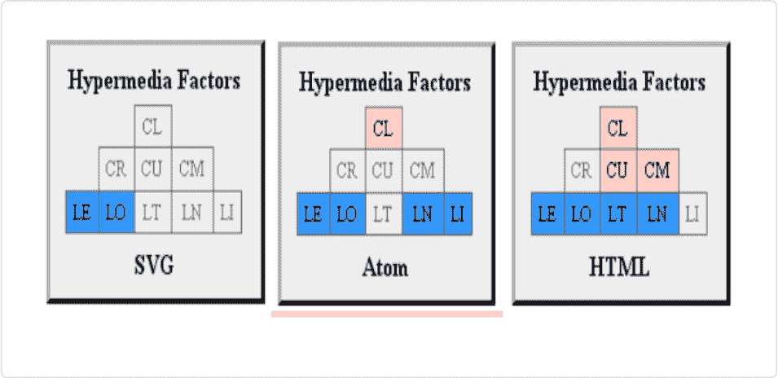

## 使用超媒体客户端增强韧性

这并不意味着我们需要复制 HTML 浏览器。该客户端应用程序专注于高度的可用性，依赖人类作为界面背后的“大脑”（或者更确切地说，在界面前方）。HTML 格式的设计旨在通过内联脚本控制消息的可视渲染以及内容的动画。这种对 UI 和人类的关注对于大多数 Web 微服务来说并不是必需的。

相反，对于 Web 微服务，我们需要关注机器对机器的交互，以及如何弥补“缺失的元素”——人类。这里选择的方案之所以被选中，是因为它们能够带来高水平的可重用性，而无需依赖人类参与每次交互。为此，重点强调了韧性超媒体驱动客户端的四个要素：1) 利用协议和格式，2) 依赖运行时元数据，3) 解决机器对机器接口的挑战，4) 使用语义概要作为客户端和服务器之间的共享理解。

那么，让我们详细看看这四个要素是什么，以及它们如何帮助我们构建更好的 API 客户端。


应用程序的存在是为了完成某项任务，它们有其目的。正如我们将在本章中讨论的，明确这个目的究竟是什么——以及在创建 API 消费者时我们希望达到何种明确程度——是非常重要的。

> **提示**
> 
> 计算机相关词典中对“application”一词的常见定义是“为满足用户的特定目的而设计和编写的程序或软件。”¹ 该术语的另一个更一般的定义是“使某物投入运行的行为。”在整理这些方案时，我试图将这两个定义都牢记在心。

一套高度详细的 API 客户端指令会使其在既定任务上非常高效，但也会让该客户端 API 几乎无法用于任何其他任务。而且，如果为其设计的目标服务在任何重要方面发生变化，该客户端应用程序就会“崩溃”。事实证明，解决方案越详细，其可重用性就越低。相反，如果你希望能够重用 API 消费者，就需要改变实现它们的方式。这正是本章的主题。

本章中的方案旨在提高客户端应用程序的韧性。这意味着要关注 API 消费者中能够提升韧性和适应性的几个重要特征，即：

- 关注协议和格式
- 在运行时解析交互细节
- 针对机器与机器之间的交互进行不同的设计
- 依赖客户端和服务器之间共享的语义词汇表。

这四个要素构成了一套实践，能够使 API 消费者保持稳定，当协议细节、资源 URL、消息模式和操作工作流等服务要素随时间变化时，也不会“崩溃”。本节中的所有方案都聚焦于这四个要素，以及它们为你的客户端应用程序带来的稳定性和韧性。

下面我们逐一介绍每个要素。

## 绑定到协议和格式

构建成功的支持超媒体的客户端应用程序的一个重要元素，是将客户端*绑定*到响应上的工作。尽管程序员可能不会想到这一点，每当我们编写一个 API 消费者应用程序时，我们实际上是在生产者（服务）和消费者（客户端）之间创建一种绑定。我们用作“绑定媒介”的任何东西，都是客户端和服务器共同拥有的东西。而最有效的绑定是那些极少（如果有的话）随时间变化的绑定。我们在这里讨论的绑定，是我们在**第 2 章**开头讨论的“共享理解”的实际表达。它是客户端和服务器双方共享的内容。

常见的绑定目标包括 URL（如 `/persons/123`）或对象（如 `{id:"123", {person:{...}}}`）。例如，有许多框架和生成器²使用这两种绑定媒介（URL 和对象）来自动生成客户端应用程序的静态代码，使其能与目标服务协同工作。事实证明，这是一种快速部署可用客户端应用程序的好方法，但最终得到的应用程序难以重用且容易崩溃。例如，API 暴露的对象的任何变化都会导致 API 消费者应用程序崩溃。此外，即使有一个相同的服务（具有相同接口）在不同的 URL 上运行，生成的客户端也不太可能成功交互，因为 URL 不同。URL 和对象模式都不是适合长期使用/重用的良好绑定媒介。

对于 Web API 来说，更好的绑定目标是协议（如 HTTP、MQTT 等）和消息格式（如 HTML、Collection+JSON 等）。它们比 URL 和对象稳定得多。实际上，它们是各自的更高层抽象。也就是说，协议是 URL 的更高层抽象，消息格式（或 Web 上的媒体类型）是对象模式的更高层抽象。由于它们更加通用且不太可能变化，协议和格式成为了良好的绑定媒介。详情请参阅**方案 3.3** 和**方案 3.6**。

例如，如果客户端应用程序绑定到一种格式（如 Collection+JSON），那么该客户端应用程序就可以成功地与任何支持 Collection+JSON 绑定的服务（在任何 URL 上）一起使用。这正是 HTML 网页浏览器 30 多年来一直在做的事情。因此，当客户端和服务器使用协议和格式作为共享理解的基础时，我们前面提到的在不同位置运行相同服务的示例就得到了支持。

但协议和格式只是共享理解的坚实基础的开端。实现稳定、可靠的 API 消费者应用程序的其他关键要素包括运行时支持元数据、语义配置文件和以客户端为中心的工作流。

## 使用元数据进行运行时解析

创建灵活的 API 客户端的挑战之一，是处理每个 HTTP 请求的所有细节。比如使用哪种 HTTP 方法、在 URL 上传递什么参数、在请求正文中发送什么数据，以及如何处理诸如 HTTP 头之类的附加元数据。这些信息需要跟踪，而且当您需要为每一个 HTTP 请求处理这些元数据时，尤其令人厌烦。

处理请求元数据的典型方式是将其“固化”到服务接口中。文档通常会指导程序员如何执行 API 的单个操作，例如使用如下说明添加一条新记录：

- 使用 POST 方法和 `/persons/` URL
- 在请求正文中传递至少四个（`givenName`、`familyName`、`telephone` 和 `email`）参数
- 对请求正文使用 `application/x-www-form-urlencoded` 序列化格式
- 期望成功完成后返回 HTTP 状态码 201，并有一个 `Location` 头指示新记录的 URL。

对运行时元数据的支持可以使编写人机应用程序变得相当容易。有些库支持将超媒体格式解析为人类可读的用户界面，其方式与浏览器处理 HTML 的方式非常相似。但支持机器与机器交互的运行时元数据则更为复杂，因为在这一过程中缺少了人类大脑的参与。

为了支持稳定、可靠的机器与机器交互，我们需要弥补交互中“缺失的人类”。这正是语义配置文件发挥作用的地方。

## 机器与机器交互的挑战

我们的大脑非常神奇，以至于我们常常注意不到它在为我们施展多少“魔法”。一个很好的例子就是填写一个简单的 HTML 表单（比如上面的那个）。一旦我们的眼睛扫过页面（这已经够神奇的了！），我们的大脑就需要处理相当多的事情：

- 识别出有一个可以填写和提交的 FORM
- 弄清楚需要提供四个输入框
- 理解 givenName 和其他值的含义
- 搜索记忆或其他来源，以找到填写所有输入框的值
- 知道需要按下提交按钮才能将数据发送到服务器进行处理。

而且，顺便说一句，还要能够处理错误消息之类的事情，比如如果我们没有填写所有输入框（或者填写错误），以及服务器的任何响应，例如“无法保存数据”或其他可能需要人类采取进一步操作的字符串。

当我们编写人机 API 客户端时，我们可以假设所有这些脑力都可以“免费”提供给客户端应用程序——我们根本不需要将其编程实现。然而，对于机器与机器应用程序来说，这种“免费”的智能是缺失的。相反，我们需要要么 1) 将人类的智能构建到我们的应用程序中，要么 2) 想出某种方法，让交互在不需要应用程序中运行人类思维的情况下也能工作。

对于那些想把时间花在编写机器学习和人工智能程序上的人来说，可以选择第一种方案。而在本书中，我们将采用第二种方案。这意味着这些客户端方案将致力于支持客户端应用程序中的“有限智能”。我们可以借助媒体类型来处理诸如识别 FORM 及其元数据之类的事情。我们还将利用语义配置文件来处理 FORM 中可能出现的参数，以及如何将这些参数与本地（客户端）可用的数据关联起来，以填充这些参数的值。我们还将讨论如何修改服务工作流支持，以使 M2M 客户端更容易安全地与服务交互（更多内容请参见*第 4 章*）。

## 依赖语义词汇表

人类为让 Web 取得如此成功所做的一大部分工作实际上相当平凡。人类可以阅读 Web 服务的响应，找到页面上的输入框，为这些输入框提供数据，并将数据提交给服务器以完成任务。HTML 和 HTTP 非常适合这项工作。然而，当交互中缺少人类，只剩下机器与机器对话时，事情就变得棘手了。

迄今为止，Web 上最成功的机器与机器（M2M）交互是那些只需要*读取数据*——而不是写入数据的交互。网络爬虫、搜索机器人以及类似的解决方案就是很好的例子（TK 还有其他例子吗？）。其中一部分与幂等性和安全性的挑战有关（参见方案 2.6 以了解应对这一挑战的答案）。

M2M 挑战的另一大部分与单个请求的数据属性有关。人类拥有丰富的数据资源，随时可以调用——而机器通常没有。对于一个负责填写表单的人来说，向 FORM 添加一个新字段通常不是什么大挑战。但对于 M2M 客户端应用程序来说，这可能是一个“破坏性变更”。要跨越这个障碍，需要交互双方（客户端和服务器）共同努力。


应对这一挑战的一个有效方法是依靠语义配置文件（参见*配方 2.4*）来划定客户端应用程序需要理解的词汇边界。换句话说，客户端和服务器可以提前商定需要哪些数据属性才能成功与应用程序交互。你将在本章*后面的章节“编写有效客户端以理解已注册词汇配置文件”*中看到这一点。

> **提示**
>
> 通过使用语义配置文件预先划定服务边界——并承诺保持该边界稳定——我们获得了另一个重要的“粘合剂”，它尤其适用于 M2M（机器间）交互。现在，我们可以将协议、格式和配置文件作为客户端与服务器交互的三个稳定而灵活的绑定元素。

构建成功的 RWM 客户端还有一个重要元素——客户端能够编写并遵循*自己*的多服务工作流，而不是被绑定到单一服务或受限于静态的预构建交互脚本。

## 支持以客户端为中心的工作流

大多数 API 客户端应用程序都静态绑定到单个 API 服务。这些客户端本质上是一次性的、定制的服务接口。这些应用程序与服务关联的基本方式之一体现在*工作流*实现中。正如有些应用程序使用 URL 和对象模式作为绑定元素一样，也有些应用程序使用顺序工作流作为绑定元素。客户端应用程序只知道一组可能的工作流，且这组工作流的细节不会改变。

这种静态绑定的工作流通常直接体现在客户端代码中。例如，一个名为 `customerOnboarding` 的服务可能提供以下 URL（并配有相应的对象模式）：

- URL：`/onboarding/customer`，模式为 `{ customer: {...} }`
- URL：`/onboarding/contact`，模式为 `{ contact: {...} }`
- URL：`/onboarding/agreement`，模式为 `{ agreement: {...} }`
- URL：`/onboarding/review`，模式为 `{ review: {...} }`

对于该服务，有四个按顺序执行的已定义步骤。这个顺序通常不是写在服务代码中，而是写在服务文档中。这意味着客户端应用程序需要将文档中的“人语”转换为代码中的“机器语”。通常看起来像这样：

```
function onboardCustomer(customer, contact, agreement, review) {
  http.send("/onboarding/customer", "POST", customer);
  http.send("/onboarding/contact", "POST", contact);
  http.send("/onboarding/agreement", "POST", agreement);
  http.send("/onboarding/review", "POST", review);
  return "200 OK";
}
```

这个示例的第一个挑战是，静态绑定意味着服务工作流的任何变更（例如新增一个 creditCheck 步骤）都会导致客户端应用程序“崩溃”。更好的做法是告诉客户端需要完成哪些工作，并让客户端应用程序能够自行选择并按顺序执行出现的步骤。我们可以使用响应中的超媒体来解决这个问题：

```
function onboardCustomer() {
  results = http.read("/onboarding/work-in-progress", "GET");
  while(results.actions) {
    var action = results.actions.pop();
    http.send(action.url, action.method, map(action.parameters,local.data));
  }
  return "200 OK";
}
```

在上面的简化示例中，客户端“请求”服务提供要执行的操作列表，然后使用消息中的运行时元数据（参见“使用元数据进行运行时解析”）执行这些操作。客户端持续执行，直到没有更多操作需要完成为止。我们在本章还会探讨这个模式的其他变体（参见*后面的章节*）。在第二个示例中，即使步骤的顺序发生变化，甚至步骤数量发生变化，该客户端实现也不太可能崩溃。

这种以客户端为中心的方法还有一个值得注意的版本——即由*客户端*来设定工作流，而不是由服务来设定。当客户端需要调用多个独立服务才能完成一项任务时，这种情况很常见。考虑前面的示例，但这次假设工作流依赖一个外部联系人管理云服务（*http://contacts.example.org/*）和一个独立的信用检查服务（*http://credit-check.example.gov*）。这两个外部服务需要与你自己公司的独立`customer`、`agreement`和`review`服务混合使用。在这种场景下，服务之间互不知道对方的存在。它们不控制工作流，由客户端应用程序来控制。事实上，真正的“应用程序”只作为客户端实现而存在。

此场景的伪代码与前面的示例类似，但包含一份写在`choreography`文档中的客户端步骤集，该文档包含每个步骤的一组起始 URL：

```
function onboardCustomer(choreography) {
  while(choreography) {
    var step = choreography.pop();
    var action = http.get(step.URL);
    http.send(action.url, action.method,
map(action.parameters,local.data));
  }
  return "200 OK";
}
```

在最新的这个示例中，编排的*来源*来自客户端应用程序。何时完成工作也由客户端应用程序自己决定。这是一种以客户端为中心的目标设定（参见配方 3.16），当您已经拥有基于协议、格式和配置文件的稳定、灵活的绑定元素基础时，支持起来并不难。

> **提示**
>
> 还有一种以客户端为中心的工作流方法，它依赖于一个或多个服务器上的特定状态值（或一组状态值）。有关此选项的示例，请参见*第 7 章*。

好了，有了这个背景，让我们深入探讨 RESTful Web 微服务的一系列客户端配方。

## 3.1 限制硬编码 URL 的使用

服务器上 URL 的更改会给客户端应用程序带来令人头疼的问题。有时 URL 变更是因为添加或移除功能——保护客户端应用程序免受此类问题的影响是一项挑战（参见 TK）。但有时服务 URL 变更是因为“重新安置”或将服务从一个平台或实现组迁移到另一个平台或实现组。如何限制服务器 URL 变更对客户端应用程序的影响？

### 问题

当服务 URL 发生变更时，如何降低客户端应用程序失败的可能性？

### 解决方案

限制客户端应用程序中服务 URL 变更影响的最佳方法是“抽象化”实际的 URL 值。

#### 使用命名 URL 变量

首先，您应该编写客户端代码，使应用程序中的任何 URL 引用都是命名变量——而不是实际的 URL。这类似于将客户端应用程序“本地化”为单一语言（法语、阿拉伯语、韩语等）的模式。

#### 将 URL 值存储在配置文件中

其次，一旦您有了一组 URL 变量名，请将实际字符串从源代码中移到配置文件中。这样，无需更改源代码或重新编译应用程序即可更新 URL。根据您的平台，更改配置文件后可能仍需要重新部署客户端应用程序。

#### 将需要“记住”的 URL 数量减少到一个

如果可能的话，首先限制应用程序需要“了解”的 URL 总数。如果您访问的服务支持超媒体格式（Collection+JSON、SIREN、HAL 等），您的客户端应用程序很可能只需要“记住”一个 URL——起始 URL 或“主页”URL（参见 TK）。

#### 说服服务团队使用超媒体或配置文件

最后，如果您对您所使用的服务的编写者（例如您的企业同事）有影响力，请尝试说服他们使用在运行时提供 URL 的超媒体格式，或者至少提供一个可下载的配置文件，服务团队可以在其中存储您的客户端在运行时所需的所有命名 URL 变量。

### 示例

减少服务 URL 变更影响的四种方法是：1）在代码中使用命名 URL 变量；2）将 URL 移到客户端配置文件中；3）限制客户端需要提前知道的 URL 数量；4）让服务为您提供 URL。

#### 使用命名 URL 变量

下面是一个代码片段示例，展示了存储在客户端代码中的命名 URL 变量列表：

```
// initializing named variables for service URLs
var serviceURLs = {};
serviceURLs.home = "http://service.example.org/";
serviceURLs.list = "http://service.example.org/list/";
serviceURLs.filter = "http://service.example.org/filter/";
serviceURLs.read = "http://service.example.org/list/{id}/";
serviceURLs.update = "http://service.example.org/list/{id}/";
serviceURLs.remove = "http://service.example.org/list/{id}/";
serviceURLs.approve = "http://service.example.org/{id}/status";
serviceURLs.close = "http://service.example.org/{id}/status";
serviceURLs.pending =
"http://service.api.example.org/{id}/status";

/* later in your client code... */

// using named URL variables
const http = new XMLHttpRequest();

// Send a request
http.open("GET", serviceURLs.list);
http.send();

// handle responses
http.onload = function() {
  switch (http.responseURL) {
    case serviceURLs.home:
      ...
      break;
    ...
  }
}
```

注意，某些 URL 值会被不同的命名变量共享。当重要信息通过 HTTP 请求体和/或 HTTP 方法（例如 HTTP PUT 与 HTTP DELETE）传递时，这种情况很常见。你还会注意到一些 URL 包含模板化值（例如 api.example.org/list/{id}/）。这意味着客户端和服务器必须共享类似的模板 URL 编码标准。我建议使用符合 IETF RFC6570 ³ 的库。

### 从配置加载命名 URL 变量

```
<html>
    <head>
        <script type="text/javascript"
            src="client.example.org/js/service-urls-config.js">
        </script>
        <script type="text/javascript">
            ...
            // using named URL variables
            const http = new XMLHttpRequest();

            // Send a request
            http.open("GET", serviceURLs.list);
            http.send();

            // handle responses
            http.onload = function() {
                switch (http.responseURL) {
                    case serviceURLs.home:
                        ...
                    break;
                    ...
                }
            }
            ...
        </script>
    </head>
    <body>
        ...
    </body>
</html>
```

在上面的例子中，配置文件（看起来与前一示例中的代码完全相同）与客户端代码存储在相同位置（`http://client.example.org/js/`）。然而，它可以存储在任何客户端应用程序能够访问的地方，包括本地文件系统（如果客户端平台支持的话）。

### 通过超媒体将客户端需记忆的 URL 限制为一个

如果你的服务使用能在运行时自动提供 URL 的超媒体格式，你可以将客户端应用需要预先了解的 URL 数量限制为可能的一个 URL：即起始 URL 或“主页” URL。然后你的客户端可以根据在 id、name、rel 和/或 tags 中找到的内联信息（参见 TK）“找到”任何其他 URL。

```
/* find-rel.js */
var startingURL = "http://service.example.org/";
var thisURL = "";
var link = {};

// using named URL variables
const http = new XMLHttpRequest();

// Send a request
http.open("GET", serviceURLs.list);
http.send();

// handle responses
http.onload = function() {
  switch (http.responseURL) {
    case startingURL:
      link = findREL("list");
      if(link.href) {
        thisURL = link.href;
        ...
      }
    ...
    break;
    ...
  }
}
```

最后，如果你能影响服务团队，请尝试说服他们要么 a) 使用超媒体类型，使客户端应用只需记住起始 URL；和/或 b) 让服务器团队提供一个远程配置文件，其中包含定义客户端所需静态 URL 的所有命名变量。

### 讨论

限制服务 URL 变更对客户端影响的最佳方式是将 URL 排除在客户端应用程序代码之外。最有效的做法是让服务使用在运行时提供 URL 的超媒体格式，或者让服务提供包含命名 URL 变量列表的配置信息。如果你无法从服务那里获得这些，那么客户端应用程序程序员就必须尽可能接近这一目标。这意味着使用客户端配置文件，或者如果加载配置数据不可行（例如出于安全原因），则在代码中创建自己的客户端命名变量集合。

> **警告**
>
> 必须认识到，依赖客户端配置文件并不是一种理想的解决方案。服务 URL 的变更需要传达给客户端开发者，以便客户端侧的信息（配置或代码）能够更新。这会造成服务变更与客户端变更之间可能存在延迟。你可以设置客户端对变更进行监控，但这只是增加了更多工作，而且只能缩短客户端应用对无预告变更的“响应时间”。

前面提到，一些 URL 变量可能共享相同的 URL 数据，但用途却截然不同。例如，用于读取、更新和删除的服务 URL 可能是相同的（*service.example.org/{id}*）。这促使客户端应用更进一步，也在代码中保存完整的请求元数据集合（URL、方法、标头、查询字符串和/或请求体信息）。有关此选项及其使用时机，请参阅[配方 3.10]。

### 相关配方

- TK（超媒体）
- 配方 3.10
- 参见 *第4章* 中的 XXX

## 3.2 使客户端代码具备 HTTP 感知能力

有时候，辅助库、包装器和/或 API 软件开发工具包（SDK）非但不能让 API 客户端应用更轻松地解决问题，反而可能让其*更困难*。因此，确保你的 API 客户端应用能够使用 HTTP（或任何目标协议）与服务“对话”是很重要的。

### 问题

```javascript
/**************************************************************
 *** PUBLIC METHODS ***
     args = {url:string, headers:{}, queryString:{}, body:{},
             callback:function, context:string}
 **************************************************************/
httpGet: function(args) {...},
httpGetXML: function(args) {...},
httpGetJSON: function(args) {...},
httpGetPlainText: function(args) {...},
httpPost: function(args) {...},
httpPostVars: function(args) {...},
httpPostFormXML: function(args) {...},
httpPostForJSON: function(args) {...},
httpPostForPlainText: function(args) {...},
httpPut: function(args) {...},
httpHead: function(args) {...},
httpDelete: function(args) {...},
httpOptions: function(args) {...},
httpTrace: function(args) {...},

// implementation details below ...
}
```

然后可以使用以下代码调用该库：

```javascript
function getDocument(url) {
    var args = {};
    args.url = url;
    args.callbackFunction = ajaxComplete;
    args.context = "processLinks";
    args.headers = {'accept':'application/vnd.collection+json'}

    ajax.httpGet(args)

    // later ...

function ajaxComplete(response,headers,context,status,msg)
{
    switch(status) {...} // handle status
    switch(context) {...} // dispatch to context
}
```

上述示例是来自面向基于浏览器应用的客户端 JavaScript 实现的伪代码。你的库的具体细节并不重要。重要的是你的客户端应用能够快速、安全地构造一个 HTTP 请求并处理

下面是一个 ToDo 领域应用程序的示例。该客户端通过绑定 API 文档中描述的所有操作来实现。

```
/* to-do-functions.js */
var thisPage = function() {
    function init() {}
    function makeRequest(href, context, body) {}
    function processResponse(ajax, context) {}
    function refreshList() {}
    function searchList() {}
    function addToList() {}
    function completeItem() {}
    function showList() {}
    function attachEvents() {}
};
```

此处每个函数内部的具体细节并不重要。但应当注意，当服务添加任何新功能（例如为任务设置 dueDate 的能力）时，该客户端应用将过时，无法适应新功能。而且，如果服务更改了参数或其他操作元数据（例如将 POST 改为 PUT、修改 URL 等），挑战会更大。

现在，看看下面这个以消息为中心的编码模型的客户端。在这种情况下，控制循环关注的不是“ToDo”领域操作，而是客户端发送和接收的消息。事实上，无论服务领域或主题是什么，这种以消息为中心的方法都是相同的。

```
/* to-do-messages.js */
var thisPage = function() {
    function init() {}
    function makeRequest(href, context, body) {}
    function processResponse(ajax, context) {}
    function displayResponse() {}
    function renderControls() {}
    function handleClicks() {}
};
```


同样，细节有所缺失，但这里的重点是客户端应用的功能植根于以下工作：发出请求、处理响应消息、显示结果、输入控件，然后捕获任何点击事件。仅此而已。实际出现的操作基于消息的内容，而不是代码。这样一来，当服务添加新功能（如 `setDueDate` 操作）时，该客户端将自动支持该功能。

绑定到消息意味着新功能和小的修改都是“免费”的——无需额外编码。

### 讨论

将客户端代码从特定领域转向以消息为中心，可能是为 Web 创建弹性应用程序的更有效方式。这正是基于 HTML 的 Web 浏览器所采用的方法，它已存在近 30 年，界面没有任何重大变化。尽管事实上 HTML 浏览器的内部编码已被完全替换不止一次，多个供应商提供了多个相互竞争的浏览器版本，而且 HTML 的特性也随时间发生了变化。

就像让你的 API 客户端“感知 HTTP”的秘诀（参见秘诀 3.2）一样，让它们以消息为中心会为你的解决方案增加额外一层弹性。正如我们将在本章后面看到的（参见秘诀 3.5），这个“客户端弹性蛋糕”还有更多层次需要处理。每增加一层，都会为构建你的特定解决方案奠定更健壮、更稳定的基础。

这种方法的一个缺点是，它依赖于服务恰当地支持资源响应的强类型消息模型（见 TK）。如果你需要连接的服务仅以 XML 和 JSON 等非结构化媒体类型响应，那么你的客户端应用将很难利用以消息为中心的编码模型。如果你对服务团队有任何影响力（例如，你在企业 IT 部门工作），那么说服他们使用高度结构化的媒体类型（如 HTML、HAL、SIREN、CollectionJSON 等）确实会带来回报。参见**第 2 章**中关于媒体类型作为 Web 服务指导原则价值的几个秘诀。

### 相关

- 秘诀 2.1
- 秘诀 2.2
- 秘诀 3.6
- *第 4 章*

## 3.4 编写有效的客户端以理解已注册的词汇表配置文件

正如让客户端能够“说”HTTP 并绑定消息格式很重要一样，让你的客户端应用能够用服务和/或领域的词汇表“交谈”也很重要。为此，你应该确保客户端能够操作几种词汇表格式之一。

### 问题

即使服务可能随时间变化，你如何确保客户端应用能够“理解”它将与之交互的服务的词汇表？

### 解决方案

为了确保客户端和服务器在运行时“说同一种语言”，你应该确保客户端和服务器都经过编码，以理解相同的词汇表术语（例如数据名称和操作名称）。你可以通过依赖以下一种众所周知的词汇表格式来实现这一点：

- RDFS : 资源描述框架模式⁴
- OWL : Web 本体语言⁵
- DCAP : 都柏林核心应用程序配置文件⁶
- ALPS : 应用程序级配置文件语义⁷

由于我是 ALPS 规范的合著者之一，你会看到很多使用 ALPS 作为词汇表标准文档的示例。你也可以使用这里未列出的格式——这完全没问题。重要的是，你与你的客户端应用所交互的服务就一种描述问题领域的词汇表格式达成一致。

### 示例

将服务的领域表达为一组词汇表术语，允许客户端和服务以通用、稳定的方式*共享理解*。这在秘诀 2.4 中已介绍。下面是一个简单领域的一组词汇表术语：

```
# Simple ToDo

## Purpose
We need to track 'ToDo' records in order to improve both
timeliness
and accuracy of customer follow-up activity.

## Data
In this first pass at the application, we need to keep track of
the
following data properties:

* **id** : a globally unique value for each ToDo record
* **body** : the text content of the ToDo record

## Actions
This edition of the application needs to support the following
operations:

* **Home** : starting location of the service
* **List** : return a list of all active ToDo records in the system
* **Add** : add a new ToDo record to the system
* **Remove** : remove a completed ToDo record from the system
```

接下来，将该故事文档转换为 ALPS 后，如下所示：

```json
{
  "$schema": "https://alps-io.github.io/schemas/alps.json",
  "alps": {
    "version": "1.0",
    "title": "ToDo List",
    "doc": {"value": "ALPS ToDo Profile (see [ToDo Story](to-do-story.md))"},
    "descriptor": [
      {"id":"id", "type":"semantic", "tag":"ontology"},
      {"id":"title", "type":"semantic", "tag":"ontology"},
      {"id":"home", "type":"semantic", "tag":"taxonomy",
       "descriptor": [{"href":"#goList"}]
      },
      {"id":"list", "type":"semantic", "tag":"taxonomy",
       "descriptor": [
         {"href":"#id"},
         {"href":"#title"},
         {"href":"#goHome"},
         {"href":"#goList"},
         {"href":"#doAdd"},
         {"href":"#doRemove"}
       ]
      },
      {"id":"goHome", "type":"safe", "rt":"#home", "tag":"choreography"},
      {"id":"goList", "type":"safe", "rt":"#list", "tag":"choreography"},
      {"id":"doAdd", "type":"unsafe", "rt":"#list", "tag":"choreography",
       "descriptor": [{"href":"#id"}, {"href":"#title"}]
      },
      {"id":"doRemove", "type":"idempotent", "rt":"#list", "tag":"choreography",
       "descriptor": [{"href":"#id"}]
      }
    ]
  }
}
```

该 ALPS 文档包含所有可能的数据元素和操作元素，以及关于如何构造对服务的请求以及期望何种响应的附加元数据。该 ALPS 文档可以作为创建客户端应用的源材料，这些应用将能够成功与任何支持此配置文件的服务交互。对于支持超媒体响应的服务尤其如此。

例如，假设一个符合 todo 规范的服务运行在 localhost:8484，一个符合 todo 规范的客户端可能会执行以下操作：

```text
# data to work with
STACK PUSH {"id":"zaxscdvf","body":"testing"}

# vocabulary and format supported
CONFIG SET {"profile":"http://api.examples.org/profiles/todo-alps.json"}
CONFIG SET {"format":"application/vnd.mash+json"}

# write to service
REQUEST WITH-URL http://api.example.org/todo/list WITH-PROFILE
WITH-FORMAT
REQUEST WITH-FORM doAdd WITH-STACK
REQUEST WITH-LINK goList
REQUEST WITH-FORM doRemove WITH-STACK
EXIT
```

### 讨论

词汇表文档是将 API 生产者和 API 消费者绑定在一起的粘合剂，而无需诉诸紧耦合。正如我们在上一个示例中看到的，依赖清晰的词汇表和众所周知的媒体类型格式，可以在不丢失任何细节的情况下大大减少客户端和服务之间的耦合。

服务通常发布 API 定义文档（例如 OpenAPI ⁸、AsyncAPI ⁹、RAML ¹⁰ 等）。这对于想要实现 API 服务单个实例的人来说很方便，但对 API 消费者的价值有限。当 API 客户端应用使用服务实现规范来创建 API 消费者时，该应用将紧密绑定到这一特定服务实现。而且，对服务实现的任何更改都可能破坏该客户端应用。更好的方法是将 API 消费者绑定到已发布的配置文件文档。

如果你使用的服务没有发布稳定的词汇表文档，最好创建自己的文档。以 API 定义文档（OpenAPI 等）为指导，编写你自己的 ALPS 文档（如果你愿意，也可以是其他格式），然后发布该文档，供你的团队（和其他人）在为该服务创建 API 客户端时使用。将 ALPS 文档包含在客户端应用的源代码库中以便将来参考也是一个好主意。

如上面最后一个示例所示，当你使用的服务返回超媒体响应时，词汇表配置文件能带来最大的好处。如果不是这种情况（并且你无法影响服务团队），你仍然可以像响应中包含超媒体一样编写客户端（详见秘诀 3.10）。

### 相关

- 秘诀 2.4
- 秘诀 3.10
- TK 第 4 章
- TK 其他客户端秘诀

## 3.5 在运行时协商配置文件支持


依赖使用预定义语义配置文件来提供响应的服务的客户端应用程序，需要一种方法确保这些服务会以所需的词汇“说话”。

## 问题

你已编写了客户端，使其能够与任何符合（例如）To-Do 语义配置文件的服务协作。你如何在运行时确认即将使用的服务支持 To-Do 词汇？

## 解决方案

客户端应用检查服务是否支持语义配置文件的一种可靠方法是使用“配置文件协商”模式。客户端可以使用 `accept-profile` 请求头来表示期望的语义配置文件，服务可以使用 `content-profile` 响应头来表示支持的语义配置文件。

与内容协商（参见 TK）类似，配置文件协商允许客户端和服务器共享有关资源表示的元数据细节，并决定服务器的响应是否可为客户端接受。当服务返回的资源配置文件与客户端请求不匹配时，客户端可以用错误拒绝响应，向服务器请求更多信息，或者继续处理。

## 示例

客户端可以通过多种方式确定服务资源支持的语义配置文件。配置文件协商是客户端指示并验证服务配置文件支持的最直接方式。

下面显示了一个配置文件协商的简单示例：

```http
*** REQUEST
GET /todo/list HTTP/1.1
Host: api.example.org
Accept-Profile: <http://profiles.example.org/to-do>

*** RESPONSE
HTTP/2.0 200 OK
Content-Profile: http://profiles.example.org/to-do

...
```

在上面的示例中，客户端使用 `accept-profile` 头来表示所需的词汇，服务使用 `content-profile` 头来告知客户端，用于组合所返回资源表示的配置文件是什么。

当客户端请求的服务不支持的语义配置文件时，服务器也可能会返回 406 HTTP 状态码（Not Acceptable）。此时，服务应返回元数据，以指示该服务准备支持哪些配置文件。

```http
*** REQUEST
GET /todo/list HTTP/1.1
Host: api.example.org
Accept-Profile: <http://profiles.example.org/to-do/v3>

*** RESPONSE
HTTP/2.0 406 Not Acceptable
Content-Type: application/vnd.collection+json

{ "collection":
  {
    "links" : [
      {"rel":"profile",
       "href":"http://profiles.example.org/todo/v1"},
      {"rel":"profile",
       "href":"http://profiles.example.org/todo/v2"}
    ]
  },
  "error" : {
    "title" : "Unsupported Profile",
    "message" : "See links for supported profiles for this resource."
  }
}
```

服务也有可能为客户端应用提供一种方式，以预先请求受支持语义配置文件的详细信息。为此，服务可以提供具有“profile”关系值的一个或多个链接，每个链接指向一个受支持的语义配置文件文档。示例如下：

```json
{
  "collection": {
    "title": "Supported Semantic Profiles",
    "links": [
      {"rel":"profile", "href":"http://profiles.example.org/todo/v1"},
      {"rel":"profile", "href":"http://profiles.example.org/todo/v2"},
      {"rel":"profile", "href":"http://profiles.example.org/todo/v3"}
    ]
  }
}
```

这些链接可以出现在任何支持该配置文件的资源表示中。即使只支持一个语义配置文件，在响应中发出“配置文件链接”也是一个好主意，以帮助客户端（及其开发人员）识别受支持的词汇。在这种情况下，客户端可以查看配置文件链接集合，以确定其所需的语义配置文件标识符是否位于响应所列出的内容中。

受支持的配置文件列表也可以通过 HTTP 头来报告。

```http
*** REQUEST
GET /todo/list HTTP/1.1
Host: api.example.org
Accept-Profile: <http://profiles.example.org/to-do/v3>

*** RESPONSE
HTTP/2.0 406 Not Acceptable
Content-Type: application/vnd.collection+json
Links <http://profiles.example.org/todo/v3>; rel="profile",
<http://profiles.example.org/todo/v2>; rel="profile",
<http://profiles.example.org/todo/v1>; rel="profile"
```

## 讨论

对于“按配置文件编写”的客户端应用来说，验证所有传入响应是个好主意，以确保客户端能够正确处理资源。因为服务器实际报告的格式可能不止 HAL、SIREN、Collection+JSON 等。这意味着需要在运行时识别和处理多种消息格式。

## 问题

需要能够处理多种消息类型的客户端应用，如何请求并验证从服务接收的消息类型，并一致地处理来自不同格式的信息？

## 解决方案

运行的应用程序应能使用 HTTP `Accept` 和 `Content-Type` 头来管理资源表示格式（HTML、HAL、SIREN、Collection+JSON 等）。这种对以消息为中心的编码（参见第 3.3 节）的关注将为你的客户端代码增加稳定性，而不会将其与所使用服务的特定领域紧密绑定。

> **媒体类型优先开发**
> 
> 在 Web 上管理消息格式的第一步，是利用 HTTP 的 Accept 和 Content-Type 头向服务发出格式偏好信号，并验证服务返回的表示格式。

每当你的客户端发出 API 请求时，应包含 HTTP `Accept` 头，以指示你的应用程序“理解”的结构化格式。然后，当服务器回复时，应检查 `Content-Type` 头，以确认返回的是你支持的哪种格式。如果返回的格式不是你的客户端能够处理的，你应该停止处理并报告问题。在由人驱动的应用中，通常通过弹出消息或内联内容来完成。对于机器对机器的应用，可以通过向调用机器返回错误消息和/或将日志消息发送给某个监管机构来完成。

```http
*** REQUEST
GET /todo/list HTTP/1.1
Host: api.example.org
Accept: application/vnd.collection+json

*** RESPONSE
HTTP/1.1 200 OK
Content-Type: application/vnd.collection+json
...
```

客户端应用还需要以某种方式编码，以在服务之间交换的消息格式与信息的内部表示之间创建关注点分离（SoC）。当服务器返回响应时，客户端应用可以将消息体路由到适当的处理程序进行处理。这是将消息转换为内部模型的地方，客户端应用可以使用该模型来检查和操作响应。这意味着需要在内部实现消息转换器模式，以便客户端能够在内部对象模型和外部消息之间进行一致的转换。

## 示例

下面是示例代码，用于验证服务响应的媒体类型并相应地处理它。

```javascript
function handleResponse(ajax,url) {
  var ctype
  if(ajax.readyState===4) {
    try {
      ctype = ajax.getResponseHeader("content-type").toLowerCase();
      switch(ctype) {
        case "application/vnd.collection+json":
          cj.parse(JSON.parse(ajax.responseText));
          break;
        case "application/vnd.siren+json":
          siren.parse(JSON.parse(ajax.responseText));
          break;
        case "application/vnd.hal+json":
          hal.parse(JSON.parse(ajax.responseText));
          break;
        default:
          dump(ajax.responseText);
          break;
      }
    } catch(ex) {
      alert(ex);
    }
  }
}
```

请注意，在上面的示例中，客户端可以使用三种消息格式“交流”：Collection+JSON、SIREN 和 HAL。如果服务返回其他任何内容，应用程序会将其发送到 `dump()` 例程进行额外处理。

## 讨论

当服务支持高度结构化的格式（如 HTML、HAL、SIREN、Collection+JSON 等）时，组织客户端代码以由消息格式驱动效果最佳。当服务使用非结构化的响应格式（如 XML 和 JSON）时，你需要额外的元数据来支持消息驱动的客户端代码。在这种情况下，像 XML Schema 13 和 JSON Schema: 14 这样的模式文档会非常有用。有关在客户端使用模式文档的更多信息，请参见第 3.7 节。

识别传入的消息格式仅仅是第一步。你还需要能够解析并经常转换该消息以供内部使用。对于 Web 浏览器，你可以构建一个单一的 Javascript 库，将传入的 JSON 格式（HAL、SIREN、Collection+JSON）转换为 HTML 进行渲染。下面是用于将基于 JSON 的 API 消息转换为 HTML 的高级方法：

```javascript
// collection+JSON-->HTML
function parse(collection) {
    var elm;

    g.cj = collection;

    title();
    content();
    links();
    items();
    queries();
    template();
```


```javascript
error();

elm = d.find("cj");
if(elm) {
    elm.style.display="block";
}
}

// HAL --> HTML
function parse(hal) {
    g.hal = hal;

    title();
    setContext();
    if(g.context!=="") {
        selectLinks("app", "toplinks");
        selectLinks("list", "h-links");
        content();
        embedded();
        properties();
    }
    else {
        alert("Unknown Context, can't continue");
    }

    elm = d.find("hal");
    if(elm) {
        elm.style.display="block";
    }
}

// SIREN --> HTML
function parse(msg) {
    var elm;

    g.siren = msg;

    title();
    getContent();
    links();
    entities();
    properties();
    actions();

    elm = d.find("siren");
    if(elm) {
        elm.style.display="block";
    }
}
```

每个消息解析器都是专门为将选定的消息格式转换为可在浏览器中渲染的 HTML 而设计的。这是消息转换器（Message Translator）模式[^15]的一种实现。对于高度结构化的格式，编写这些单向转换器并不具有太大挑战性。由于目标格式（HTML）并非领域专有，因此单个转换器即可有效地服务于任何应用主题或领域。我始终保留一个稳定的、基于浏览器的媒体类型解析器，以便为使用这些格式的服务快速构建渲染应用。

当需要将传入消息转换为特定领域的内部对象模型或图时，挑战会更大。在这种情况下，最好借助其他元数据，例如语义配置文件（参见后面的章节：*编写有效客户端以理解已注册词汇配置文件*）或模式文档（参见**方法 3.7**），来指导传入消息的转换。

当你的客户端只能处理非结构化文档（如 XML 或 JSON），*而且*没有提供可靠的模式或配置文件时，工作难度会成倍增加。在这种情况下，你需要花费时间基于人类可读的文档来创建自定义转换器。而且，文档中的小改动也很可能给自定义转换器带来大问题。

### 相关

- 方法 2.4
- 方法 2.2
- *TK：第 3 章，节：配置文件*
- 方法 3.7
- *第 4 章*

## 3.7 使用模式文档作为消息元数据的来源

当服务不支持语义配置文件或结构化媒体类型时，如果服务返回描述消息内容的模式文档引用，客户端应用程序仍然可以依据语义规范进行编码。

- 在配置文件（profile）和媒体类型（media-type）不足时使用模式
- 不要使用模式文档验证传入消息
- 要使用模式验证传出消息

### 问题

我们如何基于非结构化媒体类型（XML 或 JSON）的消息模式，而不是语义配置文件，来构建健壮的客户端应用程序？

### 解决方案

如果服务始终在运行时响应中返回带有非结构化消息格式（XML 或 JSON）的模式文档，那么即使没有语义配置文件的支持，你也有可能编写出健壮的客户端应用程序。为此，你需要组织完全由模式信息驱动的客户端代码。

这些模式格式最常见的例子是 XML Schema[^16] 和 JSON Schema[^17]。

### 示例

当服务提供这些模式文档时，你也可以将其作为传入消息的额外元数据信息。当响应本身包含指向模式的指针时，效果最佳。在运行时，不建议根据模式文档验证传入消息，除非你打算完全拒绝无效输入。通常，运行时响应会存在一些微小差异（例如，包含模式中没有的字段、响应中元素顺序调整等），这些微小变化并不是拒绝输入的充分理由。不过，将提供的模式 URI/URL 用作*标识符*很方便，可以确认服务返回的响应具有预期的语义元数据。

### 警告

使用模式文档验证*传入*消息与 Postel 定律[^18]相悖，该定律指出：“自己做事时要保守，接受他人时要宽容”。对传入消息进行强类型验证（而非“宽容地接受”）很可能会拒绝那些原本对客户端和服务器都能很好响应的响应。由 Robert Braden 编写的规范文档 RFC1122[^19] 详细阐述了如何设计和实现能够安全容忍消息与协议细节微小差异的功能。关于这一挑战的另一面——在将模式应用于*传出*消息时“自己做事时要保守”——请参见 TK。

### 协商模式

客户端应用程序有可能与服务进行模式协商。当客户端和服务器双方事先都知道同一通用模式存在多个版本（user-v1、user-v2 等），并且你想确认双方都使用相同版本时，这种方法非常有用。W3C 的一份已过期提案[^20] 建议使用 `accept-schema` 和 `schema` HTTP 头：

```
*** REQUEST
GET /todo/list HTTP/1.1
Host: api.example.org
Accept-Schema: <urn:example:schema:e-commerce-payment>

*** RESPONSE
HTTP/1.1 200 OK
Schema: <urn:example:schema:e-commerce-payment>
...
```

我在“实际环境”中没有遇到过这种协商方式。如果某项服务提供了这种方式，作为客户端开发者是值得研究的——任何语义元数据都比没有要好。

### Content-Type 头中的模式标识符

模式标识符也可以通过 `Content-Type` 头从服务器传递给客户端：

```http
*** REQUEST
GET /todo/list HTTP/1.1
Host: api.example.org
Accept: application/vnd.hal+json

*** RESPONSE
HTTP/1.1 200 OK
Content-Type: application/vnd.hal+json;schema=urn:example:schema:e-commerce-payment
...
```

需要指出的是，向媒体类型字符串添加附加参数（即“;”后面的部分）可能会使消息格式验证变得复杂。此外，某些媒体类型定义明确禁止在媒体类型标识符字符串中包含额外元数据（待补 JSON 示例？）。

### 文档中的模式标识符

最常见的做法是在消息体中提供模式标识符：

```json
{
  "$schema": "https://alps-io.github.io/schemas/alps.json",
  "alps": {
    "version": "1.0",
    "title": "ToDo List",
    "doc": {"value":"A suggested ALPS profile for a ToDo service"},
    "descriptor": [
      {"id":"id", "type":"semantic", "def":"http://schema.org/identifier"},
      {"id":"title", "type":"semantic", "def":"http://schema.org/title"},
      {"id":"completed", "type":"semantic", "def":"http://mamunda.site14.com/alps/def/completed.txt"}
    ]
  }
}
```

模式标识符不必是一个可解引用的 URL（*https://alps-io.github.io/schemas/alps.json*）。它可以是 URI 或 URN 标识符字符串（urn:example:schema:e-commerce-payment）。使用可解引用 URL 的价值在于，人类可以跟随链接获取更多信息。

### 编写识别模式的客户端

一旦你知道如何识别模式信息，就可以用它来驱动客户端应用程序代码。

```javascript
function handleSchema(ajax,schemaIdentifier) {
    var schemaType
    try {
        schemaType = schemaIdentifier.toLowerCase()
        switch(schemaType) {
            case "https://api.example.com/schemas/task":
                task.parse(JSON.parse(ajax.responseText));
                break;
            case "https://api.example.com/schemas/task-v2":
                task.parse(JSON.parse(ajax.responseText));
                break;
            case "https://api.example.com/schemas/user":
            case "https://api.example.com/schemas/user-v2":
                user.parse(JSON.parse(ajax.responseText));
                break;
            case "https://api.example.com/schemas/note":
                note.parse(JSON.parse(ajax.responseText));
                break;
            default:
                dump(ajax.responseText);
                break;
        }
    }
    catch(ex) {
        alert(ex);
    }
}
```

请注意，围绕模式定义组织代码通常比依赖像 ALPS 这样的语义配置文件格式要费力得多。模式通常是领域专有的，而且比语义配置文件更容易随时间变化。在上面的示例中，你可以看到 `task` 对象有两个（显然）不兼容的模式引用。此外，该示例


### 相关章节

- 第 2 章中的 TK
- 第 3 章中的 TK
- 第 4 章中的 TK

## 3.8 响应中的每个重要元素都需要一个标识符

正如 RESTful API 中的每个重要资源都有标识符（URL）一样，响应中的每个重要操作和/或数据元素也都应该有自己的标识符。客户端不仅需要能够定位到正确的资源，还必须能够在资源响应中找到并使用正确的操作或数据集合。

### 问题

如何确保客户端应用能够在响应中找到它们正在寻找的操作和/或数据？此外，如何确保随着服务的演进，查找这些重要元素的能力不会随时间而退化？

### 解决方案

确保 API 响应中拥有稳定且有意义的标识符的关键，是选择支持多种标识符类型作为结构元素的媒体类型。HTML 在这方面做得很好。我创建了机器可访问语义超媒体（MASH）格式，作为支持多种结构标识符的媒体类型的一个示例。

四种标识符是：

```
ID
```

文档级唯一的单值元素（例如 id=1q2w3e4r）

```
NAME
```

考虑这样一个场景：你需要更新十个或更多`user`账户的电子邮件地址。此外，你还必须处理多个版本的`user`服务，或者一个使用多种响应格式的服务，或者一个随着时间不断演进的服务。在这些情况下，客户端可能会使用如下脚本：

```text
# hyper-cli 示例

ECHO 正在为 mingles 更新电子邮件地址

ACTIVATE http://api.example.org/users

ACTIVATE WITH-FORM nickSearch
  WITH-QUERY {"nick":"mingles"}

ACTIVATE WITH-FORM userUpdate
  WITH-BODY
{"name":"Miguelito","nick":"mingles","email":"mingles@example.org
"}

ACTIVATE WITH-FORM emailSearch
  WITH-QUERY {"email":"mingles@example.org"}

ECHO 更新已确认

EXIT

# eof
```

注意在上述示例中，客户端应用依赖三个操作（`nickSearch`、`userUpdate` 和 `emailSearch`）以及一组属性（`name`、`nick` 和 `email`）的标识符。实际的表示格式（HTML、MASH、SIREN 等）对脚本来说并不重要——这是由客户端内部处理的。还要注意，提供的唯一 URL 是联系服务的初始 URL。其余 URL 都在响应中（作为表单的一部分）提供。

### 讨论

大多数 HTTP 设计实践都明确表示，每个*资源*都应该有自己的标识符（以 URL 的形式）。当你查看典型的 HTTP API 请求时，这一点很容易理解：

```
http://api.example.org/customers/123
http://api.example.org/users?customer=123
```

在描述单个响应中的交互时也是如此。例如，考虑来自 `/users?customer=123` 的以下响应：

```
{
  "id": "aqswdefrgt",
  "href": "http://api.example.org/customers/123",
  "name": "customer-record",
  "rel": "item http://rels.example.org/customer",
  "tags": "item customer read-only",
  "data": [
    {
      "identifier": "123",
      "companyName": "Ajax Brewing",
      "address": "123 Main St, Byt...ville, MD",
      "users": "http://api.example.org/users?customer=123"
    }
  ]
}
```

注意，该记录的元数据如下：

- `id`：文档级唯一 ID，客户端可用它在任何列表中定位此记录
- `href`：系统级 URL，客户端可用它从服务中检索此记录
- `name`：应用级语义名称，客户端可用它返回此“类型”的记录
- `rel`：系统级名称集合，客户端可用它返回此“类型”或实例的记录
- `tags`：应用级名称集合，客户端可用它以多种方式过滤记录

此处添加的 `href` 示例表明，系统级标识符（`http://api.example.org/customers/123`）不需要与内部 `id`（`aqswdefrgt`）相同。实际上，*假设*它们是解耦的，这是一个好主意，这样可以避免因服务迁移、安装新代理等导致 URL 变化时出现的问题。

### 相关章节

- 第 4 章中的 XXX
- 食谱 3.3

## 3.9 在响应中依赖超媒体控件

基于 REST 的服务的原则之一是依赖“超媒体作为应用状态的引擎”，或者如 Roy Fielding 所称的“超媒体约束”。发出超媒体格式响应的服务，使客户端应用更容易在*运行时*确定哪些操作是可能的——以及如何执行这些操作。而且响应中出现的超媒体信息可以是上下文相关的。上下文示例包括：1) 服务的当前状态（记录是否已存在？），2) 用户上下文（该用户是否有权限编辑记录？），3) 请求本身的上下文（是否已有其他人编辑过此数据？）。

### 问题

当服务提供者发出基于超媒体的响应时，API 消费者如何最好地利用所包含的信息来改善人工代理和机器代理的体验？

### 解决方案

最好将 API 消费者编写为“理解”响应格式（参见本章中的 TK）。对于超媒体类型，每种格式都有其自己的“超媒体签名”——即该媒体类型能够表达的超级媒体元素列表（称为超媒体因子或 H-Factor²¹）。

创建了解媒体类型并理解九个 H-Factor 的客户端应用，将大大提高客户端应用的灵活性和弹性。

RESTful 服务响应中可能出现九个 H-Factor。它们是：

**表 3-1. 五个链接因子**

| 标题 | 描述 | 示例 |
|---|---|---|
| L 链接<br>E 嵌入 | 将内容带入当前视图 | `HTML ` 标签 |
| L 链接<br>O 出站 | 将客户端导航到新视图 | `HTML <a />` 标签 |
| L 链接<br>T 模板 | 在执行前支持附加参数 | URI 模板<br>`http://example.org/users/{id}` |
| L 链接 非<br>N 幂等 | 描述非幂等操作 | `<FORM method=POST ...>` |
| L 链接<br>I 幂等 | 描述幂等操作 | `SIREN "actions":[{"name":"update-item","method":"put" ...}]` |

**表 3-2. 四个控制因子**

| 标题 | 描述 | 示例 |
|---|---|---|
| C 读取<br>R 请求控制 | 描述读取细节 | `Accept:application/vnd.hal+json` |
| C 更新<br>U 请求控制 | 描述写入细节 | `enctype="application/x-www-form-urlencoded"` |
| C HTTP<br>M 方法控制 | 描述要使用的 HTTP 方法 | `<FORM method="GET" ... >` |
| C 链接<br>L 关系控制 | 描述操作的链接关系 | `<link rel="create-form" ... />` |

### 图示

每种超媒体格式都有其自己的“H-Factor”签名。例如：



### 示例

了解你的客户端可能遇到哪些格式，可以让你对客户端进行编码，使其能够识别并在适当的时候向人工和机器驱动的代理提供选项，以便它们完成任务。

例如，**HyperCLI** 客户端（参见附录 TK）支持多种超媒体格式。当使用像 SIREN 这样的格式时，你可以编写超媒体客户端脚本，根据响应中的超媒体控件来添加、搜索、修改和/或移除内容。以下是用 HyperLANG 编写的一个简短的 SIREN 脚本。

```text
#
# SIREN 编辑会话
# 读取记录，保存，修改，写回服务器
#

# ** 发出初始请求
REQUEST WITH-URL http://rwrcbook10.herokuapp.com

# ** 获取列表中的第一条记录
REQUEST WITH-PATH $.entities[0].href

# ** 将项目属性推入堆栈
STACK PUSH WITH-PATH $.properties

# ** 修改堆栈上的 tags 属性值
STACK SET {"tags":"fishing,\\.\\skiing,\\.\\hiking"}

# ** 使用提供的编辑表单和更新后的堆栈发送更新
REQUEST WITH-FORM taskFormEdit WITH-STACK

# ** 确认更改
SIREN PATH $.entities[0]

# ** 退出会话
EXIT
```

注意，在上述示例中，只提供了起始 URL。其余操作都依赖于每个服务响应中提供的超媒体元数据来执行。

### 讨论

针对超媒体的编码已在本章的“超媒体部分”讨论过。本食谱涵盖了*使用*这些超媒体数据直接解决问题的原则。它依赖于服务提供的细节，因此，只有当服务在响应中支持超媒体格式时，本食谱才有帮助。

在脚本中依赖提供的超媒体的优势在于，你可以减少客户端应用中需要硬编码的工作量。你可以让服务更容易地修改超媒体细节（例如 URL、HTTP 方法、支持的格式等），而不会破坏客户端应用。在上面的示例中，脚本没有对 taskFormEdit 操作的 HTTP URL、方法或编码类型进行硬编码。它只是使用了服务提供的细节。

当客户端应用不仅理解响应格式（例如 SIREN），还理解服务使用的语义配置文件（主题领域）时，本食谱效果最佳。例如，在上面的示例中，客户端提前知道可能存在一个 taskFormEdit 超媒体


控制权，可用于修改现有记录。有关语义配置文件的更多信息，请参阅*后续内容*。

超媒体格式的H因子特征差异很大，这将影响API客户端所需的编码难度（或无需编码的程度）。例如，SIREN格式支持全部H因子，而HAL仅支持其中少数几个。相反，像`application/json`这样的非超媒体格式不支持任何内置H因子，这使得为仅支持纯JSON响应的服务编写弹性API客户端变得困难。

一般来说，媒体类型支持的H因子越多，你就越有可能编写出能够在未来超媒体细节变化中存活的API客户端。

### 相关

- 第2章 ??
- 第3章 ??
- *第4章* ??
- *第7章* ??

## 3.10 为非超媒体服务提供链接和表单支持

有时你需要与那些不提供清晰链接和表单（超媒体风格响应）的服务进行交互。在客户端可以采取一种简便的方法来弥补这种支持的缺失。

### 问题

当我所使用的服务不提供超媒体响应格式作为选项时，我如何才能获得API解耦和清晰描述交互（超媒体风格响应所具备的优势）？

收到响应后，客户端会检查消息体并处理所有关键任务。例如，`showTopLinks()` 方法可能如下所示。

```javascript
// emit links for all views
function showTopLinks() {
  var act, actions;
  var elm, coll;
  var menu, a;

  elm = d.find("toplinks");
  d.clear(elm);
  menu = d.node("div");

  actions = g.actions[g.object]; // get the link metadata
  for(var act in actions) {
    link = actions[act];
    if(link.target=="app") {
      a = d.anchor({
        href:link.href,
        rel:(link.rel||"collection"),
        className:"action item",
        text:link.prompt
      });
      a.onclick = link.func;
      d.push(a, menu);
    }
  }
  d.push(menu,elm);
}
```

上面的示例在用户界面上渲染了顶部链接。该渲染的来源是链接元数据。这个客户端只需一行代码（见上文）即可获取该元数据。在超媒体响应中，链接元数据位于消息体中。但即使你只得到简单的JSON数据响应，也可以使用同样的代码。你只需要修改链接元数据的来源。

在下面的示例中，链接元数据来自一个内部结构，该结构保存了特定上下文（“users”、“tasks”等）的所有链接和表单。你下面看到的所有元数据都是从API的面向人类文档中收集来的。所有可能的操作和参数规则都已从API文档转换到该客户端代码结构中。

```
args: {
  nick: { value: "{nick}", prompt: "NickName", readOnly: true },
  oldPass: { value: "", prompt: "Old Password", required: true, pattern: "[a-zA-Z0-9!@#$%^&*-]+" },
  newPass: { value: "", prompt: "New Password", required: true, pattern: "[a-zA-Z0-9!@#$%^&*-]+" },
  checkPass: { value: "", prompt: "Confirm New", required: true, pattern: "[a-zA-Z0-9!@#$%^&*-]+" }
},
assigned: { target: "single", func: httpGet, href: "/task/?assignedUser={id}", prompt: "Assigned Tasks" }
};
```

现在，你可以为那些在运行时不提供链接和表单的服务使用链接和表单了。

### 讨论

这个方法依赖于有人将API文档中隐藏的规则翻译成机器可读的形式。这正是符合超媒体规范的服务所做的。如果服务不会自动完成这项工作，客户端开发人员可以一次性完成并共享结果，从而节省大量时间。可以考虑将服务的所有链接和表单元数据放在单独的模块或外部配置文件中。如果可能的话，更好的是说服你的服务器团队为你做这件事。

有些格式专门设计用于捕获和共享链接及表单元数据。一种是“Web服务转换语言”（WSTL）。你也可以使用JSON HyperSchema。详情请参阅附录TK。

示例中未涉及一些额外挑战。最主要是用户上下文管理。可能是管理员用户应该看到/执行访客用户无法看到/执行的操作。在这种情况下，一种可靠的方法是为应用程序支持的每个安全角色创建一组独立的操作元数据。

你需要处理的另一个挑战是服务发生变化而本地元数据信息没有同步更新。这是客户端在运行时操作静态元数据时出现的另一种“版本控制”问题。好消息是，当服务器上的操作规则发生变化时，客户端应用程序至少只需要更新配置元数据，而无需更新整个应用程序代码库。

### 相关

- 方法3.1
- *第4章*中的XXX

## 3.11 在运行时验证数据属性

在为客户端应用收集输入时，如何在运行时正确描述有效输入值可能是一个挑战。然而，仅依赖以人类可读文本记录的预定义输入规则，会限制客户端应用的适应性，并随着时间的推移降低其实用性。

### 问题

API客户端如何在运行时始终如一地对输入值实施正确的数据属性？此外，我们如何确保输入规则随时间的变化能继续被API客户端遵守，并且这些规则变化不会破坏已部署的API客户端？

### 解决方案

API客户端在运行时支持数据属性验证的有效方法是识别并遵循HTTP响应中的丰富输入描述（RID）。RID的一个典型例子可以在HTML格式中找到。HTML依赖`INPUT`元素和一系列属性来描述预期输入（`INPUT.type`²²）并定义有效值（`INPUT.pattern`、`INPUT.required`、`INPUT.size`等²³）。客户端应用应支持传入消息格式（HAL、SIREN、Collection+JSON等）所提供的任何/所有数据属性质量检查。

### 示例

HAL-FORMS规范[^24]是一个支持丰富输入描述（RID）的API格式的很好例子。HAL-FORMS是HAL媒体类型的一个扩展，专门用于为HAL格式增加RID支持。HAL-FORMS规范将RID分为三个关键组：核心（Core）、附加（Additional）和特殊类别：选项（Options）。

核心部分列出了客户端应该（SHOULD）支持以下元素：`readonly`、`regex`、`required`和`templated`。附加部分列出了客户端可以（MAY）支持的元素：`cols`、`max`、`maxlength`、`min`、`minLength`、`placeholder`、`rows`、`step`和`type`。选项支持是一种特殊的输入验证类别，用于描述枚举值（例如`small`、`medium`、`large`等）。

以下是HAL-FORMS选项描述的示例：

```json
{
  "_templates": {
    "default": {
      ...
      "properties": [
        {
          "name": "shipping",
          "type": "radio",
          "prompt": "Select Shipping Method",
          "options": {
            "selectedValues": ["FedEx"],
            "inline": [
              {"prompt": "Federal Express", "value": "FedEx"},
              {"prompt": "United Parcel Service", "value": "UPS"},
              {"prompt": "DHL Express", "value": "DHL"}
            ]
          }
        }
      ]
    }
  }
}
```

### 讨论

SIREN格式支持广泛的丰富输入描述（RID）[^25]。它通过直接引用HTML规范的输入类型[^26]来实现这一点。

RID通常可用于确定输入控件的*渲染*方式（例如下拉列表、日期选择器等）。当响应消息由面向人类使用的API客户端消费时，这很常见，但当客户端应用是为机器对机器交互设计时，则可以忽略。

至少，支持用正则表达式属性来描述有效输入在许多情况下都能奏效，并能限制客户端应用的实现负担。在无需用户界面渲染提示的机器对机器交互中尤其如此。

如果服务响应不包含内联/运行时RID，客户端应用开发人员应查阅面向人类的文档，并实现API消费者以支持此处描述的同类RID。通常这意味着创建RID的内联代码实现或基于配置的方法。无论实现细节如何，将面向人类的输入验证规则转化为机器可读算法都是一个好主意。有关此策略的详细信息，请参阅[方法3.10](#)。

### 相关

- [第2章 ??](#)
- [第3章 ??](#)
- *第4章 ??*
- *第7章 ??*


## 3.12 使用文档模式验证传出消息

客户端应用程序对于向服务器*发送*有效消息（尤其是消息*正文*）非常重要。确保发送有效的消息正文的一种方法是使用模式文档验证这些正文。但在发送请求正文时使用模式验证总是好主意吗？

### 问题

客户端应用程序如何在调用服务请求时确保发送格式良好且有效的请求正文？

### 解决方案

使用 POST、PUT 和 PATCH 等 HTTP 方法发送格式良好且有效的请求正文很重要。为了降低请求被拒绝的可能性，你应该在将请求正文发送到服务进行处理之前验证其结构和内容。本质上，*客户端*应用程序有责任正确构造有效的请求正文，而*服务*的角色是尽力处理所有有效请求。这是 Postel 定律（又称健壮性原则）²⁷ 的体现。

满足此要求非常有效的方法是使用模式文档来确认消息正文的有效性。JSON 和 XML 都有强大的模式规范，并且有大量工具支持它们。

客户端需要处理的确认有两个层级：1) 文档是否格式良好？以及 2) 文档是否有效？格式良好的文档具有正确的*结构*。这意味着它可以成功解析。有效文档不仅格式良好，而且*结构元素*（例如 `street_name`、`purchase_price`）和这些元素的*值*都是正确的数据类型并且在可接受的值范围内（例如 `purchase_price` 是大于零且小于一千的数值）。

对于任何客户端应用程序预期发送请求消息正文的情况，这些客户端应在将请求提交到互联网之前执行某种类型的验证。如果正文格式为 JSON 或 XML 格式，使用模式文档和验证器库是可行的方法。对于其他格式（`application/x-www-form-urlencoded` 等），客户端应用程序应依赖自己的本地验证例程来确认消息正文格式良好且有效。

### 示例

以下是使用 FORMS+JSON 格式描述的简单消息正文示例：

```json
{
  id: "filter",
  name: "filter",
  href: "http://company-atk.herokuapp.com/filter/",
  rel: "collection company filter",
  title: "Search",
  method: "GET",
  properties: [
    {name: "status", value: ""},
    {name: "companyName", value: ""},
    {name: "stateProvince", value: ""},
    {name: "country", value: ""}
  ]
}
```

以下是可用于验证消息正文的基本 JSON Schema 文档：

```json
{
  "$schema": "http://json-schema.org/draft-04/schema#",
  "type": "object",
  "properties": {
    "status": {
      "type": "string",
      "enum": ["pending", "active", "closed"]
    },
    "companyName": {
      "type": "string"
    },
    "stateProvince": {
      "type": "string"
    },
    "country": {
      "type": "string"
    }
  }
}
```

### NOTE

本书篇幅有限，无法涵盖 JSON Schema 主题。要深入了解此主题，我建议你查看（TK ORM content?）

下面是一个客户端可能发送的可能正文：

```json
{
  "status":"pending",
  "country":"CA"
}
```

最后，这里是我经常使用的流行 JSON 验证器（ajv²⁹）的示例：

```javascript
/*
 * load the schema file from external source
 * pass in the JSON message to send
 * process and return results/errors
 */

function jsonMessageCheck(schema, message) {
  var schemaCheck = ajv.compile(schema);
  var status = schemaCheck(message);
  return {status:status,errors:schemaCheck.errors};
}
```

### 使用 XML Schema 验证 XML 消息

通过 XML Schema 文档和工具处理 XML 验证也有类似的选项。有几种方法。应用程序应查找服务响应中的模式引用。常见位置有：

- 在 HTTP Link 头中：

```
**** REQUEST
GET /api.example.org/users/search HTTP/1.1
Accept: application/forms+json;

*** RESPONSE
200 OK HTTP/1.1
Content-Type: application/forms+json;
Link: <schemas.example.org/service1/user-schema.json>;
profile=schema

{...}
```

- 作为响应正文的一部分：

```
{
  "id" : "za1xs2cd3",
  "type": "search",
  "schema" : "api.example.org/schemas/user-search.json",
  "links" : [
    {
      "id" : "q1w2e3r4",
      "name" : "user",
      "href" : "http://api.example.org/q1w2e3r4",
      "title" : "User Search",
      "method" : "GET",
      "properties": [
        {"name":"familyName", "value":""},
        {"name":"givenName", "value":""},
        {"name":"sms", "value":""},
      ]
    }
  ],
  ...
}
```

使用 JSON/XML Schema 验证消息正文可能很棘手。例如，JSON Schema 比 XML Schema 更宽容。虽然有一些工具支持在运行时将 XML Schema 转换为 JSON Schema，但很少能很好地工作。最好继续以其原生格式编写模式。

将 `application/x-www-form-urlencoded` 转换为 JSON 的技巧只要生成的 JSON 被视为简单的名称/值对就有效。大多数表单格式的消息遵循此模式，但在某些情况下，服务会使用暗示嵌套层次结构的 FORM 字段名称进行创造。例如：

```
user.familyName=mamund&user.givenName=ramund&user.sms=+1234567890
```

意味着服务器端消息看起来像这样：

```json
{
  "user": {
    "familyName": "mamund",
    "givenName": "ramund",
    "sms": "+1234567890"
  }
}
```

随着服务在命名模式上变得更聪明，建议将 FORM 字符串转换为 JSON 文档的技巧变得越来越不可靠。为避免此问题，最好编写基于代码的验证器。

在最佳情况下，服务会为客户端应用程序开发人员提供正确编写（并且是最新的）模式文档以在运行时使用。如果目标服务未执行此操作，应用程序开发人员应查看服务 API 的人类可读文档并为运行时使用制作自己的模式文档。这些文档应发布在某个在线位置（可能在受保护的 URL 后面），客户端应用程序可以访问。还必须注意，随着服务随时间变化，保持这些模式文档为最新。

> **WARNING**
>
> 遇到疑问时，直接编写自己的自定义消息检查代码以避免因编写不佳或维护不足的模式文档而出现任何问题。

### Protocol

响应是否包含预期的 HTTP 协议级详细信息（HTTP 状态码、内容类型和任何其他重要头）？

### Structure

响应正文（如果存在）是否由预期的结构元素组成？例如，是否存在预期的 `title` 属性？正文是否包含一个或多个具有预期 `rel`、`name` 或其他属性的 `link` 元素，等等？

### Value

假设预期的结构元素存在（例如链接、表单、数据属性），这些元素是否包含预期的*值*（例如 `rel="self"`）？对于数据属性，元素是否包含预期的数据类型（字符串、整数等），并且数据属性的值是否在可接受的范围内？例如，Date 类型属性是否包含有效的日历日期？数值是否在可接受的上下限范围内？

### Example

下面是验证传入消息的协议、结构和值的简化版本。

```javascript
var response = httpRequest(url, options);
var checks = {};
var message = {};

// protocol-level checks
checks.statusOK = (response.statusCode === 200 ? true : false);
checks.contentTypeCollectionJSON = (
  response.headers["content-type"].toLowerCase().indexOf("vnd.collection+json")
    ? true : false
);
checks.semanticTypeTaxes = (
  response.headers["profile-type"].toLowerCase().indexOf("taxes.v1.alps")
    ? true : false
);
```

```
);

// structural checks
checks.body = JSON.parse(response.body);
checks.submitLink = (body.filter("submit").length>0?true:false);
checks.rejectLink = (body.filter("reject").length>0?true:false);
checks.countryCode = (body.filter("countryCode").length>0?
true:false);
checks.stateProvince = (body.filter("stateProvince").length>0?
true:false);
checks.salesTotal = (body.filter("salesTotal").length>0?
true:false);

// value checks
checks.submit = checkProperties(submitLink,
["href","method","encoding"]);
checks.reject = checkProperties(rejectLink,
["href","method","encoding"]);
checks.country = checkProperties(countryCode,
["value"],filters.taxRules);
checks.stateProv = checkProperties(stateProvince,
["value"],filters.taxRules);
checks.salesTotal = checkProperties(salesTotal,
["value"],filters.taxRules);

// do computation
if(validMessage(checks)) {
  var taxes = computeTaxes(checks);
  checks.taxes = checkProperties(taxes,filters.taxRules);
}

// send results
if(validMessage(checks)) {
  message = formBody(checks.submit, checks.taxes);
}
else {
  message = formBody(checks.reject,checks.taxes);
}
response = httpRequest(taxMessage);
```

你还可以看到，在完成所有检查（并假设它们全部通过）之后，代码会执行预期的任务（计算税费）并提交结果。从这个例子可以很容易看出，大部分编码工作都花在了安全验证传入消息上，而实际要做的工作很少。这是构建良好的 API 客户端应用程序的一个特点，尤其是在机器对机器（machine-to-machine）的场景中。

### 讨论

虽然上面展示的例子较为冗长，但需要注意的是，这些代码大部分可以通过生成得到，而不是手工编写。这可以大大减少编写一个规范 API 客户端所需的工作量，并提高应用程序在运行时的安全性和一致性。

### 不要依赖 Schema

读者可能会感到惊讶，因为我没有建议使用 schema 文档（JSON Schema、XML Schema 等）来验证传入消息。根据我的经验，对传入消息应用 schema（尤其是严格的 schema）会导致过多的“误拒绝”（false negatives）——即拒绝那些不符合 schema 但客户端仍然可以安全且成功处理的消息。在默认严格模式的 XML Schema 情况下尤其如此。即使文档中的有效元素顺序不同，也可能导致 schema 校验失败。此外，schema 也不涵盖所需的协议级检查。

### 考虑使用 JSON/XML 路径查询

提供的示例依赖 Javascript 的某些特性来执行过滤检查。这些代码行可以用使用 JSON Path 查询的更通用解决方案来替代。我使用一个名为 JSONPath-Plus ³¹ 的 Javascript/NodeJS 库来完成这项任务。不过这里需要谨慎，因为截至本文撰写时，IETF 的 JSONPath 规范 ³² 仍不完整，并且很可能会发生重大变化。

而 XML Path 规范 ³³ 已经相当成熟，是检查 XML 格式消息的非常可靠的来源。W3C 甚至正在开展扩展 XML Path（3.1 版）³⁴ 范围以支持 JSON 查询的工作。

关于过滤传入消息的更多内容，请参见 Recipe 3.14。

### 相关章节

- 第 2 章 ??
- 第 3 章 ??
- *第 4 章 ??*
- *第 7 章 ??*

## 3.14 验证传入数据

在创建 API 客户端时，了解如何处理传入消息非常重要。本质上，每个服务响应在未被证明安全之前都应被视为危险的。消息可能包含恶意数据、夹带的执行脚本，和/或只是可能导致客户端应用程序行为异常的纯粹坏数据。

制定安全处理传入负载的策略对于构建成功的 API 生态系统至关重要。在存在机器对机器通信的生态系统中尤其如此，因为人类检查和更正/拒绝可疑内容的机会较少。

### 问题

客户端应用程序如何确保传入消息不包含危险或恶意内容？

### 解决方案

API 客户端应用程序应仔细检查传入消息（服务响应），并删除/忽略任何危险内容。在编写客户端应用程序时，可以通过遵循几个基本原则来实现这一点：

- 始终过滤传入数据
- 在批准内容时，依赖“允许列表”模型而不是“拒绝列表”模型
- 为所有数据值维护一个“最小/最大”范围，并拒绝该范围之外的任何数据。

> **警告**
>
> API 客户端应采用的基本前提是“不惜一切代价保护自己——包括完全拒绝处理请求。”这与“Postel 定律”³⁵（又称鲁棒性原理）略有出入，但这是有充分理由的。API 客户端应只关注它们已经理解的内容值，应确保这些值合理，并且只对这些字段执行预先确定的操作。

这些通用规则还得到了客户端应用程序另一条防御线的支持：*语法验证*（基于预期的数据类型）和*语义验证*（基于该数据类型的预期值）。语法验证的例子包括复杂类型，如邮政编码、电话号码、个人身份号码（美国社会安全号码等）以及其他类似的预定义类型。您的客户端应用程序应该能够识别这些类型的数据何时应该出现，并知道如何验证这些数据类型的*结构*。例如，美国邮政编码由两组数字组成：第一组是必需的五位数字，然后——可选地——一个连字符，再加上四位数字。设计良好的消息格式会在运行时在响应中提供这类数据类型信息。

客户端应用程序还应尽最大努力验证消息内容的*语义*值。例如，如果提供了日期范围——例如 `startDate` 和 `stopDate` ——那么验证 `startDate` 的值早于提供的 `stopDate` 的值是非常重要的。

### 示例

Collection+JSON 是这类语法类型信息支持的一个示例。

```json
{
  "collection": {
    ...,
    "items": [
      {
        "rel": "item person",
        "href": "http://example.org/friends/jdoe",
```

您的代码应该操作过滤后的表示形式，而不是原始内容。这降低了您的应用程序错误地摄入格式不当数据的可能性，并限制了您的应用程序可能面临的风险。

```javascript
// make request, pull body, and scrub
var response = httpRequest(url, options);
var message = filterResponse(response.body, filters.taxRules);
```

在上面的示例中，`message` 变量包含被认为可以安全供应用程序使用的内容。请注意，`filterResponse()` 例程可以执行多种操作。首先，它应该只查找这个客户端应用程序感兴趣的内容。例如，如果该客户端计算销售税或增值税，它可能只需要关注 `country`、`stateProvince` 和 `salesTotal` 字段。该过滤器可能只返回这些字段，同时确保这些字段中的值是“安全”的。例如，`country` 字段包含一个有效 ISO 国家代码列表中的一项，等等。结果可用于格式化另一个消息，以供未来的请求使用。

请注意，在上面的示例中，还需要额外的*语义验证*来确保 `country` 和 `stateProvince` 值是兼容的。例如，`country="CA"` 和 `stateProvince="KY"` 在语义上就是无效的。

最后，可能有些情况下，API 客户端的工作是接受一份工作文档，对该文档执行一些处理，更新它，然后将该文档发送给另一个应用程序或服务。在这些情况下，仍然建议将文档内容过滤到仅包含您的 API 客户端需要处理的字段，验证这些值，执行操作，然后在传递之前用结果更新原始文档。但是，您的 API 客户端*并不*负责清理整个将要传递的文档。您的唯一责任是提取字段、清理它们、完成工作，然后更新原始文档。您应该假设处理此文档的任何其他应用程序都在进行同等程度的自我保护。


下面是一个简化的示例：

```
function processTaxes(args) {
  var results = {};
  var response = httpRequest(args.readUrl, args.readOptions);
  var message = filterResponse(response.body,args.rules);

  if(message.status!=="error") {
    results = computeTaxes(message);
  } else {
    results = invalidMessage(message)
  }

  options.requestBody = updateBody(response.body, message);
  response = httpRequest(args.writeUrl, args.writeOptions);
}
```

关于如何清洗传入数据的更多信息，请参阅 OWASP 输入验证速查表 36。

### 相关

- 第2章 ??
- 第3章 ??
- 第4章 ??
- 第7章 ??

## 3.15 维护自己的状态

在 RESTful 系统中，定位并访问请求和响应的瞬时状态可能是一项挑战。这类信息只可能存在于三个位置：1）服务器端，2）客户端，以及 3）服务器端与客户端之间传递的消息。在什么情况下哪种方案最佳？

### 问题

客户端如何才能成功跟踪服务器与客户端交互的瞬时状态？当单个客户端应用程序与多个服务器端组件通信时，应用程序状态驻留在何处？

### 解决方案

保存瞬时状态（即由运行时请求和响应所定义的应用程序状态）最安全的位置是客户端。客户端负责选择哪些服务器参与交互，也是发起 HTTP 请求的一方。这意味着，只有客户端才能对应用程序的状态拥有最准确的视图。当客户端为了完成任务或目标而调用多个（相互无关的）服务时，尤其如此。

最简单的方法是让客户端应用程序保存每次请求/响应交互的详细历史记录，并由该客户端从历史记录中选择（或计算）重要的应用程序状态数据。大多数编程工具都支持序列化 HTTP 流。

通常，客户端应捕获并存储以下元素。

- 请求元素：
  - URL
  - 方法
  - 头信息
  - 查询字符串
  - 请求体

- 响应元素：
  - URL
  - 状态
  - Content-Type（内容类型）
  - 头信息
  - 响应体

请注意，请求中的 URL 可能不同于响应中的 URL。这可能是由于请求 URL 不完整（例如缺少协议元素：`api.example.org/users`）或服务器端重定向导致的。

### 示例

以下是 **hyper** CLI 客户端应用程序中的一段代码片段，用于管理 HTTP 交互的请求和响应元素。

```
...
// collect request info for later
requestInfo = {};
requestInfo.url = url;
```

```
PATH <jsonpath-string|$#> (applies the JSON Path query to current response)
```

### 讨论

跟踪 HTTP 请求和响应需要做一些设置工作，但能成为客户端应用程序的一个非常强大的功能。为了降低支持此功能的成本，可以创建一个可复用的库，专门处理请求/响应栈，并在所有客户端 HTTP 应用程序中共享。

通常，仅跟踪栈中的交互对客户端来说并不够。您还需要监视选定的值，并将其作为“状态变量”进行跟踪。从上面的示例部分可以看出，建议的功能包括使用 JSONPath 来检查和选择单个请求/响应对中的属性。您也可以使用类似的方法来监视重要的状态值。有关跟踪重要客户端变量的更多信息，请参阅 [方案 3.16]。

如果您使用的客户端应用程序不管理自己的文件空间（例如 Web 浏览器），您可以设置一个外部服务，让它跟踪 HTTP 交互并通过远程方式（通过 HTTP！）提供这些交互。这提供了相同的功能，但依赖于客户端与交互服务之间的实时 HTTP 连接。这意味着该服务可能比原生的基于文件的系统稍慢，而且可能由于客户端与交互服务之间的网络问题而不可用。

### 相关

- [第2章 ??](#)
- [第3章 ??](#)
- *第4章 ??*
- *第7章 ??*

## 3.16 心中要有目标

在某些情况下，客户端应用程序需要持续运行（发出请求、执行工作、发送更新等），直到达到某个目标（队列为空、总数达到适当水平等）。对于具有一定自主性或自动化处理能力的客户端应用来说尤其如此。其中存在一些挑战，例如 *客户端* 知道目标，但该客户端所使用的 *服务* 并不知道。

### 问题

如何对客户端应用程序进行编程，使其持续处理直到达到某个“目标”？此外，要创建具有“私有”目标（不与他人共享，也不被任何服务理解）的客户端应用，需要做些什么？

### 解决方案

要构建能够持续运行直到达到“目标”的客户端应用程序，您需要为客户端编程实现一定程度的自主性。应用程序需要知道要监视哪些属性，需要知道所选属性的目标值，需要能够随着时间定位并监视这些值，还需要知道何时达到“终点”以及如何实现“停止”处理。

对这一解决方案进行编程，本质上与大多数游戏引擎或自主机器人系统所做的工作相同。客户端应用程序可以遵循 PAGE 模型[37]：感知（Percepts）、行动（Actions）、目标（Goals）、环境（Environment）：

- **感知（Percepts）** 是需要监视的属性
- **行动（Actions）** 是客户端能够执行的、用于影响属性值的任务（读、写、计算）
- **目标（Goals）** 是期望的最终值
- **环境（Environment）** 是客户端运行的“活动场地”或“游戏空间”。在我们的场景中，它就是客户端所交互的服务。例如，客户端可能被指派监视房间温度并启动加热/冷却设备来维持该状态。下面是一段专门为此设计的代码。

```
// set control values
var roomURL = "http://api.example.org/rooms/13";
var min = 18;
var max = 22;
var wait = (15*60*1000);

// set up periodic checks
setInterval(checkTemp(roomURL,min,max),wait);

// do the check
function checkTemp(roomURL, minTemp, maxTemp) {
  var rtn, temp;

  rtn = "";
  response = httpRequest(roomURL);
  printLine(response);

  if(response.temp<minTemp) {
    rtn = response.form("heat");
  }
  if(response.temp>maxTemp) {
    rtn = response.form("cool");
  }

  if(rtn!=="") {
    response = httpRequest(rtn);
    printLine();
  }
}
```

在上面这个简单的 DSG 中，应用程序的任务是将房间温度保持在 18 到 22 摄氏度之间。温度每十五分钟监视一次，必要时会相应调整。当然，该客户端使用的服务并不知道客户端在想什么，它只会在被请求时返回有关所查询房间的信息。在这个例子中还可以看到，服务的响应中既包含温度数据（`response.temp`），也包含用于修改温度状态的超媒体控制（`response.form("heat")` 和 `response.form("cool")`）。值得指出的是，监视服务（`http://api.example.org/rooms`）可能完全不知道如何调节房间温度——这也可以由其他服务来处理。

### 讨论

编写面向目标的客户端（DEG 和 DSG）需要几个关键前提。第一，客户端需要“事先”知道最终目标。第二，客户端必须已经知道如何实现这一目标（找到出口、调节温度等）。第三，客户端能够找到当前状态的准确表示。第四，客户端能够根据期望目标正确评估当前状态。所有这些要素都必须具备，面向目标的客户端才能成功。

> **提示**
>
> 对于本方案，客户端示例（DEG 和 DSG）假设所有评估的规划和标准都是提前确定的，或者在客户端启动时（通过配置文件）提供。这里并未在客户端应用程序中内置机器学习或规划能力。

在 DSG 温度示例中，客户端知道最终目标是将房间温度保持在 18°C 到 22°C 之间。它也知道可以使用 HTTP 响应中的“加热”和“冷却”表单来实现这一目标。客户端还知道可以使用 roomURL 来检查当前温度，并知道如何将返回的温度与自身内部的最小值和最大值进行比较评估。

有时评估步骤会更复杂。例如，在温度管理场景中，可能一天中不同时段的温度设置不同，或者取决于房间内是否有人，或者取决于当前每千瓦时的电费成本等。在这些情况下，在采取既定行动之前，可能需要监视更多值，并使用更复杂的比较例程。

也可能存在由另一个服务（而非客户端）处理评估的情况。例如，股票的买入/卖出决策可能来自一个接受广泛输入（这些输入可能由您的客户端提供）的服务。


然后返回一个操作建议，由客户端应用随后执行。

只要可能，最好将需要监控的属性和本地评估值都设计为一组可配置的数据点。这样可以避免将决策数据硬编码到客户端应用本身。例如，你可以通过配置文件，甚至通过向另一个持有配置数据的服务发起远程 HTTP 调用来向客户端提供控制数据。

最后，对于面向目标的客户端应用而言，增加一个“退出”选项非常重要。例如，如果上面的 DEG 无法找到迷宫的出口，它可能需要在某个时刻“放弃”，否则将永远陷入循环。这个退出值也应该完全由客户端控制。如果决定是否退出的依据依赖于其他服务，那么当远程服务不可用或向客户端发送“坏数据”时，就可能无法正常工作。

对于 DSG 风格的客户端应用也是如此。在我们的温度监控器示例中，假设返回传感器数据的服务出现故障或不可用，客户端该怎么办？它只是徒劳地继续检查吗？更好的做法是添加一些代码，当传感器无响应或报告的数据远超预期边界时触发警报。

## 相关

- 第2章 ??
- 第3章 ??
- *第4章 ??*
- *第7章 ??*

1. https://www.google.com/search?q=application+definition
2. https://swagger.io/tools/swagger-codegen/
3. https://datatracker.ietf.org/doc/html/rfc6570
4. https://www.w3.org/TR/rdf-schema/
5. https://www.w3.org/TR/owl2-overview/
6. https://www.dublincore.org/specifications/dublin-core/profile-guidelines/
7. http://alps.io/spec/index.html
8. https://spec.openapis.org/oas/latest.html
9. https://www.asyncapi.com/docs/specifications/v2.1.0
10. https://github.com/raml-org/raml-spec/blob/master/versions/raml-1-0/raml-1.0.md/
11. https://www.w3.org/TR/dx-prof-conneg/
12. https://w3c.github.io/dxwg/profiles/
13. https://www.w3.org/standards/xml/schema
14. https://json-schema.org/
15. https://www.enterpriseintegrationpatterns.com/patterns/messaging/MessageTranslator.html
16. https://www.w3.org/standards/xml/schema
17. https://json-schema.org/
18. https://en.wikipedia.org/wiki/Robustness_principle
19. https://datatracker.ietf.org/doc/html/rfc1122
20. https://www.w3.org/2016/11/sdsvoc/SDSVoc16_paper_14
21. https://www.w3.org/2011/10/integration-workshop/p/hypermedia-oriented-design.pdf
22. https://www.w3.org/TR/html52/sec-forms.html#sec-states-of-the-type-attribute
23. https://www.w3.org/TR/html52/sec-forms.html#common-input-element-attributes
24. http://rwcbook.github.io/hal-forms/
25. https://github.com/kevinswiber/siren#type-3
26. https://html.spec.whatwg.org/#the-input-element
27. https://en.wikipedia.org/wiki/Robustness_principle
28. TK FORMS+JSON 规范
29. https://www.npmjs.com/package/ajv
30. https://www.npmjs.com/package/ksys-libmljs2-xsd
31. https://www.npmjs.com/package/jsonpath-plus
32. https://datatracker.ietf.org/wg/jsonpath/about/
33. https://www.w3.org/TR/xpath-30/
34. https://www.w3.org/TR/xpath-31/
35. https://en.wikipedia.org/wiki/Robustness_principle
36. https://cheatsheetseries.owasp.org/cheatsheets/Input_Validation_Cheat_Sheet.html
37. http://aima.cs.berkeley.edu/
