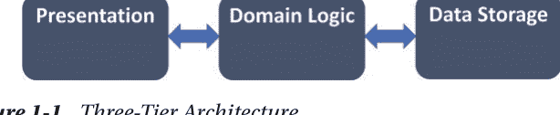
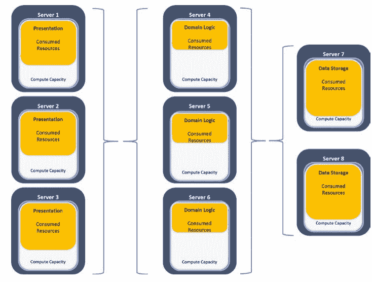
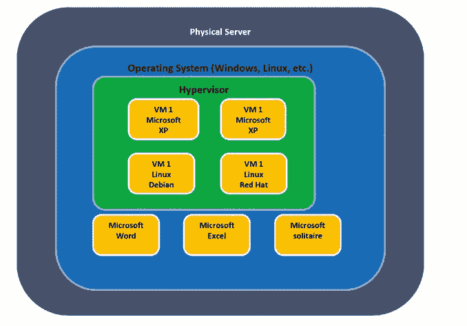
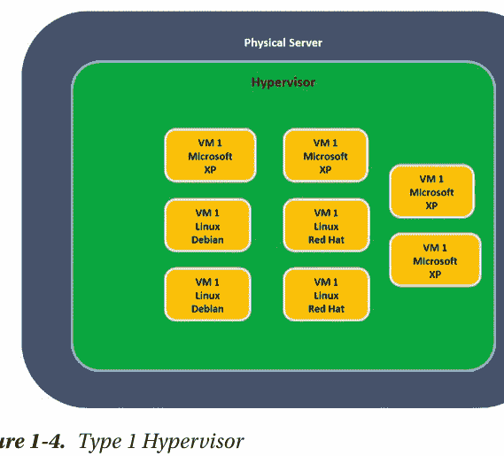
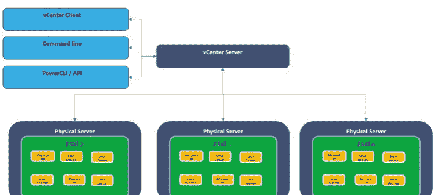
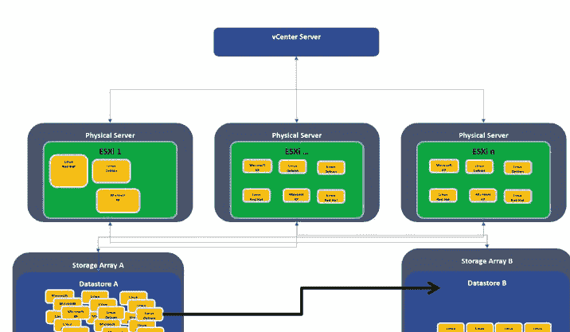

# 在 Raspberry Pi 上运行 ESXi：在 Raspberry Pi 4 上安装 VMware ESXi 以运行 Linux 虚拟机

## About the Technical Reviewer

**Darren Hirons** is Lead Solutions Engineer at VMware. He has over 20 years of experience working with a wide variety of VMware products and other datacenter technologies. His focus more recently has been in the end user computing space, where he helps customers architect solutions to address business challenges.

## Acknowledgments

We freely acknowledge that the work and information in this book has been greatly shaped by the VMware ESXi on Arm community whose legions are far too numerous to mention. Their work and dedication to this project can be found in the many forums that they contribute to. A special shout-out needs to go to William Lam, a Senior Staff Solution Architect at VMware, for documenting so much about VMware technologies and, in particular, ESXi on Arm on his website https://williamlam.com/. William’s tireless work with the community is simply amazing!

## Preamble

All of the author’s proceeds from this book will go to Mount Hood Kiwanis Camp ([https://mhkc.org/](https://mhkc.org/)). This scenic camp sits on 22 acres of the US Forest Service land at the base of Mount Hood. It offers summer and winter camps that help empower children and adults with disabilities through overnight, outdoor, recreational programming. Both of us have had outstanding experiences with the Kiwanis organization over the years and gladly support this camp.

and performance reasons, each layer within this architecture could be composed of multiple servers delivering the services needed for the respective layer.

Figure 1-1. Three-Tier Architecture

During this time, a widely accepted best practice in datacenters was to have one physical server run a single service. The servers and operating systems (OSs) that ran on them didn’t have quality of service (QoS) features that would prevent an application from overconsuming resources on a server, which in turn prevented other active applications from running effectively.

Furthermore, we didn’t want any applications or OSs to bring down an entire multitiered application due to a software or hardware failure. Because it was impractical to “rightsize” the physical components for each physical server to match the load that was required of them by the services they were providing, this led to server sprawl (see Figure 1-2)—an overabundance of servers only using a small fraction of compute capacity that they were capable of.

Figure 1-2. Server Sprawl

As the demand for computer servers exploded, it became apparent to even the most casual observer that the current datacenter was unsustainable; a new technology and/or datacenter methodology was needed, and fortunately, a new technology was coming on the scene at this exact time. x86 operating system virtualization allowed multiple instances of an x86 operating system to run on a physical x86 server. These instances are now known as virtual machines, or VMs for short.

## Introduction to Virtual Machines (VMs)

VM technology is not new; in fact, IBM supported the use of VMs back in the mid-1960s on their mainframe computers, and, later on, Unix systems supported something akin to VMs. However, these VM technologies were not widely used in the datacenter for a variety of reasons, including complexity, cost, and the fact that they were only viable on expensive proprietary hardware.

## Type 2 Hypervisor

In the 2000s, a few companies devised hypervisor technology, a solution to run VMs on inexpensive commodity x86 servers. A hypervisor is the software or hardware that creates and runs VMs. In the early days of this revelation, we first had Type 2, or hosted, hypervisors that run on top of a base OS. Type 2 hypervisors can be basically thought of as just another application that is running VMs. In fact, you could run other applications, such as Microsoft Word, Excel, or even Solitaire, on the same base OS that is running the VMs (see Figure 1-3).

Figure 1-3. Type 2 Hypervisor

虽然 Type 2 超级管理器最初使用起来很方便，但由于它们运行在现有的操作系统之上，因此存在各种问题。这些问题从在基础操作系统更改或更新时与超级管理器的兼容性问题，到超级管理器提供商无法修改基础操作系统以将其优化用于超级管理器使用而非通用应用程序使用不等。

目前，最受欢迎的 Type 2 超级管理器及其运行其上的操作系统有 VMware Workstation（MS Windows）、VMware Fusion（macOS）、KVM（Linux）、Oracle VirtualBox（Linux、Windows、Solaris）和 Parallels（Mac）。

## Type 1 Hypervisor

为了克服 Type 2 超级管理器的局限性，公司为 x86 系统创建了 Type 1 超级管理器。Type 2 超级管理器作为基础操作系统上的应用程序运行，而 Type 1 超级管理器则直接在硬件上运行，从而取代了对基础操作系统的需求（见图 1-4）。Type 1 超级管理器也被称为原生或裸金属超级管理器，因为它们直接在服务器的裸金属上运行。

Type 1 超级管理器的出现从根本上改变了数据中心，因为它允许在单个物理服务器上安全、可靠地运行多个操作系统的实例，并充分利用服务器的资源。但服务器整合只是虚拟机和超级管理器为数据中心带来的好处的开始。本书后面你将了解到它们提供的其他一些好处。

## Figure 1-4. Type 1 Hypervisor

超级管理器不仅为虚拟机提供运行场所，还提供创建和管理虚拟机的手段。虚拟机可以通过在其上安装操作系统从头创建，也可以通过从现有虚拟机克隆来创建。超级管理器提供的管理功能因超级管理器而大不相同，但它们都提供所管理虚拟机的计算资源管理和安全性。

虚拟机由各种配置和数据文件组成，这些文件描述了虚拟机并保存构成虚拟机的数据。例如，VMware 虚拟机由虚拟机配置文件、BIOS 或 EFI 配置文件、虚拟机交换文件、日志文件、数据磁盘以及其他文件组成。通常，每个虚拟机都保存在单独的文件夹中。

最受欢迎的 Type 1 超级管理器是 VMware ESXi、Microsoft Hyper-V 和 XenServer。

## VMware

VMware 由五位个人于 1998 年在加州帕洛阿尔托创立，其中包括当时（至今仍是）斯坦福大学计算机科学教授的 Mendel Rosenblum。自成立以来，VMware 已成为企业级虚拟化的领导者；其 Type 1 超级管理器 ESXi 目前是企业中最受欢迎的超级管理器。

VMware 的第一个产品是 VMware Workstation，这是一款于 1999 年推出的 Type 2 超级管理器，运行在 Windows x86 系统之上。虽然 Workstation 设计用于在桌面系统上运行，但 VMware 还在 2001 年为服务器市场推出了两个产品：GSX（Type 2 超级管理器）和 ESX（Type 1 超级管理器）。随着 ESX 成为企业数据中心的事实标准，GSX 很快就被淘汰。2004 年，ESX 更名为 ESXi，“i”代表集成（大约在此时 VMware 将代码缩小到 ~32MB 并将 ESX 的许多管理功能转移到 vCenter Server）。

多年来，VMware 一直在不断开发新技术并收购公司的技术。VMware 最引人注目的收购之一是 2007 年收购了虚拟桌面基础设施（VDI）提供商 Prop ero；此次收购后来演变为 VMware Horizon，这是一款非常受欢迎的 VDI 解决方案。此外，在 2012 年，他们收购了 Nicira Inc.，该公司创建了网络虚拟化产品，后来被称为 VMware NSX。

虽然 VMware 的收购主要集中在虚拟化领域的公司，但他们也涉足其他领域并收购了其他技术。作为一个主要例子，在 2018 年，他们收购了 Heptio，这是一家深耕 Kubernetes（K8s）的公司。

当然，并非所有 VMware 当前的技术和产品都来自收购；其中一些优秀技术也是内部开发的。例如，在 2014 年，他们发布了 vSAN，这是一款面向 VMware ESXi 的软件定义存储（SDS）解决方案，目前是数据中心中销量最高的 SDS 解决方案之一。

## VMware vSphere

ESX 首次发布后，很快就被企业级用户采用。很快就变得明显的是，数据中心中运行的各个实例需要另一个程序来监督和管理它们。为解决这一任务，VMware 创建了 vSphere，这是一个由 ESXi 以及其他产品和技术组成的平台，用于为数据中心提供可靠性、性能、业务连续性（BC）和灾难恢复（DR）。目前在 vSphere 旗下的一系列产品和功能包括

- vCenter Server – 用于控制和管理 ESXi 主机的集中管理门户。
- VMware vSphere Client – vCenter Server 的基于 HTML5 的 GUI，取代了基于 Flash 的 vSphere Web Client，而在那之前是 C# 客户端。
- vSphere vMotion – 允许用户在不产生任何停机时间的情况下将正在运行的虚拟机从一个 ESXi 主机移动到另一个主机的功能。
- vSphere Storage vMotion – 允许用户将正在运行的虚拟机从其所在的存储移动到另一个存储位置的功能。
- VMware vSphere Distributed Switch（VDS） – 可跨多个 ESXi 主机扩展的虚拟网络交换机。
- vSphere High Availability（HA） – 监控并在需要时重启虚拟机的技术。
- Fault Tolerance（FT） – 将虚拟机镜像到不同物理服务器上的技术。如果其中一个物理服务器发生故障，则在另一个物理服务器上运行的虚拟机将继续不受阻碍地运行。
- VMware Distributed Resource Scheduler（DRS） – 平衡集群中 ESXi 主机之间虚拟机计算资源使用情况的功能。
- VMware Storage Distributed Resource Scheduler – 平衡集群中 ESXi 主机之间虚拟机存储资源使用情况的功能。

VMware 正在继续开发上述列出的功能和技术，并将新功能集成到其产品中。

## vCenter Server

虽然 ESXi 处理在物理服务器上运行虚拟机，但 vCenter Server 告诉 ESXi 主机该做什么并充当中央管理点（见图 1-5）。可以通过几种不同的方式访问 vCenter Server：通过 vSphere Client 图形化访问；通过命令行；或通过 API 或 PowerCLI 以编程方式访问，PowerCLI 是 VMware 对 PowerShell 的扩展。

## Figure 1-5. vCenter Server

由于虚拟机只是文件集合，任何具有这些文件访问权限的 ESXi 服务器都能够运行 vCenter Server。为了实现此功能，VMware 创建了一个名为 VMware Virtual Machine File System（VMFS）的共享文件系统，并将 VMFS 所在的位置称为数据存储。

vCenter Server 可用于将存储在数据存储上的虚拟机实例化（启动）到连接到它的任何 ESXi 服务器（图 1-6）。此外，由于虚拟机只是软件构造器，因此可以根据需要对其进行配置或重新配置，例如，如果虚拟机需要更多虚拟 CPU（vCPU）核心或更多内存。

## Storage vMotion

后来，VMware 推出了 Storage vMotion，这是一种允许在不产生虚拟机任何停机时间的情况下将虚拟机从一个数据存储移动到另一个数据存储的工具（图 1-8）。这使得存储阵列可以在不影响应用程序停机的情况下进行更换或维护，因为在它们上运行的虚拟机不受此更改的影响。当数据存储开始耗尽容量时，可以使用 vMotion 在不中断正在运行的应用程序的情况下释放其容量。Storage vMotion 提供的另一个好处是，关键虚拟机可以根据需要获得更好的性能或可靠性。

Figure 1-8. Storage vMotion

## vCenter Server Appliance

VMware 最初将 vCenter Server 作为需要单独 Windows 实例和单独数据库的 Windows 应用程序发布，但随后推出了 vCenter Server Appliance（VCSA）。VCSA 是一个以 Linux 为基础操作系统的虚拟设备，并附带预装的 Postgres 数据库。虚拟设备是一种预装了应用程序的虚拟机，可以快速部署和配置。

VCSA 有三种不同的版本：Essentials、Foundation 和 Standard（图 1-9）。Essentials 是一个价格非常低廉的选项，但最多只能管理三台双处理器服务器，并且不包含 Standard 中的所有功能。Foundation 适用于较小的环境，因为它仅支持四台 ESXi 主机，并且在功能上也有限制。Standard 支持多达数千台 ESXi 主机以及高级功能，例如 vCenter 高可用性（vCenter HA）。

| 功能 | Essentials | Foundation | Standard |
| --- | --- | --- | --- |
| 管理服务 | X | X | X |
| 数据库服务器 | X | X | X |
| VMware vCenter API | X | X | X |
| 库存服务 | X | X | X |
| vCenter 单点登录 | X | X | X |
| vCenter Server Appliance 迁移工具 | X | X | X |
| vRealize Orchestrator |  |  | X |
| vCenter 高可用性（VCHA） |  |  | X |
| vCenter Server 备份与恢复 |  |  | X |
| 增强型链接模式（ELM） |  |  | X |
| ESXi 主机管理（最大） | 3 台主机（最多 2 个 CPU） | 4 台主机 | 2000 台主机 |

**图 1-9.** VCSA 版本
