# 第 2 章

## ESXi on Arm on Pi 与后虚拟化数据中心

在第一章中，我们展示了在虚拟化之前，数据中心中多层应用程序需要不同的物理服务器，每台服务器运行一个应用程序（图 1-2）。然而，一旦引入虚拟化，该数据中心就可以使用虚拟机运行相同的多层应用程序，将其从八台利用率低的服务器整合到三台充分利用的服务器上（图 2-1）。

在本章中，我们将概述 Arm 架构和 Raspberry Pi。然后我们将讨论数据中心中目前的 ESXi on Arm，并介绍 ESXi on Arm on Pi 的一些限制。

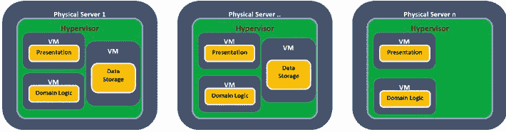

**图 2-1.** *服务器整合*

## Arm

x86 是一套由 Intel 为其微处理器开发的指令集。这种架构使用复杂指令集计算机（CISC）理念，并在 Intel 开发 CISC 64 位微处理器架构时得到了大幅升级（这被称为 x64）。尽管当前大多数桌面和数据中心服务器都是 x64 系统，但仍有其他微处理器架构在使用，而 ARM（或 Arm）正在迅速流行。

Arm 被设计为精简指令集计算机（RISC）架构。CISC 和 RISC 架构之间存在许多差异，并且双方都有拥护者，但这些讨论已超出本书范围。

RISC 并非新事物——它自 1980 年代中期就已存在——但随着 Arm 系统在数据中心以及家庭和个人设备中变得越来越普遍，它最近再次大放异彩。Arm 处理器往往比基于 CISC 的系统更便宜、功耗更低。

这些因素就是为什么许多手机使用 Arm 处理器。苹果最近发布了基于 Arm 的桌面和笔记本电脑系统。公共云提供商多年来也一直使用 Arm 系统，所有大型计算机制造商都已发布或宣布计划为数据中心发布基于 Arm 的服务器。

## Raspberry Pi

Raspberry Pi（RPi，或简称 Pi）是一款小型廉价的单板 Arm 计算机，最初设计用于帮助教授计算机技能。然而爱好者很快蜂拥而至，围绕它设计了越来越多的产品；最终，企业开始在边缘设备和 VDI 客户端等非常规用途中使用它们。

首款广泛可用的 Pi 系统是 2012 年发布的 Model B（图 2-2）。它相当原始，仅配备 256MB RAM 和 700MHz Arm11 处理器。性能评级为 0.213 GFLOPS。

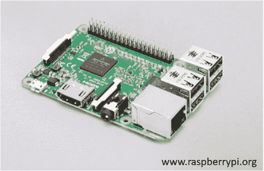

**图 2-2.** RPi Model B

最新的 Pi，Pi 4B+，于 2019 年发布，支持高达 8GB RAM，配备四核 Arm Cortex-A72 处理器，运行频率为 1.5GHz。它具有两个 4K micro-HDMI 端口、两个 USB 3.0 端口、两个 USB 2.0 端口、一个 micro-SD 卡槽、2.4GHz 和 5.0GHz IEEE 802.11ac 无线、蓝牙 5.0、BLE 和一个 GbE 端口。它通过 3A、5V USB-C 连接器供电，还配备 40 针通用输入输出（GPIO）连接器。配备 8GB RAM 的 Pi 4 Model B 价格约为 80 美元，性能评级为 13.5 GFLOPS（图 2-3）。

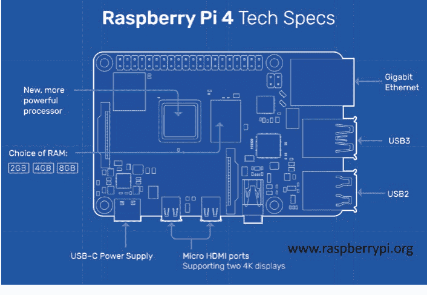

**图 2-3.** RPi 4 技术规格

## ESXi on Arm on Pi

多年来一直有传言称 VMware 正在开发适用于 Arm 的 ESXi。2020 年 10 月 6 日，VMware 的副总裁兼 CTO Kit Colbert 确认了这些传言，并宣布 VMware 发布了 ESXi on Arm Fling。虽然该公告本身引起了很大兴趣，但它能在 Pi 上运行这一事实进一步提升了热情，因为它允许人们在真正廉价的平台上工作。

ESXi on Arm 并不是 VMware 官方支持的产品。相反，ESXi on Arm 是一个 Fling，这是一项由 VMware 为 VMware 客户利益而创建的软件术语。Fling 用于在评估是否将其作为正式的 VMware 产品之前，衡量产品或技术的采用率和有用性。ESXi on Arm 对 VMware 来说是一个巨大的成功，发布后不久就获得了超过 10,000 次下载。

VMware 已讨论了 ESXi on Arm 在数据中心中的用例（vSAN 见证节点、Arm 服务器、SmartNIC 等）。他们还讨论了边缘和物联网用途，如风力涡轮机监控、离散视频监控，甚至独立的基于 Arm 的销售点（POS）设备。

ESXi on Arm 的支持硬件包括 Lenovo ThinkSystem HR350A（Ampere eMAG）（图 2-4）等数据中心服务器、SolidRun HoneyComb LX2（图 2-4）等近边缘设备，以及包括 Raspberry Pi 4B - 4GB 或 8GB 型号（图 2-5）在内的远边缘设备。

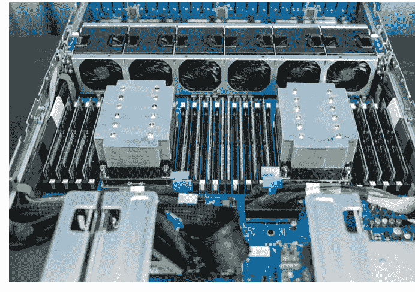

**图 2-4.** 边缘设备

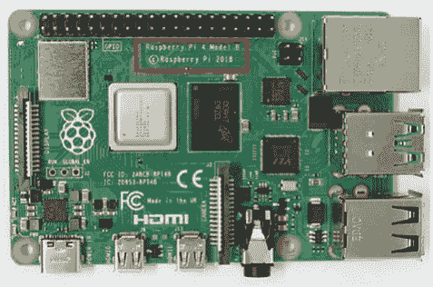

**图 2-5.** RPi 4B

## ESXi on Arm 目前在数据中心

ESXi on Arm 在家庭和企业层面都有一些有趣的用例，但 VMware 投入了大量时间和资金以及工程资源，并且它能够在比 Pi 更强大的硬件上运行。在 Pi 上拥有 ESXi 只对其开发有益。

VMware 一直以企业为驱动；其产品旨在使大型企业规模的数据中心现代化，ESXi on Arm 也不例外。VMware 可以接触到世界上一些最大数据中心的架构师。VMware 正确预见到 Arm 处理器将成为核心服务器使用的重要组成部分，不仅如此，还将使 Arm 和 x64 服务器总体上更高效。他们通过将网络和存储功能卸载到价格更低的 Arm 处理器来实现这一点，从而释放服务器主处理器用于更有价值的工作。

## 云提供商与 Arm 服务器

云提供商一直是 Arm 服务器的主要用户。他们不仅从各家公司购买 Arm 服务器，还自行设计基于 Arm 的服务器。云提供商利用 Arm 架构和精简的指令集来优化其工作负载的效率。

亚马逊网络服务（AWS）自 2018 年起就向公众提供 Arm 处理器，当时他们在 2018 年 11 月的 AWS re:Invent 上推出了基于 Graviton1 处理器的 EC2（A1）实例。该实例基于运行频率为 2.3 GHz 的 16 核 64 位 Arm Cortex-A72 处理器。AWS 于 2019 年跟进推出了 Graviton2 实例，据称其性能是 A1 实例的七倍。

Graviton2 由 Arm Neoverse N1 处理器驱动，可扩展至每芯片 8 至 16 核，每插槽 128 核。Arm 声称其 N1 处理器比 Cortex-A72 处理器每瓦性能高出 30%。

甲骨文宣布他们在基于 Arm 的云实例中使用 Ampere Altra 80 核处理器（Arm Neoverse N1）。截至撰写本文时，微软尚未展示其 Arm 云硬件，但他们之前展示了 Windows on Arm 在服务器上运行的演示。Google 多年来一直在内部使用基于 Arm 的处理器。

## 数据中心 Arm 服务器

有许多服务器公司提供基于 Arm 的服务器。像 Dell 和 Lenovo 这样的大型服务器供应商提供基于 Arm 的服务器，以及专注于基于 Arm 的服务器的公司。

为了更好地了解 ESXi 所支持的 Arm 系统的范围，让我们对比一下树莓派 4 Model B（四核、8GB 内存）与联想 ThinkSystem HR350A 的硬件。后者是一款面向数据中心使用的 2U 机架式服务器，在撰写本文时正在向特定客户进行演示。它搭载了一颗 32 核 64 位 ARMv8 CPU，运行频率为 3.3GHz，支持 512GB 内存。存储方面，它支持机箱内的两个 NVMe 驱动器以及六个外部存储托架。

## 超级计算机

2020 年 6 月，当 TOP500.org 发布年度 TOP500 超级计算机排名时，日本基于 Arm 架构的超级计算机 Fugaku 位列榜首。为了夺得第一名，它在高性能 Linpack（HPL）基准测试中达到了 416 petaflops 的性能，以高出 280% 的显著优势击败了此前的榜首。

Fugaku 运行的是未经修改的 Red Hat Enterprise Arm Linux。它拥有 158,976 个富士通 A64FX 处理器，运行频率为 2.2GHz。每个处理器包含 48 个 Arm 核心，总计略超过 750 万个核心。A64FX 还包含专用向量单元和高带宽内存（HBM），以实现这一性能水平。

日本并不是唯一在超级计算机中使用 A64FX 处理器的国家。总部位于美国的桑迪亚国家实验室宣布，他们已开始安装富士通 PRIMEHPC FX700 系统。EUC 也看到了 Arm 架构的优势，其成员正在基于 EUC 开发的 Arm 处理器构建一台超级计算机。

## Arm 上的 ESXi 与数据中心的未来

随着利用现有产品的新产品和拓扑结构开始出现，Arm 在数据中心的发展前景十分光明。许多产品都需要监控和管理，VMware 将利用其在数据中心领域强大的影响力来实现这一点——而这在很大程度上将依托于 VMware 让 ESXi 在 Arm 上运行的能力。

## SmartNIC/DPU

在 VMworld 2020 上，VMware 发布了 Project Monterey。这是一项当时未受到足够关注但影响重大的公告。正如 VMware 首席执行官 Pat Gelsinger 在 VMworld 上所说，Monterey 是“对 vSphere 本身的重大重构”。这一重构的重要性不容低估，因为 vSphere 是 ESXi、vCenter Server（其管理平面）以及基本上所有 VMware 虚拟化数据中心平台（本地部署和基于云）都涵盖在内的总框架。

Kit Colbert 在 2020 年 9 月底写了一篇博客，澄清了 Project Monterey 的一些细节。具体来说，他说明 Monterey 使用 SmartNIC 将传统服务器的网络和网络存储工作负载从服务器 CPU（图 2-6）卸载到 SmartNIC 的 CPU（图 2-7）。

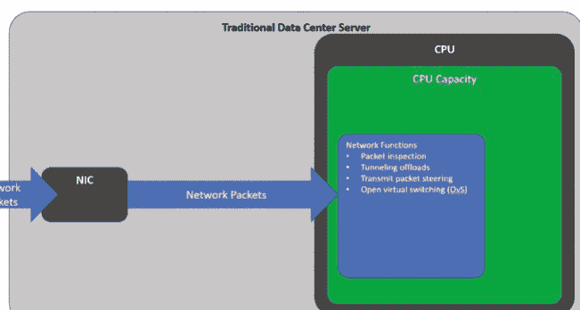

## 图 2-6. 传统服务器中的 NIC

SmartNIC 最明显的工作负载是与通用网络信息的运行和安全相关的负载。通过使用 SmartNIC，这些服务可以在不影响服务器 CPU 的情况下执行，因为只有与该服务器相关的网络信息才由服务器 CPU 处理（图 2-7）。

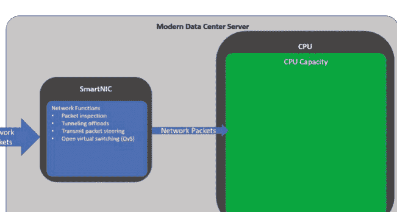

## 图 2-7. 服务器中的 SmartNIC

灵活性有限，而且在需要时很难为它们添加附加功能。SoC 则非常灵活，但缺乏 ASIC 和 FPGA 的速度。

为了同时提供灵活性和性能，一些 SmartNIC 使用 SoC 来实现控制平面功能（因为其固有灵活性），并使用 FPGA 或 ASIC 来实现数据平面功能以获得更高性能。使用 FPGA 而非 ASIC 的主要优势在于，当开发出和/或需要新功能时，FPGA 可以重新编程，而 ASIC 是硬连线的，可能更难更新（图 2-12）。

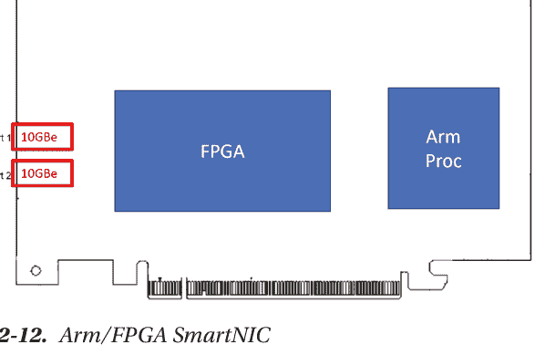

## 图 2-12. Arm/FPGA SmartNIC

在配备 SmartNIC 的服务器中，有两个 ESXi 实例在运行：一个用于服务器的主 CPU 和虚拟机，另一个用于 SmartNIC 以及处理 SmartNIC 所承担卸载工作的虚拟机（图 2-13）。

## 计算存储

一个新的术语正在涌现，用来描述虚拟机/设备/服务器/虚拟机监控程序直接在存储所在设备上处理数据的能力——*计算存储*。Arm 存储解决方案总监 Neil Werdmuller 最近写道：

> > *计算存储正在成为数据存储难题中的一个关键部分，因为它将处理能力直接放在存储设备上，让企业能够安全、快速且轻松地访问关键信息。*

我见过一些正在使用的计算存储设备，包括 Dell PowerStore 产品，以及其他基于 Arm 的计算存储设备。

## Dell PowerStore 存储设备

基于 vSphere 的计算存储已经出现在 x86 系统中。看看它是如何实现的会很有意思，因为这可能会让我们了解它在 Arm 系统上将会如何实现。

2020 年，Dell Technologies 发布了新的中端存储平台 PowerStore。该产品线基于最新技术，支持 NVMe 驱动器，其操作系统（PowerOS）使用容器来提供功能。从物理上看，它是一台 2U 机架式设备，带有四个 x64 Intel 处理器。另一个独特功能是，其型号之一 X 系列运行两个独立的 ESXi 实例（图 2-14）。

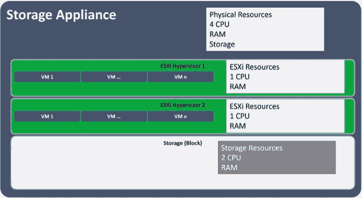

**图 2-14.** Dell PowerStore 存储设备

在传统数据中心中，物理机和虚拟机都会连接到存储阵列来处理数据。系统通常通过交换机使用光纤或以太网连接。尽管这些网络非常快，但对于某些工作负载来说，即使是纳秒级的延迟也变得不可接受（图 2-15）。

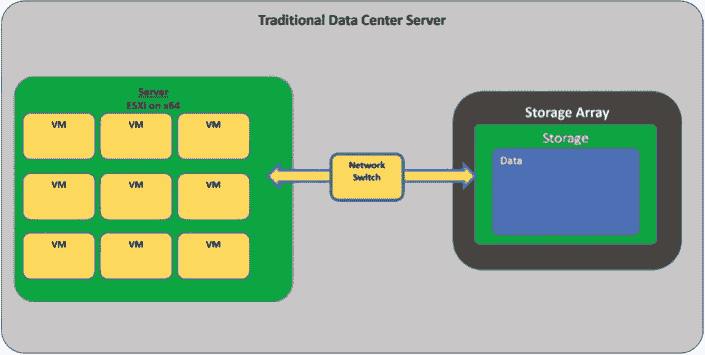

**图 2-15.** 服务器连接到存储时的延迟

通过将虚拟机监控程序与存储放在同一物理系统上，网络及其延迟都被消除了（图 2-16）。

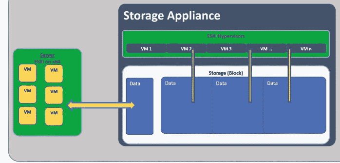

图 2-16. 虚拟机位于存储上时延迟降低

在撰写本文时，PowerStore X 系列目前使用 x64 处理器，但也有公司在基于 Arm 的存储阵列上使用 Arm 处理器。

## 基于 Arm 的计算存储

计算存储设备可以将存储和虚拟机组合在同一台物理服务器上。这要求 Arm 处理器能够高效地提供存储能力——而它们确实可以。事实上，SoftIron 和 QNAP 这两家公司提供的存储阵列都可以由 Arm 处理器驱动。

## SoftIron

SoftIron 的企业级存储阵列从底层硬件开始就为使用 Arm 处理器而设计。SoftIron 利用 Arm 处理器更低成本、更高能效和 SoC 架构的优势，简化了从物理存储设备传输数据的过程。SoftIron 的旗舰产品 Ceph 是一款开源 SDS（软件定义存储），提供块存储、文件存储和对象存储。它是一款成熟的产品，于 2012 年首次发布，此后由所有主要的商业 Linux 发行版（如 Canonical、Red Hat 和 SUSE）以及 Intel、Cisco 和 SanDisk 进行了广泛的开发。

SoftIron 将其 Arm 存储解决方案与 x64 存储进行了性能比较。事实上，与 x64 存储相比，它在对象大小为 64–4096K 时具有令人印象深刻的性能提升。值得肯定的是，SoftIron 也承认基于 x64 的系统目前在 40Gbe 及更高速网络中确实表现更好。他们的阵列不仅提供存储，还会直接在设备上执行数据转码（他们未说明是使用虚拟机、容器还是其他机制来实现这一点，但计算密集型活动会在阵列上执行）。需要记住的是，SoftIron 在其设备上使用的是较旧的 A1100 Arm 处理器，而这可能是该设备性能表现的原因。

## QNAP

QNAP 是一家备受好评的 NAS 设备制造商，产品范围从面向家庭使用的单盘位设备，到面向企业使用的 24 盘位双控制器双活单元。QNAP 会根据设备型号选择使用 x64 或 Arm 处理器。其部分基于 Arm 的设备（例如 TS-1635AX NAS（图 2-17））除了提供存储外，还提供容器和虚拟机支持。该设备使用 Linux 而非 ESXi 来管理虚拟机和容器。考虑到其面向的市场以及 ESXi 可能带来的成本（VMware 尚未公布 ESXi on Arm 如果成为产品后的任何定价），QNAP 不太可能在此类存储设备上运行 ESXi。我之所以收录此设备，是因为它是一个带有虚拟机监控程序的可运行阵列。

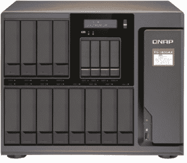

**图 2-17.** *QNAP 1635AX NAS*

鉴于我们已经拥有可以在同一设备上提供存储和虚拟机的 Arm 系统，并且 Dell PowerStore 在其基于 x64 的存储阵列上运行 ESXi，因此不难想象在不久的将来我们会看到通过 ESXi on Arm 管理虚拟机。

## 在树莓派上使用 ESXi 的局限性

虽然能在树莓派这类低价设备上运行 ESXi 对企业和爱好者来说都是一件好事，但它在软件和硬件兼容性方面也存在一些局限性。

ESXi 最大的局限性在于它只是一个 Fling（实验性项目）；因此，VMware 尚未对其最终产品化甚至持续可用性做出任何承诺——如果它真的进入生产，是否会继续支持树莓派也未可知。此外，由于 VMware 不提供官方支持，任何人在排查问题时都需要自行解决，或者咨询在线支持社区。

## 可执行程序

需要记住的一个关键点是，ESXi on Arm 只能运行那些操作系统为 Arm 处理器编译的虚拟机，而这只是所有能在 x86 系统上运行的软件中非常小的一部分。你将无法在其上运行 Windows 桌面版或服务器版操作系统。Android 设备运行在 Arm 处理器上；然而，它们也不能作为客户机在 ESXi on Arm 上运行。

解决这个问题的一个潜在途径是使用模拟软件。虽然按核授权使这一点变得很棘手，但已有成功的例子。高通展示了他们的 Windows 设备模拟技术。或许目前最著名的例子是 Apple M1 的 Rosetta 软件，它允许为 x86 编译的程序在 Apple 芯片的 Mac 上运行。在 VMware 生态系统中运行这类软件面临许多挑战，但类似的事情是有可能发生的。

有许多优秀且独特的项目使用树莓派，但如果你打算将它们作为虚拟机运行在该设备上，则不太可能成功或流畅地运行，因为 ESXi 虚拟机监控程序会将底层硬件抽象隔离。话虽如此，流行的 Arm64 版 Linux 发行版（包括 Ubuntu、CentOS、Fedora 和 Debian）以及一些不太知名的系统（如 Photon OS）都能无问题运行。Raspberry Pi OS 和 FreeBSD 也可以在其上运行。ESXi on Arm 社区非常活跃，每周都会有越来越多的操作系统可供其运行。

你无法将正在运行的虚拟机从运行在 x64 服务器上的 ESXi 服务器 vMotion 到 ESXi on Arm 主机，也无法在 Arm 服务器上启动 x64 虚拟机。VMware 提供了许多预构建的虚拟应用（vApps），但由于这些（到目前为止）都是为 x64 服务器设计的，因此它们无法在 Arm 服务器上运行。

## 树莓派硬件

人们会将各种各样的第三方硬件附件连接到树莓派上，用于各种有趣的目的，从小型 LED 显示屏到 GPS 接收器。然而，这些工具中的任何一个都极不可能在安装了 ESXi 的树莓派上正常工作，因为所需的驱动程序和接口既没有暴露给 ESXi，也没有透传给在其上运行的虚拟机。

## 物理资源超配

ESXi 支持物理资源（例如 CPU、内存和存储）的*超配*，这意味着运行中的虚拟机被配置为拥有比实际物理机器上存在的更多的专用物理资源。

例如，如果在配备 8GB 内存、四个 CPU 核心和 256GB 存储的树莓派上运行五台虚拟机，每台虚拟机具有 2GB 内存、2 个 vCPU 和 100GB 存储，那么该场景下的虚拟机就是超配的（图 2-18）。在许多情况下，这可以正常工作，因为物理资源不会同时被访问。在极少数情况下，所有虚拟机确实同时尝试访问其最大分配资源，此时虚拟机监控程序有各种方法可以优雅地处理这些情况。

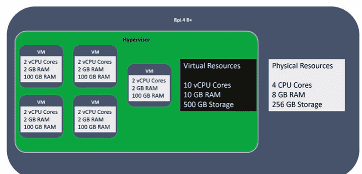

**图 2-18. 虚拟机超配**

## 存储

在树莓派上，供虚拟机使用以及由虚拟机使用的 ESXi 存储仅限于通过 USB 端口连接或通过网络访问。USB 端口和板载网卡都受其所运行总线的限制。我在树莓派上测试了相当多的存储设备，所见的最佳性能是 100MBps 的传输速率。

我还遇到过在两个连接到树莓派 USB 端口的存储设备之间复制文件时出现问题的情况。我绘制的极其简化的 Pi 4B+ 框图（图 2-19）显示所有 USB 端口都通过同一条总线，我认为瓶颈就在于此。

**图 2-19. RPi 4B+ 框图**

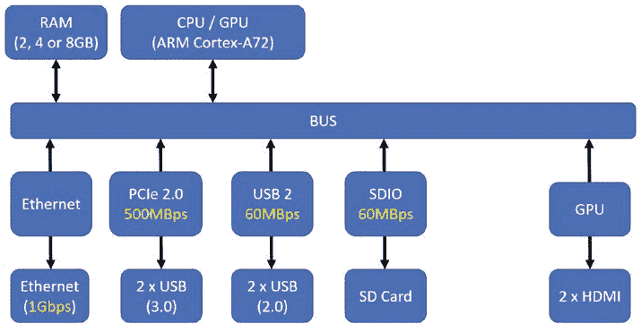

在为虚拟机添加新虚拟磁盘时（图 2-20），你有三种不同的选项：厚置备延迟置零（Thick Provision Lazy Zeroed）、厚置备快速置零（Thick Provision Eager Zeroed）和精简置备（Thin Provision）。

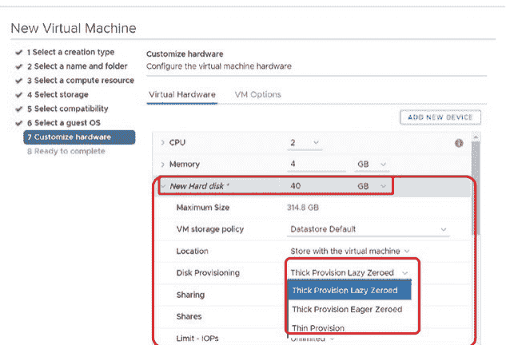

**图 2-20. 分配磁盘空间**

厚置备延迟置零会在底层存储上预留空间，并且仅在即将写入之前，才将之前可能驻留在该空间上的任何数据清零。相比之下，厚置备快速置零会在底层存储上预留空间，并在进行首次写入之前，将之前可能驻留在该空间上的任何数据清零。

精简置备可以看作是存储的超配。虚拟机不预留空间；你只需设置它可以消耗的最大空间。空间会根据需要按需分配并清零。精简置备允许将未使用的存储提供给需要它的虚拟机使用。

假设你有一个 750GB 的物理磁盘，并且有三台虚拟机分别带有 300GB 的精简置备虚拟磁盘，总共有 900GB 的精简置备存储；但是，这些虚拟机每台实际只使用磁盘上的 100GB 空间，因此实际使用的磁盘空间总计为 300GB。你还有另一台虚拟机带有 200GB 的厚置备磁盘，仅使用了其中的 50GB，但（因为是厚置备）整个 200GB 都已分配且无法用于其他用途。在这个例子中，我们在 750GB 的物理磁盘上总共有 1,100GB 的置备空间（图 2-21）。

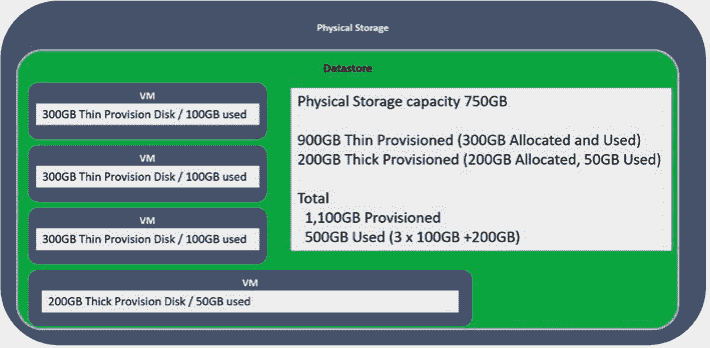

**图 2-21.** *置备的磁盘空间*

如果系统上的所有内存都已被虚拟机预留，其他虚拟机将无法启动（图 2-23）。

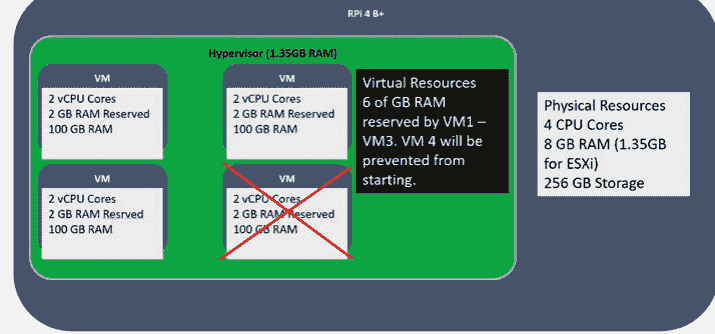

图 2-23. 所有内存均已预留

## CPU

考虑到树莓派的核数有限，且可用的 CPU 周期也有限，这反过来限制了在其上高效运行的虚拟机数量。在大多数情况下，ESXi 本身只会消耗少量 CPU 周期。

如果你对虚拟机中的 CPU 进行超配，虚拟机监控程序会对 CPU 进行时间切片，以尽量确保虚拟机获得一定的 CPU 周期。对于关键虚拟机，你可以使用 vSphere Client 预留 CPU 周期，并让虚拟机独占访问这些 CPU 周期（图 2-24）。

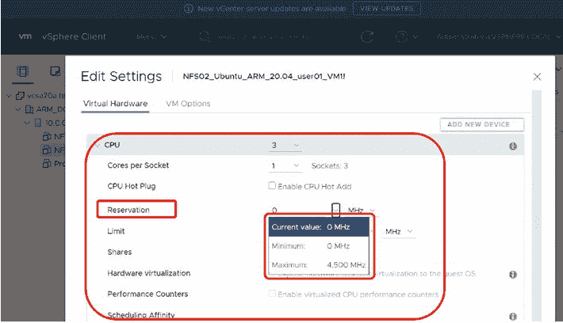

**图 2-24.** 预留 CPU 周期

如果系统上的所有 CPU 周期都已被虚拟机预留，其他虚拟机将无法启动。图 2-25 显示了这样一个例子，其中只有三台虚拟机能够启动。

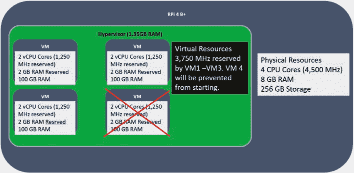

**图 2-25.** 所有 CPU 周期均已预留

在 VDI 环境中，每个物理 CPU 通常最多对应五个虚拟 CPU。

## 树莓派上 ESXi on Arm 的资源使用测试

为了检查运行在我的树莓派上的 ESXi 的资源使用情况，我使用了 ControlUp（图 2-26）和 vSphere Client（图 2-27），并且没有运行任何虚拟机。我发现它使用了 18% 的内存（约 1.35GB），几乎不使用 CPU 周期，因此为在其上运行的虚拟机留下了 6.6GB 的内存。

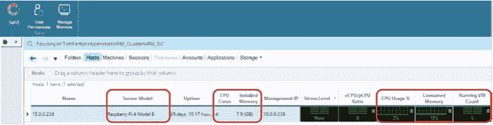

**图 2-26.** *ESXi 资源使用测试 – ControlUp*

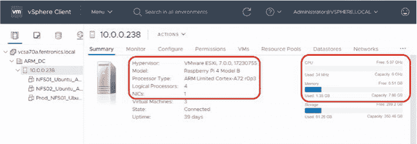

**图 2-27.** *资源使用测试 – vSphere Client*

# Arm 上 ESXi 的许可

Arm 上 ESXi 的许可既棘手又有趣。大多数 VMware 产品附带 60 天全功能试用许可，但 Arm 版 ESXi 附带 180 天许可。许可到期后，你可以重新安装 ESXi 以重置试用许可。Arm 版 ESXi 可以使用 ESXi 主机许可进行授权；然而，ESXi 许可是面向企业使用的，价格并不便宜。

虽然 VMware 确实支持免费版 ESXi，且该许可可以用于 Arm 版 ESXi，但免费版 ESXi 确实存在一些限制——其中最重要的是你将无法使用 vCenter Server 和 PowerCLI 与之交互并进行管理。免费许可在服务器可拥有的 CPU 数量和内存容量方面也有所限制，但这些限制远低于 Pi 4B+ 的能力范围。

对于家庭实验室爱好者，VMware 确实有 VMUG Advantage 计划，每年费用为 200 美元，但这还包括各种 VMware 产品的 VMware 许可，包括 ESXi 和 vCenter Server。对于较小规模的生产环境，VMware 确实提供价格低于 600 美元的 vSphere Essentials Kit。它支持三台双处理器 ESXi 主机，并附带 vCenter Server。

由于 VMware 不断重新评估其产品包和许可方案，你应该始终与他们核实，了解当前可用的许可选项。
