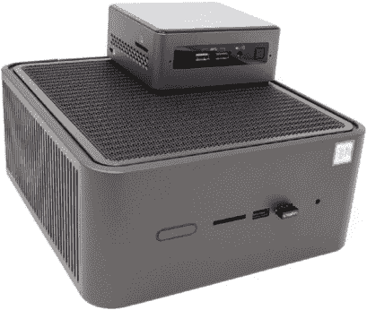
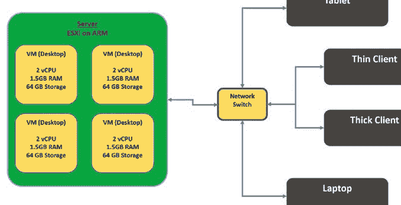
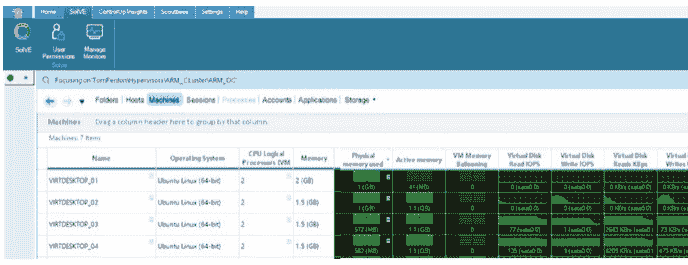
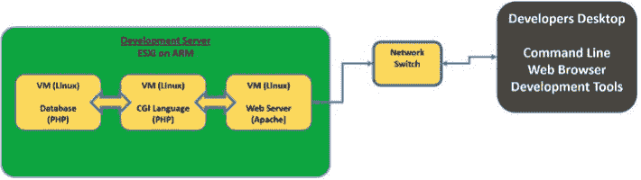
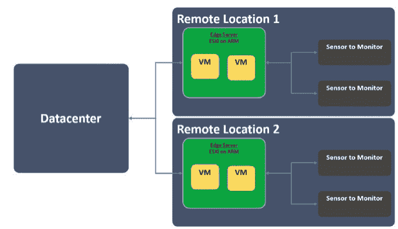
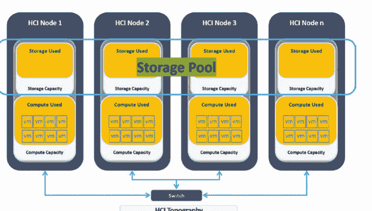
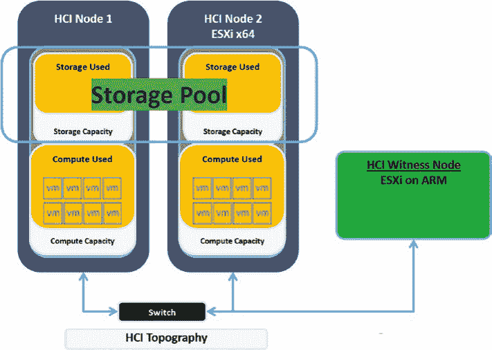
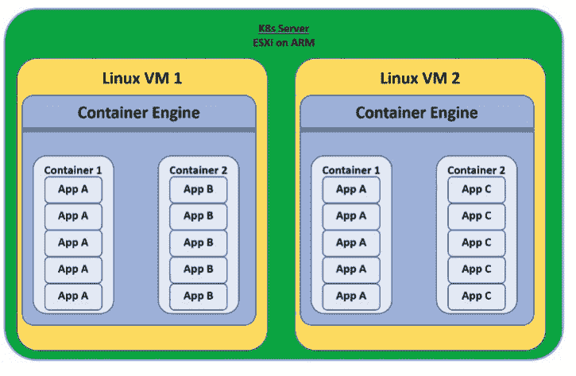

# 第 3 章

## Pi 上的 Arm 版 ESXi
使用场景

在 Raspberry Pi 上运行的 Arm 版 ESXi 是进入虚拟化和 VMware 世界的低成本入口，但正如我们在上一章讨论的那样，其硬件确实限制了这种配置所能实现的功能。尽管如此，对于如此小巧的设备而言，它仍然能够完成一些非凡的壮举。在本章中，我们将探讨 Pi 上 Arm 版 ESXi 的使用场景，其中一些已被积极使用，而另一些则较少被采用。有些是我见过的简单用法，但我自己并未实际尝试过。

要解锁真正的 VMware vSphere 环境的许多功能，你还需要安装 vCenter Server。幸运的是，目前有一个试用版可用，但它仅提供 60 天且不可续期的试用期。vCenter Server Appliance (VCSA) 以 OVF 文件形式预打包，需要安装在 VMware 虚拟机监控程序上，但该虚拟机监控程序必须是 x64 架构，而不是 Arm 架构。乍一看，这可能是个问题，因为你可能认为还需要搭建一个 x64 ESXi 系统，但幸运的是，它也可以与 VMware Player 一起使用，VMware Player 是一款免费的 2 型 x64 虚拟机监控程序。我们将在本书后面逐步介绍这一过程。

### 学习环境

由于 Arm 版 ESXi 是一个功能完备的虚拟机监控程序，它非常适合那些想要熟悉 VMware 虚拟机监控程序或 vSphere 功能的人作为学习环境。搭建一个功能完备的 vSphere 环境只需不到 100 美元，而搭建一个由网络交换机连接的双节点集群则只需略高于 200 美元。

虽然本书将为你提供在 Arm 系统上使用 ESXi 的基础知识，但你可能会想更深入地了解这一主题。幸运的是，有很多资源可以帮助你一路前行。

VMware 为想要学习 vSphere 的人提供了一些出色的动手培训；这些培训专业且精心设计，并为你提供一个独立的沙盒环境供你操作。讲师都是一流的，可以回答你提出的任何问题。课程通常为期四天，费用约为 3000 美元——如果你认真想要快速掌握 VMware 技术，并且你或你所任职的公司能够承担这笔费用，那么这是一项值得的投资。

VMware 提供动手实验，让你能够使用 VMware 或其合作伙伴的特定技术。这些实验是熟悉 VMware 或其合作伙伴技术的好方法，无需自行搭建环境。但是，由于它们是预配置的，只能近似模拟真实环境，而且出于安全原因，产品的某些部分可能会被锁定。这些实验可以在 https://hol.vmware.com/ 找到。顺便提一下，我为 ControlUp 编写了许多动手实验。

VMware 还与高等教育机构合作，推出了一项名为 IT Academy 的培训计划（www.vmware.com/company/it-academy.html），其既定目标是对学术机构的学生进行 VMware 产品培训，为他们考取 VMware 认证做好准备。许多机构以 VMware 课程费用的一小部分提供此培训，但这些课程分散在一个学期内，由机构的教员授课，而不是全职的 VMware 专职讲师。

LinkedIn、Udemy 和其他在线教育网站也提供免费或低价的培训选项。我在这些网站上查看的许多课程虽然有些过时，但仍提供了良好的信息。大多数课程不包含 VMware 动手环境，但其中许多课程可以在 Pi 上重现。

无论你选择哪种培训途径来深入了解你的 ESXi 服务器，Pi 都是一个出色的低成本平台。

### 家庭实验室

我们中许多日常工作涉及 VMware 和其他技术的人，会选择搭建家庭实验室以更好地理解这些技术；我们这些家庭实验室爱好者喜欢以企业环境不允许的方式去折腾它们，或者在自己舒适的家中继续解决工作中遇到的问题。在成本是关键驱动因素的情况下，Pi 是这类场景的绝佳平台。

在我的家庭实验室里，我有几台过时的服务器和小型 Intel NUC（Next Unit of Computing）系统，但我发现自己使用 Pi 系统的频率和这些设备一样高。考虑到你可能获得的硬件配置，一两代之前的 x64 服务器可以以合理的价格购得。例如，我在 eBay 上找到一台二手双处理器 Dell R720，配备 96GB 内存和八块 3TB 硬盘（36TB 原始存储），价格不到一千美元。从表面上看，基于你将获得的资源量，这似乎是一笔不错的交易，但它会超出普通电路的负荷，而且噪音太大，无法放置在用户附近。此外，由于它很可能在数据中心使用过，其组件在整个生命周期中可能一直处于持续且高强度的使用状态。

另一个人们认为颇具吸引力的替代方案是 Intel NUC。它们有多种外形规格，其中最小的一款能够运行 ESXi，尺寸仅为 4 英寸 × 4 英寸 × 2 英寸多一点，而最大的一款尺寸为 9.4 英寸 × 8.5 英寸 × 3.8 英寸。最小的一款搭载英特尔四核 i7 处理器，配备 8GB 内存，而较大的一款则搭载八核 Xeon 处理器，配备 64MB 内存和一个 PCI 插槽（图 3-1）。

**图 3-1.** *Intel NUC*

NUC 解决了旧服务器在家庭实验室使用中的噪音和功耗问题。然而，NUC 的缺点在于，那些能够运行 ESXi 的型号价格与旧服务器不相上下，但缺乏旧服务器所能提供的资源，因为它们只能容纳一个或至多两个存储设备，并且内存限制为 64GB，仅搭载一颗英特尔处理器。

基于上述原因，Pi 系统虽然资源有些有限，但对于预算和空间有限的人来说，是一个不错的家庭实验室系统。

### 企业沙盒

企业沙盒与家庭实验室系统密切相关。这些系统往往用于小规模的概念验证，以验证新的应用程序和流程。一些公司使用旧系统来实现此目的；然而，这些系统的支持成本很容易超过几台 Pi 系统的成本。

许多企业与 VMware 签订了许可协议，这使得在机构内部使用 ESXi 许可非常有吸引力。鉴于标准 vCenter Server 最多允许 2000 台主机，为企业沙盒添加几台额外的 ESXi 主机通常不是问题。

### 轻量级 VDI 主机

虚拟桌面基础设施（VDI）是用户连接到运行在虚拟机监控程序上的桌面操作系统虚拟机的一种流程。VDI 已经强劲发展了十多年，许多组织拥有数以万计虚拟桌面的 VDI 环境。公司采用 VDI 是出于安全、业务连续性和成本控制的原因。

虽然由于资源有限，你无法在 Pi 上运行数千个虚拟桌面，但我已经能够在 ESXi Pi 服务器上托管四个虚拟桌面（图 3-2）。这是一个有趣的方案，因为你可以将它们全部托管在一个比一副扑克牌稍大的设备上。使用这些桌面时，我只能通过 LibreOffice 完成普通任务，并使用 1920 × 1080 的桌面进行轻度网页浏览。

图3-2. Pi上的VDI

VMware Horizon和Citrix代理在Arm上不受支持，因此它们的连接服务器和远程协议无法使用。我让VDI客户端使用远程显示协议（RDP）和独立IP地址来连接到它们的Linux虚拟桌面。

虚拟桌面出奇地轻量，我的虚拟桌面只消耗了10个IOPS。网络流量高度依赖于所使用的应用程序。以下是我看到的各应用程序消耗的网络流量：

- 空闲会话 – 0.5 Kbps
- LibreOffice Writer（文字处理） – 150Kbps
- LibreOffice Calc（电子表格） – 150Kbps
- LibreOffice Impress（演示文稿） – 4Mbps
- Chrome（网页浏览） – 6Mbps

每个桌面由两个vCPU、1.5GB内存和64GB存储组成。

要查看Pi上虚拟桌面的性能和资源使用情况，我使用了ControlUp（图3-3），这是一款由VMware销售的EUC监控工具。

图3-3. 虚拟桌面资源使用情况

在本书后面，我们将更详细地了解在Pi上使用虚拟桌面。

## Web开发

网站比较流行的部署模式之一是使用LAMP软件栈（LAMP是Linux、Apache、MySQL和PHP的首字母缩写）。虽然这些组件可以在单个实例上运行，但为了更接近地模拟实际工作环境，它们应该在独立的操作系统实例上运行。

网站Web开发的后端功能通过运行在Pi上的虚拟机实例来执行，而开发者的桌面则用于内容创建和网站测试（图3-4）。

**图3-4.** *ESXi上的LAMP*

由于资源限制，网站的规模和复杂度将不得不受到限制。由于生产服务器很可能基于x64架构，因此无法将整个VM vMotion到生产服务器。

拥有小型、廉价的Web开发机箱将释放昂贵的资源用于生产部署，并将鼓励开发者更多地在他们的Web开发环境中进行实验。

## 边缘服务器/数据采集点

Pi或其他小型、低成本的Arm设备的一个可能用例是作为边缘服务器或数据采集点。在这种情况下，一个小型廉价的边缘设备捕获数据，然后对其进行一些基本的数据处理，然后再将数据传回数据中心进行进一步分析和永久存储。如果网络不可用，边缘服务器还会缓存数据（图3-5）。

图3-5. 边缘服务器

通过使用ESXi，您可以在设备上运行操作系统的多个实例，以处理不同的服务，并在需要时提供一些BC和DR服务。

## vSAN见证节点

也许Pi最常被提及的用例是作为VMware极为流行的SDS产品vSAN的见证节点（图3-6），以提供弹性和容量。vSAN将多个ESXi服务器上的本地存储池化，集群中的任何节点都可以访问。

图3-6. VMware vSAN集群

较小型部署，如ROBO中的部署，可能只需要两个物理服务器的存储容量和冗余。将两个节点聚集在一起时的一个问题是发生脑裂情况时会发生什么：节点仍然运行，但彼此失去连接。如果它们都继续提供存储，数据将会损坏，需要第三个节点或见证节点来仲裁在这种情况下哪个节点应该保持活动（图3-7）。见证节点不需要强大，也不需要为存储池贡献本地存储。

**图3-7.** *vSAN见证节点*

对于这种轻量级用途，廉价的Pi是成本可能高出十倍的低成本x64 ESXi服务器的理想替代品。

## PowerCLI自动化环境

virtuallyghetto.com的William Lam撰写了一篇有趣的博客，介绍如何在Pi上的ESXi on Arm上使用ESXi服务器进行vSphere自动化和开发。在这篇博客中，他指出Pi是运行PowerShell和PowerCLI的可接受平台，这两者是VM世界中最常见和最有用的自动化工具。有关更多信息，请访问他的网站。

## Kubernetes

Kubernetes（K8s）在企业采用方面正以惊人的速度获得发展势头。K8s是一个容器编排系统，其编排功能包括基于容器的应用程序的部署和扩展。它是最初由Google开发的开源软件，但最终转移到了云原生计算基金会。关于VM和容器之间差异的许多细微之处超出了本书的范围，但是（敬请了解的人见谅）可以将它们视为非常轻量级的VM。

所有主要的Linux发行版都支持以某种形式运行K8s或容器。通过在ESXi上使用VM，您可以在同一台物理服务器上运行K8s和容器引擎的多个实例，以实现冗余或模拟更大的环境（图3-8）。

图3-8. Kubernetes

## 游戏服务器

到目前为止，我强调的所有用例都与工作相关，但一天工作结束后，您可以使用ESXi来提供一些游戏。许多Linux发行版预装了一些游戏，并允许使用其包管理功能下载和安装游戏，或者您可以在系统上本地编译它们。

您需要知道，Pi不支持GPU，其iGPU（Broadcom VideoCore VI）无法通过在其上运行的VM访问。对图形要求高的游戏要么运行得很差，要么根本无法运行。但对于那些想玩一点俄罗斯方块、德军总部、毁灭战士或SuperTuxKart的人来说，如果您关闭服务器上运行的所有其他VM，这些游戏将运行得很好。

要显示游戏，您需要使用VMware控制台或远程显示协议。我们将在本书后面介绍如何设置这些。

## 总结

Raspberry Pi提供了一种独特且廉价的方式来使用数据中心中最流行的虚拟机监控程序ESXi。您可以设置和使用您的ESXi环境来学习vSphere的细枝末节。这个平台有各种各样的用例，从开发者的独立平台到家庭使用的游戏服务器。话虽如此，在企业世界中，小型、廉价的基于Arm的系统最有可能用作vSAN见证节点或网络边缘的数据采集点。需要强调的是，ESXi on Arm是一个Fling，而不是官方产品。VMware不保证它将来会成为官方产品。此外，其许可证在180天后过期，之后需要重新加载。

下一章将介绍设置Raspberry Pi所需的其他一些部件，即您可以与其一起使用的存储类型，以及一些在运行ESXi时可用于保护和冷却它的机箱。
