# 第 5 章

## 在树莓派上安装 ESXi

如果你和许多其他读者一样，一直盼望着动手在树莓派上使用 ESXi，那么这一章就是你耐心等待的章节。如果你真的急于开始使用硬件，你甚至可能已经跳到了这一章。无论你属于哪类读者，在本章中，我将带你逐步完成在树莓派上安装 ESXi 的过程。

VMware 在记录如何将 ESXi on Arm 安装到树莓派上的过程做得很好，但我发现他们文档的某些部分有点令人困惑，而且他们没有提供很多屏幕截图。为了以易于理解的方式指导你完成这个过程，我将提供许多屏幕截图，并尽可能精简操作步骤。

在概述安装过程之前，我想稍微跑题一下，回答一个经常被问到的问题。

## 屏幕重定向

在开始讨论如何在树莓派上安装 ESXi 之前，我想先回答一个经常被问到的问题：我是如何获取文章中、博客和书籍中使用的屏幕截图的，以及如何使用笔记本电脑或单个显示器查看我的 ESXi 主机。这似乎是一个简单的问题，因为我觉得屏幕截图对我写的文章至关重要，它们能让读者跟上我描述或看到的内容。

过去，我曾尝试使用从 USB 摄像头到手机等各种设备手动拍摄屏幕照片。我甚至尝试过在三脚架上使用高端数码相机，但效果并不理想。拍出来的照片会有炫光和反光，或者拍摄时机不对。

大约两年前，廉价的 USB HDMI 视频采集设备开始进入市场。图 5-1 展示了这些设备如何插在计算机和显示器之间，然后通过 USB 线缆将内容传输到另一台计算机。

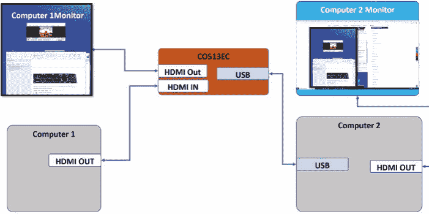

**图 5-1。** *USB 采集设备*

需要软件来显示和捕获正在传输的输出。在尝试了 Windows Camera、VLC 和 Camtasia 等几款不同的软件包后，我发现 Open Broadcaster Software (OBS) 效果最好。它是一款免费、广泛使用的开源跨平台流媒体和录制程序。它确实是一款多平台软件——目前有适用于 Microsoft Windows、macOS 和 Linux 的 OBS Studio 版本。

# 第 5 章    在树莓派上安装 ESXi

过去，我使用过几块低端、低成本的（20–50 美元）USB 采集卡，发现输出质量从模糊到相当不错不等。偶尔它们会出故障或停止工作，我需要断开并重新连接才能让它们再次工作。

后来，我有机会评测一款 Intel NUC 11 Computer Element (CE) AV 系统（参见图 5-2）。这是一款小巧而强大的系统，配备 Intel i7 酷睿处理器、16GB 内存和两块网卡。

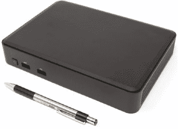

**图 5-2。** NUC 11 系统

图 5-3 显示其背面有内置视频采集设备的端口。


**图 5-3。** NUC 11 CE 背面

图 5-4 显示它有两个 HDMI 端口，分别标记为 Pass Thru 和 INPUT。这些端口由内部采集卡使用。


图 5-4. HDMI 采集卡端口

为了拍摄本书的屏幕截图，我将树莓派及其显示器插入 NUC 11 CE 的 AV 采集端口（参见图 5-5）。

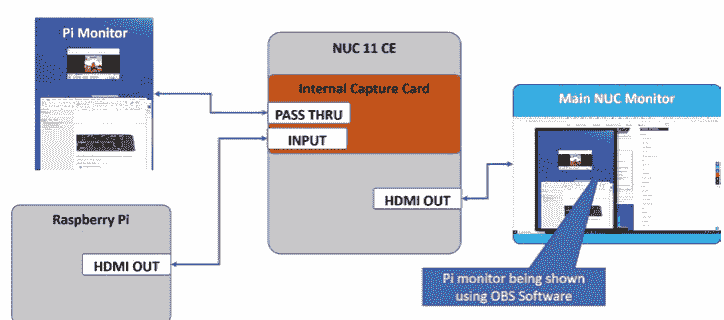

图 5-5. NUC 11 CE 与树莓派

我在 NUC 11 CE 上启动了 OBS，并将其输入源设置为采集卡。图 5-6 显示了树莓派启动屏幕的输出是如何传输到它的。

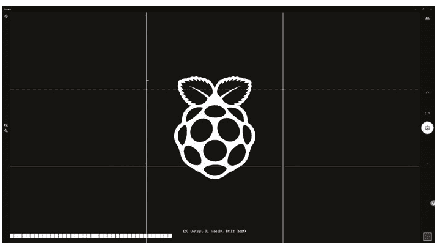

# 图 5-6. OBS

我曾让 NUC 11 上的采集卡一次运行数小时，并毫无问题地捕获了数 GB 的流式视频。

你不仅可以将采集卡用于文档记录，还可以在安装和使用树莓派时将其用作树莓派的显示器。当然，你需要将单独的键盘连接到树莓派。顺便说一句，我不止一次发现，我试图用连接在显示系统上的键盘去与流式图像交互，而不是用连接在树莓派上的键盘。

使用廉价的 USB HDMI 采集卡偶尔截屏是可以的，但如果你要捕获大量内容，我强烈建议使用高端采集卡。

## 安装概述

我之前说过，在这里我要重申——在我撰写本文时，VMware 明确且不可撤销地声明该产品不受支持，不应在生产环境中使用。话虽如此，包括我在内的数千名用户已经使用了几个月，发现它出奇地稳定。它的许可证是免费的，但获得许可证需要你创建一个 MyVMware 帐户。许可证将在安装后 180 天到期，届时你需要重新安装。不过，你的虚拟机仍然可用。

官方文档中关于在树莓派上安装 ESXi 的内容并不在最显眼的位置；要访问它，你需要前往 ESXi on Arm Fling 网页：https://flings.vmware.com/esxi-arm-edition（参见图 5-7）。在页面的下拉菜单中，选择 **ESX-Arm-Fling-Doc.pdf** 和 **Fling-on-Rasberry-Pi.pdf** 文档。第一份文档是安装过程的总体概述，第二份文档直接涉及在树莓派平台上运行 ESXi 的细微差别。这两份文档都是很好的参考。


## 图5-7. ESXi on Arm Fling网页

安装过程可以分为几个部分：

- 验证Pi上运行的EEPROM，并在需要时进行更新
- 将安装ISO写入U盘
- 在Pi上安装ESXi
- 设置Pi从ESXi启动
- 配置ESXi主机

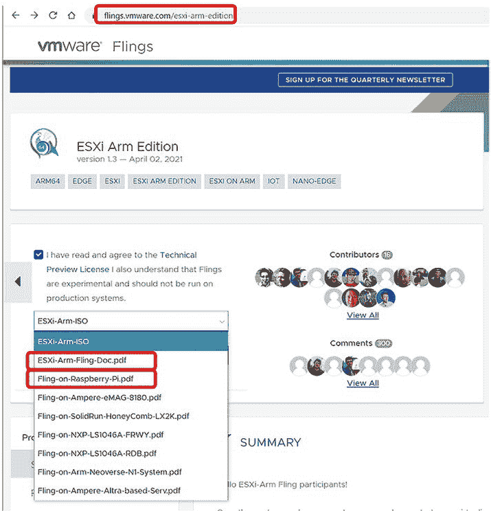

# 第5章 在Pi上安装ESXi

为了简化该过程，我将只展示在Pi上安装ESXi的一种方法。还有其他更高级的安装选项，但对于绝大多数用户来说，这种方式最能满足他们的需求。

## 硬件和软件准备

你应当做的第一步是确保拥有适合安装ESXi的Pi型号。这一个简单的验证可能会为你省去无数麻烦。为此，只需查看Pi上的标记，确认其标有*Raspberry Pi 4 Model B*，如图5-8所示。这是唯一受支持的Pi型号。

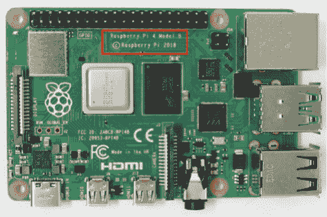

***图5-8.*** *Pi标记*

在初次安装时，我会将Pi放在机壳外；散热不成问题，而且如果安装过程中出现问题，这样可以少一个需要考虑的变量。

## 在Micro-SD卡上安装Pi

为确保Raspberry Pi微代码是最新的，你需要将Pi OS安装到micro-SD卡上，然后启动它。Pi OS的全部用途就在于此。检查完微代码后，我们将把micro-SD用于EEPROM。以下说明介绍了如何在Windows系统上完成此操作。在运行Linux或macOS的系统上也可以完成，但这超出了本书的范围。

要将映像写入卡中，请执行以下操作：

1. 在Windows系统上下载并安装用于Windows的Raspberry Pi Imager工具（www.raspberrypi.org/blog/raspberry-pi-imager-imaging-utility）。Imager是免费的开放源代码软件，大小为20 MB。如果Windows系统没有micro-SD插槽，则需要使用适配器进行写入。

2. 在Windows系统上运行Imager（见图5-9）。

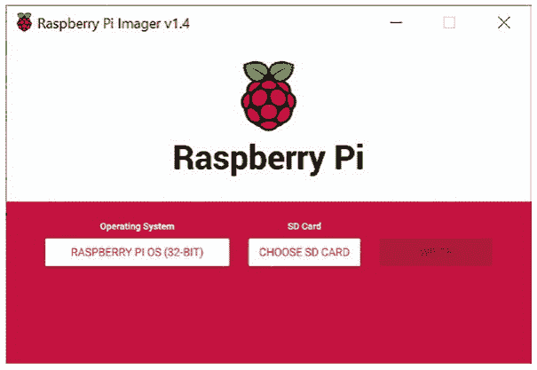

图5-9. Imager工具

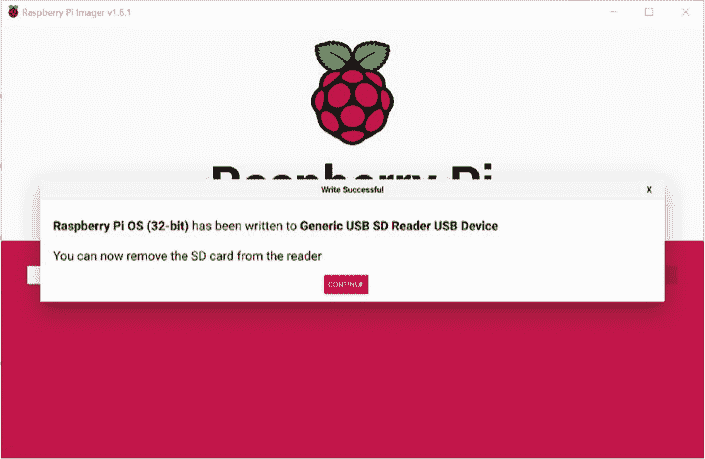

*图5-11. Imager完成*

## 使用Pi OS检查Pi的EEPROM

使用Pi OS验证Pi上的EEPROM，并在需要时进行更新。

1. 将micro-SD卡放入Pi。将电源、键盘、网络连接和HDMI显示器连接到Pi。

2. 插上电源为Pi供电。系统启动需要一两分钟。你会看到Raspberry Pi设置屏幕。按照提示设置系统。

3. 在屏幕左上方选择终端图标。输入以下命令检查EEPROM是否是最新版本：

```bash
sudo rpi-eeprom-update
```

4. 屏幕会显示Pi的EEPROM是否是最新的（见图5-12）。

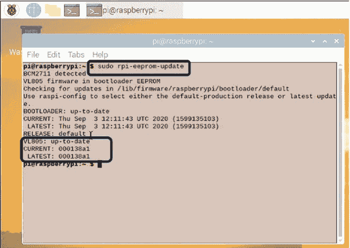

**图5-12.** *检查EEPROM*

5. 如果EEPROM不是最新的，请输入：

```bash
sudo rpi-eeprom-update -a
```

输入以下命令关闭Pi：

```bash
sudo shutdown -t now
```

6. 系统关闭后，从Pi中取出micro-SD卡，然后放回Windows机器中。

## 使用UEFI准备Micro-SD卡

现在，你将UEFI文件放在micro-SD上。这将使Pi能够启动ESXi。

1. 从以下位置下载最新的Pi固件和RPi 4 UEFI固件：

https://github.com/raspberrypi/firmware/archive/master.zip

https://github.com/pftf/RPi4/releases/download/v1.20/RPi4_UEFI_Firmware_v1.20.zip

2. 将zip文件的内容解压到单独的文件夹中：一个名为master，另一个名为UEFI。

3. 在master/boot文件夹中，删除所有以kernel开头的文件（见图5-13）。

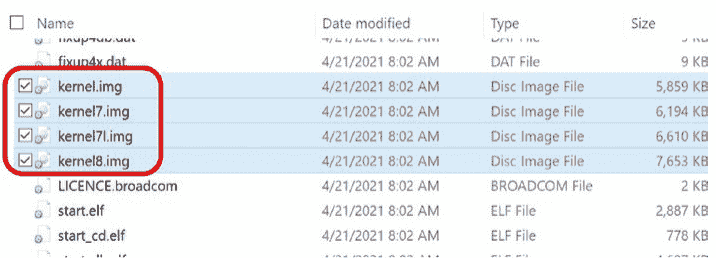

图5-13. master/boot文件夹

4. 将UEFI目录中的所有文件复制到master/boot目录中。允许覆盖重复文件，如图5-14所示。

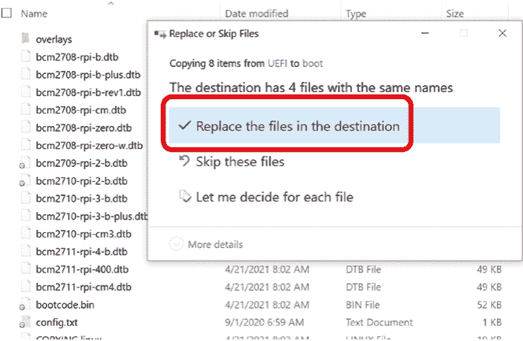

**图5-14.** *覆盖master/boot文件夹中的文件*

5. 使用FAT32文件系统格式化micro-SD卡（见图5-15）。

## 图5-15. 格式化micro-SD

6. 将master目录中的所有文件复制到micro-SD卡。这可能需要几分钟。

7. 从Windows系统中弹出micro-SD卡。

## 创建ESXi on Arm安装设备

要下载ESXi on Arm Fling，你需要创建一个MyVMware帐户，可以按照 https://my.vmware.com/ 上的说明完成。

1. 转到ESXi on Arm Fling网页 https://flings.vmware.com/esxi-arm-edition ，并使用你的MyVMware帐户登录。

2. 从“下载”下拉菜单中，选择ESXi-Arm-ISO（见图5-16）。

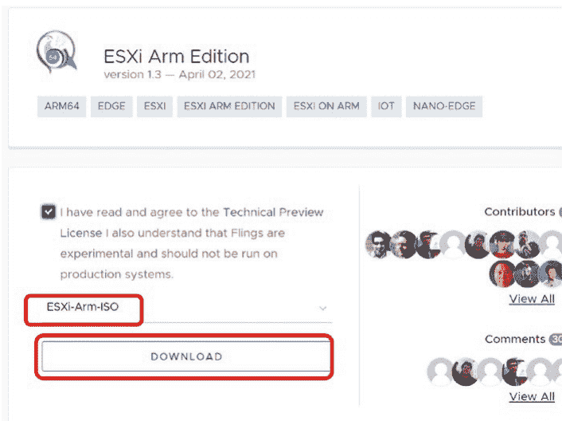

图5-16. 下载ESXi on Arm Fling

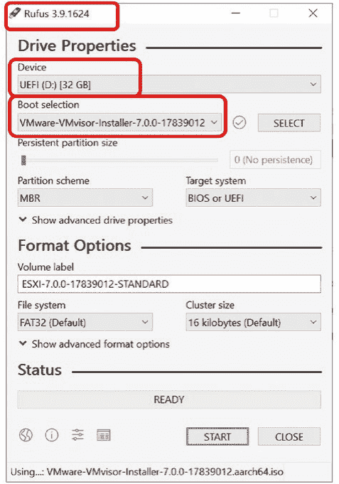

# 图5-18. Rufus

8. 当ISO映像写入驱动器后，单击“关闭”并移除U盘。

## 在Pi上安装ESXi

1. 将micro-SD和U盘放入Pi。

2. 打开Pi电源。

3. Pi启动时反复按Esc键。

4. 在Pi UEFI配置屏幕上，使用键盘选择“设备管理器”（见图5-19）。

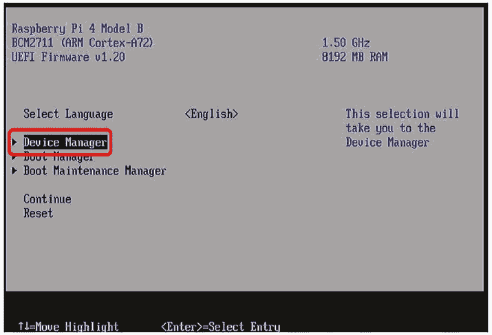

图5-19. Pi配置屏幕

5. 选择“Raspberry Pi配置” ► “高级配置”。

6. 禁用“将RAM限制为3 GB”（见图5-20）。

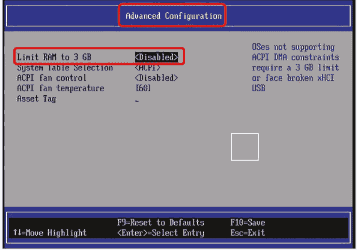

# 图5-20. RAM限制

7. 按**F10**并确认你的选择。

8. 按**Esc**三次，然后选择**继续**（见图5-21）。

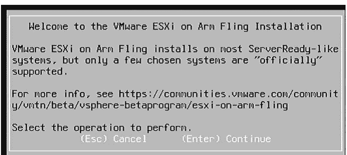

# 图5-22. 欢迎屏幕

3. 选择要安装ESXi的驱动器（见图5-23）。我发现最简单的方法是使用两个不同品牌或大小的驱动器，这样我就可以区分安装U盘和要安装的目标驱动器。

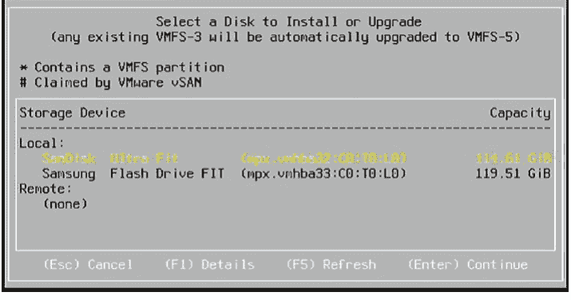

# 图5-23. 选择要安装的驱动器

4. 接受安装默认设置。

5. 当系统提示时，移除安装介质并按**Enter**重新启动系统。

6. 如果系统在显示图5-24的画面超过几分钟，请手动关闭Pi电源。

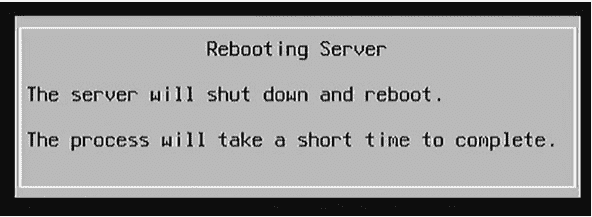

***图5-24.*** *安装重启*

## 修改RPi启动顺序

安装ESXi后，你需要为其指定启动驱动器。

1. 打开Pi电源。

2. Pi启动时反复按**Esc**键。

3. 在Pi UEFI配置屏幕上，使用键盘选择**启动维护管理器 ➤ 启动选项 ➤ 更改启动顺序**（见图5-25）。

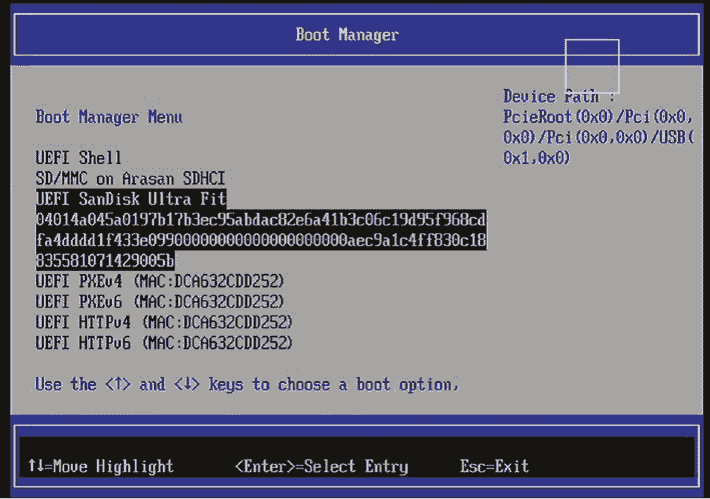

*图5-25. 更改启动顺序*

4. 选择你安装了ESXi的U盘作为第一启动设备。

5. 按**F10**，确认你的选择，然后按**Esc**三次并选择**继续**。

## 安装后配置：ESXi控制台

ESXi安装完成后，你需要从ESXi控制台配置其网络。

1. 系统启动后，你会看到ESXi屏幕。

2. 按F2，在**登录名**文本框中输入root，在**密码**文本框中输入安装ESXi时设置的密码，然后按**Enter**（见图5-26）。

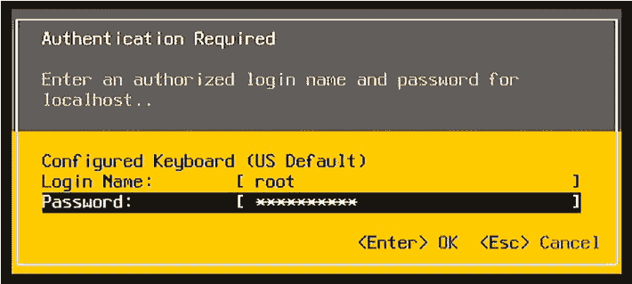

**图5-26.** *ESXi登录*

3. 选择**配置管理网络**。

4. 设置主机名，并在需要时更改网络设置。

5. 按**Esc**。选择“是”以**应用更改并重新启动管理网络**。

6. 选择**故障排除选项**。

7. 启用ESXi shell和SSH。

8. 按**Esc**。选择“是”以**应用更改并重新启动管理网络**。

9. 按**Esc**退出ESXi控制台。


## 安装后配置：VMware 主机控制台

ESXi 上的时间准确至关重要。

你可以使用基于 Web 的 VMware 主机客户端来配置 ESXi 主机上的时间。我发现树莓派上的时间通常与实际时间相差数月甚至数年，因此我先手动设置时间，然后启动 NTP 服务，以保持树莓派上的时间准确。

1. 在 Web 浏览器中输入 ESXi 系统的 IP 地址，并在其前面加上 `https://`。这将带你进入 VMware 主机客户端。

2. 在 **用户名** 文本框中输入 *root*，在 **密码** 文本框中输入安装 ESXi 时设置的密码，然后点击 **登录**（见图 5-27）。

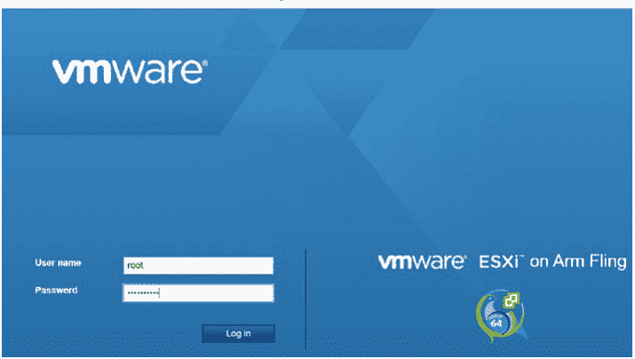

*图 5-27. 登录 VMware 主机控制台*

3. 在主页上，确认你正在树莓派上运行 ESXi on ARM Fling（见图 5-28）。

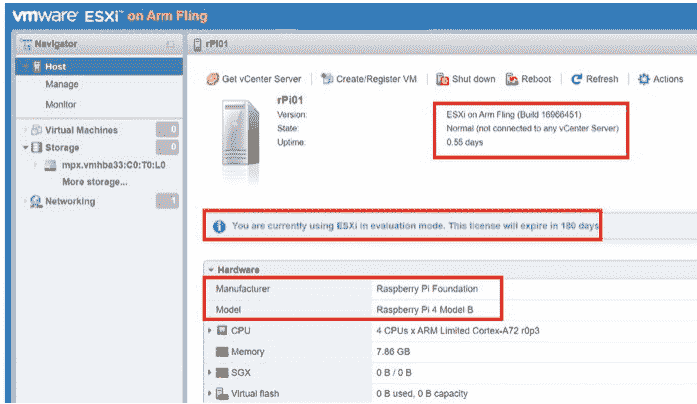

*图 5-28. VMware 主机控制台主页*

4. 在导航器窗格中，选择 **管理**，选择 **系统** 选项卡，然后选择 **时间和日期**（见图 5-29）。

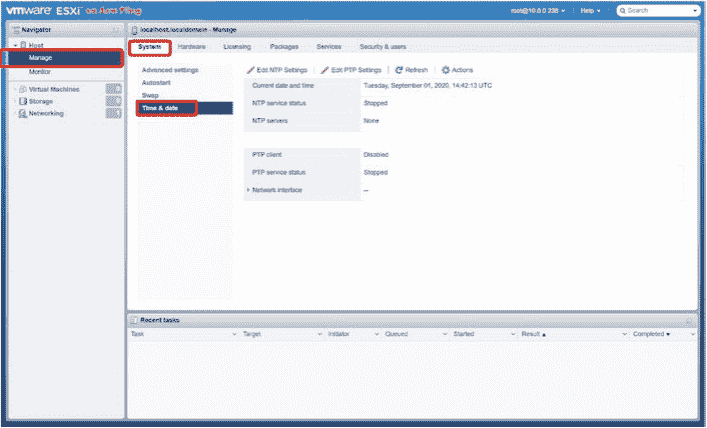

*图 5-29. 时间和日期设置*

5. 点击 **编辑 NTP 设置**。

6. 选择 **手动配置此主机上的日期和时间**，将日期设置为当前 UTC 时间，然后点击 **保存**（见图 5-30）。

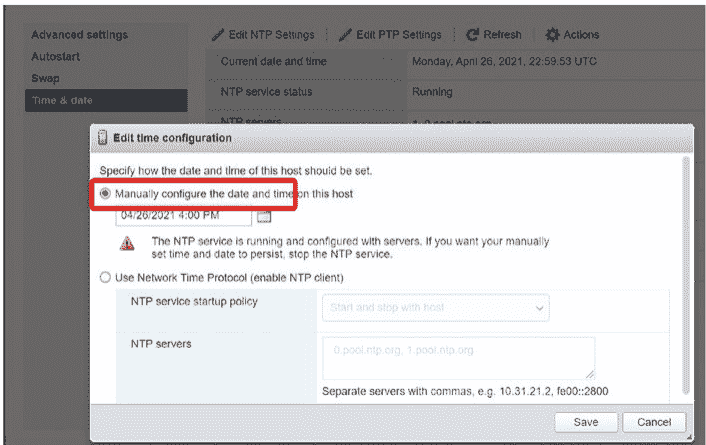

*图 5-30. 手动时间设置*

7. 点击 **编辑 NTP 设置**。

8. 选择 **使用网络时间协议**，选择 **随主机启动和停止**，输入 `0.pool.ntp.org`、`1.pool.ntp.org`，然后点击 **保存**（见图 5-31）。

## 小结

在 Arm 平台上安装 ESXi 所涉及的步骤要比 x64 系统多得多，后者只需从安装介质启动并安装即可。

第一次在 Arm 系统上安装 ESXi 可能需要一个小时左右，但如果你按照上述说明操作，应该会比较顺利。在接下来的章节中，我们将进一步使用 VMware 主机控制台，并向 ESXi 主机添加存储和虚拟机。
