# CHAPTER 8

# Virtual Machines on ESXi

虽然许多读者可能迫不及待地想了解如何创建虚拟机（VM）——我们将在本章中介绍——但这可能是本书中最无趣的一章，但原因充分：VMware 投入了大量时间和精力，使创建 VM 变得像在物理机上安装操作系统一样简单。是的，有一些细微差别你需要注意，并且你需要确保获取适用于 Arm 处理器的正确 ISO，但总体而言，在 ESXi 上创建 VM 的过程很直接。

在本章中，我将为你提供逐步说明，介绍如何从几种不同的 Linux ISO 发行版创建 VM。我还将讨论为什么 Windows 不能在你的系统上运行，如何复制你的 VM，以及快照是什么。最后，我将概述 VMware Tools：它是什么，为什么重要，以及如何在你的 Linux 系统上安装它。

> **Note:** ESXi-Arm-Fling-Doc 指出 Ubuntu、CentOS、openSUSE、Photon、Debian 和 Fedora Linux 发行版已知是兼容的；但是，你需要确保获取这些发行版的 Arm 版本。

## Windows Will Not Work

由于 Pi 采用 Arm 处理器，为 x64 系统编译的软件无法在上面运行。幸运的是，所有主要 Linux 发行版都有可直接获取的 Arm 版本，并且作为 VM 运行效果相当不错（即使内存和 CPU 周期有限）。

微软自 2011 年起就有了 Arm 版本的 Windows，其首款 Surface 设备 Surface RT 就由 NVIDIA Arm 处理器驱动。最近，微软宣布了适用于 Arm 的 Windows 10 版本，其最近宣布的 Surface Pro X 也运行该版本。

然而，很可能你无法让它在像 Pi 这样的通用 Arm 系统上运行，因为存在驱动程序兼容性问题。此外，微软宣布其云中确实运行有基于 Arm 的服务器 Windows，但它也表示，未来在近期内向公众提供该版本是值得怀疑的。

## VMware Tools

VMware Tools 是一组实用程序，可提高 VM 的性能，并使 ESXi 主机客户端和 vSphere 客户端能够查看 VM。VMware Tools 还允许在快照进行时静默磁盘，从而保存磁盘的一致状态。大多数基于 Intel 的 VM 都有预编译的 VMware Tools，可以使用客户端安装，但 Arm 系统没有，因此需要在你的机器上编译。你的 VM 在没有 VMware Tools 的情况下也能运行，但包含的工具提供的增强功能使其安装是值得的。

由于在你的系统上编译和安装 VMware Tools 涉及许多命令，我创建了脚本来执行此操作。这些脚本可供使用，可从 GitHub 下载。请在运行前仔细检查代码。

并且将获得 5 年的常规补丁支持和 10 年的安全补丁支持。

Arm Ubuntu 映像的下载站点为 https://ubuntu.com/download/server/arm。

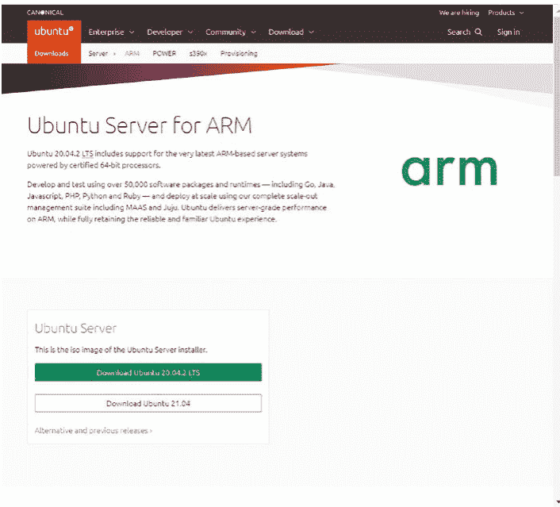

以下是将其安装在你的 Pi 上的步骤。

## Download Ubuntu 20.04 ISO

我们将直接下载安装 ISO 到 ESXi 数据存储。稍后我们将使用 ISO 安装系统。

1. SSH 到 ESXi 主机。

2. 通过输入以下命令获取 root 用户权限：

   `sudo bash`

3. 通过输入以下命令更改到你想要存储 ISO 的目录：

   `cd /vmfs/volumes/rPi-USB-Datastore-01`

4. 通过输入以下命令打开防火墙以允许 HTTP 连接：

   `esxcli network firewall ruleset set --enabled=true --ruleset-id=httpClient`

5. 通过输入以下命令下载 Ubuntu 20.04 服务器映像：

   `wget https://cdimage.ubuntu.com/releases/20.04/release/ubuntu-20.04.2-live-server-arm64.iso`

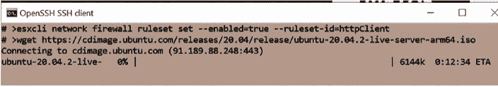

ISO 的下载需要几分钟时间。

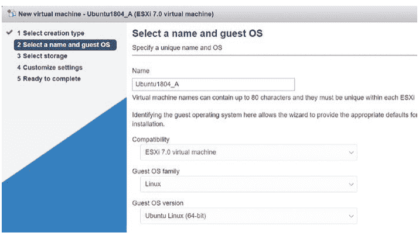

5. 验证 rPi-USB-Datastore-01 是数据存储，然后单击 **Next**。

6. 将虚拟硬件设置为三个 CPU 和 4 GB 内存。

7. 展开 **CD/DVD Drive 1**，选择 **Datastore ISO file**，并选择你的 Ubuntu ISO 映像。验证 **Connect at power on** 已被选中。单击 **Next**。

8. 验证你的设置并单击 **Finish**。

## Install Ubuntu 20.04 on the VM

在 VM 上安装操作系统就像在物理机上安装操作系统一样。当从主机客户端访问虚拟机时，你可以选择使用 Web 浏览器或 VM 远程控制台（VMRC）。VMRC 作为独立应用程序运行，可在 Windows、macOS 和 Linux 操作系统上使用，不仅允许你查看 VM 控制台，还可以执行 Web 浏览器无法执行的功能，包括安装操作系统、配置操作系统设置、运行应用程序、监控性能等。

在本章中，我将使用 VMRC。

1. 右键单击 Ubuntu 虚拟机并选择 **Download VMRC**。

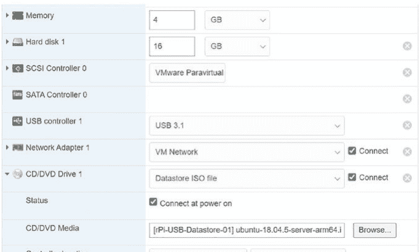

2. 这将带你进入 VMware VMRC 下载页面。下载它并在你的系统上安装。

3. 右键单击虚拟机并选择 **Launch remote console**。

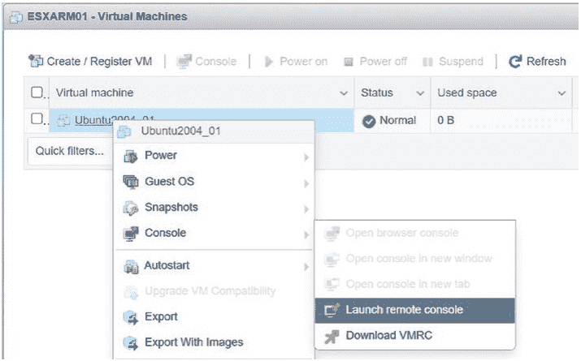

4. 在 VMRC 顶部，单击 Power On 图标。

5. 在显示屏中，选择 Install Ubuntu Server。

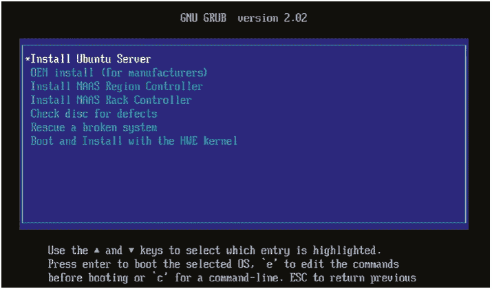

6. 按照提示安装 Ubuntu。被问及是否安装 OpenSSH 服务器时，选择 yes 并接受所有其他默认值或根据你的环境修改它们。

7. 安装操作系统需要几分钟时间。我发现使用 ESXi 主机客户端监控 ESXi 系统资源使用情况很有用，以验证安装正在进行。

8. 安装完成后，选择 Reboot Now。

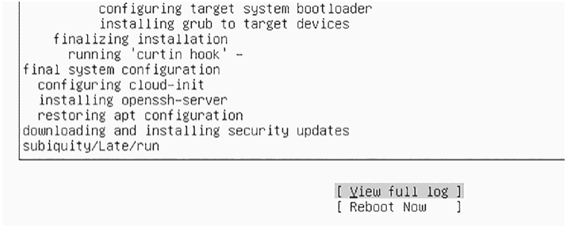

9. 重启需要几分钟时间。如果似乎卡住，请转到主机客户端，单击导航器中的 VM，然后选择 Monitor。

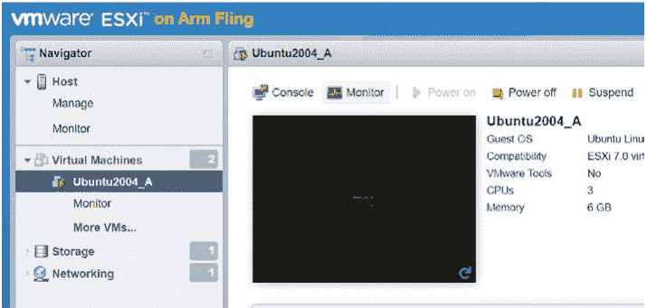

10. 从下拉菜单中选择 CPU。如果图表中几分钟内没有活动，请在 Actions 下拉菜单中选择 Reset。

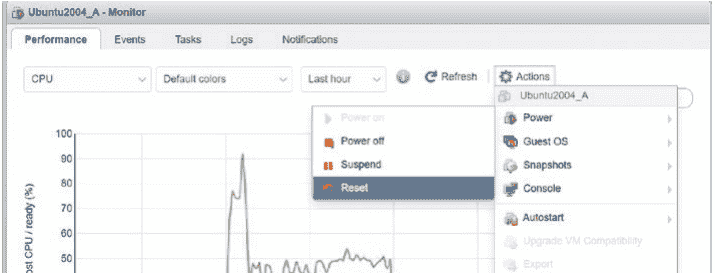

11. 系统完成启动可能并不明显，因为启动过程会继续写入屏幕，但按下 Enter 键会显示登录提示。

## Installing VMware Tools on Ubuntu

应在 Ubuntu 上安装 VMware Tools。编译和安装它需要 10–15 分钟，我建议你在安装时将 VM 配置为三个 vCPU 和 6 GB RAM。

编译 VMware Tools 的步骤相当长且详细，因此我创建了一个脚本来执行此操作。请仔细阅读脚本，不要在生产系统上使用。我只使用过 Ubuntu 20.04，但它可能适用于 Ubuntu 的其他版本。

1. 登录到 VMRC。

2. 输入 `ip add` 并获取系统的 IP 地址。

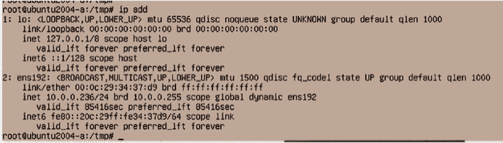

3. 我发现使用 SSH 会话工作更方便。如果你想使用 VMRC，请跳过下一步。

4. 打开到服务器的 SSH 连接。

5. 通过输入以下命令获取 root 权限：

   `sudo su`

6. 通过输入以下命令更改到 `tmp` 目录：

   `cd /tmp`


7. 输入以下命令，安装编译 VMware Tools 所需的工具：

```bash
apt update
apt install build-essential -y
```

8. 下载 VMware Tools 构建脚本，使其可执行，然后运行它，输入：

```bash
wget https://raw.githubusercontent.com/FentonTom/VMware_Tools_Ubuntu/main/Ubuntu2004
chmod 755 Ubuntu2004
./Ubuntu2004
```

9. 当 VMware Tools 编译并安装完成后，您将收到服务已启动的消息。

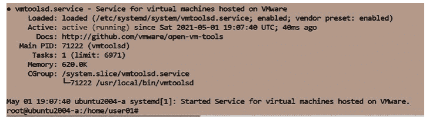

10. 返回 ESXi 主机客户端，选择 Ubuntu 虚拟机。它将显示 VMware Tools 已安装并在其上运行。您可能需要刷新屏幕。

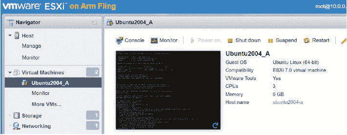

## Ubuntu 虚拟机的后续配置

除非您只打算在 ESXi 主机上运行单个虚拟机，否则您需要减少虚拟机使用的资源。

1. 关闭虚拟机电源。这可以通过虚拟机、VMRC 或主机客户端完成。
2. 在 ESXi 主机客户端中，右键单击虚拟机并选择 **编辑设置**。

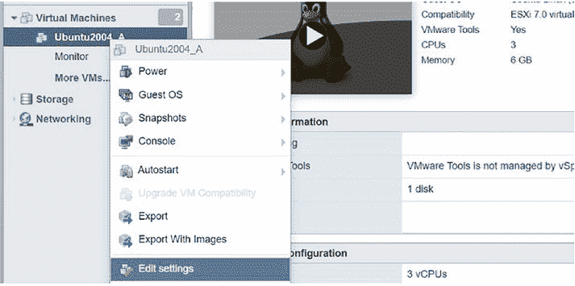

3. 将 vCPU 数量更改为 1，RAM 更改为 2GB，删除 CD/DVD，然后点击 **保存**。
4. 从 VMRC 打开虚拟机电源。
5. 验证系统已启动，然后将其关闭。

## 虚拟机文件

虚拟机是文件的集合。以下列表中显示的文件包含虚拟机监控程序运行虚拟机所需的数据和信息。

```text
[root@ESXARM01:/vmfs/volumes/5f4e5cd6-2dc632aa-9320-dca632cdd252/Fedora34_01_Argon] ls -l
total 33561728
-rw-r--r-- 1 root root 159286 Sep 13 2020 vmware.log
-rw-r--r-- 1 root root 91597 Sep 13 2020 vmware-4.log
-rw-r--r-- 1 root root 105961 Sep 13 2020 vmware-3.log
-rw-r--r-- 1 root root 87922 Sep 13 2020 vmware-2.log
-rw-r--r-- 1 root root 86790 Sep 13 2020 vmware-1.log
-rwxr-xr-x 1 root root 3217 Sep 13 2020 Fresh_Fedora34_NFS.vmx
-rw-r--r-- 1 root root 0 Sep 13 2020 Fresh_Fedora34_NFS.vmsd
-rw------- 1 root root 479 Sep 13 2020 Fresh_Fedora34_NFS.vmdk
-rw------- 1 root root 278840 Sep 13 2020 Fresh_Fedora34_NFS.nvram
-rw------- 1 root root 34359738368 Sep 13 2020 Fresh_Fedora34_NFS-flat.vmdk
```

以下是一些文件及其用途：

- **nvram** — 包含虚拟机 BIOS 的状态。
- **vmdk** — 存储虚拟机虚拟磁盘的内容。一个虚拟机可以有多个虚拟磁盘。
- **vmsd** — 存储虚拟机快照的元数据。
- **vmx** — 虚拟机的配置文件。它存储虚拟机设置。
- **log** — 包含日志。

这些文件可以通过主机客户端查看。

1. 在主机客户端中，展开“存储”对象并选择 rPi-USB-Datastore-01。

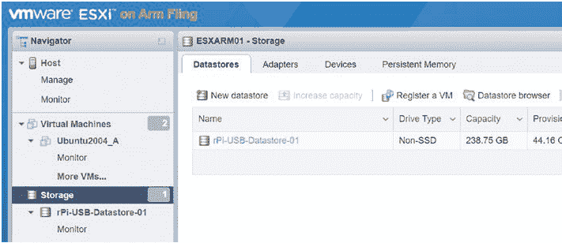

2. 选择“数据存储浏览器”。

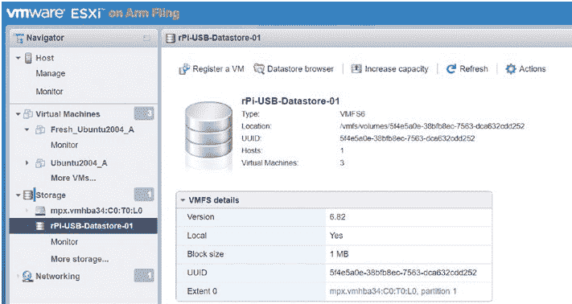

3. 选择虚拟机。文件将显示在右侧。

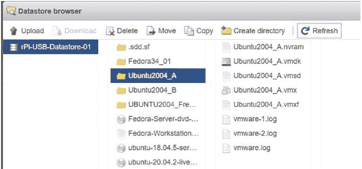

## 创建虚拟机副本

创建虚拟机后，您可能需要它的另一个实例。VMware 可以在 vSphere Client 中使用克隆功能通过 GUI 轻松创建虚拟机副本，但由于我们尚未安装 vCenter Server，只有 ESXi 主机客户端可用，因此我们需要使用 ESXi 主机客户端来完成。确实可以做到，但使用它复制虚拟机比使用 vCenter Server 需要更多的步骤。

## 复制虚拟机文件

组成虚拟机的文件存储在可从 ESXi 访问的目录中。您可以复制这些文件来创建重复的虚拟机。

1. 在到 ESXi 主机的 SSH 会话中，切换到包含虚拟机的目录：

```bash
cd /volumes/rPi-USB-Datastore-01
```

4. 复制过程完成后，我有了一个新目录，其中包含虚拟机的文件。

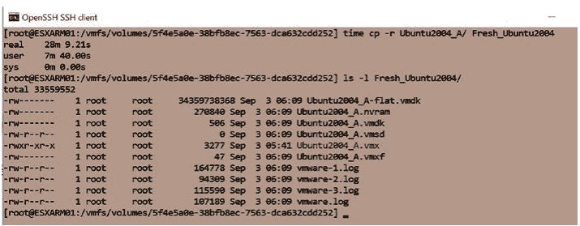

## 注册复制的虚拟机

复制虚拟机的文件后，您需要让 ESXi 主机感知到它。这通过注册来完成。

1. 在主机客户端中，展开“存储”对象，然后点击您复制文件到的数据存储。
2. 选择“注册虚拟机”。

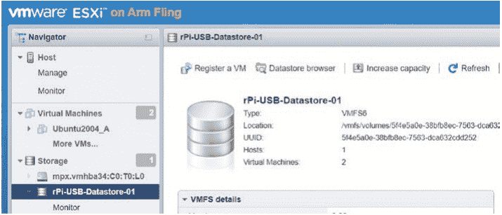

3. 选择 **Fresh_Ubuntu2004** 目录，右键单击 `.vmx` 文件，然后选择 **注册虚拟机**。

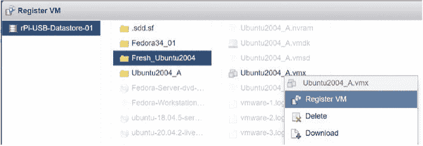

4. 关闭数据存储浏览器。

5. 在导航器中选择 **虚拟机**。右键单击底部名为 Ubuntu2004_A 的虚拟机，然后选择 **编辑设置**。

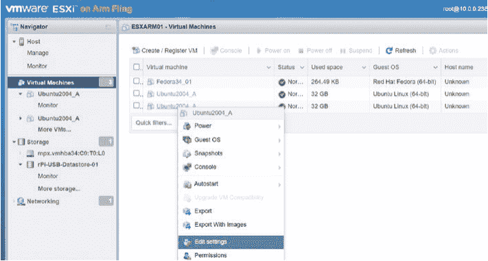

6. 选择 **虚拟机选项**。
7. 验证其目录显示为 Fresh_Ubuntu2004；如果不是，请选择另一个虚拟机。
8. 在 **虚拟机配置文件** 文本框中，输入 Fresh_Ubuntu2004_A，然后点击 **保存**。

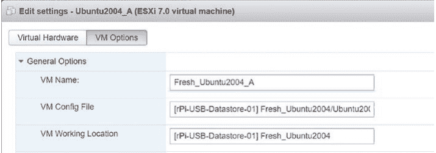

9. 点击 **刷新**，验证新虚拟机的名称是否显示。

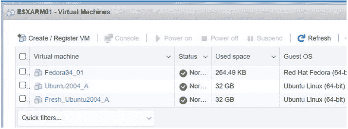

## 启动操作系统

1. 打开新虚拟机的 VMRC 控制台并打开其电源。
2. 在弹出的窗口中，选择 **我复制了它**，然后点击 **应答**。
3. 登录 Ubuntu 系统。
4. 输入以下命令获取 root 权限：

```bash
sudo bash
```

5. 输入以下命令，验证其 IP 地址与复制来源的虚拟机不同：

```bash
ip add
```

6. 输入以下命令，验证其名称与复制来源的虚拟机相同：

```bash
hostname
```

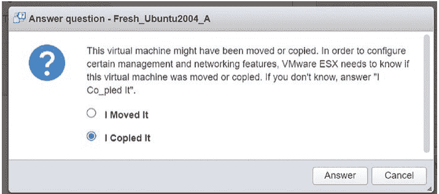

我将安装 Fedora 34，但已知许多其他版本也可以与 ESXi on Arm 配合使用。

创建 Fedora 虚拟机的过程与安装 Ubuntu 以及许多其他 Linux 发行版非常相似。

Arm Fedora 镜像的下载站点是 https://getfedora.org/en/server/download/。

我将直接从该网站下载 *Fedora 34：适用于 aarch64 的标准 ISO 镜像* 到 ESXi 数据存储。

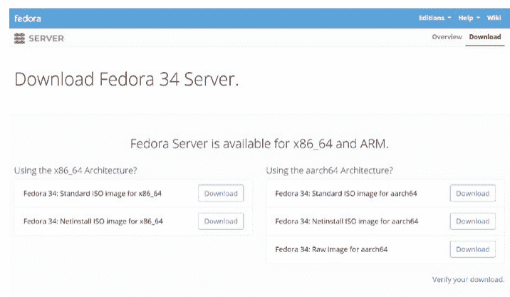

## 下载 Fedora 34 ISO

我将把安装 ISO 直接下载到 ESXi 数据存储。

1. SSH 进入 ESXi 系统。
2. 输入以下命令获取 root 用户权限：

```bash
sudo bash
```

3. 在“新建虚拟机”向导中，选择“创建新的虚拟机”，然后点击“下一步”。

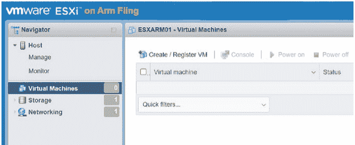

4. 在“名称”文本框中，输入 Fedora34_01。从“客户机操作系统系列”下拉菜单中，选择 Linux。在“客户机操作系统版本”下拉菜单中，选择 Red Hat Fedora (64-bit)，然后点击“下一步”。

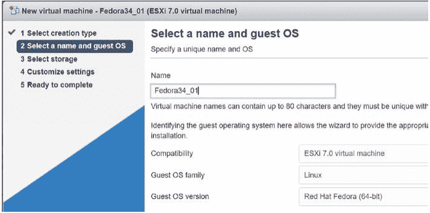

# 第 8 章    ESXi 上的虚拟机

5. 验证 rPi-USB-Datastore-01 是数据存储，然后点击 **下一步**。
6. 将虚拟硬件设置为三个 CPU、4GB 内存和 32GB 硬盘。
7. 展开 CD/DVD **驱动器 1**，选择 **数据存储 ISO 文件**，然后选择您的 Fedora ISO 镜像。验证已选择 **打开电源时连接**。
8. 展开 **硬盘 1**，然后选择 **精简置备**。点击 **下一步**。

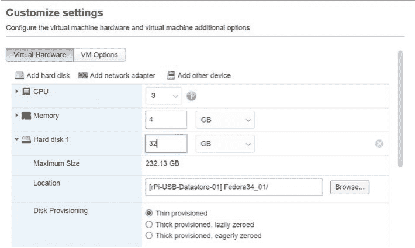

9. 验证您的设置，然后点击 **完成**。

## 在虚拟机上安装 Fedora 34

在虚拟机上安装操作系统就像在物理机上安装一样。我将使用之前安装的 VMRC 来创建 Fedora 虚拟机。

1. 右键单击 Fedora 虚拟机，然后选择“启动远程控制台”。

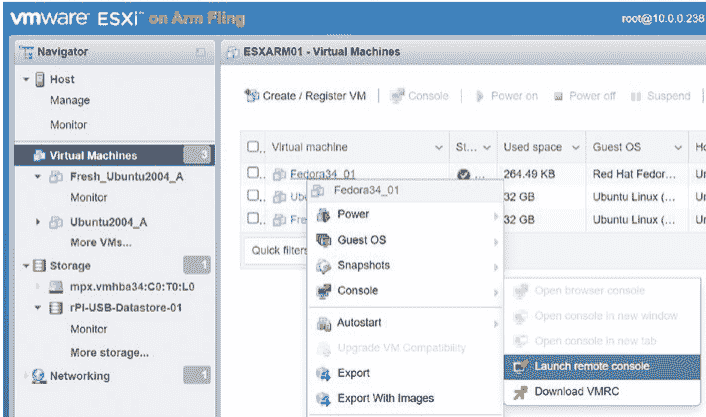

2. 在 VMRC 顶部，点击“打开电源”图标。
3. 在显示界面中，选择“安装 Fedora 34”。

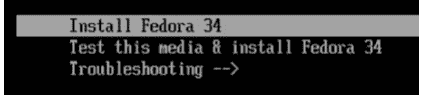

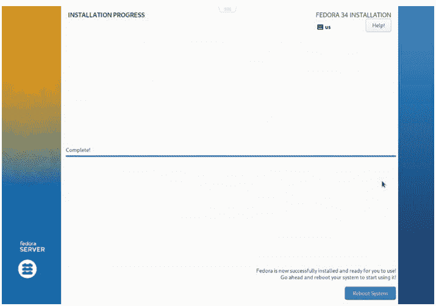

6. 安装完成后，选择“立即重启”。

## 配置 Fedora 34

操作系统安装完成后，您需要进行一些安装后配置。

1. 系统将重新启动到登录提示符。
2. 虽然我可以从命令提示符登录系统，但我使用 Web 门户与系统交互。Web 控制台的 IP 地址显示在 VMRC 中。


Fedora 34（服务器版）
内核 5.11.12-300.fc34.aarch64，运行于 aarch64（tty1）

Web 控制台：https://fedora:9090/ 或 https://10.0.0.234:9090/

Fedora 登录：

- 3. 我以所创建的用户身份登录了 Web 控制台。

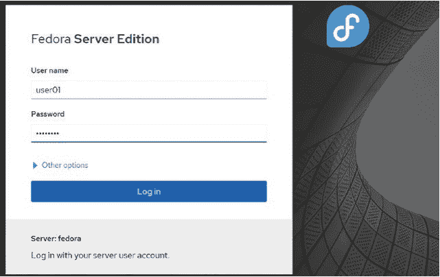

- 4. 登录 Web 控制台后，我可以在**真实主机名**文本框中输入主机名来设置它。

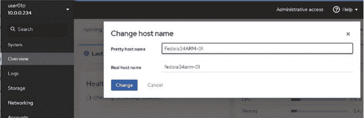

5. 在日志中，我注意到 SELinux 已启用。

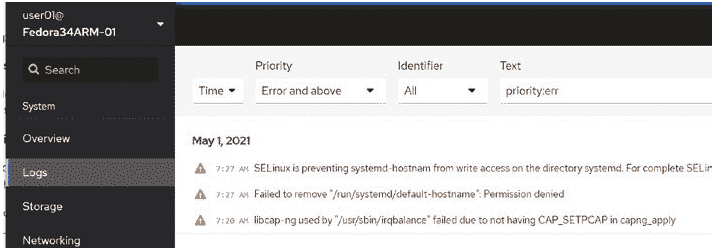

6. SELinux 是一个强大的安全工具，但我发现它有时限制过度。由于我的环境相当安全，我选择移除它。在“应用程序”选项卡中，我选中它并点击**移除**。

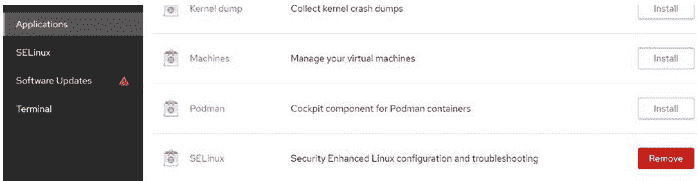

7. 在右上角，我从下拉菜单中选择“关机”。在主机客户端中，我使用“编辑设置”将虚拟机改为 1 个 CPU 和 2 GB 内存。这是必要的，因为我计划在 ESXi 服务器上运行多台虚拟机。

Fusion）或受支持的公共云之一。它可以免费获取，易于在 vSphere 上安装，并可用作项目的基础操作系统。它的安装和使用方式与其他 Linux 发行版略有不同。

有适用于 Raspberry Pi 的镜像和完整的 Arm64 ISO 镜像。Pi 镜像用于在 Pi 上原生运行；你需要安装完整的 Arm64 Photon OS 4.0 GA 版本。

Arm 镜像的下载地址是 https://github.com/vmware/photon/wiki/Downloading-Photon-OS

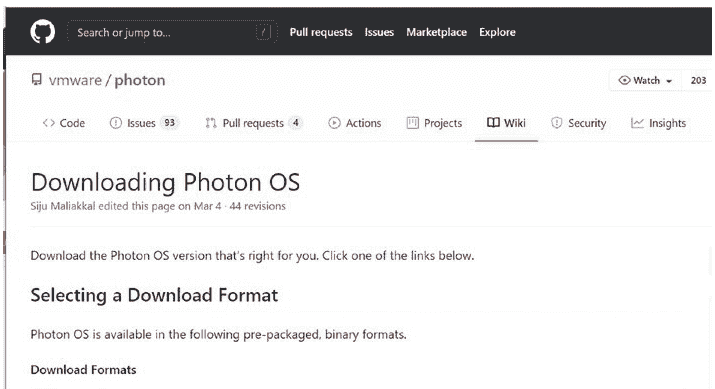

以下是在你的 Pi 上安装 Photon OS 的步骤。

## 下载 Photon OS

我们将直接把安装 ISO 下载到 ESXi 数据存储中。之后我们将使用该 ISO 安装系统。

- 1. SSH 登录 ESXi 系统。
- 2. 输入以下命令获取 root 用户权限：

  `sudo bash`

# 第 8 章　ESXi 上的虚拟机

- 3. 输入以下命令切换到要存储 ISO 的目录：

  `cd /vmfs/volumes/rPi-USB-Datastore-01`

- 4. 输入以下命令打开防火墙以允许 HTTP 连接：

  `esxcli network firewall ruleset set --enabled=true --ruleset-id=httpClient`

- 5. 输入以下命令下载 Arm 镜像：

  `wget https://packages.vmware.com/photon/4.0/GA/iso/photon-4.0-1526e30ba-aarch64.iso`

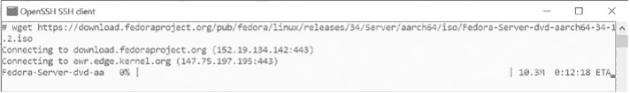

该 ISO 大小为 2.9 GB，下载需要几分钟。

你也可以将 ISO 下载到桌面系统，然后使用 SCP 将其复制到 ESXi 主机。

## 创建 Photon 虚拟机

- 1. 登录 ESXi 主机客户端。
- 2. 在导航器中，选择**虚拟机**，然后点击**创建/注册虚拟机**。
- 3. 在“新建虚拟机”向导中，选择“创建新虚拟机”，然后点击“下一步”。

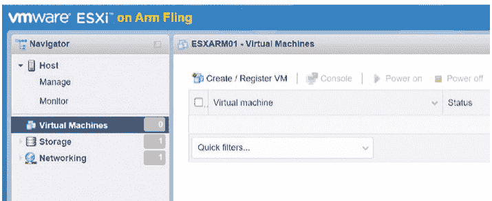

- 4. 在“名称”文本框中输入 PhotonOS40。在“客户机操作系统系列”下拉菜单中选择 Linux。在“客户机操作系统版本”下拉菜单中选择 VMware Photon OS（64 位），然后点击“下一步”。

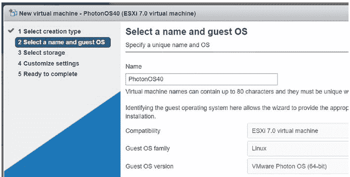

- 5. 确认 rPi-USB-Datastore-01 是数据存储，然后点击**下一步**。
- 6. 将虚拟硬件设置为 3 个 CPU、4 GB 内存和 32 GB 硬盘。
- 7. 展开**CD/DVD 驱动器 1**，选择**数据存储 ISO 文件**，然后选择你的 Photon OS ISO 镜像。确认已选中**开机时连接**。
- 8. 展开**硬盘 1**，选择**精简置备**。点击**下一步**。

## 自定义设置

配置虚拟机硬件和虚拟机的其他选项。

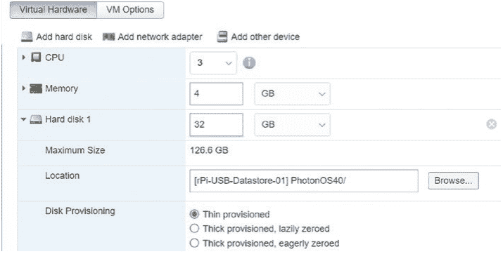

- 9. 确认设置并点击**完成**。

## 在虚拟机上安装 Photon

我将使用之前安装的 VMRC 来安装操作系统。

- 1. 右键单击 Photon OS 虚拟机，然后选择**启动远程控制台**。

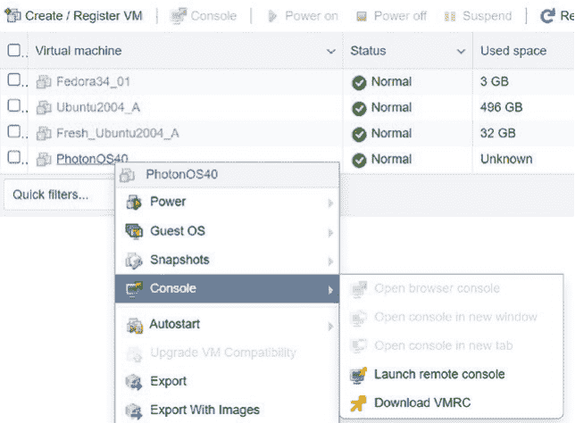

- 2. 在 VMRC 顶部，点击**开机**图标。
- 3. 接受 EULA（最终用户许可协议）。

# 第 8 章　ESXi 上的虚拟机

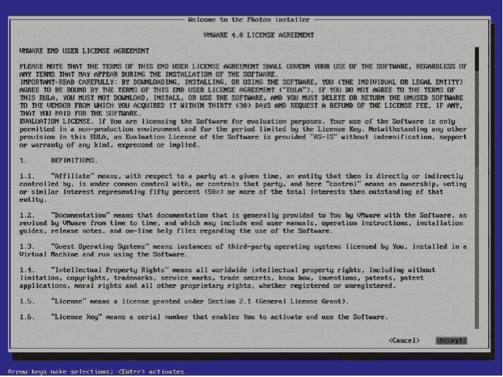

- 4. 按照提示安装 Photon Minimal OS。

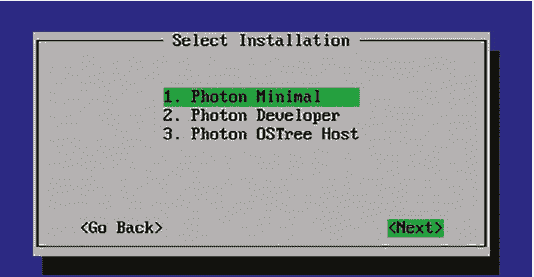

- 5. 接受所有默认设置。
- 6. 安装操作系统需要几分钟。安装过程中会显示已用计时器。我只用了 96 秒就完成了安装。

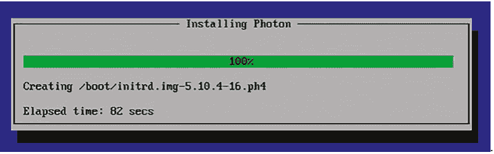

- 7. 安装完成后，按任意键启动系统。

## 配置 Photon

操作系统安装完成后，你需要进行一些安装后配置。

- 1. 系统将重新启动并显示启动画面。操作系统在此期间会进行一些配置，因此你会看到启动画面（参见图 8-3）。

- 5. 输入以下命令重启 SSH 服务：

```bash
systemctl restart sshd
```

- 6. 验证 root 用户能否使用 SSH 登录：

```bash
ssh root@localhost
```

- 7. 输入以下命令退出 SSH 会话：

```bash
exit
```

- 8. 输入以下命令关闭虚拟机：

```bash
init 0
```

- 9. 如果你计划在它上面运行多个 Photon 实例，请编辑设置将其改为 1 个 CPU 和 2 GB 内存。你甚至可以使用 1 GB 内存。

## 在 Photon 上安装 VMware Tools

如果可能，应在所有客户机操作系统上安装 VMware Tools。幸运的是，你可以通过软件包安装 open-vm-tools，而无需自行构建。

- 1. 启动虚拟机，并从 VMRC 或 SSH 以 root 身份登录。
- 2. 输入以下命令安装 open-vm-tools 软件包：

```bash
tdnf -y install open-vm-tools
```

- 3. 输入以下命令启用并启动 VMware Tools：

```bash
systemctl enable vmtoolsd.service
systemctl start vmtoolsd.service
```

- 4. 输入以下命令查看已启动的服务：

  `systemctl status`

- 5. 在输出中，确认显示了 vmtoolsd.service。

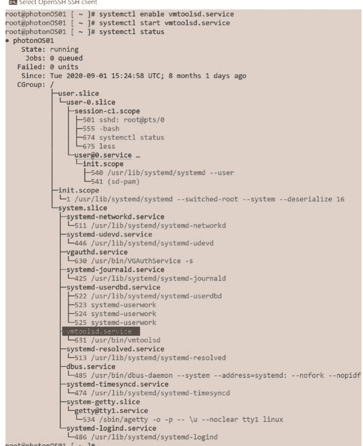

- 6. 在主机客户端中，确认 VMware Tools 正在运行。

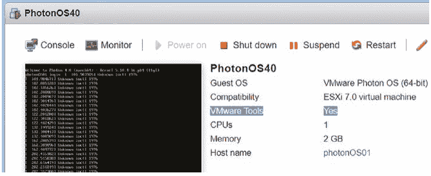

Photon OS 是一款极其轻量级的操作系统。重启虚拟机后，它仅使用了 0.5 GB 内存。很赞的是它有用于安装 VMware Tools 的软件包。它的管理方式与其他 Linux 发行版略有不同，但 Photon OS 网站上有用户和管理员指南。

有趣的事实：包管理器 tdnf 是 Tiny Dandified Yum 的缩写！

## 快照

ESXi 能够为虚拟机拍摄快照。这是一项强大的技术，因为它允许你保留机器在特定时间点的状态和数据。我发现先对虚拟机拍摄快照再进行重大更改（如更新或安装应用程序）非常有用。如果更新成功完成，我会将快照提交到虚拟机中。

我还发现此功能在教学时很有用。在带领学生完成一个流程后，我可以将机器恢复到原始状态，让下一个班级做同样的练习，而无需重新安装操作系统。

一台虚拟机可以有多个快照，无论虚拟机是开机还是关机，你都可以拍摄快照。如果对正在运行的虚拟机拍摄快照，它将捕获其内存和磁盘的当前状态。由于拍摄实时快照需要占用资源，我会对已关机的虚拟机拍摄快照。快照有许多细微之处，我们在此不做讨论，但 VMware 提供了许多优秀的文档来帮助解答相关问题。

## 使用快照

可以从 ESXi 主机客户端启动快照。

- 1. 登录 ESXi 主机客户端。
- 2. 在导航器中，双击**虚拟机**。
- 3. 确认 Fedora 虚拟机已关机。
- 4. 右键单击 Fedora 虚拟机，然后从**快照**下拉菜单中选择**拍摄快照**。

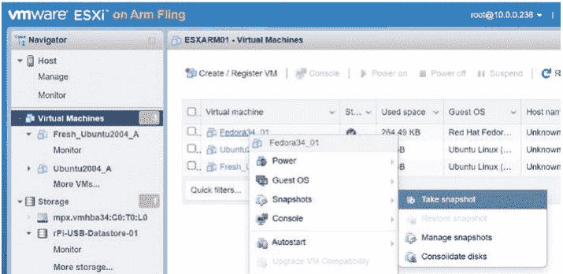


5. 在“名称”文本框中，输入“第一个快照”，并单击“拍摄快照”。

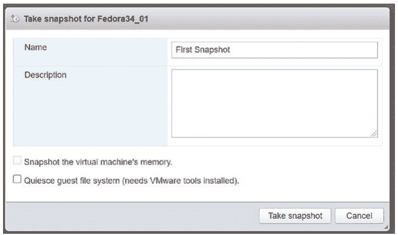

6. 为已关闭电源的虚拟机拍摄快照非常迅速。

7. 右键单击 Fedora 虚拟机，从“快照”下拉菜单中选择“管理快照”。

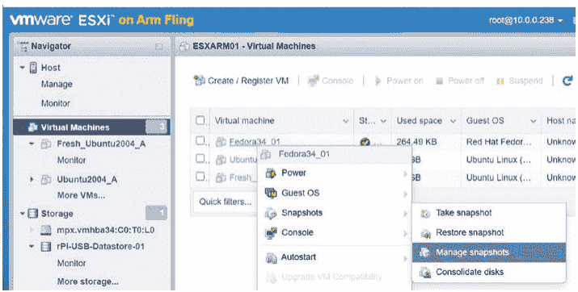

13. 右键单击 Fedora 虚拟机，从“快照”下拉菜单中选择“管理快照”。

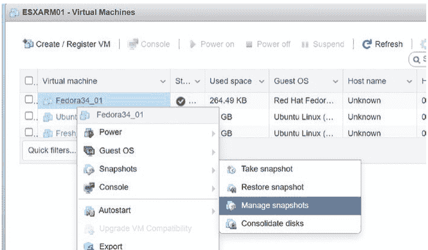

14. 单击“第一个快照”，并单击“删除快照”。

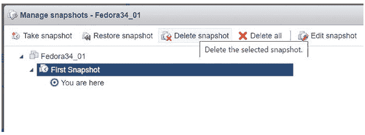

15. 单击**移除。**


16. 快照已被删除，所有更改现在都已提交到虚拟机中，并且对虚拟机所做的所有更改现在都已永久生效。

17. 启动 Fedora 虚拟机，登录到该虚拟机，并验证 *MyNewFile* 仍然存在。

18. 关闭 Fedora 虚拟机。为其创建一个名为 *第二个快照。* 的快照。

19. 启动 Fedora 虚拟机，登录到该虚拟机，并通过输入以下命令在该虚拟机上创建一个新文件：

```
touch NewFile002
```

20. 验证文件是否已创建。

21. 关闭虚拟机。

22. 在快照管理器中，选择**第二个快照**，单击**恢复快照**，再单击**恢复**。


23. 启动 Fedora 虚拟机，并验证 *NewFile002* 已不再存在。

24. 关闭虚拟机。

## 总结

在本章中，我们创建了 Fedora、Ubuntu 和 Photon OS 虚拟机，并复制组成虚拟机的文件来从中创建另一台虚拟机。我们还讨论了 VMware Tools、可用于虚拟机的虚拟磁盘类型，以及如何拍摄快照。

我们使用 USB 设备来存储虚拟机。这些设备并非理想选择，但可以使用。我监控了用于存储的 USB 设备，注意到在复制文件以创建新虚拟机时，其温度达到了 121 华氏度（50 摄氏度）；这可能会对设备的性能和使用寿命产生不利影响。在接下来的章节中，我们将介绍其他一些更合适的存储选项。
