# 第 9 章：ESXi 的网络存储选项

网络存储对 vSphere 来说是一个巨大的颠覆性变革——它既将 ESXi 主机从主机可支持的存储容量物理限制中解放出来，又允许存储在其上的虚拟机在任意可访问的主机上运行。

在本章中，我将介绍并解释如何设置两种不同的网络存储方法：网络文件系统（NFS）和 Internet 小型计算机系统接口（iSCSI）。我将演示如何使用 Windows 和 Linux 系统提供网络存储，并将使用 2 型虚拟机监控程序在笔记本电脑上以虚拟机形式运行 Linux 系统。

> 注意：在本章的学习过程中，需要记住的 NFS 与 iSCSI 之间的一个关键区别是：NFS 通过网络共享文件，而 iSCSI 通过网络共享块设备；NFS 用于文件，iSCSI 用于块。

到目前为止，我们仅使用本地存储来创建和存储虚拟机。虽然这种设置在有限的使用场景下可以接受，但虚拟化的真正力量在于它提供的抽象层。这些抽象层允许虚拟机在能够访问这些文件的任何服务器上启动。图 9-1 显示，共享存储上的虚拟机可以在任何已连接的 ESXi 主机上运行，从而大大提高了业务连续性。

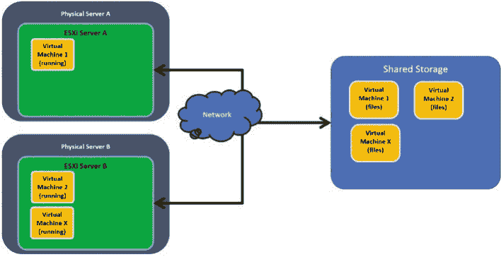

**图 9-1.** *共享存储与 ESXi*

如果某个 ESXi 主机发生故障，你可以在仍在运行的主机上重启虚拟机（参见图 9-2）。

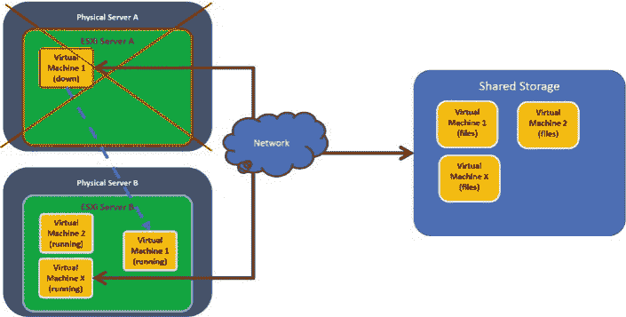

**图 9-2.** *故障系统*

你还可以将虚拟机放置到资源（如 CPU、RAM 等）最多的主机上，以平衡负载并提高性能（参见图 9-3）。

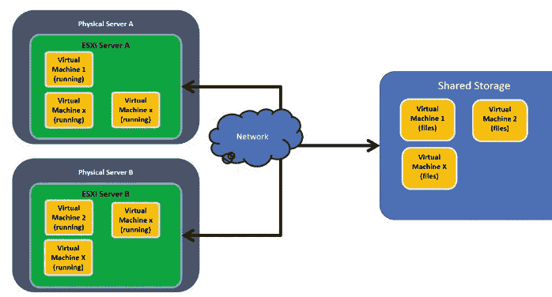

**图 9-3.** *负载均衡*

图 9-4 展示了如何在多个 ESXi 主机上使用 NFS 和 iSCSI。

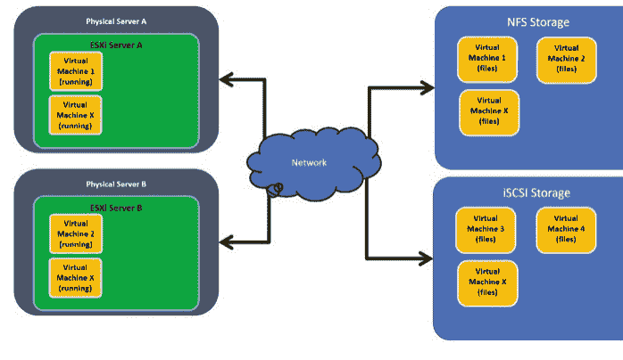

**图 9-4.** *ESXi 主机上的 iSCSI 和 NFS*

### NFS

有些人可能会混淆 NFS 和另一种用于通过网络共享文件的协议——服务器消息块（SMB）。虽然 SMB 和 NFS 都可以用于各种操作系统（如 Windows、Linux、macOS 等），但实际上 SMB 最常用于 Windows 和 macOS 系统，而 NFS 更常用于 Linux 和 Unix 系统。ESXi 不支持 SMB。

最初，ESXi 仅支持 NFS v3，但后来增加对 NFS v4.1 的支持。这些版本之间的主要区别在于，v4.1 支持多网络连接，即多路径。这种设置允许多个 IP 地址访问同一个 NFS 共享，从而同时提高冗余性和性能。

### 将 NFS 与 ESXi 结合使用

在 ESXi 的早期，NFS 是迄今为止最流行的共享存储方法。这并不奇怪，因为 NFS 自 20 世纪 90 年代就已存在，并已被证明是一种极其强大、可靠且高效的文件传输机制，可在不同系统之间传递文件。所有现代操作系统都支持 NFS，从 Android 到大型机等一系列系统也都支持它。

生产环境使用通过高带宽网络连接到主机的存储阵列或设备。由于你不太可能接触到这类设备，因此在本演示中，我将展示如何使用 Windows 和 Linux 机器通过 1GbE 网络存储和交付虚拟机。

图 9-5 显示了 NFS 的架构。它使用 NFS 服务器来存储和共享文件，并使用 NFS 客户端来访问正在共享的文件。在所示示例中，NFS 客户端将在 ESXi 主机上运行，我们将设置另一个系统充当 NFS 服务器。客户端挂载 NFS 服务器共享的文件夹，而 NFS 服务器则保存包含共享目录和文件的文件系统。

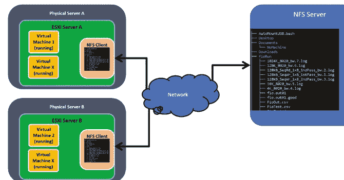

**图 9-5.** *NFS 架构*

Linux 和 Windows Server 都可以用作 NFS 服务器。如果你没有额外的物理系统来运行 Windows 或 Linux，你可以在现有的 Windows 或 Linux 系统上运行 2 型虚拟机监控程序，例如 VMware Player。在稍后的部分中，我将引导你使用 Player 设置一个 Linux 虚拟机作为 iSCSI 目标，但你也可以在上面运行 Windows Server。

### 在 Windows 上设置 NFS 服务器

Windows Server 长期以来一直支持充当 NFS 服务器。以下说明使用 Windows Server 2016 完成，但其他版本的 Windows Server 也同样适用。

1. 在“运行”命令窗口中输入 `ServerManager.exe`。
2. 单击**添加角色和功能**。

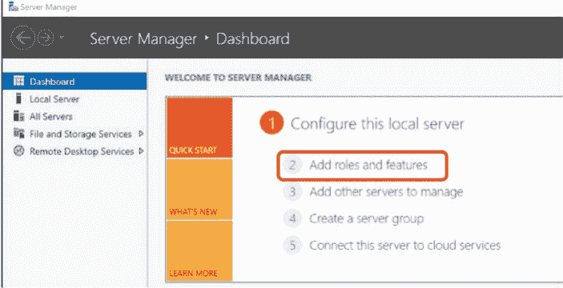

3. 在“添加角色和功能向导”中，单击**下一步**。
4. 选择**基于角色或功能的安装**，然后单击**下一步**。
5. 单击**下一步**。
6. 展开**文件和存储服务**，并展开**文件和 iSCSI 服务**。

7. 单击“NFS 服务器”复选框。当出现“添加 NFS 服务器所需的功能？”对话框时，单击“添加功能”，然后点击“下一步”。

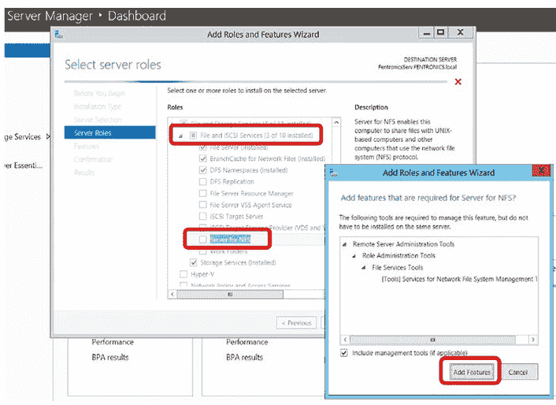

8. 单击“下一步”，然后“安装”。
9. 单击“关闭”。
10. 重新启动系统并重新登录。

### 通过 NFS 共享 Windows Server 目录

安装 NFS 后，你可以在 Windows 系统上通过 NFS 共享文件夹。

1. 在桌面上创建一个名为 WinServerNFS01 的新文件夹。
2. 右键单击**WinServerNFS01**文件夹，选择**属性**，然后选择 **NFS 共享**。
3. 单击**管理 NFS 共享**。

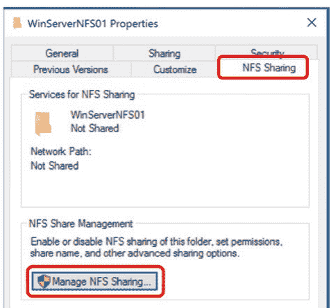

4. 单击**共享此文件夹**，单击**权限**按钮，并单击**允许根访问**。

5. 从“访问类型”下拉菜单中选择“读写”。

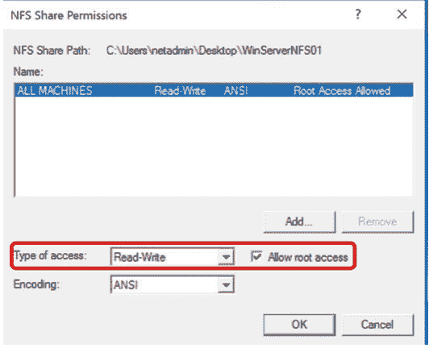

6. 单击“确定”，单击“应用”，再单击“确定”。
7. 单击“关闭”。

### 将 ESXi 主机连接到 NFS 服务器

作为免责声明，VMware 不认可、推荐或支持在 ESXi 上使用 Windows Server 作为 NFS 数据存储，并且该配置不在其硬件兼容性列表（HCL）中。以下说明旨在表明这是可以实现的，而非应该这样做。话虽如此，我已将 NFS 挂载到我的 ESXi 主机上，并且使用过程中没有遇到任何问题。

1. 在 VMware Host Client 导航器中，单击“存储”。


2. 单击“新建数据存储”。

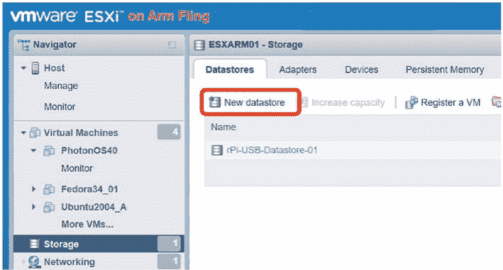

3. 单击“挂载 NFS 数据存储”，然后单击“下一步”。

4. 为 NFS 共享指定名称，并输入 NFS 服务器（Windows Server）的 IP 地址。选择 NFS 3，然后单击“下一步”。

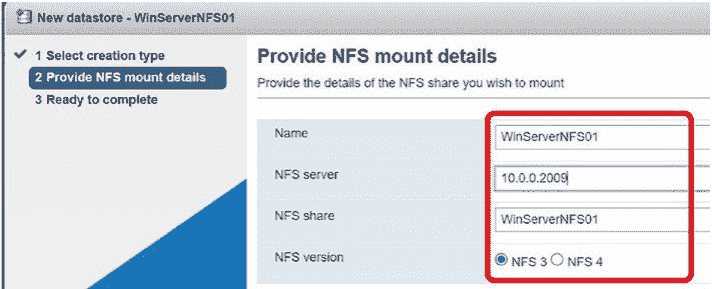

2. 像创建其他虚拟机一样创建虚拟机，但为其存储选择 NFS 共享。

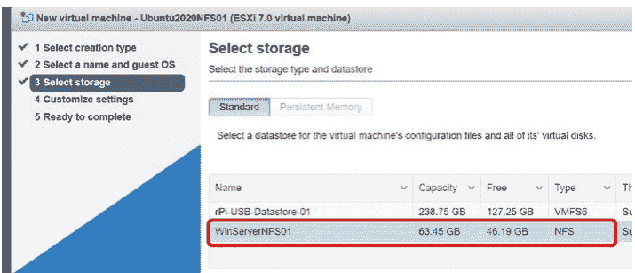

3. 验证虚拟机将使用 NFS 存储。

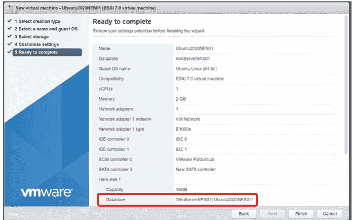

4. 可以使用数据存储浏览器查看组成虚拟机的文件是否存储在 NFS 服务器上。

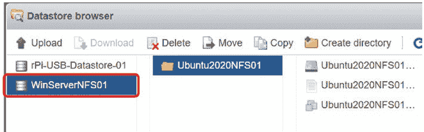

## 将存储在本地数据存储中的虚拟机复制到 NFS 共享

NFS 共享与我们创建的本地数据存储一样，会显示在 `/vmfs/volumes` 下。下面将介绍如何从 ESXi 主机命令行将现有虚拟机从本地数据存储复制到 NFS。

- 1. 从主机控制台或使用 SSH 登录 ESXi 主机。
- 2. 输入以下命令切换到数据存储目录：

```
cd /vmfs/volumes
```

- 3. 创建新目录并将现有虚拟机复制到该目录。我使用 `time` 命令，通过输入以下命令查看复制所需的时间：

```
mkdir WinServerNFS01/Ubuntu_NFS01
time cp -r rPi-USB-Datastore-01/Fresh_Ubuntu2004/* WinServerNFS01/Ubuntu_NFS01
```

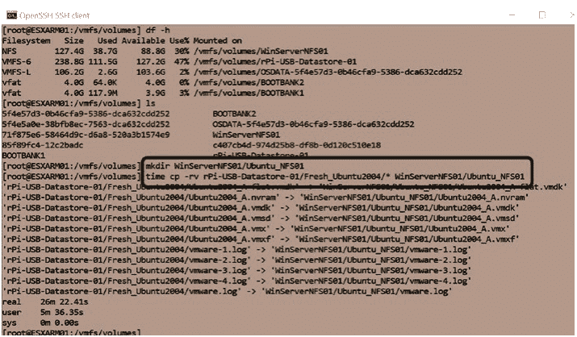

- 4. 复制过程中，可以使用 VMware Host Client 监控网络和磁盘活动。将虚拟机从基于 USB 的本地存储复制到 NFS 共享耗时 26 分钟。
- 5. 文件复制完成后，使用 VMware Host Client 中的数据存储浏览器注册虚拟机。

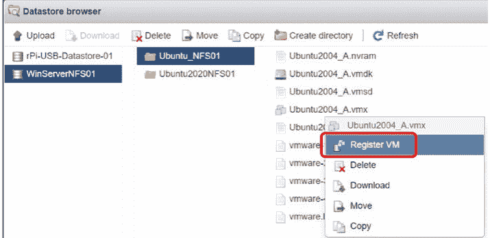

6. 现在可以像启动其他虚拟机一样启动该虚拟机。

## 将 NFS 共享连接到 Linux 系统

可以将 Linux 系统连接到 NFS 共享。尽管最佳实践是为 ESXi 主机专门配置 NFS 共享，但过去在排查问题时，我发现将 NFS 共享连接到 Linux 主机非常有用。我们将把 Windows NFS 共享连接到之前在 ESXi 主机上安装的 Ubuntu 系统（图 9-6）。

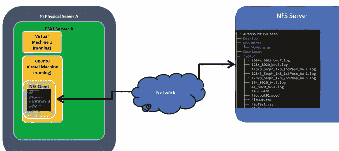

图 9-6。NFS 连接到 Linux 系统

- 1. 启动 Ubuntu 系统。
- 2. 使用 SSH 或从系统终端登录系统。
- 3. 输入以下命令切换到 root 用户：
  `sudo su`
- 4. 输入以下命令安装 NFS 客户端：
  `apt install nfs-common`

- 5. 创建挂载点，将 NFS 挂载到该挂载点，并输入以下命令列出 NFS：

```
mkdir /mnt/NFS01
mount.nfs 10.0.0.209:/WinServerNFS01 /mnt/NFS01
mount
```

```
root@ubuntu2004-a:/home/user01# apt install nfs-common
Reading package lists... Done
Building dependency tree
Reading state information... Done
nfs-common is already the newest version (1:1.3.4-2.5ubuntu3.3).
0 upgraded, 0 newly installed, 0 to remove and 62 not upgraded.
root@ubuntu2004-a:/home/user01# mkdir /mnt/NFS01
root@ubuntu2004-a:/home/user01# mount.nfs 10.0.0.209:/WinServerNFS01 /mnt/NFS01
```

- 6. 如果希望每次系统启动时都挂载 NFS，可以输入以下命令，将条目添加到 `/etc/fstab`：

```
echo '10.0.0.209:WinServerNFS01 /mnt/NFS01
NFS defaults 0 0' >> /etc/fstab
```

## 配置 NFS 共享的最终思考

总的来说，在 Windows Server 上创建 NFS 服务器并将其挂载到 ESXi 主机上，我花费的时间不到 15 分钟。

## VMware Player

VMware 有三款二类虚拟机监控程序：Workstation、Fusion 和 Player。这些产品供希望在台式机和笔记本电脑上运行不同操作系统的开发人员、学生和家庭用户使用。Workstation 可运行在 Windows 和 Linux x64 系统上，是 VMware 最早且历史最悠久的产品。Workstation 价格合理，并拥有一批忠实用户。

- - 最低 2GB RAM（建议 4GB RAM）：
  - 每个客户机操作系统以及主机和客户机上的应用程序所需的 RAM 不包含在 2GB 要求中（因此建议使用 4GB）。
- 下载 Player 需要 215MB 磁盘空间
- 安装 Player 需要 150MB 磁盘空间
- 为要创建的虚拟机准备足够的磁盘空间
- 一种受支持的 Windows 或 Linux 版本

有关完整要求，请参阅 Player 文档：www.vmware.com/support/pubs/player_pubs.html。

## 安装 VMware Player

Player 的安装方式与其他应用程序相同；在没有运行虚拟机时，它占用的资源非常少。虚拟机运行后，Player 将消耗虚拟机所需的资源。

以下说明介绍如何在 Windows 10 系统上安装 Player。

- 1. 在 Windows 系统中，使用 Web 浏览器访问 www.vmware.com/products/workstation-player.html，下载 VMware Workstation Player。ISO 映像大小约为 215MB，应该可以快速下载。

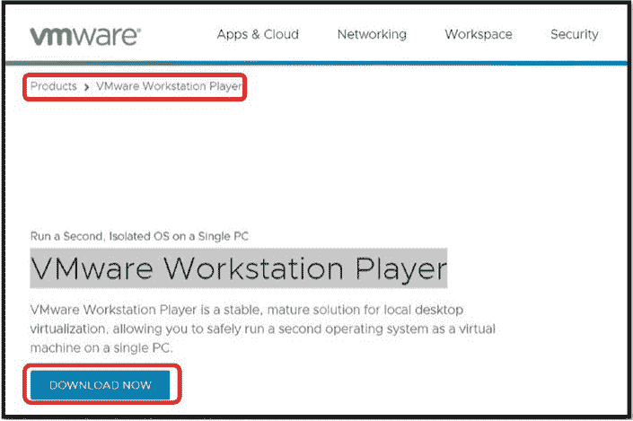

- 2. 双击下载的文件，并按照提示进行安装。
- 3. 安装结束时，系统会询问是否要为其授权。单击**完成**以运行未授权版本。
- 4. 在 Windows 搜索框中输入 *player*，然后启动 Player。

5. 按照提示启动 Player。

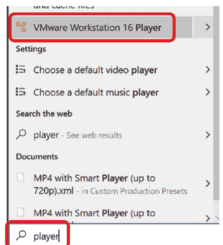

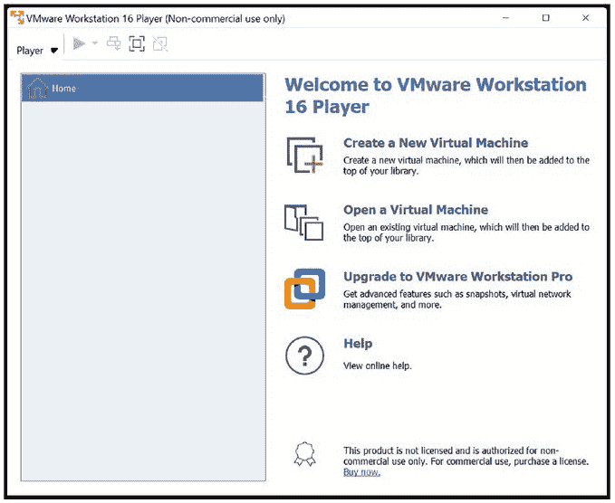

## 在 Player 上安装 Ubuntu

你将在 Player 上安装 Ubuntu-20.04 桌面版。由于需要使用兼容 x64 的安装 ISO，因此无法使用之前在 Pi 上创建虚拟机时使用的 ISO。

首先创建一个包含 32GB 虚拟磁盘的虚拟机，然后再向其中添加第二个 100GB 虚拟磁盘，将其用作 iSCSI 目标。

- 1. 在 Windows 系统中，使用 Web 浏览器访问 https://releases.ubuntu.com/20.04/，下载 Ubuntu 20.04 服务器版。ISO 映像大小约为 1.1GB，下载需要一段时间。

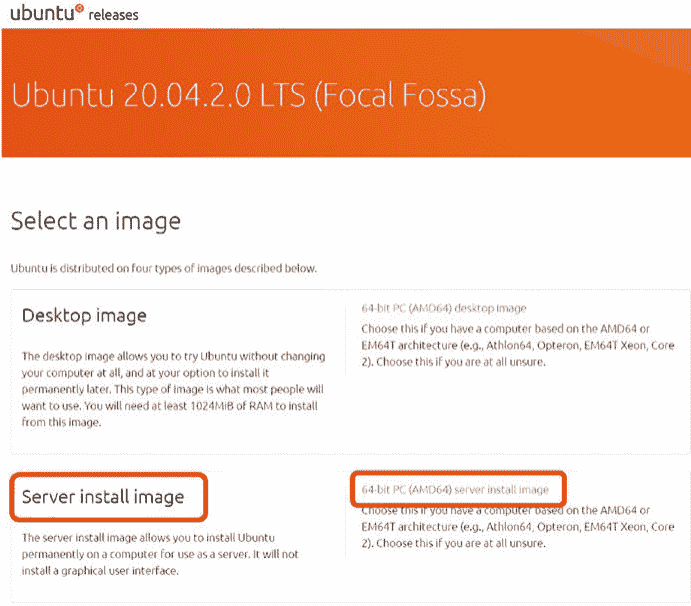

# 第 9 章　ESXI 的网络存储选项

- 2. 在 Player 中选择**创建新的虚拟机**。

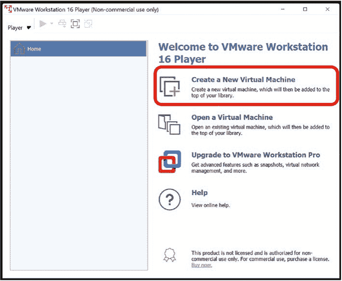

- 3. 选择**安装程序光盘映像文件**，浏览并选择 Ubuntu ISO 映像，然后单击**下一步**。
- 4. 在**全名**文本框中输入 _Ubuntu2004 iSCSI Server_，输入用户名和密码，然后单击**下一步**。
- 5. 在**虚拟机名称**文本框中输入 _Ubuntu2004 iSCSI Server_，然后单击**下一步**。

# 第 9 章   ESXI 的网络存储选项

- 6. 在**最大磁盘大小**文本框中输入 32，然后单击**下一步**。
- 7. 单击**完成**。
- 8. Player 将挂载 ISO 并启动虚拟机。
- 9. 允许系统下载并安装 VMware Tools。

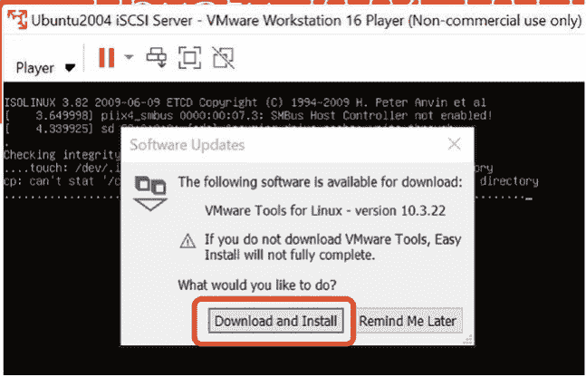

- 10. 接受默认设置。当系统询问计算机名称时，输入 *ubuntuiscsi01*。
- 11. 当系统询问是否安装 OpenSSH 服务器时，选择是。
- 12. 允许系统完成安装。

13. 观察 Player 左上角，确认安装已完成。

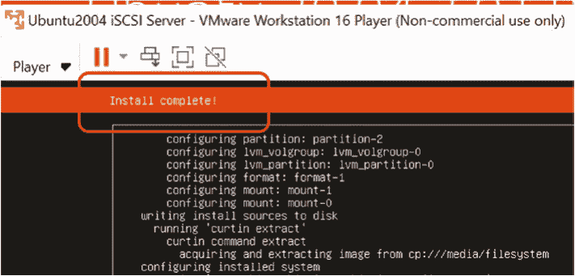

14. 在 Player 底部选择**立即重新启动**。

15. 验证可以登录 Ubuntu 系统。

16. 输入以下命令关闭系统：

```
```bash
sudo init 0
```
```

## 向 Player 虚拟机添加第二块硬盘

虚拟机安装完成后，将向其中添加第二块 100GB 虚拟硬盘。该虚拟机将用作 iSCSI 目标。如果磁盘空间不足，也可以创建一块 36GB 的虚拟硬盘。

- 1. 启动 Player。
- 2. 右键单击 Ubuntu 虚拟机，然后选择**设置**。

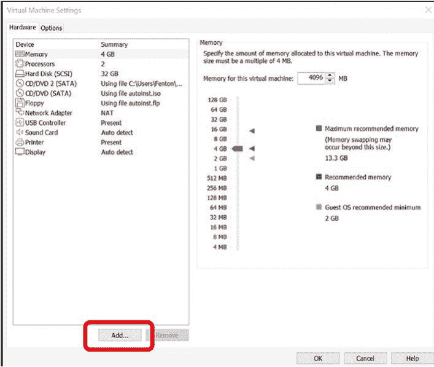

- 3. 单击**添加**，选择**硬盘**，然后单击**下一步**。
- 4. 确认已选择 **SCSI**，然后单击**下一步**。
- 5. 选择**创建新的虚拟磁盘**，然后单击**下一步**。
- 6. 将大小设置为 100GB，然后单击**下一步**。
- 7. 在**文件名**文本框中输入 *iSCSI Target*，然后单击**完成**。
- 8. 单击**确定**关闭“设置”对话框。
- 9. 现在，该虚拟机将关联两块虚拟磁盘。Linux 会将这些磁盘显示为 sda 和 sdb。


# 第9章 ESXi 的网络存储选项

5. 选择 **网络适配器**，选择 **桥接**，然后单击 **配置适配器**。

6. 如果您有多个适配器，请取消选中除具有网络连接的适配器之外的所有网络适配器。单击 **确定**。

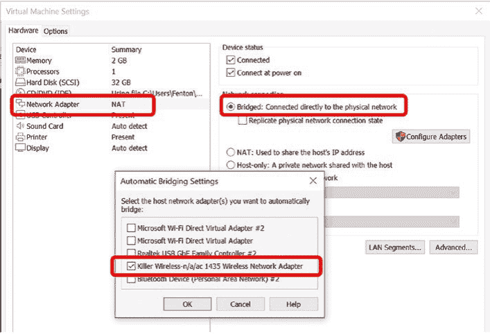

7. 单击 **确定** 关闭设置对话框。

8. 在终端中输入 `ip add` 并验证您是否具有桥接 IP 地址。

### iSCSI

如前所述，NFS 共享文件，而 iSCSI 共享块设备。这意味着在将 iSCSI 目标与 ESXi 系统共享后，需要在 iSCSI 目标上放置 VMFS。人们选择使用 NFS 或 iSCSI 进行存储的原因各不相同，讨论一个相对于另一个的优势需要相当长的时间。然而，从原则上讲，vSphere 可以使用 NFS 或 iSCSI，并且许多系统同时使用两者。

在深入之前，这里是图 9-9 中显示的一些关键 iSCSI 概念的快速定义。*iSCSI 目标* 是要共享的块设备，*iSCSI 发起程序* 是连接到目标的客户端，而 *iSCSI 限定名称 (IQN)* 是用于标识目标和发起程序的名称。

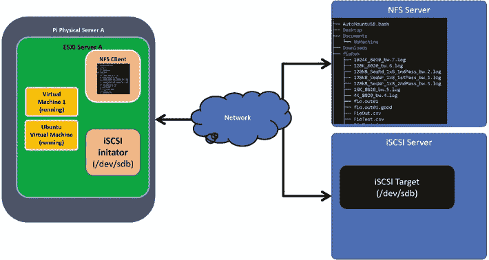

### 在 Ubuntu 上安装和配置 iSCSI

由于 iSCSI 共享的是块设备而不是文件，因此您将使用第二个硬盘作为 iSCSI 目标，而不是像使用 NFS 时那样使用目录。

1. 登录到您的 Ubuntu 系统并通过输入切换到 root 用户

   `sudo su`

2. 通过输入显示系统上的块设备

   `lsblk`

3. 验证新的块设备是否被识别为 `/dev/sdb`。

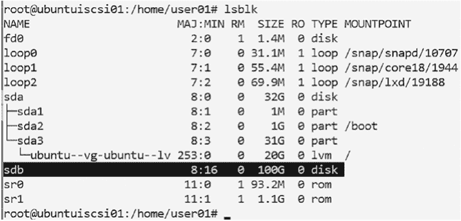

4. 使用 `fdisk` 在 `/dev/sdb` 上创建新的 Linux 主分区。通过输入使其占用驱动器上的所有空间

    ```text
    fdisk /dev/sdb
    n
    p
    1
    Enter
    Enter
    w
    ```

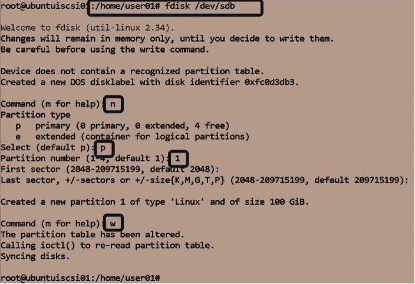

5. 显示系统上的块设备并通过输入验证设备上的新分区是否被识别为 `sdb1`

    ```bash
    lsblk
    ```

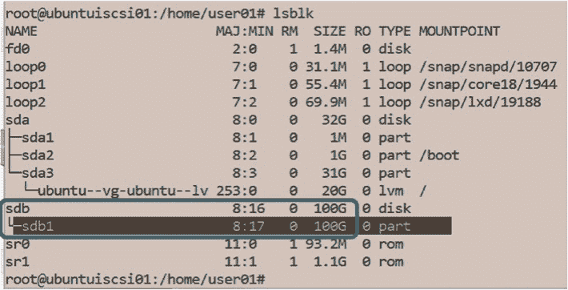

6. 通过输入安装 iSCSI 目标框架 tgt

    ```bash
    apt install tgt -y
    ```

7. 通过输入验证 iSCSI 是否已启动

    ```bash
    systemctl status tgt
    ```

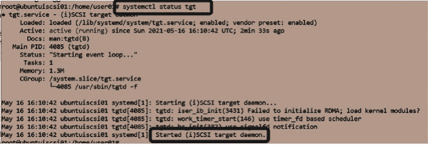

```text
root@ubuntuiscsi01:/home/user01# tgtadm --mode target --op show
Target 1: iqn.2021-05.iscsiexample.local:lun1
  System information:
    Driver: iscsi
    State: ready
  I_T nexus information:
  LUN information:
    LUN: 0
      Type: controller
      SCSI ID: IET      00010000
      SCSI SN: beaf10
      Size: 0 MB, Block size: 1
      Online: Yes
      Removable media: No
      Prevent removal: No
      Readonly: No
      SWP: No
      Thin-provisioning: No
      Backing store type: null
      Backing store path: None
      Backing store flags:
    LUN: 1
      Type: disk
      SCSI ID: IET      00010001
      SCSI SN: beaf11
      Size: 107373 MB, Block size: 512
      Online: Yes
      Removable media: No
      Prevent removal: No
      Readonly: No
      SWP: No
      Thin-provisioning: No
      Backing store type: rdwr
      Backing store path: /dev/sdb1
      Backing store flags:
  Account information:
  ACL information:
    ALL
root@ubuntuiscsi01:/home/user01#
```

### 向 ESXi 主机添加 iSCSI 目标

您将 iSCSI 目标添加到 ESXi 主机。它可以用作 VMFS 数据存储的后端。

1. 登录到您的 VMware 主机客户端。
2. 在导航器中选择 **存储**。
3. 选择 **适配器**，然后单击 **软件 iSCSI**。

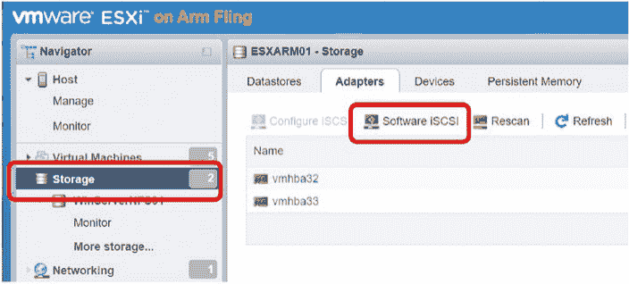

4. 选择 **已启用**，然后单击 **添加动态目标**。

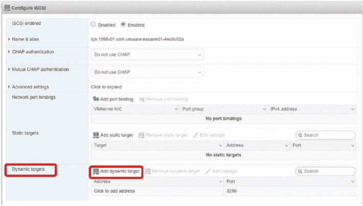

5. 在 **目标** 列的 **单击添加名称** 文本框中，输入您的 iSCSI 目标的 IP 地址。

6. 单击 **保存配置**。

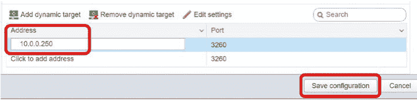

7. 选择 **设备** 选项卡并单击 **重新扫描**。

8. 验证 iSCSI 磁盘是否正在显示。由于 iSCSI 目标只有一个路径，因此显示为降级。

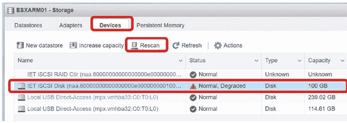

9. 在导航器中右键单击 **存储**，然后选择 **新建数据存储**。

10. 验证是否已选择 **创建新的 VMFS 数据存储**，然后单击 **下一步**。

11. 在 **名称** 文本框中输入 `iSCSI01`，选择 iSCSI 磁盘，然后单击 **下一步**。

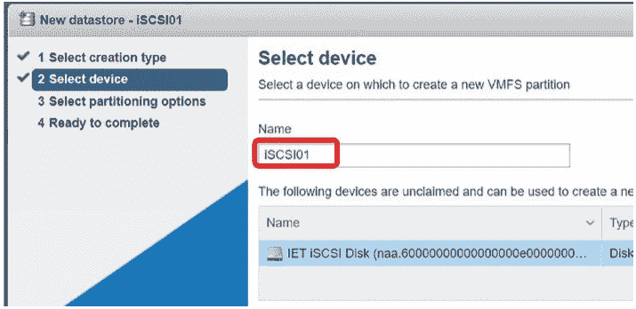

12. 验证整个分区将被使用，然后单击 **下一步**。

13. 验证您的设置并单击 **完成**。

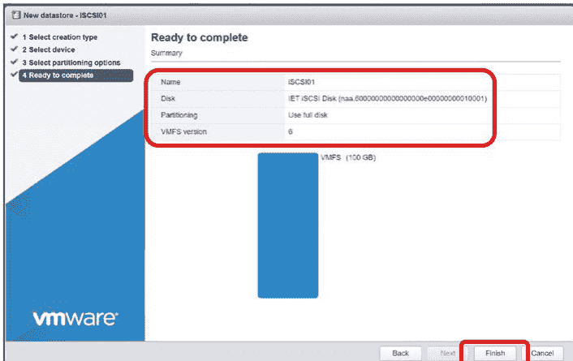

14. 选择 **数据存储** 选项卡并验证 `iSCSI01` 数据存储是否显示。

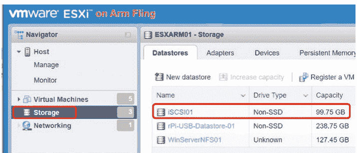

15. iSCSI 数据存储可以像任何其他数据存储一样使用。

### iSCSI 最后的想法

与 NFS 一样，在 Linux 上设置 iSCSI 目标相对容易和直接，将 ESXi 主机连接到 iSCSI 目标并将其用作数据存储也是如此。

> 注意 使用 Player 来托管提供 iSCSI 目标的 Linux 系统是我不会建议在没有广泛测试的情况下去做的事情。我不会完全信任此配置的性能、可靠性和稳健性能够与专用 iSCSI 设备的性能、可靠性和稳健性相媲美；然而，对于临时测试和家庭实验室使用来说，它应该没问题。Player 正在运行的系统会看到性能下降，并且主机越繁忙，您的 iSCSI 性能就越低。

### 案例研究：使用虚拟机作为 ESXi 主机的 iSCSI 服务器

在我职业生涯早期，我需要为 vSphere 创建一个培训平台。我当时还没有访问存储阵列，并且需要向学生展示如何访问共享存储以演示 vMotion 等高级功能。图 9-10 显示了我如何通过在 ESXi 主机上设置一个 Linux VM 来解决此限制，该 VM 为其所在的 ESXi 主机提供 iSCSI 服务。

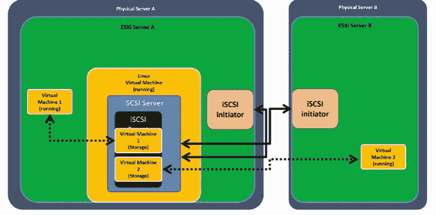

**图 9-10. ESXi 托管 iSCSI 共享**

我对它的工作效果感到惊讶，但这对于生产环境来说是一个低效的设置；对于学习目的来说，它工作得很好。使用 Pi 执行类似的设置可能是可能的，但由于其有限的资源（尤其是在 I/O 和存储方面），性能将非常糟糕。

### 摘要

正如本章开头提到的，NFS 用于共享构成 VM 的文件，而 iSCSI 共享块设备（如网络上的磁盘）。与 ESXi 主机一起使用时，NFS 的开销略少，因为与文件系统相关的所有开销都由 NFS 服务器完成，但使用 iSCSI（文件系统由 ESXi 主机管理）时，它可能具有 NFS 共享上不可用的功能。

在生产环境中，ESXi 几乎总是与共享存储一起使用。您很少会看到仅使用本地存储的生产 ESXi 主机。设置 Windows 或 Linux 服务器充当 iSCSI 主机非常简单，它允许您存储比本地存储更多的 VM，并且允许它们在连接到它的任何 ESXi 主机上运行。

底层存储的性能会直接影响 VM 的性能。在下一章中，我将测量许多不同存储设备的性能。
