# 第10章 测试存储性能

到目前为止，在本书中，我们已经使用本地和网络存储与 ESXi。此时，您可能会问自己该为存储使用什么——而且不出所料，变量太多，我无法给出笼统或明确的答案。

例如，您可能正在使用慢速 USB 驱动器作为本地存储，或者您可能有拥塞或不可靠的网络导致 NFS 存储出现问题。另一方面，您可能有一个充当 iSCSI 服务器的独立系统，或一个连接到 Raspberry Pi 的外壳中的 M.2 驱动器。

在本章中，我将提供我在本地和网络存储上进行的测试结果的概述，以及我用于执行这些测试的工具的亮点。我以极其随意的方式进行了测试，唯一目的是展示可用的存储选项范围，并提供这些设备性能的非常粗略的近似值，您可能可以期望得到。


## 测试配置

为了进行我的测试，我使用了一台装在 Argon M.2 外壳中的 8GB Pi。我通过将它们连接到 Pi 然后对每个设备执行测试，来测试不同存储设备的性能。

我使用 Pi 的 USB 3.0 端口测试了本地连接的存储。我用来运行测试的机器是一个运行在 SanDisk 256GB Ultra Fit USB 3.1 闪存驱动器 (SDCZ430-256G-G46) 上的 Ubuntu 20.04 实例，该驱动器插入到 USB 2.0 端口。Ubuntu 虚拟机有三个 CPU 核心和 6GB RAM，以确保 Pi 的资源不会妨碍其性能。对于网络存储，我通过 1Gbe 网络将其连接到存储，Pi 与存储之间只有一个交换机。我的测试配置如图 10-1 所示。

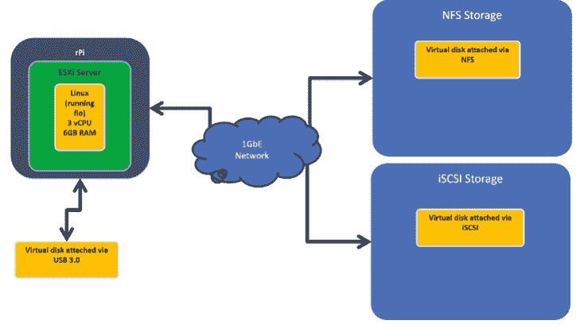

图 10-1. 测试配置

## 初始 USB 存储性能测试

我对两种不同设备进行了初始测试：一个 256GB 拇指驱动器和一个 500GB 西部数据蓝盘 SATA SSD (WDS500G2B0B) 置于 M.2 外壳中（见图 10-2）。

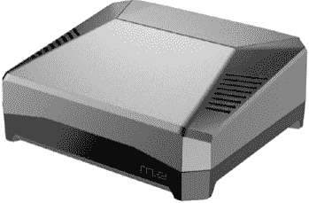

**图 10-2.** *Argon M.2 外壳顶部*

如前一章所述，M.2 Argon 外壳内装有 SATA SSD，并通过 U 形 USB 连接器连接到 Pi（见图 10-3）。


**图 10-3.** *M.2 外壳中的 SATA SSD 驱动器*

该外壳非常灵活，支持 SATA M.2 NGFF Key B 或 B+M SSD。M.2 设备可以是常用的 M.2 形态之一：2280、2260、2242 或 2230。该外壳使用 ASMedia Technologies ASM1153E 芯片来支持 SATA M.2 驱动器的 USB 传输。

由于热量会妨碍性能，外壳的顶部和底部表面都有通风槽，顶部还装有散热风扇。外壳背部有七个连接端口：两个 HDMI，一个 USB-C（仅供电）、两个 USB 2.0 和两个 USB 3.0（其中一个用于连接外壳下部中的 M.2 设备）。外壳背部还配有 RJ45 1GB 以太网端口和电源按钮。

我首先对外壳中的 SATA SSD 设备进行了测试。我通过 SSH 访问我的 ESXi 主机，并使用我的 AutoMountUSB 脚本在其上挂载并创建了一个 VMFS 数据存储（见图 10-4）。

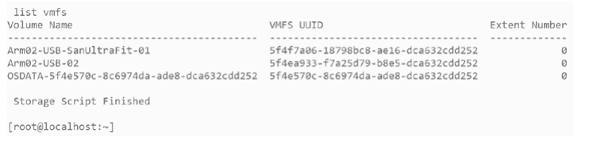

# 图 10-4. M.2 数据存储

为了测试该设备，我向 Ubuntu 虚拟机添加了一个由 SATA SSD 存储支持的 55GB 虚拟磁盘（见图 10-5）。

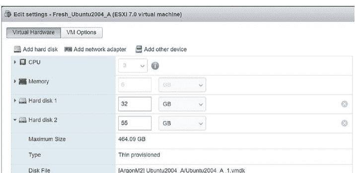

# 图 10-5. 55GB 虚拟磁盘

根据经验，我知道不同的命令会报告有关驱动器的不同类型信息。以下是我在第二个虚拟磁盘上运行的一些命令：

- *lshw* – 列出系统硬件信息；“-C disk”将列出磁盘和存储控制器。
- *fdisk* – 配置和报告设备上的分区；“-l”将列出驱动器上的分区。
- *hdparm* – 获取和设置 SATA/IDE 设备的参数。
- *dd* – 转换和复制文件（我用它来计时复制文件所需的时间）。
- *fio* – 一个灵活的 I/O 测试工具，用于衡量包括存储在内的 I/O 设备的性能。

我使用 SSH 访问了我的 Ubuntu 实例，然后输入以下命令来检查 SATA SSD 设备：

```
lshw -C disk [see results in Table 1]
```

```
fdisk -l  ## [this showed the 50GiB drive as /dev/sdb]
```

```
hdparm -I /dev/sdb ## [see results in Table 1]
```

```
hdparm -Tt /dev/sdb ## [see results in Table 1]
```

```
dd if=/dev/zero of=/dev/sdb bs=4k count=5M ## [see results in Table 1]
```

```
fio --filename=/dev/sdb --ioengine=libaio --rw=randread --bs=4k --numjobs=1 --size=50g --iodepth=32 --runtime=120 --time_based --end_fsync=1 --name=4krandread --status-interval=15
```

然后我使用 USB 3 和 USB 2 端口对一个三星 128GB 拇指驱动器进行了同样的测试。这些测试的结果见表 10-1。

# 表 10-1. 初始性能测试

|  | Kingston SATA SSD USB 3 | Samsung Thumb Drive USB 3 | Samsung Thumb Drive USB 2 |
|---|---|---|---|
| hdparm -Tt (Cached Read) | 835MBs | 835MBs | 833MBs |
| hdparm -Tt (Buffered Read) | 99MBs | 60MBs | 314MBs |
| Dd | 54MBs | 28MBs | Failed |
| fio 4K (Random Read) | 32MiBs/8121 IOPS | 25MiBs/6075 IOPS | 11MiBs/3004 IOPS |

## 对初始测试的观察

fio 显示，当拇指驱动器插入 USB 3 和 USB 2 端口时，SATA SSD 的性能比拇指驱动器高出 28% 和 290%。

*hdparm* 测试仅运行了几秒钟，对所有设备给出了相同的结果，并显示出比 *dd* 和 *fio* 测试好得多的性能，这让我相信存在某种缓存或缓冲。*dd* 命令显示，当插入 USB 3 端口时，SATA SSD 驱动器的性能比拇指驱动器高出 50%；当拇指驱动器插入 USB 2 端口时，该命令失败。

由于这只是临时测试，我并不惊讶地发现 SSD 的性能远未达到 USB 3.0 总线（625MB）的理论性能，甚至也未达到 M.2 设备（560MB）的性能。出现这种情况可能有多种原因，例如 USB 和以太网端口共享同一总线。此外，我运行的是 VMware 的一个 Fling，可能尚未完全针对性能进行完善，而我运行测试的 Ubuntu 实例是一个虚拟机。这些（或其他因素）都可能导致瓶颈。

尽管存在这些问题，我的基本测试仍然表明，就性能而言，SATA SSD 驱动器明显优于拇指驱动器。我有点担心 SATA SSD 和 *首次写入* 效应，即闪存设备的首次写入速度明显快于后续读取；然而，考虑到 SATA SSD 的性能甚至远未达到我所知的其能力，我认为在此场景中限制因素是 Pi 上的 I/O 子系统，而不是设备本身。

在随后的测试中，我只使用了 fio，因为我认为它提供了最完整、最准确的结果。我在测试之间重新启动了 Ubuntu 客户机。

## Fio

灵活 I/O 测试工具（fio）最初由 Jens Axboe 编写，用于测试 Linux I/O 子系统和调度程序。此后它已被移植到 Solaris、Windows 和其他操作系统。它已成为测试存储的 *事实标准* 工具，因为其灵活性很高。尽管它功能强大且可配置，但也非常易于使用和理解。

要在我的 Ubuntu 实例上安装 fio，我输入了 *apt install fio -y*。要测试设备的顺序读取吞吐量，我输入了

```
fio --filename=/dev/sdb --ioengine=libaio --rw=randread --bs=4k
--numjobs=1 --size=50g --iodepth=32 --runtime=120 --time_based
--end_fsync=1 --name=4krandread --status-interval=120
```

官方 fio 文档（[https://fio.readthedocs.io/en/latest/](https://fio.readthedocs.io/en/latest/)）非常出色地概述了每个参数的作用。以下是上述示例中使用的参数的简要概述：

- *filename* – 指定要写入的设备或文件。在我的大部分测试中，我写入的是设备；即我连接到 Linux 实例的第二个驱动器（/dev/sdb）。对于 NFS，我指定 NFS 共享上的文件名。
- *ioengine* – 指示如何将 I/O 发出到文件，有二十多种方式可以使用。例如，*libaio* 使用原生的 Linux 异步 I/O；这可与非缓冲 I/O 或缓冲 I/O 一起使用，使用 *direct=1* 或 *buffered=0*。
- *rw* – 确认 I/O 类型；可以是顺序或随机读取或写入。
- *bs* – 定义读写块大小。
- *numjobs* – 指定作业的克隆数量。
- *iodepth* – 设置针对文件排队的 I/O 单位数量。
- *runtime* – 指示作业运行的最大时间。默认时间单位为秒，但你可以用 *m* 为分钟或 *h* 为小时作为后缀。
- *time_based* – 使作业在设备或文件已被完全写入后继续循环运行。
- *end_fsync* – 在作业结束时同步文件。
- *name* – 指示新作业的名称。
- *status-interval* – 指定显示作业状态的频率。

对于更复杂的测试，可以创建 *作业文件*；这会以有组织的方式运行各种测试，但超出了我需要做的工作范围。

## 随机和顺序测试脚本

以下是我用来运行 fio 测试的脚本：

```
echo
echo "### fio to run a random read 4k test ###"
echo

fio --filename=/dev/sdb --ioengine=libaio --rw=randread --bs=4k
--numjobs=1 --size=50g --iodepth=32 --runtime=120 --time_based
--end_fsync=1 --name=4krandread --status-interval=120
echo
echo "### fio to run a random write 4k test ###"
echo
```


```bash
fio --filename=/dev/sdb --ioengine=libaio --rw=randwrite \
--bs=4k --numjobs=1 --size=50g --iodepth=32 --runtime=120 \
--time_based --end_fsync=1 --name=4krandwrite --status-interval=120

echo
echo "### fio to run a sequential read 4k test ###"
echo

fio --filename=/dev/sdb --ioengine=libaio --rw=read --bs=4k \
--numjobs=1 --size=50g --iodepth=32 --runtime=120 --time_based \
--end_fsync=1 --name=4kSeqRead --status-interval=120

echo
echo " ### fio to run a sequential write 4k test ###"
echo

fio --filename=/dev/sdb --ioengine=libaio --rw=write --bs=4k \
--numjobs=1 --size=50g --iodepth=32 --runtime=120 --time_based \
--end_fsync=1 --name=4kSeqWrite --status-interval=120
```

## 测试网络存储

在对本地存储设备的性能有了基准后，我有兴趣确定网络存储的性能如何。遵循我用于测试本地存储的相同流程，我测试了 NFS 和 iSCSI 存储设备。

## Player 上的 iSCSI

我测试的第一个网络存储是之前章节中在 Player 上搭建的 Ubuntu 上的 iSCSI 目标。

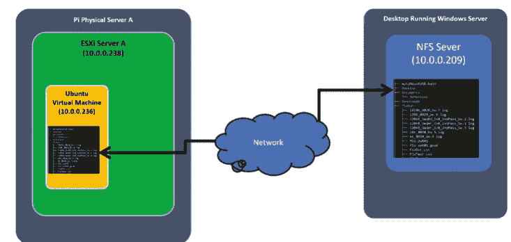

图 10-7. NFS Player 测试拓扑

以下是测试结果：

|  | Fio 4K – RAND Read | Fio 4K – RAND Write | Fio 4K – SEQ Read | Fio 4K – SEQ Write |
|---|---|---|---|---|
| NFS on Windows Server | bw=6.1MiB/s | bw=5.3MiB/s | bw=94.2MiB/s | bw=67.6MiB/s |

## QNAP TS-431K 存储设备上的 NFS

我有一台 QNAP TS-431K 用于媒体流媒体和备份以及作为 NFS 服务器。它是一款相对便宜且轻量级的服务器。它由 Alpine AL214 驱动，这是一款四核 1.7GHz 32 位 Arm 处理器，1GB RAM 和 1GbE 适配器。

对于后端存储，我使用了一块 2TB Seagate ST2000LX001-1RG174 HDD 和一块 SanDisk SSD Plus – 240GB SSD 作为读写缓存。

图 10-8 显示了 ESXi 主机与 NFS 服务器之间的连接。

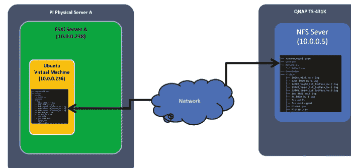

图 10-8. QNAP 测试拓扑

|  | Fio 4K – RAND Read | Fio 4K – RAND Write | Fio 4K – SEQ Read | Fio 4K – SEQ Write |
|---|---|---|---|---|
| TS-431K SSD cache | bw=9.2MiB/s | bw=9.2MiB/s | bw=82.2MiB/s | bw=21.5MiB/s |

## 测试U盘

我看到很多人使用 Pi 设备的U盘来存储 VM 和 ISO。在我的测试中，我使用了我使用多年的一些U盘并购买了其他一些。如果制造商对驱动器有任何性能数据，我都包含了。

## PNY Elite-X Fit

我测试了一款 128GB USB 3.1 PNY Elite-X Fit U盘（P-FDI128EXFIT-GE）。该驱动器宣称读取速度为 200MB/s。

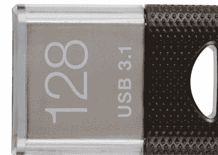

以下是测试结果：

|  | Fio 4K – RAND Read | Fio 4K – RAND Write | Fio 4K – SEQ Read | Fio 4K – SEQ Write |
|---|---|---|---|---|
| PNY Elite-X Fit | Failed | Failed | bw=89.8MiB/s | bw=7.1MiB/s |

## Samsung BAR Plus 256GB

我测试了一款 256GB USB 3.1 Samsung BAR Plus 驱动器（MUF-256BE3/AM）。该驱动器宣称读取速度为 300MB/s。


以下是测试结果。

|  | Fio 4K – RAND Read | Fio 4K – RAND Write | Fio 4K – SEQ Read | Fio 4K – SEQ Write |
|---|---|---|---|---|
| Samsung BAR Plus 256GB | bw=7.5MiB/s | bw=12.9MiB/s | bw=57.2MiB/s | bw=63.7MiB/s |

## Samsung BAR Plus 128GB

我测试了一款 128GB USB 3.1 Samsung BAR Plus 驱动器（MUF-256BE4/AM）。该驱动器宣称读取速度为 300MB/s。

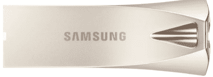

以下是测试结果：

|  | Fio 4K – RAND Read | Fio 4K – RAND Write | Fio 4K – SEQ Read | Fio 4K – SEQ Write |
|---|---|---|---|---|
| Samsung BAR Plus 128GB | bw=6.9MiB/s | bw=16.5MiB/s | bw=77.8MiB/s | bw=69.1MiB/s |

## SanDisk Ultra Flair

我测试了一款 64GB USB 3.1 SanDisk Ultra Flair U盘（SDCZ73-064G-A46）。该驱动器宣称读取速度为 150MB/s。


当我运行测试时，我收到了以下错误消息：

```
root@freshbuntu2004:/home/user0# fio --filename=/dev/sdb --ioengine=libaio --rw=write --bs=4k --numjobs=1 --size=50g --iodepth=32 --runtime=120 --time_based --end_fsync=1 --name=4kSeqWrite --status-interval=120
4kSeqWrite: (g=0): rw=write, bs=(R) 4096B-4096B, (W) 4096B-4096B, (T) 4096B-4096B, ioengine=libaio, iodepth=32
fio-3.16
Starting 1 process
fio: job '4kSeqWrite' (state=5) hasn't exited in 300 seconds, it appears to be stuck. Doing forceful exit of this job.
```

以下是测试结果：

|  | Fio 4K – RAND Read | Fio 4K – RAND Write | Fio 4K – SEQ Read | Fio 4K – SEQ Write |
|---|---|---|---|---|
| SanDisk Ultra Flair | bw=35.2MiB/s | Failed | Failed | Failed |

## 压力测试U盘

U盘并非设计用于承受持续负载；它们是为偶尔负载和间歇性写入而设计的。为了看看驱动器能承受多少，我使用以下脚本完全向 Samsung BAR Plus 256GB 驱动器写入 100 次：

```bash
for ((i=1;i<=100;i++));
do

echo " Start of loop $i"
time fio --filename=/dev/sdb --ioengine=libaio --rw=write \
--bs=128k --numjobs=1 --size=100% --iodepth=32 --end_fsync=1 --name=4kSeqWrite --status-interval=600
done
```

运行期间驱动器达到 43°C 和 119°F。图 10-9 显示了使用压力测试时驱动器的性能，与之前进行的 4K 测试相比。最初，驱动器的性能不稳定。

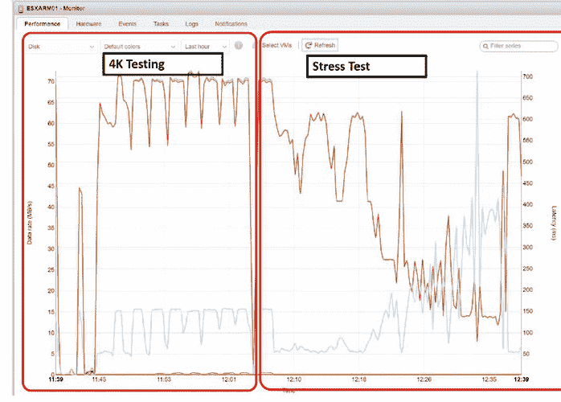

图 10-9. 初始压力测试运行

图 10-10 显示设备最终达到约 bw=69.4MiB/s 的稳定状态，温度为 121 度。

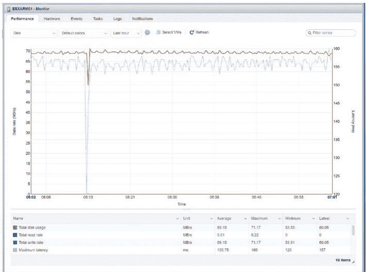

图 10-10. 压力测试

## 测试外接驱动器

U盘的设计工作负载与 HDD、SSD 或 NVMe 驱动器大不相同。然而，Pi 只有 USB 接口，没有 NVMe 或 SATA 接口。但是，这些设备可以放入外壳并通过 USB 端口连接到 Pi。通过这样做，你将使用为这种工作负载设计的设备。

## Argon 盒中的 Western Digital SATA

我测试了一块 500GB Western Digital Blue SATA SSD（WDS500G2B0B）安装在 Argon M.2 盒中。该驱动器宣称顺序读取速度高达 560MB/s，顺序写入速度高达 530MB/s。

## ORICO 外壳中的 Kingston SATA M.2

我测试了一块 240GB Kingston SATA SSD（SUV500M8）安装在 ORICO M.2 SSD 外壳（B08R9DMFFT）中。Kingston 驱动器宣称读取速度高达 500MB/s，写入速度高达 450MB/s。

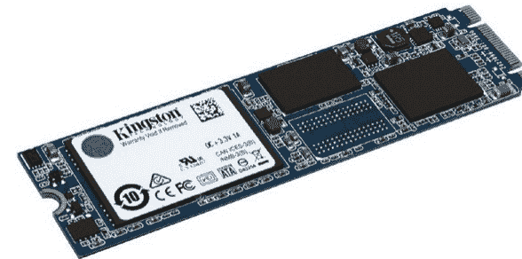

以下是测试结果：

|  | Fio 4K – RAND Read | Fio 4K – RAND Write | Fio 4K – SEQ Read | Fio 4K – SEQ Write |
|---|---|---|---|---|
| Kingston SATA | bw=8.7MiB/s | bw=17.9MiB/s | bw=99.9MiB/s | bw=81.7MiB/s |

## MASSCOOL 外部外壳中的 Micron M500DC

我尝试测试一块 800GB Micron M500DC SATA SSD 安装在 MASSCOOL 2.5" USB 3.0 外部外壳中。插入后 ESXi 未检测到该设备。

|  | Fio 4K – RAND Read | Fio 4K – RAND Write | Fio 4K – SEQ Read | Fio 4K – SEQ Write |
|---|---|---|---|---|
| M500DC SATA/MASSCOOL | Failed | Failed | Failed | Failed |

## Sabrent Docking Station 中的 Micron M500DC

我测试了一块 800GB Micron M500DC SATA SSD 安装在带内置散热风扇的 Sabrent 3.5/2.5" USB 3.0 Docking Station（EC-DFFN）中。M500DC 是一款极受欢迎的 SATA SSD 驱动器，而 Sabrent 外壳内置风扇以保持驱动器冷却。

测试结果。

|  | Fio 4K – RAND Read | Fio 4K – RAND Write | Fio 4K – SEQ Read | Fio 4K – SEQ Write |
|---|---|---|---|---|
| M500DC SATA/Sabrent | bw=9.2MiB/s | bw=19.7MiB/s | bw=79.9MiB/s | bw=82.4MiB/s |

## Sabrent Docking Station 中的 Seagate IronWolf

我尝试测试一块 10TB Seagate IronWolf NAS HDD（ST10000NE0004）安装在带内置散热风扇的 Sabrent 3.5/2.5" USB 3.0 Docking Station（EC-DFFN）中。

当我尝试在设备上创建文件系统时，我收到了此消息“Error: Connection timed out.”我在 x64 ESXi 服务器上尝试了相同的操作，并收到了相同的消息。


|  | Fio 4K – 随机读 | Fio 4K – 随机写 | Fio 4K – 顺序读 | Fio 4K – 顺序写 |
|---|---|---|---|---|
| Seagate IronWolf | 失败 | 失败 | 失败 | 失败 |

## diskAshur M2 高安全性驱动器

我测试了一款 1TB iStorage diskAshur M2 驱动器（IS DAM2-256-1000）。M2 是一款坚固且高度安全的驱动器。此前我曾通过将其从两层阳台扔下并让一辆 3.8 吨的卡车碾压来测试其坚固性。在安全性方面，读取驱动器内容之前需要输入密码。如果连续五次输入错误密码，驱动器内容将变得不可读。

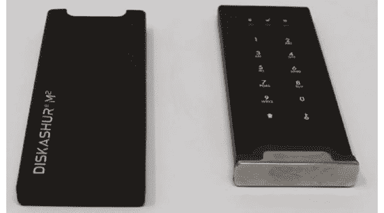

以下是测试结果：

|  | Fio 4K – 随机读 | Fio 4K – 随机写 | Fio 4K – 顺序读 | Fio 4K – 顺序写 |
|---|---|---|---|---|
| diskAshur M2 | bw=8.5MiB/s | bw=18.8MiB/s | bw=97.7MiB/s | bw=85.9MiB/s |

## 本地存储的汇总结果

表10-2 展示了我进行的存储设备测试结果，每种存储类型的最高性能数字以粗体标出。没有一种存储设备能在所有测试中始终优于其他设备。这在意料之中，因为闪存具有不同的特性；有些设备读取性能优于写入性能，处理顺序负载的方式也与随机负载不同。

> **注意** 以下显示的数字应谨慎对待；我的测试方法并非高度结构化，而且我也没有在高度受控的环境中进行测试。
> 
> 测试中出现的失败结果不应被视为设备的问题，也不表示设备设计或质量不佳，因为我是在超出其预期用途的情况下使用这些驱动器的。

|  | Fio 4K – 随机读 | Fio 4K – 随机写 | Fio 4K – 顺序读 | Fio 4K – 顺序写 |
|---|---|---|---|---|
| 网络存储 |  |  |  |  |
| Player 上的 iSCSI | bw=5.2MiB/s | bw=1.2MiB/s | bw=76.9MiB/s | bw=101MiB/s |
| Windows Server 上的 NFS | bw=6.1MiB/s | bw=5.3MiB/s | bw=94.2MiB/s | bw=67.6MiB/s |
| QNAP | bw=9.2MiB/s | bw=9.2MiB/s | bw=82.2MiB/s | bw=21.5MiB/s |
| TS-431K |  |  |  |  |
| U盘 |  |  |  |  |
| PNY Elite-X Fit | 失败 | 失败 | bw=7.1MiB/s | bw=7.1MiB/s |
| Samsung BAR Plus 128GB | bw=6.9MiB/s | bw=16.5MiB/s | bw=77.8MiB/s | bw=69.1MiB/s |
| Samsung BAR Plus 256GB | bw=7.5MiB/s | bw=12.9MiB/s | bw=57.2MiB/s | bw=63.7MiB/s |
| SanDisk Ultra Flair | bw=35.2MiB/s | 失败 | 失败 | 失败 |
| 直连驱动器 |  |  |  |  |
| Western Digital Blue SATA SSD | bw=34.6MiB/s | bw=9.7MiB/s | bw=100MiB/s | bw=77.6MiB/s |
| Toshiba KXG5 NVMe | bw=18.8MiB/s | bw=87.7MiB/s | bw=87.7MiB/s | bw=87.5MiB/s |
|  |  |  |  | （续） |

## 第10章 测试存储性能

| 驱动器 | Fio 4K – 随机读 | Fio 4K – 随机写 | Fio 4K – 顺序读 | Fio 4K – 顺序写 |
|---|---|---|---|---|
| KingSpec SATA | bw=35.1MiB/s | bw=18.8MiB/s | bw=100MiB/s | bw=87.2MiB/s |
| Kingston SATA | bw=8.7MiB/s | bw=17.9MiB/s | bw=99.9MiB/s | bw=81.7MiB/s |
| M5000D SATA / Sabrent | bw=9.2MiB/s | bw=19.7MiB/s | bw=79.9MiB/s | bw=82.4MiB/s |
| Seagate IronWolf | 失败 | 失败 | 失败 | 失败 |
| diskAshur M2 | bw=8.5MiB/s | bw=18.8MiB/s | bw=97.7MiB/s | bw=85.9MiB/s |
