# 第11章

## ESXi 上的虚拟桌面

## 虚拟桌面的优势

到目前为止，本书一直在讨论虚拟机（VM），但有一类有趣的 VM 子集运行的是桌面操作系统而非服务器操作系统——这就是虚拟桌面。在本章中，我们将介绍虚拟桌面，讨论它们的一些优势，并逐步讲解如何创建和访问它们。

当虚拟桌面在 VMware 首次出现时，我处于一个独特的位置。当时，我在培训部门工作，并且是公司里最早安装后来被称为 VMware Horizon（其虚拟桌面基础设施（VDI）技术的核心）软件的人之一。不久之后，我有机会开发和讲授该产品的第一批课程。

起初，我不明白为什么有人想要运行虚拟桌面而不是物理桌面。然而，随着我深入研究这项技术并与其开发工程师合作，我开始理解它的威力和吸引力。Horizon 现在是 VMware 的主要产品线之一；他们有一个完整的部门专门负责其开发、销售和部署。

## 虚拟桌面基础设施

VDI 最基本的形态如图 11-1 所示。该配置由一台运行桌面操作系统的 ESXi 主机、VM 以及 VDI 客户端组成，VDI 客户端用于通过网络连接到这些虚拟桌面，从而允许从远程位置访问虚拟桌面。

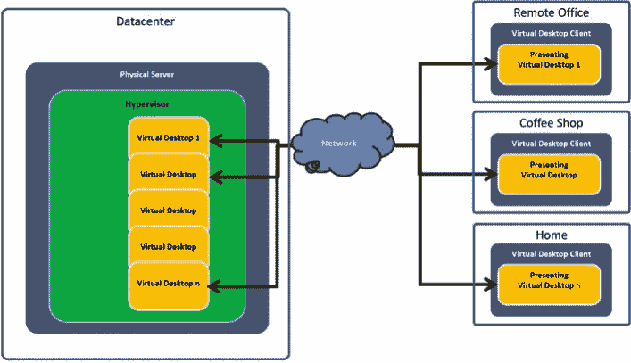

*图 11-1.* 基本 VDI 拓扑

虽然可以直接使用 IP 地址和远程显示协议（RDP）访问虚拟桌面，但除非你只有少数几个虚拟桌面，否则你会希望使用连接服务器和更复杂的协议来高效连接它们（参见图 11-2）。

连接服务器（也称为连接代理）负责对用户进行身份验证、授予他们桌面的访问权限，并执行其他有助于将用户连接到虚拟桌面的操作。大多数提供 VDI 产品的公司（如 VMware Horizon）都提供了 RDP 的替代协议。这些协议性能更高，且提供的功能比 RDP 更丰富。

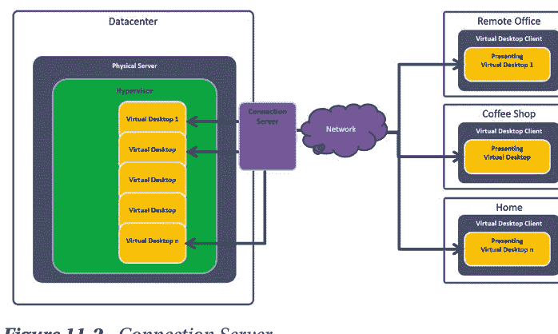

# 图 11-2. 连接服务器

## 成本节省

当 VDI 在 21 世纪初首次推出时，供应商将节省成本作为主要卖点，他们使用计算器来展示部署 VDI 理论上可以节省多少钱。然而，这些计算器在购买、维护和管理物理桌面的成本方面做出了很多随意的假设。诚然，如果你运营一个 24 小时全天候的呼叫中心并为其配备人员，从成本角度来看，运行 VDI 是非常合理的。但对于单班部署而言，要为任务型用户以上级别的用户证明其成本合理性，就有点勉强了。

但 20 年后，VDI 节省成本的说法如今已站得住脚，主要原因有两个：服务器的平均价格大幅下降，而服务器中的 CPU 核心数和内存容量同样大幅增加。二十年前，配备两个处理器、每个处理器 8 核、128GB 内存的服务器被认为是行业标准。在这样的系统上，你可以容纳 50 到 70 名任务型用户。然而，现在的标准服务器是双处理器、32 核、内存高达 956GB。这样的服务器可以容纳 250 到 300 名用户。你甚至可以在服务器中安装 GPU，供多个用户共享。

## 安全性

虽然 VDI 节省成本的故事最终开始成为现实（毕竟世界上的呼叫中心数量有限），但大约在此时，IT 社区找到了一个拥抱 VDI 的非常充分的理由：安全性。使用虚拟桌面时，操作系统及其访问的数据都安全地保存在数据中心的上锁门后，这意味着使用 VDI 时，有人留下带有客户数据或个人信息的笔记本电脑的可能性被大大消除。基于 VDI 提供的增强安全性，它在医疗保健、金融服务和政府机构中得到了广泛接受。

## 业务连续性

业务连续性是 VDI 的另一个优势。我是一名 VMware 的销售工程师（SE），当时一场大型飓风袭击了东海岸。主要城市关闭了数月，人们无法进入办公室使用台式电脑。这种工作中断非常严重，导致一些公司倒闭——这让人深刻认识到，桌面是一种需要持续可访问的战略资产。少数运行 VDI 的公司的员工能够从远程位置工作，而不会受到其正常办公室发生情况的影响。这些公司认识到，确保员工桌面的远程可访问性对于业务连续性至关重要。

2020 年也出现了类似情况，由于疫情，员工无法亲身前往其主要工作场所。居家办公不再只是一种可选的便利选项——而是政府的强制要求。虽然一些员工能够将笔记本电脑或小型桌面系统带回家继续工作，但这些系统存在安全性和可管理性问题。


在这种情况下，VDI 成为了一个极具吸引力的选择，而且幸运的是，早期阻碍远程家庭访问的许多障碍（即高速、可靠的互联网）已经消除。

## 可管理性

维护和管理桌面一直是一件令人头疼的事情，而 VDI 使得这一方面大大简化。例如，如果用户遇到问题，技术人员可以“影子”查看用户的会话，或直接登录到该桌面。到了需要安装新应用程序、修补系统或以其他方式维护软件的时候，技术人员可以直接完成所有这些操作。在许多情况下，虚拟桌面是从一个黄金镜像克隆出来的，只需更新黄金镜像，然后推送出去即可。

## 数据本地性

除了 VDI 更明显的好处（如安全性和可管理性）之外，虚拟桌面经常被忽视的好处之一是数据本地性，即尽可能靠近需要处理的数据。虽然对于大多数只处理非常小的普通办公文档的 VDI 用户来说，数据本地性永远不会成为问题，但在某些情况下，靠近数据可以极大地影响员工的生产力，例如处理大型数据库、视频、高分辨率图像和通常存储在独立存储设备上的 CAD 模型时。

例如，如果你需要编辑存储在公司中央存储库中的视频文件，但你所在的位置距离几英里远，你可以使用 VPN 从家里的笔记本电脑连接到这个中央存储（见图 11-3）。根据你处理的数据量，这可能会变成一种令人沮丧的体验，因为应用程序可能会因带宽不足而缓冲数据。此外，如果网络存在任何抖动，数据包可能需要重传。

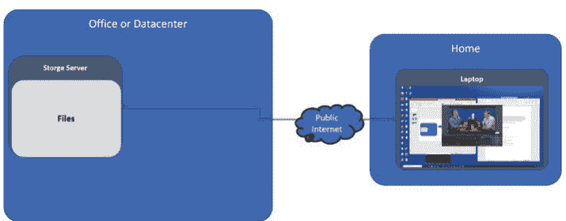

*图 11-3. 流式传输数据*

使用远程存储数据的本地系统可能会耗尽你公共互联网连接的全部带宽，使其他人无法使用它。

图 11-4 提供了一个如何将文件从远程位置传输到本地系统的示例。根据文件的大小，你可能无法将它们存储在本地，或者本地存储系统可能无法提供所需的性能。

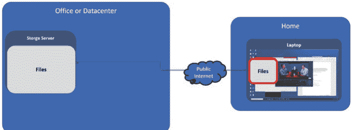

*图 11-4. 传输文件*

文件安全性（如前所述）也可能是一个问题。如果多个人在处理相同的文件，试图跟踪它们可能会令人恼火，而如果文件被意外删除，可能需要花相当长的时间来重新创建。然而，通过连接到靠近数据的虚拟桌面，你可以最大限度地减少网络流量，因为远程协议仅使用存储流式传输所需带宽的一小部分（见图 11-5）。

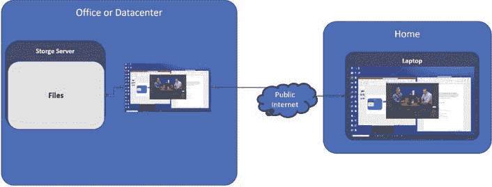

*图 11-5. 使用虚拟桌面编辑文件*

一些 VDI 协议允许多个用户与同一个虚拟桌面交互（见图 11-6）。这可以节省大量时间，避免试图向他人描述他们正在看到什么和试图完成什么的烦恼。VMware 已在 Blast 中通过其会话协作功能实现了这一点。

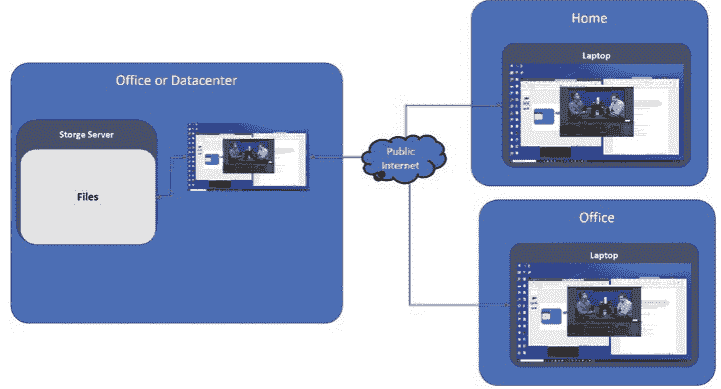

*图 11-6. 协作*

总之，在讨论 VDI 的好处时，应同时考虑数据本地性等附带好处，以及安全性、成本控制、可管理性等更明显的好处。

## 虚拟桌面用户的类型

表 11-1 显示了虚拟桌面用户的分类。这种分类有助于根据使用虚拟桌面的工作者类型，更好地确定虚拟桌面所需的资源。

**表 11-1. 用户类型**

| 分类 | 工作负载 | 所需资源 |
|---|---|---|
| 任务型工作者 | 使用一两个应用程序，通常位于呼叫中心。 | 最小桌面，配有一或两个 vCPU、2GB 内存和 32GB 存储。公司可能会使用 Linux 桌面以降低成本。 |
| 知识型工作者 | 使用许多不同的办公应用程序以及专用应用程序。这些是一般的办公室职员和企业员工。 | 完整的 Windows 桌面，至少配备两个 vCPU、4GB 内存，以及适合其用例的存储。 |
| 高级用户 | 工程师、内容创建者和 IT 工作者，他们使用常见的办公应用程序以及 CAD/CAM、编译器和其他强大应用程序等专用应用程序。 | 完整的 Windows 或 Linux，至少配备四个 vCPU、8GB 内存，以及适合其特定用例的存储。 |

## 访问虚拟桌面

可以从任何支持虚拟桌面所用协议的设备访问虚拟桌面。以下是一些较流行的客户端类型，这些客户端是为连接虚拟桌面而开发的。

### 媒体重定向

在讨论不同类型的 VDI 客户端之前，我们首先需要了解一种开始在 VDI 世界中发挥作用的技术：媒体重定向。这种技术会检测某个应用程序（如 Web 浏览器、视频会议和其他通信应用程序）何时被重定向到运行 VDI 客户端的设备上本地运行，而不是在虚拟桌面上运行；也就是说，这些应用程序从虚拟桌面实例化，但在设备本身上运行。这对用户是透明的。

图 11-7 显示了在没有重定向的情况下，浏览网站需要应用程序（在本例中为视频网站）从网站到虚拟桌面，然后再到客户端。这会给交互带来延迟，并消耗虚拟桌面所在主机上的 CPU 资源。

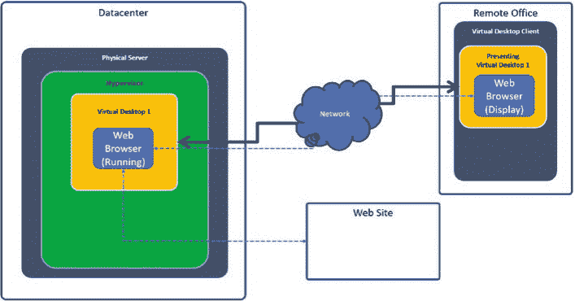

*图 11-7. 无重定向*

图 11-8 显示，通过使用重定向，可以直接从 VDI 客户端的硬件访问网站，从而减少网络流量、延迟和虚拟桌面上的 CPU 使用率，并利用现代 VDI 客户端的多余硬件能力。

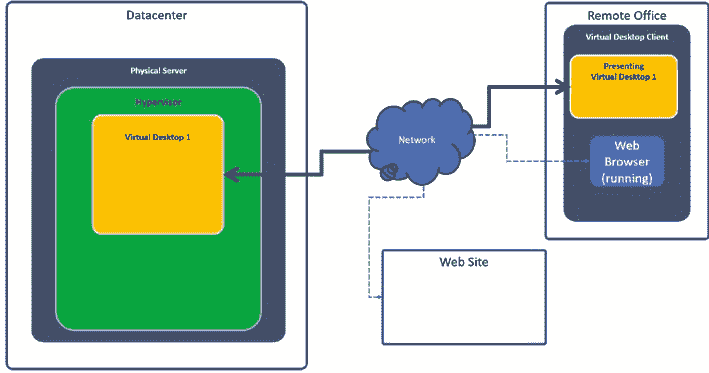

*图 11-8. 使用重定向*

图 11-9 显示了 Top（一个进程监控应用程序）的输出。这表明 Zoom（一个流行的视频会议应用程序）在从虚拟桌面实例化并重定向后，正在 VDI 客户端上运行并消耗其资源。

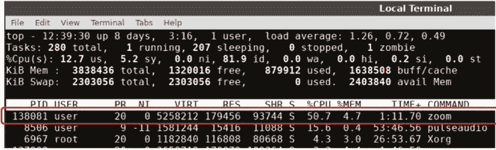

*图 11-9. 重定向的应用程序在 VDI 客户端上运行*

### VDI 客户端

多年来，不同类型的客户端不断演进。遗憾的是，这些类型的名称没有严格的标准，由供应商自行描述他们销售的客户端类型。在讨论客户端时，我倾向于使用“*VDI 客户端*”一词，然后详细说明客户端的特性，以下是一些示例。但值得注意的是，这些客户端提供的功能之间存在很大的流动性。

- **零客户端**：*零客户端*是一种专用设备，使用连接虚拟桌面所需的最少硬件构建而成。由于这些设备只运行固件，它们被认为是所有客户端类型中最安全的，但可能不如其他客户端类型灵活。

- **瘦客户端**：*瘦客户端*是专门设计为 VDI 客户端运行的。它们通常具有低功耗、低成本的处理器和最少数量的内存。它们也只有足够的存储空间来运行一个为支持 VDI 客户端软件而设计的操作系统。此外，由于它们运行操作系统而不是直接由固件运行，因此更容易修改，并且可能提供比零客户端更多的功能。

- **厚客户端**：*厚客户端*（或胖客户端）比零客户端或瘦客户端拥有更强大的硬件，由供应商专门构建为重新利用的 PC 或笔记本电脑，其中安装了允许其连接到虚拟桌面的应用程序。而瘦客户端或零客户端则非常依赖于虚拟


desktops，厚客户端可能运行一些独立的应用程序，例如办公应用程序，并且可能提供本地存储。

## 原生客户端

访问虚拟桌面不需要特殊设备，许多公司允许——甚至可能鼓励——最终用户从标准笔记本电脑或台式机访问其虚拟桌面。VDI 厂商通过在 Windows、Linux、macOS 或其他操作系统上运行的应用程序来实现此功能（见图 11-10）。

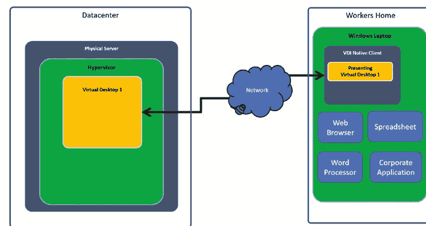

图 11-10. 原生客户端

原生客户端可能（取决于安全要求）允许集成功能，例如从本地应用程序向虚拟桌面剪切和粘贴。

## Web 客户端

随着 HTML5 的出现，网络浏览器很快成为访问虚拟桌面的有吸引力的方式，现在所有主要 VDI 厂商都支持基于 Web 的客户端。虽然它们可能不具备前面列出的其他客户端的所有功能，但它们确实提供了非常好的用户体验，并且在无需物理设备或安装原生客户端的情况下提供了访问虚拟桌面的灵活性。许多自带设备（BYOD）的用户更喜欢通过 Web 客户端访问，因为它不需要他们在设备上安装任何额外软件。Web 客户端与虚拟桌面之间的连接如图 11-11 所示。

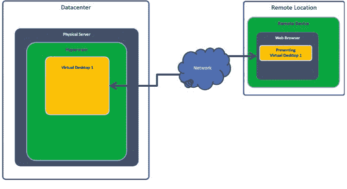

图 11-11. Web 客户端

## 一体式客户端

出于便利目的，许多制造商已将 VDI 客户端与显示器无缝结合。这不仅腾出了桌面空间，而且还使设备更容易维护，因为它可以作为一个整体进行更换。

图 11-12 显示了一台专门为医疗保健行业设计的 LG 一体式设备。它内置射频识别（RFID）读卡器，用于基于接近度的免提登录，以及其他使其对该市场具有吸引力的功能。

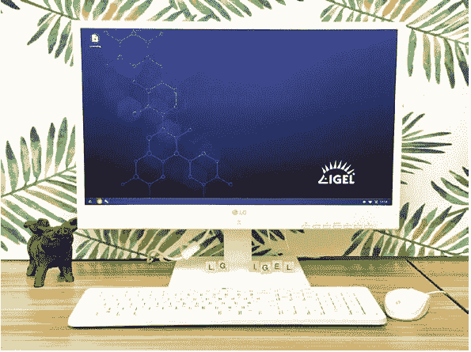

*图 11-12. LG 一体式设备*

## 移动设备

平板电脑、手机和其他移动设备也可以用于访问虚拟桌面。事实上，一些 VDI 厂商甚至允许将“捏合”等原生手势传递到移动设备。一些厂商支持通过 Web 客户端访问虚拟桌面，而其他厂商则专门为移动设备设计了原生客户端。

能够通过移动设备访问虚拟桌面对用户来说是一种解放的体验，因为他们无需携带专用设备。作为一个主要例子，如果医生在参加活动时需要访问患者的记录，他们可以立即从手机上完成，而无需返回办公室。

## 远程协议的作用

在继续之前，我应该解释一下远程协议到底做什么。以最简单的形式，如图 11-13 所示，远程协议将一个系统的显示传输到另一个系统显示；它还将本地系统的键盘和鼠标发送到远程系统。这使用户能够以与本地系统完全相同的方式与远程系统进行交互。

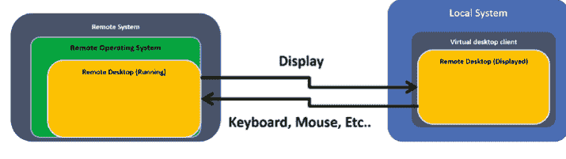

图 11-13. 远程协议

远程协议还可能执行其他功能，例如为安全目的加密数据流、压缩数据流以降低网络要求、将本地机器的 USB 设备传递到虚拟桌面、从虚拟桌面向本地连接的打印机打印，以及许多其他服务。

## 连接到虚拟桌面

在本节中，我将讨论一些连接到虚拟桌面的方法。我将首先使用 RDP，因为它是最常用和最广泛可用的协议。随后我将使用 X11 连接到桌面，X11 是 Unix 和 Linux 系统最早使用的协议之一。最后，我将使用 NoMachine（NX），这是一种专有但流行的协议，用于连接到 Windows 和 Linux 桌面。我将使用 Windows 10 系统连接到 Linux VM。

## Linux VM

Windows 无疑是最流行的桌面操作系统；然而，微软尚未发布可在通用 Arm 处理器系统上运行的 Windows 公共版本。然而，Linux 社区已完全拥抱 Arm 处理器，所有主要 Linux 发行版都有带桌面功能的版本。还有许多 Linux 发行版专门致力于使用 Linux 提供类似 Windows 的桌面体验。在本节中，我们将查看为 Linux VM 安装附加软件包以使其适合桌面使用的操作。

### Fedora

要使用 Fedora VM，您可以通过以下步骤在其上安装图形桌面：

1. 从控制台登录到您的 Fedora 实例。
2. 切换到 root 用户，然后输入 sudo su。
3. 通过输入以下命令安装 GNOME 桌面和 GUI 应用程序

```
dnf -y group install "Basic Desktop" GNOME
dnf -y install libreoffice
dnf -y install xeyes
```

4. 通过输入以下命令禁用 pcscd 服务

```
systemctl stop pcscd; systemctl disable pcscd
```

5. 通过输入 startx 启动图形桌面。
6. 您将在控制台中看到一个基本的图形桌面。单击 Activities。
7. 启动图形终端。在桌面顶部的搜索框中，输入 XTerm。

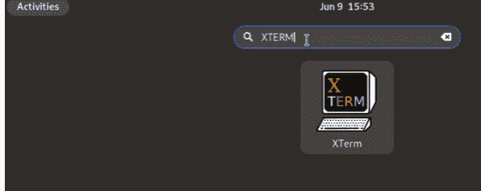

8. 在 XTerm 终端中，通过输入 /usr/bin/xeyes 启动图形应用程序。
9. 验证眼睛是否跟随鼠标。
10. 关闭 XTerm。

### Ubuntu

要使用 Ubuntu VM，它需要安装图形桌面。Ubuntu 有不同的桌面可以安装，以下是安装基本 GNOME 桌面的说明：

1. 从控制台登录到您的 Ubuntu 实例。
2. 切换到 root 用户，然后输入 sudo su。
3. 通过输入以下命令安装 GNOME 桌面和一些应用程序

```
apt install -y gnome-session gdm3
apt install -y libreoffice
apt install -y x11-apps
apt-get install -y gnome-terminal
apt-get install -y links2
apt-get install -y firefox
```

4. 通过输入以下命令设置图形桌面默认启动

```
systemctl set-default graphical.target
```

5. 您将在控制台中看到一个基本的图形桌面。通过输入 init 6 重启系统。
6. 系统启动后，登录到 GNOME 桌面。

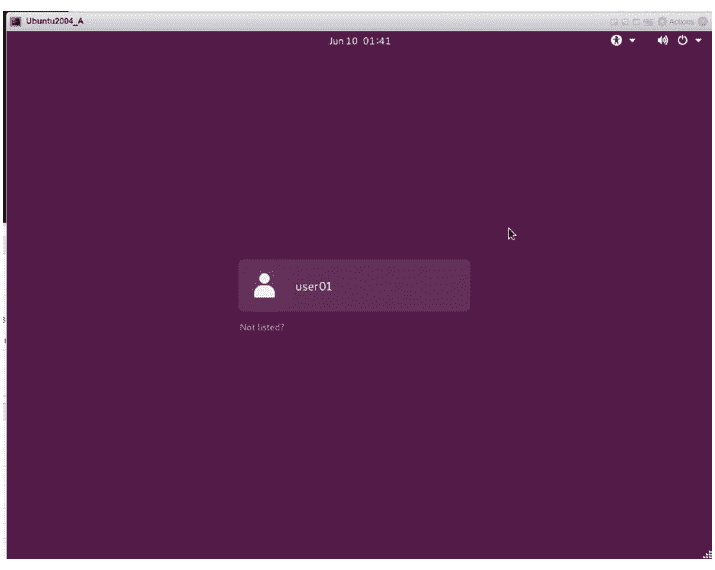

7. 单击 Activities。

### NoMachine for ARM - arm64

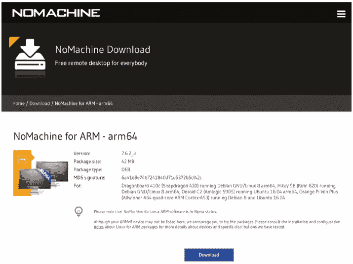

16. 通过输入以下命令安装 NoMachine

```
sudo su
apt install -y nomachine
sudo dpkg -i nomachine_7.6.2_3_arm64.deb
```

## 使用 RDP 连接到 Fedora 桌面

RDP 是最初与 Windows 机器一起使用的协议。它最初被称为 Terminal Services，并基于 Citrix 的 MultiWin 技术。

所有 Windows 系统都附带 RDP 客户端，可以通过在 Windows 命令行中输入 mstsc.exe 启动。RDP 客户端和服务器已为包括 Fedora 在内的各种机器开发。

### 在 Fedora 上安装 RDP 服务器

要在 Fedora 系统上安装 RDP 服务器，请执行以下步骤：

1. 使用 SSH 或控制台登录到 Fedora 系统。
2. 通过输入以下命令安装 RDP 服务器、启用它并为其打开防火墙

```
dnf -y install xrdp tigervnc-server
systemctl enable --now xrdp
firewall-cmd --add-port=3389/tcp --permanent
firewall-cmd --reload
```

### 使用 RDP 连接到 Linux 桌面

您可以按照以下步骤从 Windows 机器连接到 Fedora 机器：

1. 从 Windows 开始菜单，输入 mstsc.exe。
2. 在远程桌面连接面板中，输入 Fedora 系统的 IP 地址。

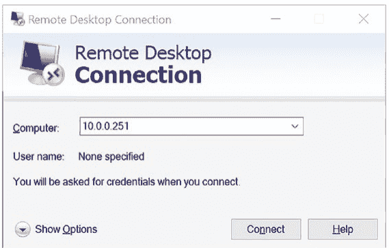

3. 输入您的用户名和密码并单击 **OK**。

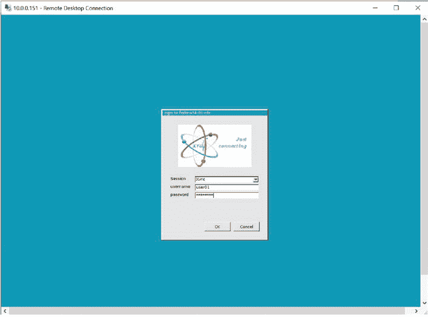

4. 短暂等待后，您应该会收到“Welcome to GNOME”消息。单击 **Take Tour**。


# 第11章　ESXi 上的虚拟桌面

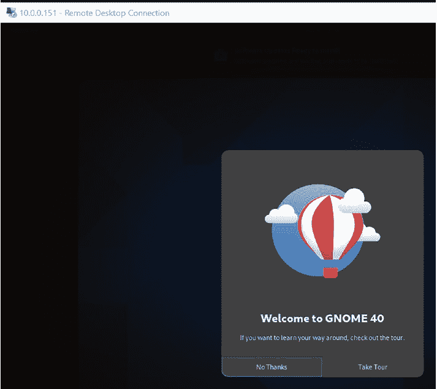

+   5. 游览结束后，启动文字处理器。在“活动”搜索框中输入 *writer*。
+   
+   6. 你将在控制台中看到 LibreOffice Writer。

# 第11章　ESXi 上的虚拟桌面

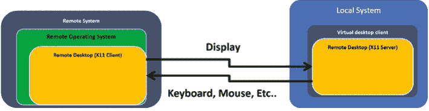

## 使用 X11 连接 Fedora

Windows 上有许多可用的 X11 服务器，其中较流行的一些是 Xming、Cygwin X 和 VcXsrv。在本节中，我们将使用 Xming。虽然它是专有软件，但也有免费版本可用。Xming 仅充当 X11 服务器，因此我将使用 PuTTY 来提供与远程系统的通信。

虽然你可以通过 Xming over PuTTY 显示完整的 GNOME 桌面，但有更好的工具（如 NoMachine）可用于此目的。在本节中，我将仅展示如何使用 X11 启动单个应用程序。

+   1. 从 [www.putty.org/](http://www.putty.org/) 下载并在你的 Windows 机器上安装 PuTTY。
+   2. 从 [https://sourceforge.net/projects/xming/](https://sourceforge.net/projects/xming/) 下载 Xming。

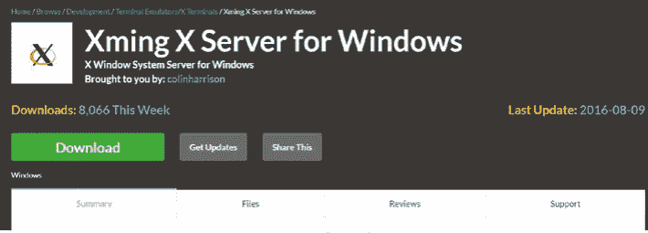

+   3. 使用 Xming 安装向导安装 Xming。

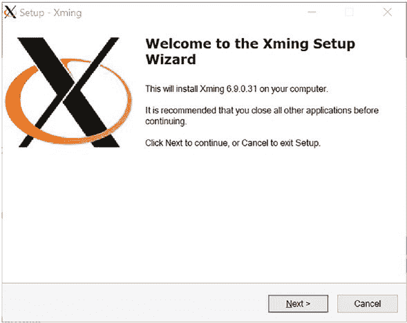

+   4. 启动 Xming。

+   5. 如果防火墙询问，请允许 Xming 在专用网络上通信。

# 第11章　ESXi 上的虚拟桌面

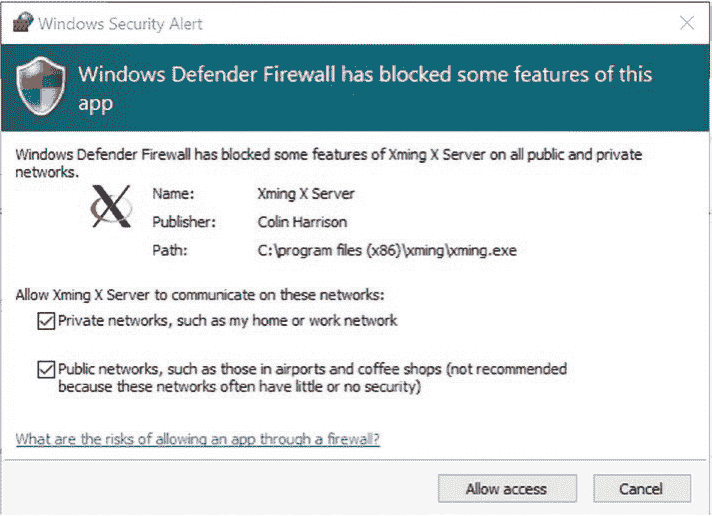

6. Xming 将出现在 Windows 系统托盘中，等待来自 X11 客户端的连接。

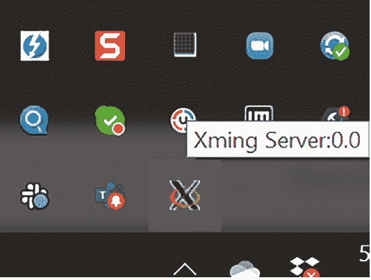

一旦 Xming 服务器开始侦听 X11 客户端，就需要在两者之间建立网络连接，你可以通过以下步骤完成此操作：

+   1. 启动 PuTTY。
+   2. 在 PuTTY 配置窗口中，选择 Connection ► SSH ► X11。
+   3. 勾选 Enable X11 forwarding 复选框。

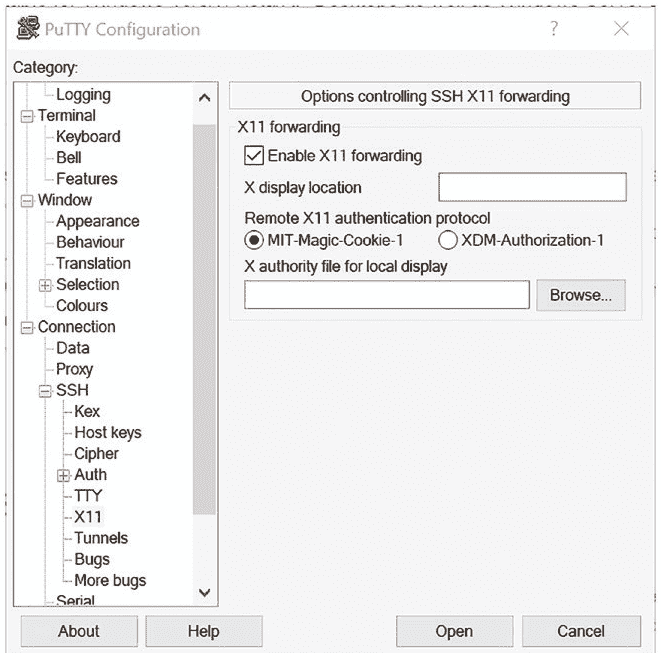

8. 启动你的 X11 会话，并通过输入以下内容启动一个应用程序：

```
sudo su
Export DISPLAY=:0
Xeyes
```

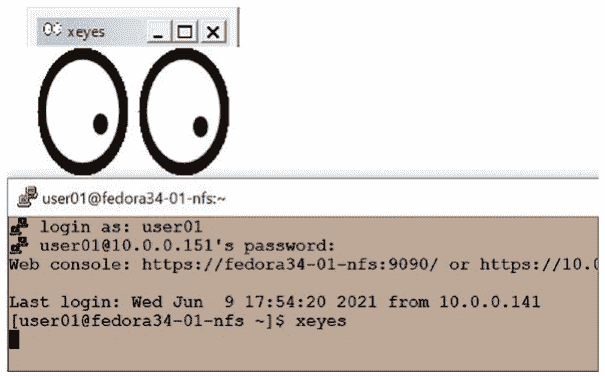

9. 关闭 xeyes。

10. 通过输入以下内容启动电子表格和绘图程序：

```
libreoffice --calc &
libreoffice --draw &
```

11. 使用这些程序，然后关闭它们。

12. 通过输入以下内容安装并启动 Firefox 网络浏览器：

```
dnf -y install firefox
firefox
```

# 第11章  ESXi 上的虚拟桌面

13.  使用该程序，然后将其关闭。

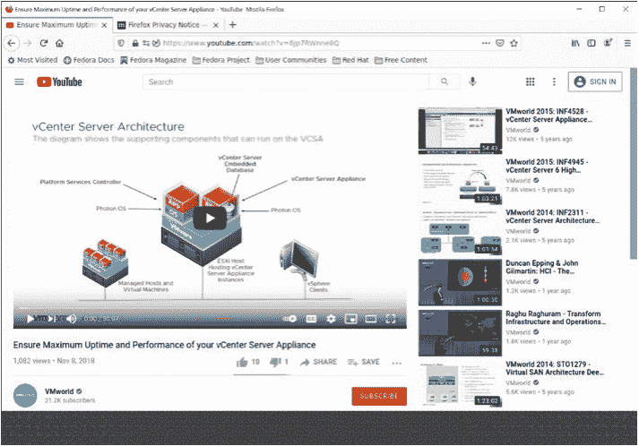

## NoMachine（NX）

NoMachine（NX）是一款高度优化的专有软件应用程序，用于访问在 Windows、Linux 和 macOS 上运行的虚拟桌面。我们将安装免费的服务器和客户端，但也有企业版，其中包括允许将多个用户附加到同一会话以及从同一 Linux 系统运行多个虚拟桌面等高级功能。

## 使用 NoMachine 连接到虚拟桌面

我们将使用 NX 从 Windows 机器连接到你的 Ubuntu 虚拟机，具体步骤如下：

+   1. 从 www.nomachine.com/download/download&id=115&s=ARM 下载 NoMachine 软件包。
+   2. 使用 SCP 将其传输到 Ubuntu 虚拟机。
+   3. 从控制台或使用 SSH 登录到 Ubuntu 虚拟机。
+   4. 通过输入以下内容安装 NX：
+   ```
+   sudo su
+   dpkg -i nomachine_7.6.2_3_arm64.deb
+   ```
+   5. 从 www.nomachine.com/download/ 下载并安装 NoMachine 到你的 Windows 系统。
+   6. 启动 NoMachine 应用。
+   7. 配置 NoMachine 以连接到你的 Ubuntu 系统。

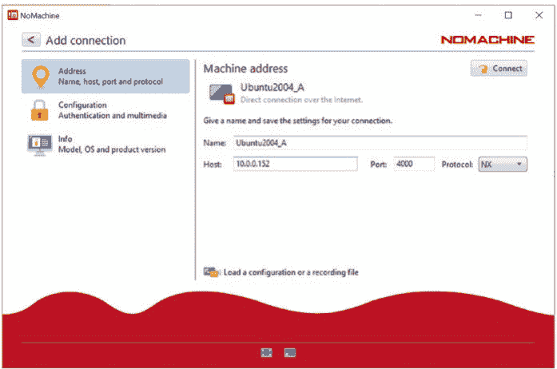

8. 单击“连接”并登录到你的 Ubuntu 桌面。

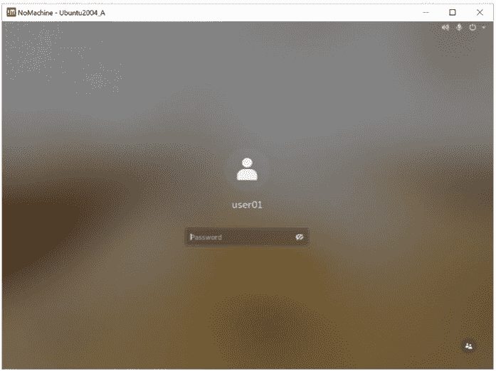

9. 从使用 NX 显示的 Ubuntu 桌面中打开 Firefox、Writer 和其他应用程序（参见图 11-33）。

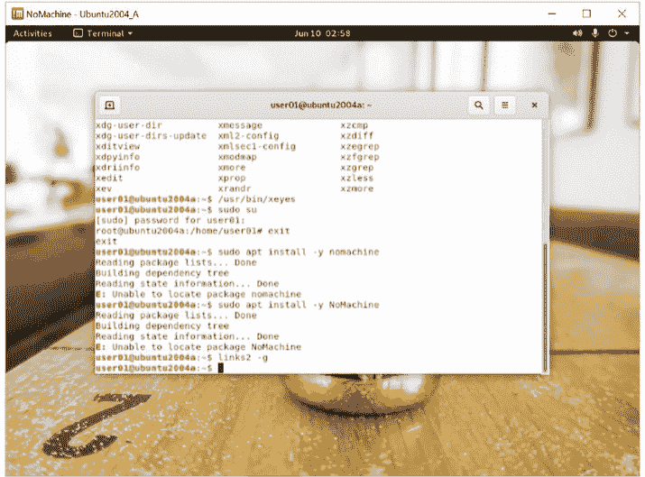

10. 关闭 Windows 系统上的 NX 应用程序。

## 更改屏幕分辨率

很长一段时间以来，我都不知道如何更改所显示的远程虚拟桌面的分辨率，但后来我偶然发现了 Cyprien Laplace 撰写的一篇博客文章，题为“为 ESXi Arm 虚拟机设置虚拟屏幕分辨率”。在这篇文章中，Cyprien 指出：“不幸的是，ESXi for Arm 附带了一个新的、尚未最终定版的 VMware 虚拟 SVGA 适配器，
