# 第12章

## ESXi 网络

虚拟机（VM）与物理机一样，需要使用网络接口卡（NIC）和交换机来连接到其他系统和互联网。但由于每台虚拟机在服务器中配备一个物理网卡并不现实，VMware 设计了一种方案，通过使用虚拟网卡（vNIC）、虚拟交换机（vSwitch）和端口组，让物理网卡可以被多台虚拟机共享。

在本章中，我们将研究虚拟机如何使用物理和虚拟网络结构，还将了解如何测试网络的性能。

## 网络

在讨论虚拟网络之前，让我们先看一下组成传统物理环境基础设施的各个组件。

仅举一个例子，图 12-1 展示了一种拓扑结构，其中机架中的所有服务器都连接到一个架顶式（TOR）交换机，两个机架通过一台汇聚交换机相互连接（这样还可以连接更多机架）。汇聚交换机随后可以连接到其他汇聚交换机、局域网（LAN）或广域网（WAN）。这个示例只是众多可用的网络拓扑类型之一，但它展示了如何使用不同的网络组件来互连系统。

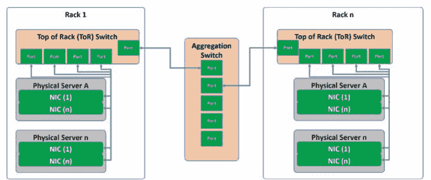

## 图 12-1. 传统网络拓扑

当我们最初设置 ESXi 服务器时，会自动创建一个虚拟交换机，并将服务器上的物理网卡连接到该交换机上。当我们创建虚拟机时，会创建一个 vNIC 并将其连接到虚拟交换机。此设置如图 12-2 所示。

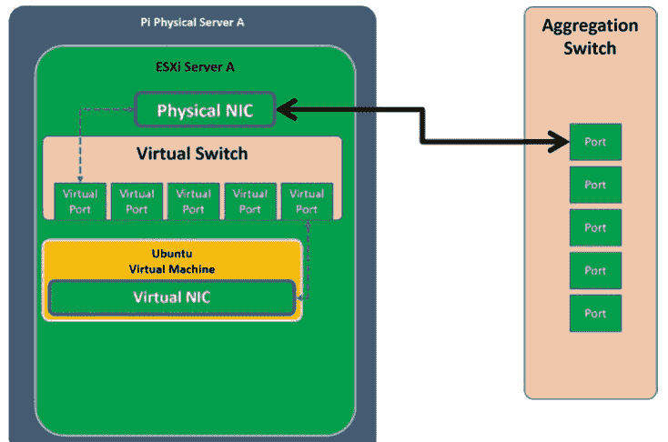

## 图 12-2. ESXi 虚拟网络

可以使用 ESXi 主机客户端查看、创建和修改构成虚拟网络的组件。

要查看 vSwitch0（安装 ESXi 时自动创建的交换机）的高级概览，请在 ESXi 主机客户端的“导航器”窗格中展开“网络”下拉菜单。然后，选择 vSwitch0 并展开“vSwitch 拓扑”窗格，就会显示 vSwitch 的图形表示（参见图 12-3）。

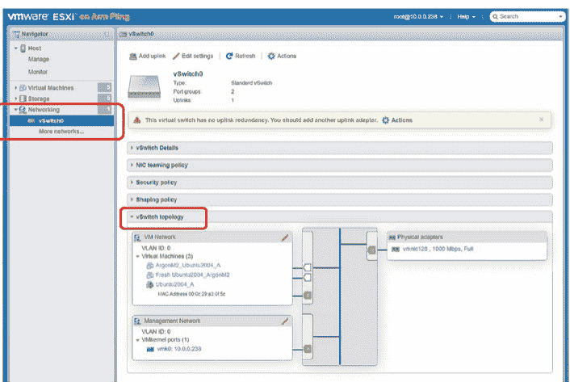

图 12-3. vSwitch 拓扑

## 虚拟交换机

vSwitch0 有两个端口组：VM Network 和 Management Network，两者都连接到单个物理适配器（参见图 12-4），并且是在我们安装 ESXi 时自动创建的。物理适配器就是 Raspberry Pi 上的网卡。

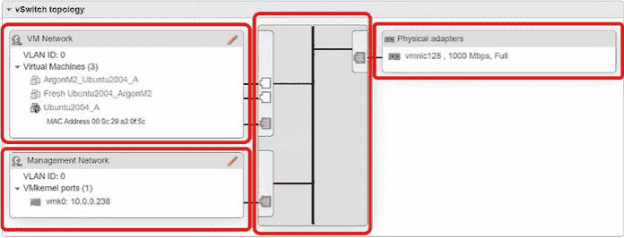

图 12-4. *vSwitch0*

端口组允许你将端口分组在一起，每个端口可以有不同的属性。VM Network 端口组连接到我们创建的虚拟机，这些虚拟机可以通过与 vSwitch 关联的物理适配器相互通信或与外部世界通信。

Management Network 端口组用于与 ESXi 主机进行通信和控制，而不是用于其上驻留的虚拟机。Management Network 的 IP 地址是用于通过 SSH 或 ESXi 主机客户端连接到 ESXi 主机的地址。活动端口以绿色显示，非活动端口以白色显示。

vSwitch0 连接到服务器上的单个物理网卡，但一个 vSwitch 可以有多个物理网卡，也可以是 *仅内部* 的 vSwitch，不连接到任何物理网卡。仅内部交换机在只需要虚拟机间通信的多层应用程序中非常有用。

图 12-5 展示了如何为多层应用程序配置 vSwitch。*虚拟机 2*（包含不应从 LAN 直接访问的应用程序，如数据库）连接到仅内部 vSwitch。*虚拟机 1* 有两个虚拟网卡：一个连接到仅内部 vSwitch，另一个连接到与两个物理网卡关联的 vSwitch。


这两个物理 NIC 分别连接到不同的聚合交换机，而这些交换机又连接到 LAN。双物理 NIC 和聚合交换机可在发生故障时提供冗余。

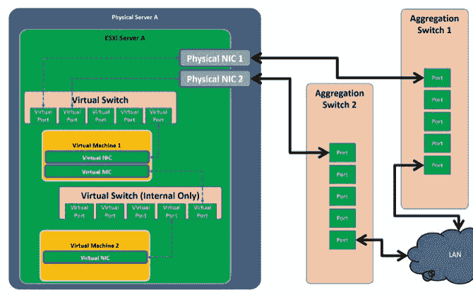

图 12-5。多层应用

## 创建虚拟交换机

你可以使用 ESXi Host Client 创建虚拟交换机。创建 vSwitch 时，可以使用多种选项，包括：

- 混杂模式（Promiscuous Mode）– 将所有帧传递给交换机上的 VM；防火墙、端口扫描程序、WAN 仿真器等都需要此功能。
- MAC 地址更改（MAC Address Changes）– 如果客户机操作系统更改了 MAC 地址，则允许流量传递到 VM。
- 伪造传输（Forged Transmits）– 即使网络帧与 vNIC 的 MAC 地址不匹配，也允许 VM 传递网络帧。

在以下练习中，你将创建一个仅供内部使用的交换机：

1. 以 root 身份登录 ESXi Host Client。
2. 在导航器窗格中选择**网络**。然后选择**虚拟交换机**选项卡，并单击**添加标准虚拟交换机**。
3. 在**vSwitch 名称**文本框中输入 *InternalOnly0*。
4. 展开**链路发现**和**安全**下拉菜单并查看选项。

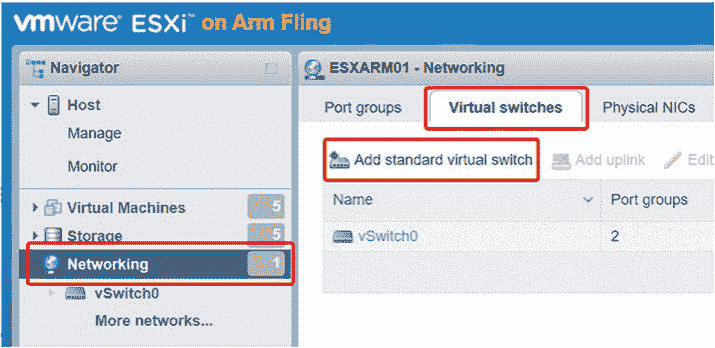

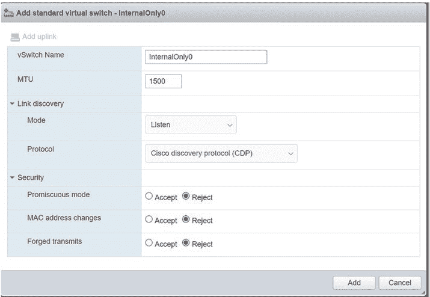

5. 单击**添加**。

创建 vSwitch 后，你可以向其中添加端口组，这些端口组可以像 vSwitch 一样具有安全属性。默认情况下，这些属性会从 vSwitch 继承。

在以下练习中，你将在 *InternalOnly0* vSwitch 上创建一个端口组：

1. 选择**端口组**选项卡，然后单击**添加端口组**。
2. 在**名称**文本框中输入 *DatabaseToFrontend*。
3. 展开**安全**下拉菜单并查看选项。

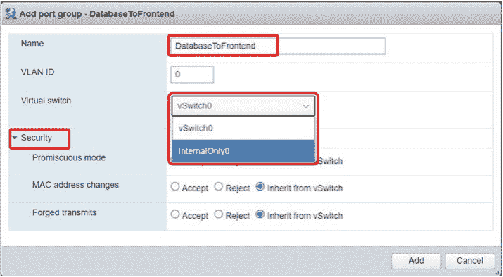

4. 单击**添加**。

现在已经有了一个包含端口组的 vSwitch，但该 vSwitch 没有连接物理 NIC；如果需要，你可以添加物理 NIC。

如果你决定稍后向交换机添加物理 NIC，请执行以下步骤：

1. 在导航器窗格中打开**网络**下拉菜单，然后选择**更多网络**。
2. 在右侧窗格中单击**端口组**选项卡，然后单击 **DatabaseToFrontend**。
3. 在图示中确认它属于该 vSwitch，并且没有连接任何物理适配器。

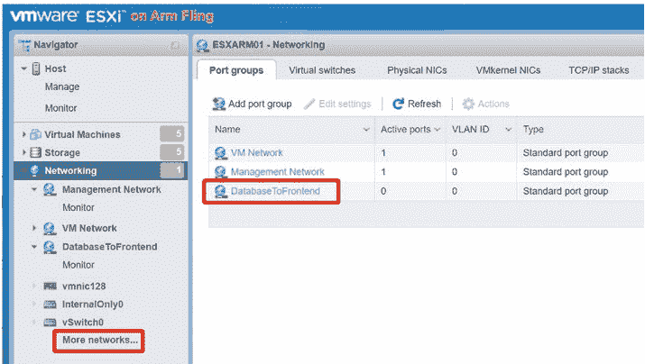

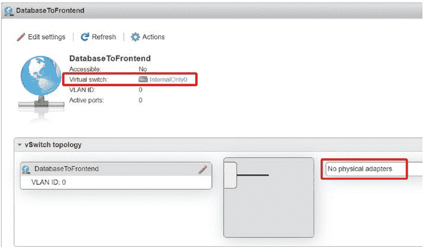

8. 确认没有可添加到其中的空闲物理 NIC，然后单击**确定**。
9. 单击**取消**。

## 物理 NIC

ESXi 主机上的物理 NIC 会被自动检测，并且可以由该主机上的 vSwitch 使用。可以使用 ESXi Host Client 查看和修改 NIC 的属性。

在以下练习中，你将查看物理 NIC 的属性：

1. 在导航器窗格中打开**网络**下拉菜单，然后选择**更多网络**。
2. 在右侧窗格中单击**物理 NIC**选项卡。
3. 确认 NIC 的属性。

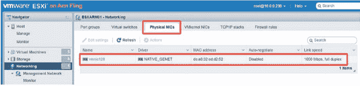

4. 单击显示的 NIC。
5. 确认 NIC 的详细信息。

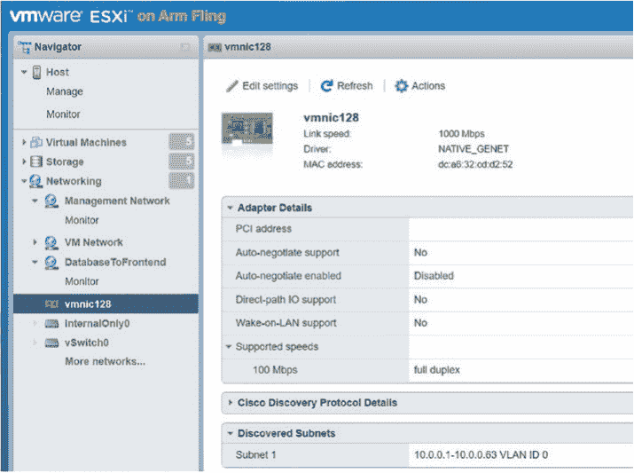

## 虚拟 NIC

vNIC 模拟物理 NIC，使 VM 能够与虚拟交换机通信（参见图 12-5）。虽然 VMware 提供了多种 vNIC，但目前 ESXi on Arm 仅提供以下三种：

- E1000 – 模拟 Intel 82545EM 千兆以太网 NIC。
- E1000E – 模拟 Intel 82574 千兆以太网 NIC。
- VMXNET3 – 此 vNIC 不模拟 NIC，而是由 VMware 从头设计，旨在为 VM 提供最佳性能。

有许多不同的工具可用于测量带宽，但我最常使用的是 iPerf3，因为它易于使用且灵活。

## iPerf3

iPerf3 是 iPerf 的第三次重写版本，iPerf 最初于 2014 年发布。它由 Robert McMahon、Battu Kaushik 和 Tim Auckland 开发。iPerf3 免费、易于获取，并采用 BSD 许可证授权。iPerf3 的主页是 https://iperf.fr/。

iPerf3 使用服务器/客户端模式，在两个系统之间生成模拟负载（参见图 12-7）。

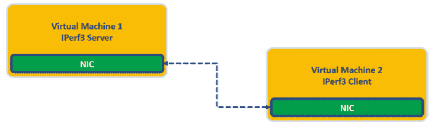

图 12-7。iPerf3 模式

iPerf3 会报告两个系统之间的带宽、延迟、抖动和数据包丢失率。iPerf3 的源代码可以在 Arm 机器上下载并编译，但由于 Ubuntu 和 Fedora Arm 也提供了预编译的软件包，因此我们将使用这些软件包。

## 在同一 ESXi 主机上使用 iPerf3 进行 VM 到 VM 测试

在本节中，我们将在 Ubuntu 和 Fedora VM 上安装 iPerf3。随后使用它检查两者之间的带宽（参见图 12-8）。在另一节中，我们将检查 VM 与物理主机之间的带宽（参见图 12-11），然后使用它检查 VM 与其所在 ESXi 主机之间的带宽（参见图 12-15）。

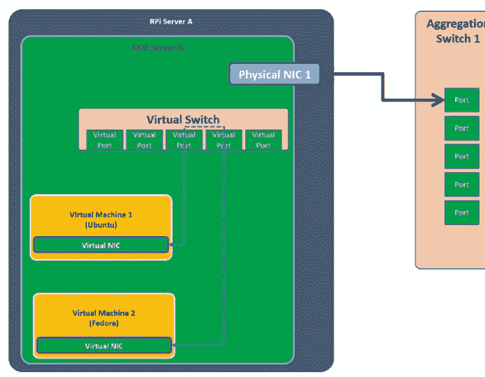

图 12-8。同一 ESXi 主机上的两个 VM 使用 iPerf3

在以下练习中，你将在两个不同的 VM 上安装 iPerf3，并使用它检查两者之间的带宽：

1. 使用 SSH 或控制台连接到 Ubuntu VM。
2. 通过输入以下命令在 Ubuntu 服务器上安装 iPerf3：

```bash
sudo su
apt install iPerf3
```

## 图 12-9。iPerf3 结果

随后，我在命令后追加 `-r`，以反向方向运行 iPerf3；图 12-10 中的结果显示，速度略高，为 1.21Gbps。

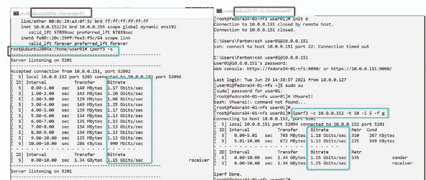

## 图 12-10。反向模式下的 iPerf3

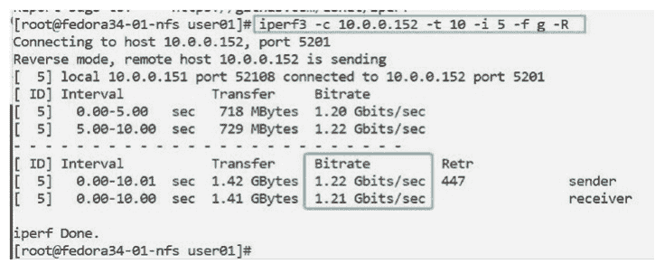

## 在 VM 与物理机之间使用 iPerf3

在上一节中，我们验证了同一 ESXi 主机上两个 VM 之间的带宽。由于它们位于同一 ESXi 主机上，网络流量不需要经过任何物理网络基础设施（即 NIC、交换机等）。在本节中，我们将检查 VM 与物理主机之间的带宽（参见图 12-11）。

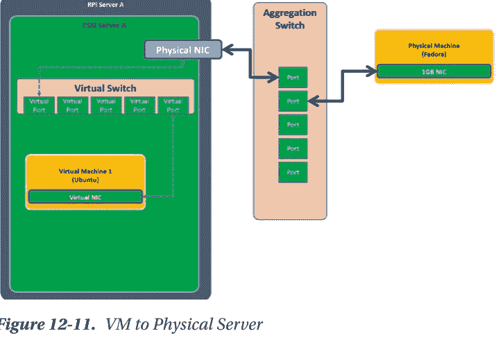

图 12-11。VM 到物理服务器

我分别以正向和反向模式运行了 iPerf3。在这两种情况下，由于物理硬件的限制，带宽均为 0.90Gbps（参见图 12-12）。

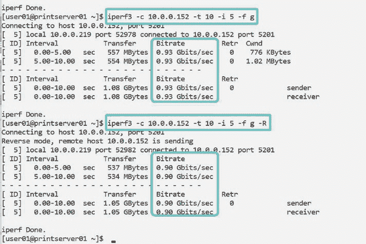

## 图 12-12。*从 VM 到物理主机的 iPerf3 结果*

## 使用 VMXNET3 驱动程序运行 iPerf3

在之前的测试中，我们使用了配备 E1000E vNIC 的 VM。在本节中，我们将在同一 ESXi 主机上，使用 VMXNET3 vNIC 检查两个 VM 之间的带宽。

要将 vNIC 从 E1000E 更改为 VMXNET3，请执行以下步骤：

1. 登录 ESXi Host Client。
2. 关闭 Ubuntu VM。
3. 选择**编辑**。

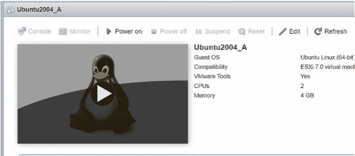

4. 展开**网络适配器 1**。然后从**适配器类型**下拉菜单中选择 *VMXNET 3*。

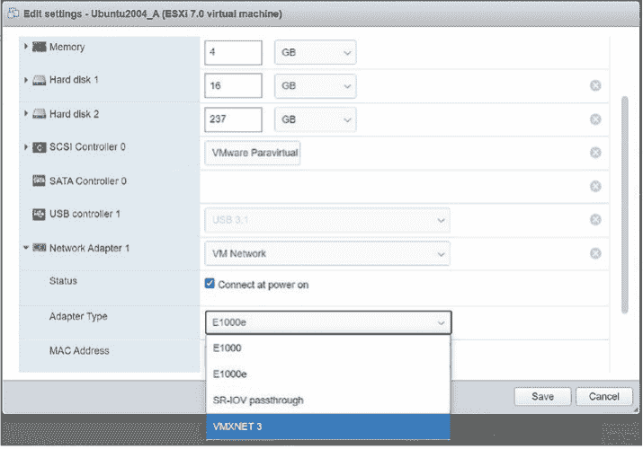

5. 单击**保存**。
6. 启动 VM。

接下来，执行以下步骤，确认 VM 使用的是 VMXNET3 驱动程序：

1. 登录 Ubuntu VM。
2. 输入以下命令检查正在使用的驱动程序：

```bash
sudo su
lshw -class network
```

在我的情况下，结果显示使用的是 VMXNET3 以太网控制器，其容量为 10Gbps（参见图 12-13）。

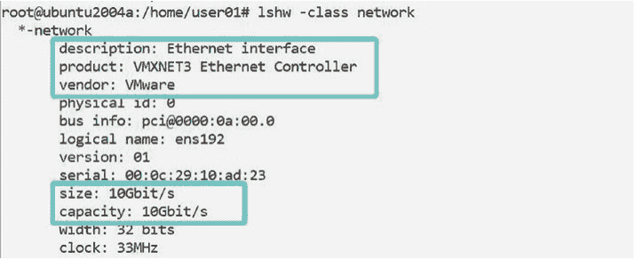

***图 12-13。*** *VMXNET3 属性*

由于我没有在 Fedora VM 上安装 VMware Tools，因此又创建了一个 Ubuntu VM。我使用配备 VMXNET3 vNIC 的两个 Ubuntu VM 重新运行了 iPerf3 测试。结果显示，带宽为 2.08Gbps（参见图 12-14）。


root@ubuntu2004a:/home/user01# iperf3 -c 10.0.0.148 -t 10 -i 5 -f g
Connecting to host 10.0.0.148, port 5201
[  5] local 10.0.0.131 port 48892 connected to 10.0.0.148 port 5201
[ ID] Interval           Transfer     Bitrate         Retr  Cwnd
[  5]   0.00-5.00   sec  1.24 GBytes  2.12 Gbits/sec    0   1.95 MBytes
[  5]   5.00-10.00  sec  1.18 GBytes  2.03 Gbits/sec  728   1.70 MBytes
[ ID] Interval           Transfer     Bitrate         Retr
[  5]   0.00-10.00  sec  2.42 GBytes  2.08 Gbits/sec  728             sender
[  5]   0.00-10.00  sec  2.42 GBytes  2.08 Gbits/sec                  receiver
iperf Done.

## 图12-14. VMXNET3 vNIC

ESXi主机客户端显示，在运行iPerf3测试时，Pi上的CPU核心使用率超过90%（见图12-15）。这可能是仅传输了2Gbps的原因。

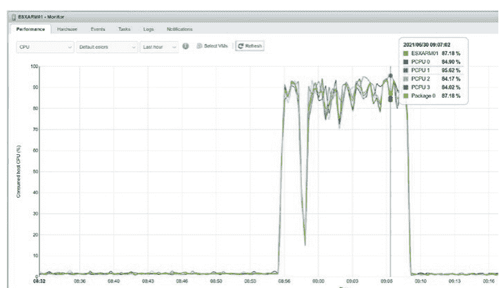

## 图12-15. CPU使用率

## ESXi上的iPerf3

为了进行故障排除和规划，最好能了解您可以获得多少到ESXi主机（而不是驻留在其上的虚拟机）的带宽。

VMware不鼓励在ESXi主机上安装任何第三方软件，因为这可能会带来灾难性后果，干扰虚拟机监控程序及其上虚拟机的运行。话虽如此，VMware在ESXi 6.5中附带了iPerf，在6.7中移除了它，但又在6.7 U1中重新加入。ESXi 7.0的x64版本中包含它，但ESXi on Arm Fling中没有。

iPerf3可以从源代码编译，也可以从互联网下载编译好的版本。我安装了一个预编译版本，并在我的Pi ESXi主机上运行，以下是我从ESXi主机上的一个虚拟机以及一台物理机上运行它时记录的结果。

当我从ESXi主机到具有E1000E vNIC的虚拟机运行它时，它报告了1.28Gbps的速率（见图12-16）。

```
[root@fedora34-01-nfs user01]# iperf3 -c 10.0.0.238 -t 10 -i 5 -f g
Connecting to host 10.0.0.238, port 5201
[ 5] local 10.0.0.151 port 56080 connected to 10.0.0.238 port 5201
[ ID] Interval           Transfer     Bitrate         Retr  Cwnd
[ 5] 0.00-5.00 sec  1.15 GBytes  1.98 Gbits/sec  0   2.03 MBytes
[ 5] 5.00-10.00 sec  1.17 GBytes  2.02 Gbits/sec  0   2.03 MBytes
[ ID] Interval           Transfer     Bitrate         Retr
[ 5] 0.00-10.00 sec  2.32 GBytes  2.00 Gbits/sec  0   sender
[ 5] 0.00-10.00 sec  2.32 GBytes  1.99 Gbits/sec      receiver
iperf Done.
```

```
[root@fedora34-01-nfs user01]# iperf3 -c 10.0.0.238 -t 10 -i 5 -f g -R
Connecting to host 10.0.0.238, port 5201
Reverse mode, remote host 10.0.0.238 is sending
[ 5] local 10.0.0.151 port 56084 connected to 10.0.0.238 port 5201
[ ID] Interval           Transfer     Bitrate         Retr  Cwnd
[ 5] 0.00-5.00 sec  791 MBytes  1.33 Gbits/sec
[ 5] 5.00-10.00 sec  734 MBytes  1.23 Gbits/sec
[ ID] Interval           Transfer     Bitrate         Retr
[ 5] 0.00-10.00 sec  1.49 GBytes  1.28 Gbits/sec  0   sender
[ 5] 0.00-10.00 sec  1.49 GBytes  1.28 Gbits/sec      receiver
iperf Done.
```

图12-16. 使用E1000E的ESXi主机到虚拟机的iPerf3结果

当我从ESXi主机到具有VMXNET3 vNIC的虚拟机运行它时，它报告了2.01Gbps（见图12-17）。

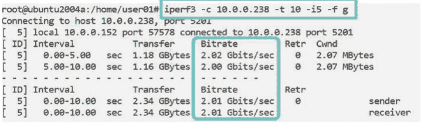

**图12-17.** *使用VMXNET3的ESXi主机到虚拟机的iPerf3结果*

当我从ESXi主机到物理系统运行它时，它报告了0.94Gbps（见图12-18）。

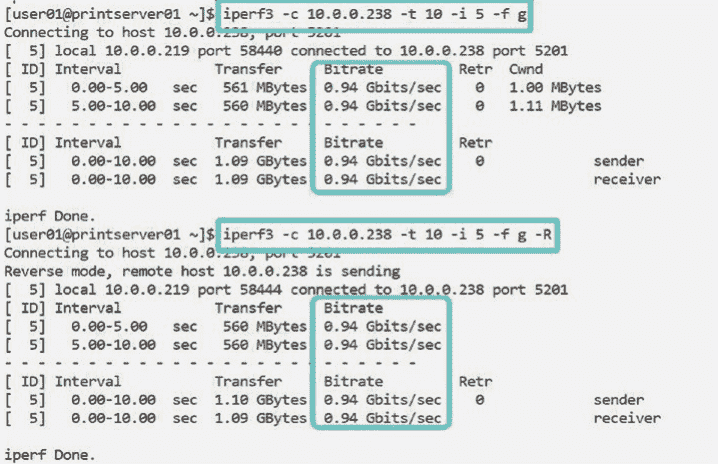

**图12-18.** *ESXi主机到物理系统的iPerf3结果*

## 总结

自成立以来，VMware就认识到网络在虚拟基础架构中的重要性；他们的工程师已将物理网络组件实现为虚拟网络组件的技术打磨到了精细的程度。多年来，VMware的虚拟网卡、虚拟交换机及其TCP协议栈已被证明是坚如磐石的。使用他们的虚拟网络结构简单直观。

虽然我使用iPerf3来测试虚拟机、物理机甚至ESXi服务器的性能，但还有其他工具可以使用。这些工具在排查性能问题时非常有帮助，每位系统管理员都需要熟悉它们。

到目前为止，我们将ESXi主机视为一个独立的单元，但实际上，你极少会看到ESXi主机作为单个实体运行，因为虚拟化的真正威力在于环境中拥有多台ESXi主机时才能发挥出来。vCenter Server是VMware的产品，用于管理和监控多台ESXi主机。我们将在下一章讨论它。
