# 第13章

# 使用VCSA管理ESXi系统

到目前为止，在本书中，我们一直专注于使用ESXi主机客户端来管理我们的ESXi服务器，主要因为它是一个随ESXi附带的免费工具。尽管在管理单台服务器时很有用，但ESXi主机客户端在生产环境中很少使用，因为vSphere的真正强大之处在于将许多ESXi主机集群在一起，置于vCenter Server的管理之下。

早期，vCenter Server需要安装在Windows Server系统上，但现在它也以虚拟设备的形式交付，称为vCenter Server Appliance（VCSA）。由于VCSA现在更受欢迎，本章我们将只讨论它。

直到最近，vCenter Server仅支持x64 ESXi主机——但vCenter Server 7.0现在也支持Arm ESXi主机。尽管该设备是为x64编译的，无法安装在Arm ESXi主机上，但可以安装在VMware Workstation Player上。Player不是vCenter Server的官方支持平台，但对我们来说足够用了。

在本章中，我们将讨论VCSA的功能，并解释如何安装它。我们还将介绍如何使用vSphere Client（VCSA的基于Web的界面）以及第三方产品ControlUp来管理ESXi系统。

另外，VCSA也可以部署在VMware Workstation Player上，不过这并未被广泛宣传，也不受官方支持。

我将向您展示如何在x64 ESXi主机和Player上部署它。

VCSA可以通过GUI或命令行部署，但我们将使用GUI。这是一个两阶段的过程：第一阶段部署设备的OVA文件，第二阶段设置并启动新部署设备的服务。

在本节中，无论您打算在ESXi主机还是Player上安装，我都将向您展示准备VCSA安装所涉及的步骤。

要准备安装VCSA，请完成以下步骤：

- 1. 阅读VCSA的发行说明，确保满足安装的所有系统要求（例如存储、网络、计算容量等）。
- 2. 从 [my.vmware.com](https://my.vmware.com) 的 *数据中心与云基础设施* 下，将最新的VCSA 7.0或更新版本的设备安装程序下载到您的Windows系统。

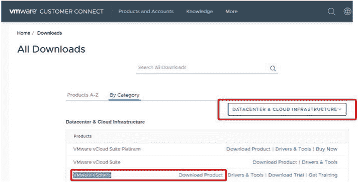

## 在x64 ESXi主机上安装vCenter Server

要在x64 ESXi主机上安装VCSA，您需要预先安装ESXi服务器并在其上具有数据存储（如以下步骤所述）。

- 1. 导航到 *vcsa-ui-installer* ► *win32*，然后双击 **installer.exe.**

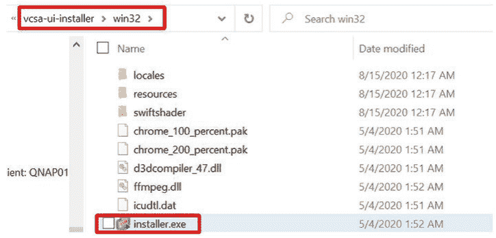

- 2. 在向导中，单击 **Install**。
- 3. 接受默认值，根据需要填写信息，并指定您要安装到的ESXi主机。
- 4. 当您到达步骤5时，为部署大小选择 **Tiny**。
- 5. 选择要安装到的数据存储。
- 6. 设置网络信息。
- 7. 在 **Summary** 页面上，验证您的设置并单击 **Finish**。完成安装的第一阶段可能需要长达半小时。

+   8. 第一阶段完成后，单击**继续**。

+   9. 接受默认设置，并根据需要填写第二阶段的信息。
+   
+      a. 当系统询问是否创建新的单点登录（SSO）时，将其命名为*vsphere.local*。

+   10. 在**摘要**页面上，验证您的设置，然后单击**完成**。安装第二阶段可能需要半小时才能完成。

+   11. 安装完成后，记下*“vCenter Server 入门页面”*列出的 URL。

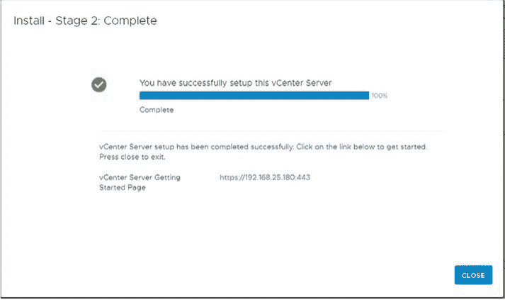

+   12. 单击**关闭**。

如果您在 x64 ESXi 服务器上安装了 VCSA，则可以跳过下一节。

+   3. 导航到已挂载 ISO 的*vcsa*文件夹，然后双击**VMware-vCenter-Server-Appliance**。

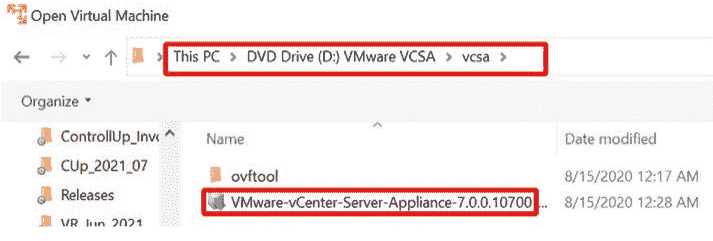

+   4. 接受 EULA，然后单击**下一步**。
+   
+   5. 为 VCSA 命名，然后单击**下一步**。
+   
+   6. 为部署大小选择**带嵌入式 PSC 的精简版 vCenter Server**，然后单击**下一步**。

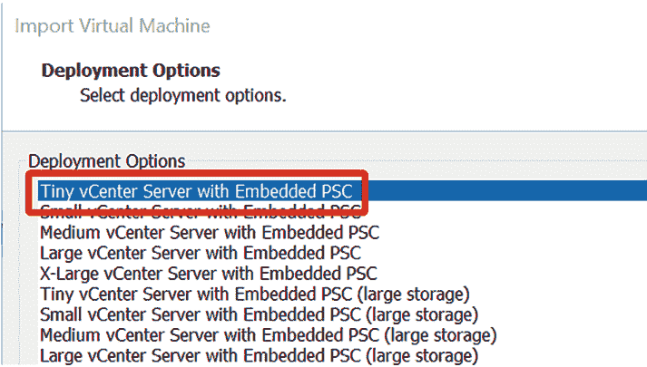

# 第13章 使用VCSA管理ESXi系统

+   7. 单击**安装。**

+   8. 接受默认设置并填写网络信息（您可以单击文本框右侧的“帮助”图标，了解有关需要输入的信息的更多内容）。

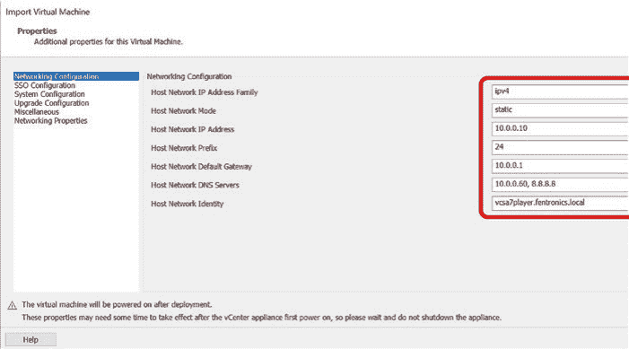

9. 单击**导入**。导入过程将需要几分钟才能完成。

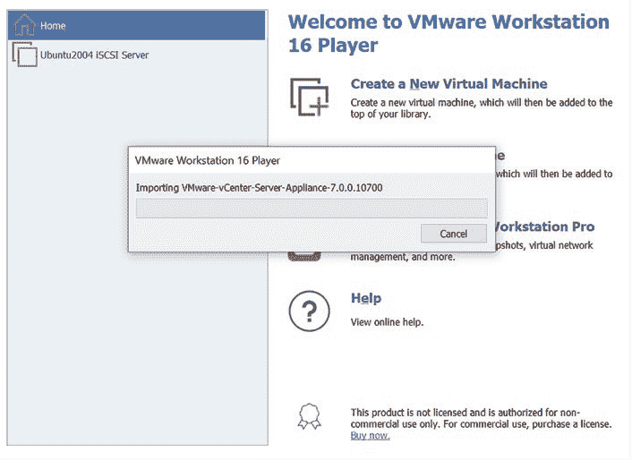

# 第13章 使用VCSA管理ESXi系统

10. 导入完成后，您将看到以下屏幕。

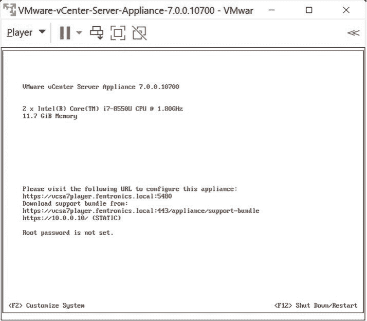

11. 按 F2 键，然后输入 root 密码。

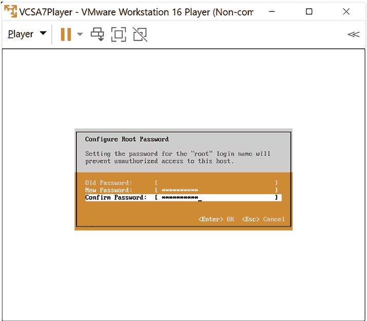

12. 按 Esc 键。

13. 在相同网络的 Web 浏览器中，输入用于配置设备的 URL。如果您收到无法访问该站点的消息，请等待几分钟，然后重试。

## 配置 vCenter Server

VCSA 安装完成后，将显示一个网页供您进行配置。此时，请按照以下步骤操作：

+   1. 在 Web 浏览器中，单击**设置**。

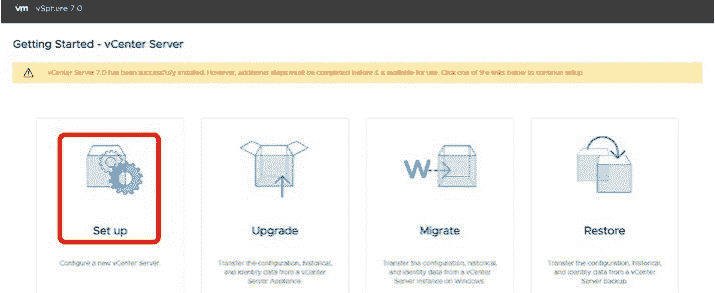

+   2. 输入 root 密码。

+   3. 单击**下一步**。

+   4. 验证网络信息。然后，从**SSH 访问**下拉菜单中选择**已启用**。

+   5. 单击**下一步**。

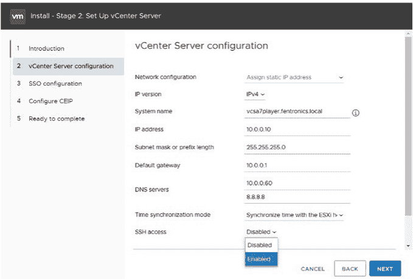

6. 为您的 SSO 域设置域名和密码，然后单击“下一步”。

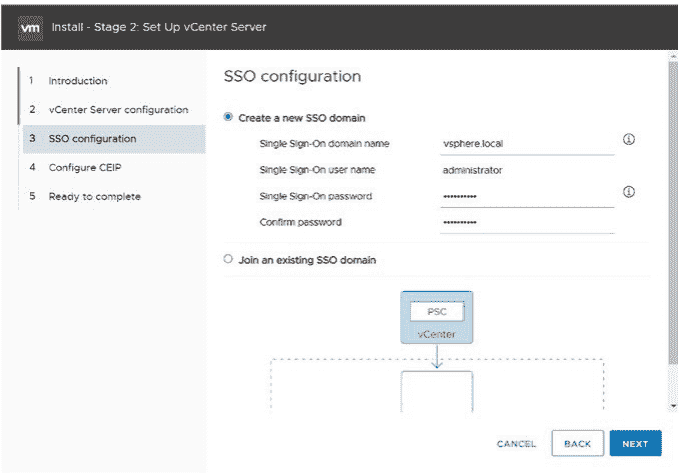

+   7. 拒绝加入 CEIP。
+   8. 验证您的设置，然后单击**完成**。
+   9. 单击**确定**。安装可能需要 30 分钟才能完成，您可能需要刷新页面才能看到进度。请耐心等待，直到看到表明安装已完成的消息。
+   10. 单击**vCenter Server 入门页面**的 URL。

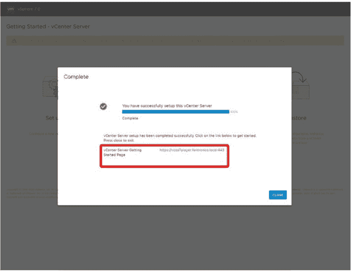

## 将 ESXi 主机添加到 vCenter Server

安装 VCSA 后，您需要将现有的 ESXi 主机添加到其中。vCenter 的拓扑结构是：ESXi 主机属于集群，集群属于数据中心，数据中心又属于 vCenter Server。

图 13-1 显示了 vCenter Server（*vcsa7player*）如何拥有一个数据中心（Arm 数据中心），该数据中心下有两个集群（Arm 集群和 Intel 集群）。所有这些都是逻辑对象，有助于管理它们所含的对象（例如，ESXi 主机、虚拟机等）。

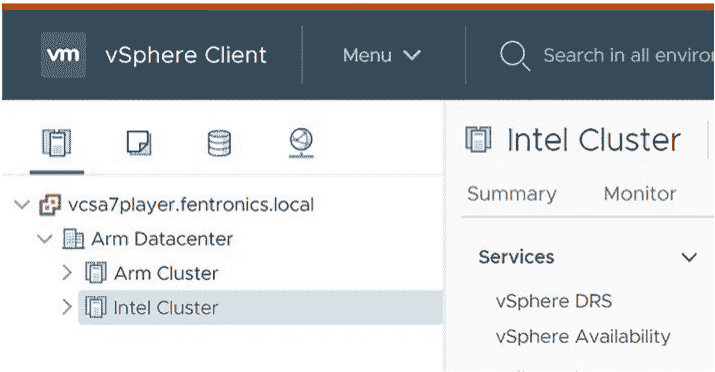

## 图 13-1. 拓扑结构

Arm 和 x64 ESXi 主机都可以添加到 VCSA；但是，如果这样做，出于管理目的，您需要为它们创建单独的数据中心。

要将 ESXi 主机添加到 VCSA，请执行以下操作：

+   1. 在 Web 浏览器中，单击“启动 vSphere Client（HTML5）”。

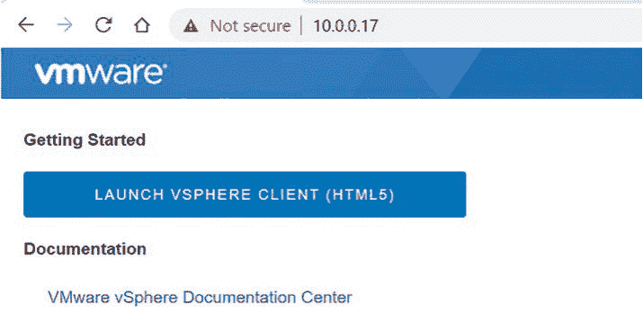

+   2. 输入您之前设置的用户名和密码，然后单击“登录”。

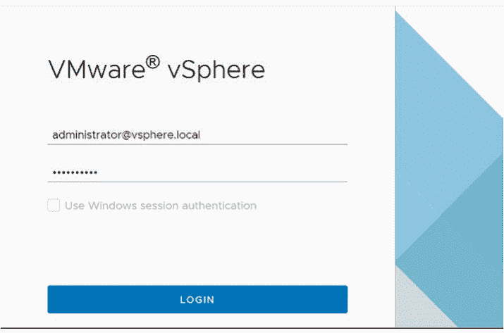

+   3. 在导航窗格中，右键单击您的 VCSA 的名称，然后选择**新建数据中心**。

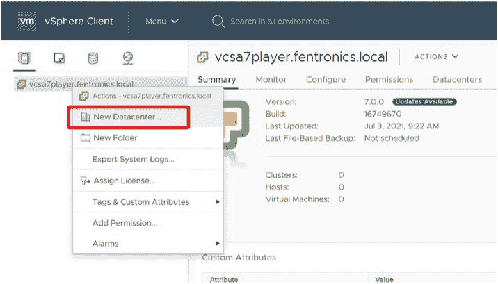

+   4. 输入数据中心名称，然后单击**确定**。

+   5. 右键单击数据中心，然后选择**添加主机**。

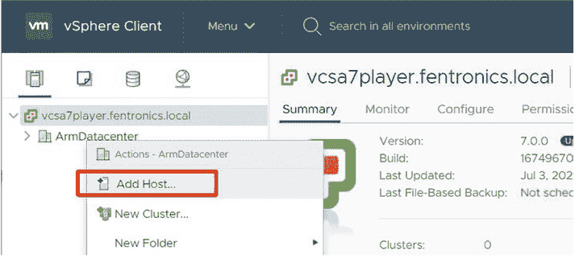

6. 输入所需信息，验证您输入的信息，然后单击“完成”。

# 添加主机

- 1 名称和位置
- 2 连接设置
- 3 主机摘要
- 4 分配许可证
- 5 锁定模式
- 6 虚拟机位置
- 7 准备完成

准备完成
单击“完成”以添加主机

|  |  |
|---|---|
| 名称 | 10.0.0.238 |
| 位置 | ArmDatacenter |
| 版本 | VMware ESXi 7.0.0 build-17839012 |
| 许可证 | 评估许可证 |
| 网络 | VM Network DatabaseToFrontend |
| 数据存储 | ArgonM2 iSCSI01 WinServerNFS01 SamGray Sam256 |
| 锁定模式 | 已禁用 |
| 虚拟机位置 | ArmDatacenter |

7. 在 vSphere Client 的下部窗格中监视任务。任务完成后，在导航窗格中展开数据中心和主机，以验证之前创建的虚拟机是否显示。

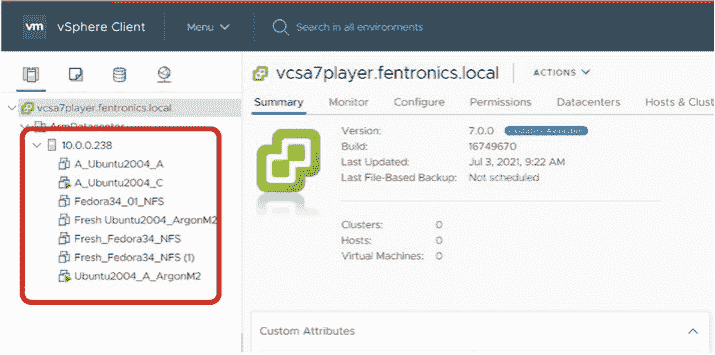

## 使用 vCenter Server 管理 ESXi

从信息和功能的角度来看，ESXi 主机客户端中可用的所有内容也都在 vSphere Client 中可用，但 vSphere Client 还包含其他功能。vCenter Server 是一个功能非常强大的工具，用于为服务器提供无与伦比的业务连续性、灵活性和可用性。在以下部分中，我们将对这些功能中的一部分进行非常基本的概述。

> 注意 如前所述，vCenter Server 和 vSphere Client 设计用于处理 ESXi 主机集群，为了演示它们的强大功能，我有时会展示一个添加了第二个 ESXi 主机的数据中心。

## 许可

VMware 对许多特性和产品授予许可；例如，Arm 主机上的 ESXi 附带 180 天许可证，vCenter Server 提供 60 天试用许可证。

您可以通过以下步骤验证环境中当前已获得许可的内容：

# 第13章 使用VCSA管理ESXi系统

+   1. 在**菜单**下拉列表中，选择**管理**。

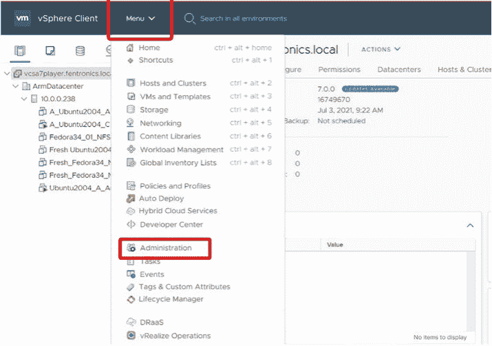

+   2. 在导航器中，选择**许可证**。

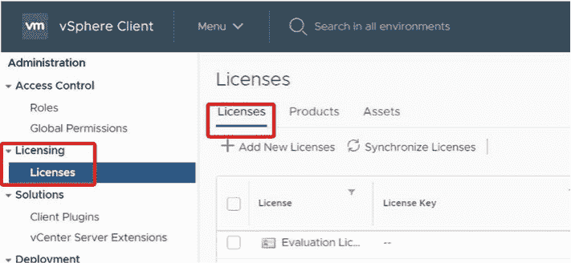

3. 在“资产”屏幕中，选择“vCenter Server 系统”选项卡，并验证其是否具有评估许可证。

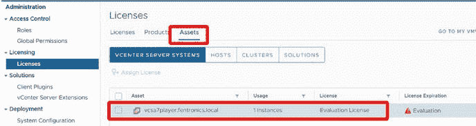

4. 选择“主机”选项卡，并验证其是否具有评估许可证。

## 存储

使用 vSphere Client 可以查看在您的 ESXi 主机上创建的所有存储。由于 vCenter Server 设计用于承载多个 ESXi 主机，因此 NFS 共享和 iSCSI 目标等共享存储设备可同时供多个 ESXi 主机访问。此功能支持 vMotion 等功能。

图 13-2 显示了在两个主机之间共享的数据存储。

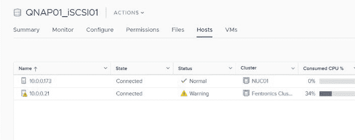

图 13-2. 共享数据存储

# 第13章 使用VCSA管理ESXi系统

您可以通过以下操作使用 vSphere Client 浏览存储：

+   1. 在**菜单**下拉列表中，选择**存储**。

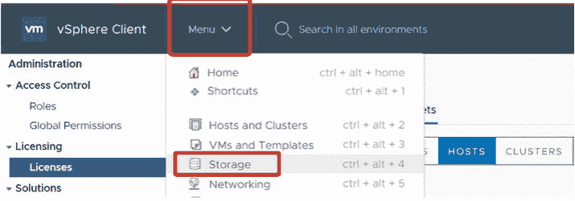

+   2. 验证导航窗格顶部的**存储**图标是否带有下划线，然后展开数据中心。

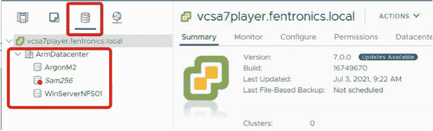

+   3. 在主窗格顶部，选择**数据存储**选项卡。

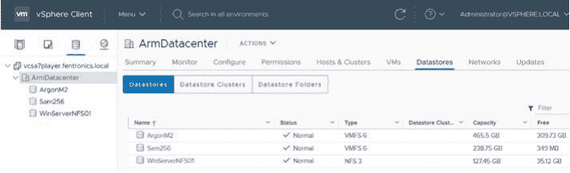

4. 验证是否显示了数据存储，并且信息（例如，容量、类型等）是否全部正确。例如，在我下面的截图中，你会看到 *Sam256* 数据存储有一个警报，因为其容量已用尽。

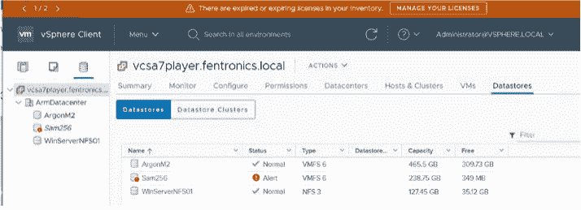

5. 在导航器中，选择一个数据存储并点击所有标签页，最后到 **VMs**。验证在该数据存储上创建的虚拟机是否已显示。

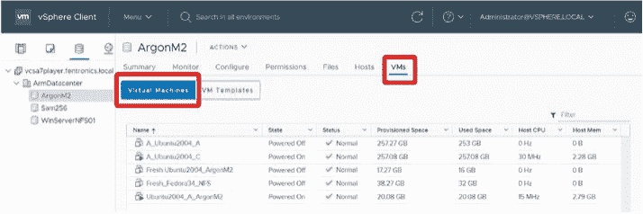

## Networking

要使用 vSphere Client 探索网络，请执行以下步骤：

1. 在 **Menu** 下拉菜单中，选择 **Networking**。

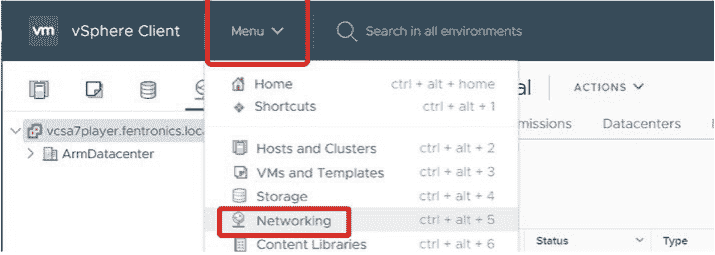

2. 验证 **Networking** 图标是否在导航窗格顶部下方有下划线，然后展开数据中心。

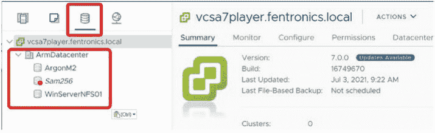

3. 在主窗格顶部，选择 **Networks** 标签。

4. 验证网络是否已显示，并且信息（例如，类型、主机等）是否正确。

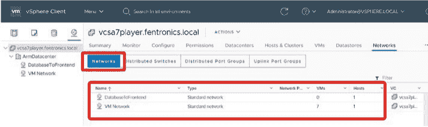

5. 在导航器中，选择 **VM Network** 并点击所有标签页，最后到 **VMs**。验证使用该网络的虚拟机是否已显示。

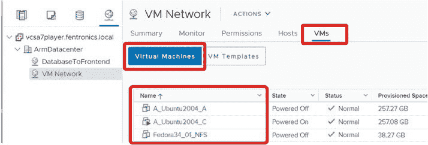

4. 验证虚拟机是否已显示，并且显示的所有信息（例如，状态、状态等）是否正确。

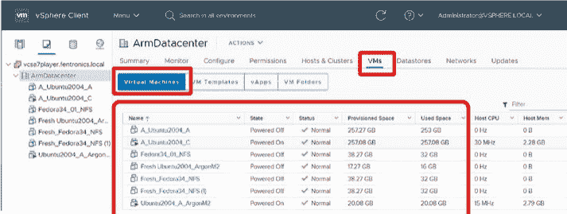

5. 在导航器中，选择一个虚拟机并依次点击所有标签页。

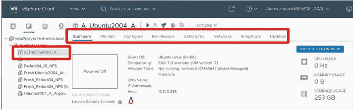

## Cloning Virtual Machines

你可以使用 vSphere Client 克隆虚拟机。使用 ESXi Host Client 时，我们需要手动复制文件来复制虚拟机。可以克隆已开机和已关机的虚拟机，但克隆已开机虚拟机所需时间更长。克隆虚拟机时，可以选择不同的数据存储。

要使用 vSphere Client 克隆虚拟机，请执行以下步骤：

1. 在导航器中，右键单击虚拟机并选择 **Clone ➤ Clone to Virtual Machine.**

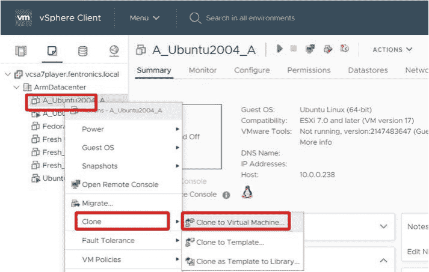

2. 输入克隆虚拟机的信息，接受默认值，验证设置，然后单击 **Finish.**

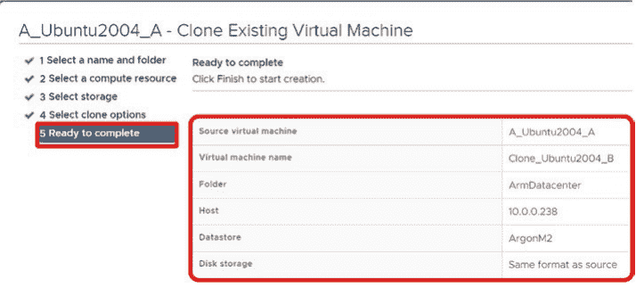

3. 在 vSphere Client 的下部窗格中监控任务，直到完成。

## vMotion

vSphere Client 允许在虚拟机仍在运行时将其从一个 ESXi 主机传输到另一个主机——这是一项非常强大的工具，从业务连续性和可用性的角度来看。这可能是使 VMware 在数据中心确立地位的特性之一。基于 Arm 的虚拟机无法 vMotion 到 x64 服务器。

在生产环境中，你会设置一个单独的虚拟网络来处理 vMotion 流量。由于 RPi 只有一个 NIC，我们没有设置它。

在下面的示例中，我使用了具有多个 ESXi 主机的 vCenter Server。

要 vMotion 虚拟机，请执行以下操作：

1. 在导航器中，右键单击正在运行或已关机的虚拟机并选择 **Migrate**。

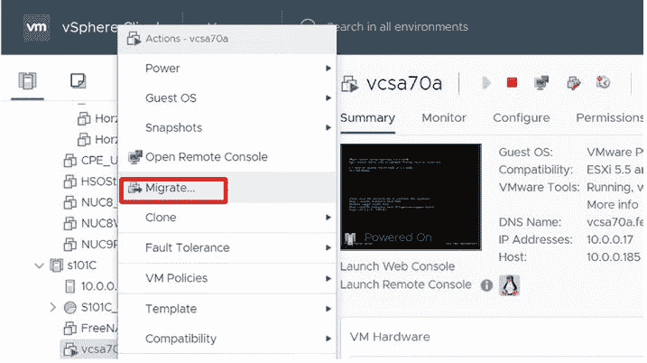

2. 选择 **Change compute resource only** 并单击 **Next.**

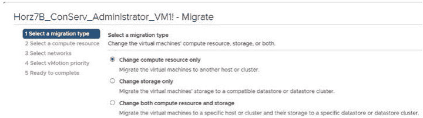

3. 选择要将虚拟机迁移到的主机（将显示虚拟机可以迁移到的所有主机）。

4. 选择迁移后虚拟机要使用的网络。

5. 设置 vMotion 优先级。

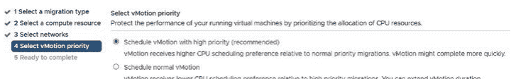

6. 验证信息并单击 **Finish.**

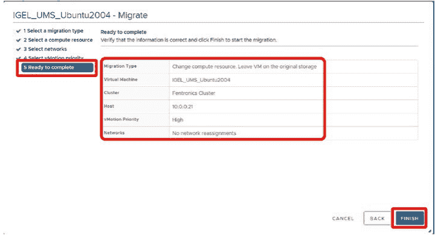

7. 在 vSphere Client 的下部窗格中监控任务，直到完成。

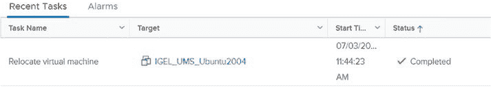

## Storage vMotion

vSphere Client 不仅允许在虚拟机仍在运行时将其从一个 ESXi 主机传输到另一个主机，还可以更改其所在的数据存储。这允许维护存储并将其退租，或因性能原因将虚拟机移离该存储。虚拟机可以从任何数据存储迁移到另一个数据存储；这包括从本地附加存储迁移到网络存储，反之亦然。

要存储 vMotion 虚拟机，请执行以下操作：

1. 在导航器中，右键单击正在运行或已关机的虚拟机并选择 **Migrate**。

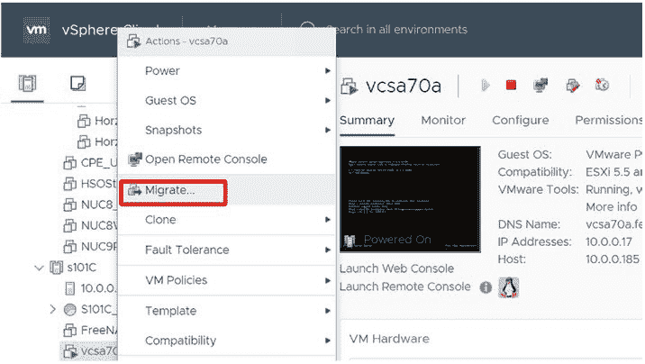

2. 选择 **Change storage only** 并单击 **Next**.

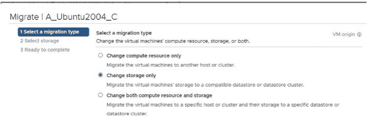

3. 选择要将虚拟机迁移到的存储。

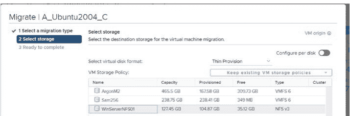

4. 验证信息并单击 **Finish**.

5. 在 vSphere Client 的下部窗格中监控任务，直到完成。

## Automatic VM Startup with a Host

vCenter Server 是一个功能强大的工具，通过 vSphere Client 浏览其众多功能，你可以开始掌握其强大的功能以及如何在数据中心利用这种功能。其中一个例子是它能够与 ESXi 主机一起自动启动和关闭虚拟机。随着更先进技术的出现，这一功能的使用不如以前普遍，但我仍然认为它是 vCenter Server 强大功能的良好示例。

要使虚拟机随主机启动，请执行以下步骤：

1. 在 **Menu** 下拉菜单中，选择 **Hosts and Clusters**。

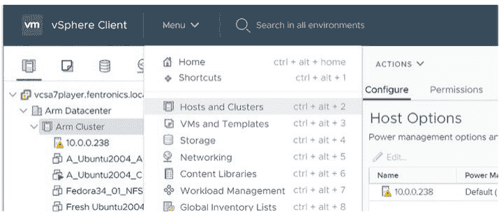

2. 验证 **Hosts and Clusters** 图标是否在导航窗格顶部下方有下划线，然后展开数据中心。

3. 在导航器中，选择一个 ESXi 主机，然后打开 **Configure** 标签。

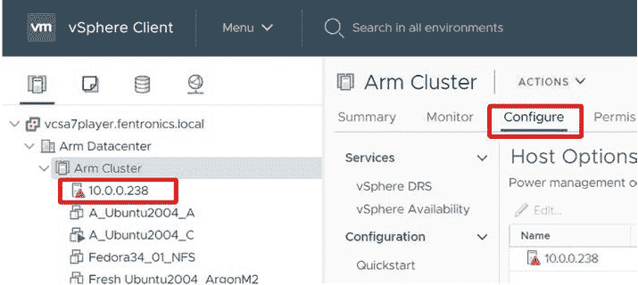

4. 展开 **Virtual Machines**，选择 **VM Startup/Shutdown**，然后单击 **Edit**。

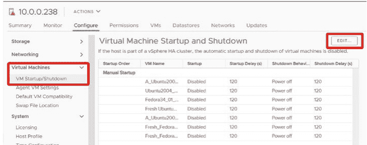

5. 选择 **System influence** 复选框。

**Edit VM Startup/Shutdown Configuration | 10.0.0.238**

**Default VM Settings**

| Setting | Value |
| --- | --- |
| System influence | ☑ Automatically start and stop the virtual machines with the system |
| Startup delay | 120 |
| Continue if VMware Tools is started | ☐ |
| Shutdown delay | 120 |
| Shutdown action | Power off |

6. 选择其中一个虚拟机并单击 **Move Up**。

7. 验证 **Startup Order** 下现在显示 **Automatic**，并且虚拟机位于该列中。

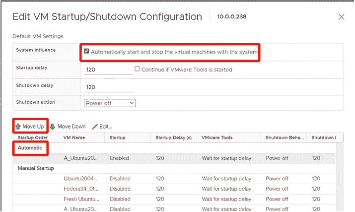

使用 vCenter Server 的自动启动和关闭功能，你可以与 ESXi 主机协同优雅地关闭和重新启动多层应用程序。例如，你可能希望在承载数据库的虚拟机启动后几分钟再启动承载 Web 应用程序的虚拟机，而该功能允许你做到这一点。如果 VCSA 托管在 ESXi 主机上，你甚至可以将其设置为系统启动时自动启动，因为这些功能不直接依赖于 VCSA。

## Using Third-Party Products with VCSA

VMware 很早就意识到他们无法满足所有人的所有需求，因此他们积极推广供应商生态系统来填补其产品线中的空白和细分市场。VMware 有数百家，如果不是数千家这样的供应商。如果你曾经有机会参观 VMworld，VMware 的年度用户大会，你会看到 VMware 第三方供应商的一个小样本，从软件备份工具到大型硬件供应商的大型显示屏。

截至撰写本文时，我还没有看到任何供应商明确表示他们支持 ESXi on Arm，但同时我也没有看到任何供应商表示他们不支持。理论上，由于 ESXi 主机和 vCenter Server 使用相同的 API 与 VMware 产品集成，只要它不直接与主机上的虚拟机交互，它们应该也能很好地与 ESXi on Arm 以及 x64 ESXi 主机上的 ESXi 一起使用。

### ControlUp

第三方产品为 VMware 提供了丰富性，在本节中，我将向你展示一个特定的第三方产品 ControlUp Real-Time Console 如何增强 VMware 的基础产品。

> **Note**   作为免责声明，截至撰写本文时，我担任 ControlUp 的技术营销工程师，我选择使用该产品是因为我对其很熟悉。

尽管我相当确定许多，如果不是大多数，第三方产品将与 ESXi on Arm 兼容，但我还是想验证这一点。我认为 ControlUp 是一个不错的选择，因为我知道它稳定并且使用 API 与 vCenter Server 进行深度集成。

ControlUp 广泛用于监控和管理 VDI 环境。它已有十多年的历史，在早期专注于 Citrix VDI 环境，即 Citrix 虚拟桌面及其运行的基础设施。由于绝大多数 Citrix 桌面运行在 vSphere 上，ControlUp 从早期阶段就熟悉了 VCSA 与第三方产品集成方面的细微差别。ControlUp 现在支持各种 VDI 环境，包括 VMware Horizon。正如所讨论的

在前面的章节中，不支持在 Arm 上运行的 Horizon 桌面，但我们仍然可以查看基于 Arm 的 ESXi 主机以及在其上运行的虚拟机。

与许多 VMware 第三方产品一样，ControlUp Real-Time Console 附带免费试用许可证。我花了大约五分钟在 Windows 机器上下载并安装该控制台。然后，我将与我的 Arm 版 ESXi 服务器关联的 vCenter Server 添加到控制台。片刻之后，我就看到了该服务器及其上运行的虚拟机。

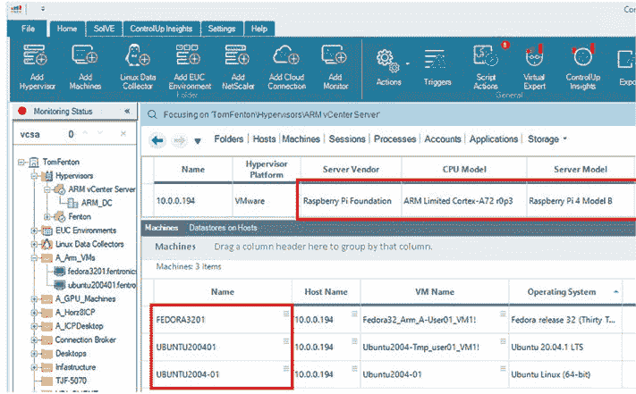

ControlUp 从 vCenter Server 获取有关虚拟机的信息，但它的一个独特功能是还可以获取虚拟机内部发生的情况的信息。它使用代理从 Windows 机器获取此信息，并使用 Linux 数据收集器 (LDC) 从 Linux 系统获取信息。设置 LDC 后，我能够看到来自虚拟机的指标，从而更深入地了解它们。

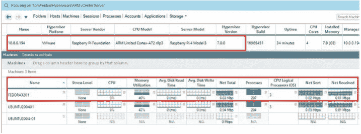

这包括在虚拟机上运行的进程。

在某次案例中，我发现由于磁盘延迟，压力级别显示为红色。在调查该问题时，我发现这是因为用于存储的 U 盘所致。

# 第 13 章：使用 VCSA 管理 ESXi 系统

在同一主机上的两个虚拟机之间运行 iPerf3 时，我使用 ControlUp 仪表板实时监控网络统计信息。

虽然 ControlUp 是为 VDI 环境（即虚拟桌面和应用程序）设计的，但它也会监控其运行的基础设施，以便提供 VDI 环境的整体视图。在与基于 Arm 的 ESXi 主机相处几周后，我发现它可以监控这些主机以及基于 x64 的 ESXi 主机上的一切。

### 总结

vCenter Server 是一个非常强大的工具，在本章中我们为了保持本书的涵盖范围而对其进行了简略介绍。它的主要功能之一是能够创建脚本，通过 PowerShell 使用 PowerCLI 以编程方式处理和管理它们。围绕这一点已经形成了一个庞大而热情洋溢的社区，并提出了几乎可以自动化任何任务的脚本。

虽然我能够使用 Player 安装和运行 VCSA，但它确实消耗相当多的资源（两个 vCPU 和 12GB 内存），因此请确保你使用的系统具备处理该负载的能力。

通过使用 VCSA 及其 vSphere Client，你只需单击几下即可克隆虚拟机，并且即使在虚拟机运行期间，也可以使用 vMotion 将其迁移到/从不同主机和不同存储，还可以执行许多我们没有提到的其他操作。

VMware 生态系统中的大多数第三方产品都需要 vCenter 才能正常运行。我使用 ControlUp Real-Time Console 进行的测试证明，它可以有效地监控和管理驻留在其上的虚拟机管理程序和虚拟机。

安装并运行 vCenter Server 后，你就拥有了功能完备的 vSphere 环境的基础！从这个环境中，尽管规模不大，你可以开始探索虚拟化环境的功能和潜力，并进一步了解它如何为成千上万大大小小的企业提供支持。在下一章中，我们将探讨 Arm 将如何在未来的数据中心中发挥作用。
