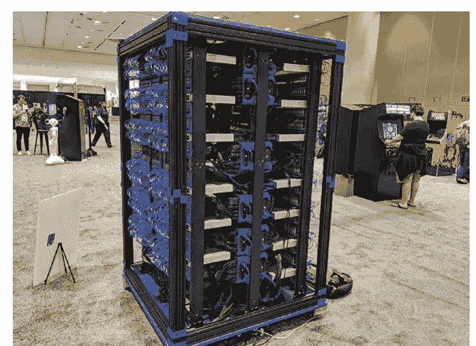
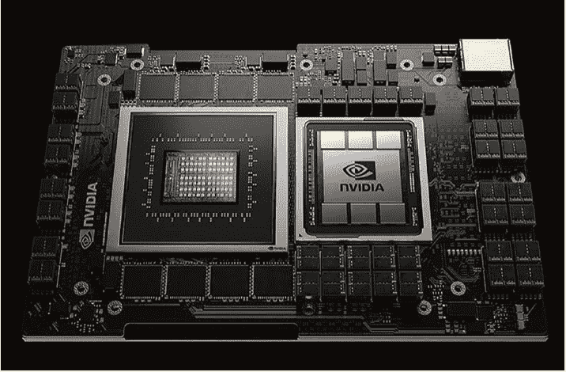
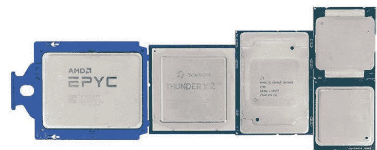
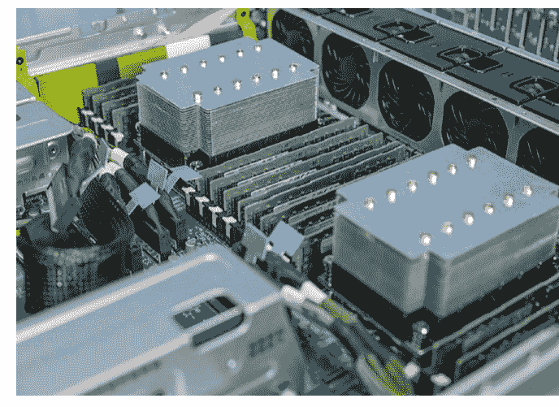
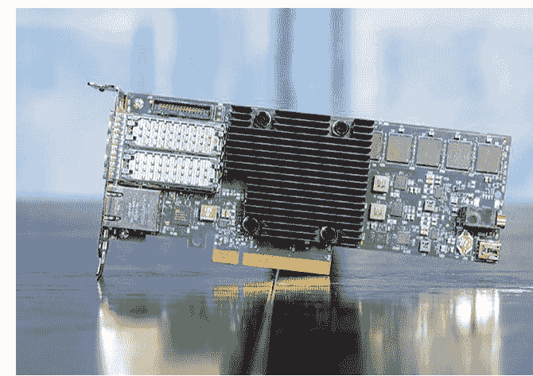
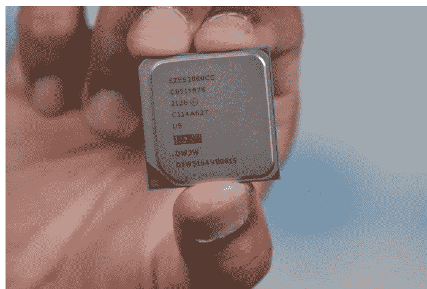

# 第 14 章：ESXi on Arm 的未来

在本书中，我们演示了如何开始使用 Arm 上的 VMware。未来远不止在树莓派上使用 VMware（图 14-1）。虽然这项能力可能相对较新，但它对于 VMware 在市场上保持相关性至关重要。

**图 14-1.** 2019 年 Oracle OpenWorld 上的树莓派超级计算机

Arm 服务器的生态系统将呈现出与过去十年占主导地位的传统 x86 服务器截然不同的面貌。亚马逊 AWS（Graviton）、安培（Altra）和华为（鲲鹏）等公司正在推出创新服务器，与英特尔和 AMD 最优秀的 x86 服务器一较高下。更重要的是，这些新处理器不再是实验室里出于好奇心的项目，而是正在被主要云提供商所采用。如今，这些处理器在云中使用的 CPU 核心中只占一小部分，但正在稳步增长。

使用 Arm 核心不仅限于通用计算。x86 一直依附于以数代向后兼容性为主导的遗留基础设施，而 Arm 则是从头开始，针对云计算和高性能计算（HPC）等特定工作负载定制硬件。事实上，2020 年 6 月，根据 TOP500.org 发布的半年一度的 TOP500 超级计算机榜单，超级计算机 Fugaku 成为全球最快超级计算机。这一成就归功于为 HPC 市场量身定制的定制 Arm 核心，这在现代 x86 市场几乎是不可能实现的，英特尔 Knights Landing 和 Knights Mill 就是最新的例子。截至 2021 年年中，其他地区还有几个面向 HPC 的 Arm 项目正在进行中。NVIDIA 已经提前数年发布了其“Grace”解决方案，将 Arm CPU 和 GPU 结合在一起（见图 14-2）。

**图 14-2.** NVIDIA GTC 2021 上展示的 NVIDIA Grace Arm CPU 和 GPU

Arm 在数据中心的下一波热潮是将 Arm 作为数据中心内设备的基础设施网关。现代环境中的数据中心运营商每天都面临一个根本性挑战。运行工作负载的用户可能值得信任，也可能不值得信任。即使是值得信任的用户也可能会下载恶意代码。因此，数据中心运营商正在努力将环境中的基础设施层和应用层分离开来。AWS Nitro 是该领域的领导者，但业内其他公司也在迎头赶上。

通过使用一类名为 DPU（数据处理单元）的新设备，数据中心运营商能够维护一个可以配置服务的安全端点。目前大多数 DPU 都内置了 Arm CPU、内存、存储、高速网络和安全加速器。它们运行自己的操作系统，无论是像 Ubuntu 这样的 Linux，还是像 VMware 的 Project Monterey 那样，直接在 PCIe 扩展卡上运行 VMware ESXi。随着主要云提供商采用这种运营模式，VMware 需要将 ESXi 部署到 DPU 上，以便为其客户提供类似级别的能力。DPU 通常基于 Arm，这意味着如果没有 Arm 支持，VMware 就无法继续提供符合领先行业实践的运营模式。

数据中心领域的高端市场通常会引发大量行业热议，但随着服务器平均售价（ASP）的上升，销量受到限制。下一个大趋势是计算从大型云数据中心向去中心化发展。随着 5G 边缘技术聚焦于对延迟敏感的应用程序，将需要构建更多的边缘计算设备来满足下一代服务需求。许多服务按某种简单指标（例如每个用户一个核心）来调整规模，因此将更多核心部署到网络边缘非常重要。Arm 的 Neoverse 核心组合以及 Arm 的客户项目正在为边缘构建这种更高核心数、更低功耗的核心。

Arm 已经在边缘占据主导地位，不仅存在于移动设备中，还支持着大量 IoT 设备，因为传统上仅具备机械功能的设备（如水泵）也开始联网。传感器越来越多地被添加到设备中，数据流回云端。随着这些设备激增，从 IT 和环境角度来看，将数据带回大型集中式数据中心的成本变得过高。相反，必须对数据进行筛选，并在需要进一步调查时将重要见解带回云端。这项工作不仅推动了对边缘设备和数据中心中的 Arm 的需求，也推动了对连接这两个极端的基础设施中 Arm 的需求。

对 VMware 而言，其影响直截了当：它要么将 ESXi 及其产品套件带到这些 5G 边缘部署中，要么就会将这个巨大的市场拱手让给 Linux 虚拟机管理程序、Kubernetes 和公有云部署。从战略上讲，VMware 需要支持 Arm，因为 Arm 将凭借其更低的核心成本成为边缘计算领域的主导处理器架构。

总结这一点，Arm 正在进入主流云计算和高性能计算市场。随着这种运营模式在未来几年扩展到公有云提供商之外，Arm 将成为进入大型服务器的新型 DPU 类设备的主导架构。Arm 已经在 IoT 和边缘设备领域占据主导地位，并且对下一代 5G 边缘计算基础设施具有核心价值主张。虽然 VMware 可能已将 ESXi on Arm 作为其“Fling”之一推出，但该公司在支持 Arm 的 Linux 工具（如 KVM）方面已经落后，不能错过这一技术转变。

## ESXi on Arm 未来的关键挑战

VMware ESXi on Arm 面临几个关键挑战。其中最大的挑战之一是 Arm 是一个相对开放的架构。尽管 Arm 最近在指令集标准化方面取得了长足进展，并推动了 SBSA 等举措以提高 Arm 平台的兼容性，但这种灵活性使 Arm 支持变得复杂。

一个很好的例子是，Arm SoC 供应商可能会说，由于添加了特定的加密加速指令和逻辑，它们获得了显著的加速效果。如果新主机上不存在相同的指令，虚拟机从一个 Arm 主机实时迁移到另一个 Arm 主机时可能会面临挑战。当 AMD EPYC 开始在主流 x86 市场获得关注时，这是英特尔为了减缓竞争而经常强调的营销点。二者之间，AMD x86 与 Intel x86 的接近程度，远高于 x86 与 Arm 的接近程度（图 14-3）。

*图 14-3. AMD EPYC 7001、Cavium（Marvell）ThunderX2、各种 Intel Xeon*

另一个挑战是可用性。虽然几乎所有主要服务器供应商都提供 AMD 和 Intel 服务器，但支持 Arm 的服务器供应商却较少。在撰写本书时，除了华为之外，还没有主流的戴尔 PowerEdge、HPE ProLiant、浪潮 N 系列、联想 ThinkSystem 或其他主要供应商的平台是基于 Arm 的。几乎每家服务器供应商都曾推出过涉及 Arm 的产品，但迄今为止，还没有一家显示出持续将 Arm 服务器引入企业数据中心的长期承诺。

VMware 也有自己的挑战。ESXi on Arm 仍被视为一个“Fling”，未获得主流部署的官方支持。一旦成为主流，VMware 就需要制定合理的许可结构。Arm 在公有云中持续增长，通常是因为公有云提供商对 Arm 产品提供了比 x86 产品更优惠的价格。将当前 VMware 按核心和插槽计费的许可模式应用于 Arm 服务器，实际上会使 Arm 在与 x86 服务器的价格竞争中出局。

最后，Arm 必须克服惯性。虽然可用性和定价是成功的关键要素，但很少有部署是完全从零开始的新建项目。在大多数部署中，已有运行现有工作负载的 x86 基础设施。要让 IT 组织采用新架构是

*图 14-5. Patrick 手中的 Intel Ice Lake Xeon*

生活充满了风险和挑战。值得注意的是，行业内的参与者都非常清楚这些挑战，但它们确实阻碍了 Arm 在 2021 年成为第一大服务器架构。

## 如何参与

对于该领域的从业者，有多种参与途径。

在本书中，我们演示了如何在低成本的 Raspberry Pi 上运行 VMware ESXi。尽管这是一项出色的工作，但 Raspberry Pi 与主流服务器之间仍有很大差距（图 14-6）。

*图 14-6. Wiwynn Mt. Jade Ampere Altra 2U 超大规模服务器*

如果你想试用运行 VMware ESXi on Arm 的主流服务器，那么目前最好的平台也许就是由少数供应商销售的 Ampere Altra 平台（图 14-7）。不久之后，Ampere Altra Max 平台也将加入这一行列，每个插槽 128 核，即每台服务器 256 核。这些服务器在云工作负载方面大致相当于主流 x86 服务器。在撰写本文时，VMware 已开始使其 VMware on Arm Fling 具备利用这些服务器的能力。虽然供应情况可能会发生变化，但 Oracle Cloud 已宣布推出裸机 Ampere Altra 产品，供那些不想走采购流程的人使用。此外，我们预计随着时间推移，对 AWS Graviton 2 及未来世代的支持将会进一步加强。

*图 14-8. NVIDIA BlueField-2 DPU*

对于运行 5G 边缘基础设施的用户，Marvell Octeon 10 已经发布，专为 5G O-RAN 应用而设计。虽然 5G 正作为标准电信运营商和服务提供商产品的一部分进入市场，但 5G 的前景在于它可以在企业环境中部署，并最终取代 WiFi（很多年后）。Octeon 10 对 VMware 的支持尚未公布，但这是一个非常有前景的边缘平台。

在撰写本书时，英特尔也凭借其 Mount Evans IPU 进入了 Arm DPU 市场（见图 14-9）。作为 x86 最大的支持者之一，英特尔在其基础设施处理器上使用了 16 个 Arm Neoverse N1 核心，该处理器瞄准的是与 NVIDIA BlueField 系列相同的市场，后者是 Project Monterey 的一部分。英特尔在这一市场选择使用 Arm 核心，是由一家大型云服务提供商推动的，这充分说明了向 Arm 的推进力度有多大。既然连英特尔都在向 Arm 浪潮妥协，IT 从业者明智的做法是予以关注。

*图 14-9. 在 2021 年英特尔架构日上展出的基于 Arm 的英特尔 Mount Evans ASIC*

最简单的参与方式是加入不断壮大的致力于 ESXi on Arm 的社区。你可以参加当地的 VMUG，浏览 VMware 论坛，加入 ServeTheHome 论坛社区，甚至可以在各种社交媒体平台上活跃。无论是亲手实践、自行学习，还是主动帮助他人，都非常容易。

## 结语

撰写本书时，我们有两个目标：

- 对 Arm 处理器的历史、目前如何在数据中心中使用以及未来将如何应用，进行高层级概述。
- 让读者能够使用基于 Arm 的经济实惠的系统——Raspberry Pi 4 Model B，动手体验安装、配置和使用数据中心中最流行的虚拟机监控程序——ESXi。

展望未来，Arm 将成为数据中心中更强大的力量。Arm 处理器既包括与 x86 同类产品相竞争的高端数据中心芯片，也包括 SmartNIC 等独立组件。我们开始看到来自不同供应商的多种竞争性产品，这让市场对基于 Arm 的系统和组件更有信心。主要客户正在要求采用 Arm 处理器，这使得 Arm 不仅在服务器领域，而且在基础设施和边缘领域的发展都带有某种必然性。

两年前，也就是 2019 年，如果有人对我们说，他们可以用不到 100 美元买到一台能运行 ESXi 的新系统，我们是不会相信的，但 VMware ESXi on Arm Fling 让这一切成为可能。诚然，Raspberry Pi 确实有局限，但它可以运行小型工作负载，而且人们确实会在上面运行一些小负载。更重要的是，就本书的目的而言，它是一个非常合适、低成本的切入点，适合用于学习和使用 ESXi 和 vSphere。

在撰写本书时，ESXi on Arm 仍是一个 Fling，尚未获得 VMware 的官方支持。我们相信，VMware 看到了 Arm 在数据中心的价值，也看到了 ESXi 凭借其坚实的抽象和管理层能为其带来的价值。我们也相信，随着 Arm 在数据中心中变得越来越重要，ESXi 为其带来的价值将愈发明显。有鉴于此，我们完全预期 ESXi on Arm 会尽早成为一款完全受支持的产品。

既然你已经用这些知识武装起来（双关语，故意为之）——你知道这一技术转型正在发生，也知道如何在 Arm 上使用 VMware 工具——你就处于一个独特的位置，可以成为那个未来的一部分。正如我们从社区中积累了这一主题的知识一样，我们建议你

也参与其中。这可能是通过成为您当地 VMUG 的成员或参与 VMware 论坛和 ServeTheHome 论坛或围绕 ESXi on Arm 兴起的其他在线社区来实现的。现在是社区仍处于起步阶段之际，做出影响的理想时机。

最后，我们要感谢您花费时间阅读本书，并让我们分享多年来积累的知识和见解。
