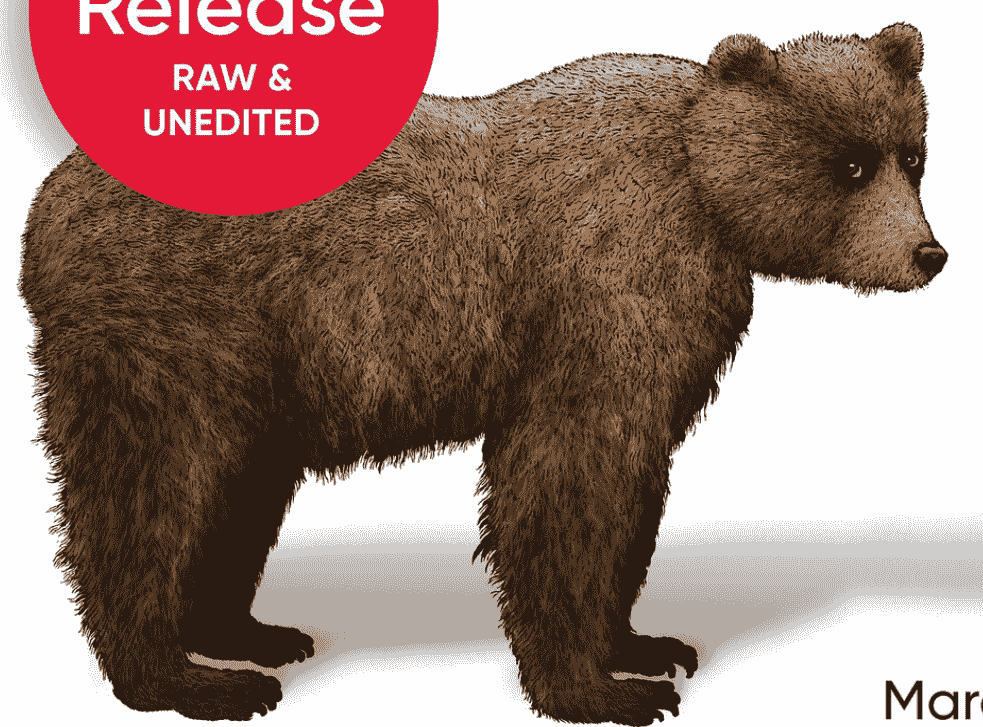

# Rust 原子操作与锁（第二次早期发布）

With Early Release ebooks, you get books in their earliest form—the author’s raw and unedited content as they write—so you can take advantage of these technologies long before the official release of these titles.

[LSI]
