# 三星 Galaxy S10 傻瓜书

## Bill Hughes

Samsung Galaxy S For Dummies 所有版本的作者

## 引言

三星 Galaxy S10、S10E 和 S10+ 是功能强大的智能手机，是有史以来最强大的移动电话之一。截至本书出版时，Galaxy S10 系列已成为衡量所有其他基于 Android 的手机的标准。

每个移动运营商都提供略有定制的 Galaxy S10 系列版本。一些运营商的手机出厂时已预装应用程序、游戏或文件。大多数附带配件，例如有线耳机；有些则没有。本书不会过多讨论这类差异。

尽管各网络的名称不同，这些手机在很大程度上是相同的。（当你读到这里时，每个移动运营商至少有一名营销人员正在尴尬地皱眉。）这种相似性使我能够以涵盖共同功能的方式撰写本书。

在更核心的层面，这些手机是为高速无线通信而构建的。移动运营商花费了天文数字的资金升级网络，以提供比竞争对手更广的覆盖范围和更快的 数据速度。同样，本书不会过多讨论这些网络技术的差异，因为它们实际上并没有太大区别。（同样，当你读到这里时，每个移动运营商至少有一名工程人员正在尴尬地皱眉。）

同样，不同 Galaxy S10 机型的绝大多数功能都相似。S10+ 的屏幕更大、电池更大、摄像头镜头更多。同样，S10 的屏幕更大、电池更大、摄像头镜头更多于 S10E。否则，Galaxy S10 的三个版本几乎完全相同。当 S10+、S10 和 S10E 之间存在重要区别时，我会提及。否则，我就直接称其为 Galaxy S10。

我假设你已经拥有一部 Galaxy S10，并且希望你在大部分使用手机的地方都有良好的覆盖。如果是这样，你会没问题的。如果不是，你需要换到另一个网络；否则，使用手机的体验会令人沮丧。我建议你将手机退回该运营商，并在另一家移动运营商处购买你的 Galaxy S10。只要你拥有良好的蜂窝数据覆盖，拥有三星 Galaxy S10 将是一次令人兴奋的体验！

首先，就像不同品牌的 PC 都基于 Microsoft Windows 操作系统一样，所有 Galaxy S 手机都使用 Google Android 平台。好消息是，Android 平台已被证明非常受欢迎，甚至比 Google 在 2007 年 11 月首次宣布 Android 时最初预期的还要成功。更多人使用基于 Android 的手机，更多第三方在编写应用程序。这是个好消息，因为它为你提供了更多应用程序选择（有关此内容将在第 8 章 Play Store 中详细介绍，那里可以购买应用程序）。

此外，所有 Galaxy S10 手机均使用强大的图形处理器，采用三星 Super AMOLED 触摸屏，并覆盖康宁 Gorilla Glass。卓越的屏幕体验使该产品线区别于其他 Android 手机。由于这些增强功能，你可以使用多点触控手势在屏幕上导航，而无需使用低端 Android 手机上常见的分层菜单。此外，视频从多个角度看起来都令人惊艳。

智能手机变得越来越智能，而 Galaxy S10 就是其中最智能的之一。然而，仅仅因为你过去使用过智能手机，并不意味着你应该期望在没有一点指导的情况下使用新的 Galaxy S10。

你可能不熟悉使用多点触控屏幕，而你的新手机提供了许多你可能熟悉也可能不熟悉的功能。以前正面有一个物理按钮可以带你返回主屏幕。它不再是物理按钮；现在是基于软件的。很不幸的是，如果你几个月来一直随身携带的手机本可以解决你一直存在的问题，却因为从未有人告诉你解决方案一直就在口袋里，而最终是从邻居小孩那里得知，那将是令人遗憾的。

事实上，三星为其整个 Galaxy 系列的易用性感到自豪——并且自豪于用户手册实际上只是一个快速入门指南。你可以在网上找到大量说明。然而，除非你打算观看每个教程，否则你必须知道自己不知道什么才能得到想要的东西。

这就是本书的用武之地。本书是充分发挥 Galaxy S10 潜力的实用指南。

## 关于本书

本书是一本参考书——你不必从头到尾阅读就能获得所需的所有信息。信息组织清晰，易于访问。你不需要戴厚眼镜就能理解本书。本书帮助你弄清楚想要做什么——然后用通俗的英语告诉你怎么做。

在本书中，你可能会注意到某些网址在两行文字之间断开。如果你正在阅读印刷版书籍并想访问其中一个网页，只需完全按照文本中注明的网址输入，假装换行不存在即可。如果你正在阅读电子书，那就很简单——只需点击网址即可直接进入网页。

## 愚蠢的假设

你知道人们关于假设的说法，所以本书中我很少做假设。但我对你确实做了一些假设：

- **你拥有一部 Galaxy S10 手机。**你可能正在考虑购买 Galaxy S10 手机，但我敢打赌你已经拥有了一部。毕竟，拿到手机上手就是最棒的部分！
- **你并非完全不熟悉移动电话。**你知道你的 Galaxy S10 手机能够做的事情比普通手机多得多，并且渴望了解手机的功能。
- **你使用过电脑。**你不必是电脑专家，但至少知道如何检查电子邮件和浏览网页。

## 本书中使用的图标

在整本书中，我使用了图标（页边的小图片）来引起你对各种类型信息的注意。以下是这些图标的含义说明：

整本书就像一系列提示。当我分享特别有用的技巧时，我会用提示图标标记它们。

本书是一本参考书，这意味着你不必死记硬背——最后没有考试。但偶尔，我会告诉你一些如此重要的事情，我认为你应该记住它们，而当我这样做时，我会用记住图标标记它们。

每当你可能做某事导致严重麻烦时，我会用呃，警告图标来提醒你。

这些部分提供了使用手机所必需信息之外的一些额外信息。希望这些部分能传达额外的知识，帮助你理解事情出错时发生了什么，或者至少与你预期不同时发生了什么。

## 超出本书内容

除了你现在正在阅读的内容外，该产品还附带一份免费的随时随地访问的 Cheat Sheet。要获取此 Cheat Sheet，只需前往 www.dummies.com 并在搜索框中输入 Samsung Galaxy S10 For Dummies Cheat Sheet 即可。

## 从这里开始

你不必从头到尾阅读本书。你可以随意跳读。例如，如果你需要关于通话、短信和电子邮件的基础知识，请翻到第 2 部分。要了解更多关于照片、游戏和应用的信息，请前往第 4 部分。

许多读者已经对智能手机有所了解，不需要第 1 部分和第 2 部分中的基础信息。一个相当精明的移动电话用户可以弄清楚如何使用电话、短信和数据功能。第 1 部分和第 2 部分不适合这些读者。对于他们，我建议直接跳到第 3 部分至第 6 部分的章节。

另一方面，前 iPhone 用户是特殊情况。（首先，欢迎来到 Android 世界！）现实是 iPhone 和 Galaxy S 系列具有非常相似的功能，但这些功能只是以略有不同方式实现，并强调对相似问题的不同方法。iPhone 用户，如果你发现本书花费了相当多的时间解释你熟悉的功能，不必担心。你可以快速阅读这些章节，专注于如何操作而不是对做什么的描述，从而避免潜在的挫败感。

当前三星 Galaxy S9 用户也是特殊情况。三星 Galaxy S10 在许多方面与 Galaxy S9 非常相似。Galaxy S10 大多数情况下像 S9 一样运行，但在易用性、功耗和性能方面有所改进。此外，相机功能甚至更多（如果你能相信的话！）。如果你对 Galaxy S9 很熟悉，现在拥有了 Galaxy S10，第 15 章及以后的内容将对你感兴趣。

本书的大多数读者实际上都很精明，并且明白本书涵盖了使用三星 Galaxy S10 的基础知识。一部分读者在网络评论中抱怨 For Dummies 书籍太基础。如果你这样做，人们会知道你没有读标题。务必阅读标题，避免公开尴尬。

## 使用三星 Galaxy S10 入门

## 本部分内容...
- 回顾手机的功能以及智能手机的独特之处。
- 关闭手机并管理休眠模式。

## 本章内容
- 回顾几乎任何移动电话的基本功能
- 了解智能手机与众不同的特点
- 梳理三星 Galaxy S10 手机如此出色的原因
- 为您做好准备，尽情享受您的手机

### 第1章
### 探索您可以用手机做什么

无论您只是想要一部手机的基本功能（打电话、接电话、自定义铃声、拍些照片，或许使用蓝牙耳机），还是希望手机始终伴随左右（在您一天中多个场合使用的工具），您都可以实现。 在本章中，我概述了您的三星 Galaxy S10 能做的一切——从基础功能到 Galaxy S10 手机与众不同的特点。

### 了解手机的基础知识

目前市面上所有的手机都包含基本功能，甚至一些入门级手机也略显复杂。 当然，三星在 Galaxy S10 型号上包含了所有基本功能。 除了打电话和接电话（见第 3 章）和发送与接收短信（见第 4 章）之外，Galaxy S10 还具有以下基本功能：

- 1600 万像素数码相机：该分辨率足以在互联网上发布高质量图像，甚至可以制作 8 x 10 英寸的照片打印。

前置摄像头为 1000 万像素，可用于视频会议通话和自拍。 您的手机具有一些令人惊叹的功能（有关更多信息，请参阅第 9 章）。

- **铃声：** 您可以将标准铃声替换为您下载到手机上的自定义铃声。 您还可以为不同的号码指定不同的铃声。
- **蓝牙：** Galaxy S10 手机支持立体声和标准蓝牙设备。 （有关蓝牙的更多信息，请参阅第 3 章。）
- **高分辨率屏幕：** Galaxy S10 和 S10+ 提供了市场上分辨率最高的触摸屏（3,200 x 1,800 像素）； S10E 也不逊色，拥有全高清+分辨率。
- **电容式触摸屏：** Galaxy S10 手机提供非常流畅的触摸屏，其灵敏度足以让您准确地与屏幕互动，但又不会过于灵敏而难以操作。 此外，它还有一个可选设置，可在特殊情况下提高灵敏度，例如当您想单手使用时！

### 将手机提升到下一个层次：智能手机功能

除了任何入门级手机的基本功能之外，基于流行的移动设备 Android 平台的 Galaxy S10 还具有与 Apple iPhone 等其他智能手机相关的功能：

- **互联网访问：** 通过手机上的网络浏览器访问网站。
- **照片：** Galaxy S10 配备了一款非常智能的相机，具有数百万种设置、滤镜和分辨率组合，还具有管理照片的功能。 S10 和 S10+ 还配备了广角镜头和长焦镜头。
- **无线电子邮件：** 通过手机发送和接收电子邮件。
- **多媒体：** 在手机上播放音乐和视频。
- **联系人管理器：** Galaxy S10 允许您使用快捷方式，无需每次想给朋友打电话或发短信时都输入十位数字。 事实上，联系人管理器可以跟踪个人可能拥有的所有号码，为该人存储电子邮件地址和照片，并与您在个人和工作电脑上用于管理联系人的程序同步！

- **数码摄像机：** Galaxy S10 内置数码摄像机，可录制您可设置的分辨率的实时视频，包括 4K/UHD（超高清，即最新电视上可用的分辨率）。
- **地图和导航：** Galaxy S10 使用 GPS（全球定位系统）以及其他辅助定位系统来告诉您所在位置、查找所需的本地服务并提供前往目的地的路线。
- **健身信息：** Galaxy S10 可自动追踪手机内及外部传感器的重要健康信息。
- **商务应用：** Galaxy S10 可让您在离开办公室时保持高效。

我将在以下各节中更详细地介绍这些功能。

### 互联网访问

直到几年前，离开办公桌访问互联网的唯一方式就是使用笔记本电脑。 智能手机是笔记本电脑的绝佳替代品，因为它们体积小、方便，并且可以立即启动网络浏览器。 更重要的是，当您拥有智能手机时，您可以在任何地方访问互联网——无论是否有 Wi-Fi。

然而，智能手机的缺点是其屏幕尺寸甚至小于最基本的笔记本电脑。 在 Galaxy S10 手机上，您可以根据需要使用网站的标准版本。 您可以捏合和拉伸以获取所需的信息。 （有关捏合和拉伸的更多信息，请参阅第 2 章。有关从 Galaxy S10 手机访问互联网的更多信息，请参阅第 7 章。）

为了让事情变得更简单，许多热门网站都提供更易于使用的应用程序，您可以将其下载并安装到手机上。 这将在第 8 章中详细介绍。 本质上，网站会重新格式化网站上的信息，以便在移动环境中更易于阅读和导航。 图 1-1 对比了常规网站与其应用程序版本。

### 完整网页

### 移动应用主页

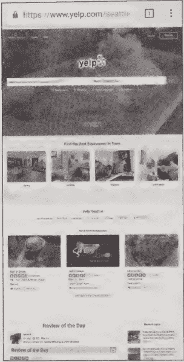

图 1-1：
一个网站及其主站的应用程序版本。

### 照片

手机上的图像应用程序可以帮助您充分发挥 Galaxy S10 手机上数码相机的潜力。 几乎可以说三星 Galaxy S10 是一款内置手机的智能相机！ 这些应用程序中包含各种智能功能，可自动判断您想要做什么，让您瞬间成为下一个安塞尔·亚当斯。

研究发现，手机用户倾向于在首次使用手机的一个月内拍摄大量照片。 此后，照片会留在手机上（而不是下载到电脑上），拍照率会急剧下降。

Galaxy S10 图像管理应用程序有所不同。 您可以将相机图像集成到家庭照片库中，以及 Google Photos 和 Instagram 等照片共享网站，几乎无需任何操作。

有关如何使用照片应用程序的更多信息，请参阅第 9 章。

### 无线电子邮件

在您的 Galaxy S10 智能手机上，您可以访问您的商务和个人电子邮件帐户，随时阅读和发送电子邮件。 根据您的电子邮件系统，您可能可以同步，以便在手机上删除电子邮件时，电子邮件也会同时在电脑上删除，这样您就不必在手机和电脑上阅读相同的消息。

第 5 章介绍如何设置您的商务和个人电子邮件帐户。

### 多媒体

一些智能手机允许您在手机上播放音乐和视频。 在 Galaxy S10 上，您可以使用随手机附带的应用程序，或从 Play 商店下载提供这些功能的应用程序。

第 12 章介绍如何使用 Galaxy S10 手机的多媒体服务。

### 智能代理

第 14 章探讨如何使用三星的智能代理 Bixby。 您只需要求 Bixby 为您处理事情，例如更新约会或查询价格，Bixby 就会去执行。

### 使用游戏和应用程序自定义您的手机

大大小小的应用程序开发人员都在 Android 平台上开发各种应用程序和游戏，供 Galaxy S10 手机使用。 与大多数其他智能手机平台相比，Google 对应用程序开发人员在允许范围内的限制较少。 这种开发自由度引起了许多开发人员的共鸣——导致该平台上的应用程序开发蓬勃发展。

截至本文撰写时，Google Play 商店中几乎有三百万个应用程序可供使用。 有关下载游戏和应用程序的更多信息，请参阅第 8 章。

## 下载游戏

本书第10章面向游戏玩家。虽然你的手机自带了一些大众兴趣游戏，但你可以找到适合各种技能和喜好的琳琅满目的游戏世界。在第10章中，我提供了设置不同游戏体验所需的所有信息。无论你喜欢单机游戏还是多人游戏，你都可以设置你的 Galaxy S10 手机来满足你的需求。

## 下载应用程序

你的手机自带了一些很不错的应用程序，但这些可能无法满足你想要达到的程度。你可能还有一些特殊兴趣，例如集邮或观星，这些三星或你的运营商认为没有足够的普遍兴趣而未包含在手机中。（你能想象吗？）

你的手机还预装了小部件，它们是服务于特定目的的较小的应用程序，例如检索特定股票报价或告诉你今天手机电池的状态。小部件驻留在扩展的主屏幕上，可即时使用。

购买应用程序可以让你快速、轻松且经济地获得额外功能。最终，这些功能使你的手机——它本身已是你的写照——在你添加更多功能时变得更加个性化。

## 深呼吸

你不必在拿到 Galaxy S10 手机的第一天就急于实现所有功能。不如一次只选择一个功能。消化它，享受它，然后再处理下一个。

我建议从设置你的电子邮件和社交账户开始，但这只是我的建议。

无论你如何处理设置 Galaxy S10 手机的过程，都需要一些时间。如果你试图在第一天就全部塞进去，本应有趣的事情就会变成苦差事。

好消息是，你拥有这本带你完成流程的书。你可以一次做一两章。

## 如果我没有从移动运营商那里获得手机怎么办？

除了“解锁”GSM 手机等少数例外，每个手机都与特定的移动运营商相关联。（在此上下文中，锁定手机只能在原始运营商上使用。）也许你在一 eBay 上买了二手手机，或者从不再想要的朋友那里得到了一部手机。如果你没有直接从移动运营商那里获得手机，你需要弄清楚手机与哪家运营商相关联，并从该公司获取服务计划。

如果正面没有标志，你将不得不弄清楚它可以与哪家移动运营商一起使用。最快的方法是把手机带到任何一家移动商店；那里的人知道如何弄清楚。

## Android 平台的亮点

三星 Galaxy S10 是一款顶级的 Android 手机。这意味着你可以以其全部功能运行为 Android 手机开发的任何应用程序。这很重要，因为 Android 平台的创始原则之一是创造一个环境，让应用程序开发者能够尽可能富有创造力，而不受压迫性组织的支配，决定什么可以卖什么不可以卖（只要在法律范围内，当然）。这种创造性的自由空间激励了许多最好的应用程序开发者优先选择 Android。

此外，Android 设计为可同时运行多个应用程序。其他智能手机平台也增加了这一功能，但 Android 设计让你能够在正在运行的多个应用之间快速切换——这使得你的智能手机体验更加顺畅。

## 挺过开箱日

当你第一次打开手机时，它会要求你回答一系列十个问题和偏好设置来配置它。说实话，他们试图让这本书变得多余并让我失业。太过分了！

三星的好人们是善意的，但并非每位拥有三星 Galaxy S10 的客户从第一天起就知道他/她是否想要一个三星账户、手机起什么好名字、以及云服务（如 Dropbox）的用途以及如何使用。

你可以放松。我会帮助你回答这些问题——或者在适当的时候，引导你阅读本书中帮助你得出答案的章节。

另一方面，如果你的手机已经设置好了，你可能猜测了一下或跳过了一些问题。也许现在你正在重新考虑一些选择。没问题。你可以返回并更改任何你给出的答案，让手机按你想要的方式运行。

以下是你可能会被问到的类型问题。这些问题可能按此顺序出现，也可能不按此顺序。通常包括以下内容：

-   **语言/辅助功能：** 此选项让你选择语言。美国销售的手机默认语言为英语。此外，手机为残疾人士提供了一些特殊功能。如果你有残疾并且认为可能会受益，请查看这些选项。他们真的努力让这款手机尽可能多的人都能使用。
-   **Wi-Fi：** 你的手机会自动开始扫描 Wi-Fi 连接。当你在移动网络覆盖范围内时，你始终可以使用蜂窝连接，但如果有 Wi-Fi 连接可用，你的手机会优先尝试使用它。它可能更便宜，也可能比蜂窝网络更快。

与此同时，你可能不希望手机连接到信号最好的 Wi-Fi 接入点。可能是最强的信号是收费服务，而下一个最好的信号是免费的。无论如何，此页面会扫描可用选项并向你展示。
-   **日期和时间：** 这很简单。默认设置是使用来自蜂窝网络的时间和日期，日期和时间格式为美国风格。只需点击下一步按钮继续即可。此日期和时间来自蜂窝网络，是你能获得的最准确的信息，你只需不时处于蜂窝网络覆盖范围内即可，无需做其他事情。如果你喜欢非美国格式，例如 24 小时制或日/月/年格式，你可以随意更改手机设置。
-   **注册三星账户：** 尽管注册一个账户。三星账户提供一些不错的功能，帮助你在丢失手机时找回它。你只需要一个账户名，例如电子邮件账户，以及一个密码。

当你购买 Galaxy S10 智能手机时，你现在就成了多家公司的客户！其中包括三星负责手机硬件，Google 负责手机操作系统（Android），以及提供蜂窝服务的无线运营商。此外，如果你通过 Best Buy 等手机零售商购买了手机，它也在其中。所有他们都希望你满意，这总体上是件好事。唯一的缺点是他们想知道

你是谁，以便他们能为你提供更多服务。别担心。你控制他们提供多少服务。

## Google 账户注册：

Google 账户是指地址以 @gmail.com 结尾的电子邮件账户。如果你已经拥有 Gmail 账户，请在此输入你的用户 ID 和密码。如果你没有 Gmail 账户，我建议等到阅读第 5 章后再说。我强烈建议你创建一个 Gmail 账户，但在选择一个好名字时有一些考虑因素。如果你愿意，现在就为你的 Gmail 账户选一个名字。否则，可以等到阅读第 5 章后再说。

## 位置选项：

你的手机知道你的位置并将其提供给应用程序可能是一个敏感问题。

如果你真的担心隐私和安全，请点击屏幕上的绿色复选标记，然后点击标有“下一步”的按钮。选择这些选项可防止应用程序知道你的位置。（此选择也阻止你获取导航和应用程序内置的大量酷炫功能。）唯一会知道你位置的人将是如果你拨打他们，911 调度员。

如果你担心安全但想利用手机内置的一些酷炫功能，请点击右箭头键继续。请记住，你可以逐案选择是否共享你的位置。（我在第 8 章中讨论了这个问题。）

## 手机所有权：

此屏幕要求你输入名字和姓氏。尽管输入你的真实姓名。如果你想了解更多，请阅读第 5 章。

## 云服务：

你很可能会被提供注册云服务的选项，在那里你可以备份手机并获得海量 MB 的免费存储空间。这可能是一个棘手的决定。你可以为遇到的每个云服务都注册。然后你需要记住关键文件存储在哪里。你也可以只注册一个，但可能会错过另一个提供的不错功能。你可以为工作使用一个云服务，为个人使用另一个。这是我的建议：如果在初始设置过程中手机提供的云服务你还没有，请注册它。你稍后会看到它是什么。如果你对已有的云服务感到满意，例如 Dropbox 或 OneDrive，很可能它们已提供你和你的手机所需的所有服务。你可以通过下载必要的应用程序（我在第 8 章中介绍了如何操作）将你的 Galaxy S10 与此服务链接。

## 了解主要功能：

如果你认为你不需要这本书，尽管去体验所有新功能吧。如果你认为在任何方面、任何形式下可能需要这本书，请点击“下一步”按钮。此屏幕用于设置手机最酷和最复杂的fiy能力。我在这本书中涵盖了其中许多功能。现在，跳过此步骤以进入最后一屏。

**设备名称：** 当此屏幕出现时，你会看到一个包含型号名称的文本框。你可以保留此名称用于你的手机，也可以选择稍微个性化一下。例如，你可以将其更改为“Bill's Galaxy S10”或“Indy at 425-555-1234。”此名称的用途是用于连接到本地数据网络，例如当你配对蓝牙设备时。如果上一句话对你来说毫无意义，不用担心。（我将在第3章中详细介绍。）轻触完成。片刻之后，你会看到主屏幕，如图1-2所示。

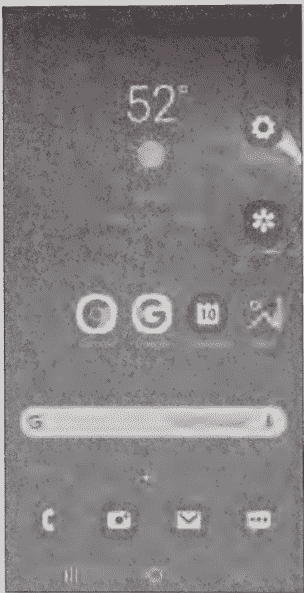

图 1-2：
主屏幕
三星
Galaxy S10。

## 本章内容

- 开启你的手机
- 为手机充电并管理电池寿命
- 导航你的手机
- 关闭你的手机并使用睡眠模式

### 第2章

### 从头开始

在本章中，我将介绍使用你的新三星 Galaxy S10 的基础知识。你从开启手机开始。（我告诉过你我要讲基础！）我会指导你为手机充电并最大化手机电池的使用。跟我一起进行一次你手机按钮和其他功能的基础巡览。然后我会告诉你如何关闭手机或将其置于“睡眠”模式。

除非你对移动电话总体上——尤其是智能手机——是新手，否则你可能想跳过本章。如果“智能手机”这个词对你来说很陌生，你可能以前从未使用过，阅读本章也不会有坏处。而且，顺便说一下，智能手机只是在出厂时预装的程序比普通手机更好，你可以下载并运行应用程序的移动电话。

### 首先：开启你的手机

当你打开新手机的盒子时，包装会为你呈现出用塑料包裹、触手可及的手机。如果你还没有，请取出手机并移除屏幕上的任何保护覆盖物。（没有必要保留塑料。它不是有效的屏幕保护膜！）

首先。电源按钮位于手机右侧。你可以在图2-1中看到它的位置。按住电源按钮一秒钟，看看它是否会振动并且屏幕亮起。希望你的手机到货时电量充足，这样你就不必马上插到插座上。你可以在第一天享受新手机而无需为其充电。

图 2-1：
Galaxy S10 上的
电源按钮。

大多数蜂窝运营商商店里出售的手机通常都带有部分充电并已在网络上注册的电池。

### 记住

如果屏幕确实亮了，不要按住电源按钮太久，否则手机可能会关机。

如果手机屏幕没有亮起（糟糕！），你需要为电池充电。这意味着你必须等待才能使用你漂亮的新手机。抱歉。

### 手机工作原理的细节

技术资料

一旦你打开手机，就会发生几件事。在手机启动时，它开始向附近的蜂窝基站传输信息（并从中接收信息）。交换的第一批信息包括你手机的电子序列号。每部手机都有自己独特的序列号内置于手机硬件中；当前一代手机的序列号无法被复制或被其他手机使用。

这个电子序列号也称为国际移动设备身份（IMEI）号码。它长14或15位。蜂窝设备处理长数字没问题。我们这些凡人记住10位数字就已经够困难了，即使有仅限于少数区号的技巧。为了帮助我们，你和我可以使用较短的号码，而蜂窝设备则愉快地跟踪10位和14/15位号码，只向我们显示我们能处理的部分。

手机或蜂窝基站并不在乎你在打开手机时是否在家——这就是移动电话的乐趣所在。所有蜂窝网络都有协议，允许你在全国其他地区，有时甚至是世界各地使用蜂窝网络。

话虽如此，在你蜂窝运营商自己的网络之外通话可能会很昂贵。在美国，许多服务计划允许你在美国任何地方使用手机拨打美国任何地方的电话时支付相同的费率。如果你前往美国以外的地方，甚至加拿大，你可能会付出高昂的代价。记住：在出发旅行前，请向你的蜂窝运营商咨询你的费率。即使你每年只出国旅行几次，不同的服务计划可能更适合你。你的蜂窝运营商可以为你提供选择的信息。

### 为手机充电并管理电池寿命

购买手机时包装中，你会找到一个两件式电池充电器（电缆和变压器），如图2-2所示。

图 2-2：
用于为手机充电的
变压器和 USB 电缆。

墙上充电器

USB-A/USB-C 电缆

电缆有两个端头：一个端头插入手机，另一个是标准的矩形 USB 连接器。手机端是一个小连接器，称为 *USB-C*，用于许多三星设备，也是为手机和其他小型电子设备充电——以及将它们连接到计算机的标准。

提示
关于 USB-C 连接器有一个很酷的事情你会注意到，你可以将其任意一面朝上插入。旧的、矩形的 USB-A 连接器可能让你抓狂，因为如果插头朝下就插不进去。你在墙上充电器和电缆上仍然有这个问题，但在使用电缆和手机时就不会有这个问题！

为手机充电，你有两个选择：

- 将变压器插入墙上插座，然后将电缆的 USB 插头插入变压器中的 USB 插座。这是我的推荐选项。
- 将电缆上的 USB 插入你电脑的 USB 端口。

然后将电缆的小端插入手机。端口位于手机底部。确保将小金属插头完全推入。

记住
插接顺序其实并不重要。然而，如果你使用电脑的 USB 端口为手机充电，电脑需要处于开机状态。

提示
如果使用带有自适应快充的 Samsung 墙上充电器，你的手机充电会更快。当墙上充电器或车载充电器具有自适应快充时，它会知道手机是否过热并减慢充电速度。由于充电速度可以减慢，因此其余时间可以更快。

如果你在给电池充电时手机处于关闭状态，屏幕上会短暂出现一个电池图像。电池的绿色部分表示电池内的电量。你可以通过快速按下电源按钮使图像重新出现。此图像可让你在不打开手机的情况下了解电池状态。

如果手机处于开启状态，你会在屏幕顶部看到一个小的电池图标，显示手机电池的电量。当手机电池充满电时，它会振动以通知你充电已完成。

根据情况不同，从没电到充满电可能不到一小时。你不需要等待电池完全充满。你也可以部分充电后使用。

你会听到各种源自早期电池技术的“电池传说”。例如，你的 S10 中的锂离子（Li-ion）电池不像镍镉（NiCad）电池那样具有“记忆效应”（对电池来说是坏事）。这意味着你不必在充电前确保电池完全放电。事实上，如果可以避免，你应避免让电池完全放电。

除了随手机附带的变压器和 USB 电缆外，你还有其他可选的充电工具：

- **USB 旅行充电器：** 如果你已经有 USB 旅行充电器，你可以把变压器留在家里。这个配件大约花费 15 美元。你仍然需要你的电缆，尽管任何 USB 到 USB-C 电缆应该都能工作。
- **车载充电器：** 你可以购买一个带 USB 端口的充电器，插入汽车的电源插座/点烟器。这在你在车里花费大量时间时很方便。标价为 30 美元，但在某些在线商店你可以以更低的价格买到真正的三星车载充电器。
- **便携式外接充电器：** 你可以购买一个便携式外接充电器，无需插入电源插座或汽车点烟器即可为手机充电。你在旅行前为这个小装置充电，并在手机电量开始变低时才连接。它通常涉及可充电电池，但其中一些产品使用光伏电池将光转化为电能。只要有 USB 端口（USB 的母头），你只需要你的电缆即可。这些充电器价格从 30 美元到 100 美元以上不等。图 2-3 中有一些选项。

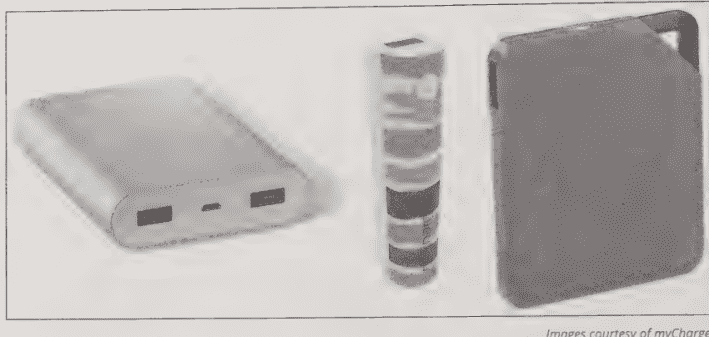

FIGURE 2-3:
一些便携式
外部充电
选项。

图片由 myCharge 提供

**无线充电器：** 这个选项很酷。你只需把手机放在充电垫上或放入充电座，手机电池就会开始充电！你的 Galaxy S10 使用广泛采用的 Qi 标准（读作 chee）。这个选项让你免于反复插拔手机。

警告
理想情况下，请使用三星充电器或来自信誉良好的制造商或零售商的充电器。USB 端口的功率规格是标准化的。信誉良好的制造商遵守这些标准，但信誉较差的制造商可能不遵守。廉价的 USB 充电器在物理上可以适配到连到手机的电缆的 USB 端。然而，Li-ion 电池对电压很敏感。除了你购买手机的商店之外，还有很多很多创意选项，但请避免低价的诱惑。

警告
请注意，使光电电池充电良好的条件往往也会产生高温。拥有一个功能完美的充电器而手机没电对你帮助不大。

市面上大多数充电器要么是为 Apple iPhone 设计并带有 Apple Lightning 接口，要么带有 micro-USB 接口。如你所知，你的手机带有 USB-C 接口。micro USB 不能与 USB-C 接口配合使用。你要么需要一根带有 USB-C 接口的电缆，要么使用一个适配器来连接 micro USB 到 USB-C 接口。图 2-4 显示了 micro USB 转 USB-C 适配器旁边放着一枚一角硬币以作尺寸对比。

FIGURE 2-4:
微型 USB 转 USB-C 适配器。

## 只有你能防止手机起火

### 技术细节

Galaxy S10 使用锂离子（Li-ion）电池。顾名思义，这些电池基于元素锂（Li）。锂非常适合手机电池，因为它非常轻。

问题在于，如果锂过热，就会燃烧。锂在相对适中的 180°F 时就会着火，然后在 1,100°F 时疯狂燃烧。相比之下，干木柴要到 451°F 才会点燃，然后在 1,100°F 时燃烧。换句话说，锂燃烧的温度与篝火一样高，但点燃温度要低得多。

为了安全，电池制造商和手机制造商实施了各种各样巧妙而富有想象力的方法来去除锂电池周围的热量。此外，你的手机会隐形地监测温度并采取措施确保它不会过热。这一切运作得如此出色且无缝，以至于你可能甚至没有注意到这在你之前的手机和其他使用 Li-ion 技术的[content]

FIGURE 2-3:
一些便携式
外部充电
选项。

图片由 myCharge 提供

**无线充电器：** 这个选项很酷。你只需把手机放在充电垫上或放入充电座，手机电池就会开始充电！你的 Galaxy S10 使用广泛采用的 Qi 标准（读作 chee）。这个选项让你免于反复插拔手机。

警告
理想情况下，请使用三星充电器或来自信誉良好的制造商或零售商的充电器。USB 端口的功率规格是标准化的。信誉良好的制造商遵守这些标准，但信誉较差的制造商可能不遵守。廉价的 USB 充电器在物理上可以适配到连到手机的电缆的 USB 端。然而，Li-ion 电池对电压很敏感。除了你购买手机的商店之外，还有很多很多创意选项，但请避免低价的诱惑。

警告
请注意，使光电电池充电良好的条件往往也会产生高温。拥有一个功能完美的充电器而手机没电对你帮助不大。

市面上大多数充电器要么是为 Apple iPhone 设计并带有 Apple Lightning 接口，要么带有 micro-USB 接口。如你所知，你的手机带有 USB-C 接口。micro USB 不能与 USB-C 接口配合使用。你要么需要一根带有 USB-C 接口的电缆，要么使用一个适配器来连接 micro USB 到 USB-C 接口。图 2-4 显示了 micro USB 转 USB-C 适配器旁边放着一枚一角硬币以作尺寸对比。

FIGURE 2-4:
微型 USB 转 USB-C 适配器。

## 只有你能防止手机起火

### 技术细节

Galaxy S10 使用锂离子（Li-ion）电池。顾名思义，这些电池基于元素锂（Li）。锂非常适合手机电池，因为它非常轻。

问题在于，如果锂过热，就会燃烧。锂在相对适中的 180°F 时就会着火，然后在 1,100°F 时疯狂燃烧。相比之下，干木柴要到 451°F 才会点燃，然后在 1,100°F 时燃烧。换句话说，锂燃烧的温度与篝火一样高，但点燃温度要低得多。

为了安全，电池制造商和手机制造商实施了各种各样巧妙而富有想象力的方法来去除锂电池周围的热量。此外，你的手机会隐形地监测温度并采取措施确保它不会过热。这一切运作得如此出色且无缝，以至于你可能甚至没有注意到这在你之前的手机和其他使用 Li-ion 技术的[content]

FIGURE 2-3:
一些便携式
外部充电
选项。

图片由 myCharge 提供

**无线充电器：** 这个选项很酷。你只需把手机放在充电垫上或放入充电座，手机电池就会开始充电！你的 Galaxy S10 使用广泛采用的 Qi 标准（读作 chee）。这个选项让你免于反复插拔手机。

警告
理想情况下，请使用三星充电器或来自信誉良好的制造商或零售商的充电器。USB 端口的功率规格是标准化的。信誉良好的制造商遵守这些标准，但信誉较差的制造商可能不遵守。廉价的 USB 充电器在物理上可以适配到连到手机的电缆的 USB 端。然而，Li-ion 电池对电压很敏感。除了你购买手机的商店之外，还有很多很多创意选项，但请避免低价的诱惑。

警告
请注意，使光电电池充电良好的条件往往也会产生高温。拥有一个功能完美的充电器而手机没电对你帮助不大。

市面上大多数充电器要么是为 Apple iPhone 设计并带有 Apple Lightning 接口，要么带有 micro-USB 接口。如你所知，你的手机带有 USB-C 接口。micro USB 不能与 USB-C 接口配合使用。你要么需要一根带有 USB-C 接口的电缆，要么使用一个适配器来连接 micro USB 到 USB-C 接口。图 2-4 显示了 micro USB 转 USB-C 适配器旁边放着一枚一角硬币以作尺寸对比。

FIGURE 2-4:
微型 USB 转 USB-C 适配器。

## 只有你能防止手机起火

### 技术细节

Galaxy S10 使用锂离子（Li-ion）电池。顾名思义，这些电池基于元素锂（Li）。锂非常适合手机电池，因为它非常轻。

问题在于，如果锂过热，就会燃烧。锂在相对适中的 180°F 时就会着火，然后在 1,100°F 时疯狂燃烧。相比之下，干木柴要到 451°F 才会点燃，然后在 1,100°F 时燃烧。换句话说，锂燃烧的温度与篝火一样高，但点燃温度要低得多。

为了安全，电池制造商和手机制造商实施了各种各样巧妙而富有想象力的方法来去除锂电池周围的热量。此外，你的手机会隐形地监测温度并采取措施确保它不会过热。这一切运作得如此出色且无缝，以至于你可能甚至没有注意到这在你之前的手机和其他使用 Li-ion 技术的设备上也在发生。

那么，这里的大问题是：如果锂离子电池出现问题，许多用于去除热量的巧妙而富有想象力的方法会开始失效。接下来发生的事情的专业术语是热失控。当带有 Li-ion 电池的设备发生热失控时，会发生两种情况之一：

- 手机内部会冒泡并熔化。
- 电池会爆燃，火花向四面八方飞溅数英尺。

那么，你应该怎么做，也许更重要的是，你不应该做什么？如果你的手机开始燃烧，最好的解决方案是将其浸入装满水的玻璃杯、桶或马桶中。如果你找不到可以浸入的东西，可以向手机上泼水来灭火。水既能冷却锂，也能防止氧气接触火焰。我知道：让手机受潮违背了你所有的直觉，但一旦手机开始冒泡，你的所有短信和照片都已经丢失了。防止进一步损坏并用水灭火。

如果你手边没有水，而且你在室外，例如停车场或人行道上远离人群，你可以将手机放在地上，远离它，然后拨打 911。远离手机。它可能会爆炸。出于明显的原因，通过将手机浸入水中或用水浇灭来灭火是最好的。

用毯子或泥土覆盖手机不起作用。即使你用这些方法暂时扑灭了火，电池很可能仍会再次燃烧，因为它仍然太热。任何除水或液体以外的灭火器也不起作用。就像毯子或泥土一样，电池保持高温，当氧气接触到它时，锂会重新点燃。

## 提升你的充电知识

如今充电选项如此之多，很容易让人困惑。我的简单建议是使用带有自适应快充的三星 USB-C 电缆。下一个最好的选择是带 USB-C 的知名品牌充电器。一些好心的“朋友”可能会试图引诱你使用其他东西。请不要被骗。

下图显示了市场上现在的一些选项。USB-C 在左边。右边那些与你的手机不兼容。购买这些东西除非你计划使用适配器，否则就是浪费钱。否则，它们无法插入你手机上的插槽。

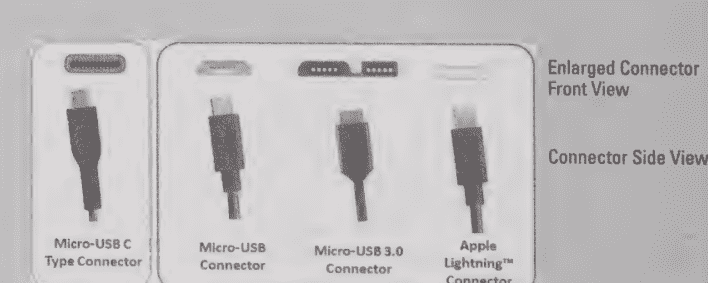

第一个选项是 micro-USB。这就是 Galaxy S6、S7 以及许多其他制造商的手机所使用的接口。

第二个选项是 micro-USB 3.0。micro-USB 3.0 连接器的正面视图看起来像 micro-USB 连接器正面视图在右边焊上一个矩形。说实话，它看起来有点傻，这就是为什么它从未真正流行起来的原因。三星在 Galaxy S5 上使用过它，这就是为什么你可能会在一些商店看到它。

第三个选项是 Apple Lightning 电缆。这与其它不同，因为连接器是可见的，而不是被金属外壳保护。它的最好之处在于它更贵，正如显示 Ventev 汽车充电器的图中所看到的那样（Ventev 是我告诉过你的那些可靠供应商之一）。

图片由 Ventev 提供

同款产品在 Apple 接口上多收 5 美元。

## 分享就是关怀：无线 Powershare

人们非常关注保持手机充电。有时你的手机电量充足，但另一台设备电量不足。你的 S10 有一个很酷的新功能叫做 Wireless PowerShare。你进入设置，打开此功能，你的 S10 背面就变成了一个无线充电器！你可以为你最好的朋友的 Galaxy S9 充电，并在这一天成为英雄。

## 导航 Galaxy S10

Galaxy S10 手机设备在设计上与许多其他移动电话不同：它们具有显著更少的硬件按钮（手机上的物理按钮）。它们更依赖于出现在屏幕上的软件按钮。

在本节中，我将带你了解手机的按钮。

### 手机的硬件按钮

三星减少了 Galaxy S10 上的硬件按钮数量。只有三个：电源按钮、音量按钮和 Bixby 按钮。在你更深入地使用手机之前，先熟悉一下，确保你正在查看手机的正确一侧。当我提到手机的左侧或右侧时，我假设是垂直方向（意思是你没有横向握持手机），并且你正在查看手机的屏幕。

### 电源按钮

电源按钮（参见图 2-1）位于手机右侧，当你以垂直方向握持时位于顶部附近。

除了开机外，按住电源按钮可在手机开机时将其置于睡眠模式。睡眠模式关闭屏幕并暂停大多数正在运行的应用程序。

手机在约 30 秒无操作后会自动进入睡眠模式以节省电量，但当你收起手机时，你可能希望手动执行此操作。你三星 Galaxy S10 上的 Super AMOLED（Active-Matrix Organic Light-Emitting Diode）屏幕很酷，但它也使用大量电量。

不要将睡眠模式与关机混淆。因为屏幕是手机上耗电最大的部件，让屏幕变黑可以节省电池寿命。手机仍会注意任何来电；有人来电时，屏幕会自动点亮。

### 音量按钮

从技术上讲，有两个音量按钮：一个用于增大音量，另一个用于减小音量。它们的位置如图 2-5 所示。

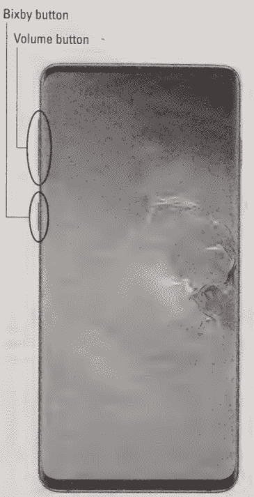

Bixby 按钮

音量按钮

图 2-5：
Galaxy S10 左侧的音量按钮。

音量按钮控制手机上所有音频源的音量，包括：

- 电话铃声，即来电时（铃声）。
- 仅在不通话时发生的通知，例如可选的提示音，让你知道收到短信或电子邮件。
- 通话时的话筒听筒。
- 数字音乐和视频播放器（媒体）的音量。

音量控制具有上下文感知能力；它们可以判断你正在更改哪个音量。例如，如果你在听音乐，调节音量会提高或降低音乐音量，但不会改变铃声和听筒音量。

音量按钮与应用程序内可进行的软件设置相辅相成。例如，你可以打开音乐播放器软件并在相应屏幕上调高音量。然后你可以使用硬件按钮调低音量，你会看到屏幕上的音量设置随之下降。

另一个选项是进入设置屏幕并为每个场景设置音量级别。操作方法如下：

- 1. **从主屏幕，按下任意音量按钮。**

你可以按下上或下。执行此操作会调出图 2-6 所示的屏幕。

如果你按下音量上或下，铃声会变大或变小。现在先不要进行此调整，继续下一步。

- 2. **从此屏幕，点按右上角的向下箭头。**

点按它会调出图 2-7 所示的屏幕。

- 3. **从图 2-7 所示的屏幕，将音量设置为所需设置。**

你可以通过将手指放在滑块图像上的点上来调整任何设置的音量。点会变大；你可以向左滑动以降低该特定音量设置，或向右滑动以提高它。

图 2-6：
铃声音量弹出窗口。

图 2-7：
所有音量设置弹出窗口。

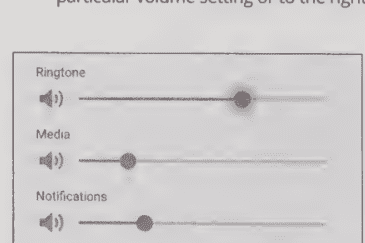

## Bixby 按钮

手机上的 Bixby 按钮如图 2-5 所示。它位于音量按钮下方。Bixby 是三星的一款应用程序，是一种智能代理（IA）。它就像 iPhone 上的 Alexa 或 Siri。我将在第 14 章更详细地介绍 Bixby。它很酷——而且他们一直在添加新功能。计划是你可以按两次 Bixby 按钮来启动此应用程序。目前，它会带你进入 Bixby 屏幕。

## 触摸屏

为了将所需的所有信息塞进一个屏幕，三星采用了现代化的屏幕布局方法。你需要熟悉几种用于操作屏幕的手指导航动作。

在深入之前，这里有一份你需要了解的小术语列表：

- **图标：** 一个 *图标* 是一个小图像。点按图标会启动应用程序或执行某些功能，例如拨打电话。
- **按钮：** 触摸屏上的 *按钮* 旨在看起来像一个三维按钮，就像你在电话上按下的那样。按钮通常有标签，告诉你在点按时它们的作用。例如，你会看到标有 Save 或 Send 的按钮。
- **超链接：** 有时简称为 *链接*，*超链接* 是点按时会执行某些功能的文本。通常文本是无生命的。如果你点按一个词而什么都没发生，那就是纯文本。如果你点按一个词而它启动了一个网站或导致屏幕弹出，那就是超链接。
- **缩略图：** *缩略图* 是存储在其他地方的大型高分辨率图片的小型低分辨率版本。

有了这些背景知识，是时候讨论你在触摸屏上使用的动作了。

你需要不时清洁触摸屏玻璃。手机上的玻璃是 Gorilla Glass（由 Corning 制造）——用于防止破损的最坚固的材料。使用软布或超细纤维布去除指纹。你甚至可以用衣服擦拭触摸屏。然而，永远不要使用纸巾！随着时间的推移，玻璃无法与卑微的纸巾中的纤维抗衡。

## 点按

通常，你只需点按屏幕即可让事情发生（例如启动应用程序时）或选择选项。将点按视为计算机屏幕上的单击。

点按只是在屏幕上轻触，就像使用零售[content]

Bixby 按钮

音量按钮

图 2-5：
Galaxy S10 左侧的音量按钮。

音量按钮控制手机上所有音频源的音量，包括：

- 电话铃声，即来电时（铃声）。
- 仅在不通话时发生的通知，例如可选的提示音，让你知道收到短信或电子邮件。
- 通话时的话筒听筒。
- 数字音乐和视频播放器（媒体）的音量。

音量控制具有上下文感知能力；它们可以判断你正在更改哪个音量。例如，如果你在听音乐，调节音量会提高或降低音乐音量，但不会改变铃声和听筒音量。

音量按钮与应用程序内可进行的软件设置相辅相成。例如，你可以打开音乐播放器软件并在相应屏幕上调高音量。然后你可以使用硬件按钮调低音量，你会看到屏幕上的音量设置随之下降。

另一个选项是进入设置屏幕并为每个场景设置音量级别。操作方法如下：

- 1. **从主屏幕，按下任意音量按钮。**

你可以按下上或下。执行此操作会调出图 2-6 所示的屏幕。

如果你按下音量上或下，铃声会变大或变小。现在先不要进行此调整，继续下一步。

- 2. **从此屏幕，点按右上角的向下箭头。**

点按它会调出图 2-7 所示的屏幕。

- 3. **从图 2-7 所示的屏幕，将音量设置为所需设置。**

你可以通过将手指放在滑块图像上的点上来调整任何设置的音量。点会变大；你可以向左滑动以降低该特定音量设置，或向右滑动以提高它。

图 2-6：
铃声音量弹出窗口。

图 2-7：
所有音量设置弹出窗口。

## Bixby 按钮

手机上的 Bixby 按钮如图 2-5 所示。它位于音量按钮下方。Bixby 是三星的一款应用程序，是一种智能代理（IA）。它就像 iPhone 上的 Alexa 或 Siri。我将在第 14 章更详细地介绍 Bixby。它很酷——而且他们一直在添加新功能。计划是你可以按两次 Bixby 按钮来启动此应用程序。目前，它会带你进入 Bixby 屏幕。

## 触摸屏

为了将所需的所有信息塞进一个屏幕，三星采用了现代化的屏幕布局方法。你需要熟悉几种用于操作屏幕的手指导航动作。

在深入之前，这里有一份你需要了解的小术语列表：

- **图标：** 一个 *图标* 是一个小图像。点按图标会启动应用程序或执行某些功能，例如拨打电话。
- **按钮：** 触摸屏上的 *按钮* 旨在看起来像一个三维按钮，就像你在电话上按下的那样。按钮通常有标签，告诉你在点按时它们的作用。例如，你会看到标有 Save 或 Send 的按钮。
- **超链接：** 有时简称为 *链接*，*超链接* 是点按时会执行某些功能的文本。通常文本是无生命的。如果你点按一个词而什么都没发生，那就是纯文本。如果你点按一个词而它启动了一个网站或导致屏幕弹出，那就是超链接。
- **缩略图：** *缩略图* 是存储在其他地方的大型高分辨率图片的小型低分辨率版本。

有了这些背景知识，是时候讨论你在触摸屏上使用的动作了。

你需要不时清洁触摸屏玻璃。手机上的玻璃是 Gorilla Glass（由 Corning 制造）——用于防止破损的最坚固的材料。使用软布或超细纤维布去除指纹。你甚至可以用衣服擦拭触摸屏。然而，永远不要使用纸巾！随着时间的推移，玻璃无法与卑微的纸巾中的纤维抗衡。

## 点按

通常，你只需点按屏幕即可让事情发生（例如启动应用程序时）或选择选项。将点按视为计算机屏幕上的单击。

点按只是在屏幕上轻触，就像使用零售[content]

Bixby 按钮

音量按钮

图 2-5：
Galaxy S10 左侧的音量按钮。

音量按钮控制手机上所有音频源的音量，包括：

- 电话铃声，即来电时（铃声）。
- 仅在不通话时发生的通知，例如可选的提示音，让你知道收到短信或电子邮件。
- 通话时的话筒听筒。
- 数字音乐和视频播放器（媒体）的音量。

音量控制具有上下文感知能力；它们可以判断你正在更改哪个音量。例如，如果你在听音乐，调节音量会提高或降低音乐音量，但不会改变铃声和听筒音量。

音量按钮与应用程序内可进行的软件设置相辅相成。例如，你可以打开音乐播放器软件并在相应屏幕上调高音量。然后你可以使用硬件按钮调低音量，你会看到屏幕上的音量设置随之下降。

另一个选项是进入设置屏幕并为每个场景设置音量级别。操作方法如下：

- 1. **从主屏幕，按下任意音量按钮。**

你可以按下上或下。执行此操作会调出图 2-6 所示的屏幕。

如果你按下音量上或下，铃声会变大或变小。现在先不要进行此调整，继续下一步。

- 2. **从此屏幕，点按右上角的向下箭头。**

点按它会调出图 2-7 所示的屏幕。

- 3. **从图 2-7 所示的屏幕，将音量设置为所需设置。**

你可以通过将手指放在滑块图像上的点上来调整任何设置的音量。点会变大；你可以向左滑动以降低该特定音量设置，或向右滑动以提高它。

图 2-6：
铃声音量弹出窗口。

图 2-7：
所有音量设置弹出窗口。

## Bixby 按钮

手机上的 Bixby 按钮如图 2-5 所示。它位于音量按钮下方。Bixby 是三星的一款应用程序，是一种智能代理（IA）。它就像 iPhone 上的 Alexa 或 Siri。我将在第 14 章更详细地介绍 Bixby。它很酷——而且他们一直在添加新功能。计划是你可以按两次 Bixby 按钮来启动此应用程序。目前，它会带你进入 Bixby 屏幕。

## 触摸屏

为了将所需的所有信息塞进一个屏幕，三星采用了现代化的屏幕布局方法。你需要熟悉几种用于操作屏幕的手指导航动作。

在深入之前，这里有一份你需要了解的小术语列表：

- **图标：** 一个 *图标* 是一个小图像。点按图标会启动应用程序或执行某些功能，例如拨打电话。
- **按钮：** 触摸屏上的 *按钮* 旨在看起来像一个三维按钮，就像你在电话上按下的那样。按钮通常有标签，告诉你在点按时它们的作用。例如，你会看到标有 Save 或 Send 的按钮。
- **超链接：** 有时简称为 *链接*，*超链接* 是点按时会执行某些功能的文本。通常文本是无生命的。如果你点按一个词而什么都没发生，那就是纯文本。如果你点按一个词而它启动了一个网站或导致屏幕弹出，那就是超链接。
- **缩略图：** *缩略图* 是存储在其他地方的大型高分辨率图片的小型低分辨率版本。

有了这些背景知识，是时候讨论你在触摸屏上使用的动作了。

你需要不时清洁触摸屏玻璃。手机上的玻璃是 Gorilla Glass（由 Corning 制造）——用于防止破损的最坚固的材料。使用软布或超细纤维布去除指纹。你甚至可以用衣服擦拭触摸屏。然而，永远不要使用纸巾！随着时间的推移，玻璃无法与卑微的纸巾中的纤维抗衡。

## 点按

通常，你只需点按屏幕即可让事情发生（例如启动应用程序时）或选择选项。将点按视为计算机屏幕上的单击。

点按只是在屏幕上轻触，就像使用零售[content]

Bixby 按钮

音量按钮

图 2-5：
Galaxy S10 左侧的音量按钮。

音量按钮控制手机上所有音频源的音量，包括：

- 电话铃声，即来电时（铃声）。
- 仅在不通话时发生的通知，例如可选的提示音，让你知道收到短信或电子邮件。
- 通话时的话筒听筒。
- 数字音乐和视频播放器（媒体）的音量。

音量控制具有上下文感知能力；它们可以判断你正在更改哪个音量。例如，如果你在听音乐，调节音量会提高或降低音乐音量，但不会改变铃声和听筒音量。

音量按钮与应用程序内可进行的软件设置相辅相成。例如，你可以打开音乐播放器软件并在相应屏幕上调高音量。然后你可以使用硬件按钮调低音量，你会看到屏幕上的音量设置随之下降。

另一个选项是进入设置屏幕并为每个场景设置音量级别。操作方法如下：

- 1. **从主屏幕，按下任意音量按钮。**

你可以按下上或下。执行此操作会调出图 2-6 所示的屏幕。

如果你按下音量上或下，铃声会变大或变小。现在先不要进行此调整，继续下一步。

- 2. **从此屏幕，点按右上角的向下箭头。**

点按它会调出图 2-7 所示的屏幕。

- 3. **从图 2-7 所示的屏幕，将音量设置为所需设置。**

你可以通过将手指放在滑块图像上的点上来调整任何设置的音量。点会变大；你可以向左滑动以降低该特定音量设置，或向右滑动以提高它。

图 2-6：
铃声音量弹出窗口。

图 2-7：
所有音量设置弹出窗口。

## Bixby 按钮

手机上的 Bixby 按钮如图 2-5 所示。它位于音量按钮下方。Bixby 是三星的一款应用程序，是一种智能代理（IA）。它就像 iPhone 上的 Alexa 或 Siri。我将在第 14 章更详细地介绍 Bixby。它很酷——而且他们一直在添加新功能。计划是你可以按两次 Bixby 按钮来启动此应用程序。目前，它会带你进入 Bixby 屏幕。

## 触摸屏

为了将所需的所有信息塞进一个屏幕，三星采用了现代化的屏幕布局方法。你需要熟悉几种用于操作屏幕的手指导航动作。

在深入之前，这里有一份你需要了解的小术语列表：

- **图标：** 一个 *图标* 是一个小图像。点按图标会启动应用程序或执行某些功能，例如拨打电话。
- **按钮：** 触摸屏上的 *按钮* 旨在看起来像一个三维按钮，就像你在电话上按下的那样。按钮通常有标签，告诉你在点按时它们的作用。例如，你会看到标有 Save 或 Send 的按钮。
- **超链接：** 有时简称为 *链接*，*超链接* 是点按时会执行某些功能的文本。通常文本是无生命的。如果你点按一个词而什么都没发生，那就是纯文本。如果你点按一个词而它启动了一个网站或导致屏幕弹出，那就是超链接。
- **缩略图：** *缩略图* 是存储在其他地方的大型高分辨率图片的小型低分辨率版本。

有了这些背景知识，是时候讨论你在触摸屏上使用的动作了。

你需要不时清洁触摸屏玻璃。手机上的玻璃是 Gorilla Glass（由 Corning 制造）——用于防止破损的最坚固的材料。使用软布或超细纤维布去除指纹。你甚至可以用衣服擦拭触摸屏。然而，永远不要使用纸巾！随着时间的推移，玻璃无法与卑微的纸巾中的纤维抗衡。

## 点按

通常，你只需点按屏幕即可让事情发生（例如启动应用程序时）或选择选项。将点按视为计算机屏幕上的单击。

点按只是在屏幕上轻触，就像使用零售[content]

Bixby 按钮

音量按钮

图 2-5：
Galaxy S10 左侧的音量按钮。

音量按钮控制手机上所有音频源的音量，包括：

- 电话铃声，即来电时（铃声）。
- 仅在不通话时发生的通知，例如可选的提示音，让你知道收到短信或电子邮件。
- 通话时的话筒听筒。
- 数字音乐和视频播放器（媒体）的音量。

音量控制具有上下文感知能力；它们可以判断你正在更改哪个音量。例如，如果你在听音乐，调节音量会提高或降低音乐音量，但不会改变铃声和听筒音量。

音量按钮与应用程序内可进行的软件设置相辅相成。例如，你可以打开音乐播放器软件并在相应屏幕上调高音量。然后你可以使用硬件按钮调低音量，你会看到屏幕上的音量设置随之下降。

另一个选项是进入设置屏幕并为每个场景设置音量级别。操作方法如下：

- 1. **从主屏幕，按下任意音量按钮。**

你可以按下上或下。执行此操作会调出图 2-6 所示的屏幕。

如果你按下音量上或下，铃声会变大或变小。现在先不要进行此调整，继续下一步。

- 2. **从此屏幕，点按右上角的向下箭头。**

点按它会调出图 2-7 所示的屏幕。

- 3. **从图 2-7 所示的屏幕，将音量设置为所需设置。**

你可以通过将手指放在滑块图像上的点上来调整任何设置的音量。点会变大；你可以向左滑动以降低该特定音量设置，或向右滑动以提高它。

图 2-6：
铃声音量弹出窗口。

图 2-7：
所有音量设置弹出窗口。

## Bixby 按钮

手机上的 Bixby 按钮如图 2-5 所示。它位于音量按钮下方。Bixby 是三星的一款应用程序，是一种智能代理（IA）。它就像 iPhone 上的 Alexa 或 Siri。我将在第 14 章更详细地介绍 Bixby。它很酷——而且他们一直在添加新功能。计划是你可以按两次 Bixby 按钮来启动此应用程序。目前，它会带你进入 Bixby 屏幕。

## 触摸屏

为了将所需的所有信息塞进一个屏幕，三星采用了现代化的屏幕布局方法。你需要熟悉几种用于操作屏幕的手指导航动作。

在深入之前，这里有一份你需要了解的小术语列表：

- **图标：** 一个 *图标* 是一个小图像。点按图标会启动应用程序或执行某些功能，例如拨打电话。
- **按钮：** 触摸屏上的 *按钮* 旨在看起来像一个三维按钮，就像你在电话上按下的那样。按钮通常有标签，告诉你在点按时它们的作用。例如，你会看到标有 Save 或 Send 的按钮。
- **超链接：** 有时简称为 *链接*，*超链接* 是点按时会执行某些功能的文本。通常文本是无生命的。如果你点按一个词而什么都没发生，那就是纯文本。如果你点按一个词而它启动了一个网站或导致屏幕弹出，那就是超链接。
- **缩略图：** *缩略图* 是存储在其他地方的大型高分辨率图片的小型低分辨率版本。

有了这些背景知识，是时候讨论你在触摸屏上使用的动作了。

你需要不时清洁触摸屏玻璃。手机上的玻璃是 Gorilla Glass（由 Corning 制造）——用于防止破损的最坚固的材料。使用软布或超细纤维布去除指纹。你甚至可以用衣服擦拭触摸屏。然而，永远不要使用纸巾！随着时间的推移，玻璃无法与卑微的纸巾中的纤维抗衡。

## 点按

通常，你只需点按屏幕即可让事情发生（例如启动应用程序时）或选择选项。将点按视为计算机屏幕上的单击。

点按只是在屏幕上轻触，就像使用零售[content]

Bixby 按钮

音量按钮

图 2-5：
Galaxy S10 左侧的音量按钮。

音量按钮控制手机上所有音频源的音量，包括：

- 电话铃声，即来电时（铃声）。
- 仅在不通话时发生的通知，例如可选的提示音，让你知道收到短信或电子邮件。
- 通话时的话筒听筒。
- 数字音乐和视频播放器（媒体）的音量。

音量控制具有上下文感知能力；它们可以判断你正在更改哪个音量。例如，如果你在听音乐，调节音量会提高或降低音乐音量，但不会改变铃声和听筒音量。

音量按钮与应用程序内可进行的软件设置相辅相成。例如，你可以打开音乐播放器软件并在相应屏幕上调高音量。然后你可以使用硬件按钮调低音量，你会看到屏幕上的音量设置随之下降。

另一个选项是进入设置屏幕并为每个场景设置音量级别。操作方法如下：

- 1. **从主屏幕，按下任意音量按钮。**

你可以按下上或下。执行此操作会调出图 2-6 所示的屏幕。

如果你按下音量上或下，铃声会变大或变小。现在先不要进行此调整，继续下一步。

- 2. **从此屏幕，点按右上角的向下箭头。**

点按它会调出图 2-7 所示的屏幕。

- 3. **从图 2-7 所示的屏幕，将音量设置为所需设置。**

你可以通过将手指放在滑块图像上的点上来调整任何设置的音量。点会变大；你可以向左滑动以降低该特定音量设置，或向右滑动以提高它。

图 2-6：
铃声音量弹出窗口。

图 2-7：
所有音量设置弹出窗口。

## Bixby 按钮

手机上的 Bixby 按钮如图 2-5 所示。它位于音量按钮下方。Bixby 是三星的一款应用程序，是一种智能代理（IA）。它就像 iPhone 上的 Alexa 或 Siri。我将在第 14 章更详细地介绍 Bixby。它很酷——而且他们一直在添加新功能。计划是你可以按两次 Bixby 按钮来启动此应用程序。目前，它会带你进入 Bixby 屏幕。

## 触摸屏

为了将所需的所有信息塞进一个屏幕，三星采用了现代化的屏幕布局方法。你需要熟悉几种用于操作屏幕的手指导航动作。

在深入之前，这里有一份你需要了解的小术语列表：

- **图标：** 一个 *图标* 是一个小图像。点按图标会启动应用程序或执行某些功能，例如拨打电话。
- **按钮：** 触摸屏上的 *按钮* 旨在看起来像一个三维按钮，就像你在电话上按下的那样。按钮通常有标签，告诉你在点按时它们的作用。例如，你会看到标有 Save 或 Send 的按钮。
- **超链接：** 有时简称为 *链接*，*超链接* 是点按时会执行某些功能的文本。通常文本是无生命的。如果你点按一个词而什么都没发生，那就是纯文本。如果你点按一个词而它启动了一个网站或导致屏幕弹出，那就是超链接。
- **缩略图：** *缩略图* 是存储在其他地方的大型高分辨率图片的小型低分辨率版本。

有了这些背景知识，是时候讨论你在触摸屏上使用的动作了。

你需要不时清洁触摸屏玻璃。手机上的玻璃是 Gorilla Glass（由 Corning 制造）——用于防止破损的最坚固的材料。使用软布或超细纤维布去除指纹。你甚至可以用衣服擦拭触摸屏。然而，永远不要使用纸巾！随着时间的推移，玻璃无法与卑微的纸巾中的纤维抗衡。

## 点按

通常，你只需点按屏幕即可让事情发生（例如启动应用程序时）或选择选项。将点按视为计算机屏幕上的单击。

点按只是在屏幕上轻触，就像使用零售[content]

Bixby 按钮

音量按钮

图 2-5：
Galaxy S10 左侧的音量按钮。

音量按钮控制手机所有音频源的音量，包括：

- 来电时的电话铃声（铃声）。
- 不通话时发生的通知，如提示收到短信或邮件的提示音。
- 通话时的话筒听筒。
- 数字音乐和视频播放器（媒体）的音量。

音量控制有上下文感知，可判断正在更改哪个音量。例如听音乐时调节音量只改变音乐音量，不改变铃声和听筒音量。

音量按钮与应用内的软件设置互补。例如可在音乐播放器中调高音量，再用硬件按钮调低，屏幕上的音量设置会随之下降。

也可进入设置屏幕为各场景设置音量。方法如下：

- 1. **从主屏幕，按下任意音量按钮。**

可按上或下，会弹出图 2-6 的屏幕。

按音量上/下会使铃声变大/小，先不要调整，继续下一步。

- 2. **从此屏幕，点按右上角的向下箭头。**

会弹出图 2-7 的屏幕。

- 3. **从图 2-7 所示屏幕，将音量调至所需设置。**

将手指放在滑块上的点即可调整，点会变大，向左降低，向右提高。

图 2-6：
铃声音量弹出窗口。

图 2-7：
所有音量设置弹出窗口。

## Bixby 按钮

Bixby 按钮如图 2-5 所示，在音量按钮下方。Bixby 是三星的智能代理应用，像 iPhone 上的 Alexa 或 Siri。第 14 章会详细介绍。它很酷且持续增加功能。计划是双按 Bixby 按钮启动，目前会进入 Bixby 屏幕。

## 触摸屏

三星采用现代布局将所需信息塞进一屏。你需熟悉几种手指导航手势。

先了解几个术语：

- **图标：** 一个 *图标* 是小图像。点按图标可启动应用或执行功能，如拨打电话。
- **按钮：** 触摸屏上的 *按钮* 像可按压的三维按钮，通常有标签说明点按后的作用，如 Save 或 Send。
- **超链接：** 简称 *链接*，*超链接* 是点按后会执行功能的文本。点按无反应的词是纯文本，会启动网站或弹出屏幕的词是超链接。
- **缩略图：** *缩略图* 是存储 elsewhere 的大图的小低分辨率版本。

有了背景，下面讨论触摸屏手势。

需定期清洁触摸屏玻璃。手机玻璃为 Corning 制造的 Gorilla Glass，是防破损最坚固的材料。用软布或超细纤维布擦指纹，甚至可用衣服擦拭。切勿用纸巾，长期下来纸巾纤维会磨损玻璃。

## 点按

通常点按屏幕即可操作或选择选项，相当于电脑的单击。

点按就是在屏幕上轻触，像零售[content]

Bixby 按钮

音量按钮

图 2-5：
Galaxy S10 左侧的音量按钮。

音量按钮控制手机所有音频源的音量，包括：

- 来电时的电话铃声（铃声）。
- 不通话时发生的通知，如提示收到短信或邮件的提示音。
- 通话时的话筒听筒。
- 数字音乐和视频播放器（媒体）的音量。

音量控制有上下文感知，可判断正在更改哪个音量。例如听音乐时调节音量只改变音乐音量，不改变铃声和听筒音量。

音量按钮与应用内的软件设置互补。例如可在音乐播放器中调高音量，再用硬件按钮调低，屏幕上的音量设置会随之下降。

也可进入设置屏幕为各场景设置音量。方法如下：

- 1. **从主屏幕，按下任意音量按钮。**

可按上或下，会弹出图 2-6 的屏幕。

按音量上/下会使铃声变大/小，先不要调整，继续下一步。

- 2. **从此屏幕，点按右上角的向下箭头。**

会弹出图 2-7 的屏幕。

- 3. **从图 2-7 所示屏幕，将音量调至所需设置。**

将手指放在滑块上的点即可调整，点会变大，向左降低，向右提高。

图 2-6：
铃声音量弹出窗口。

图 2-7：
所有音量设置弹出窗口。

## Bixby 按钮

Bixby 按钮如图 2-5 所示，在音量按钮下方。Bixby 是三星的智能代理应用，像 iPhone 上的 Alexa 或 Siri。第 14 章会详细介绍。它很酷且持续增加功能。计划是双按 Bixby 按钮启动，目前会进入 Bixby 屏幕。

## 触摸屏

三星采用现代布局将所需信息塞进一屏。你需熟悉几种手指导航手势。

先了解几个术语：

- **图标：** 一个 *图标* 是小图像。点按图标可启动应用或执行功能，如拨打电话。
- **按钮：** 触摸屏上的 *按钮* 像可按压的三维按钮，通常有标签说明点按后的作用，如 Save 或 Send。
- **超链接：** 简称 *链接*，*超链接* 是点按后会执行功能的文本。点按无反应的词是纯文本，会启动网站或弹出屏幕的词是超链接。
- **缩略图：** *缩略图* 是存储 elsewhere 的大图的小低分辨率版本。

有了背景，下面讨论触摸屏手势。

需定期清洁触摸屏玻璃。手机玻璃为 Corning 制造的 Gorilla Glass，是防破损最坚固的材料。用软布或超细纤维布擦指纹，甚至可用衣服擦拭。切勿用纸巾，长期下来纸巾纤维会磨损玻璃。

## 点按

通常点按屏幕即可操作或选择选项，相当于电脑的单击。

点按就是在屏幕上轻触一下，类似于在零售[content]

Bixby 按钮

音量按钮

图 2-5：
Galaxy S10 左侧的音量按钮。

音量按钮控制手机所有音频源音量，包括：

- 来电铃声。
- 不通话时的通知，如收短信/邮件提示音。
- 通话时的听筒。
- 媒体音乐视频音量。

音量控制有上下文感知。例如听音乐时调节只改变音乐音量，不改变铃声和听筒音量。

音量按钮与应用内软件设置互补。例如可在音乐播放器中调高音量，再用硬件按钮调低，屏幕设置会随之下降。

也可进入设置屏幕为各场景设音量。方法如下：

- 1. **从主屏幕，按下任意音量按钮。**

可按上或下，会显示图 2-6 屏幕。

按音量上/下会改变铃声大小，先不调整，继续下一步。

- 2. **从此屏幕，点按右上角向下箭头。**

会显示图 2-7 屏幕。

- 3. **从图 2-7 屏幕，将音量调至所需。**

将手指放在滑块上的点即可调整，点会变大，向左降低，向右提高。

图 2-6：
铃声音量弹出窗口。

图 2-7：
所有音量设置弹出窗口。

## Bixby 按钮

Bixby 按钮如图 2-5 所示，在音量按钮下方。Bixby 是三星的智能代理应用，像 iPhone 上的 Alexa 或 Siri。第 14 章会详细介绍。它很酷且持续增加功能。计划双按按钮启动，目前会进入 Bixby 屏幕。

## 触摸屏

三星采用现代布局将信息塞进一屏。需熟悉几种手指导航手势。

先了解术语：

- **图标：** 一个 *图标* 是小图像。点按可启动应用或执行功能，如拨打电话。
- **按钮：** 触摸屏上的 *按钮* 像可按压的三维按钮，通常有标签说明作用，如 Save 或 Send。
- **超链接：** 简称 *链接*，*超链接* 是点按后会执行功能的文本。无反应的词是纯文本，会启动网站或弹出屏幕的词是超链接。
- **缩略图：** *缩略图* 是 elsewhere 大图的小低分辨率版本。

下面讨论触摸屏手势。

需定期清洁触摸屏玻璃。手机玻璃为 Corning 制造的 Gorilla Glass，是防破损最坚固的材料。用软布或超细纤维布擦指纹，甚至可用衣服擦拭。切勿用纸巾，长期下来纸巾纤维会磨损玻璃。

## 点按

通常点按屏幕即可操作或选择，相当于电脑单击。

点按就是在屏幕上轻触，类似于使用自助终端触摸屏。图 2-8 显示点按动作。

图 2-8：
点按动作。

与电脑鼠标单击不同，Galaxy S10 上单次点按即可启动应用，相当于电脑双击。

点按与长按不同。若手指在屏幕上停留超过瞬间，手机会认为要执行其他操作。

## 长按

长按即把手指放在图标上停留超过一秒。效果视情况而定。

例如在主屏幕长按应用会显示垃圾桶图标，用于移除该图标。长按应用列表中的图标则会将其复制到主屏幕。熟悉长按与点按的区别即可。

点按或长按无需用力，玻璃也不易破损。单手持机另一手操作即可。不要把手机放在地上用手指顶起做手倒立，否则可能损坏玻璃。建议不要尝试，如尝试请上传视频到 YouTube。

平均每人每年呼叫 911 约一次。通常在压力情况下呼叫。Galaxy S10 并无压力传感器，但压力下容易把长按误认为点按。请注意此倾向，记住要点按。

## 屏幕移动或切换

手指手势可帮助在屏幕间移动并调整图像缩放。掌握这些手势可最大化手机使用。

首先是导航以访问屏幕上不可见的内容。类似电脑使用水平/垂直滚动条。

手机屏幕小，Galaxy S10 采用全景布局，需左右或上下滚动访问不同屏幕。

总之屏幕全宽可访问，但仅物理屏幕范围可见。根据情况可用拖动、滑动、捏合缩放和双击等手势。后续章节会介绍。

## 拖动

最简单的手势是拖动。手指放在屏幕一点后拖动图像再抬起。图 2-9 显示动作。

图 2-9：
拖动动作
用于受控
移动。

拖动可让您缓慢地在全景中移动。这种动作类似于点击滚动条并缓慢移动它。

## 弹指

要快速在全景中移动，您可以弹指屏幕，使其朝弹指方向移动（见图 2-10）。

图 2-10：
使用弹指动作
实现更快的
移动。

经过练习后对该动作的控制会更好。一般来说，弹指越快，全景移动得越多。然而，有些屏幕（如扩展主屏幕）无论弹指多快，只会向右或向左移动一屏。

## 捏合与拉伸

某些屏幕允许您更改在屏幕上查看的图像的比例。当此功能处于活动状态时，缩放选项会更改屏幕上区域的放大倍数。您可以缩小以以较小尺寸查看更多功能，或放大以以较大尺寸查看更多细节。

要缩小，您将两根手指（分开）放在屏幕上并将它们合拢以捏合图像。确保您居中于想要更详细查看的点。捏合动作如图 2-11 所示。

图 2-11：
使用捏合手势缩小。

相反的动作是放大。这涉及如图 2-12 所示的拉伸动作。您将两根手指（靠近）放置并向外拉开。

图 2-12：
使用拉伸手势放大。

## 双击

双击（如图 2-13 所示）只是指快速连续两次轻触屏幕上的同一按钮区域。您使用双击在放大和缩小的图像之间跳转，以恢复到之前的分辨率。此选项可节省您返回熟悉视角时的挫败感。

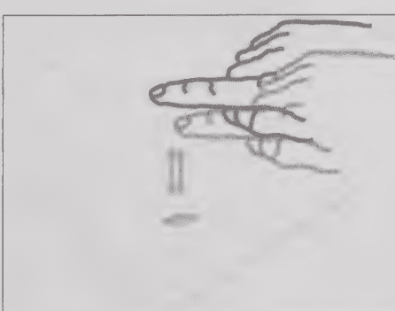

图 2-13：
双击手势。

记住

双击时，请把握好轻触的时机，以免手机将其解释为两次单独的轻触。经过一点练习，您就会掌握第二次轻触的时机。

## 扩展主屏幕

主屏幕是在手机完成设置后您看到的第一个屏幕。左右两侧的额外屏幕构成了扩展主屏幕。它们在图 2-14 中可视为全景。

图 2-14：
Galaxy S10 手机扩展主屏幕的全景显示。

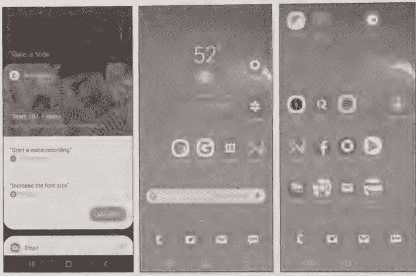

在任何时候，您一次只能看到一个屏幕。您可以通过向右或向左弹指在屏幕之间导航。我们将在下一节详细介绍的主屏幕按钮将始终带您返回主屏幕。

扩展主屏幕是您可以组织图标和其他功能以使手机最方便您的地方。开箱即用时，三星和您的移动运营商已共同为您创建了一个起点。除此之外，您还有很多方法可以自定义主屏幕，以便轻松访问对您最重要的东西。本书的大部分内容涵盖了手机能做的所有事情，但一个反复出现的主题是如何将您最喜欢的功能放在主屏幕上（如果您愿意的话）。

开始时，请查看主屏幕的布局以及它与其他手机区域的关系。了解这些区域对于基本导航很重要。

图 2-15 显示了一个典型的[content]
图 2-9：
拖动动作
用于受控
移动。

拖动可让您缓慢地在全景中移动。这种动作类似于点击滚动条并缓慢移动它。

## 弹指

要快速在全景中移动，您可以弹指屏幕，使其朝弹指方向移动（见图 2-10）。

图 2-10：
使用弹指动作
实现更快的
移动。

经过练习后对该动作的控制会更好。一般来说，弹指越快，全景移动得越多。然而，有些屏幕（如扩展主屏幕）无论弹指多快，只会向右或向左移动一屏。

## 捏合与拉伸

某些屏幕允许您更改在屏幕上查看的图像的比例。当此功能处于活动状态时，缩放选项会更改屏幕上区域的放大倍数。您可以缩小以以较小尺寸查看更多功能，或放大以以较大尺寸查看更多细节。

要缩小，您将两根手指（分开）放在屏幕上并将它们合拢以捏合图像。确保您居中于想要更详细查看的点。捏合动作如图 2-11 所示。

图 2-11：
使用捏合手势缩小。

相反的动作是放大。这涉及如图 2-12 所示的拉伸动作。您将两根手指（靠近）放置并向外拉开。

图 2-12：
使用拉伸手势放大。

## 双击

双击（如图 2-13 所示）只是指快速连续两次轻触屏幕上的同一按钮区域。您使用双击在放大和缩小的图像之间跳转，以恢复到之前的分辨率。此选项可节省您返回熟悉视角时的挫败感。

图 2-13：
双击手势。

记住

双击时，请把握好轻触的时机，以免手机将其解释为两次单独的轻触。经过一点练习，您就会掌握第二次轻触的时机。

## 扩展主屏幕

主屏幕是在手机完成设置后您看到的第一个屏幕。左右两侧的额外屏幕构成了扩展主屏幕。它们在图 2-14 中可视为全景。

图 2-14：
Galaxy S10 手机扩展主屏幕的全景显示。

在任何时候，您一次只能看到一个屏幕。您可以通过向右或向左弹指在屏幕之间导航。我们将在下一节详细介绍的主屏幕按钮将始终带您返回主屏幕。

扩展主屏幕是您可以组织图标和其他功能以使手机最方便您的地方。开箱即用时，三星和您的移动运营商已共同为您创建了一个起点。除此之外，您还有很多方法可以自定义主屏幕，以便轻松访问对您最重要的东西。本书的大部分内容涵盖了手机能做的所有事情，但一个反复出现的主题是如何将您最喜欢的功能放在主屏幕上（如果您愿意的话）。

开始时，请查看主屏幕的布局以及它与其他手机区域的关系。了解这些区域对于基本导航很重要。

图 2-15 显示了一个典型的[content]
图 2-9：
拖动动作
用于受控
移动。

拖动可让您缓慢地在全景中移动。这种动作类似于点击滚动条并缓慢移动它。

## 弹指

要快速在全景中移动，您可以弹指屏幕，使其朝弹指方向移动（见图 2-10）。

图 2-10：
使用弹指动作
实现更快的
移动。

经过练习后对该动作的控制会更好。一般来说，弹指越快，全景移动得越多。然而，有些屏幕（如扩展主屏幕）无论弹指多快，只会向右或向左移动一屏。

## 捏合与拉伸

某些屏幕允许您更改在屏幕上查看的图像的比例。当此功能处于活动状态时，缩放选项会更改屏幕上区域的放大倍数。您可以缩小以以较小尺寸查看更多功能，或放大以以较大尺寸查看更多细节。

要缩小，您将两根手指（分开）放在屏幕上并将它们合拢以捏合图像。确保您居中于想要更详细查看的点。捏合动作如图 2-11 所示。

图 2-11：
使用捏合手势缩小。

相反的动作是放大。这涉及如图 2-12 所示的拉伸动作。您将两根手指（靠近）放置并向外拉开。

图 2-12：
使用拉伸手势放大。

## 双击

双击（如图 2-13 所示）只是指快速连续两次轻触屏幕上的同一按钮区域。您使用双击在放大和缩小的图像之间跳转，以恢复到之前的分辨率。此选项可节省您返回熟悉视角时的挫败感。

图 2-13：
双击手势。

记住

双击时，请把握好轻触的时机，以免手机将其解释为两次单独的轻触。经过一点练习，您就会掌握第二次轻触的时机。

## 扩展主屏幕

主屏幕是在手机完成设置后您看到的第一个屏幕。左右两侧的额外屏幕构成了扩展主屏幕。它们在图 2-14 中可视为全景。

图 2-14：
Galaxy S10 手机扩展主屏幕的全景显示。

在任何时候，您一次只能看到一个屏幕。您可以通过向右或向左弹指在屏幕之间导航。我们将在下一节详细介绍的主屏幕按钮将始终带您返回主屏幕。

扩展主屏幕是您可以组织图标和其他功能以使手机最方便您的地方。开箱即用时，三星和您的移动运营商已共同为您创建了一个起点。除此之外，您还有很多方法可以自定义主屏幕，以便轻松访问对您最重要的东西。本书的大部分内容涵盖了手机能做的所有事情，但一个反复出现的主题是如何将您最喜欢的功能放在主屏幕上（如果您愿意的话）。

开始时，请查看主屏幕的布局以及它与其他手机区域的关系。了解这些区域对于基本导航很重要。

图 2-15 显示了一个典型的 Home screen 并突出了手机上的三个重要区域：

- 通知区域：屏幕的这一部分会向您展示小图标，让您知道是否有重要事项，例如电池电量或来自麦当劳的优惠券。
- 主快捷方式：这四个图标在您在主屏幕间移动时保持静止。如果您注意到图 2-15 中，这些是由三星和您的移动运营商确定的手机上四个最重要的应用程序，并且在所有屏幕上都有。
- 功能键：这三个键控制手机的基本功能，无论手机当时正在进行什么其他操作。

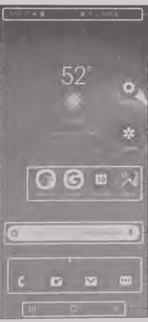

图 2-15：
Galaxy S10 手机及主屏幕上的重要区域。

通知区域

应用快捷方式

带语音识别的 Google 搜索引擎

主快捷方式

功能键

在扩展主屏幕的主快捷方式上方有一系列点。您可能还会注意到其中一个点不是普通的点——它是一个小房子。那就是“主页”主屏幕。最亮的点指示您在屏幕中的位置。您可以通过向左或向右拖动屏幕在屏幕之间导航。这一次移动一个屏幕。您也可以通过点击对应您想要查看的屏幕编号的点，或通过拖动点到您想要查看的屏幕来跳转多个屏幕。以下各节将对每个区域提供更多详细信息。

## 使用主屏幕按钮

三星在 Galaxy 手机上实现的一个重要设计功能是“隐形”主屏幕按钮。一些其他智能手机在前面屏幕底部有一个物理按钮。为了提供更大的屏幕显示区域，S10 将其做成软件按钮，位于功能键底部中央。

主屏幕按钮（见图 2-16）可能看起来没什么，但它非常重要，因为它可以从应用程序中的任何位置将您带回主屏幕。如果您正在使用应用程序并感到自己迷路了，不用担心。按下主屏幕按钮，闭上眼睛，连续三次并拢脚跟，然后对自己说：“没有地方像家一样”，您将被带回主屏幕。

图 2-16：
Galaxy S10 前面的主屏幕按钮。
主屏幕按钮

您不需要在按下主屏幕按钮后做所有那些其他事情。只需按下主屏幕按钮即可。

## 向主屏幕添加快捷方式

您有大量的屏幕空间可以放置您喜欢的应用程序和部件的图标（参考图 2-14）。（部件是处理简单功能的微型应用，例如显示时间或电池状态。）您可以按照以下步骤将应用程序和这些部件的快捷方式添加到主屏幕：

1. 从有空间放置应用图标的扩展主屏幕页面向上滑动手指。

这会调出您当前在手机上拥有的所有应用的目录。应用的数量及其图标的页面数量几乎是无限的。（我在第 8 章介绍如何添加新应用。）

2. 按住您想要添加的应用图标。

您手指下的图标会出现一个弹出窗口，如图 2-17 所示。

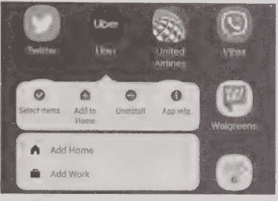

图 2-17：
一个应用页面。

3. 点击“添加到主屏幕”选项。

图标现在会出现在您其中一个主屏幕上的随机位置。如果您喜欢图标的位置，就完成了。如果您想将其移动到主屏幕上的另一个位置，请继续下一步。

4. 按住您想要移动的图标。

图标会发生两件事。首先会出现一个弹出窗口，询问您是否要卸载该应用以及其他选项。要移动图标，请将手指在屏幕上滑动到您想要它所在的位置。当您对位置满意时，抬起手指，它就有了新的家。

完成。

## 移除快捷方式

假设您发现自己并不像想象的那样经常使用该应用，并且想要减少主屏幕上的杂乱。没问题。按住图标。会出现一个如[content]
图 2-9：
拖动动作
用于受控
移动。

拖动可让您缓慢地在全景中移动。这种动作类似于点击滚动条并缓慢移动它。

## 弹指

要快速在全景中移动，您可以弹指屏幕，使其朝弹指方向移动（见图 2-10）。

图 2-10：
使用弹指动作
实现更快的
移动。

经过练习后对该动作的控制会更好。一般来说，弹指越快，全景移动得越多。然而，有些屏幕（如扩展主屏幕）无论弹指多快，只会向右或向左移动一屏。

## 捏合与拉伸

某些屏幕允许您更改在屏幕上查看的图像的比例。当此功能处于活动状态时，缩放选项会更改屏幕上区域的放大倍数。您可以缩小以以较小尺寸查看更多功能，或放大以以较大尺寸查看更多细节。

要缩小，您将两根手指（分开）放在屏幕上并将它们合拢以捏合图像。确保您居中于想要更详细查看的点。捏合动作如图 2-11 所示。

图 2-11：
使用捏合手势缩小。

相反的动作是放大。这涉及如图 2-12 所示的拉伸动作。您将两根手指（靠近）放置并向外拉开。

图 2-12：
使用拉伸手势放大。

## 双击

双击（如图 2-13 所示）只是指快速连续两次轻触屏幕上的同一按钮区域。您使用双击在放大和缩小的图像之间跳转，以恢复到之前的分辨率。此选项可节省您返回熟悉视角时的挫败感。

图 2-13：
双击手势。

记住

双击时，请把握好轻触的时机，以免手机将其解释为两次单独的轻触。经过一点练习，您就会掌握第二次轻触的时机。

## 扩展主屏幕

主屏幕是在手机完成设置后您看到的第一个屏幕。左右两侧的额外屏幕构成了扩展主屏幕。它们在图 2-14 中可视为全景。

图 2-14：
Galaxy S10 手机扩展主屏幕的全景显示。

在任何时候，您一次只能看到一个屏幕。您可以通过向右或向左弹指在屏幕之间导航。我们将在下一节详细介绍的主屏幕按钮将始终带您返回主屏幕。

扩展主屏幕是您可以组织图标和其他功能以使手机最方便您的地方。开箱即用时，三星和您的移动运营商已共同为您创建了一个起点。除此之外，您还有很多方法可以自定义主屏幕，以便轻松访问对您最重要的东西。本书的大部分内容涵盖了手机能做的所有事情，但一个反复出现的主题是如何将您最喜欢的功能放在主屏幕上（如果您愿意的话）。

开始时，请查看主屏幕的布局以及它与其他手机区域的关系。了解这些区域对于基本导航很重要。

图 2-15 显示了一个典型的 Home screen 并突出了手机上的三个重要区域：

- 通知区域：屏幕的这一部分会向您展示小图标，让您知道是否有重要事项，例如电池电量或来自麦当劳的优惠券。
- 主快捷方式：这四个图标在您在主屏幕间移动时保持静止。如果您注意到图 2-15 中，这些是由三星和您的移动运营商确定的手机上四个最重要的应用程序，并且在所有屏幕上都有。
- 功能键：这三个键控制手机的基本功能，无论手机当时正在进行什么其他操作。

图 2-15：
Galaxy S10 手机及主屏幕上的重要区域。

通知区域

应用快捷方式

带语音识别的 Google 搜索引擎

主快捷方式

功能键

在扩展主屏幕的主快捷方式上方有一系列点。您可能还会注意到其中一个点不是普通的点——它是一个小房子。那就是“主页”主屏幕。最亮的点指示您在屏幕中的位置。您可以通过向左或向右拖动屏幕在屏幕之间导航。这一次移动一个屏幕。您也可以通过点击对应您想要查看的屏幕编号的点，或通过拖动点到您想要查看的屏幕来跳转多个屏幕。以下各节将对每个区域提供更多详细信息。

## 使用主屏幕按钮

三星在 Galaxy 手机上实现的一个重要设计功能是“隐形”主屏幕按钮。一些其他智能手机在前面屏幕底部有一个物理按钮。为了提供更大的屏幕显示区域，S10 将其做成软件按钮，位于功能键底部中央。

主屏幕按钮（见图 2-16）可能看起来没什么，但它非常重要，因为它可以从应用程序中的任何位置将您带回主屏幕。如果您正在使用应用程序并感到自己迷路了，不用担心。按下主屏幕按钮，闭上眼睛，连续三次并拢脚跟，然后对自己说：“没有地方像家一样”，您将被带回主屏幕。

图 2-16：
Galaxy S10 前面的主屏幕按钮。
主屏幕按钮

您不需要在按下主屏幕按钮后做所有那些其他事情。只需按下主屏幕按钮即可。

## 向主屏幕添加快捷方式

您有大量的屏幕空间可以放置您喜欢的应用程序和部件的图标（参考图 2-14）。（部件是处理简单功能的微型应用，例如显示时间或电池状态。）您可以按照以下步骤将应用程序和这些部件的快捷方式添加到主屏幕：

1. 从有空间放置应用图标的扩展主屏幕页面向上滑动手指。

这会调出您当前在手机上拥有的所有应用的目录。应用的数量及其图标的页面数量几乎是无限的。（我在第 8 章介绍如何添加新应用。）

2. 按住您想要添加的应用图标。

您手指下的图标会出现一个弹出窗口，如图 2-17 所示。

图 2-17：
一个应用页面。

3. 点击“添加到主屏幕”选项。

图标现在会出现在您其中一个主屏幕上的随机位置。如果您喜欢图标的位置，就完成了。如果您想将其移动到主屏幕上的另一个位置，请继续下一步。

4. 按住您想要移动的图标。

图标会发生两件事。首先会出现一个弹出窗口，询问您是否要卸载该应用以及其他选项。要移动图标，请将手指在屏幕上滑动到您想要它所在的位置。当您对位置满意时，抬起手指，它就有了新的家。

完成。

## 移除快捷方式

假设您发现自己并不像想象的那样经常使用该应用，并且想要减少主屏幕上的杂乱。没问题。按住图标。会出现一个如图所示的弹出窗口，如图 2-18 所示。

FIGURE 2-18:
主页上的快捷方式弹出窗口。

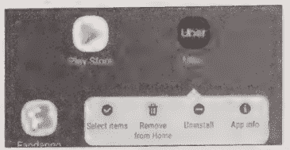

只需轻点垃圾桶图标，它就会回到制造商那里。

它已从你的主屏幕消失，但如果你操作失误，很容易就能找回。只需返回 App 菜单键并重复之前的流程即可重新创建。它仍然在你的手机上。

## 通知区域和屏幕

通知区域位于手机顶部（参见图 2-15）。在这里，你会看到一些状态图标。也许你收到了短信或电子邮件，或者会看到某个应用需要处理。

可以把通知区域想象成一个特殊的电子邮件收件箱，你的运营商（甚至是手机本身）可以通过它提供有关手机状况的重要信息。顶部这些小图标会告诉你手机上不同无线电系统的状态：显示的信号格数表示信号强度，通常手机还会告诉你正在使用的移动数据速度类型——例如 3G 或 4G。

你可以花时间学习所有可能出现的图标含义，但那样会花费很长时间。更方便的做法是触摸通知区域并向下滑动，如图 2-19 所示。

屏幕其余部分会以易于理解的方式写明当前情况以及你需要采取的行动（如果有的话）——例如，当你看到已连接到预期的 Wi-Fi 接入点时。

阅读完通知后，将手指滑回顶部即可。如果此屏幕过于拥挤，可以点击清除按钮将其清空。你也可以逐条清除通知，只需触摸每条通知并向侧面滑动即可。

如果你想快速控制某些关键手机功能，可以点击这些图标中的一个。例如，如果你想关闭 Wi-Fi，只需点击 Wi-Fi 图标即可。这样就无需进入设置来完成同样的操作。

通知区域选项

FIGURE 2-19:
通知区域下拉。

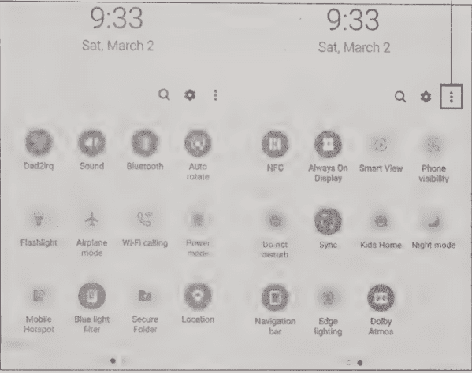

如果你想添加更多项目，只需点击图 2-19 中突出显示的三个垂直点，即可查看通知区域选项。这些选项如图 2-20 所示，不过你的手机上的选择可能略有不同。

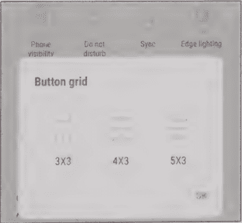

FIGURE 2-20:
通知区域选项。

例如，许多人觉得手电筒功能很实用。如果在下拉通知屏幕时它尚未显示，请查看是否在选项中。如果有，长按手电筒图标，然后将其拖到顶部。其他图标会散开，然后松手。点击该图标即可打开手电筒。试试看。

## 设备功能键

屏幕底部有三个重要按钮：设备功能键。即使它们可能会关闭以隐藏自身、提供更多屏幕空间，它们也始终准备好帮助你导航手机。无论你在手机上做什么，这些按钮都可以接管。我在本章前面已谈到过 Home 按钮。其他按钮同样很酷。

### 最近应用按钮

Home 按钮左侧的按钮，三个垂直线，即为最近应用按钮。点击该按钮会显示正在运行的应用列表。这对于在运行中的应用之间切换非常方便。图 2-21 显示了典型的最近应用屏幕。

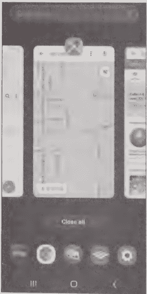

FIGURE 2-21:
最近应用屏幕。

你可以通过左右滑动在打开的应用之间滚动。点击图像上的任意位置即可跳转到其中一个应用。你也可以通过向上滑动关闭某个应用。点击底部写有“全部关闭”的链接即可全部关闭。

设备功能键很酷，因为当你触摸它们或屏幕时它们会亮起，其余时间则会淡出。

### 返回按钮

手机上的返回按钮与网页浏览器中的返回按钮类似：它会带你返回上一屏。

当你在手机屏幕间导航时，点击返回按钮会带你回到上一屏。如果持续点击返回按钮，最终会回到主屏幕。

## 键盘

Galaxy S10 手机的屏幕很重要，但你可能仍会在 QWERTY 键盘上花费更多时间输入数据。

### 使用软件键盘

当应用检测到需要用户文本输入时，软件键盘会自动弹出。如图 2-22 所示，键盘出现在屏幕底部。

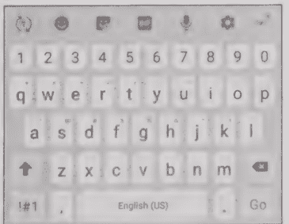

FIGURE 2-22:
使用软件键盘输入数据。

### 使用语音识别

键盘的第三种选择是……根本没有键盘！Galaxy S10 手机提供语音识别作为选项。它非常简单且效果出奇地好。在大多数可以输入文本的地方，你会看到如图 2-23 所示的麦克风图标的缩小版。

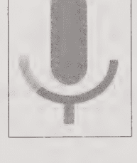

FIGURE 2-23:
语音识别图标。

只需点击此图标并说出你本想输入的内容。你会看到手机思考一秒钟，然后屏幕会提示它正在聆听。开始说话吧。说完后，你可以点击完成按钮或保持安静等待。几秒钟内，你就能读到刚才说的话！

## 手机的朝向

在本章前面讨论电源按钮时，我提到手机处于竖向（手机高而窄）。它也可以在横向（侧向，或手机短而宽）使用。手机会感应你拿着它的方向并调整屏幕，使其更易于查看。

记住

手机会将自身的朝向告知应用，但并非所有应用都设计为改变其固有显示方式。这种细微差别取决于应用的编写者。例如，你的手机可以播放视频。然而，手机自带视频播放应用仅在横向模式下显示视频。

此外，手机还能感应到你将其贴近耳朵时。当感应到处于此位置时，它会关闭屏幕。你无需担心会意外“下巴拨号”拨打博茨瓦纳的号码。

## 进入睡眠模式/关闭手机

你可以一直让手机开机，直到几年后准备升级到最新的 Galaxy S10 手机，但那样会很快耗尽电池。相反，请将闲置的手机置于睡眠模式以节省电量。注意：屏幕在 30 秒无操作后会自动进入睡眠模式。

你可以调整睡眠超时时间使其更长，我将在第 16 章介绍。或者，你也可以通过短按电源按钮手动将手机置于睡眠模式。

如果几天或更长时间不使用手机，最好直接将其关机。要完全关闭手机，只需长按电源按钮几秒钟。随后会出现以下选项：

- **关机**：完全关闭手机。
- **重启**：Android 操作系统很稳定。好吧，大部分时间都很稳定。有时你可能想重启它，因为它开始出现异常。点击重启选项，看看是否能解决问题。
- **紧急模式**：这是一个有趣的选项。一旦你同意某些条款和条件，你的手机将进入休眠状态，但如果你觉得需要拨打 911，它可以迅速恢复。在使用此选项之前，你需要同意其中的一些限制。

晚安！

## 2 与他人沟通

## 本部分内容...

- 拨打和接听电话。
- 发送和接收短信。
- 在手机上设置电子邮件账户。
- 将所有联系人集中到一个位置。

## 本章内容

- 拨号和接听电话
- 使用呼叫列表
- 进行紧急呼叫
- 连接蓝牙耳机

### 第3章

### 拨打电话

本质上，任何手机——无论多么花哨或智能——存在的目的都是为了打电话。好消息是，在你的 Galaxy S10 上拨打和接听电话很容易。

在本章中，我不仅会向你展示如何拨打电话，还会展示如何使用呼叫列表来跟踪你的通话。并且不要跳过关于在紧急情况下使用手机的部分。

最后，如果你像许多人一样，从不只做一件事，那么蓝牙耳机可以让你在开车并获取导航、检查电子邮件、照看孩子和狗，或只是平常地生活时，更容易通电话。在本章中，我将向你展示如何将手机连接到蓝牙耳机，以便你可以免提拨打和接听电话。

### 拨打电话

在你的手机已打开并且已连接到蜂窝运营商（参见第 1 章和第 2 章）后，你就可以拨打电话。这一切都从主屏幕开始。在屏幕底部，设备功能键上方，有四个或五个图标，它们是主快捷方式（参见图 3-1）。你手机上的主快捷方式可能略有不同，但在这种情况下，从左到右，它们是

- 电话
- 相机
- 电子邮件
- 消息

图 3-1：
主屏幕上的主快捷方式。

要拨打电话，请按照以下步骤操作：

1. **从主屏幕，轻点电话图标。**

你将看到一个类似图 3-2 所示的屏幕。这个屏幕称为“最近通话”，显示你已拨打或接听的任何电话，例如运营商为确认你的手机已正确设置而拨打的电话。

2. **轻点屏幕左下角的键盘链接。**

这个图标是一个绿色圆圈，上面有小白点，象征着普通座机上的触摸板。

3. **轻点你想要拨打的电话号码。**

键盘屏幕（参见图 3-3）出现。这看起来像普通座机触摸板的完整尺寸版本。

提示

在美国进行长途电话时，你不需要在区号前拨 1 ——只需拨区号然后是七位电话号码。同样，你也可以为本地电话包含 1 和区号。另一方面，如果你在国际旅行，则需要包含 1 ——并做好准备支付国际漫游费用！

在第 6 章中，你可以阅读有关如何通过联系人拨打电话的信息。

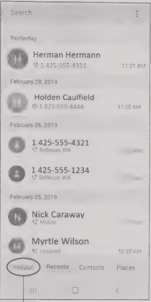

图 3-2：
电话的主屏幕。

键盘图标

4. 轻点屏幕底部的绿色电话按钮以拨打电话。

屏幕变为图 3-4 所示的屏幕。你有机会验证你是否拨打了预期的联系人。

几秒钟内，你应该能听到对方电话响铃或忙音。从那时起，就像一次普通的电话通话。

5. 通话结束后，轻点屏幕底部的红色电话按钮。

电话已断开。

### 无电话号码

### 有电话号码

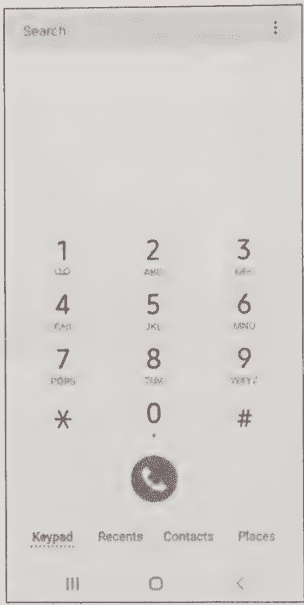

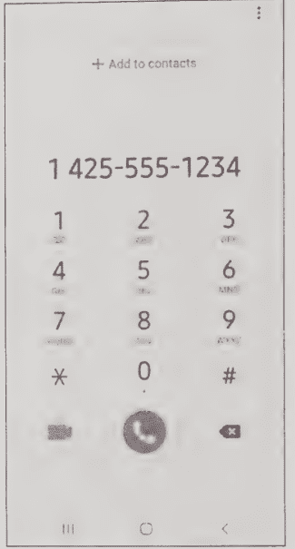

图 3-3：
从键盘屏幕拨号。

如果对方接听电话，你可以通过轻点屏幕上的正确图标/超链接获得一些选项，包括：

- 将通话保持。
- 添加另一个呼叫以进行三方通话。
- 增加音量。
- 打开蓝牙设备（参见本章后面“同步蓝牙耳机”部分）。
- 打开手机扬声器。
- 调出键盘输入号码。
- 静音手机麦克风。

你可以执行其中任何一项或全部，也可以只是享受通话。

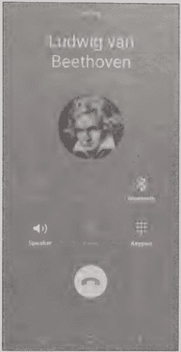

图 3-4：
拨号屏幕。

如果电话无法接通，要么你所在地的蜂窝覆盖不足，要么你的手机已切换到飞行模式，这会关闭手机中的所有无线电。（当然，你的蜂窝运营商可能在未为你设置服务的情况下就让你出门，但这种情况不太可能！）

检查屏幕顶部的通知区域。如果没有连接强度条，请尝试移动到另一个位置。如果看到一个小飞机剪影，请下拉通知屏幕（参见第 2 章中的操作方法）并轻点飞机图标以关闭飞行模式。

如果你下拉通知屏幕但看不到绿色的飞机剪影，请向左滚动绿色或灰色图标。这个图标可能已超出页面。或者，轻点右上角带有方框的图标，你将看到所有通知图标。

### 接听电话

接听电话甚至比拨打电话更容易。当有人呼叫你时，呼叫者 ID 信息会出现在弹出屏幕中。图 3-5 显示了一些来电的屏幕选项。

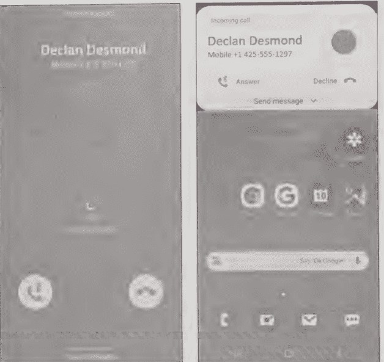

图 3-5：
接听电话时可能出现的屏幕。

如果你当时没有使用手机，它会显示全屏。如果你在使用应用，它会显示弹出屏幕，如右侧图像所示。要接听电话，轻点或滑动绿色电话按钮。要不接听电话，你可以简单地忽略铃声，或轻点或滑动红色电话按钮。铃声会立即停止，在任何情况下，电话都会转到语音邮件。

提示
在第 4 部分，我会告诉你一些在接听电话时可以启用（或不启用）的令人兴奋的选项。例如，你可以为特定号码指定独特的铃声，或让呼叫者的图像弹出（如果你将联系人保存到手机）。

无论你当时在手机上做什么——例如听音乐或玩游戏——接听弹出屏幕都可能出现。任何正在运行的应用，包括音乐或视频，在通话结束前都会被暂停。

要让呼叫者为你留言，你必须设置语音邮件。如果你尚未设置语音邮件，呼叫者会听到一条录音消息，说明你的语音邮件账户尚未设置。一些蜂窝运营商在你激活账户并获取手机时可以为你设置语音邮件；其他运营商则要求你自行设置。在运营商商店询问语音邮件的工作方式，或查看随手机附带的说明书中的说明。

接听和拒绝图标在任何蜂窝电话上都很标准。然而，你的 Galaxy S10 并非标准手机。还有第三个选项，具体情况取决于你的手机。除标准的接听或拒绝选项外，你还有一个选项——拒绝并向呼叫者发送短信。当你的呼叫者被转到语音邮件时，你也可以立即向呼叫者发送一条短信以确认通话。

你可以发送的一些典型预设消息包括：

- 对不起，我很忙。稍后再打。
- 我正在开会。
- 我会回电。
- 我在电影院。
- 我在上课。

你轻点适用的消息。消息会立即作为短信发送，这会提醒呼叫者你不是在无视他——只是你现在无法通话。很贴心。

你也可以创建并存储自己的消息，例如“走开，离开我一个人”，或“我正在做的任何事情都比和你说话更重要”。你也可以礼貌一些。要创建自己的预设消息，轻点“撰写新消息”并输入。随后它会保存在你的手机中以备需要时使用。

呼叫者必须能够在用于拨打电话的手机上接收短信。如果你的呼叫者是从固定电话或无法接收短信的手机拨打电话，此功能不起作用。

## 跟踪你的通话：最近通话

移动电话的一个不错功能是，手机会记录你已拨出和已接到的通话。Sure, you might have caller ID on your landline at home or work, but most landline phones don't keep track of whom you called. 另一方面，手机会记录你拨打过的所有号码。这些信息非常方便，例如当你想回拨但手头没有那个号码时。此外，你可以轻松地将号码添加到手机的联系人列表中。

通过点击手机屏幕上的“最近”链接，你会得到所有来电和去电的列表。（此超链接位于图 3-2 左侧所示屏幕的顶部附近。）当你点击“最近”超链接时，你会看到类似图 3-6 所示的通话记录。

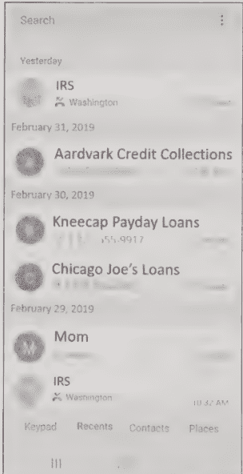

FIGURE 3-6:
通话记录。

顶部标签包括

- **你拨出的通话：** 橙色箭头指向号码。
- **你接到的来电：** 绿色箭头远离号码。
- **你未接的来电：** 红色电话轮廓配有断裂的箭头。
- **你忽略的来电：** 电话号码旁边有一个蓝色斜线符号。

记录是你拨出或接到的所有通话的列表。这很方便，这样你就可以轻松再次呼叫某人或回拨。通过点击通话列表中的任意号码，你会看到类似图 3-7 所示的屏幕。从此屏幕，你可以执行以下几项操作：

- 通过点击绿色通话按钮呼叫该号码。
- 通过点击橙色信封图标向该号码发送短信。（有关此内容的更多信息请参见第 4 章。）
- 如果已设置，则可进行视频通话。
- 点击详细信息图标将号码添加到你的联系人列表。我将在第 6 章更详细地介绍联系人。

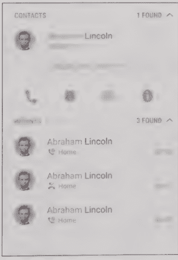

FIGURE 3-7:
通话记录详情。

## 拨打紧急电话：关于 911 的 411

手机是紧急求助的绝佳工具。Samsung Galaxy S10 与美国和加拿大所有手机一样，可以拨打 911 紧急电话。

只需在主屏幕上点击“电话”图标，点击 911，然后点击发送即可。你将被转接到离你位置最近的 911 呼叫中心。这在美国境内任何地方都有效。所以，例如，你住在芝加哥，但在夏洛特发生车祸；只需点击 911 即可连接到夏洛特的 911 呼叫中心，而不是芝加哥。

即使你的手机未注册到网络，只要电池有电，就不会有问题。你的手机会提示你唯一可以拨打的号码是 911 呼叫中心，即使主屏幕已锁定。

当你从座机拨打 911 时，你的地址通常会显示给接线员。当你从手机拨打时，接线员没有这些具体信息。所以，当你拨打 911 时，接线员可能会说，“911. Where is your emergency?” 不要被这个问题吓到；毕竟，你可能专注于发生了什么，而不是在哪里。花点时间描述一下你的位置——你所在的街道、最近的交叉街道（如果知道的话）、附近的任何商店或其他地标。知道你所在位置的接线员更能帮助你处理紧急情况。你的手机确实内置了 GPS 接收器，911 中心可以访问。然而，它并不总是准确的；它可能在那一刻无法接收位置信息，例如在室内时。

### 意外拨打 911 时

如果你不小心从手机拨打了 911，不要挂断。只需告诉接线员这是误拨。她可能会问一些问题以确认你确实安全，并且不是被迫说这是误拨。

如果你惊慌失措并在误拨 911 后挂断，你会接到最近 911 呼叫中心的来电。Always answer the call, even if you feel foolish. 如果你不接听电话，911 呼叫中心会认为你遇到了麻烦且无法回应。他们会通过你手机中的 GPS 找到你以确认你安全。如果你认为向 911 接线员解释错误会让你感到尴尬，那么想象一下向追踪你的警察解释并因浪费部门时间而对你不满时会有多尴尬。

在美国或加拿大境外旅行时，911 可能不是你在紧急情况下拨打的号码。墨西哥使用 066、060 或 080，但大多数旅游区也接受 911。而欧洲大多数——但不是全部——国家使用 112。知道当地的紧急号码与知道足够多的语言来表达你需要帮助一样重要。

## 同步蓝牙耳机

使用蓝牙耳机设备，你可以在不把手机拿在耳边的情况下通话——而且没有从手机到耳机的任何电线。你可能遇到过很多人使用蓝牙耳机通话。你甚至可能想过他们是不是有点疯狂，自言自语。Well, call yourself crazy now, because when you start using a Bluetooth headset, you might never want to go back.

不出所料，Galaxy S10 手机可以连接到蓝牙设备。The first step to using a Bluetooth headset with your phone is to sync the two devices. 方法如下：

- 1. **从手机主屏幕向上滑动以进入应用屏幕。**
这会带你进入手机上所有应用程序的列表。
- 2. **滑动或平移至“设置”图标并点击它。**
“设置”图标显示如下。此屏幕包含你可以在手机上调整的大多数设置。如果你愿意，也可以下拉通知屏幕并点击齿轮图标，或在主屏幕上点击菜单按钮。所有这些操作都会到达同一位置。点击“设置”图标会显示图 3-8 所示的屏幕。
- 3. **点击“连接”图标。**
手机上所有连接选项都会出现。
- 4. **点击“蓝牙”图标。**
这将显示图 3-9 所示的两个屏幕之一。如果蓝牙关闭，它看起来像左侧的屏幕。如果它已打开，它看起来像右侧的屏幕。

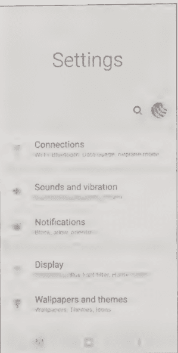

FIGURE 3-8:
设置屏幕。

蓝牙“关闭”模式

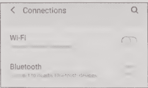

蓝牙“开启”模式

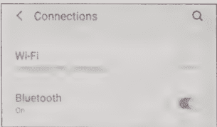

FIGURE 3-9:
蓝牙设置屏幕。

- 5. 通过打开蓝牙或将蓝牙关闭后再打开，将手机置于配对模式。
此步骤使你的手机对其他蓝牙设备可见。此状态将持续约 60 秒——足够你将蓝牙设备置于配对模式的时间，以便两个设备可以协商适当的设置并在今后每次“看到”彼此时配对。例如，图 3-9 右侧图像中的手机识别出它的老朋友 Plantronics Backbeat Pro。此设备和手机在此图像中显示为尝试重新建立连接。Backbeat Pro 和这部手机曾经有过连接。该连接已中断。现在它们想要再次配对。这是一旦你交换正确的 security code 就会自动完成的。
- 6. 接下来，将你的耳机置于同步模式。
按照随耳机附带的说明操作。
片刻后，手机“看到”耳机。当它这样做时，你会被提示输入 security code，并且软件键盘会弹出。
- 7. 输入耳机的 security code，然后点击 Enter 按钮。

大多数耳机的 security code 为 0000，但如果该号码不起作用，请查看随耳机附带的说明。

你的手机可能会看到附近的其他设备。如果是这样，它会询问你想要配对哪台设备。点击你的耳机的名称。

你的耳机现在已与你的手机同步。如果其中一个打开时另一个已打开，它们会相互识别并自动配对。

一些制造商使通过蓝牙链接变得更容易。例如，你可能收到了一副 Samsung Galaxy Buds。使用这些耳塞，你只需在手机处于扫描模式时打开存放耳塞的盒子。系统会提示你连接，一切就完成了。不要对它比本节列出的步骤更简单感到惊讶！

## 除了耳机之外的其他选项

耳机不再是唯一的选择。Although many people walk around with the ubiquitous Bluetooth headset dangling from an ear, many other choices are out there. 你可以同步到各种蓝牙设备，包括外部键盘、笔记本电脑、平板电脑、外部扬声器，甚至你的汽车。

还有用于测量血压、心率和大量其他身体信息的外部传感器。其中一些内置于可穿戴设备中，例如健身手环。制造商现在正在将计算机嵌入到可以通过蓝牙连接到智能手机的家用电器中！

好消息是，无论技术如何，你都可以使用前一节所述的步骤将所有这些设备连接到你的手机。我将在后面的章节中谈论更多这些可能性。

## 本章内容
- » 发送短信
- » 发送带附件的短信
- » 接收短信

### 第4章
### 发现短信的乐趣

当然，手机是用来通话的。但如今，很多人使用手机发短信甚至比打电话还多。

即使是最基础的手机如今也都支持短信，但你的 Galaxy S10 手机让发送和接收短信变得更加方便，无论你是偶尔发短信还是病态的短信狂。本章我将介绍如何发送短信（带或不带附件）、如何接收短信以及如何阅读旧短信。

本章使用的图片来自三星信息应用程序。你的手机可能默认使用的是另一个短信应用程序。如果是这样，你可以轻松切换到信息应用。你也可以继续使用默认应用，但图片会有所不同。由你选择。

### 发送第一条短信

短信（通常为160个字符或更少的简短信息，通过手机发送）在你此刻无法通话时（也许你在开会或上课）或只是想分享一点小信息时（“来晚了——马上见！”）特别方便。

许多手机用户——尤其是年轻人——更喜欢发短信而不是打电话。他们认为短信是一种更快、更方便的沟通方式，并且经常使用短信缩写来在短消息中容纳更多内容。

发短信有两种情况。第一种是第一次给某人发短信。第二种是与某人进行短信对话。

当你刚拿到手机，准备炫耀你的新 Galaxy S10 并想给你的好朋友发条短信时，操作是如此简单：

- 1. 在主屏幕上，点按信息图标。

信息图标看起来像一个信封。点按它后，你会得到一个用于发短信的几乎空白的主屏幕。这在图4-1中显示。

当你进行一些对话时，它开始填满。

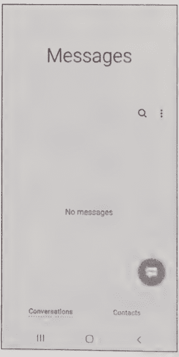

图4-1：
初始信息主屏幕。

- 2. 点按新建信息图标（带三个点的卡通对话框）。

点按新建信息图标会显示图4-2所示的屏幕。

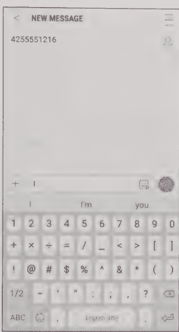

图4-2：
空白短信屏幕。

- 3. 点按以输入收件人的十位移动电话号码。

屏幕顶部会出现一个文本框，顶部有熟悉的收件人字段。
键盘出现在屏幕底部。

如图4-3所示，顶部字段是输入电话号码的地方。
数字位于键盘顶部。

一定要包含区号，即使你短信的对象是本地的。
在号码前加上1是不必要的。

如果这是你的第一条短信，你还没有机会建立短信历史。
在使用信息应用程序一段时间后，你会输入联系人信息，你的手机会开始尝试预测你的预期收件人。你可以采用其中一个建议，也可以继续输入。

### 部分输入的号码及猜测

### 完全输入的号码

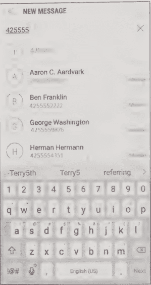

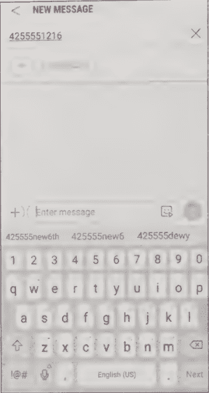

图4-3：
在上方的文本框中输入收件人号码。

- 4. 要输入短信，请点按显示“输入信息”的文本框。图4-4显示了输入文本的位置。

你的信息将出现在回形针图标右侧的文本框中。

在Android信息应用中，你的短信最多可达160个字符，包括空格和标点。应用程序会倒计时你剩余的字符数。

记住

- 5. 通过点按信息右侧的发送按钮发送短信。

发送按钮在开始输入之前是灰色的。输入内容后，它会变成全亮的橙色。点按按钮后，手机会接管后续操作。几秒钟内，信息就会发送到你朋友的手机上。

提示

在你建立联系人列表后（在第6章阅读相关内容），你可以从联系人列表中点按一个名字，或在收件人文本框中开始输入名字。如果该联系人只有一个号码，你的手机会假设那就是你想要发送短信的接收电话。如果该联系人有多个号码，它会询问你想要发送短信的电话号码。

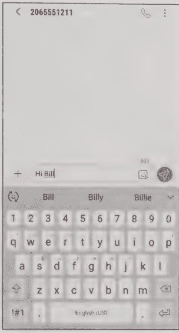

图4-4：
输入你的文本。

记住

在大多数情况下，短信应用的默认设置是让手机自动纠正它认为拼写错误的单词。你可以在短信下方较深的灰色区域看到它的猜测。这种功能称为自动更正。你可能会觉得它非常方便，也可能会觉得烦人。如果你喜欢它，仍应验证它是否以正确的方式更正了单词。如果你想知道为什么这是个好主意，可以在你喜欢的搜索引擎中搜索“搞笑自动更正示例”（尽管有些可能非常露骨）。

警告

你可能已经听过一千次开车时发短信是非常糟糕的主意的说法。这里是第一千零一次。开车时发短信是非常糟糕的主意——而且在许多地方是非法的。有一些读这本书的傻瓜，实际上非常聪明，然后还有一些傻瓜开车时发短信。我希望你成为前者而不是后者。

### 通过短信进行对话

在糟糕的老式 pre-Galaxy S 时代，大多数手机都会保留你的短信记录。手机会按顺序保存你发送或接收的短信，无论谁发送或接收。

按顺序存储的短信是老派的。你的 Galaxy S10 会跟踪你正在短信联系的联系人，并将每组往返信息存储为一个 *对话*。

在图4-5中，你可以看到信息的第一页包含 *对话*。在你开始给某人发短信后，这些短信会被存储在一个对话中。

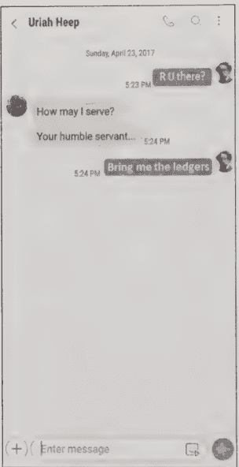

图4-5：
一次信息对话。

如图4-5所示，每条短信按顺序呈现，短信作者由对话框的方向表示。

请注意屏幕底部的输入信息文本框。有了这个方便的功能，你可以向正在对话的人发送你输入的任何内容。

在旧时代，有时很难理清你正在进行的不同的短信对话。当你与他人开始短信对话时，就会出现第二个对话。

不久之后，你将会有多个对话同时进行。别担心。它们不是那种需要不断进行的对话。如果一段时间不发短信，没人会多想。图4-6中的图像显示了图4-1中的短信页面不久后可能的样子。

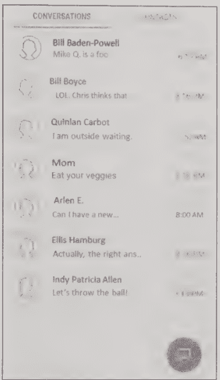

图4-6：
显示多个对话的短信屏幕。

提示
更改对话的字体大小很容易。要使字体更大、更易读，请使用拉伸手势。使用捏合手势使字体变小，以便可以看到更多对话内容。

### 发送带附件的短信

如果你想发送除文本之外或代替文本的东西怎么办？比如你想随短信发送一张图片、一些音乐或Word文档。只要接收端的手机能识别附件，就很容易。以下是步骤：

- 1. 从主屏幕点按信息图标。
- 2. 要么点按新建信息图标并输入预期收件人的号码，要么继续进行现有对话。

您将看到图 4-2 中的输入信息气泡。像输入普通文本一样输入您想要的信息。

### 3. 要添加附件，请点击输入文字左侧的加号。

加号会调出您在图 4-7 中看到的屏幕，该屏幕会询问您想要附加哪种类型的文件。您的选择包括图片、视频、音频文件，以及我在第 9、12、13 和 14 章中描述的一些其他类型，当您有一些不错的文件可供分享时。暂时知道您有选择就足够了。

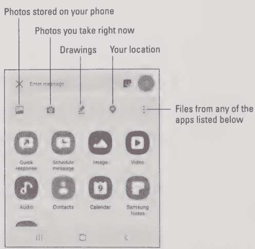

图 4-7：
可以附加到文本上的文件类型。

### 4. 点击您选择的文件类型，您的手机会为您提供属于该类别的选项。

准备好惊讶吧。在文本框下方，您有五个选择。其中包括用于照片的图库、现在用相机拍摄的照片、手绘涂鸦、带有您位置的地图或其他类别。图 4-7 显示了“其他”类别。这适用于您手机上已有的任何想要附加的文件。它可以是您的电子名片。也可能是视频。

快速回复会打开预设回复，例如“What's up?” 或 “Where's the meeting?” 这有多酷啊？！

### 5. 如有需要，请继续输入短信。

### 6. 当您完成消息的文本部分后，点击发送按钮（看起来像纸飞机线条图的那个），消息就会发出。

简单的短信是 SMS（短消息服务）消息。当您添加附件时，您发送的是 MMS（多媒体消息服务）消息。过去，MMS 消息的发送和接收费用比 SMS 消息更高。如今在美国已不是这种情况。

## 接收短信

接收短信甚至比发送更简单。

当您正在进行短信对话并收到与您聊天的人发来的新短信时，您的手机会发出蜂鸣声和/或振动。此外，屏幕的通知区域（最顶部）会显示一个非常小的 Messages 图标。

您可以从屏幕最顶部下拉通知区域，或启动消息应用程序。由您选择。

如果有附件，它会包含在对话屏幕中。

要访问短信，您需要解锁屏幕。Messages 图标（一个信封）还会显示您未读短信的数量。点击该图标以打开对话。

## 管理您的短信历史记录

Messaging Conversations 屏幕会存储并整理您所有的短信，直到您删除它们。您应该不时清理此屏幕。

管理消息最简单的选项是点击菜单图标，然后点击删除。然后您可以选择和取消选择要删除的所有对话。点击屏幕底部的垃圾桶图标，它们就会消失。

另一种删除选项是打开对话。您可以通过长按气泡来删除每条短信。片刻后，会出现一个菜单，您可以从中删除该消息。如果短信很多，这种方法会慢很多。

我建议您毫不留情地删除旧的短信和对话。相信我；删除所有旧消息会令人感到舒畅！

### 第5章

## 发送和接收电子邮件

### 本章内容

- 在手机上设置电子邮件账户
- 在手机上阅读电子邮件
- 管理电子邮件文件夹
- 从手机发送电子邮件

> 如果您已在手机上使用电子邮件一段时间，您会知道它有多方便。如果您的 Galaxy S10 手机是您第一部能够发送和接收电子邮件的手机，请做好上瘾的准备。

我从本章开始向您展示如何设置电子邮件，无论您的电子邮件程序是否受支持。然后我向您展示如何阅读和管理电子邮件。最后，我在本章的最后一节告诉您如何撰写和发送电子邮件。

## 设置您的电子邮件

如今，许多人出于多种原因拥有多个个人电子邮件地址。您的手机 Email 应用最多可管理十个电子邮件账户。使用 Galaxy S10 手机时，您可能需要仅为手机在 Google 的 Gmail 上创建单独的电子邮件账户。如果您不获取 Gmail 账户，您将错过许多令人兴奋的功能。我强烈建议如果您还没有，请设置一个新的 Gmail 账户（请参阅即将到来的“设置新的 Gmail 账户”部分）。

您手机上的 Email 应用会定期“轮询”您已识别电子邮件账户和密码的所有电子邮件系统。然后它会向您展示电子邮件的副本。

您的手机主要与您电子邮件账户中的收件箱交互。不过，它并不是真正设置为像计算机上的功能齐全的电子邮件应用程序那样工作。例如，许多电子邮件套件集成了复杂的文字处理器，具有用于保存消息的复杂归档系统，并提供大量字体。只要您不介意没有这些功能，您可能永远不需要登录计算机来访问电子邮件，并且可以将电子邮件存储在手机文件夹中。

设置很简单，并且能够访问所有电子邮件会让您如此高效，我建议您考虑将所有电子邮件账户添加到手机中。

### 准备工作

通常，连接到个人电子邮件账户只需在手机中输入您的电子邮件账户名称及其密码即可。在准备设置手机时，请将这些信息备好。

如前所述，您的手机上最多可以有十个电子邮件账户；不过，您需要选择一个作为首选账户。您可以使用任何账户发送电子邮件，但您的手机希望知道您希望它用作默认的电子邮件账户。

接下来，您可能希望能够访问工作账户。如今这相对常见，但一些公司认为这是安全问题。您应咨询 IT 部门获取更多信息。从技术上讲，只要您的企业电子邮件足够现代，实现这一点并不困难。

最后，如果您还没有 Gmail 账户，我强烈建议您注册一个。阅读附近的侧边栏“获取 Gmail 账户的优势”以了解原因。

### 设置您现有的 Gmail 账户

如果您已有 Gmail 账户，将其设置在手机上非常简单。请从“应用”菜单按以下步骤操作：

### 1. 在应用列表中找到 Gmail 图标。

这里有一个令人困惑的部分。图 5-1 中左侧的图标是 Gmail 应用。右侧的图标是通用电子邮件应用。通用电子邮件应用用于您的合并电子邮件账户。通用电子邮件应用是您用来访问所有电子邮件账户的应用。

图 5-1：
Email 和 Gmail 图标。

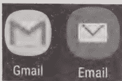

### 2. 点击 Gmail 图标。

因为您的手机还不知道您是否有 Gmail 账户，所以它会提供输入 Gmail 账户或是否要创建新账户的选项。此页面显示在图 5-2 中。

### 获取 Gmail 账户的优势

您可能已有工作和个人电子邮件账户。您甚至可能有一个旧电子邮件账户，因为某些朋友出于某种原因没有更新您的资料而继续使用旧地址，所以您只偶尔检查一次。

获得另一个电子邮件地址的想法，即使是免费的，也可能（可以理解地）令人不感兴趣。毕竟，这又是一个需要记住的地址和密码。然而，手机上的一些重要功能需要 Gmail 账户：

- 从 Google Play 商店购买应用的能力。（这很重要！）我在第 8 章介绍 Play 商店。
- 使用 Google Drive 进行存储的能力。（这相当重要，几乎是巨大的！）
- 免费访问照片网站 Google Photos（尽管其他网站具有许多相同功能）。
- 自动备份您的联系人和日历。有关详细信息，请参阅第 6 章和第 13 章。

长话短说，即使您已有个人电子邮件账户，获取 Gmail 账户也值得付出努力。

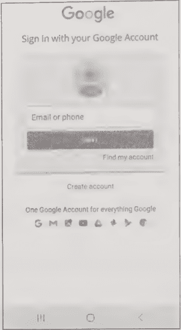

FIGURE 5-2:
添加您的账户页面。

3. **输入您的 Gmail 账户电子邮件地址并轻触“下一步”。**

请务必包含 @gmail.com 后缀。

4. **输入您现有的 Gmail 密码并轻触“下一步”。**

请继续输入您的密码。准备好后，在键盘上轻触“下一步”。

您可能会收到一个弹出窗口，重新确认您同意使用条款以及所有法律内容。轻触“确定”。在您的手机和 Gmail 账户相互认识的过程中，您会看到许多闪烁的灯光和旋转的圆圈。

如果一切正确，您的手机和账户将相互熟悉并成为最好的朋友。几分钟后，它们就可以满足您的需求。甚至还有几个屏幕会告诉您 Gmail 账户将为您做的一切美妙事情。相信每一个字！

如果您遇到问题，您可能输入有误。请尝试重新输入信息。从现在开始，您 Gmail 账户收到的任何电子邮件也都会出现在您的手机上！

## 设置新的 Gmail 账户

如果您需要设置新的 Gmail 账户，您需要遵循几个额外的步骤。在开始步骤之前，请想好一个好的用户 ID 和密码。

Gmail 已经存在一段时间了。这意味着所有好用的、简单的电子邮件地址都被占用了。除非您计划开始将此电子邮件账户用作您的主要电子邮件，否则您最好选择一些现在可以记住的字母和数字的特殊组合来完成此过程。

当您准备好所有内容后，请按照上一节中的步骤 1 和 2 操作，但在到达图 5-2 所示的屏幕时轻触“创建账户”链接。从那里开始，按照以下步骤操作：

- 1. 在屏幕上输入您的名字和姓氏。

Google 在图 5-3 所示的屏幕中要求您的姓名。这就是 Google 个性化与您沟通的方式。

您可能会想使用假名或其他巧妙的双词组合代替姓名。不要这样做。幽默感消退后很久，您仍然会收到发给 Rita Book 或 Warren Peace 的电子邮件。

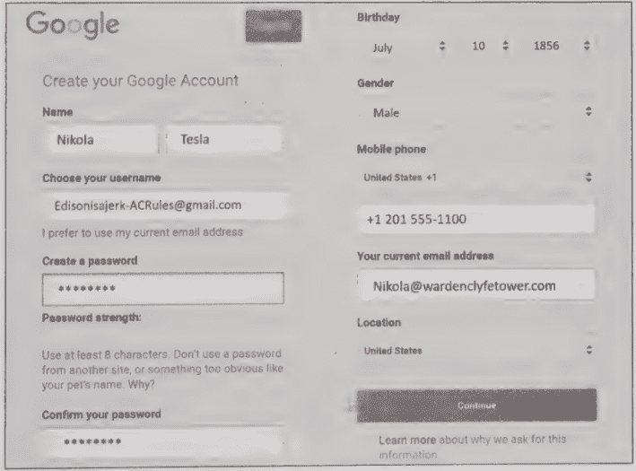

FIGURE 5-3:
创建您的 Google 账户屏幕。

### 2. 输入您希望与 Gmail 一起使用的用户名。

在图 5-3 所示的屏幕中，输入您想要的用户名。希望您能一次就通过此名称的审核。

如果您的首选不可用，请重试。在进行这些步骤之前，没有简单的方法可以检查。最终，您会找到一个未使用的 ID，或者您会使用蓝色字体中的建议之一。成功时，它会祝贺您。

### 3. 选择一个至少八个字符的好密码。

请确保选择一个独特且您能记住的密码。

### 4. 输入其他信息和备用电子邮件地址，然后轻触“继续”。

如果您忘记密码，Google 希望验证您确实是您本人，而不是冒充您的人。Google 通过向另一个账户发送确认电子邮件或向您的手机发送短信来进行此检查。您可以现在执行此操作，也可以轻触“跳过”稍后再做。

轻触“完成”后，灯光闪烁，您会看到屏幕正在工作。此过程通常需要不到两分钟。在等待期间，您会看到各种信息，表明它正在准备同步。别担心。我会及时解释这些信息。现在，您可以通过遵循下一节中的步骤添加任何其他电子邮件账户。

## 使用非 Gmail 电子邮件账户

您的手机设置可与最多十个电子邮件账户配合使用。如果您有超过十个账户，我想您生活可能太忙碌了。没有任何手机，甚至 Galaxy S10 也帮不了您！

我现在介绍添加电子邮件账户的步骤。一旦您告诉手机所有电子邮件账户，电子邮件屏幕将让您查看每个账户的收件箱或将所有电子邮件合并到单个收件箱中。您可以选择最适合您的选项。

## 添加您的第一个电子邮件账户

开始之前，请准备好您的电子邮件地址和密码。准备好后，进入手机的主屏幕。查找邮件图标；它是一个剪影信封（参见图 5-1）。它可能位于主屏幕上设备功能键正上方的四个主要快捷方式之一，或在您的应用程序列表中。

### 1. 从主屏幕轻触邮件图标。

这会显示一个类似图 5-4 所示的屏幕。选择其中一个选项开始。在每种情况下，它都从输入电子邮件地址开始。

您的电子邮件地址应包括全部内容，包括 @ 符号及其后面的所有内容。请确保正确输入密码，如果您的电子邮件服务器区分大小写（大多数都区分），请注意大小写。如果不确定，请选择允许您查看密码的选项。

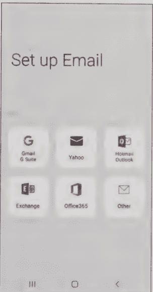

FIGURE 5-4:
电子邮件应用的设置屏幕。

### 2. 轻触框以输入您的密码。

如果您的 S10 将您带到专门用于输入密码的电子邮件提供商专用屏幕，请不要惊讶。图 5-5 显示了通用电子邮件账户的登录屏幕。图 5-6 显示了 Microsoft Exchange 账户的屏幕。其中一个会起作用。

FIGURE 5-5:
电子邮件应用的设置屏幕。

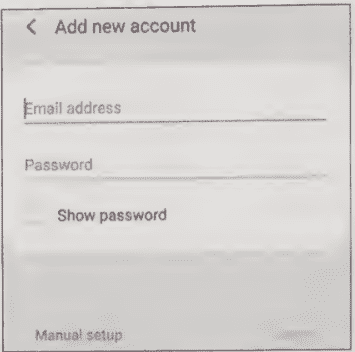

FIGURE 5-6:
Microsoft Exchange 账户的“输入账户信息”屏幕。

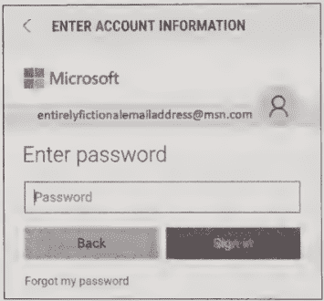

3. 仔细在适当字段中输入您的密码并轻触“下一步”。

系统会要求您授权权限。现在只需使用默认设置即可。这会显示图 5-7 所示的屏幕。

4. 选择所需的同步设置，然后轻触“下一步”。

您可以选择希望手机和电子邮件服务同步的频率。默认设置经过了大量思考和考虑。如果您只是想开始使用，请轻触“下一步”。

如果您以后想微调设置，返回调整这些设置并不困难。这些设置旨在对您的数据使用量温和。

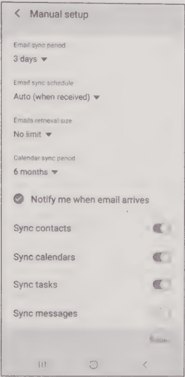

FIGURE 5-7:
同步设置屏幕。

如果您希望电子邮件中的图片立即下载、在手机上存储较旧的电子邮件、随时检查是否有新电子邮件，您可以在此页面为此电子邮件账户更改这些设置。如果您知道想要与默认设置不同的内容，请进行更改，然后轻触“下一步”。

### 5. 为新的电子邮件账户输入一个名称。

下一个屏幕如图 5-8 所示。这让您可以选择为电子邮件账户命名，而非使用其地址。您可以随意命名，但我建议选择较短的名称，例如 Joe's MSN 或 My Hotmail。（听我的，别学我。）

### 6. 轻触“完成”。

以图 5-9 为例，您可以看到我的账户现在已在我的手机上注册。它成功了！

FIGURE 5-8:
为电子邮件账户命名。

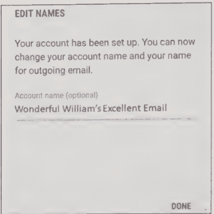

选项图标

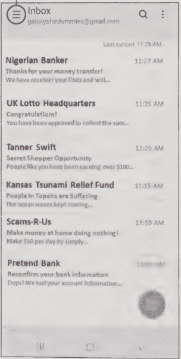

FIGURE 5-9:
电子邮件主屏幕。

## 添加额外的电子邮件账户

一旦您输入了第一个电子邮件账户，就有几个不同的步骤可以添加额外的账户。

- 1. 轻触屏幕左上角的选项图标。

三条水平线会调出图 5-10 所示的滑入屏幕。这允许您查看其他电子邮件文件夹。它还让您访问设置图标。

- 2. 轻触设置图标。

轻触“设置”会显示图 5-11 所示的屏幕。

- 3. 轻触绿色加号旁边的“添加账户”。

这会将您带回电子邮件设置屏幕（参见图 5-5）。

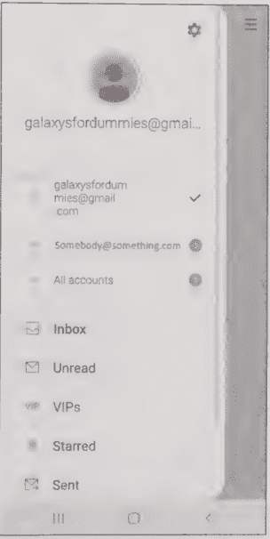

FIGURE 5-10:
选项滑入屏幕。

FIGURE 5-11:
电子邮件设置屏幕。

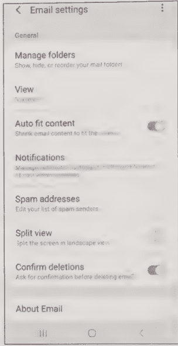

在此阶段你可以再添加多达九个账户，并且请记住，系统会询问你希望哪个电子邮件账户作为主要账户。完全由你决定。你可以通过选择来从所有账户发送和接收电子邮件，但如果从其他应用程序（如联系人应用）发送电子邮件，则只有一个可以作为主要账户使用。

## 设置企业电子邮件账户

除了个人电子邮件账户之外，如果基于 Microsoft Exchange 服务器，并且公司 IT 部门允许，你还可以将工作电子邮件账户添加到手机上。

开始之前，你需要从公司的 IT 部门获取一些信息：

- 办公电子邮件服务器的域名。
- 你的工作电子邮件密码。
- 你的 Exchange 服务器名称。

如果 IT 部门同意你使用手机访问其电子邮件服务，IT 部门将毫不费力地为你提供这些信息。

在手机上设置工作电子邮件之前，请确保你已获得许可。如果你未经公司批准就这样做，并最终违反公司规定，你可能会惹上麻烦。提高生产力并不会有太大帮助，如果你最终站在停车场里，手持装满办公室所有物品的纸板箱。

假设你的公司希望你在不增加公司成本的情况下提高生产力，添加工作电子邮件的过程从图 5-5 所示的电子邮件主屏幕开始。

- 1. 输入你的电子邮件地址和密码。
- 企业屏幕显示在图 5-12 中。
- 2. 点按手动设置。
- 这会调出图 5-13 所示的屏幕。
- 很可能你对这些意味着什么或现在该做什么毫无头绪。

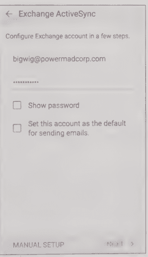

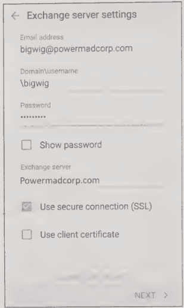

FIGURE 5-13:
添加企业电子邮件账户的手动设置屏幕。

3. 确认你的 IT 部门同意你在自己的设备上使用电子邮件，并请他们提供必要的设置。

说真的。越来越多的公司会允许你在手机上访问。但与此同时，他们通常不会传阅说明如何实现这一点的文档。如果任何人都能获得访问权限，这将是一个巨大的安全问题。省去时间，请向 IT 求助。

## 在手机上阅读电子邮件

在图 5-9 中，你可以看到我所称的“我的个人电子邮件”的电子邮件屏幕的外观。你也可以将其设置为将所有电子邮件合并到一个收件箱中。在任何时候，你可能希望单独查看账户或全部一起查看。

若要在一个大型收件箱中查看所有电子邮件，请点按“收件箱”一词旁边的向下箭头并选择“合并收件箱”。这会按时间顺序列出所有电子邮件。要打开任何电子邮件，只需点按它即可。

如果你只想查看某个账户的电子邮件，请点按顶部写着“合并收件箱”的框。点按此图标后，你的手机将显示所有单独的电子邮件账户。点按你当前想要关注的账户，你的手机将按时间顺序显示仅该电子邮件地址的电子邮件。

## 编写和发送电子邮件

在设置好电子邮件的接收部分后，另一个重要方面是撰写和发送电子邮件。只要你在电子邮件屏幕中，随时都可以点按菜单按钮以调出弹出屏幕。从弹出菜单中，点按撰写图标以打开电子邮件撰写屏幕。

以下是决定此电子邮件将使用哪个电子邮件账户发送的逻辑：

- 如果你在某个电子邮件账户的收件箱中，并在点按菜单后点按撰写图标，你的手机将通过该账户向预期收件人发送电子邮件。
- 如果你在合并收件箱或电子邮件应用的其他部分，你的手机会假定你希望从注册第二个（或额外）电子邮件账户时选择的默认电子邮件账户发送电子邮件。

当你在菜单弹出菜单中点按撰写图标时，它会告诉你将使用哪个账户。图 5-14 所示的电子邮件撰写屏幕显示，此电子邮件将来自此账户：galaxysfordummies@gmail.com。

如本屏幕所示，顶部有一个坚定的收件人字段，在此处输入收件人地址。你也可以调出你的联系人、群组或最近的电子邮件地址。（有关联系人的所有信息，请阅读第 6 章。）点按你想要的地址或联系人，它会填充收件人字段。

在下方，主旨字段是输入电子邮件主题的地方。其下方是消息正文，默认签名为 Sent from my Samsung Galaxy S10，尽管你的蜂窝运营商可能已自定义此签名。

FIGURE 5-14:
电子邮件撰写屏幕。

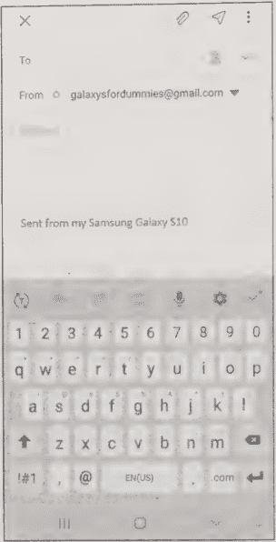

屏幕顶部有三个链接：

- **Attach:** 点按此超链接即可将任何类型的文件附加到你的电子邮件中。
- **Send:** 点按此看起来像纸飞机的图标即可将电子邮件发送给预期收件人。
- **More (three vertical dots):** 点按此选项，即可获得图 5-15 所示的弹出窗口。这可能会提供以下一些选项：
  - **Save in Drafts:** 这允许你在不丢失工作的情况下稍后完成电子邮件。
  - **Send email to myself:** 这是保存电子邮件到已发送邮件文件夹的替代方案。
  - **Priority:** 此选项表示这比发送给收件人的平均电子邮件更重要。
  - **Security options:** 这里有一些花哨的、007 风格的选项。你可以签署文档或对其进行加密。
- **Turn on Rich text:** 为节省数据使用，电子邮件以默认字体发送。如果你想多消耗一些数据，你可以发挥创意并添加更精美的字体。

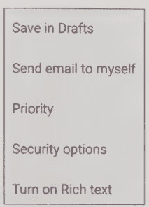

FIGURE 5-15: 撰写电子邮件选项。

如果你改变主意不想发送电子邮件，只需点按返回键即可。如果你只完成了部分消息，系统会询问你是否要将其保存在草稿文件夹中。

草稿文件夹的工作方式与计算机电子邮件程序中的草稿文件夹相同。当你想继续处理已保存的电子邮件时，打开草稿文件夹，点按它，然后继续工作。

## 回复和转发电子邮件

回复或转发你收到的电子邮件是常见活动。你可以在电子邮件应用中执行此操作。图 5-16 显示了一条典型的打开电子邮件。

你可以通过点按屏幕底部的带返回箭头的图标来回复。如果其他人被抄送了电子邮件，你可以点按双返回箭头进行全部回复。

当你点按其中任一选项时，回复屏幕会返回，收件人行由发件人电子邮件地址（或地址）填充，并留有空白供你发表评论。（在图 5-16 的情况下，你可以要求你爸爸不要再发送类似的笑话。）

FIGURE 5-16:
一封已打开的电子邮件。

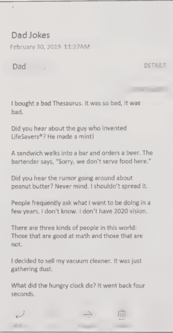

要转发电子邮件，请点按“转发”一词上方指向右方的箭头，并像发送新电子邮件时一样输入收件人。

## 本章内容

- 将你的所有来电者、短信者和电子邮件发送者放在你的手机上
- 将所有联系人集中在一个位置
- 只需几次点按即可保持最新

### 第6章

### 管理你的联系人

你可能熟悉使用联系人数据库。许多手机会自动创建一个，或至少提示你创建一个。你可能还在工作电脑上有一个联系人文件，由工作电子邮件地址和电话号码组成。而且如果你有个人电子邮件账户，你可能也有朋友和家人的电子邮件账户联系人数据库。如果你走的是老派路线，你甚至可能保留一本纸质地址簿，上面有姓名、地址和电话号码。

拥有所有这些联系人数据库的问题是，它很少像我刚才概述的那样整洁有序。一个朋友可能在工作中给你发电子邮件，因此你在两个联系人数据库中都有她。然后她的电子邮件地址可能会更改，你在个人地址簿中更新了该信息，但在工作地址簿中没有更新。不久之后，你就会有重复且过时的联系人，很难判断哪个是正确的。如何在你的联系人资料中包含 Facebook 或 LinkedIn 消息尚不明确。

除了保持所有联系人数据库为最新之外的问题，从旧手机迁移数据库也可能很麻烦。一些蜂窝运营商或公司提供了将现有文件转换为新手机的服务，但这很少是真正令人满意的体验。你最终会花费大量时间纠正它所做的假设。

你现在在使用 Galaxy S10 时再次面临同样的困境：决定如何管理你的联系人。本章为你提供了每种方法的优点，以便你

可以决定哪一种最适合你。这样，你就不会在把 500 个最好的朋友放到错误的归档系统之前，产生后悔当初没有用另一种方式处理的挫败感。

## 使用 Galaxy S10 通讯录应用

你的手机希望你能够以你所知道的任何方式与你想联系的所有人进行沟通。这要求很高，而你的 Galaxy S10 让这一切尽可能简单。事实上，如果通讯录应用中实现的这项技术成为你最喜欢的手机功能之一，我也不会感到惊讶。毕竟，你的手机就是为了简化与朋友、家人和同事的沟通，而手机上的通讯录应用让这一切在技术允许的范围内变得尽可能简单。

同时，这些信息的好坏取决于你的通讯录数据库管理是否规范。本节的重点是帮助你帮助你的手机帮助你。

## 学习手机上的通讯录应用

事实是，如果你在第 5 章中将手机与你的电子邮件账户关联起来，那么手机上的通讯录列表就会包含来自每个通讯录列表中的所有联系人。

看一下。从主屏幕点按通讯录图标。

如果你还没有创建 Gmail 账户、同步个人电子邮件，或在发送短信或拨打电话时创建联系人，你的通讯录列表将是空的。否则，你会看到一堆现在驻留在手机上的联系人，按字母顺序排序（如图 6-1 所示）。

除了管理数据的通讯录应用程序外，此数据库不仅仅存储姓名、电话号码和电子邮件地址。不过，你可以让联系人包含以下全部或部分信息：

- 所有电话号码，包括
  - 手机
  - 住宅
  - 工作
  - 工作传真

图 6-1：
通讯录列表。

  - 寻呼机
  - 其他
- 电子邮件地址
  - 住宅
  - 工作
  - 手机
- 即时通讯地址
- 公司/组织
- 职位
- 昵称
- 邮寄地址
  - 住宅
  - 工作
  - 其他地点

## 关于此人的任何备注

- 网址
- 生日（或其他重要事件）
- 姓名的音译拼写

如果这还不够，你可以为特定联系人来电指定特定的铃声。我将在第 12 章介绍为单个来电者分配音乐文件的步骤。

最后，你可以为联系人分配一张图片。它可以来自你的图库；你可以拍摄新照片；或（正如我在第 8 章中讨论的）你可以连接到像 Facebook 这样的社交网络并使用该人的个人资料图片。

幸运的是，唯一必不可少的信息是姓名。其他所有字段都是可选的，只有在字段包含要显示的信息时才会显示。图 6-2 显示了一个信息较少的联系人。

图 6-2：
一个信息较少的联系人。

## 决定在哪里存储你的联系人

在深入之前，重要的是你决定想要存储联系人的默认选项。利用本节提供的信息现在做出决定，将使你在今后的使用中生活更轻松。合并联系人数据库是可能的，但即使是最好的工具也不完美。

当你第一次尝试保存新联系人时，通讯录应用会提供一个弹出屏幕，如图 6-3 所示。它列出了你拥有的选项，并将你的第一次输入作为你想要的默认选项。

图 6-3：
为创建新联系人选择默认值。

每当你保存新条目时，你可以手动切换到这些数据库中的另一个。为自己节省时间和麻烦，现在就决定你想要做什么。以下是保存新联系人的选项：

- 在手机的内存中。
- 在插入手机的 SIM 卡上。
- 在你的 Gmail 账户中。
- 作为你其他账户中的一个联系人。

这四种选项各有利弊。如果你只是想要我的建议，我建议使用你的 Gmail 账户来存储新联系人。如果这让你满意，请跳到下一节关于从其他来源链接联系人的内容。如果你需要一些背景信息，请继续阅读。

情况是这样的：如果一切正常运行，所有选项都同样有效。然而，如果你经常更换手机、丢失手机、需要对联系人进行重大更新，或经常处于无线覆盖范围之外，例如在飞机上，你应该考虑这些选项。

第一个提到的选项涉及将联系人存储在手机内部。只要你拥有手机，这就是一个很棒的选项。然而，总有一天三星（或 HTC、LG 等）会有更快更好的产品，你会想要升级。届时，也许明年或十年后，如果你想保留联系人，你需要将它们移动到另一个位置。此外，如果你丢失手机，我希望你最近已经使用过我在第 17 章中探讨的备份选项之一。

第二个选项是将新联系人存储在 SIM 卡上。如果你之前的手机使用 AT&T 或 T-Mobile，那么 SIM 卡就是熟悉的技术。图 6-4 显示了一个典型 SIM 卡的剖面图，旁边有一枚十美分硬币作为比例尺，尽管你的卡上可能印有你移动运营商的标志。SIM 卡右侧是更新的 micro SIM 卡。这是同样的概念，但尺寸更小。

图 6-4：
SIM 卡和 micro SIM 卡。

### 技术说明

如果你的移动运营商是 Verizon、Sprint 或 US Cellular，你可能会感到困惑。你的 Galaxy S10 有一张 SIM 卡。怎么回事？这些运营商使用 CDMA 技术进行语音和某些数据功能。直到 3G，使用 CDMA 技术和数据服务的手机不使用 SIM 卡。如今，美国所有运营商都在实施一种超高速数据技术，称为 LTE，也称为 4G。因为你的手机支持 LTE，所以你现在有了一张 SIM 卡。

使用 SIM 卡的酷炫之处在于，你可以将其从现有手机中取出并插入另一部手机，所有联系人都会随你一起移动。如果你使用的是近期版本的 Android 智能手机，它就能如此轻松地工作。如果你，比如说，换回功能手机（即仅能打电话和发短信且价格为 1 美元的手机），它也几乎同样容易。另一个优点是，你的 SIM 卡更新更改时不需要无线连接。

下一个选项是将新联系人存储在你的 Gmail 账户中。这意味着你的新联系人会自动从手机复制到 Google 服务器上的 Gmail 账户中。这会保留手机上的记录，但 Google 会在你的 Gmail 账户中保留此记录的副本。你可以在手机或 PC 上更改联系人。

我推荐使用 Gmail 账户的两个原因是：

- 你可以用全尺寸键盘而不是手机上的小键盘来维护这些记录。
- 只需告诉新手机你的 Gmail 账户，就能轻松地在新的 Android 手机上恢复所有这些联系人。因为你很可能会在拿到新手机时立即输入 Gmail 账户，所以你的联系人比第四个选项更快地重新出现。

第四个选项是将联系人存储在你现有的电子邮件账户之一中。如果你已经认为你的电子邮件，无论是个人还是工作账户，是存储联系人的主要位置，这可能是最好的选择。如果你已经对其中一个电子邮件账户有良好的数据库管理习惯，请务必将此电子邮件账户用作存储新联系人的默认位置。

如果当前你用于保存联系人的这个账户尚未在手机上设置，你可以点按图 6-3 中显示的“添加新账户”链接，按照第 5 章中描述的过程设置新的电子邮件账户。

## 在手机上链接联系人

通讯录列表很智能。让我解释一下正在发生的一些事情。

假设你的好朋友是 Bill McCarty，亲切地被称为“小子”。你之前给他发了短信，告诉他你的新手机。你按照第 4 章中发送短信的说明输入了他的电话号码。你继续下一步并点按了“添加联系人”。当提示你添加他的名字时，你就添加了。现在你的手机上有一个联系人，“Bill McCarty”。

然后你关联了你的电子邮件。当然，你的朋友 Bill 在你的电子邮件联系人列表中。所以在你阅读本章时，发生了几件事。首先，这两个联系人自动同步了。你的手机会思考并判断这一定是同一个人。它会自动将所有信息合并到手机上的一个条目中！

然后你的手机会自动更新你的 Gmail 账户。在图 6-5 的左侧，你可以看到 Bill 的手机号码。此联系人已与你的 Gmail 账户同步。你不需要做任何事情来使其发生。

图 6-5：
同一个人的两个联系人。

你的手机注意到 Bill 的工作号码在你的电子邮件联系人信息中，但你用来给他发短信的手机号码不在其中。没问题！现在你手机上的联系人同时包含你在电子邮件联系人中的信息以及他的手机。

现在，这个系统虽然很精妙，但并不完美。在此场景中，两个联系人都有相同的名字和姓氏。然而，如果同一个人也使用不同的名字，你就需要链接这些联系人。例如，如果你为 Bill McCarty 创建了一个联系人，但你的电子邮件称他为 William H. McCarty，你的手机会认为这是两个人。这在图 6-6 中显示。

选项

图 6-6：
Bill McCarty 的链接页面。

没问题，不过。你在图 6-6 中看到三个垂直点吗？以下是链接同一个人的两个联系人的步骤：

- 1. 从一个联系人中，轻点三个垂直点。

这会弹出图 6-7 所示的弹出窗口。

图 6-7：
用于链接并显示链接建议的弹出窗口。

- 2. 轻点“链接另一个联系人”链接。

你的手机会尝试通过一些建议来帮助你。如果它完全猜错了，你可以按字母顺序搜索来找到另一个联系人，如图 6-8 所示。

图 6-8：
链接建议。

- 3. 轻点你想要合并的联系人。

在这种情况下，第二个猜测 Bill McCarty 就是你要找的。轻点他名字左侧的头像（或圆圈），然后两个联系人就会被链接。

- 4. 现在轻点屏幕底部中央的“链接”链接。

这个合并的联系人现在将包含此人的所有信息。

## 在你的数据库中创建联系人

你的手机正努力让自己成为终极联系人数据库，同时尽量减少你的操作。有趣的是，手机店的销售人员可能没有详细向你解释这一点。这是一种微妙但重要的功能，很难在销售现场传达。以下是发生的情况。

无论你拨打或接听电话、发送或接收电子邮件，或发送或接收短信，你的手机都会查找消息来源的电话号码或电子邮件地址，以检查是否之前见过该地址。如果见过，它就会准备好该人的其他所有信息。如果它不认识来源的电话号码或电子邮件，它会询问你是否要将其设为新联系人或更新现有联系人。还能有什么更简单的呢？

## 拨号时添加联系人

当你收到联系人列表中没有的人的电话、短信或电子邮件时，你会得到为该人创建个人资料的选项。当你主动联系联系人列表中没有的人时也是如此。第 3 章向你展示了空的和完整的拨号屏幕。图 6-9 左侧的图像显示手机正尽力预测你正在拨打的人，而右侧的图像显示如果尚未保存，它会提供将此号码添加到联系人的选项。

### 拨号进行中并进行猜测

### 拨打新号码

图 6-9：
拨号进行中的屏幕以及有新号码时的屏幕。

你会立即得到创建联系人或更新现有联系人的选项。你的手机不知道这是否是现有联系人的新号码还是完全的新人。与市面上较差的手机会做的假设不同，你的手机会询问你是否需要创建新个人资料或将此联系人信息添加到现有个人资料中。

请记住，如果你正在呼叫现有联系人并且你的手机猜对了人，你可以节省时间并轻点电话进行拨号。

假设你想将此号码作为新联系人输入。你按照以下步骤操作：

- 1. 轻点“创建联系人”链接。
- 2. 在你输入完此联系人的信息后，轻点联系人顶部的“保存”。

一个新的联系人页面会出现。示例显示在图 6-10 中。

号码已经填好。你只需要填写正确的姓名以及你想要与此人关联的任何其他信息。

图 6-10 显示了屏幕顶部的“保存”按钮。

图 6-10：
部分填充的联系人。

## 手动添加联系人

手动添加联系人涉及将现有的联系人数据库的条目逐个个人资料添加到你的手机中。（这种最后的手段选项在过去是手机唯一的选项。）

- 1. **轻点“联系人”图标。**
这样会显示图 6-1 所示的现有联系人列表。
- 2. **轻点“添加联系人”图标（轮廓旁边的 + [plus] 符号）。**
该图标显示在图 6-11 中。轻点它会打开一个空白的联系人页面，没有任何填充内容。
- 3. **填写你想要包含的信息。**
- 4. **在你完成数据输入后，轻点屏幕顶部的“保存”。**
个人资料现已保存。重复此过程以创建你想要的任意数量的个人资料。

## 联系人如何让生活更轻松

呼。繁重的工作结束了。在你填充数十或数百个联系人的个人资料后，你将获得极大的便利。

要从联系人目录联系某人，首先轻点联系人图标。你的联系人列表会出现（参见图 6-1）。向下滚动或搜索你想要的联系人。当你轻点该联系人姓名时，你会得到一些选择，如图 6-12 所示。

图 6-12：
轻点个人资料时联系人数据库。

我已轻点我朋友 Ludwig 的联系人，我有以下选择：

- 轻点号码旁边的绿色电话以拨打该号码。
- 轻点蓝色消息图标发送短信。
- 轻点绿色视频通话图标进行视频聊天。
- 轻点灰色信封图标发送电子邮件。

唯一轻点数据字段不会做的事情就是如果你轻点邮寄地址，它不会为你打印信封！联系人底部有一个名为“历史记录”的按钮。这是你与该联系人的所有通信的运行日志，无论你使用何种媒体。图 6-13 显示了一个示例。

一切都在那里。

图 6-13：
你与
该人的历史记录。

## 设为收藏

随着时间的推移，你可能会发现自己打电话给某些人比其他人多。最好不必滚动整个联系人数据库来找到那些特定的人。联系人允许你将一些联系人放入收藏夹列表以便快速访问。

在“联系人”应用中，打开个人资料并注意该人姓名旁边的星号（参见图 6-12）。联系人姓名右侧有一个星号。如果该星号为金色，则该联系人是收藏夹。如果不是，则不是。

要将联系人设为星标，轻点星号的空白轮廓。要在不删除的情况下将联系人从星标降级，轻点金色星号。

除了金色星号的出现外，你不会立即在联系人中看到任何差异。但是，当你打开手机时，该联系人现在会出现在你的收藏夹标签下。收藏夹标签就像一个迷你联系人数据库。它的结构与你的常规联系人数据库相似，但只包含你的收藏夹。

## 在互联网上生活

## 本部分内容...

用手机冲浪网页。

了解 Google Play 商店并为手机添加令人兴奋的新应用。

## 本章内容

- 用手机冲浪互联网
- 修改浏览设置
- 访问网站
- 添加和删除书签

### 第7章

## 手握整个（网络）世界

如果你和大多数人一样，购买智能手机的原因之一就是想要随时随地上网。你不想等回到笔记本或台式机前才在线查找所需信息。你希望即使远离 Wi-Fi 热点也能访问互联网——而 Galaxy S10 手机正好可以做到这一点。本章我将向你展示如何操作。

Galaxy S10 标配的浏览器几乎与你电脑上当前使用的浏览器完全相同。你会看到许多熟悉的工具栏，包括收藏栏和搜索引擎。而且浏览器的移动版包含标签页，允许你同时打开多个互联网会话。

本章将更详细地介绍如何在 Galaxy S10 上使用互联网浏览器、手机可访问的网站，以及在查看网页时可以做出的一些权衡。

## 启动浏览器

你有三种方式通过 Galaxy S10 手机获取互联网信息。选择哪一种是个人偏好。选项如下

- **使用常规网页：** 这种方式是通过网页的常规地址（URL）访问网页，并在屏幕上显示。生成的文字可能很小。
- **使用移动网页：** 如今几乎所有网站都提供其常规网页的移动版本。这是对完整网站的精简版，更易于在移动设备上阅读。
- **查看网页是否关联了移动应用：** 许多网站发现，为访问其网站信息编写移动应用是最快捷的方式。应用会重新格式化网页以更好地适应移动屏幕——如果你计划经常访问该网站，这是一个方便的选择。我将在“在移动浏览和移动应用之间抉择”一节后面讨论此选项的权衡，并在第 8 章探讨如何查找和安装此类应用。

有了这些背景知识，就开始上网吧。在 Galaxy S10 手机上，你可能有几种方式到达那里。图 7-1 显示了三种可以到达那里的可能图标。点击其中任意一个，即可开始冲浪。

图 7-1：
在 Galaxy S10 上访问互联网的可能路径。

如果你想更深入了解为何存在多种选项，请阅读附近关于互联网术语的侧边栏。

为达到你的目的，点击 Chrome 图标或 Google 图标开始。这些图标通常位于主屏幕上。或者，点击应用图标并找到 Chrome 或 Google 图标。

如果你喜欢 Bing，也不用担心。Bing 要么已在你的手机上，要么可以安装（我在第 8 章介绍如何安装像 Bing 这样的东西）。现在就先使用 Chrome 和 Google 吧。其他浏览器和搜索引擎上的东西大多相似，选择 Chrome/Google 组合会更简单。

## 傻瓜式基础互联网术语

术语 *互联网访问* 可能有几种不同的含义。在某些情况下，单词 Internet 可能指代网页浏览器。*网页浏览器* 是一种会显示互联网页面的应用。在其他情况下，单词 Internet 可能指代搜索引擎。你使用 *搜索引擎* 来查找所需信息或带你到某个网站。然后你使用网页浏览器查看信息。你的手机上很可能会使用来自 Google 的名为 Chrome 的应用作为网页浏览器。

你手机上使用的搜索引擎很可能是 Google，但也可能是微软的搜索引擎 Bing。手机的目标是以最少的麻烦带你到达想要的地方。对于提供这部手机和服务的厂商（三星、Google 和你的无线运营商）来说，给你三个本质上指向同一事物的图标，比解释术语更容易。点击 Internet 图标、Chrome 图标或 Google 图标，很可能会打开 Chrome 网页浏览器。

只要你已连接互联网（即你靠近 Wi-Fi 热点或处于有蜂窝服务覆盖的区域），你的主页就会出现。如果你点击 Google 图标，它将是 Google。如果你点击 Chrome，你的默认主页可能是空白或 Google 主页，但许多蜂窝运营商会将手机的主页设为自己的网站。

如果你超出覆盖范围或因打开了飞行模式而关闭了蜂窝和 Wi-Fi 收发器，你会收到一个弹出屏幕提示没有互联网连接。（关于飞行模式，请阅读第 2 章。）

如果你本应在覆盖范围内但未连接，或下飞机后，你可以通过下拉通知屏幕，然后点击顶部的 Wi-Fi 图标或关闭飞行模式来重新建立连接。

## 访问移动（或非移动）网站

手机上的浏览器设计成像电脑上的浏览器一样工作。随时都可以点击屏幕顶部的文本框输入网页地址（URL）。你可以尝试输入你喜欢的网站地址看看会发生什么。

例如，图 7-2 所示的页面是 Refdesk.com 网站的常规版本。

图 7-2：
Refdesk.com 网站的常规版本。

如你所见，网站都在那里。同样如你所见，文字非常小。这个特定网站旨在带你到互联网上大量有用的链接，所以这是一个常规网站的极端例子。

虽然这段文字在你漂亮的屏幕上清晰明亮，但仍然很小。你可以伸展和捏合来查找所需信息。（伸展和捏合是可用于放大/缩小屏幕显示的手势，如第 2 章所述。）稍加练习，你就能轻松浏览熟悉的网站。

另一个选择是找到网站的移动版本。相比之下，图 7-3 显示了 Refdesk.com 的移动版本。它图片更少，文字更大，移动版加载更快——但花哨程度较低。

图 7-3：
Refdesk.com 的移动版本。

对于 RefDesk，你可以通过软件键盘在顶部的文本框中输入 m.refdesk.com 来访问移动版本。Refdesk.com 远非唯一提供移动版本的网站。许多网站——从 Facebook 到 Flickr、Gmail 到 Wikipedia——都提供移动版本。

那么如何访问移动网站呢？如果网站有移动版本，你的手机浏览器通常会在你无需操作的情况下自动打开。Samsung 特别努力使 Galaxy S10 手机上的网页体验尽可能与你在电脑上的体验相似。

移动化网站地址与常规网站地址最常见的区别是地址末尾的 /mobile.com。例如，Amazon.com 的移动版本是 www.amazon.com/mobile。

如果你的手机因某种原因没有自动打开某个网站的移动版本，最简单的方法是在搜索时加上 mobile 术语。例如，在手机上搜索 IMDb mobile 时得到的第一个选项就是互联网电影数据库的移动化网站。

## 选择您的搜索引擎

如果您点击了图 7-1 中显示的图标之一，您就打开了浏览器。现在是尝试一些您喜欢的网站的好时机。继续输入几个网站地址，看看它们的效果如何！

智能手机浏览器早期的目标之一是复制在 PC 上使用互联网的体验。大体上，您手机上的浏览器实现了这一目标，即使您可能需要练习缩放和平移。

您浏览器的一项关键决定是您希望默认使用哪个搜索引擎。您可能希望使用与桌面 PC 上相同的搜索引擎。领先的选项都很不错，但您可能对使用最多的搜索引擎最满意。如果您不在意，请随意跳到关于书签的下一节。

- 1. 从浏览器屏幕，轻点设置图标。

轻点设置图标，即网站地址右侧的三个垂直点，会显示图 7-4 中所示的菜单选项。

应用选择

图 7-4：
设置
菜单选项。

### 2. 轻点“应用”链接。

轻点“应用”链接会显示图 7-5 所示的屏幕。

图 7-5：
应用屏幕。

### 3. 轻点右上角的三个垂直点。

图 7-6 所示的屏幕出现。

图 7-6：
应用菜单弹出窗口。

### 4. 轻点“默认应用”链接。

图 7-7 所示的屏幕出现。

图 7-7：
默认应用选择。

### 5. 轻点“浏览器应用”链接。

图 7-8 所示的屏幕出现。

图 7-8：
搜索引擎选择。

### 6. 选择您想要的搜索引擎。

轻点您偏好的搜索引擎名称旁的切换开关即可完成所有操作。

## 在移动浏览和移动应用之间做出选择

当您打开浏览器时，您可以使用任何您想要的搜索引擎（例如 Bing 或 Yahoo！）。这与您在 PC 上的经验非常相似。然而，您可能会对屏幕上所有的捏合和拉伸感到厌倦。

许多公司都意识到了这一点。他们所做的是开发一个移动应用，提供与网站上相同的信息，但格式适用于智能手机屏幕。特别是公司会将网站上的信息放入移动应用中，然后添加一些重要的移动功能。

例如，从全国连锁披萨店的网站订购定制披萨非常方便。您可以订购您想要的各种饼底和配料。网站版本还提供前往最近商店的路线。移动应用可以更进一步，在您开车去取披萨时为您提供逐向导航。

提供逐向导航的功能对于台式电脑来说毫无意义。对于笔记本电脑来说，这个功能可能有意义，但只有少数笔记本电脑内置了 GPS 接收器。依靠笔记本电脑的逐向导航也太麻烦而且可能不安全。通过智能手机获取逐向导航要容易得多。

这只是下载移动应用提供更优体验的一个例子。最好的部分是，您可以在 Galaxy S10 上选择适合您的方式。

## 本章内容

- 了解 Play Store
- 在手机上找到 Play Store
- 查看 Play Store 有什么提供
- 下载和安装适用于 Android 的 Facebook
- 评分和卸载应用
