### 第8章

## 在 Google Play 商店中游玩

使智能手机（如基于 Google Android 平台的手机）与普通手机不同的事情之一是，您可以下载比手机标配更好的应用。大多数传统手机附带一些简单的游戏和基本应用。智能手机通常附带更好的游戏和应用。例如，在您的 Galaxy S10 手机上，您可以获得更复杂的联系人管理器、可以播放数字音乐（MP3）的应用、基本地图和短信工具。

此外，您还可以为基于 Google Android 平台的手机下载更好的应用和游戏。您的 Galaxy S10 手机上有许多应用可用，而且这个数量只会随着时间的推移而增长。

那么这些精彩的应用都从哪里获得呢？获取 Android 应用的主要地方是 Google Play 商店（有时简称为 Google Play）。您可能对随手机附带的应用感到满意，但浏览 Play 商店，您会发现一些您从未知道自己需要却突然离不开的应用。

在本章中，我向您介绍 Google Play 商店，并让您品尝一下那里能找到的内容。

## 探索 Play 商店：您手机的商场

Play 商店由 Google 设立并运营，主要面向 Android 手机用户。在手机上添加应用与在 PC 上添加软件类似。在这两种情况下，新的应用（或软件）使您更高效、更方便、和/或让您娱乐数小时——有时甚至是免费的。很划算。

然而，在 PC 上安装软件和在手机上获取应用之间存在一些重要区别：

- **智能手机应用需要比电脑软件更稳定，因为其潜在危害更大。** 如果您为 PC 购买了一个应用，发现它不稳定（例如导致 PC 崩溃），当然您会不高兴。但是，如果您为手机购买了一个不稳定的应用，您可能会产生巨额电话账单，甚至导致区域手机网络瘫痪。你现在能听到我吗？
- **存在多个智能手机平台。** 如今，可以相当安全地假设电脑软件可在 PC 或 Mac 上运行，或两者皆可。另一方面，由于存在各种智能手机平台，同一平台内的不同版本并不总是兼容。Play 商店可确保您购买的应用适用于您的手机版本。

### 如何进入商店

您可以通过 Galaxy S10 手机的 Play 商店应用或通过互联网访问 Play 商店。访问 Play 商店最简单的方法是通过 Galaxy S10 手机上的 Play 商店应用。图标如图 8-1 所示。

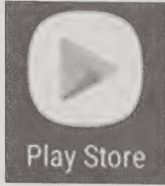

图 8-1：
Play 商店图标。

提示

如果 Play 商店应用不在您的主屏幕上，您可以在应用列表中找到它。要打开它，只需轻点图标即可。

当您轻点 Play 商店图标时，您会看到类似图 8-2 所示的屏幕。

子类别

顶级类别

Google Play 菜单按钮

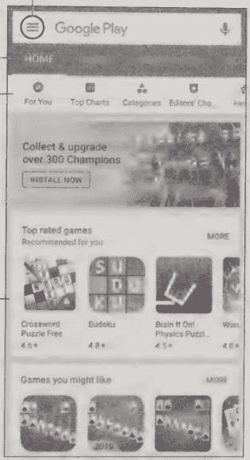

精选类别

图 8-2：
Play 商店主页。

随着新应用的推出，突出显示的应用会发生变化，主页也会一天一个样。

此外，Google 的好人们花费大量时间思考如何最好地帮助数亿 Android 用户从 350 万应用的选集中找到最佳应用。

这不是一件小事。其中一些用户经验丰富，知道自己想要什么。其他人是第一次走进门，还有一些人只是来浏览，看看是否有任何东西吸引他们。

Google 的目标是让每个进入的用户都能找到他们想要的东西。本书的目标是为您提供足够的信息，以便您能够舒适地下载第一个应用，然后随着对布局越来越熟悉，能够舒适地找到其他有趣的应用。

## 查看可用内容：为 Android 应用购物

图 8-2 所示的 Google Play 主页的全景非常广泛。您可以向右滑动很远，也可以向下滑动数十层。看看图 8-2 的结构。

如果有一天您打开 Play 商店主页，发现它有完全不同的布局，请不要感到惊讶。Google 不时会尝试不同的格式来解决一个或另一个问题并保持新鲜感。很有可能较低级别的类别仍然存在，即使本章描述的结构不再完全准确，您也可以找到所需的内容。

图 8-2 显示了几个顶级类别（右侧还有几个）：

- **主页：** 这是一个总括类别。它包括生产力、信息、社交连接或娱乐方面的应用。
- **游戏：** 游戏是您积极参与的应用。有关此主题的更多信息，请参阅第 10 章。
- **电影和电视：** Google Play 商店是视频娱乐的绝佳来源。第 12 章对此主题有更多信息。
- **音乐：** 同样，Google Play 商店是音频娱乐的绝佳来源。第 12 章有更多信息。
- **图书：** 这是有声读物和电子书的部分。有声读物是录音书籍的智能手机版本，有人为您朗读书籍。电子书允许您将智能手机用作电子阅读器。
- **报刊亭：** 此部分可订阅您喜爱的报纸、杂志或其他期刊。

## 浏览 Google Play 主页

当你决定要查看应用时，点击某个顶级分类的链接后，你会看到以下选项：

- **畅销榜：** 这些是最畅销的应用。这通常是一个很好的迹象，表明你可能想试试看。
- **家庭：** 如果你正在寻找适合孩子使用的应用，就来这里。
- **分类：** 此选项会带你进入一个应用类型的层级结构，如果你已经知道想要添加什么，这很有用。本章后面会详细介绍这些不同的分类。
- **编辑精选：** 依靠销量来寻找你可能觉得有价值的应用是一种方法，而本部分是经过精心策划的，希望是由和你想法相似的人挑选的。
- **抢先体验：** 假设你已经浏览了 340 万个应用，却仍然没有找到适合自己的。你可以通过访问本部分查看刚刚添加到 Google Play 虚拟货架上的应用。这些是商店里最新的应用。

Google 正在尽最大努力帮助你在数十万种选择中找出你需要的应用。今天的 Play Store 版本有一个名为“分类”的链接，你可以按应用类型开始深入挖掘。

- **艺术与设计：** 这些应用让你能够运用强大的图形处理功能制作一些很酷的图像，从抽象到实用，例如平面图。
- **增强现实：** 这些应用让你有机会使用摄像头镜头看到不存在的东西（以一种好的方式）。
- **汽车与车辆：** 我们热爱汽车。这些应用帮助你以更低的价格买到它们，更好地享受它们，并更长时间地享受它们。
- **美容：** 这些应用提供技巧和方法，让你看起来更好。
- **漫画：** 这些应用本意是搞笑的。希望你能找到能逗乐你的东西。
- **通讯：** 是的，Galaxy S10 手机自带许多通讯应用，但这些 Play Store 应用增强了手机自带的功能——例如，如果你迟到会议会自动发送消息的工具，或当你的孩子离开指定区域时给你发短信。
- **约会：** 这是现代结识那个特别的人的方式，或者至少是比周六晚间电视更有趣的人。
- **教育：** 引用 Emil Faber 的话，“知识是好的。”
- **娱乐：** 并非游戏本身，但这些应用仍然很有趣：[content]
## 浏览 Google Play 主页

当你决定要查看应用时，点击某个顶级分类的链接后，你会看到以下选项：

- **畅销榜：** 这些是最畅销的应用。这通常是一个很好的迹象，表明你可能想试试看。
- **家庭：** 如果你正在寻找适合孩子使用的应用，就来这里。
- **分类：** 此选项会带你进入一个应用类型的层级结构，如果你已经知道想要添加什么，这很有用。本章后面会详细介绍这些不同的分类。
- **编辑精选：** 依靠销量来寻找你可能觉得有价值的应用是一种方法，而本部分是经过精心策划的，希望是由和你想法相似的人挑选的。
- **抢先体验：** 假设你已经浏览了 340 万个应用，却仍然没有找到适合自己的。你可以通过访问本部分查看刚刚添加到 Google Play 虚拟货架上的应用。这些是商店里最新的应用。

Google 正在尽最大努力帮助你在数十万种选择中找出你需要的应用。今天的 Play Store 版本有一个名为“分类”的链接，你可以按应用类型开始深入挖掘。

- **艺术与设计：** 这些应用让你能够运用强大的图形处理功能制作一些很酷的图像，从抽象到实用，例如平面图。
- **增强现实：** 这些应用让你有机会使用摄像头镜头看到不存在的东西（以一种好的方式）。
- **汽车与车辆：** 我们热爱汽车。这些应用帮助你以更低的价格买到它们，更好地享受它们，并更长时间地享受它们。
- **美容：** 这些应用提供技巧和方法，让你看起来更好。
- **漫画：** 这些应用本意是搞笑的。希望你能找到能逗乐你的东西。
- **通讯：** 是的，Galaxy S10 手机自带许多通讯应用，但这些 Play Store 应用增强了手机自带的功能——例如，如果你迟到会议会自动发送消息的工具，或当你的孩子离开指定区域时给你发短信。
- **约会：** 这是现代结识那个特别的人的方式，或者至少是比周六晚间电视更有趣的人。
- **教育：** 引用 Emil Faber 的话，“知识是好的。”
- **娱乐：** 并非游戏本身，但这些应用仍然很有趣：[content]
## 浏览 Google Play 主页

当你决定要查看应用时，点击某个顶级分类的链接后，你会看到以下选项：

- **畅销榜：** 这些是最畅销的应用。这通常是一个很好的迹象，表明你可能想试试看。
- **家庭：** 如果你正在寻找适合孩子使用的应用，就来这里。
- **分类：** 此选项会带你进入一个应用类型的层级结构，如果你已经知道想要添加什么，这很有用。本章后面会详细介绍这些不同的分类。
- **编辑精选：** 依靠销量来寻找你可能觉得有价值的应用是一种方法，而本部分是经过精心策划的，希望是由和你想法相似的人挑选的。
- **抢先体验：** 假设你已经浏览了 340 万个应用，却仍然没有找到适合自己的。你可以通过访问本部分查看刚刚添加到 Google Play 虚拟货架上的应用。这些是商店里最新的应用。

Google 正在尽最大努力帮助你在数十万种选择中找出你需要的应用。今天的 Play Store 版本有一个名为“分类”的链接，你可以按应用类型开始深入挖掘。

- **艺术与设计：** 这些应用让你能够运用强大的图形处理功能制作一些很酷的图像，从抽象到实用，例如平面图。
- **增强现实：** 这些应用让你有机会使用摄像头镜头看到不存在的东西（以一种好的方式）。
- **汽车与车辆：** 我们热爱汽车。这些应用帮助你以更低的价格买到它们，更好地享受它们，并更长时间地享受它们。
- **美容：** 这些应用提供技巧和方法，让你看起来更好。
- **漫画：** 这些应用本意是搞笑的。希望你能找到能逗乐你的东西。
- **通讯：** 是的，Galaxy S10 手机自带许多通讯应用，但这些 Play Store 应用增强了手机自带的功能——例如，如果你迟到会议会自动发送消息的工具，或当你的孩子离开指定区域时给你发短信。
- **约会：** 这是现代结识那个特别的人的方式，或者至少是比周六晚间电视更有趣的人。
- **教育：** 引用 Emil Faber 的话，“知识是好的。”
- **娱乐：** 并非游戏本身，但这些应用仍然很有趣：[content]
## 浏览 Google Play 主页

当你决定要查看应用时，点击某个顶级分类的链接后，你会看到以下选项：

- **畅销榜：** 这些是最畅销的应用。这通常是一个很好的迹象，表明你可能想试试看。
- **家庭：** 如果你正在寻找适合孩子使用的应用，就来这里。
- **分类：** 此选项会带你进入一个应用类型的层级结构，如果你已经知道想要添加什么，这很有用。本章后面会详细介绍这些不同的分类。
- **编辑精选：** 依靠销量来寻找你可能觉得有价值的应用是一种方法，而本部分是经过精心策划的，希望是由和你想法相似的人挑选的。
- **抢先体验：** 假设你已经浏览了 340 万个应用，却仍然没有找到适合自己的。你可以通过访问本部分查看刚刚添加到 Google Play 虚拟货架上的应用。这些是商店里最新的应用。

Google 正在尽最大努力帮助你在数十万种选择中找出你需要的应用。今天的 Play Store 版本有一个名为“分类”的链接，你可以按应用类型开始深入挖掘。

- **艺术与设计：** 这些应用让你能够运用强大的图形处理功能制作一些很酷的图像，从抽象到实用，例如平面图。
- **增强现实：** 这些应用让你有机会使用摄像头镜头看到不存在的东西（以一种好的方式）。
- **汽车与车辆：** 我们热爱汽车。这些应用帮助你以更低的价格买到它们，更好地享受它们，并更长时间地享受它们。
- **美容：** 这些应用提供技巧和方法，让你看起来更好。
- **漫画：** 这些应用本意是搞笑的。希望你能找到能逗乐你的东西。
- **通讯：** 是的，Galaxy S10 手机自带许多通讯应用，但这些 Play Store 应用增强了手机自带的功能——例如，如果你迟到会议会自动发送消息的工具，或当你的孩子离开指定区域时给你发短信。
- **约会：** 这是现代结识那个特别的人的方式，或者至少是比周六晚间电视更有趣的人。
- **教育：** 引用 Emil Faber 的话，“知识是好的。”
- **娱乐：** 并非游戏本身，但这些应用仍然很有趣：[content]
## 浏览 Google Play 主页

当你决定要查看应用时，点击某个顶级分类的链接后，你会看到以下选项：

- **畅销榜：** 这些是最畅销的应用。这通常是一个很好的迹象，表明你可能想试试看。
- **家庭：** 如果你正在寻找适合孩子使用的应用，就来这里。
- **分类：** 此选项会带你进入一个应用类型的层级结构，如果你已经知道想要添加什么，这很有用。本章后面会详细介绍这些不同的分类。
- **编辑精选：** 依靠销量来寻找你可能觉得有价值的应用是一种方法，而本部分是经过精心策划的，希望是由和你想法相似的人挑选的。
- **抢先体验：** 假设你已经浏览了 340 万个应用，却仍然没有找到适合自己的。你可以通过访问本部分查看刚刚添加到 Google Play 虚拟货架上的应用。这些是商店里最新的应用。

Google 正在尽最大努力帮助你在数十万种选择中找出你需要的应用。今天的 Play Store 版本有一个名为“分类”的链接，你可以按应用类型开始深入挖掘。

- **艺术与设计：** 这些应用让你能够运用强大的图形处理功能制作一些很酷的图像，从抽象到实用，例如平面图。
- **增强现实：** 这些应用让你有机会使用摄像头镜头看到不存在的东西（以一种好的方式）。
- **汽车与车辆：** 我们热爱汽车。这些应用帮助你以更低的价格买到它们，更好地享受它们，并更长时间地享受它们。
- **美容：** 这些应用提供技巧和方法，让你看起来更好。
- **漫画：** 这些应用本意是搞笑的。希望你能找到能逗乐你的东西。
- **通讯：** 是的，Galaxy S10 手机自带许多通讯应用，但这些 Play Store 应用增强了手机自带的功能——例如，如果你迟到会议会自动发送消息的工具，或当你的孩子离开指定区域时给你发短信。
- **约会：** 这是现代结识那个特别的人的方式，或者至少是比周六晚间电视更有趣的人。
- **教育：** 引用 Emil Faber 的话，“知识是好的。”
- **娱乐：** 并非游戏本身，但这些应用仍然很有趣：智力问答、星座运势和无聊的制造噪音应用。 （这些也包括 Chuck Norris 的事实。你知道 Chuck Norris 可以除以 0 吗？）
- **财务：** 这里可以找到移动银行应用和便于管理个人财务的工具。
- **餐饮：** 这里可以找到最好的餐厅和最好的食谱。
- **健康与健身：** 这是一个涵盖所有移动医疗应用的分类，包括卡路里计数器、健身追踪以及帮助管理慢性疾病如糖尿病的工具。
- **生活方式：** 此分类是涵盖涉及休闲或特殊兴趣的应用的集合，例如集邮或观鸟。
- **地图与搜索：** 许多应用会告诉你所在的位置以及如何到达目的地。有些会根据当前状况更新，其他则基于静态地图，使用典型的出行时间。
- **多媒体：** Galaxy S10 自带音乐和视频服务，但没人规定你必须喜欢它们。你可能更喜欢设置不同或拥有其他地方没有的音乐选择的应用。
- **新闻与天气：** 你会找到各种应用，允许你深入挖掘，直到获得比扩展主屏幕上提供的更相关的新闻或天气信息。
- **生产力：** 这些应用用于财务管理（如小费计算器）、语音记录（如独立语音记录器）和时间管理（例如电子待办清单）。
- **参考资料：** 这些应用包括各种参考书籍，如词典和翻译指南。可以把本部分想象成你当地图书馆或书店的参考区。
- **购物：** 这些应用可快速访问移动购物网站，或允许你进行自动比价购物。
- **社交：** 这些是社交网络网站。如果你认为你已经全部知道，这里再确认一下即可。当然，你会找到 Facebook、LinkedIn、Twitter 和 Pinterest，但你也会找到数十个更专注的网站，它们提供应用以方便其用户。
- **软件库：** 各类大小的电脑都自带软件库来处理特殊功能，例如管理铃声、追踪应用性能和防止恶意软件的工具。
- **体育：** 在 Play Store 的这一部分，你可以找到体育网站来了解最新比分和分析。
- **主题：** 你的手机自带配色方案或主题。Play Store 的这一部分提供更广泛的选择。
- **工具：** 其中一些应用是小部件，可帮助你实现一些有趣的功能。其他则更复杂，可帮助你从手机中获得更多功能。
- **旅行：** 这些应用对旅行很有用，包括实用的项目，如货币转换和旅行指南。

然后还有精选分类，它们会随时间变化。Google Play Store 尽最大努力让这些分类保持新鲜，并根据你的需求和口味进行定制。

Play Store 的算法并不总是完美的。出于某种原因，它们一直向我展示与时尚、个人卫生和自我护理相关的精选应用。这一定是个错误。

你喜爱的许多网站现在都提供专为你的手机打造的应用。第 7 章讲述了你如何在手机上访问网站。你可以使用高分辨率屏幕上的完整网站或使用移动版。另一种选择是下载该网站的应用，它会以更易访问的方式在你的手机上呈现你想要的该网站信息。事实上，当你进入一个网站时，你的手机会查看你是否拥有对应的应用。如果有，你的手机会自动为你打开该应用。很酷！

## 浏览 Google Play 游戏页面

本部分提供大量娱乐选择，你可以通过点击图 8-2 所示的 Games 链接访问。它们分类如下：

- **为你推荐：** 这是 Google，所以他们有电脑根据他们目前对你的了解制作一份可能吸引你的清单。
- **畅销榜：** 与应用一样，这些是游戏中销量最好的。是一个不错的起点。
- **新品：** 这就像应用的抢先体验，但针对游戏。
- **付费：** 这些是需要付费才能使用的游戏。有些是一次性费用；另一些涉及持续收费。付费购买某些游戏标题的好处是你不必忽略广告。在其他情况下，免费游戏只提供你将获得内容的尝鲜，而所有真正酷炫的东西只有在你付钱时才可用。
- **分类：** 此选项会带你进入应用类型的层级结构——如果你已经知道想要添加什么，这很有用。我将在本章后面提供有关不同分类的更多信息。
- **家庭：** 这是一个专门为让孩子们开心的游戏部分。

你的 Galaxy S10 手机将互动游戏提升到了新水平。Play Store 本部分的游戏分为以下分类：

- **街机与动作：** 想想基于你在街机里找到的东西的游戏：射击游戏、赛车游戏以及其他技巧和/或策略游戏。
- **益智与解谜：** 想想填字游戏、数独和其他文字或数字游戏。
- **牌类与赌场：** 你可以找到几乎每种纸牌或赌场游戏的电子版本。 （如果你知道有任何缺失的游戏，请告诉我，这样我可以编写该应用并卖给玩它那三个人。）
- **休闲：** 这个跨界分类包括更简单的游戏，其中一些也是街机、动作或纸牌，但其特点是你可以轻松拿起、玩一下然后放下。纸牌游戏可能是休闲游戏最广泛的例子。
- **教育：** 谁说游戏不能具有教育意义呢？浏览过本部分的人不会这么说！
- **音乐：** 这里就是你一直在寻找的音乐类游戏。
- **竞速：** 当你有 S10 时，谁还需要那些游戏机来赛车呢？
- **角色扮演：** 如果你想要一个沉浸式游戏带你进入新世界，这里就是你要找的地方。
- **体育：** 你可以找到体育网站来了解最新比分或找到你的梦幻体育联赛。
- **策略：** 如果你想知道自己是否聪明（或不聪明），策略游戏适合你。想想国际象棋或桥牌，但是在你的 S10 上。

**冷知识：**《欢迎回来，科特》中的高中叫什么名字？月球和冥王星哪个更大？如果这些问题能激发你的想象力，这就是你新的最爱分类。

**旅行：** 这些应用对于旅行很有用，包括方便的物品，例如货币翻译和旅行指南。

下面子分类下方是精选游戏分类的行。如果你喜欢某一行，可以开始向右滚动以查看该精选分类中的选项。希望策展人的想法和你一样，并能为你提供大量建议。如果不确定想要什么，这尤其方便。

免费应用很棒。但不要害怕购买你会经常使用的任何应用。应用通常价格很低，额外功能可能物有所值。有些人（包括我）对每月为自己经常使用的东西支付 $1.99 有一种不理性的抵触。说实话，这有点傻。让我们都理性一点，愿意为我们使用的服务支付一点费用。

## 安装和管理 Android 应用

为了让查找和下载应用的过程不那么抽象，我以一个具体的例子向你展示如何下载和安装它：Facebook for Android 应用。

### 下载 Facebook 应用

按照以下步骤添加此应用：

- 1. 点击 Play Store 图标。
- 2. 在查询框中输入 Facebook。

这样会弹出一个下拉屏幕，如图 8-3 所示。

正如你在搜索结果中看到的，几个选项都包含单词 Facebook。应用部分中的其他行是包含单词 Facebook 的应用。这些通常是按自己的方式增强 Facebook 的应用——截至此时，有 112,160 个。与其一个一个地查看，不如坚持使用带有 Facebook 图标的那个。

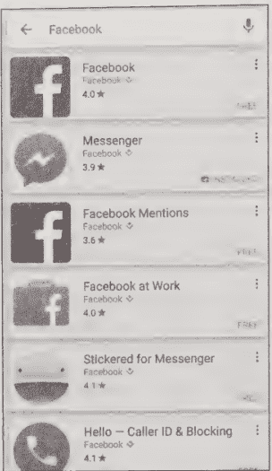

FIGURE 8-3:
Facebook 搜索结果。

### 3. 点击带有 Facebook 标志的框中的任意位置。

当你点击该框时，它会显示如图 8-4 所示的屏幕。

在继续下一步之前，我想指出此页面上的一些重要元素：

- **标题行：** 顶部部分在绿色安装按钮正上方显示应用的正式名称。点击此按钮下载并安装应用后，你会看到其他一些选项。我将在本章后面给出一些示例。
- **描述：** 这告诉你应用的功能。
- **屏幕截图：** 这些代表性屏幕有点太小而无法阅读，但它们确实为页面增添了一些漂亮的颜色。
- **新功能：** 如果你有此应用的先前版本，此信息很重要。现在跳过此部分。
- **评分和评论：** 此特定应用大约有 4.1 星（满分 5 星）。这并不算差。其他数字告诉你有多少人投票、多少人下载了此应用、发布日期以及应用的大小（以 MB 为单位）。
- **类似应用：** 以防你不确定此特定应用，Google 的好人们提供了一些替代方案。
- **Facebook 的更多应用：** 在这种情况下，应用开发者是 Facebook。如果你喜欢某个开发者的风格，此部分会告诉你该开发者提供的其他应用。
- **基于你的最近活动：** Play Store 会告诉你下载了此应用的客户还下载了哪些其他应用的名称。这是一个很好的指标，可以显示你可能还喜欢什么。
- **Google Play 内容：** 这就是你告诉 Play Store 此应用是好是坏的方式。

### 屏幕截图

### 标题

### 评分和评论部分（续）

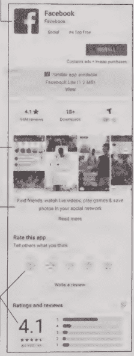

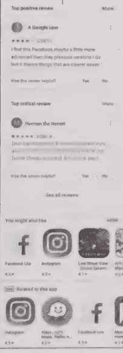

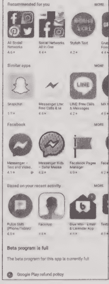

FIGURE 8-4:
Facebook 应用全景屏幕。

### 评分和评论部分

### 描述

### 4. 点击写着“安装”的深绿色按钮。

你可以看到应用下载过程的进度。当应用全部下载完成后，它开始安装过程。

在过程的某个阶段，大多数应用会弹出窗口，让你知道应用将使用手机中的哪些信息。这是为了让你了解此特定应用可能如何影响你的隐私。权限弹出窗口的示例如图 8-5 所示。

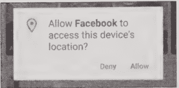

FIGURE 8-5. Facebook 权限屏幕。

第 1 章讨论了阻止应用访问你的位置信息的选项。我提到你可以逐案允许应用知道你的位置。这里就出现了这个问题。每个应用都会要求你授权访问信息，例如你的位置。如果你不希望应用使用这些信息或以某种方式共享它，这里就是你了解应用是否使用这些信息的地方。你可能能够限制位置信息的数量。如果你对此不舒服，你应该完全拒绝该应用。

提示

这类似于你在 PC 上安装软件时签署的许可协议。希望你能详细阅读它们并理解所有含义。实际上，你希望如果很多人都接受了这些条件，就不会有问题。对于像 Facebook 这样知名度很高的应用，你可能很安全，但对于不太受欢迎的应用，你应该谨慎。

应用下载并安装后，你将回到如图 8-6 所示的屏幕。

### 5. 点击深绿色的“打开”按钮。

这会显示 Facebook 的主屏幕，如图 8-7 所示。

如果你已经有 Facebook 账户，请继续输入你的信息。事情看起来会非常熟悉。如果你没有 Facebook 账户，并且现在想要添加一个，请继续下一部分。

FIGURE 8-6:
成功下载应用的 Play Store 应用屏幕。

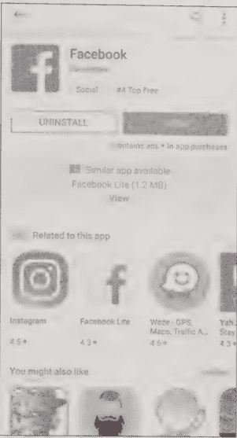

FIGURE 8-7:
Facebook 登录屏幕。

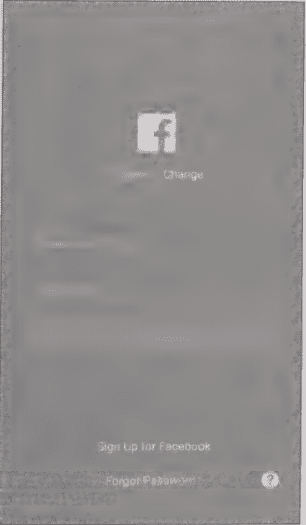

无论如何，Facebook 图标会出现在你的应用屏幕上，与一些最近添加的应用（如 Angry Birds 和 Solitaire）一起显示。这在图 8-8 中可见。

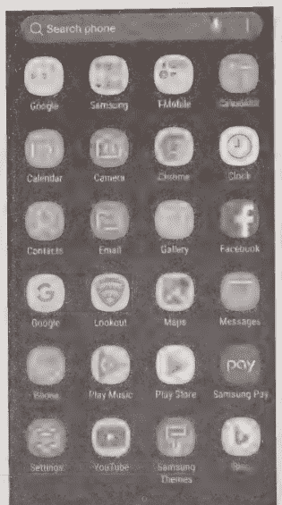

FIGURE 8-8:
应用屏幕上的 Facebook 图标。

如果你希望此应用出现在主屏幕上，请长按图标。Facebook 图标会出现在你的主屏幕上。

## 创建 Facebook 账户

如果你还没有 Facebook 账户，可以在此创建账户。屏幕底部有注册 Facebook 的选项。点击“注册 Facebook”链接，你会看到如图 8-9 所示的屏幕。

注册 Facebook，你需要以下信息：

- **姓名：** 这似乎是一个简单的问题。然而，你应该考虑添加以前的名字和/或昵称。这完全取决于你是否希望被老朋友找到。
- **手机号码：** 你的手机号码将自动填充此问题。你可能想使用另一个号码。由你决定。
- **你的生日：** 继续吧。这一项要说实话。
- **你的密码：** 选择一个你能记住的。
- **你的性别：** 我不确定 Facebook 为什么需要知道这一点，但请选择一个性别。

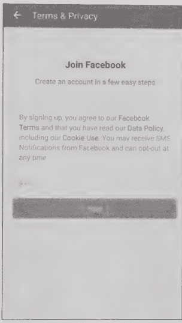

FIGURE 8-9:
注册 Facebook 主屏幕。

输入这些信息后，Facebook 会发送验证消息。如果你提供电子邮件地址，应用会向你发送电子邮件。如果你使用手机号码，它会向你发送短信。

电子邮件或短信包含一个代码。输入此代码，你的 Facebook 账户即得到验证。为了充分利用 Facebook，我建议阅读 Carolyn Abram 所著的 *《Facebook傻瓜书》第7版*（John Wiley & Sons, Inc.）。

在 Facebook 应用本身中，你可以立即看到朋友的最新帖子。你会收到每日份量的可爱小猫图片、自豪的父母关于他们孩子的故事，以及旧情人发来的关于“如果当初”的消息。

Facebook 移动应用在用户中相当受欢迎。据 Facebook 称，超过一半的 Facebook 用户只使用智能手机，从不费心在 PC 上查看他们的帖子！

## 评分或卸载您的应用

提供应用反馈是维护 Android 社区实力的重要组成部分。诚实地评分应用是你的责任。（或者你可以置之不理，只是利用他人投入到评分系统中的工作。由你选择。）

如果你想对某个应用表达自己的看法，以下是步骤：

- 1. 打开 Play Store。
- 参考图 8-2 查看布局。

- 2. 点按菜单按钮（Google Play 横幅中的三条平行线）。
- 这样会弹出一个下拉菜单，如图 8-10 所示。

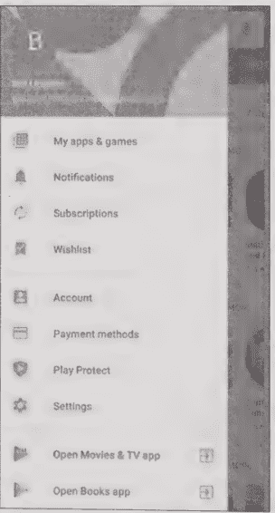

FIGURE 8-10:
Play Store 的菜单。

- 3. 点按名为“我的应用和游戏”的链接。
- 此操作会调出图 8-11 所示的屏幕，其中列出了手机上的所有应用。继续向下滚动。你最终会看到它们全部。

FIGURE 8-11:
全景中的“我的应用和游戏”屏幕。

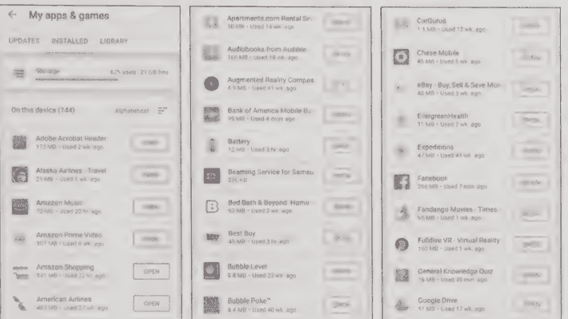

点击其中一个应用就是对其进行评分或卸载的方式，如图 8-12 所示。

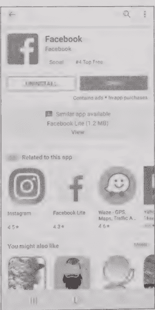

FIGURE 8-12:
Facebook 安装后的应用页面。

如果你喜欢这个应用，请在五星制中给予高分。明确地说，要将其评为一星，请点按最左边的星星。要用五星高度评价，请点按最右边的星星。

你选择的星星数量会弹出相应星数的弹出窗口，如图 8-13 所示。然后你可以告诉全世界你对该应用的看法。

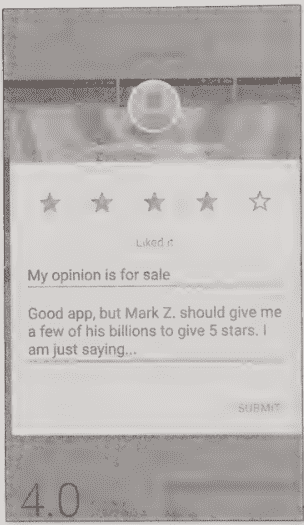

FIGURE 8-13:
评分弹出窗口。

虽然许多应用开发者会阅读评论，但有些人需要更长时间。我仍在等待对我的评论的回复。请注意，寻求贿赂以提供正面评价完全是我的想法，你最好不要复制这种做法。如果你这样做，我会起诉你。

另一方面，如果你讨厌这个应用，就给它一星并尽情抨击。虽然不常见，但确实存在一些大牌的失败应用。在大多数情况下，这发生在你使用较旧的手机时，而你拥有的应用假设了一些并不存在的功能。

Galaxy S10 不会很长时间出现这种情况，但技术确实在不断进步。将来某一天，你的美好手机将成为遗物，而一些新应用会假设你的 S10 可以通过思想控制/读心术操作。不幸的是，你的 S10 手机没有这个功能（就你所知）。新应用似乎无法正常工作。

尽管给那个应用一星，然后点按卸载按钮。啪。它消失了。

## 4 与手机尽情玩乐

### 本部分内容...

- 在手机上拍摄照片和视频。
- 浏览 Play Store 上可用的游戏并下载最好的游戏到你的手机。
- 使用手机中的 Google 地图和 GPS 让你往返目的地。
- 无论去哪里都能享受你最喜欢的音乐。

### 本章内容

- 使用手机拍摄照片和视频
- 整理你的照片和视频
- 与朋友和家人分享照片和视频
