### 第 9 章

### 分享照片

Samsung Galaxy S10 真应该被称为带手机的智能相机。如果你像许多手机用户一样，你喜欢可以用手机拍摄照片和视频。

你可能几乎随身携带手机，所以你再也不用因为把相机留在家里而错过精彩的照片了。

而且不要以为三星在 Galaxy S10 的相机上偷工减料。事实上，他们投入了大量精力。起初就拥有 1600 万像素（MP）的实力，这款相机还配备了许多拍摄选项。然后，根据你的机型，你还有一系列用于特殊情况的额外镜头。拍摄完图像后，你可以在那块出色的 Super AMOLED 屏幕上查看它们。三星还包含了一个用于整理和分享的图库应用。此外，相机可以拍摄静态照片和视频。

真令人惊讶的是，你的照片和视频有多少种选项。三星不断添加新的选项、滤镜和分享这些文件的方式。如果你的手机现在比你的数码相机功能更强大，也不会令人惊讶。

这些功能实际上造成了一个问题。选项太多可能会让人不知所措。研究表明，人们可分为三类：第一组倾向于使用默认设置。如果他们想更改图像，他们更愿意在自己的电脑上操作。第二组喜欢探索手机上的一些功能，会乐于查看场景，但保持适度。第三组对手机的所有功能都着迷。

为了满足每个人，本章从基础开始。我介绍如何使用手机上的相机、查看照片以及在线分享它们。这对每个人都适用。

然后我重点介绍第二组最受欢迎的设置。有些重要功能。

对于第三组，最好的做法是引导你走向正确的方向。尽管我很想这样做，但不可能涵盖所有选项和组合。据我统计，滤镜、光线和模式的可能组合有 24.3 亿种。如果你现在开始，每 10 秒拍一张照片，你在 700 多年内都不会用完组合。这甚至不包括分享这些图像的所有选项。

实际上，你或你的手机都不会持续那么久。为了保持现实，我只介绍最重要的、最有价值的选项，然后再继续。

### 说“茄子”！用手机拍照

在拍照之前，你必须打开相机应用。传统方式是从应用列表中直接访问相机应用程序。只需点按相机图标即可启动应用。

因为相机非常重要，这里还有几种打开相机应用的方法。首先，按两次电源按钮。砰。就出现了。（如果你的手机上此功能已关闭，你可以在设置中的高级功能里切换快速启动相机。）

接下来，除非出于安全原因已关闭此功能，否则你的锁屏上有一个相机图标。如果你将图标在屏幕上滑动，
相机应用会绕过安全设置。你可以尽情拍摄，但无法访问照片图库或其他任何文件。

这里有一个建议。如果你看到一些可疑的东西，但还没准备好拨打 911，就先拍摄你所担忧的东西的照片。如果需要，你可以返回锁屏并向右滑动手机图标拨打 911，同样无需解锁。

与之密切相关的一个应用是图库，你的手机将图像存储在那里。这两个应用的图标显示在页边。

打开相机应用后，你在一两秒内即可准备好拍照。屏幕变成你的取景器。你会看到如图 9-1 所示的屏幕。

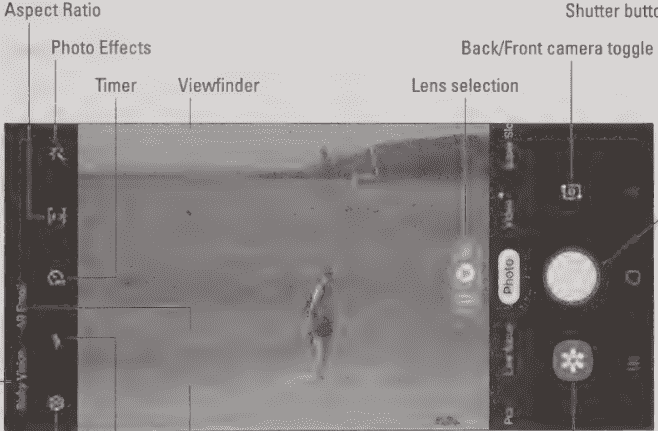

FIGURE 9-1:
屏幕是相机应用的取景器。

那么如何拍摄呢？只需点按右侧的大白按钮，即数字快门按钮。取景器中的图像就会变成数字图像。

### 超级 AMOLED 超快速入门

所有 Samsung Galaxy S10 手机都配备 Super AMOLED 屏幕。让我花点时间解释一下这为何如此出色——以及为何购买 Samsung Galaxy S10 的你如此聪明。

首先，想象一下典型的 LCD 屏幕，就像你的电视或电脑可能有的那样。LCD 很棒，但在室内且不太亮的环境下效果最佳。LCD 需要背光（最常见的是荧光灯），而背光会消耗相当多的电量，尽管比 CRT 少得多。在手机上使用时，LCD 屏幕是电池寿命的最大单一消耗者，使用功率超过无线电或处理器。此外，由于 LCD 屏幕的背光，这些屏幕显示黑色时有点发白，而不是真正的黑色。

下一步是使用发光二极管（LED），它们能更高效地将能量转换为光。单色 LED 已使用了数十年。它们也用于体育场馆中的巨型屏幕（巨型显示屏）。直到最近，准确呈现颜色一直是个难题。（蓝色是个大问题。）这个问题通过使用有机材料（有机即以碳为基础，而不是无农药种植）来制造 LED 而得到解决。

最初的有机发光二极管（OLED）看起来不错，耗电更少，并提供非常深的黑色，但仍有两个问题。它们在强光下的成像非常糟糕，甚至比 LCD 屏幕更差。此外，还有串扰问题——单个像素会随着时间推移而混淆是否应开或关。你会看到绿色或红色像素仍留在屏幕上，即使该区域明显应该是暗的。这非常分散注意力。

解决像素混淆的方案称为有源矩阵，它更频繁地告诉像素是否应开或关。当你拥有有源矩阵技术时，你就拥有了有源矩阵有机发光二极管，即 AMOLED。使用该技术获得的图像在强光下仍然很糟，但至少有所改善。

三星制造的 Super AMOLED 技术登场。与最初的 AMOLED 屏幕相比，Super AMOLED 屏幕亮度高出 20%，功耗降低 20%，阳光反射减少 80%。这真的很超！

该屏幕仍使用相当一部分电池寿命，但比早期技术少。使用 Super AMOLED 时，如果可能使用较暗的背景，你甚至可以节省更多电量。一些拍照选项就在取景器上。顺时针围绕取景器，选项包括

### 取景器：
取景器显示照片中将包含的内容。好吧，这很明显，但这也是你控制放大倍率的一种方式。在取景器内，你可以通过捏合或拉伸屏幕来放大和缩小。参见图 9-2 作为示例。

- 拉伸屏幕以放大。
- 捏合屏幕以缩小。

### 镜头选择：
你可以通过拉伸来放大或通过捏合来缩小。或者你可以点击其中一个镜头选项。在图 9-1 和图 9-2 中，单个树图标是 2 倍放大的长焦镜头，两个树图标是 1 倍放大的标准镜头，三个树图标是用于微距镜头。这里是 Galaxy S10 各型号之间的差异所在。不同型号的前置和后置镜头数量不同，具体取决于你拥有的型号以及你使用的是后置还是前置摄像头。你会根据拥有的镜头看到不同数量的选项。如果你拥有 S10+，这就是额外成本物有所值的地方。

## 无变焦

## 部分变焦

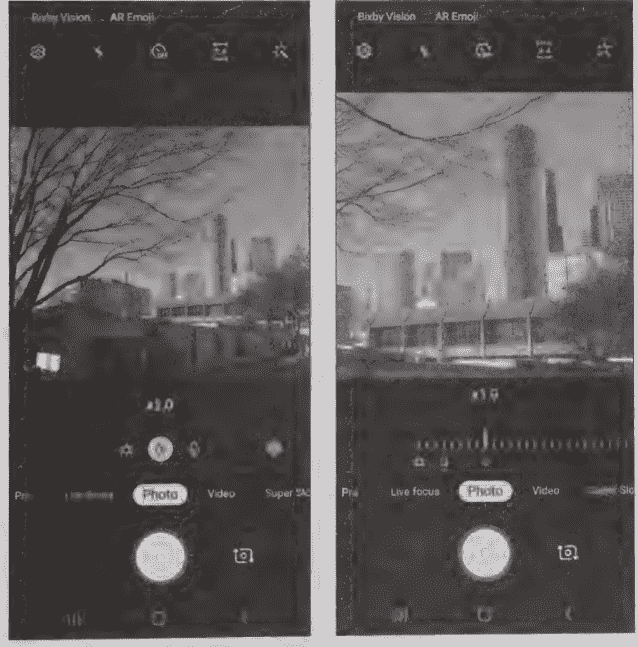

图 9-2：
变焦时的取景器。

- **后置摄像头到前置摄像头切换：** 该图标可将你从 16MP 后置摄像头切换到不算差的 10MP 前置摄像头。这对于自拍来说是个不错的选择，因为你可以在拍摄前看到拍摄效果会是什么样。
- **快门按钮：** 该图标用于拍照。
- **图库：** 点击此图标查看刚刚拍摄的照片。我将在本章后面的“管理您的照片图像”部分讨论图库。
- **相机/摄像机模式：** 这些很重要。图 9-1 和图 9-2 设置为照片模式，这可能是最好的开始位置。你的相机非常智能，照片模式在猜测如何让图像看起来最好方面做得很好。然而，如果你想做得更花哨——或更花哨——你可以更改设置。你可以在本章后面找到有关此选项的更多信息。这也是你切换到录制视频的方式。同样，稍后会详细介绍。
- **设置：** 设置还提供一些花哨的选项，这些将在下一节中介绍。
- **Bixby：** Bixby 可以对你的图像做一些很酷的事情。它可以告诉你正在看什么。如果你知道它是什么并且想购买它，Bixby 可以告诉你在其他零售商的价格是多少。有关 Bixby 的更多信息请参见第 14 章。
- **闪光灯选项：** 即使你想保持简单，你也需要知道如何控制闪光灯。有时你需要为照片使用闪光灯。有时你需要为照片使用闪光灯，但不允许使用，例如在水族馆拍摄鱼类、新生儿或某些动物时拍摄图像。记住金刚发生了什么事？无论情况如何，你的手机都让你控制闪光灯。点击取景器顶部的设置图标。选项为关闭、开启或自动闪光，让相机内的测光表决定是否需要闪光。选项显示在图 9-3 中。
- **AR Emoji：** 此选项纯粹是为了好玩！当你给某人拍照时，此选项会创建该人的卡通式图像，称为 emoji，你可以分享以展示各种情绪。有关此内容的更多信息请参见第 16 章。
- **定时器：** 这会在你按下快门按钮和实际拍摄图像之间创建几秒的延迟，以便你有时间进入合影。

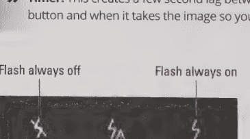

图 9-3：
闪光灯选项。

### 宽高比：
标准照片通常宽 4 个单位，高 3 个单位。这意味着它具有 4:3 的宽高比。这很常规，但为什么要一直常规呢？你可以尝试不同的选项。

### 相机/摄像机切换：
此图标可将你从相机切换到摄像机。

## 仅供怀疑者

如果你曾经使用过带摄像头的手机，你可能会想：“为什么要大肆宣传这款拍照手机？带摄像头的手机不值得它们所用的像素。”  granted，过去许多带摄像头的手机并不像数码相机那样好，但三星已经通过 Galaxy S10 解决了这些问题，你完全可以把你的数码相机拿到车库义卖，因为你的 S10 拍摄效果要好得多：

- **分辨率：** 大多数带摄像头的手机的分辨率低于专用数码相机通常提供的分辨率。然而，Galaxy S10 配备了 16MP 相机——这足以制作一张与胶片相机制作的照片无法区分的 8 x 10 英寸打印照片，而 4 x 6 英寸的照片对于大多数用途来说已经足够大。
- **弱光：** 许多带摄像头的手机在弱光条件下表现不佳。Galaxy S10 具有 f/1.5 或 f/2.4 镜头，这会让懂行的人印象深刻。其含义是 S10 在弱光下工作得非常出色。
- **自动对焦和人工智能：** 我们业余爱好者喜欢相机能完成对焦的繁重工作。S10 的技术通过更多像素来确定对焦位置，从而实现了巨大的飞跃，然后还有智能来弄清楚如何充分利用你在取景器中看到的内容。
- **照片传输：** 对于大多数带摄像头的手机来说，照片很难从相机传输到计算机。然而，对于三星 Galaxy S10 来说（记住：它使用 Android 操作系统），你可以快速轻松地将图像或一批图像无线发送到任何你想要的地方。
- **屏幕分辨率：** 实际上，许多带摄像头手机用户最终只是在手机上向朋友展示照片。然而，许多带摄像头手机屏幕的分辨率并不好，这意味着当你想向朋友展示时，你的图像看起来并不好。好消息是三星 Galaxy S10 具有明亮、高分辨率的屏幕。照片在 Super AMOLED 屏幕上看起来非常好。
- **组织：** 大多数带摄像头的手机在组织工具方面提供的很少。你的图像都只是存在于你的手机上，没有任何结构。但三星 Galaxy S10 具有图库应用程序，使组织照片变得更容易。它也设置为轻松共享这些照片。

你可能知道，触摸相机镜头不是一个好主意。与此同时，几乎不可能避免触摸 Galaxy S10 上的镜头。这可能会导致高分辨率镜头上积累油污和灰尘。你应该不时用超细纤维布清洁相机的镜头，以充分利用你的相机。否则，你的高分辨率图像看起来就像你生活在永恒的雾银行中。

拍摄照片后，你有选择。图像会自动存储在另一个应用程序中：图库。这让你可以继续拍摄，并在有时间时返回图库。我将在即将到来的“管理您的照片图像”部分更详细地介绍图库应用程序。

然而，如果你想立即发送该图像，这里是操作方法：

- 1. 从取景器屏幕点击图库图标。

取景器在取景器右上角显示图库图标。当你点击它时，它会打开图库应用程序，如图 9-4 所示。

这会显示当前图像以及一些其他最近的照片。

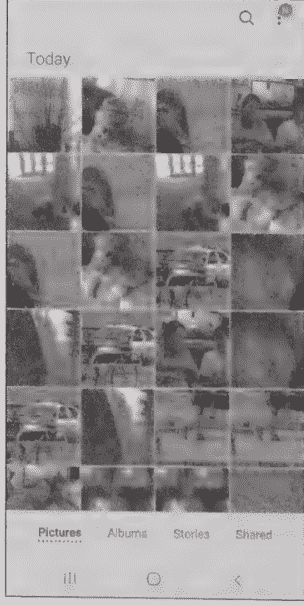

图 9-4：
图库应用。

### 2. 点击要分享的图像的缩略图。

它还会显示一些选项，如图 9-5 所示。现在，你对分享选项感兴趣。

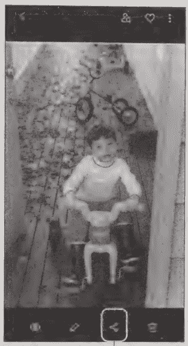

图 9-5：
当前图像的图库选项。

分享图标

### 3. 点击分享按钮。

这会显示你可以用它转发图像的选项；参见图 9-6（尽管你的手机可能不支持此处列出的所有选项，并且可能还有一些在此图像中未显示的其他选项）。

- **Facebook：** 你可以用此选项拍照并发布到你的 Facebook 账户。
- **蓝牙：** 将图像发送到通过蓝牙连接链接的设备，例如笔记本电脑或手机。
- **信息：** 这允许你立即将它作为短信发送到某人的手机。

-   **电子邮件：** 将图片作为附件发送，使用您的主要电子邮件账户。
-   **Gmail：** 如果您的主要电子邮件是 Gmail，则此选项与电子邮件选项相同。
-   **您的云服务提供商：** 图 9-6 显示了 Google Drive，但如果您注册了任何云存储选项，它们都会在这里。
-   **Wi-Fi Direct：** 真够酷的！此选项将您的手机变成 Wi-Fi 接入点，以便您的 Wi-Fi 启用 PC 或另一部智能手机可以与您建立连接。

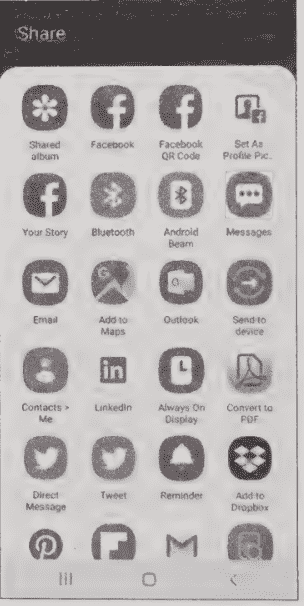

图 9-6：
当前图像的
共享选项。

重点是选择过多。如果设备上的某个应用支持图像，您可以在此上传该图像。如果这些选项中没有一个完全符合您分享照片的需求，也许您要求太苛刻了！

## 让您的相机更高级一些

使用默认的相机设置 Photo 拍摄照片，对于那些即兴、休闲、随拍的照片来说完全没问题——比如客厅里的朋友。然而，您的 Samsung Galaxy S10 手机相机可以支持更复杂的拍摄。您的数码单反相机的镜头比手机大，但我向您保证，您的手机的大脑比您的相机大得多。我建议即使想要这些默认设置的用户也熟悉相机的模式设置。这些设置很容易访问，并且只需最小的努力就能提高图像质量。

### 摄影模式设置

模式设置是您进行一些基本设置的地方，这些设置描述了您将拍摄的场景。默认是自动模式下的单张照片。相机效果图标是取景器底部最左侧的圆点。

将此图标向右滑动会显示图 9-7 所示的选项。

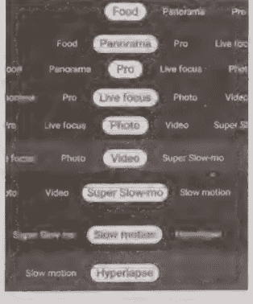

图 9-7：
相机取景器上的摄影模式选项。

取景器左侧的选项会带来许多选择：

-   **食物：** 这会拍摄强调食物颜色的照片，让您的朋友更加羡慕（和/或饥饿）。
-   **全景：** 此设置让您拍摄比单张照片更宽的画面。按下相机按钮同时旋转以覆盖您想要的视野范围。应用程序随后会将单独的照片数字拼接成一张广角照片。
-   **专业：** 此模式让您访问各种相机设置，这些设置是懂得如何操作的人希望控制而不是让相机选择的设置。这包括设置曝光、快门速度、ISO 感光度、白平衡、焦距和色调。如果您不知道这些是什么意思，这不是适合您的模式。
-   **实时对焦：** 此设置让您能靠近物体 20 英寸，这对于普通自动对焦来说太近了。更重要的是，您可以在拍摄后更改焦点。（您没看错！）
-   **照片：** 一次拍摄单张照片是默认设置，假设为平均光线。这是一个很好的起点。也通常是保持的大多数时间。
-   **视频：** 这就是用手机拍摄视频的方式。本章后面会详细介绍此选项。
-   **超慢动作：** 这会切换到视频模式以减慢快速拍摄。特别之处在于，您的 S10 以全 4K 分辨率执行此操作，因此您可以在不妥协的情况下获得高速度和高分辨率！
-   **慢动作：** 这就是普通的、乏味的慢动作。仍然很酷。
-   **延时摄影：** 您可以使用此设置创建延时视频。摄像机会根据手机的移动调整拍摄速度。

通过滑动选项选择听起来合适的选项，然后开始拍摄。

### 取景器上的设置选项

点击取景器上的设置图标会显示许多选项。此列表让您控制后置摄像头镜头、前置摄像头镜头（用于自拍或视频通话），以及影响两个摄像头的设置。这些选项显示在图 9-8 中：

图 9-8：
设置选项。

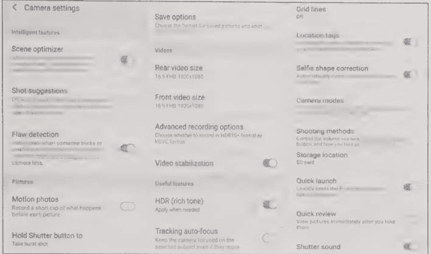

-   **场景优化器：** 再一次，我要指出您的手机非常智能。此设置会自动调整设置以拍摄最佳照片。您可以关闭此选项，但为什么要这样做呢？
-   **拍摄建议：** 这将场景优化器更进一步。您的手机会建议如何设置拍摄，并在完美时为您拍摄照片。试试看，看看您是否喜欢。
-   **瑕疵检测：** 您是否有一个亲戚在家庭照片中总是闭着眼睛？此功能会在大家散开前警告您该问题。
-   **动态照片：** 如果您选择此选项，您的手机将在您拍摄照片前录制并存储视频。
-   **按住快门按钮以：** 这里有三个选项。默认情况下，按住快门按钮会拍摄一连串快速照片。这样，您可以返回后挑选最佳的照片保留。您也可以设置按住时只拍摄单张照片。我们中的一些人习惯于在模拟相机上按住快门按钮；这是给我们的选项。最后一个选项是按住快门按钮会将图像存储为 GIF。如果您不知道 GIF 是什么，您可能不想费心使用此选项。
-   **保存选项：** 普通智能手机会将照片保存为流行的照片格式之一。但这不是普通的智能手机。您可以将默认选项更改为高效率 HEIF 以节省存储空间。如果您在 PC 上有超级强大的照片编辑软件，您可以选择 RAW 副本。第三个选项是以预览方式保存图片。此选项很有用，如果您不想以镜像方式保存自拍，例如 T 恤上的文字是镜像的（试试看就明白我的意思了）。最后，S10 或 S10+ 上的超广角镜头会使图像失真。此选项会纠正这种效果，这种效果会让苗条的人看起来像 Homer Simpson 那样的体型。（多么糟糕！）

### 视频大小：

您在这里可以完全放纵。最低的视频选项是 HD。HD 对于彻底的现代人来说是可以接受的最低分辨率。然而，您的手机对这种微不足道的分辨率嗤之以鼻，并且可以提升到更高的设置，如图 9-9 所示。唯一犹豫使用这些更高设置的原因是，就像静态图片一样，以更高分辨率录制的视频会占用更多内存。知道这些分辨率存在是件好事。您还可以为前置和后置摄像头设置不同的设置。

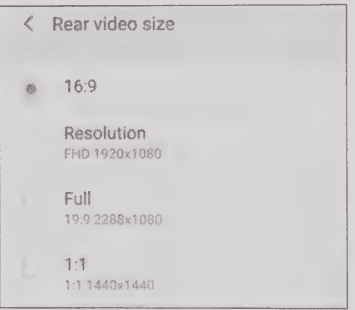

图 9-9：
手机摄像机后置和前置摄像头的分辨率选项。

SD 卡的主要考虑因素一直是其额定容量。当您以标准分辨率和标准帧率使用手机进行视频录制时，标准 SD 卡可能就足够了。如果您想要更高分辨率或更高帧率，您应该购买专为更快数据速度设计的卡。如今，SD 卡通常更快，并标有“SDXC”，但如果您使用的是几年前的旧 SD 卡，它可能无法处理太多数据。解决方案很简单：购买一张标有 SDXC 的新 SD 卡。

### 高级录制选项：

Samsung Galaxy S10 可以让您在这方面完全放纵。尽管存储空间充足，您仍可选择使用高效率选项。您还可以使用 HDR10+，它会处理对比度级别。除非您知道此选项适合您，否则您可能可以跳过它。

-   **视频稳定：** 与高级录制选项不同，这是您想要的。这个复杂的工具会自动让您看起来像专业摄像师。当您移动相机时，此选项会平滑运动。您可能刚刚喝了两杯三重浓缩咖啡，视频也会呈现出平滑优雅的广角过渡。我的建议是保持此选项开启。
-   **HDR（丰富色调）：** 相机在需要时可以应用此图像增强。您也可以一直将其打开。由您选择。
-   **追踪自动对焦：** Samsung Galaxy S10 可以识别人的面部，并假设如果您将此选项切换到开启位置，您希望它成为对焦位置。否则，如果您不使用此模式，相机可能会假设您希望取景器中央的物体处于焦点。
-   **网格线：** 有些人喜欢在取景器上显示 3 x 3 网格来帮助构图。如果您是这些人之一，请打开此选项。
-   **位置标签：** Samsung Galaxy S10 使用其 GPS 来告知拍摄照片的位置。如果这太具侵入性，您可以不在图像描述中包含此信息。
-   **自拍形状校正：** 一些自拍可能会扭曲朋友的面部。您的 Samsung Galaxy S10 可以自动修复该问题。
-   **拍摄方法：** 您还记得用于拍摄照片和视频的选项吗（参见图 9-7）？好吧，您也可以在这里选择它们。但是，默认情况下，关闭相机后它会恢复为照片模式。如果您希望它保留上次使用的模式（例如拍摄视频），您可以告诉它保留最后的模式。
-   **快速启动：** 您可以通过按两次主屏幕按钮启动相机。如果您不想这样做，这里可以禁用该设置。
-   **快速预览：** 有些人希望立即看到拍摄的照片。其他人希望拍摄一堆照片，然后再慢慢查看。如果您想立即查看图像以确定是否需要拍摄第二张照片，请打开此切换。它会立即将您跳转到图库应用。
-   **快门声音：** 拍摄照片时听到咔嗒声会令人满意。如果您不想听到，可以在此处关闭该声音。

## 照片特效选项

当你在取景器内向左滑动最右边的点时，你会看到可以应用到图像上的多种特效。一些示例显示在图 9-10 中。

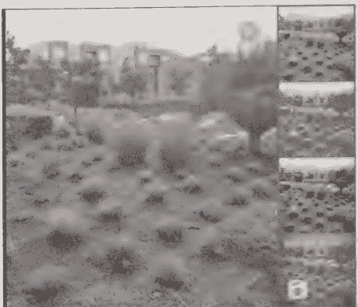

FIGURE 9-10:
一些示例
特效选项。

通过点击缩略图选择符合你创作构想的选项，然后拍摄。

## 口袋里的数码摄像机

你的三星 Galaxy S10 相机应用程序也可以用作数码摄像机。

## 启动摄像机

要将手机用作视频录制设备，只需将相机切换到摄像机模式即可。从相机取景器中，点击右上角看起来像电影摄像机录制按钮的图标，即可从摄影师切换为摄像师。

此时视频录制会自动开始。你会看到红色“Rec”通知以及从开始时的计时器。

录制会一直继续，直到你点击停止按钮——取景器右侧带中心深色方块的圆圈（参见图 9-11）——或暂停按钮——中间带平行斜线的按钮。如果按下上方的按钮，即带相机剪影的按钮，屏幕将恢复到静态相机。

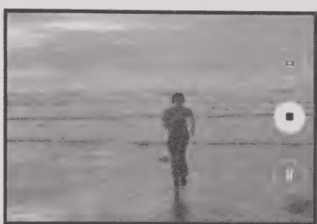

FIGURE 9-11:
你手机的摄像机取景器。

如果在摄像机模式下按下暂停按钮，右下角的按钮会变成下方小图中所见的选项。你可以再次点击它返回视频。也可以点击快门按钮停止，或点击上方按钮切换回相机。

你的手机不仅在录制视频，还在录制声音。说话时要小心！

## 使用摄像机拍摄和分享视频

就像你分享相机拍摄的照片一样，你可以通过点击视频查看器立即分享视频、播放它或删除它。此外，视频会立即保存在你的相机中。它存储在图库应用中，或可从你的视频播放器应用中查看（参见第 12 章）。

你可以对摄像机的一些设置进行精细调整，但你会发现设置远没有相机那么多（幸好如此！）。两个设置：AF 和亮度。AF 让你改变想要相机使用自动对焦的位置。自动对焦的默认设置是假设你希望屏幕正中央的内容最清晰。然而，有时你可能想在构图上做些花样，比如让画面底部的人物对焦，而拉什莫尔山占据大部分屏幕。在这种情况下，你告诉相机在屏幕下部自动对焦，并在图像其余部分尽力而为。亮度让你可以调整视频的亮度。否则，一切都是自动的。

## 管理你的照片图像

拍完一些好照片后，你需要考虑如何处理它们。虽然你可以立即将图像发送到另一个网站或通过电子邮件发送，但这可能只是例外。

在大多数情况下，更容易继续做你正在做的事情，并在有时间查看图像后再返回图库应用程序，然后决定如何处理它们。你的选择包括

- 将它们存储在手机的图库应用中。
- 通过电子邮件发送将它们传输到你的 PC 照片相册应用程序。
- 将它们存储在互联网网站上，如 Google Photos 或 Flickr。
- 从你的 PC 打印它们。
- 通过电子邮件或短信发送给你的朋友和家人。
- 以上选择的任意组合。

与许多内置相机的普通手机不同，Galaxy S10 使访问这些选择变得很容易。你需要确定想要保留图像时采用的方法。本章其余部分将介绍你的选项。

尽管相机应用程序和图库应用程序密切相关，但它们是两个独立的应用程序。请确保你清楚想要使用哪个应用程序。

图库主屏幕（参见图 9-4）显示了该应用如何根据图像的来源时间首先将手机上的图像按文件夹排序。

相机应用中的所有照片都按日期排序存放在文件中。当大约同一时间拍摄一系列照片或视频时，该应用程序会尝试将它们分组。

## 在手机上使用图像

除了分享相机拍摄的照片外，你的 Galaxy S10 手机还允许你将图库照片用作壁纸或联系人照片。而且如果相机应用程序中的精细拍摄设置还不够，你可以在图库应用程序中对图像进行一些小编辑——例如裁剪或旋转。

第一步是在图库中找到你想要的图像。如果想对该图像做一些除发送之外的操作，请点击屏幕底部的编辑按钮（参见图 9-5）。其中一些选项包括

- **Slideshow**：这会将每张图像显示几秒钟。你不仅可以设置过渡速度，还可以添加音乐并在多种图像过渡中选择。
- **Crop**：剪掉图像中不必要或分散注意力的部分。应用程序会在其认为的主要对象周围创建一个虚拟框。你可以移动框在图像中的位置，但不能调整其大小。然后你可以保存此裁剪后的图像或丢弃。
- **Set As**：将此图像设为你的壁纸或设为联系人图像。
- **Print**：如果已设置本地打印机通过 Wi-Fi 或蓝牙与手机通信，此选项允许你打印。
- **Rename**：这些选项允许你将图像向右或向左旋转。如果你在拍摄时将相机横向放置以获得更多高度，现在想将图像转为横向（或反之），这很有用。
- **Details**：查看图像上的信息——其元数据，这是固定的且无法更改。

## 删除手机上的图像

手机上的图像并非都值得保留。事实上，你可能会习惯于删除比保留更多的照片。对于习惯昂贵胶片的我们来说这很难。然而，不久之后，你就会有太多照片，这违背了初衷。

当你想摆脱一张图像时，长按要删除的图像。一秒钟后，会出现一个带选中图像的复选框。此外，顶部会出现分享或删除的链接。如果想删除此图像，请点击删除。相机将验证这是否是你的意图。确认后，图像就会消失。

如果你想删除更多图像，可以点击所有想要删除的图像。如果图像上有绿色复选标记，则表示已选中。点击完毕后，点击删除。它会向你确认一次。再次点击后，这些图像将永远消失。

当我说你删除的照片永远消失时，我确实是说永-远。许多人无意中删除了 PC 或数码相机中图像的唯一副本。那种感觉并不愉快，所以要小心。

## 本章内容

- 浏览 Play Store 上可用的游戏
- 将游戏下载到你的手机
- 跟踪你已下载的内容
- 提供反馈
