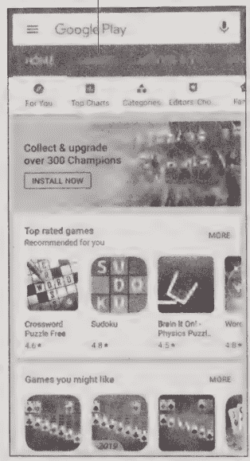
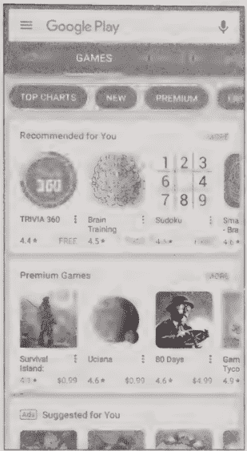
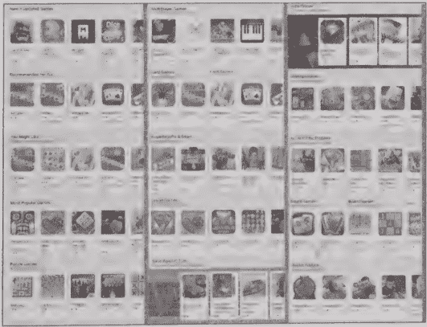
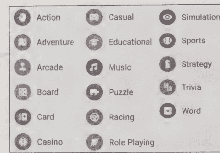
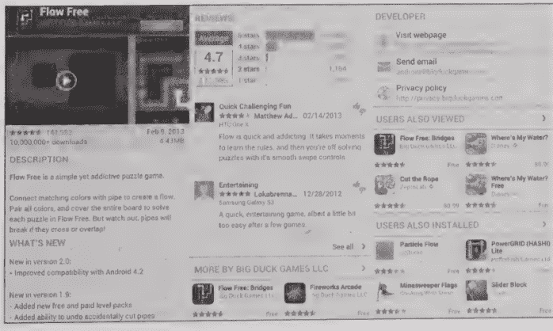
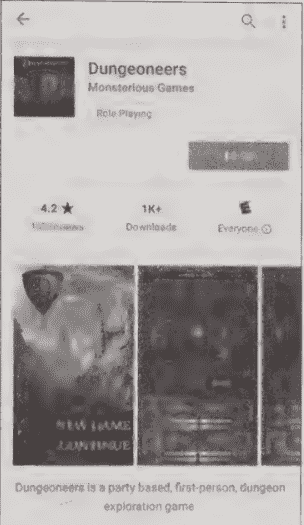
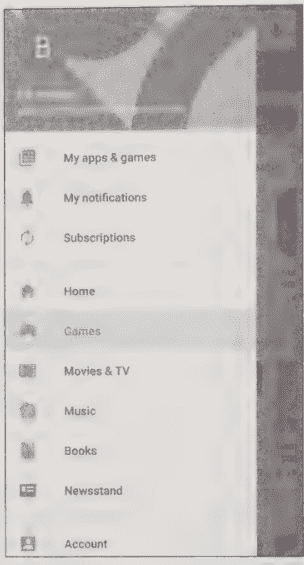
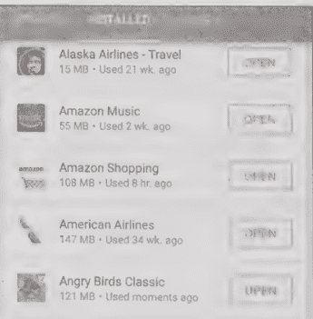
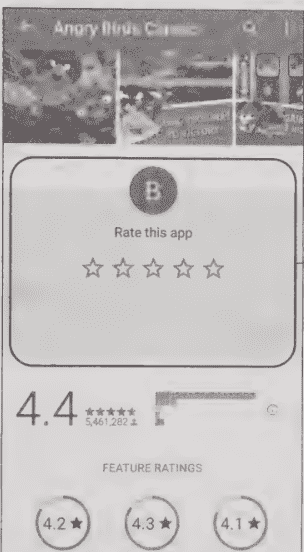
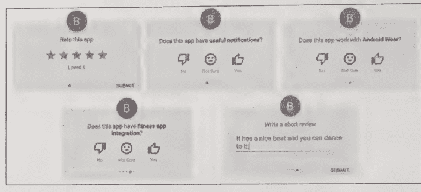

### 第10章

## 玩游戏

游戏是各种智能手机最受欢迎的下载类型。尽管人们关注的是商业生产力、社交和简化生活，但游戏下载量超过了所有其他应用程序下载量。到目前为止，电子游戏行业的收入超过了电影行业——而且已经持续了好几年！

我们可以就游戏与应用程序的优劣进行一场生动且富有智识的辩论。就本书而言，游戏与应用之间的区别如下：

- 如果一个人喜欢一款游戏，他或她往往会玩一段时间，也许几周甚至几个月，然后就停止使用。喜欢一个应用的人往往会继续使用它。
- 游戏往往会使用手机更多的图形功能。
- 用手机玩游戏的人往往喜欢尝试各种各样的游戏。

事实是，你的三星 Galaxy S10 凭借其大尺寸 Super AMOLED 屏幕和强劲的图形处理单元，让基于 Android 的游戏更有趣。既然你已经有一部，也许你应该休息一下，专注于享受乐趣！

## Play 商店游戏分类

第 8 章介绍了 Play 商店，如图 10-1 所示。顶层将商品分为几个类别：Home、Games、Movies & TV，以及右侧的几个其他类别。

### 游戏主页

FIGURE 10-1:
Play 商店主屏幕。

我们想要游戏。考验我们技能的游戏；好玩的游戏；可爱的游戏；让我们沉浸在另一个宇宙中的游戏！要到达那里，请点击游戏按钮！

这会调出如图 10-2 所示的游戏页面。

商店的这一部分只有游戏。本部分包括从简单拼图到模拟暴力的所有内容。所有游戏都涉及智力、技能（认知或运动）和角色扮演的各种组合。让我们开始吧。

FIGURE 10-2:
Google Play 主屏幕上的游戏链接。

## 游戏主屏幕

如果你滚动这个屏幕，你会看到许多推荐的游戏。这在图 10-3 中以全景显示。

FIGURE 10-3:
全景中的游戏主屏幕。

如果你不确定想尝试什么游戏，不用担心：选择很多。如你所见，游戏主屏幕提供了大量建议。每行都从不同角度帮助你找到新游戏。其中一些是棋盘游戏、策略游戏和动作游戏。它们还包括允许你在没有 Wi-Fi 的情况下离线玩的游戏。

另一种方法是选择分类选项，如图 10-2 右上角部分所示。这将调出如图 10-4 所示的游戏分类。

FIGURE 10-4:
游戏分类标签。

## 游戏分类标签

在 Play 商店中，游戏分为以下类型：

- **Action:** 游戏涉及发射弹丸，从棉花糖到子弹再到反弹道导弹不等。它们还包括各种程度血腥的格斗游戏。
- **Adventure:** 游戏带你进入虚拟世界，在那里寻找宝藏和/或与邪恶战斗。僵尸和吸血鬼是传统的恶棍。
- **Arcade:** 游戏厅和酒吧的热门之选。
- **Board:** 熟悉的（以及一些不太熟悉的）棋盘游戏版本。
- **Card:** 这里有所有标准的纸牌游戏。
- **Casino:** 赌博游戏的模拟；没有真实金钱交易。
- **Casual:** 你可以轻松拿起放下的游戏（除非你有成瘾性人格）。
- **Educational:** 令人愉快的游戏，同时为用户提供增强技能或信息。
- **Music:** 包括各种以音乐为主题的游戏。这些游戏可能包括[content]
## Play 商店游戏分类

第 8 章介绍了 Play 商店，如图 10-1 所示。顶层将商品分为几个类别：Home、Games、Movies & TV，以及右侧的几个其他类别。

### 游戏主页

FIGURE 10-1:
Play 商店主屏幕。

我们想要游戏。考验我们技能的游戏；好玩的游戏；可爱的游戏；让我们沉浸在另一个宇宙中的游戏！要到达那里，请点击游戏按钮！

这会调出如图 10-2 所示的游戏页面。

商店的这一部分只有游戏。本部分包括从简单拼图到模拟暴力的所有内容。所有游戏都涉及智力、技能（认知或运动）和角色扮演的各种组合。让我们开始吧。

FIGURE 10-2:
Google Play 主屏幕上的游戏链接。

## 游戏主屏幕

如果你滚动这个屏幕，你会看到许多推荐的游戏。这在图 10-3 中以全景显示。

FIGURE 10-3:
全景中的游戏主屏幕。

如果你不确定想尝试什么游戏，不用担心：选择很多。如你所见，游戏主屏幕提供了大量建议。每行都从不同角度帮助你找到新游戏。其中一些是棋盘游戏、策略游戏和动作游戏。它们还包括允许你在没有 Wi-Fi 的情况下离线玩的游戏。

另一种方法是选择分类选项，如图 10-2 右上角部分所示。这将调出如图 10-4 所示的游戏分类。

FIGURE 10-4:
游戏分类标签。

## 游戏分类标签

在 Play 商店中，游戏分为以下类型：

- **Action:** 游戏涉及发射弹丸，从棉花糖到子弹再到反弹道导弹不等。它们还包括各种程度血腥的格斗游戏。
- **Adventure:** 游戏带你进入虚拟世界，在那里寻找宝藏和/或与邪恶战斗。僵尸和吸血鬼是传统的恶棍。
- **Arcade:** 游戏厅和酒吧的热门之选。
- **Board:** 熟悉的（以及一些不太熟悉的）棋盘游戏版本。
- **Card:** 这里有所有标准的纸牌游戏。
- **Casino:** 赌博游戏的模拟；没有真实金钱交易。
- **Casual:** 你可以轻松拿起放下的游戏（除非你有成瘾性人格）。
- **Educational:** 令人愉快的游戏，同时为用户提供增强技能或信息。
- **Music:** 包括各种以音乐为主题的游戏。这些游戏可能包括[content]
## Play 商店游戏分类

第 8 章介绍了 Play 商店，如图 10-1 所示。顶层将商品分为几个类别：Home、Games、Movies & TV，以及右侧的几个其他类别。

### 游戏主页

FIGURE 10-1:
Play 商店主屏幕。

我们想要游戏。考验我们技能的游戏；好玩的游戏；可爱的游戏；让我们沉浸在另一个宇宙中的游戏！要到达那里，请点击游戏按钮！

这会调出如图 10-2 所示的游戏页面。

商店的这一部分只有游戏。本部分包括从简单拼图到模拟暴力的所有内容。所有游戏都涉及智力、技能（认知或运动）和角色扮演的各种组合。让我们开始吧。

FIGURE 10-2:
Google Play 主屏幕上的游戏链接。

## 游戏主屏幕

如果你滚动这个屏幕，你会看到许多推荐的游戏。这在图 10-3 中以全景显示。

FIGURE 10-3:
全景中的游戏主屏幕。

如果你不确定想尝试什么游戏，不用担心：选择很多。如你所见，游戏主屏幕提供了大量建议。每行都从不同角度帮助你找到新游戏。其中一些是棋盘游戏、策略游戏和动作游戏。它们还包括允许你在没有 Wi-Fi 的情况下离线玩的游戏。

另一种方法是选择分类选项，如图 10-2 右上角部分所示。这将调出如图 10-4 所示的游戏分类。

FIGURE 10-4:
游戏分类标签。

## 游戏分类标签

在 Play 商店中，游戏分为以下类型：

- **Action:** 游戏涉及发射弹丸，从棉花糖到子弹再到反弹道导弹不等。它们还包括各种程度血腥的格斗游戏。
- **Adventure:** 游戏带你进入虚拟世界，在那里寻找宝藏和/或与邪恶战斗。僵尸和吸血鬼是传统的恶棍。
- **Arcade:** 游戏厅和酒吧的热门之选。
- **Board:** 熟悉的（以及一些不太熟悉的）棋盘游戏版本。
- **Card:** 这里有所有标准的纸牌游戏。
- **Casino:** 赌博游戏的模拟；没有真实金钱交易。
- **Casual:** 你可以轻松拿起放下的游戏（除非你有成瘾性人格）。
- **Educational:** 令人愉快的游戏，同时为用户提供增强技能或信息。
- **Music:** 包括各种以音乐为主题的游戏。这些游戏可能包括[content]
## Play 商店游戏分类

第 8 章介绍了 Play 商店，如图 10-1 所示。顶层将商品分为几个类别：Home、Games、Movies & TV，以及右侧的几个其他类别。

### 游戏主页

FIGURE 10-1:
Play 商店主屏幕。

我们想要游戏。考验我们技能的游戏；好玩的游戏；可爱的游戏；让我们沉浸在另一个宇宙中的游戏！要到达那里，请点击游戏按钮！

这会调出如图 10-2 所示的游戏页面。

商店的这一部分只有游戏。本部分包括从简单拼图到模拟暴力的所有内容。所有游戏都涉及智力、技能（认知或运动）和角色扮演的各种组合。让我们开始吧。

FIGURE 10-2:
Google Play 主屏幕上的游戏链接。

## 游戏主屏幕

如果你滚动这个屏幕，你会看到许多推荐的游戏。这在图 10-3 中以全景显示。

FIGURE 10-3:
全景中的游戏主屏幕。

如果你不确定想尝试什么游戏，不用担心：选择很多。如你所见，游戏主屏幕提供了大量建议。每行都从不同角度帮助你找到新游戏。其中一些是棋盘游戏、策略游戏和动作游戏。它们还包括允许你在没有 Wi-Fi 的情况下离线玩的游戏。

另一种方法是选择分类选项，如图 10-2 右上角部分所示。这将调出如图 10-4 所示的游戏分类。

FIGURE 10-4:
游戏分类标签。

## 游戏分类标签

在 Play 商店中，游戏分为以下类型：

- **Action:** 游戏涉及发射弹丸，从棉花糖到子弹再到反弹道导弹不等。它们还包括各种程度血腥的格斗游戏。
- **Adventure:** 游戏带你进入虚拟世界，在那里寻找宝藏和/或与邪恶战斗。僵尸和吸血鬼是传统的恶棍。
- **Arcade:** 游戏厅和酒吧的热门之选。
- **Board:** 熟悉的（以及一些不太熟悉的）棋盘游戏版本。
- **Card:** 这里有所有标准的纸牌游戏。
- **Casino:** 赌博游戏的模拟；没有真实金钱交易。
- **Casual:** 你可以轻松拿起放下的游戏（除非你有成瘾性人格）。
- **Educational:** 令人愉快的游戏，同时为用户提供增强技能或信息。
- **Music:** 包括各种以音乐为主题的游戏。这些游戏可能包括[content]
## Play 商店游戏分类

第 8 章介绍了 Play 商店，如图 10-1 所示。顶层将商品分为几个类别：Home、Games、Movies & TV，以及右侧的几个其他类别。

### 游戏主页

FIGURE 10-1:
Play 商店主屏幕。

我们想要游戏。考验我们技能的游戏；好玩的游戏；可爱的游戏；让我们沉浸在另一个宇宙中的游戏！要到达那里，请点击游戏按钮！

这会调出如图 10-2 所示的游戏页面。

商店的这一部分只有游戏。本部分包括从简单拼图到模拟暴力的所有内容。所有游戏都涉及智力、技能（认知或运动）和角色扮演的各种组合。让我们开始吧。

FIGURE 10-2:
Google Play 主屏幕上的游戏链接。

## 游戏主屏幕

如果你滚动这个屏幕，你会看到许多推荐的游戏。这在图 10-3 中以全景显示。

FIGURE 10-3:
全景中的游戏主屏幕。

如果你不确定想尝试什么游戏，不用担心：选择很多。如你所见，游戏主屏幕提供了大量建议。每行都从不同角度帮助你找到新游戏。其中一些是棋盘游戏、策略游戏和动作游戏。它们还包括允许你在没有 Wi-Fi 的情况下离线玩的游戏。

另一种方法是选择分类选项，如图 10-2 右上角部分所示。这将调出如图 10-4 所示的游戏分类。

FIGURE 10-4:
游戏分类标签。

## 游戏分类标签

在 Play 商店中，游戏分为以下类型：

- **Action:** 游戏涉及发射弹丸，从棉花糖到子弹再到反弹道导弹不等。它们还包括各种程度血腥的格斗游戏。
- **Adventure:** 游戏带你进入虚拟世界，在那里寻找宝藏和/或与邪恶战斗。僵尸和吸血鬼是传统的恶棍。
- **Arcade:** 游戏厅和酒吧的热门之选。
- **Board:** 熟悉的（以及一些不太熟悉的）棋盘游戏版本。
- **Card:** 这里有所有标准的纸牌游戏。
- **Casino:** 赌博游戏的模拟；没有真实金钱交易。
- **Casual:** 你可以轻松拿起放下的游戏（除非你有成瘾性人格）。
- **Educational:** 令人愉快的游戏，同时为用户提供增强技能或信息。
- **Music:** 包括各种以音乐为主题的游戏。这些游戏可能包括[content]
## Play 商店游戏分类

第 8 章介绍了 Play 商店，如图 10-1 所示。顶层将商品分为几个类别：Home、Games、Movies & TV，以及右侧的几个其他类别。

### 游戏主页

FIGURE 10-1:
Play 商店主屏幕。

我们想要游戏。考验我们技能的游戏；好玩的游戏；可爱的游戏；让我们沉浸在另一个宇宙中的游戏！要到达那里，请点击游戏按钮！

这会调出如图 10-2 所示的游戏页面。

商店的这一部分只有游戏。本部分包括从简单拼图到模拟暴力的所有内容。所有游戏都涉及智力、技能（认知或运动）和角色扮演的各种组合。让我们开始吧。

FIGURE 10-2:
Google Play 主屏幕上的游戏链接。

## 游戏主屏幕

如果你滚动这个屏幕，你会看到许多推荐的游戏。这在图 10-3 中以全景显示。

FIGURE 10-3:
全景中的游戏主屏幕。

如果你不确定想尝试什么游戏，不用担心：选择很多。如你所见，游戏主屏幕提供了大量建议。每行都从不同角度帮助你找到新游戏。其中一些是棋盘游戏、策略游戏和动作游戏。它们还包括允许你在没有 Wi-Fi 的情况下离线玩的游戏。

另一种方法是选择分类选项，如图 10-2 右上角部分所示。这将调出如图 10-4 所示的游戏分类。

FIGURE 10-4:
游戏分类标签。

## 游戏分类标签

在 Play 商店中，游戏分为以下类型：

- **Action:** 游戏涉及发射弹丸，从棉花糖到子弹再到反弹道导弹不等。它们还包括各种程度血腥的格斗游戏。
- **Adventure:** 游戏带你进入虚拟世界，在那里寻找宝藏和/或与邪恶战斗。僵尸和吸血鬼是传统的恶棍。
- **Arcade:** 游戏厅和酒吧的热门之选。
- **Board:** 熟悉的（以及一些不太熟悉的）棋盘游戏版本。
- **Card:** 这里有所有标准的纸牌游戏。
- **Casino:** 赌博游戏的模拟；没有真实金钱交易。
- **Casual:** 你可以轻松拿起放下的游戏（除非你有成瘾性人格）。
- **Educational:** 令人愉快的游戏，同时为用户提供增强技能或信息。
- **Music:** 包括各种以音乐为主题的游戏。这些游戏可能包括[content]
## Play 商店游戏分类

第 8 章介绍了 Play 商店，如图 10-1 所示。顶层将商品分为几个类别：Home、Games、Movies & TV，以及右侧的几个其他类别。

### 游戏主页

FIGURE 10-1:
Play 商店主屏幕。

我们想要游戏。考验我们技能的游戏；好玩的游戏；可爱的游戏；让我们沉浸在另一个宇宙中的游戏！要到达那里，请点击游戏按钮！

这会调出如图 10-2 所示的游戏页面。

商店的这一部分只有游戏。本部分包括从简单拼图到模拟暴力的所有内容。所有游戏都涉及智力、技能（认知或运动）和角色扮演的各种组合。让我们开始吧。

FIGURE 10-2:
Google Play 主屏幕上的游戏链接。

## 游戏主屏幕

如果你滚动这个屏幕，你会看到许多推荐的游戏。这在图 10-3 中以全景显示。

FIGURE 10-3:
全景中的游戏主屏幕。

如果你不确定想尝试什么游戏，不用担心：选择很多。如你所见，游戏主屏幕提供了大量建议。每行都从不同角度帮助你找到新游戏。其中一些是棋盘游戏、策略游戏和动作游戏。它们还包括允许你在没有 Wi-Fi 的情况下离线玩的游戏。

另一种方法是选择分类选项，如图 10-2 右上角部分所示。这将调出如图 10-4 所示的游戏分类。

FIGURE 10-4:
游戏分类标签。

## 游戏分类标签

在 Play 商店中，游戏分为以下类型：

- **Action:** 游戏涉及发射弹丸，从棉花糖到子弹再到反弹道导弹不等。它们还包括各种程度血腥的格斗游戏。
- **Adventure:** 游戏带你进入虚拟世界，在那里寻找宝藏和/或与邪恶战斗。僵尸和吸血鬼是传统的恶棍。
- **Arcade:** 游戏厅和酒吧的热门之选。
- **Board:** 熟悉的（以及一些不太熟悉的）棋盘游戏版本。
- **Card:** 这里有所有标准的纸牌游戏。
- **Casino:** 赌博游戏的模拟；没有真实金钱交易。
- **Casual:** 你可以轻松拿起放下的游戏（除非你有成瘾性人格）。
- **Educational:** 令人愉快的游戏，同时为用户提供增强技能或信息。
- **Music:** 包括各种以音乐为主题的游戏。这些游戏可能包括[content]
## Play 商店游戏分类

第 8 章介绍了 Play 商店，如图 10-1 所示。顶层将商品分为几个类别：Home、Games、Movies & TV，以及右侧的几个其他类别。

### 游戏主页

FIGURE 10-1:
Play 商店主屏幕。

我们想要游戏。考验我们技能的游戏；好玩的游戏；可爱的游戏；让我们沉浸在另一个宇宙中的游戏！要到达那里，请点击游戏按钮！

这会调出如图 10-2 所示的游戏页面。

商店的这一部分只有游戏。本部分包括从简单拼图到模拟暴力的所有内容。所有游戏都涉及智力、技能（认知或运动）和角色扮演的各种组合。让我们开始吧。

FIGURE 10-2:
Google Play 主屏幕上的游戏链接。

## 游戏主屏幕

如果你滚动这个屏幕，你会看到许多推荐的游戏。这在图 10-3 中以全景显示。

FIGURE 10-3:
全景中的游戏主屏幕。

如果你不确定想尝试什么游戏，不用担心：选择很多。如你所见，游戏主屏幕提供了大量建议。每行都从不同角度帮助你找到新游戏。其中一些是棋盘游戏、策略游戏和动作游戏。它们还包括允许你在没有 Wi-Fi 的情况下离线玩的游戏。

另一种方法是选择分类选项，如图 10-2 右上角部分所示。这将调出如图 10-4 所示的游戏分类。

FIGURE 10-4:
游戏分类标签。

## 游戏分类标签

在 Play 商店中，游戏分为以下类型：

- **Action:** 游戏涉及发射弹丸，从棉花糖到子弹再到反弹道导弹不等。它们还包括各种程度血腥的格斗游戏。
- **Adventure:** 游戏带你进入虚拟世界，在那里寻找宝藏和/或与邪恶战斗。僵尸和吸血鬼是传统的恶棍。
- **Arcade:** 游戏厅和酒吧的热门之选。
- **Board:** 熟悉的（以及一些不太熟悉的）棋盘游戏版本。
- **Card:** 这里有所有标准的纸牌游戏。
- **Casino:** 赌博游戏的模拟；没有真实金钱交易。
- **Casual:** 你可以轻松拿起放下的游戏（除非你有成瘾性人格）。
- **Educational:** 令人愉快的游戏，同时为用户提供增强技能或信息。
- **Music:** 涵盖各种与音乐相关的游戏。这些游戏可能包含[content]
## Play 商店游戏分类

第 8 章介绍了 Play 商店，如图 10-1 所示。顶层分为几个类别：Home、Games、Movies & TV，以及右侧其他类别。

### 游戏主页

FIGURE 10-1:
Play 商店主屏幕。

我们想要游戏。考验技能的游戏；好玩的游戏；可爱的游戏；让我们沉浸在另一个宇宙的游戏！点击游戏按钮即可。

这会打开如图 10-2 所示的游戏页面。

本区只有游戏。内容从简单拼图到模拟暴力不等。所有游戏都涉及智力、技能（认知或运动）和角色扮演的组合。开始吧。

FIGURE 10-2:
Google Play 主屏幕上的游戏链接。

## 游戏主屏幕

滚动此屏幕可看到许多推荐游戏。图 10-3 为全景展示。

FIGURE 10-3:
全景中的游戏主屏幕。

不确定想玩什么？不用担心，选择很多。游戏主屏幕提供大量建议。每行从不同角度帮助你找新游戏。包括棋盘、策略、动作游戏，也包括可离线无 Wi-Fi 游玩的游戏。

另一种方法是选择分类选项，如图 10-2 右上角所示。这会打开如图 10-4 所示的游戏分类。

FIGURE 10-4:
游戏分类标签。

## 游戏分类标签

Play 商店中游戏分为以下类型：

- **Action:** 涉及发射弹丸的游戏，从棉花糖到子弹再到反弹道导弹。还包括各种血腥程度的格斗游戏。
- **Adventure:** 带你进入虚拟世界寻找宝藏和/或与邪恶战斗。僵尸和吸血鬼是传统反派。
- **Arcade:** 游戏厅和酒吧的热门。
- **Board:** 熟悉及不熟悉的棋盘游戏版本。
- **Card:** 所有标准纸牌游戏。
- **Casino:** 赌博游戏模拟，无真实金钱交易。
- **Casual:** 可随时拿起放下的游戏，除非有成瘾人格。
- **Educational:** 寓教于乐，提供增强技能或信息的游戏。
- **Music:** 涵盖各种与音乐相关的游戏。可能包括[content]
- **Music:** 涵盖各种与音乐相关的游戏。可能包括[content]
## Play 商店游戏分类

第 8 章介绍了 Play 商店，如图 10-1。顶层分为 Home、Games、Movies & TV 及右侧其他类别。

### 游戏主页

FIGURE 10-1:
Play 商店主屏幕。

我们想要游戏。考验技能、好玩、可爱、沉浸式游戏！点击游戏按钮。

打开如图 10-2 的游戏页面。

本区只有游戏。从简单拼图到模拟暴力。游戏涉及智力、技能和角色扮演。开始吧。

FIGURE 10-2:
Google Play 主屏幕上的游戏链接。

## 游戏主屏幕

滚动可看到推荐游戏。图 10-3 为全景。

FIGURE 10-3:
全景中的游戏主屏幕。

不确定想玩什么？选择很多。游戏主屏幕提供大量建议。每行帮助找新游戏。包括棋盘、策略、动作游戏，也可离线无 Wi-Fi 游玩。

另一方法是选择分类选项，如图 10-2 右上角所示。打开如图 10-4 的游戏分类。

FIGURE 10-4:
游戏分类标签。

## 游戏分类标签

Play 商店游戏分为以下类型：

- **Action:** 发射弹丸游戏，从棉花糖到子弹到反弹道导弹。还包括各种血腥格斗。
- **Adventure:** 虚拟世界寻宝或抗恶。僵尸吸血鬼是传统反派。
- **Arcade:** 游戏厅酒吧热门。
- **Board:** 熟悉与不熟悉棋盘游戏版本。
- **Card:** 所有标准纸牌游戏。
- **Casino:** 赌博模拟，无真钱交易。
- **Casual:** 可随时拿起放下，除非成瘾。
- **Educational:** 寓教于乐，提升技能或信息。
- **Music:** 多种音乐相关游戏。可能含[content]
- **Music:** 包含多种与音乐相关的游戏。可能包含问答、学习音乐的教育游戏或儿童合唱歌曲。
- **Puzzle:** 包含数独、字谜和 Trivial Pursuit 等游戏。
- **Racing:** 汽车、卡丁车、单板滑雪、喷气滑水、双翼机、喷气机或航天器相互竞赛。
- **Role Playing:** 在虚拟世界中成为现实生活不同版本的自己，无论好坏。
- **Simulation:** 而不是生活在游戏设计师的虚拟世界中，而是创建和管理自己的虚拟世界。
- **Sports:** 电子化的现实世界活动，包含原游戏的部分技能或策略元素；根据细节程度而变化。
- **Strategy:** 强调决策技能，如国际象棋；多种复杂程度和现实契合度各异的游戏。
- **Trivia:** 如果你知道《我的三个儿子》这部电视剧中家庭狗的名字等知识，就会获奖的游戏。它的名字叫 Tramp，但你早就知道了。
- **Word:** 通用流行游戏，如 Scrabble。

许多游戏出现在多个分类中。

每个游戏都有描述页。与应用描述页类似，但强调不同属性。图 10-5 是描述页示例。

FIGURE 10-5
Flow Free 的描述页。

当你在一个有前景的分类中时，寻找以下路标来帮助你查看并缩小类似标题的选择范围：

- **Ratings/Comments:** 玩家喜欢赞美好游戏和抨击坏游戏。图 10-5 所示游戏的评论是赞美的，游戏名称旁的整体排名表明许多人评价良好。
- **Description:** 说明游戏的基本概念。
- **What's New:** 说明自上次发布以来新增的功能。如果你有该游戏的旧版本，这很重要。
- **Reviews:** 现有用户在此发泄不满或炫耀自己比你早买。评论匿名，包含评论日期，并说明评论者使用的设备类型。某些应用在旧设备上会卡顿。但你有 Galaxy S10，拥有目前最好的配置。
- **More Games by Developer:** 如果你对某个游戏体验积极，可能想查看该开发者的其他游戏。更多内容部分使查找这些其他标题更容易。
- **Users Also Viewed/Users Also Installed:** 显示下载此应用的其他人还查看或下载了哪些其他应用。这些是你可能想查看的应用。
- **Price:** 作为类似标题之间的平局打破者，略高的价格最终表明游戏更优秀。由于只相差几美分，价格通常不是大问题。

## 在游戏上留下反馈

对于应用总体而言，尤其是游戏，Play 商店是一个自由市场。进入 Play 商店时，最好的购买途径是阅读先行者的评论。虽然超过一百万用户评论过 Angry Birds，但大多数游戏没有这种关注度。

可以说，你的意见不会改变像 Angry Birds 这样评论频繁的游戏的整体评分。其他游戏则不然。

新付费游戏之一是 Monstrous Games 的 Dungeoneers。游戏描述如图 10-6 所示。

FIGURE 10-6:
Dungeoneers 的游戏描述。

在下载到手机之前，描述页会显示安装按钮或游戏价格；反馈区域为灰色。下载到手机后，描述页会提供打开或卸载选项，反馈区域变为可用。

在此例中，Dungeoneers 已被 132 名玩家评测，其中大多数非常热情。你的意见对这款游戏比对评论众多的游戏更重要。下载并玩过游戏后，你可以通过提供自己的评论来帮助系统正常运行。本节从 Play 商店第一屏开始介绍流程，该屏如图 10-1 所示：

- 1. 点击菜单图标。

这会弹出如图 10-7 所示的弹出菜单。

FIGURE 10-7:
Play 商店应用的弹出菜单。

### 2. 点击我的应用。

这会显示你已下载的应用，如图 10-8 所示。
Play 商店在此菜单中不区分游戏和应用。
它们都在同一列表中。

FIGURE 10-8:
查看你的下载内容。

### 3. 轻点您想要留下反馈的游戏。

轻点游戏标题通常会显示游戏描述，类似于图 10-5 和 10-6 所示的内容。但是，在您下载游戏后，会出现一个“为此应用评分”部分，让您可以留下反馈。参见图 10-9 以查看 Angry Birds 的此部分。

图 10-9：
游戏描述页面，留有反馈空间。

### 4. 轻点屏幕上的星星。

这会弹出一个屏幕，如图 10-10 左侧所示。

### 5. 轻点您认为该游戏应得的星级数量。

星级介于一星到五星之间。您将被要求回答图 10-10 中显示的其他一些问题，包括在最后一个弹出窗口中发表任何评论。

### 6. 完成后，轻点“提交”。

您的评论将被发送到 Play Store，供所有人查看。为了系统的缘故，请确保您的评论准确无误！

图 10-10：
输入反馈前后的评分星级弹出屏幕。

## 本章内容
- 决定导航使用什么
- 使用手机已有的功能
- 安全使用地图
