### 第11章

### 规划你想去的地方

手机上有地图是非常方便的工具。在最基本层面上，您可以让手机为您计划前往的地方显示地图。这很方便，但只是您能做的事情的一小部分。

使用合适的应用程序，您的 Galaxy S10 手机可以执行以下操作：

- 自动在地图上找到您的位置。
- 提供前往您想去的地方的路线。
  - 在驾驶时，使用历史驾驶时间。
  - 在驾驶时，使用实时路况。
  - 在步行时。
  - 在乘坐公共交通时。
- 在旅行时提供逐向导航。
  - 使用道路和路口的二维表示。
  - 使用道路、建筑物和路口的三维表示。
- 告诉他人您所在的位置。
- 使用手机屏幕作为取景器，在您平移区域时识别地标（增强现实）。

对于 Galaxy S10 也有一些面向商业用户的地图应用程序，例如 Zonar Systems 的 MyBusVue 或 Real Green Systems 的 Live Truck Tracking，但本书不涉及它们。

## GPS 101：先从基础开始

如果不谈及后台的 GPS，就无法谈论智能手机地图，这会带来一些您需要了解的固有挑战。首先（而且显而易见的是），您的手机中有一个 GPS 接收器。这意味着以下几点：

- **给我几秒钟。** 与所有 GPS 接收器一样，您位置检测系统在您第一次打开手机时需要一点时间来确定位置。
- **户外更好。** 您使用手机的许多常见场所——主要是建筑物内部——GPS 覆盖较差。
- **没有什么是完美的。** 即使 GPS 覆盖良好，定位和地图也尚未完善。*增强现实*，即在屏幕上识别当地地标的选项，甚至更不完美。有关更多信息，请参阅第 14 章。
- **您必须打开它。** 您的 GPS 接收器必须打开才能工作。当然，关闭它可以节省电池寿命，但这样会阻止地图应用程序工作。
- **保持低调。** 分享敏感位置信息是隐私倡导者非常关心的问题。人们担心跟踪者或其他恶棍可以访问您手机中的位置信息来跟踪您的行动。实际上，有更简单的方法来实现这一目标，但控制谁知道您所在的位置仍然是您应该考虑的事情，特别是当您拥有共享位置信息的应用程序时。

良好的蜂窝覆盖与 GPS 覆盖无关。您手机中的 GPS 接收器正在寻找卫星；蜂窝覆盖基于安装在塔或高楼上的天线。

地图应用很有用，但它们也比许多其他应用消耗更多的电池寿命和数据。请注意其对数据使用和电池寿命的影响。保持地图应用程序处于活动状态很方便，但如果您不注意使用情况并且服务计划不正确，它也可能对电池和钱包造成负担。

## 实际操作：使用地图

最容易理解的地图应用程序类型是在打开应用程序时显示本地地图。根据手机型号，您可能已预装了地图应用程序，例如 Google Maps、TeleNav 或 VZ Navigator。您可以在主屏幕和应用程序列表中找到它们。

对于智能手机来说，从您基于 GPS 的位置提供到本地某个您想去的地方的路线并不是一个很大的飞跃。这些是这些应用程序中都具备的标准功能。

本节介绍 Google Maps 和 Google Maps Navigation；两者都是免费的，可能已预装在您的手机上。如果没有，您可以从 Google Play Store 下载它们。其他可能随手机附带的地图应用程序，例如 Bing Maps 或 Waze，具有类似的功能，但细节会有所不同。或者您可能想使用其他地图应用程序。都没问题。

除了手机自带的通用地图应用程序外，还有数百种可用的地图应用程序可以帮助您找到喜爱的商店、导航水道或在拥挤的停车场找到您的汽车。例如，Navigon 和 Waze 提供基于实时交通状况的导航解决方案，并使用您驾驶区域的三维图像提供逐向导航。更多信息，请参阅本章末尾的“升级您的导航”部分。

地图设备再好，也来不及告诉您停止观看它们并避开迎面而来的汽车。如果您在车上无法控制自己，需要盯着地图屏幕上的箭头移动，请善待自己，让别人开车。如果没有其他人可以开车，请安全行事，不要在车内使用手机的导航服务。

使用地图最基本的方法是打开 Google Maps 应用程序。启动此应用的图标显示如下。

轻点 Google Maps 图标时看到的第一个屏幕是带有您位置的街道地图。图 11-1 显示了当手机用户在西雅图地区时地图的示例。

图 11-1：
您从当前位置开始。

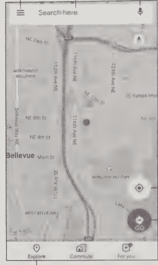

地图菜单

搜索框

语音命令

居中图标

路线

本地服务

您所在的位置是地图中央的蓝色圆点——除非您正在移动，此时它会变成蓝色箭头。图中地图的分辨率约为一平方英里。您可以通过将手指放在地图上并拖动远离您想要查看的地图部分来查看地图的其他部分。这会将地图的新区域带到屏幕上。

提示
旋转手机以更改地图的显示方式。根据您要查找的内容，不同的朝向可能更容易。

### 更改地图比例尺

在某些情况下，一平方英里的分辨率可以帮助您在不熟悉的地方找到方向。但有时缩小以获得更广阔的视角或放大以找到熟悉的地标（如水体或主要高速公路）会有所帮助。

要在屏幕上获得更多显示区域，请使用我在第 2 章中讨论的捏合手势。这会缩小地图的大小，并在您捏合的区域周围显示更多地图。如果您需要在屏幕上获得更多显示区域，您可以继续捏合，直到获得更多地图。在您找到方向后，您可以通过双击屏幕返回到原始分辨率。

另一方面，一平方英里的比例可能不够。要查看更多地标，请使用拉伸手势放大。拉伸手势会扩展您开始屏幕的区域的边界。继续拉伸，直到获得您想要的细节。图 11-2 显示了同时放大和缩小的街道地图。左侧地图在卫星视图中放大。右侧地图在地形视图中缩小。

### 放大后的图像

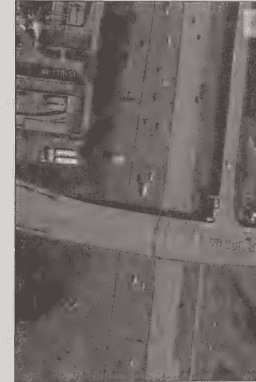

### 缩小后的图像

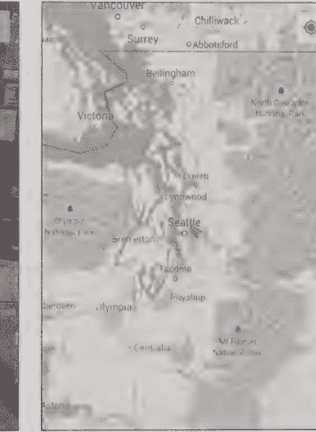

图 11-2：
放大和缩小的街道图像。

通过轻点地图左上角的菜单按钮（三个平行线），该应用可让您在卫星视图或地形视图之间进行选择。这会弹出一个类似图 11-3 所示的弹出菜单。

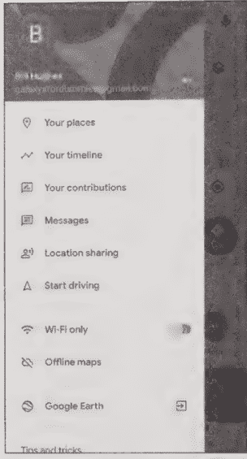

图 11-3：
地图菜单弹出窗口。

通过点击“卫星”调出卫星视图。点击“地形”即可获得地形视图。你还可以调出其他对你有用的视图，包括交通路线和自行车道。本章下一节我会向你展示其他一些选项。

如果你在放大地图且找不到自己的位置，请点击带圆圈的点图标（有关居中图标，请参阅图 11-1）。它会移动地图使你位于中心。

## 查找附近服务

大多数服务搜索都属于相对较少的几个类别。你的地图应用程序已设置好查找你最可能寻求的内容。通过点击页面底部的本地服务图标（请参阅图 11-1），你可以快速找到附近的服务，例如餐厅、咖啡店、酒吧、酒店、景点、ATM 和加油站，如图 11-4 所示。

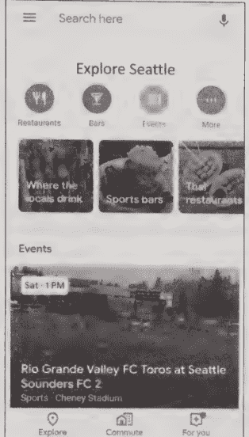

图 11-4：
点击在地图上查找服务。

不仅如此，它还知道一天中的时间。早餐时间与晚上的建议不同。只需向下滚动并点击其中一个主题图标，你的手机就会搜索你附近的商家。结果会以常规的 Google 搜索形式返回，包含名称、地址以及与你位置的距离。示例如图 11-5 所示。

除了位置和评论外，搜索结果还包括图标和其他相关信息：

- **导航：** 点击汽车图标即可获取从当前位置到该商家的逐向导航。
- **通话：** 点击此项即可致电该商家。
- **保存：** 点击星标即可将此地点设为收藏之一。
- **网站：** 点击此项即可前往该商家的网站。

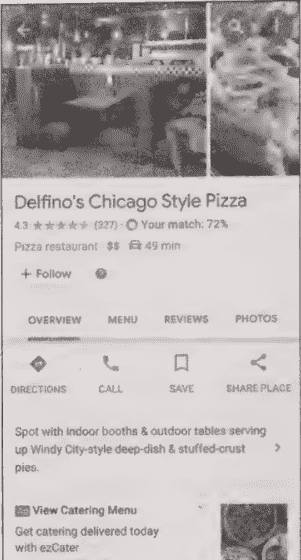

图 11-5
服务选择的搜索结果。

**分享地点：** 点击分享地点图标，你就可以通过多种方式告诉你的朋友、家人、同事以及全世界关于这个精彩地点。

**更多选项，包括**

- *街景视图：* 在 Google 街景中查看该位置。如图 11-6 底部所示，街景会显示你输入位置的街道地址照片。
- *营业时间：* 如果该商家已分享营业时间，你可以在这里找到。
- *菜单：* 如果该商家已分享菜单，你可以在这里找到。
- *评论：* 这包括人们对该地点的各种体验信息。
- *更多：* 运行另一次 Google 搜索以获取该商家的更多信息，例如来自网络其他部分的评论。

但假设你到了现场，却发现队伍排到了门外。会发生这种情况。你只需点击街道地址，本地地图就会如图 11-6 所示出现。该地图会告诉你周围的所有位置，以便你可以找到其他选择。

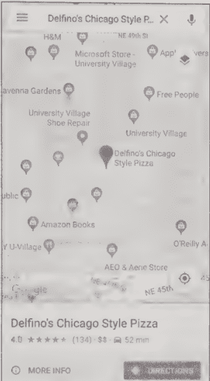

图 11-6：
街道地图搜索结果。

## 获取和使用路线

你可能想从地图应用程序获取路线。我也是。你可以通过多种方式获取路线，包括：

- 点击搜索文本框并输入你的位置名称或地址——例如，西雅图太空针塔或伊利诺伊州斯普林菲尔德埃弗格林 Terrace 742 号。
- 点击探索图标（请参阅图 11-1），点击景点图标（请参阅图 11-4），然后选择你的位置。

这些方法都会带你进入显示你位置的地图。

看起来很直观，搜索特定景点（例如西雅图太空针塔）时只会得到西雅图太空针塔。然而，这种结果有时过于简单。一次搜索可能有多个结果，例如连锁店。Google 地图会提供多个选择，你可能需要选择自己喜欢的。通常，应用会给出最近的选项。

要获取路线，请点击路线图标。这会弹出如图 11-7 所示的屏幕。

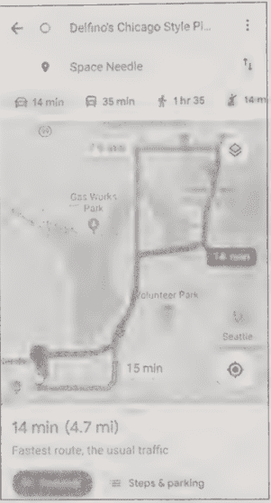

图 11-7：
从起始位置到目标的路线选项。

这提供了以下选项：

- **驾驶：** 从当前位置驾车前往目的地时的逐向导航。
- **公共交通：** 此选项会告诉你如何利用公布的时间表乘坐公共交通前往目的地。
- **出租车或叫车服务：** 此选项会给出乘坐出租车、Uber 或 Lyft 所需的时间。
- **骑行：** 此选项适用于骑行者；除了城市街道外，还包括自行车道。
- **步行导航：** 步行前往目的地时的逐向导航。

对于这些选项中的每一个，你可以使用屏幕底部的选项来

- **获取路线：** 顺序路线，如图 11-8 所示，但不会告诉你何时转弯。
- **导航：** 而不是显示地图，此选项会将你置于导航应用中，该应用在你旅行时会监控你的位置并告诉你下一步该做什么。

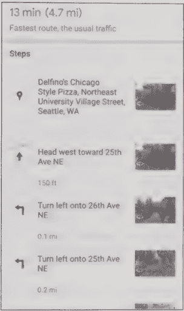

图 11-8：
前往目标的分步路线。

## 升级你的导航

通常，像 Google 地图导航这样的免费导航应用程序具有实时更新，可避免让你走拥堵的路线。这非常方便，尤其是在城市地区。然而，如果这还不够，你还可以升级以获得提供地标更好上下文的 3D 图像。（见图 11-9。）

如你在图 11-9 中所见，2D 地图完全可用且准确，但 3D 地图会提供上下文以及周围建筑物的额外信息，这可以给你额外的信心。这需要支付少量溢价。因此，如果你经常依赖地图应用到达目的地，你可能会觉得花钱购买付费应用是值得的。

### 2D 导航

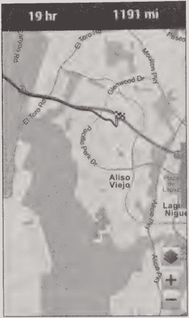

### 3D 导航

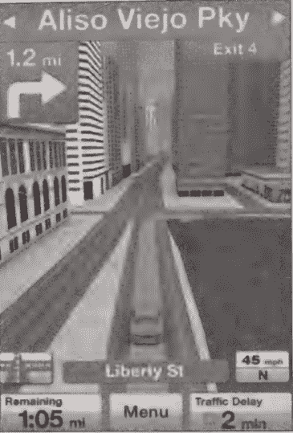

图 11-9：
比较 2D 导航与 3D 导航。

每月额外支付 5 到 10 美元对我们中的一些人来说感觉很多。然而，请记住：

- 这笔金额与你每月支付的服务费用相比相对适中。
- 具有几乎相同功能的专用 GPS 接收器的价格在 125 美元到 200 美元之间。服务的月费用与 GPS 接收器的一次性费用相当。此外，你不必携带额外的设备及其线路的麻烦。

有时应用会提供语音指令。Google 应用在地图上有一个扬声器图标，允许你打开或关闭语音指令。

## 安全驾驶

驾驶时使用手机是个坏主意。大多数州禁止驾驶时发短信，但研究表明法律对行为影响不大。偷看手机实在太诱人了。残酷的现实是：根据美国国家公路交通安全管理局的数据，2016 年美国因驾驶时发短信导致近 600 人死亡。当包括所有分心驾驶来源（进食、饮水、调整收音机等）时，共有 3,450 人死亡。

更糟糕的是，分心驾驶对年轻驾驶员来说问题尤为突出。你无法阻止你的青少年在驾驶时通过后视镜检查他的头发，但你可以为他的手机安装一个应用，防止他在汽车行驶时发短信。最简单的应用会跟踪速度——如果手机速度超过预设限制，就会关闭手机的通信。更复杂的应用程序提供更多选项，包括拨打 911 或例外列表的能力、如果你是乘客而非驾驶员可以输入的代码等。

如果你难以放下手机，你甚至可能想为自己和你的青少年安装其中一个应用。

