### 第12章
### 播放音乐和视频

智能手机内置了数字音乐和视频播放器。不久前，拥有专用音乐或视频播放器曾是主流。然而，拥有一台既可作电话又可作为娱乐来源的设备更方便，因为这样你只需要一台设备而不是两台，而且省去了充电用的额外线缆和用于听歌的独立耳机。你的三星 Galaxy S10 也不例外。你可以在手机上全天全夜播放数字音乐文件和播客。嵌入手机中的音视频技术确实是目前最好的之一。

此外，得益于 Galaxy S10 智能手机上的 Super AMOLED 屏幕，你的手机非常适合作为便携式视频播放器。只需戴上耳机收听，屏幕上观看，无论是短小的音乐视频还是全长电影。你可能会看着手机想知道在相对较小的屏幕上观看视频会有多好，但一旦开始，屏幕表现如此出色，你很快就会沉浸其中。

此外，你的 Galaxy S10 配备了用于下载和收听音乐以及下载和观看视频的应用程序。这些应用非常直观，尤其是如果你曾经使用过 CD 或 DVD 播放器的话。我将通过读者在 eBay 上挂售的 MP3 和 CD 播放器数量来评判本章的成功与否。

## 为娱乐做好准备

无论你使用的是哪款手机、用于娱乐的具体应用是什么，以及你是在收听音频还是观看视频，这里我将提前介绍一些常见注意事项。

首先是耳机的使用。是的，你在 MP3 播放器上使用过耳机，但你可能希望在手机上使用耳机。术语不仅仅是语义问题；耳机由耳机加上线缆上的麦克风组成。这使得在听音乐或看电影时接到电话时更方便。

你的手机检测到来电时会暂停音乐或电影并显示来电号码。如果你接听并且使用耳机，你可以合理地确信对方能清晰地听到你。如果你使用耳机，手机会使用内置麦克风收录你的声音，而你则通过耳机听到对方。我的建议是使用耳机测试音质，然后自行判断你想使用耳机还是耳麦。

接下来，我将探讨扬声器。我在第3章讨论蓝牙配对时提到过扬声器，并在第16章谈到让手机更个性化时也提到了扬声器。如你所料，制定一个可靠的扬声器策略对于充分发挥 Galaxy S10 的性能很重要。

然后你需要了解如何将 Galaxy S10 手机连接到电视和/或音响。在此之后，我将讨论多媒体材料的许可问题。

最后，我将探讨如何在手机上存储所有这些选项以供离线娱乐。如果你愿意，你可以拥有海量的存储空间。我将探讨“gobs”这一术语在音视频存储方面究竟意味着什么。

## 选择你的耳机

你可以在三星 Galaxy S10 手机上使用有线或无线（蓝牙）耳机。有线耳机比蓝牙耳机便宜，而且当然，有线耳机不需要充电，而蓝牙耳机需要。

另一方面，如果被线缆缠住，你会失去行动自由。此外，蓝牙耳机的电池寿命通常比手机电池更长。然而，如果你的耳机电量不足且支持无线充电，你可以使用 S10 的 PowerShare 功能延长耳机使用时间，直到你能为所有设备充电为止。

### 有线耳机

Galaxy S10 手机底部有一个耳机插孔。如果你尝试在此插孔中使用普通耳机插头，你可以听到音频，但对方可能听不到你的声音，因为耳机没有麦克风。在这种情况下，你的手机会尝试使用内置麦克风作为免提。根据环境噪音情况，它可能工作正常或听起来很糟糕。当然，你可以随时询问对方是否能听到你。

为了解决这个问题，你的手机可能附带一副有线耳机。在这种情况下，只需将其插入即可使用设备。Galaxy S10 使用耳塞，如图 12-1 所示。

图 12-1：
带耳塞和 3.5mm 插头的典型有线耳机。

有些人不喜欢耳塞。你可以在多家零售连锁店获得其他款式，选项包括：
- 绕耳式耳机，将扬声器放在耳朵上并用夹子固定。
- 绕颈带，用于固定绕耳式耳机。
- 绕头带，将耳机放在耳朵上。

在某些地区，法律禁止驾驶时使用耳机。如果你被拦下，纠正警察并解释这些其实是“耳机”而不是“耳塞”并不会帮到你。即使在某些地区并不明确违法，在驾驶时以妨碍你听到警告的声音播放音乐仍然是不明智的。

如果音量过大，耳塞比其他选项更有可能导致耳部损伤。靠近耳膜是罪魁祸首。耳塞说明书上可能有警告，但我想强调这些信息（<harhar>）。

无论如何，给自己一些时间来适应任何新耳机。在适应耳内或耳周有异物时，通常需要一个适应期。

### 立体声蓝牙耳机

另一个选择是使用立体声蓝牙耳机。图 12-2 显示了一些选项。

绕耳式耳机

贴耳式耳机

入耳式耳机

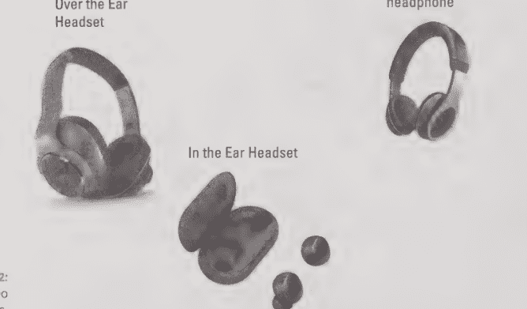

图 12-2：
蓝牙立体声耳机。

在花钱购买之前，你需要考虑几个重要选项。首先，你可以选择耳机是“贴”在耳朵上、“绕”在耳朵上还是“塞”进耳朵里。

绕耳式选项倾向于更好地隔绝外界噪音，因为你的耳朵被耳垫包围。如果长时间佩戴耳机，这也会变得很热。另一方面，一些绕耳式耳机具有降噪功能，在嘈杂环境（如飞机）中很实用。

贴耳式耳机适合长时间佩戴。图 12-2 中看到的贴耳式耳机是 Bedphone，专为在床上使用而设计，包括睡觉时使用。多酷啊？

第三类耳机包括插入耳道的款式。图 12-2 中的耳塞是三星 Galaxy Buds。虽然它们可与任何蓝牙设备配合使用，但与你的 S10 配合效果特别好。当你将它们插入耳道时，它们就会停留在那里（如果不合适，你可以使用其他几款硅胶耳塞来获得合适的贴合）。没有线缆和插头。这种耳机戴在耳朵里比其他选项更不容易移位或掉落。图 12-2 中显示的入耳式耳机非常适合那些想在锻炼时听音乐并接听电话的人。多棒啊？

在每种情况下，立体声蓝牙耳机的配对方式与其他蓝牙耳机相同。（请参阅第 3 章了解如何操作。）当你的 Galaxy S10 手机与耳机连接时，手机在你收听音乐或视频时会识别出耳机以立体声运行。当你打开存放耳塞的盒子时，Galaxy Buds 不仅会配对，还会弹出一个名为 Galaxy Gear 的屏幕，让你微调音质。非常流畅！

## 选择你的蓝牙扬声器

在过去几年里，开发商发布了大量被称为蓝牙扬声器的产品。这些扬声器包括多种选择，其中一些非常小巧方便。其他产品则旨在提供出色的音质。其中一些扬声器外观很酷或非常小巧，但音质很差。购买前请先试用。

虽然这些扬声器（有多种尺寸）不如蓝牙耳机便携——在街上行走时使用有点困难——但通常在办公桌或他人客厅使用时很容易携带和设置。它们也不需要线缆连接，随时准备使用。

Cavalier Audio 的 Maverick（见图 12-3）是高质量蓝牙扬声器的绝佳示例。其标价约为 $250。

如果你喜欢高质量音效，这就是你想要的蓝牙扬声器品质。如你所见，它看起来非常时尚。另一方面，如果你只是想要背景娱乐，你可以以不到一半的价格买到蓝牙扬声器。

FIGURE 12-3:
卡瓦列尔
Audio Maverick
蓝牙
音箱。

照片由 Cavalier Audio 提供

## 连接到你的立体声系统

虽然外出时收听音乐很方便，但在家庭或汽车立体声系统上收听音乐收藏也很不错。你的 Galaxy S10 手机向立体声系统呈现的几乎是完美的输入版本。输出的声音质量仅受立体声系统质量的限制。

此外，你还可以播放手机上存储的音乐文件和播放列表，这比播放 CD 更方便。如果你的立体声接收器较旧，你有两个选择：

- 一种设置是将图 12-4 所示电缆上的 3.5mm 插头插入较新型立体声系统上可用的 3.5mm 插孔。当你像通过耳机一样播放音乐时，它会通过你的立体声系统播放。尽管每个立体声系统都是独一无二的，但选择旋钮的正确设置是 AUX。
- 另一个选项是购买一个蓝牙接收器并将其连接到你的立体声系统（请确保它至少支持蓝牙 4.2 版本以获得最佳音质）。蓝牙接收器可以通过 3.5mm 插孔连接，或连接到一对未使用的红白插孔，例如你不再使用的旧卡带播放器。此设置让你可以在家中带着手机走动。只要你不要离立体声系统超过 30 英尺，连接效果就非常好！

FIGURE 12-4:
带 3.5mm
插头的
转接线缆。

较新的立体声接收器认识到手机是访问音乐的好地方。这些接收器支持与手机的蓝牙连接。如果你正在寻找新的接收器，请确保选择具有蓝牙功能的型号。无论哪种情况，你都会得到娱乐。尽情享受吧。

## 许可你的多媒体文件

其实很简单：如果你想有 integrity 地收听音乐或观看视频，你需要向艺术家付费。许多低成本选项适合任何预算。根据你计划收听音乐或播客、或观看视频的多少，你可以算出最划算的方案。

偷窃音乐或视频很不酷。虽然技术上可能在手机上播放盗版音乐和视频，但这就是偷窃。不要这样做。如果你的经济状况不允许你支付音乐费用，我建议你收听互联网广播。只要你稍微花点功夫，你就可以获得免费的无限音乐，如果你想要无广告，至少只需支付较低的月费。

你可以购买或租赁音乐、播客或视频。在大多数情况下，你需要用信用卡支付。根据你的移动运营商，你可能还可以在每月手机账单上支付费用。

## 了解许可

以下是音乐文件和播客可用的三种主要许可选项：

按曲目付费：单独为每首歌付费。购买一首典型歌曲的费用约为 79 美分到 1.29 美元。播客通常用于演讲或讲座，价格差异很大。

**按专辑付费：**购买专辑并不是数字音乐时代之前的遗留物。音乐艺术家和制作人会以提供一致感觉或氛围的歌曲编排来制作专辑。虽然许多音乐播放应用程序允许你自行组建播放列表，但专辑是由专业人士制作的。此外，按整张专辑购买通常比按单曲购买更便宜。你可以用 8 到 12 美元获得多首歌曲。

**使用月度通行证：**购买音频文件的最后一个选项是月度通行证。每月约 15 美元，你可以从服务提供商的库中下载任意多的音乐。

如果你让月度通行证提供商的订阅过期，你将无法收听该库中的音乐。这些音乐是通过互联网流式传输的，并未存储在你的手机上。

除了完全访问音乐库外，一些音乐库提供商还提供特殊服务，向你介绍与你一直在播放的音乐相似的音乐。这些服务是了解新音乐的非常便捷方式。如果你甚至有一点兴趣扩展你的音乐曲目，这些服务就是一个简单的方法。

购买还是租赁更经济取决于你的收听/观看习惯。如果你不打算买很多，或者你清楚自己想要什么，你可以通过单独支付所有文件来节省一些钱。如果你不确定自己想要什么，或者你喜欢大量多样的音乐，支付月度访问费用可能更适合你。

## 视频许可

视频可用的两种主要许可选项是：

**租赁：**此选项类似于从商店租借视频。你可以在首次播放开始后的 24 小时内随意观看视频。此外，首次播放必须在下载后的一段限定时间内开始，例如一周。大多数电影的价格在 3 到 5 美元之间。

**购买：**你拥有在想要的时间内、想要的次数观看文件的许可。购买成本低至 12 美元，但通常在 15 美元左右。

目前，没有主流好莱坞电影的来源允许你购买月度订阅并获得电影库的无限访问权限。这随时可能改变，因此请留意公告。

## 使用 SD 卡的完整容量

你的 Galaxy S10 至少配备 128GB 存储空间。好吧。这到底意味着什么？

Android 操作系统占用了其中一部分存储空间。此外，你下载的应用程序也存储在这里。然后，还有你创建和使用的文件。所有事情结束后，你可能至少有 80GB 可用于存储照片、音乐和视频。那是多少，你需要更多吗？

正确的答案是：“谁知道？”这可能是本书中任何地方都能找到的最无用的答案之一。然而，我可以告诉你如何将这个回答改为“无关紧要”。

你的手机顶部有一个插槽，可以添加 microSD 卡，你的 Android 操作系统最多可寻址额外 512GB 的存储空间。好吧。那是多少？

最简单描述的方法是计算 1GB 能容纳多少张照片、多少首歌曲和多少部电影。

- **300 张图像：**在默认设置下，你可以用手机相机拍摄约 300 张图像。
- **十小时音乐：**如果你购买一张专辑，它将占用不到十分之一千兆字节。专辑的长度是根据能在黑胶唱片上可靠刻录的内容设定的。这相当于约 45 分钟，也许十几首歌曲。
- **大约一部标准清晰度（电视质量）电影：**估计视频大小可能差异很大。电视质量的视频浪费了那块漂亮的屏幕。然而，使用全部分辨率像素的一小时视频大约需要 4GB。

不幸的是，在这一点上，你需要做一点数学计算。假设我想观看《辛普森一家》全部 529 集的每一分钟。这将需要 194 小时或约 8 天。我只需要买一个约 50 美元的 256GB 芯片，加载好，然后放入手机即可。哎呀！

你可以在一张 SD 卡上以高清观看《绝命毒师》系列的所有剧集。如果你想能够连续观看《绝命毒师》、《权力的游戏》和《行尸走肉》，它们就需要以标准模式存储。抱歉。

如果你更喜欢音乐而不是视频，你可以在那张可怜的 microSD 卡上存储超过 5,000 小时的音乐。你可以在 1 月 1 日午夜开始播放音乐，直到 7 月 27 日才重复一首曲目。如果你大手笔购买 125 美元的 512GB 卡，你可以连续播放到下一年的二月下旬。

请记住，这些只是粗略估计。这些计算假设对这些文件进行了轻微的压缩尝试。这会对存储需求产生巨大影响。让我们就说，你可以放置图像、音乐和视频的组合，让你在非常、非常长的时间内保持娱乐。

## 享受基本多媒体功能

无论你的 Galaxy S10 是哪个版本，一些基本的多媒体功能在不同手机上都是通用的。图 12-5 显示了音乐和视频应用程序。

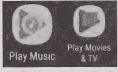

FIGURE 12-5:
Galaxy S10 上的多媒体应用。

你的手机预装了这些应用程序，根据运营商的不同，你可能还拥有其他多媒体应用程序。此外，一些音乐和视频来源，例如 Netflix，拥有自己的嵌入式播放器。

## 使用 Play Music 应用尽情享受

Play Music 应用允许你播放音乐和音频文件。第一步是为你的手机获取音乐和音频文件。

获取手机音乐和/或录音的一些方式是：

- 从在线音乐商店购买并下载曲目。
- 通过电子邮件或短信作为附件接收它们。
- 从通过蓝牙链接连接的另一台设备接收它们。
- 在你的手机上录制它们。

## 从在线音乐商店购买

获取手机音乐最直接的方法是从在线音乐商店获取。你可以从数十家主流在线音乐商店下载各种音乐。Play Store 是一个选择。除了应用之外，它还有音乐和视频。其他知名网站包括 Spotify 和 Amazon Music。

此外，还有许多更专业的或“精品”商店提供比大众市场商店更差异化的产品。例如，MAQAM 提供中东音乐（www.maqammp3.com）。

在各在线商店之间获取音乐的细节因商店而异。最终，相似之处多于差异之处。作为一个你知道自己想要什么，而且真的、真的想要的例子，以下是如何查找并下载 Spice Girls 的歌曲“Wannabe”。我使用的是 Amazon Music。如果你没有在应用程序列表中找到 Amazon Music，你需要先在手机上加载该应用，就像我在第 8 章中描述的那样。输入你的 Amazon 登录信息后，你会看到右侧图 12-6 所示的 Amazon Music 主屏幕。

Amazon MP3 登录屏幕

Amazon MP3 音乐商店主屏幕

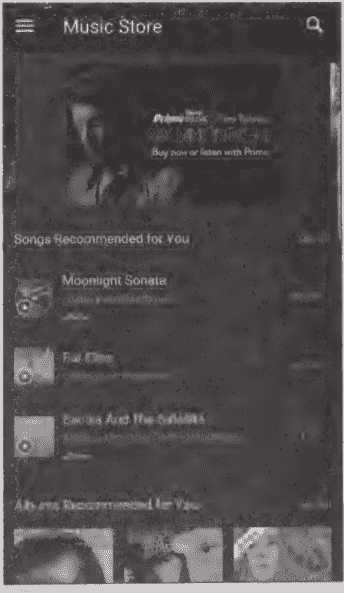

图 12-6：
Amazon Music 登录和主屏幕。

从这里，你可以通过专辑、歌曲或音乐流派搜索音乐。现在搜索你想要的歌曲：

1. **在 Amazon Music 搜索字段中输入相关搜索信息。**

在这种情况下，我搜索的是 Spice Girls 的 “Wannabe”。歌曲搜索结果如下图 12-7 所示。

搜索结果会列出各种各样的选项，包括：专辑、单曲、相似歌曲、卡拉 OK 版本以及同一艺术家的其他歌曲。做好准备迎接这些选项。

2. **双击价格以购买曲目。**

图 12-8 左侧屏幕显示价格。当你第一次点击价格时，会出现确认信息以确保你想要购买下载；价格会被 Buy Song 图标取代，如图 12-8 右侧所示。要购买，请点击 Buy Song。

3. **预期需要付费。**

除非你要靠免费的促销歌曲为生，否则你需要付费。在这种情况下，你会看到图 12-9 所示的屏幕。

歌曲现在已加载到你的手机上。当你打开音乐播放器时，它随时准备在你想像 1996 年那样狂欢时播放！

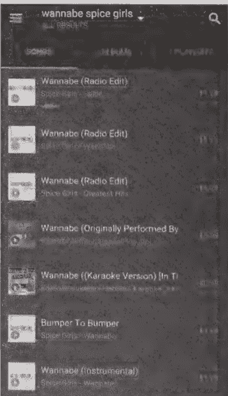

图 12-7：
Amazon Music 商店中歌曲的搜索结果。

### 第 1 步

### 第 2 步

图 12-8：

双击购买。

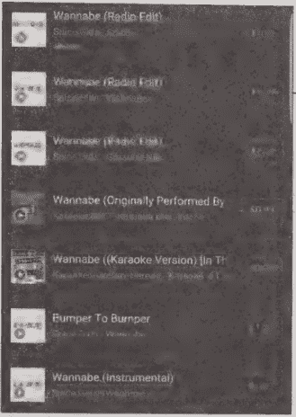

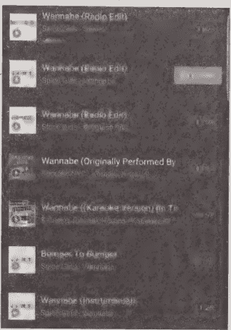

图 12-9：

来自 Amazon Music 商店购买确认屏幕。

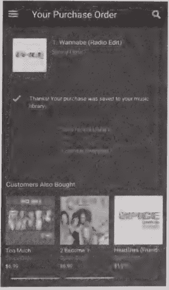

## 作为附件接收音乐

只要你遵守许可协议，你就可以通过电子邮件或短信作为附件发送音乐文件。只需从你的 PC 向自己发送一封包含所需音乐文件的电子邮件。然后你在手机上打开电子邮件或短信并将文件保存到音乐应用的库中。

你的手机可以播放以下任何格式的音乐文件：FLAC、WAV、Vorbis、MP3、AAC、AAC+、eAAC+、WMA、AMR-NB、AMR-WB、MID、AC3 和 XMF。

## 在手机上录制声音

别人可能不觉得你孩子演唱的“生日快乐”有什么特别之处，但你可能视若珍宝。事实上，你的手机上有很多声音录制应用可用。

有些很基础，可以将你的手机变成基本的语音记录器。其他可以改变你的声音。（我不想知道为什么。）其他则是为了让你能够秘密录制语音对话。有些可以专门录制电话对话。

注意你所在地区的隐私法！某些司法辖区只需对话中的一方同意即可录制对话。其他司法辖区要求所有各方明确同意。虽然很少见，但已有首次违法者因录制在另一州完全合法的内容而被判长期监禁的案例！

通常，简单的录制按钮在你停止录制时会创建一个声音文件。音质可能不是最好的，但你录制的内容可能与你商业购买的内容一样重要或有趣。你的手机将所有音频文件视为相同，并且都可以在你的 Play Music 上播放。

## 播放已下载的音乐

要播放你的音乐，请点击图 12-5 所示的 Play Music 应用图标以打开音乐播放应用程序。

好吧。图 12-10 显示了你在完成初始营销欢迎后看到的主屏幕。有时此应用在欢迎你时会过于热情。

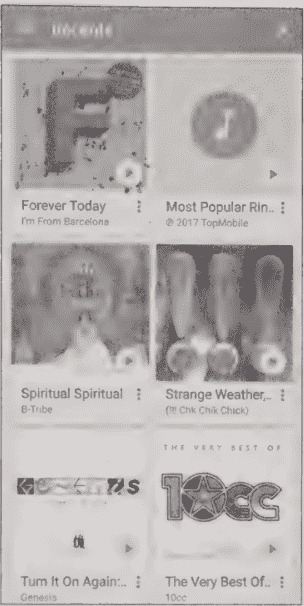

图 12-10：
Play
Music 应用的主屏幕。

你看到的第一个屏幕会将你的音乐文件分类为多个类别。你可以通过点击写有 playlist 的链接来选择要使用的类别。这会弹出一个弹出屏幕。

类别包括

- **Playlists：** 一些数字音乐商店会将歌曲捆绑成播放列表，例如 50 年代的热门歌曲。你也可以为对你有意义的歌曲组创建自己的播放列表。
- **Stations：** 这些有点像遵循特定格式的广播电台。你输入一个组名，如 Genesis 或 Van Halen，Play Music 将播放该流派内的歌曲，这些歌曲可能已存储在你的手机上，也可能未存储。图 12-11 显示了我搜索 Bruno Mars 时的一个更近期的示例。本章后面关于 Internet Radio 的部分更详细地描述了此服务。

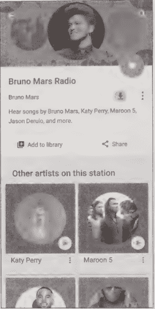

图 12-11：
Play Music 应用内的 Bruno Mars 电台。

- **Artists：** 此类别列出给定艺术家所有专辑中的所有歌曲。
- **Albums：** 点击此类别会将你的所有歌曲放入与歌曲关联的专辑中。当你点击专辑时，你会看到你购买的所有歌曲，无论是一首歌还是该专辑的所有歌曲。
- **Songs：** 这按字母顺序列出你的所有歌曲文件。
- **Genres：** 此类别将音乐分为音乐流派，例如乡村西部或重金属。

当你有大量文件时，这些类别很有用。要播放歌曲、专辑或流派，请打开该类别并点击歌曲、播放列表、专辑、艺术家或流派，歌曲就会开始播放。

## 将歌曲添加为铃声和闹钟

以下是如何将歌曲添加为铃声或闹钟。第一步是打开一个联系人。编辑模式下的通用联系人如图 12-12 所示。（如果对联系人有任何疑问，请参阅第 6 章。）

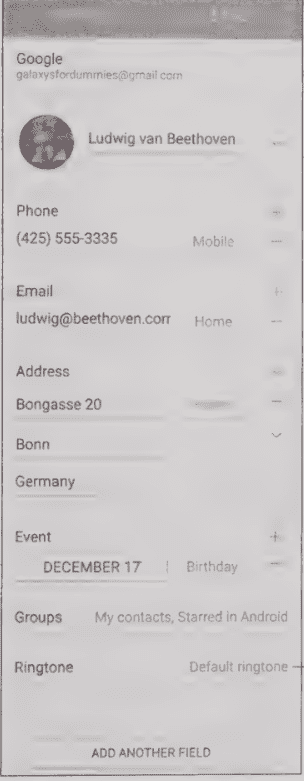

图 12-12：
一位巴洛克作曲家的典型联系人。

铃声设置

按照以下步骤操作：

1. **点击默认铃声链接。**

这将列出铃声（如下图 12-13 所示）。

快速浏览发现，*Ode to Joy* 并不是随手机附带的选项之一。要使用音乐文件作为铃声，请在顶部找到添加按钮。

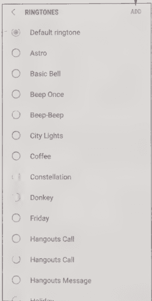

图 12-13：
基本铃声。

2. **点击添加。**

这会带来打开 Sound Picker 应用的选项。此应用显示手机上的所有音乐文件，如图 12-14 所示。

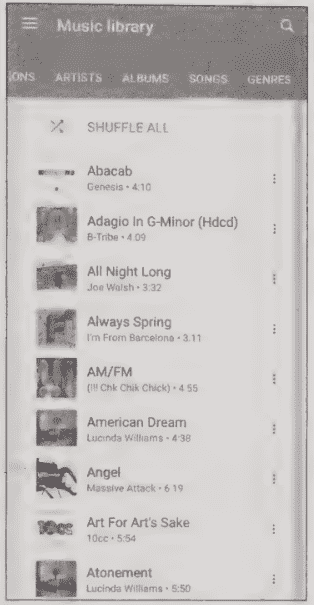

图 12-14：
曲目选择。

3. 突出显示你想要的歌曲并点击确定。

从现在开始，当你听到这首歌时，你就知道它将是你的朋友路德维希。图 12-15 显示这现在是路德维希的铃声。

## 收听网络电台

如果你还没有尝试过网络电台，你绝对应该考虑一下。其基本思想是，你输入当前音乐喜好的信息，这些服务会播放相似的音乐。在某些电台，大量的研究和复杂的统计分析会根据音乐模式的数字分析来挑选相似的歌曲。其他电台则凭感觉。

好消息是你可以选择。图 12-16 显示了 Play Store 中约 9,000 个网络电台应用。Pandora 和 Slacker Radio 是这种类型的两大知名服务；其中一个或另一个可能已预装在你的手机上。（实际上，你可能会在手机上找到四个或更多预装的网络电台选项！）

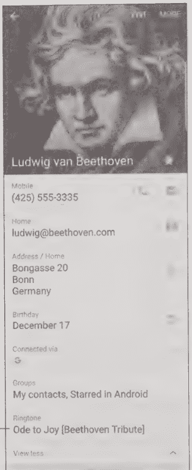

FIGURE 12-15:
铃声选择。

适合路德维希的铃声

这些应用是了解可能吸引你的新歌曲和乐队的好方法。该服务会向你的手机流媒体传输音乐供你欣赏。如果你愿意，也可以购买曲目。

流媒体音频文件在一段时间内可能会使用大量数据。如果你拥有无限（甚至是较大）的流量套餐，这可能不是问题。否则，你的“免费”网络电台服务最终可能会花费你很多。最好使用 Wi-Fi。

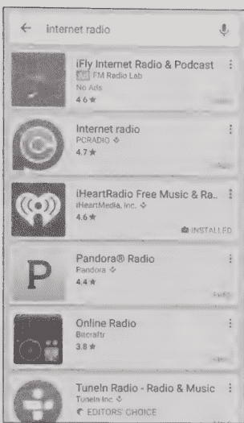

FIGURE 12-16
Play 商店中的一些网络电台选项。

即使是最好的网络电台，播放的曲目在听得足够多的情况下一段时间后也会变得重复。如果你感到无聊，不要犹豫更换网络电台提供商并使用同一频道的电台。这几乎总会带来新歌曲。

## 查看你的视频选项

Play Music 应用允许你播放音乐文件。同样，你使用 Video Player 应用来播放视频选项。Video Player 在你的应用程序列表中，甚至可能在你的主屏幕上。在大多数方面，播放视频与播放音频相同，但有一些例外：

- 许多人更喜欢购买音乐，但租赁在视频中更常见。
- 视频文件通常（但不总是）更大。

另外，就像音乐文件一样，你可以从在线视频商店获取手机的视频——并且你需要拥有一个账户并付费使用。此外，你可以将视频文件下载到手机上，Video Player 会像 DVD 播放器一样播放它们。

Google Play 商店和 Amazon Prime Video 上有大量视频可供选择。这些平台各自都有很棒的视频选择，你可以租赁或购买。图 12-17 显示了 Google Play 商店和 Amazon Prime Video 的主屏幕。

## Play 商店视频主页

## Amazon Prime Video 主页

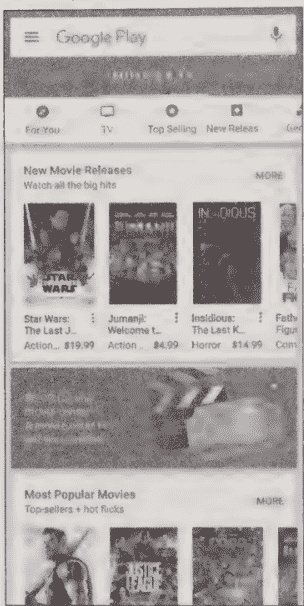

FIGURE 12-17:
Google Play 商店
和 Amazon
Prime Video 的
主屏幕。

## 使用三屏

如果你订阅了 Amazon Video，我在此授权你在 Galaxy S10 上观看所有 Amazon Video 选项（在登录并遵守亚马逊规定的所有条款和条件后）。一旦你从 Play 商店安装 Amazon Prime Video 应用，使用与你的账户关联的电子邮件和密码登录，所有内容即可供你流媒体播放。就这么简单。如果你不相信我，不妨试试。

如果你查看互联网上的 Amazon Prime Video 主页，如图 12-18 所示，它显示了你访问所订阅内容的选项。最初这个概念被称为服务三屏。策略中提到的三屏包括家里的电视、PC 或笔记本电脑以及智能手机。

FIGURE 12-18:
Amazon Prime Video 主页。

想法是，你只需一个订阅即可访问相同的内容，而且重要的是可以继续观看。也就是说，如果你在电视上观看视频，你可以在智能手机上接着观看。

Amazon Prime Video 更进一步，以确保尽可能多的订阅用户能够访问。如果你有一台联网的智能电视，很可能 Amazon Prime Video 可以在电视上运行。如果你有一台旧的和/或“笨”电视，你可以通过流媒体播放器、游戏机、机顶盒或蓝光播放器使用 Amazon。

亚马逊并不是唯一这样做的组织。许多有线电视公司提供这种解决方案，许多视频订阅服务也是如此。

主流视频服务通过在库中提供广泛的选择来竞争，以吸引尽可能多的客户。请记住，还有专门的视频提供商为订阅用户提供精选视频。

例如，TeacherTube 是一个致力于 K-12 教育的网站，如图 12-19 所示。如果我们继续沿着这条路走下去，在线教育的选择非常多。这些网站中的许多不认为自己是视频聚合器，但当它们录制讲座并提供给学生时，这正是视频聚合所发生的事情。

最知名的在线教育服务是凤凰大学。还有数十所在线大学。

教育只是精选视频服务之一。还有为宝莱坞电影、英国情景喜剧、葡萄牙游戏节目以及许多其他艺术形式视频而存在的服务。

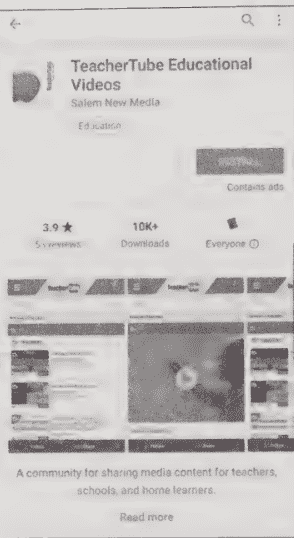

FIGURE 12-19:
TeacherTube 应用。

## 查看你自己的视频

在第 9 章中，我介绍了如何使用手机上的数码摄像机。你可以观看在手机上拍摄的任何视频。从 Google Play 应用中，滚动到个人视频部分。

### 技术细节

你的手机可以显示以下视频格式：MPEG-4、WMV、AVI/DivX、MKV 和 FLV。

要播放视频，只需点击文件名即可。应用开始以横向显示视频。点击屏幕时弹出的控件与 DVD 播放器的控件类似。

## 虚拟现实的现实

电子游戏可以令人沉浸，好的电影也能让你真正沉浸在其现实中。虚拟现实的想法就是更进一步。虚拟现实背后的基本思想是通过让你戴上一副眼镜并根据头部和身体的动作改变屏幕上的图像来创建一个模拟世界。

我们可以通过逐步探索这个概念。在最基本层面上，你可以使用手机配合一副虚拟现实眼镜。三星提供了一款专为 Galaxy S10 设计的虚拟现实眼镜。如图 12-20 所示。

FIGURE 12-20:
三星虚拟现实眼镜。

你所做的就是将 Galaxy S10 插入眼镜中。然后使用眼镜旁边的遥控器导航到应用程序。遥控器非常方便，因为没有它，唯一与屏幕通信的方式就是将头部转向命令并保持几秒钟。那个小设备允许你在手机插入眼镜时导航屏幕。

发生的情况是，你的视野完全被 Galaxy S10 的屏幕占据。想象最基本的场景，手机背面的摄像头向你展示前方的情况。这种体验或多或少相当于使用一副眼镜。

当你向前走时，东西会变近。当你向下看时，你会看到地板。当你向右或向左转头时，你会看到视野范围之外的东西。到目前为止，这并不太有趣。

那么让我们提升一个层次。现在让我们让你的手机及其所有处理能力和智能告诉你你在看什么。你转头，看到一张图片。啪，图片旁边出现一个小弹出窗口，告诉你这是一幅爱德华·霍珀的《夜鹰》的印刷品。你向外看窗外，弹出窗口显示当前天气状况和今天的预报。

现在你把虚拟现实眼镜带到杂货店。当你拿购物车时，一个熟悉的面孔出现并开始说话。无论如何你都记不起这个人是谁或你怎么认识他。片刻之后，人脸识别系统识别出这个人，弹出窗口显示此人是你的老邻居 Bif Wellington。聊天后，你走在商店的过道里寻找优惠。你会收到一个弹出窗口，告知你何时该杂货店对 Honeycrisp 苹果有优惠，或是否可以在另一家商店更便宜地买到。这种能力被称为 *增强现实*。

让我们再提升一个档次。想象一个世界，在那里，你看到的不是现实的轻微修改版本，而是被传送到海滩。你可以环顾四周，看到身后的棕榈树和丛林。

为什么要局限于地球？你在虚拟中被传送到火星周围的太空。当你环顾四周时，就好像你就在火星上。

图 12-21 看起来像是同一颗行星的两张图像。当你的手机插入眼镜中时，你会得到行星的 3D 图像。你还可以环顾四周并在整个太阳系中导航。相信我，这比太空旅行方便得多。

FIGURE 12-21:
来自 Onepixelsoft 的 VR Solar System 的屏幕截图。

为什么要坚持主流对现实的看法？现在我们都可以拥有“爱丽丝镜中奇遇”的体验。你可以变大变小，看到各种奇异的景象，其限制只在于你的想象力。

有一些非常、非常酷的演示利用了您手机的功能。三星的产品相比市场上其他一些选择来说价格非常划算。顺便说一下，如果您预订了手机，可能已免费获得三星虚拟现实眼镜。

Play 商店中还有额外的 VR 应用和内容。这是一个变化迅速的领域，新的内容不断被添加。请务必定期查看 Play 商店。

这应该会让拥有 iPhone 技术的朋友们感到相当羡慕。需要发生的是进一步的应用开发，才能真正将我们带到这项技术所能达到的高度。

不幸的是，我们中的一些人经历过被称为虚拟现实晕眩的不愉快体验。这与晕船和晕车相似，但并不完全相同。最常见的症状是恶心和头痛。如果您遇到这种情况，一些帮助缓解晕船的药物可能会帮助您避免这种不愉快的感觉。有人说使用虚拟现实时坐着也有帮助。此外，随着大脑逐渐适应这种体验，症状往往会随着时间的推移而减轻。如果症状过于严重，虚拟现实可能就不适合您。

## Getting Down to Business

## IN THIS PART ...
- 将您的日历下载到手机并将新事件上传到您的电子日历。
- 使用 Bixby 来辨识您正在看的内容。
- 使用 Samsung Pay 付款。

## IN THIS CHAPTER
- 设置事件
- 将日历下载到您的手机
- 将事件上传到您的 PC
