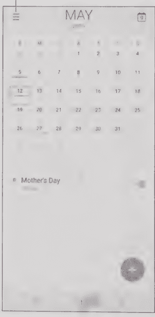
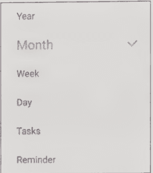
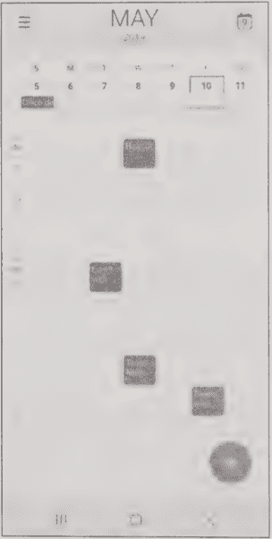
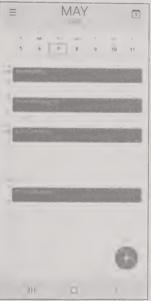
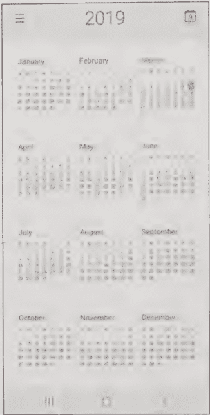
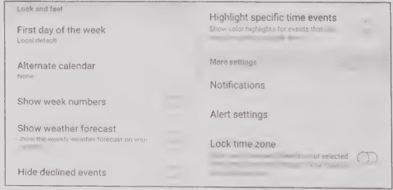
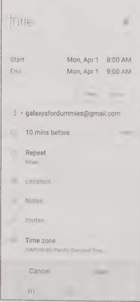
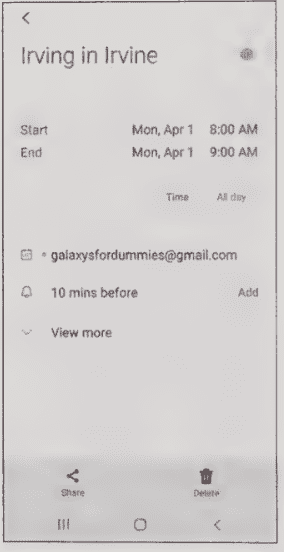
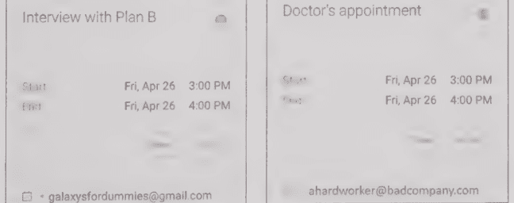
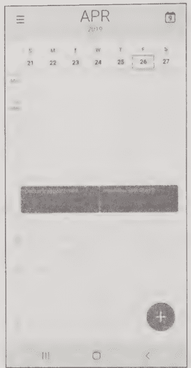

### 第13章
### Using the Calendar

您可能会如此爱上您的 Galaxy S10 手机，以至于想约它出去约会。说到约会，让我们谈谈您手机的日历。Galaxy S10 手机的日历功能功能强大，可以让您的生活更轻松。只需轻点几下，您就可以将所有电子日历整合在一起，保持生活的同步。

在本章中，我将向您展示如何设置手机自带的日历，这可能就是您所需的一切。不过，很可能您在其他地方也有日历，例如在工作电脑上。因此我还将向您展示如何将所有日历与您的 Galaxy S10 手机合并。读完本章后，您将没有借口错过会议。（或者，好吧，约会。）

提示
一些日历使用 *预约* 来表示事件。它们是同一个概念。我使用 *事件* 这个术语。

### Syncing Calendars

很可能您已经至少有两个电子日历分散在不同的地方：一个与工作电脑绑定的日历和一个个人日历。现在您又多了一个——与您的 Gmail 账户同步的三星手机上的日历。

不过，将所有电子日历集中到一个地方，是您手机最好的功能之一——前提是您是电子日历的忠实用户。要开始此过程，您需要以与您在第 5 章和第 6 章中授权访问电子邮件账户和联系人相同的方式，对日历存储的相应位置提供授权。此授权是为了尊重您的隐私而必要的。

如果您的主屏幕上没有日历图标，请从应用列表中打开日历应用。同一个应用可与存储在手机上的日历以及您添加的任何数字日历配合使用。

当您首次打开此应用时，您会看到按月格式显示的日历，如图 13-1 所示。我将在下一节讨论其他日历视图。

选项链接

FIGURE 13-1:
月度日历显示。

### YOU MAY ALREADY BE A WINNER!

您手机上的日历可能已经填充了来自工作和个人日历的事件。别担心——这是好消息！

如果您已经设置手机与电子邮件和日历（参见第 5 章）同步（合并），您的日历已经在与手机同步。

当您向手机添加账户时，例如个人或工作电子邮件账户、Facebook 账户或 Dropbox，系统会询问您是否要同步日历。同步的默认设置通常是每小时一次。

除非您收到警告消息提示通信问题，否则您的手机现在已拥有有关预约和会议请求的最新信息。您的手机会继续自动同步。所有这些同步都在后台进行；您可能甚至注意不到变化正在发生。

如果其他人可以在您的数字日历上为您创建事件，您可能会遇到日程冲突。请注意这种可能性。认为自己有空闲时间并提供出来，然后发现别人已经占用了，这可能会令人恼火（甚至更糟）。

### Setting Calendar Display Preferences

在您深入玩弄日历之前，您需要选择如何查看它。

如果您没有很多事件，使用图 13-1 所示的月度日历可能是一个不错的选择。另一方面，如果您的一天被个人和专业事件塞满，每日或每周的日程可能更实用。切换视图很容易。例如，只需轻点日历顶部的三条线（在本例中显示为 2016 年 4 月），即可调出选项。这些选项如图 13-2 所示。

如果您轻点 Week，您会看到如图 13-3 所示的周视图。

FIGURE 13-2:
日历显示选项弹出菜单。

FIGURE 13-3:
周日历显示。

或轻点日历顶部的“Day”按钮以显示如图 13-4 所示的每日显示。

FIGURE 13-4:
每日日历显示。

为了查看您即将发生的事件，无论它们在哪个日期，您可能更喜欢列表视图。轻点日历顶部的“List”按钮即可查看您的活动列表。

周日历和每日日历仅显示一天的一部分。您可以滑动屏幕查看更早和更晚的时间段。您也可以捏合和拉伸以查看更多或更少的时间段。

还有一个年度日历，如图 13-5 所示。它非常繁忙，无法让您看到任何预约。它主要用于设定未来的日期。

FIGURE 13-5:
年度日历显示。

### Setting Other Display Options

除了默认显示选项外，您还可以为手机上的日历设置其他个人偏好。要进入日历设置，请在每日、每周或每月日历上轻点“More”链接，然后轻点“Settings”。这样会调出如图 13-6 所示的屏幕。

FIGURE 13-6:
日历应用程序的设置选项。

您有以下选项：
- **一周的第一天：** 美国标准是一周从星期日到星期六显示。如果您希望一周从星期六或星期一开始，可以在此更改。
- **替代日历：** 默认是公历。然而，如果您是十多亿使用中国农历的人之一，您就幸运了！轻点此选项，您将在日历上看到中国农历日期。同样适用于韩国农历、越南农历和其他一些日历。
- **显示周数：** 有些人喜欢在周日历上看到周数。如果您也是其中之一，请勾选此选项。
- **显示天气预报：** 如果您查看图 13-1 所示的月度日历，您可以在某些日期看到代表天气预报的图像。如果您喜欢看到这些，可以保留此信息。如果您觉得它占用了太多屏幕空间，可以删除它。
- **隐藏已拒绝的事件：** 当我们中的一些人拒绝一个事件时，我们不想再听到它的消息。其他人可能希望保留已拒绝事件的提醒，以防情况发生变化（或以防没有更好的选择）。默认设置是隐藏已拒绝的事件；如果您想查看它们，请取消选中此框。
- **突出显示特定时间事件：** 选择此选项会在“月”日历中为持续时间少于一天的事件显示颜色。
- **通知：** 当事件即将到来时，您可以让手机通过弹出窗口提醒您、在状态栏上发出通知信号，或什么都不做。默认是给您一个通知，但您可以在此处更改该选项。
- **提醒设置：** 有些人会在到达某个地方前几分钟被提醒预约，这对他们有帮助。其他人则觉得这很烦人。此设置让您可以选择是否接收提醒以及提前多久提醒。
- **锁定时区：** 当您旅行到新的时区时，您的手机会采用新的时区。在大多数情况下，这是一个不错的便利功能。然而，对某些人来说可能会造成困惑。如果您希望日历保持在您所在家庭时区，请勾选此选项。

## 在正确的日历上创建事件

在移动设备上使用日历时，一个重要步骤是创建事件。更重要的是确保事件最终出现在正确的日历上。本节介绍实现此操作的步骤。

### 创建、编辑和删除事件

这是在手机上创建事件——也就是（好吧，没错）“事件”——的方法。从图 13-1、13-3 或 13-4 所示的日历显示之一开始。点击日历右下角带有加号 (+) 的亮绿色圆圈。这样会弹出图 13-7 所示的弹出屏幕（不带键盘）。

图 13-7：
创建事件屏幕。

开始所需唯一的信息是易记的事件名称以及开始和结束时间。

创建事件时，您需要准备以下信息：

- **日历：** 决定要将此事件保存在哪个日历上。图 13-7 显示此事件将存储在 Gmail 日历上。这通过在屏幕中间的蓝色点旁边显示我的 Gmail 账户来表示。当您点击此选项时，手机会向您展示已同步到手机的其他日历；您可以将事件存储在其中任何一个上。
- **标题：** 为事件取一个描述性的名称，以便您无需打开它即可记住它是什么。
- **开始和结束：** 开始时间和结束时间的两个输入字段。如果事件为全天事件，请选择全天切换开关。
- **通知：** 此字段让您可以设置手机在事件开始前多久提醒您即将有事件。这样，如果您将此提醒设置为适应您的旅行时间，就不太可能迟到。
- **位置：** 此设置与 Google 地图应用关联，允许您输入地址或地标。您也可以只输入文本。

如果需要，您可以通过添加以下内容输入会议的更多详细信息：

- **重复：** 此选项适用于循环事件，例如每周会议。
- **邀请者：** 这允许您通过输入多个联系人来举行团体会议。
- **备注：** 添加您认为对该会议有用的信息。
- **隐私：** 这与“显示为”选项的想法相同，但适用于非 Outlook 基于的日历。
- **时区：** 如果您和所有受邀者都在同一时区，则无需担心。如果您恰好在另一个时区或部分受邀者在其他时区，您可以使用此选项确保不会在非工作时间安排会议，更糟糕的是在半夜。

填写完必填（以及任何可选）字段和设置后，点击页面底部的保存链接。事件将存储在您同步时选择的任何日历中。

保存事件后，您可以通过在任何日历上点击它来编辑、共享或删除它。它显示为图 13-8 所示。现在您可以

- **编辑：** 这会调出已输入的信息。进行更改并点击保存。
- **共享：** 您可以将此事件作为文本附件发送给任何人。
- **删除：** 要删除事件，只需点击屏幕底部的垃圾桶图标，事件就会消失。

图 13-8：
编辑事件屏幕。

您也可以通过双击日历本身来创建事件。双击会弹出一个弹出窗口（参见图 13-7），您可以在其中输入事件详细信息。

### 保持事件分离和私密

当您在一个地方（在本例中为手机）存储多个日历时，在想要添加新事件时可能会感到困惑。当您需要在一个日历上添加真实事件，在另一个日历上添加占位符时，可能会更加令人困惑。

假设你的老板是个混蛋，为了保持理智，你需要找一份新工作。你把简历发送给了总部在城另一边的死对头公司 Plan B。Plan B 感兴趣，想在下周二下午 3 点面试你。都是好消息。

问题是，你现在的老板要求你在使用公司日程系统上跟踪你的每一步。他的专制管理风格是，如果人们不在预定会议时不在办公桌前工作，就会责骂他们。（顺便说一下，我并不是在编造这个场景。）

你明白我的意思。你不想让 Snidely Whiplash 翻阅你的日历，嗅出你准备左撤的计划，如果 Plan B 不成功，让生活更糟。相反，你想在工作日历上放一个听起来合理的占位符，同时把真实事件放在个人日历上。你可以轻松地从三星 Galaxy S10 上的日历执行此操作。当你创建事件时，你只需告诉手机你希望事件存储在哪里，确保每个事件都保存在正确的位置。

流程从创建事件屏幕开始。你可以通过点击图 13-1、13-3 或 13-4 中任何日历右下角看到的绿色圆圈中的 + 号来调出它。图 13-9 左侧显示真实事件的信息。右侧显示虚假事件。这是保存到你的工作邮件的那个。工作地址旁边的彩色点有助于你意识到这是一个不同的日历。

### 手机上的真实预约

### 工作邮件上的虚假预约

图 13-9：
手机上的添加事件屏幕。

现在，当你查看手机上的日历时，你会同时看到两个事件。（请查看图 13-10。）Galaxy S10 不介意你同时创建两个事件。

图 13-10：
手机日历上同一天的两个事件。

在这种情况下，这就是你想要创建的。只要你的老板看不到你的手机，你就安全了——至少是尝试寻找更有意义的工作。
