### 第14章

## 与 Bixby 交谈

### 本章内容

- 告诉手机拨打电话或发送短信
- 识别物体和地标
- 无需输入即可进行网络搜索
- 更快速、更方便地获取信息

Bixby 是三星的智能代理（IA）。智能代理的目的是预测你的问题，比点击或输入更快地获取信息。它通常只需对手机说话，让它在无需点击或输入的情况下执行你要求的操作。

这个 IA 东西可能令人困惑，所以让我为你分解一下。Bixby 在以下三个主要功能中非常有用：

- Bixby Home 汇总了来自你最重要的许多应用的最新新闻。
- Bixby Vision 可以告诉你你在看什么。这包括告诉价格是多少、条形码是什么意思、食物中有多少卡路里、精美的葡萄酒标签是否真的含有好酒，或者你戴上 Sephora 眼影会多么惊艳。
- Bixby Voice 应用可以识别你的声音，处理许多手机命令，并回应你。

关于 Bixby 的情况是你可以接受或放弃任何功能。如果你喜欢点击和输入，Bixby 理解。Bixby 的意图是利用智能手机的新功能使其变得更简单。如果你无法接受，那也没关系。另一方面，这非常令人兴奋！

你对这个应用的满意程度取决于 Bixby 执行你想要的操作的准确性。在某些方面，Bixby 非常准确。在其他情况下，你可能会质疑三星为什么发布这个产品。如果你对 Bixby 感到失望，我最好的建议是在未来某个时候再试一次。Bixby 持续努力改进自己。事实上，你可能会被要求允许更新 Bixby Labs。这就是你帮助三星改进 Bixby 的方式，进而使应用更准确。

为了帮助你下一步关于 Bixby 的操作，我首先探索 Bixby Home 以及如何访问它。然后我介绍 Bixby Vision 和 Bixby Voice。

### 启动 Bixby

Bixby Home 的全部内容是为你以最有效的方式提供你最想看到的信息摘要。Bixby Home 为你提供来自各种不同应用的信息摘要。每个摘要称为 Bixby 卡片。

到达 Bixby Home 的最简单方法，如图 14-1 所示，是从手机主页面向右滑动。本章后面我会更多地谈论与 Bixby 的语音交互。

Bixby Home 由与手机上流行的应用相关的“卡片”组成。卡片为你提供快速的亮点。你可以在 Bixby Home 上拥有任意多或任意少的卡片。你可以通过点击图 14-1 右上角显示的 Bixby 选项图标查看设置卡片的所有选项。这会调出 Bixby 选项列表（参见图 14-2）。

当你点击卡片时，你可以看到可以在 Bixby 页面上设置为卡片的所有应用（参见图 14-3）。

当你在主屏幕卡片下点击应用时，你会看到已下载的应用以及可能想要下载的应用。随着更多应用支持 Bixby 卡片，此列表将继续变化。如果你看到某个应用受支持，但尚未下载，只需点击下载按钮，你将被带到 Google Play 商店内的页面，以便立即添加它。

如果你想删除一张卡片，只需将卡片向右滑动即可。图 14-4 显示了向右滑动后 Bixby Home 的样子。

卡片的放置位置有一定的灵活性。每张卡片右上角都有两条水平线。

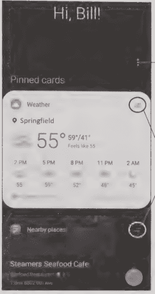

FIGURE 14-1:
Bixby 主页。

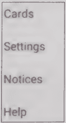

FIGURE 14-2:
Bixby 弹出菜单页面。

如果你对某张卡片特别感兴趣，可以点按置顶。这会将该卡片移到列表顶部。你也可以让它刷新自身。这样会检查是否有新信息。

Bixby 页面在你积极使用手机时非常方便。它能让你认为最重要的内容通过按两次按钮或从主页面向右快速滑动即可轻松获取。

FIGURE 14-3:
Bixby 卡片选项。

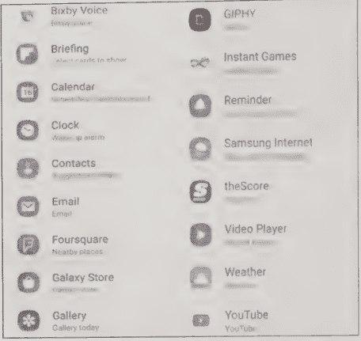

FIGURE 14-4:
移除活动的 Bixby 卡片。

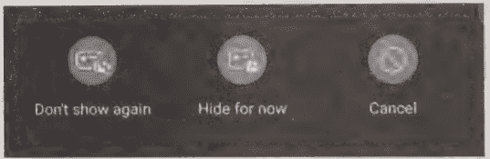

## 使用 Bixby Vision 可以做什么的可视化

在第 9 章中，我指出了取景器中的 Bixby Vision 选项。当你打开相机应用时，可以点按链接启动 Bixby Vision。然后 Bixby Vision 会告诉你相机对准的是什么的信息：

- 如果是物体，Bixby Vision 可以告诉你物体是什么以及在线上可以买到多少钱。
- 如果是条形码或二维码，Bixby Vision 可以告诉你代码的含义。
- 如果是文字，Bixby Vision 可以读取它并将其转换为文本。你随后可以将该文本翻译成 108 种语言中的任何一种。
- 如果是地标，Bixby Vision 可以告诉你它的位置。
- 如果是酒标，Bixby Vision 可以告诉你葡萄酒的排名以及搭配什么食物最佳。

Bixby Vision 的工作原理很简单。你打开相机应用程序并将相机对准物体、文档、条形码、文字或酒标，使其有良好的视野，就像第 9 章中描述的那样（见图 14-5）。

### 普通相机取景器

### 带 Bixby Vision 的相机取景器

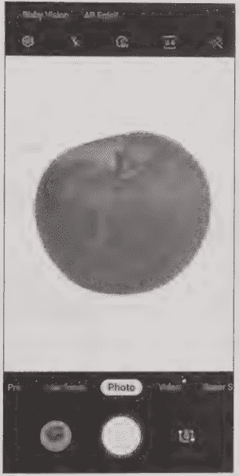

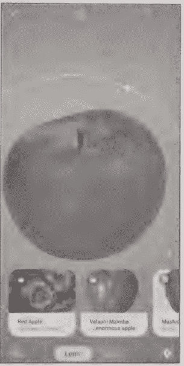

FIGURE 14-5:
取景器在点按 Bixby Vision 之前和之后的典型图像。

当你在取景器上点按 Bixby 图标时，你的手机开始尝试弄清楚它是什么以及你想要什么。在图 14-5 中，它看到一个苹果，然后询问你是否想将其作为图像搜索以找出它是什么，或者你是否对为此商品购物或其他它能做的事情感兴趣。

假设我想买一个苹果。我点按购物图标。结果如图 14-6 所示。

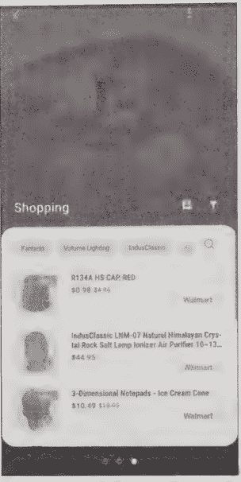

FIGURE 14-6:
基于图 14-5 呈现的购物选项。

所以，我真的想获取来自华盛顿州的新鲜脆甜苹果的价格。首选是一个红色帽子。第二选择是红色盐灯/空气净化器（注意，Bixby Labs！）。

关键是 Bixby Vision 会尽力解读你想要的内容。它在某些事物上做得更好，比如 UPC 产品代码。如果你向它展示文字，它会开始复制它。

Bixby 会根据它认为图像中有什么以及你想要什么来呈现一个或多个这些图标。不仅有趣，而且你在购物时可能会省些钱！

## 与 Bixby 闲聊

每个物有所值的科幻电影都预测了一个世界，在那里我们对电脑说话而不是输入数据。正常对话大约是每分钟 150 个词，而即使是专家打字员也只能打 90 个词每分钟。

更重要的是，说话是最基本的交流形式。现实是，有许多技术障碍使得语音识别无法完全达到电脑完美解读用户口头指令的理想。

这并不能阻止我们在此同时玩得开心。当 Bixby 包含语音功能时，你将能够通过语音命令拨打电话、发送电子邮件或短信、搜索网络，甚至更新你的 Facebook 状态和日历。

Bixby 的一个特点是 Bixby Home、Bixby Vision 和 Bixby Voice 各自都是独立的应用程序。每个都有自己的外观和感觉。最终，这并不是大问题，因为你使用它们是为了非常不同的事情。设置 Bixby Voice 时请记住这一点。你可能最频繁使用 Bixby Voice，因此在设置偏好时，我鼓励你花最多时间让它达到你喜欢的方式。最终，你可能会爱上这个功能。或者你可能会觉得它是个噱头而且没什么用。无论如何，你可以玩得开心，希望它会越来越受欢迎。

## 看吧！不用手！

假设你想打电话给某人。在过去，高端手机需要你训练语音识别软件来理解你说话的基本方式。不再需要了。只需按住手机左侧的 Bixby 按钮，说“Call Bill。”即可告诉它你想打给谁。

准备好吧。片刻之后，它就拨打 Bill 了。就这么简单。

然而，如果你认识几个叫 Bill 的人，你的手机会问你（用半愉快的声音）你想打给哪个“Bill”。你可能听说过 iPhone 上的“Siri”。Siri 会回应你问它的问题。Bixby 应用也是同样的想法，只是它回应的是名字“Bixby”。在用几个基本命令教 Bixby 你的声音之后，你只需说，“Hi, Bixby。”

如果你想打电话给联系人列表中的 Bill Boyce，说“Hi, Bixby. Call Bill Boyce。”片刻之内，他的电话就会响起。

我很快就会介绍与 Bixby 配合工作的功能列表。现在，试试它一些简单而有价值的功能吧。

## 为你的声音设置 Bixby

从 Bixby 设置页面（参见图 14-3）向下滚动到语音唤醒并将按钮切换到开启。图 14-7 所示的屏幕会出现。准备好后，点按 Bixby 标志。

准备学习你的声音

学习你的声音

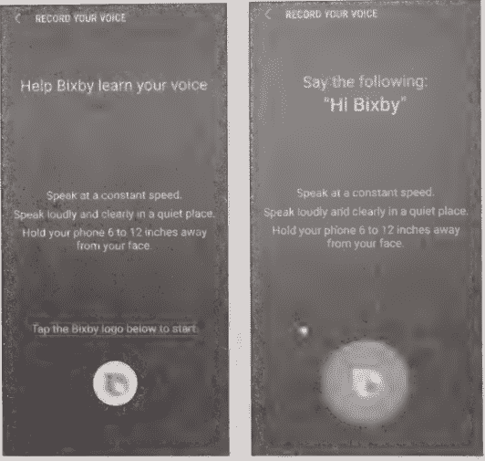

FIGURE 14-7:
Bixby 准备好的文本。

你会被要求说几遍“Hello, Bixby”，以及其他几句话。然后它就可以使用了。你只需说，“Hi, Bixby”然后加上你的请求。

## 语音输入文本

要发送短信，说“Hi, Bixby. Send a text.”即可。完成。短信屏幕弹出。

Bixby 问你，“Who would you like to message?”给出名字。它会从你的联系人列表中查找号码。我说，“Ludwig van Beethoven。”然后 Bixby 会问你要发送的消息。继续说出你本会输入的内容。

然后 Bixby 将你的话转换为消息。它在框中显示它认为你说的内容，如图 14-8 所示。

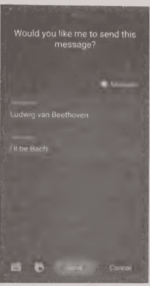

FIGURE 14-8:
Bixby 准备好的文本。

发送前请阅读。如果正确，只需说“Send”它就会发送。如果不正确，你可以说“Cancel”，它就不会发送该消息。然后你可以重试。就这么简单。试试吧！

## 准备与 Bixby 协作

发短信是一个简单的例子，但它只是 Bixby 可以为你做的任务之一。你可以要求 Bixby 在手机上做各种事情。一些示例包括

- 告诉你时间
- 设置闹钟
- 打开或关闭 Wi-Fi
- 告诉你天气预报
- 设置倒计时器
- 录制你的声音
- 打开应用
- 播放播放列表
- 向你的日程添加约会
- 查找当地餐厅、商店或公共场所
- 导航到地址或位置

你所需要做的就是提问，Bixby 会很好地找到你想要的内容。学习 Bixby 能做什么的最佳方式是：问 Bixby，“What services do you offer?”图 14-9 所示的屏幕会出现。

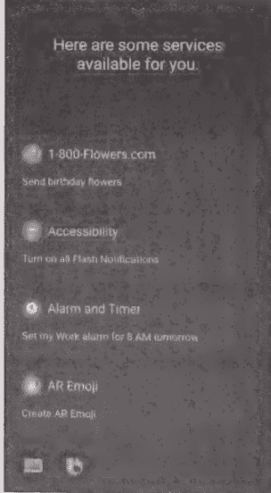

FIGURE 14-9:
当你询问有哪些服务可用时 Bixby 的界面。

每个应用在应用名称下方都附带一个建议。例如，应用会建议你可以做什么，例如“Send birthday flowers.”你可以通过点按 1-800-Flowers.com 链接了解更多信息。应用的完整列表如图 14-10 所示。这个列表令人印象深刻。

FIGURE 14-10:
可与 Bixby Voice 一起使用的 Bixby 服务列表。

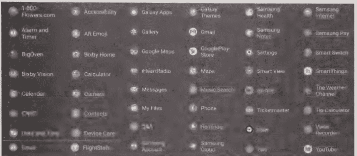

大多数应用程序都有相当不错的命令列表。图 14-11 显示了计算器应用的更简洁的选项列表，让你了解其中的情况。

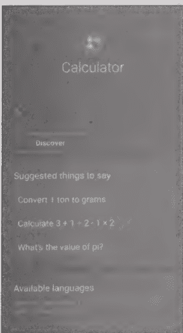

FIGURE 14-11:
计算器应用的 Bixby 命令。

先试着做一些数学题来熟悉一下吧。谁能想到数学会这么简单呢？（想想看，麦克里亚先生说过我们并不是总能在需要时有计算器。）

这一番交谈和计算让我有点饿了，但还不至于饿到不能问 Bixby，“嗨，Bixby。用 Google 地图找最近的麦当劳在哪里？” Bixby 回了一些选项，如图 14-12 所示。

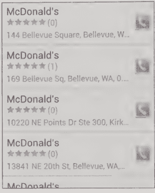

图 14-12：
Bixby 在位置上的选项。

然后你可以让它为你选择的麦当劳提供路线。这样请求会导致 Bixby 将你转交给首选的导航应用，显示出类似图 14-13 所示的屏幕。

你也可以使用其他应用，比如 Yelp，如果你想获取除位置之外的信息。例如，如果你想找到西雅图最好的意大利餐厅，只需询问即可看到图 14-14。

现在你只需安全驾驶前往并尽情享受！

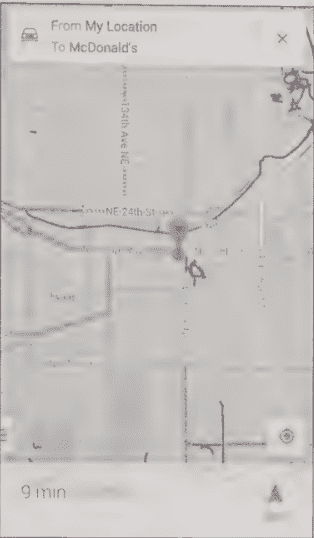

图 14-13：
导航到
你请求的
位置。

图 14-14：
询问
该地区的
最佳餐厅。

## 本章内容
- 发现 Samsung Pay 为何是最酷的支付系统
- 为支付设置你的手机
- 管理你的信用卡选项
