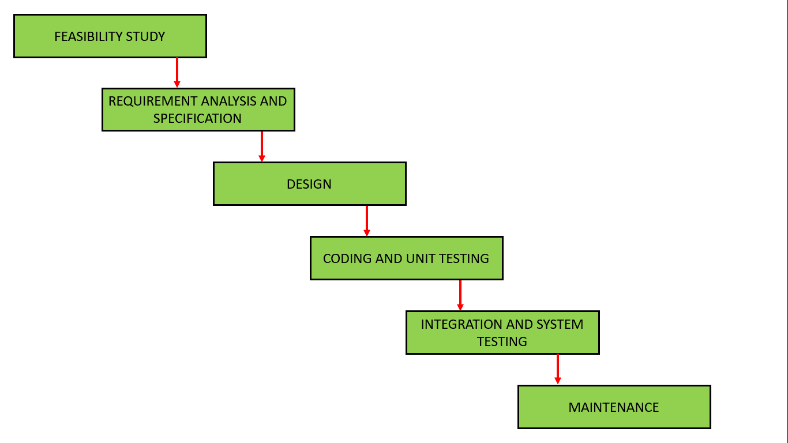
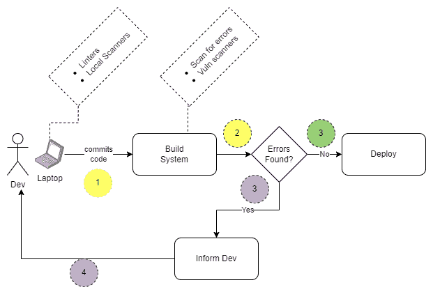
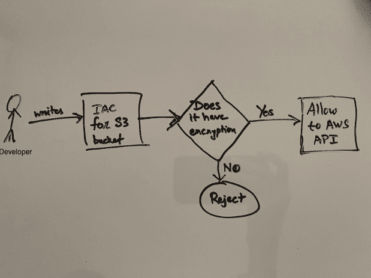

## 第 1 章 DevSecOps 简介

我们并非从安全领域起步，但我们都深知，交付软件对开发人员至关重要。在此语境下，“交付软件”意味着交付*能够按预期运行的产品*。这可能指代代码的稳定性，或软件在无任何问题的情况下满足功能需求（例如，计算器能进行加、乘、减、除运算）和性能预期（例如，聊天应用允许 10 多人同时互发消息）。

然而，构建*高质量*软件需要良好的编码实践、弹性架构和安全性。通常安全措施是在软件构建完成后才加入，但[左移方法](https://www.dynatrace.com/news/blog/what-is-shift-left-and-what-is-shift-right/#:~:text=and%20reliability%20criteria.-,What%20does%20shift%2Dleft%20mean%20in%20DevOps%3F,side%20of%20the%20DevOps%20lifecycle.)建议将安全前移到开发生命周期的更早阶段，从一开始就内置安全。本章将讨论该方法，重点关注*安全即代码*。在此方法中，我们基础设施的安全策略——检测、预防、修复——均定义为代码。

本章还将讨论 DevSecOps，重点关注软件开发中的三大核心角色：

开发
: 您的代码是否在执行其预期功能？

运维
: 这段代码运行在什么之上？您是否具备持续维护的技能/时间？预置的基础设施能否承受预期工作负载？

测试
: 代码能否经受意外用例的考验？面对未预料的情况，代码如何响应？

本书的主要关注点是如何通过云基础设施将安全集成到您的开发流程中。在文件中声明基础设施也称为*基础设施即代码* (IaC)。Kief Morris 在其著作《[基础设施即代码](https://learning.oreilly.com/library/view/infrastructure-as-code/9781098114664/ch01.xhtml#iron-age-cloud-age)》第 2 版 (O'Reilly) 中给出了一个有用的定义：

> “基础设施即代码是一种基于软件开发实践的基础设施自动化方法。它强调用于预置和更改系统及其配置的一致、可重复的例程。您修改代码，然后使用自动化来测试并将这些更改应用到您的系统中。”

使用 IaC 并声明该基础设施的安全方面即为安全即代码 (SaC)。SaC 并不完全不同于 IaC，而是侧重于使用模板启用安全控制。

本章介绍 SaC 的基本概念，第 2 章提供设置和说明帮助您入门。之后，各章按安全领域组织。有些章节专属于单一领域；其他章节则在构建的单一阶段涵盖多个领域。每个领域都有其独特的问题集。例如：

数据保护（第 3 章）
: 所有数据是否都已加密？加密方法是否遵循数据分类指南？我是否有数据分类？

基础设施安全（第 3 章）
: 既然我们在云中运行应用程序，所有基础设施是否都已安全部署？当我的 S3 存储桶不应公开访问时，它是否却公开了？当缺少某些内容时，我能否阻止资源部署？

应用安全（第 3 章）
: 我运行的代码是否安全？我的代码中有多少活跃漏洞？我们是否发布了包含严重漏洞的代码？

日志记录与监控（第 4 章）
: 您知道监控什么吗？观察何时会变成异常？是否有适当的应用安全指标来告知我们任何意外事件？

身份与访问管理（第 5 章）
: 谁有权访问什么？是否有人拥有提升权限？某人能否提升自己或他人的权限？

事件响应（第 6 章）
: 我们如何应对事件？出现问题时，我能否替换有问题的应用程序的部分组件？

贯穿各章，我们将使用 Amazon Web Services (AWS) 原生安全服务和最佳实践为我们部署的环境建立基线。当我们假设特定的运营和团队结构时，会明确指出这些假设。

### DevOps 之前：软件开发生命周期

职业生涯初期，编写一段完全符合要求的代码本身就是一种乐趣。但随着时间的推移，我们意识到编写高质量代码不仅仅是让 `2 + 2 = 4`。如果用户输入 `2 + a` 怎么办？您的软件该如何表现？

好吧，那是质量和测试工程师的责任，不是吗？错。

#### 传统软件开发的挑战

我们见过开发人员和测试人员之间耗时且让双方团队都产生不健康预期的来回拉扯。让我们以计算器输入“2 + a”为例。如果作为程序员，你因为需求中未包含此用例而未考虑到它，而你的测试人员或 QA 团队也未将其记录为测试用例，那么你就会向客户交付有缺陷的代码。现在，这有缺陷的代码就是你的最终产品。一个无法按预期工作的代码库，对最终用户来说并不是什么愉快的体验。

##### 基础设施职责

代码需要托管在某些基础设施上才能进行构建和部署。它将运行在你数据中心的服务器上、云端的虚拟机上、容器中，还是某人的笔记本电脑上？根据你的回答，你将承担另一组与基础设施相关的职责。一旦你搭建好基础设施，你将需要回答一组新的问题，包括：

*   程序员是在将要部署的完全相同的平台上进行开发的吗？
*   谁来搭建所有基础设施？
*   发生错误时，基础设施是故障开放还是故障安全？

这组问题需要另一组测试，以确保应用代码在正确的平台上正确运行，且平台本身没有异常行为。

##### 瀑布模型

在传统软件开发中，只有*开发人员*负责开发，这意味着他们的首要任务是按照规范编写代码。*运维*团队负责处理环境和部署方式，以及变更管理流程。*测试人员*接收开发人员和运维团队的输出，确保近乎最终的产品不出问题。这三个角色并非互斥，但每个团队都需要等待前一个团队的输入才能开始工作。这种流程的一种非常常见的表示形式是软件开发生命周期（SDLC）模型（参见图 1-1）。

在实践中，SDLC 的瀑布模型运作大致如下：开发人员根据功能需求快速编写代码。代码被送去测试，发现错误，代码被退回给开发人员。开发人员修复代码并送去进行另一轮测试。测试完成后，代码移交给运维团队进行维护。

##### 孤岛式团队的劣势

以放任风格运作的孤岛式团队，类似于图 1-1 中的 SDLC，有其劣势。每个团队都有自己的工具集，负责 SDLC 中非常特定的一环，且通常不了解其他团队的工具集。这使得按时交付高质量软件变得困难。

正如我们所指出的，瀑布模型导致团队之间大量的来回拉扯。当你因为代码未通过测试团队的测试而无法交付任何东西时，这种来回拉扯会变得更糟。因此，大量的时间和精力白白流失，却未产生任何切实成果。

### DevOps：文化变革

DevOps 登场了。为了缩短上市时间并提高软件质量，DevOps 概念被引入。在他们的著作[*《高效 DevOps》*](https://learning.oreilly.com/library/view/effective-devops/9781491926291/ch02.xhtml#idm140536841630480)（O'Reilly 出版）中，作者 Jennifer Davis 和 Ryn Daniels 将 DevOps 定义为：

> “一种文化运动，它改变了个人对工作的看法，重视工作的多样性，支持有意识的流程以加快企业实现价值的速度，并衡量社会和技术变革的影响。它是一种思维方式和工作方式，使个人和组织能够开发和维护可持续的工作实践。它是一个分享故事和培养同理心的文化框架，使人员和团队能够以有效且持久的方式实践他们的技艺。”

在 DevOps 模型中，开发、测试和运维团队不再孤岛式工作，而是同一个群体。如果我们将 DevOps 模型可视化，它看起来会像一个角色的均质团块。Kief Morris 在《基础设施即代码》一书中写道，DevOps 的目标是：

> “减少组织孤岛——开发、运维以及其他参与规划、构建和运行软件的利益相关者——之间的障碍和摩擦。虽然技术是 DevOps 最显眼、在某些方面也是最简单的表现，但文化、人员和流程对流程和效率影响最大。像基础设施即代码这样的技术和工程实践，应被用来支持弥合差距和改善协作的努力。”

我们想强调这一点：*DevOps 并非仅由技术驱动。只有当人员、流程和技术协同工作时，它才有效。* 存在一个常见的误解，认为如果你使用了 `CI/CD` 系统中使用的工具，就自动在实践 DevOps 了。这是错误的思维。真正驱动 DevOps 的是协作。

### 什么是 DevSecOps？

DevSecOps 不是 DevOps 的“新版本”，而是将安全融入 DevOps 框架的有意识努力。与 DevOps 一样，DevSecOps 有许多定义和方法。为了本书的目的，我们将 *DevSecOps* 定义为在软件中实现和部署 `SaC` 的能力。

我们将大量依赖 `API`、云服务和其他开源项目来实现 `SaC`，这很像 `IaC`。当你的 SDLC 的某一部分变成“即代码”时，你的团队应该保持开放态度去构建事物。

当你的组织开始实施 DevSecOps 时，你的团队需要明确两件重要的事情：工具和安全准则。

#### 实施 DevSecOps

首先，你将如何编写 `IaC`？换句话说，你将使用什么工具？这可能是像 `AWS CloudFormation` 或 `Terraform` 这样的工具。供应商和开源社区提供了大量服务和产品，你可以用它们来构建 `SaC` 并将其集成到你的流水线中。正如我们提到的，本书将使用 AWS 和开源项目来演示实施 DevSecOps 的*原因*和*方法*，而不是纠结于某个特定工具的许可或采购。我们选择在本书中专注于 AWS，因为它目前是最受欢迎的云基础设施供应商，拥有[33% 的市场份额](https://www.statista.com/statistics/967365/worldwide-cloud-infrastructure-services-market-share-vendor/#:~:text=In%20the%20first%20quarter%20of,with%20eight%20percent%20market%20share.)。然而，本书的基本原则对所有读者都有用。

其次，你们公司的安全“行车规则”是什么？你们的安全团队指定了哪些“绝对不要这样做”的规则？理解安全团队提供特定指导的原因，有助于你理解规则背后的顾虑。

在 DevSecOps 中，你将安全直接构建到软件开发流水线中（参见图 1-2）。在步骤 1 中，开发人员在本地对代码进行静态检查，并确保其格式遵循团队的约定和标准。然后他们将代码提交到代码库。在步骤 2 中，流水线的构建系统扫描错误以及任何其他漏洞和错误配置。流水线的安全性内嵌于此阶段。最后，在步骤 3 中，代码（可能）准备好部署了。最后一道关卡是*决策门*——一种检查错误的机制。如果发现任何错误，部署将取消并通知开发人员。如果代码没有错误，部署将继续进行。

步骤 1 和 2 每次都会发生。步骤 3 的上半部分（成功路径）仅在静态检查工具和扫描器未发现错误时发生。步骤 3 的下半部分（失败路径）和步骤 4，仅在静态检查工具和扫描器发现问题时发生。

### 简介

部署的代码并非唯一需要保障安全的事物。您还需要保护在 `DevOps` 流水线中实施的安全检查。试想一下，如果任何提交代码的人都可以开启或关闭安全检查，那还安全吗？

我们见过团队绕过安全检查，因为需要“紧急”变更代码，而跳过安全检查部署更快。这是酿成灾难的配方。真正的紧急情况如果证明不安全的代码变更是合理的，应当被记录并补救。部署不应存在绕过功能。

#### 介绍 Automatoonz

安全是一个广泛的话题。其子领域包括物理安全、应用安全、密码学、培训等。本书将范围限定在安全领域的一个子集内，我们将通过跟随一家名为 Automatoonz 的虚构公司的历程来探索这些领域。

Automatoonz 是一家动画公司，最近涉足网络动画和剧集创作。该公司运行在 `AWS` 上，目前正试图将安全融入其开发和部署流程。他们想要精益且安全，但公司在该领域相对较新，没有资金雇佣更多安全工程师。因此，他们希望尽可能自动化安全工作。

因为 Automatoonz 运行在 `AWS` 上，所以有些安全责任他们不必操心，例如物理安全。`AWS` 将此称为 [共担责任模型](https://aws.amazon.com/compliance/shared-responsibility-model/)。

### 云基础设施：默认安全

在云基础设施中，每个资源都是通过 API 调用创建的。每个 API 调用都有参数，可按您的意愿精确配置资源。您使用的软件开发工具包（`SDK`）也会自动生成默认配置，以提供最大的自定义选项。

例如，如果您使用 `AWS SDK for Python (Boto3)` 创建一个 `Amazon S3` 存储桶，唯一必需的参数就是存储桶名称。`SDK` 不会询问您是否加密，也不要求您确保存储桶不公开访问。如果您想要强制对存储桶内容进行加密，应在部署时执行。这就是所谓的 `默认安全`。

`默认安全`并不意味着您应该锁定所有能锁定的东西。常言道，最安全的计算机系统是拔掉电源的那台。但如果您让系统安全到实际上不可用——人们就不会用它。他们会寻找变通办法，在此过程中可能危及安全。本书旨在演示 `可用的安全性`——在易用性与安全性之间取得平衡。

在 `IaC` 范式中，您可以将资源 `模板化`——为遇到的模式编写声明式代码，并创建供开发人员使用的模板，以保持代码库的一致性。例如，如果您在 `AWS` 中构建 Web 服务器，您应该能够为未来的部署标准化架构。如果架构仅定义在图表中，您需要将该图表编纂为 `IaC`。为此，您需要创建声明式模板，以便同一 Web 服务器模式能够零偏差地重复部署。

模板化在安全方面提供了什么？让我们回顾一下 `S3` 存储桶的例子。在 Automatoonz，法务团队负责确保公司所有数据 `静态加密`，即存储在任何持久存储中的数据必须通过加密密钥进行加密，且该密钥仅对授权用户可访问。在云计算中，您可以通过 `IaC` 模板中的 API 标志来定义 `静态加密`。这也有助于为您的基础设施标准化 `默认安全` 态势。

当然，法务团队将此要求告知开发人员，开发人员需要应用正确的检查和平衡机制以遵守策略。如果存储桶有 `IaC` 模板，开发人员必须在其发送到 `AWS` 端点创建资源之前对其进行检查。这将防止未加密的存储桶被创建。

从高层来看，图 1-3 展示了我们试图实现的目标。左侧的开发人员创建一个 `AWS CloudFormation` 模板，进而创建一个 `S3` 存储桶。这进入一个决策关卡。如果未启用加密，决策关卡将阻止部署。只有模板修复后，部署才能继续。

### 快速行动，快速保障：自动化的重要性

开车时，您必须遵守特定的交通规则。不遵守这些规则可能导致意外、严重事故和法律麻烦。在安全领域，我们也有类似的不可变规则。有时规则由法规或合规要求驱动；有时旨在打造工程卓越。无论原因如何，每个团队都应遵循这些规则。

开发人员如何确保始终如一地遵守与安全相关的规则？回顾我们之前关于 `IaC` 的讨论，及其以声明方式定义云资源的能力。答案就在此处。如果我们能为云资源设置可预测的标志和/或参数，我们就可以允许创建新资源或部署新代码等操作，*仅在* 满足特定条件时才通过。

当您想以云的速度行动时，也想以云的速度保障安全。这意味着尽可能自动化您的安全工作。图 1-3 所示的检查有一种手动方式，即开发人员查看他们的代码并防止错误配置。但请记住那句老话“人是安全中最薄弱的环节？”您理想情况下希望自动化这些检查。要自动化安全检查——`DevSecOps` 的核心理念——需要考虑某些属性：

**`幂等性`**

: 无论您传递相关模板多少次，安全检查都应产生相同的结果。

**`基线`**

: 安全检查应适用于所有或大多数资源。如果安全检查仅适用于一种资源变体，而该变体在您的部署中出现的比例不到 30%，您在检查时会得到大量噪音和失败。

**`建议`**

: 您发现了安全错误配置。这很好，但您是否告诉构建系统该怎么做？如果您让最终用户没有修复方案，您就是在增加他们的工作量。发现错误配置时，您的扫描应推荐修复方案。

我们将在全书构建流水线的过程中使用这些属性。我们想重申一点：自动化**并不能**解决所有问题。如果没有合适的负责人和流程，世界上所有的自动化也不会有任何成效。这些安全检查需要维护，开发人员应提供反馈以提高效率。

### DevSecOps 文化

技术不是银弹。文化也起着作用。`DevOps` 的核心建立在文化之上，其工具只有在人们以正确方式使用时才有用。

我们见过组织购买了所有声称能解决安全问题的工具，却甚至没有配置其中的一半。为什么团队不使用这些安全工具？他们缺乏培训吗？工具是否大材小用，或推广到整个组织的成本太高？

我们强烈建议在购买任何安全工具之前，先回答一个简单的问题：*你试图解决什么安全问题？* 像“让事情变安全”和“提升我的安全”这样的回答模糊至极。试着将其浓缩为一句话。如果这不能给你一个明确的答案，请考虑编写一份风险声明。风险声明大致如下：

“缺乏 X 导致 Y 损失，因为 Z。”

X = 一个安全功能，如访问控制或日志记录

Y = 如果未实施安全控制造成的影响（即，什么处于风险之中？）

Z = 你的安全控制如何防止安全事件

我们不会深入探讨采购细节，但在购买工具之前，了解该工具旨在解决什么安全问题至关重要。许多企业级工具提供免费试用或演示。如果你的团队具有构建者心态，你可能想探索开源云安全工具的广阔天地，其中许多已在行业中崭露头角并持续变得更好。

一旦你选定了工具，谁来维护它？是否需要定期更新？你的工具在运维侧应有明确的负责人。假设你获得了一个云安全态势管理工具，安全团队已集成每个云账户以供摄入。安全团队从账户接收告警，但不采取任何行动，因为他们预期云账户所有者会处理这些告警。但云账户所有者认为*安全*团队正在处理。如果没有处理告警的明确流程，团队就没有行动计划。简单的工具如责任分配矩阵（或 RACI 图表）和运行手册可以解决这个问题。我们将在第 7 章更详细地讨论这些工具。

### 总结

现在我们已经介绍了 DevSecOps 并阐明了本书的范围，让我们开始在流水线中实施 DevSecOps 吧！

后续章节将从为 Automatoonz 搭建基础设施开始，并迭代地将安全能力构建到应用程序开发过程中。我们将主要关注技术和工具，但会根据我们的经验指出任何人员和流程方面的必备要素。

本章关键要点快速回顾：

*   DevSecOps 是 DevOps 的一个变体，它在其迭代 DevOps 模型中包含了安全。
*   如果你能防止错误配置的资源被创建，就能建立安全卫生并教育开发人员。
*   自动化安全检查需要幂等性、基线和建议。第 3 章和第 4 章将更详细地讨论此主题。
*   仅自动化安全检查无法解决安全问题。建立人员和流程来拥有和运营自动化。
*   在推出安全工具之前，先确定*为什么*要实施它。
