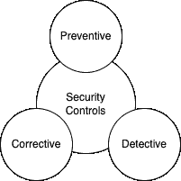
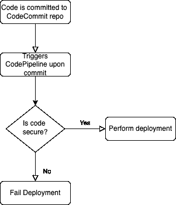
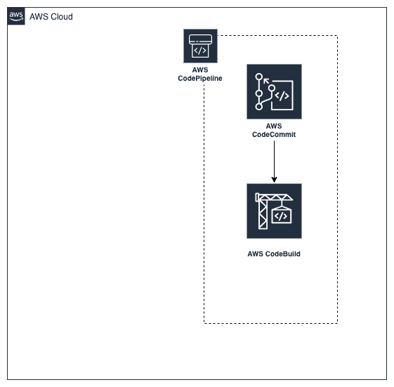
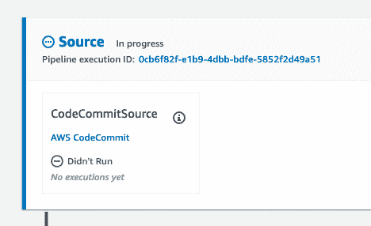
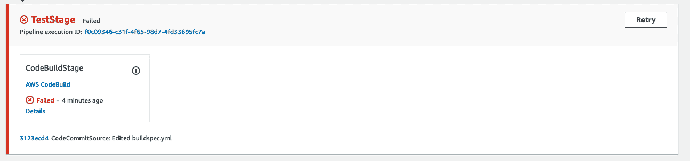

## 第 3 章 保护您的基础设施

您可能已经知道，云基础设施的启动和关闭速度比传统数据中心基础设施快得多。云提供商使用声明式语言帮助最终用户配置他们启动的基础设施。例如，AWS 使用 CloudFormation。

在本书中，为求简单起见，我们将使用 CloudFormation 代码。不过，您应该知道还有其他 IaC 工具——如 Cloud Development Kit (CDK) 和 HashiCorp 的 Terraform——它们使用不同的编写和部署格式，但实现通过代码创建基础设施的相同目标。

### 什么使基础设施安全？

“保护”您的基础设施意味着什么？IaC 就是代码，正如您保护应用程序代码一样，您需要计划保护您的 IaC。保护 IaC 涉及的三大优先事项，按重要性排序如下：

1.  防止未经授权的代码访问
2.  检测待部署基础设施中的错误配置
3.  防止错误配置的代码被部署

在本章中，我们将详细探讨这三大优先事项。

#### 注意

我们假设您对如何使用基于 Git 的版本控制有中级理解，因此不会涉及 Git 故障排除或分支策略。有关这些主题的更多信息，我们推荐阅读 Raju Gandhi 所著的《[*Head First Git*](https://learning.oreilly.com/library/view/head-first-git/9781492092506/)》（O'Reilly 出版）。

我们还将深入探讨身份和访问管理 (IAM) 等主题。如果您不熟悉 IAM，我们建议阅读 [AWS 文档](https://docs.aws.amazon.com/IAM/latest/UserGuide/introduction.xhtml) 以了解 IAM。

### 禁止访问！使用 IAM 权限防止未经授权的访问

始终将您的 IaC 文件存储在远程版本控制仓库中，以便集成更改。AWS 拥有自己的原生基于 Git 的版本控制系统，称为 CodeCommit，我们将在本书中一直使用它。现在，如何保护此仓库免受未经授权的访问？

*身份和访问管理* (IAM) 是在 AWS 账户中向资源分配权限的核心方法。任何需要在您的 CodeCommit 仓库中创建、更新或删除文件的人——至少——都应拥有 IAM 策略中规定的权限。此策略仅允许在正确的区域中对您的特定仓库执行 CodeCommit 操作：在本例中，如下所示，只有 `us-east-2` 区域中的最终用户才能执行操作。

下面的第二条语句允许您列出所有 CodeCommit 仓库。我们将这两条语句分开，因为您不能将 `ListRepositories` 用于特定资源。


```json
{
  "Version": "2012-10-17",
  "Statement": [
    {
      "Effect": "Allow",
      "Action": "codecommit:*",
      "Resource": "arn:aws:codecommit:us-east-2:111111111111:*",
      "Condition": {
        "StringEquals": {
          "aws:RequestedRegion": "us-east-2"
        }
      }
    },
    {
      "Effect": "Allow",
      "Action": "codecommit:ListRepositories",
      "Resource": "*",
      "Condition": {
        "StringEquals": {
          "aws:RequestedRegion": "us-east-2"
        }
      }
    }
  ]
}
```

此 IAM 策略是使用 CodeCommit 存储库的起点。您可以选择缩减这些权限，以将用户的操作限制在特定存储库中。您可以在 GitHub 上本书的[补充材料](https://github.com/bksarthak/devsecops-book/tree/main/chapter-3)中看到示例。

### 检测错误配置

保护 IaC 的下一步是检测写入其中的任何错误配置。为了更多地解释错误配置，让我们将重点转移回我们的虚构公司 Automatoonz。

Automatoonz 正努力成为一个快速行动、以开发者为中心的组织，其中安全性融入开发生命周期。由于安全性在其组织内通常被视为事后诸葛亮，优先考虑安全性将有助于前置初始安全模式和工作，使开发团队在未来能够以更少的摩擦进行扩展。

开发人员计划使用 Amazon `EC2 instances` 来部署和托管供客户使用的应用程序。来自 Automatoonz 安全团队的 Lupe 要求开发团队确保附加到 EC2 实例的卷已加密。然而，新聘用的 DevSecOps 工程师 Jake 意外地忘记加密其中一个卷。此错误在内部审计中被发现，开发团队匆忙修复它。

事后，Jake、Lupe 以及开发和安全团队希望确保此错误不再发生。与其依赖人的一致性，团队同意使用自动化来查找 IaC 中的错误。他们需要决定一些“行车规则”，以确保其自动化符合合规标准并通过审计。

#### 确定标准

两个团队都希望找到一个基准标准来保护 IaC 代码，最好是能快速实施的标准。经过一些研究，他们发现了 [互联网安全中心](https://www.cisecurity.org/)，这是一个与云提供商无关的联盟，通过其 [CIS 基准](https://www.cisecurity.org/cis-benchmarks/) 资源为不同场景提供基准配置。CIS 的配置被视为行业标准，并定期更新。Automatoonz 团队决定使用 CIS 基准，并注意到他们需要跟踪更新以跟上任何变化。现在他们需要决定想要哪个级别的加固作为其环境的基准。

#### 威胁建模

CIS 基准是一个好的起点，但它们并不涵盖所有安全考量。为了创建自定义安全行动计划，Lupe 建议为应用程序开发威胁模型。

*威胁模型* 是一种设计工具，可帮助团队枚举任何给定应用程序中可能的漏洞。构建威胁模型有多种方法。较流行的框架之一是 [STRIDE](https://docs.microsoft.com/en-us/azure/security/develop/threat-modeling-tool-threats)，这是一种威胁建模工具，可帮助在开发周期早期识别安全风险。STRIDE 包含六类安全风险，如表 3-1 所示。

**表 3-1. STRIDE 的安全风险类别**

| STRIDE 类别 | 定义 | 对 Automatoonz 意味着什么？ |
| --- | --- | --- |
| 欺骗 | 使用他人凭证冒充他人 | 能够承担 CodePipeline 的角色，在没有检查的情况下部署 CloudFormation 堆栈 |
| 篡改 | 对系统（基础设施或应用程序）进行未经授权的更改 | 直接更改应用程序和基础设施，而不通过 CodePipeline |
| 抵赖 | 用户否认他们所做的更改，而其他用户无法反驳 | 对基础设施的任何更改都无法追溯到日志条目 |
| 信息泄露 | 向不应有权访问信息的用户暴露信息 | 授予最终用户的权限使其能够查看底层基础设施和日志 |
| 拒绝服务 | 有效用户无法执行任务 | 开发人员无法将代码提交到 CodeCommit |
| 权限提升 | 非特权用户获得特权操作的访问权限 | 用户可以在不通过 CodePipeline 检查的情况下部署和启动资源 |

虽然表 3-1 不是可能威胁的详尽列表，但就本章而言，这些是我们关心的威胁。在下一节中，我们将重点介绍可以保护 Automatoonz 免受这些安全风险的各种安全控制。

#### 安全控制

AWS 中有三种类型的安全控制，如 图 3-1 所示：预防性、纠正性和检测性。AWS 提供错误配置检测服务，如 `SecurityHub`、`GuardDuty` 和 `Config`。虽然这些很有价值，但它们都是 *检测性安全控制*：它们只能在资源创建*后*检测错误配置。

拥有 *预防性控制* 以 *防止* 开发人员启动错误配置的资源也很重要。时间是坏人的最好朋友：错误配置的资源运行时间越长，他们就有越多时间探测账户以寻找弱点、运行不同的攻击并访问敏感数据。

第三种安全控制是 *纠正性控制*，它修复配置以将系统恢复到已知良好状态。开发人员应力求具备所有三种控制来保护其 IaC。在 Automatoonz 的背景下，我们将重点首先实施预防性控制和自动化，然后是检测性控制。



我们的设计目标是当 IaC 推送到 CodeCommit 存储库时自动触发部署。工作流将从 Automatoonz 开发人员提交代码开始。一次提交会调用构建阶段，仅当代码符合安全标准并被视为安全时，才会部署到 VPC 中。在构建阶段，安全标准和期望以检查的形式编码。如果代码通过这些检查，则将其部署到环境中。

Automatoonz 开发团队（Aisha 和 Dave）已经拥有一个 VPC 和相关子网，并继续构建安全组和其他资源以满足其需求。然而，他们构建的内容并不总是安全的，这导致与安全团队进行了一些不愉快的对话。

开发人员正在使用现有的 CodeCommit 存储库来存储他们的代码。这将成为他们 DevSecOps 之旅的起点。拥有版本化的 IaC 有助于团队协作代码、回滚部署并与测试功能集成。开发人员可以在流水线中集成他们的单元测试（我们将在本章后面和全书中演示）以增强自动化和调试。

然而，事实证明 *某人* 创建了一个安全组，该安全组开放了端口 22 访问权限，面向互联网。这是个问题：坏人可能会发现此端口，并将其作为攻击向量，通过暴力破解进入 Automatoonz 的 AWS VPC 网络。团队该怎么办？


理想情况下，它们应监控 `main` 分支，因为那里的代码在经过人工批准和/或审查后已被合并。当有人向 CodeCommit 仓库提交代码时，流水线就会被执行。作为该流水线的一部分，团队可以选择想要监控以检测变更的确切分支。让我们创建流水线来实现这一点。

### 防胜于治：实施预防性控制

`pipeline`（根据 [RedHat 的定义](https://www.redhat.com/en/topics/devops/what-cicd-pipeline)）是“一组必须执行的步骤，以创建应用程序的新版本”——在本例中，即 Automatoonz 的 IaC。请按照以下步骤，使用 AWS 开发工具设置您的流水线。

首先，您需要设置 CodeCommit 仓库。您可以在我们的 [GitHub 仓库](https://github.com/bksarthak/devsecops-book) 中找到代码（文件名为 `ch3-codecommitrepo.yml`），但我们在此也将其复现如下：

```yaml
AWSTemplateFormatVersion: "2010-09-09"
Description: Template to create Codecommit repository, CodePipeline
Parameters:
  CodeCommitName:
    Type: String
    Default: AutomatoonzRepo
Resources:
  CodecommitRepo:
    Type: AWS::CodeCommit::Repository
    Properties:
      RepositoryName: !Ref CodeCommitName
      RepositoryDescription: Repo created for automatoonz team infra Code
      Tags:
        - Key: Team
          Value: Automatoonz
```

运行此代码将设置一个默认名为 `AutomatoonzRepo` 的 CodeCommit 仓库。（如果您想更改仓库名称，可以在启动 CloudFormation 堆栈时进行，或在下面的命令中传递参数。）这是一个新的空仓库。随着步骤的推进，您将向此配置文件添加更多功能以部署不同的资源。

要部署该仓库，请运行以下命令：

```bash
aws cloudformation create-stack \
--stack-name devsecops-repo \
--template-body file://ch3-codecommitrepo.yml
```

使用以下命令通过 AWS 控制台或 CLI 检查其部署状态：

```bash
aws codecommit list-repositories
```

```json
{
  "repositories": [
    {
      "repositoryName": "devsecops-repo",
      "repositoryId": "a0000e13-x83x-4027-aaef-650c0XXXXXX"
    }
  ]
}
```

在继续之前，请等待仓库成功启动。

接下来，您需要向仓库添加第一个文件。首先，通过执行 [AWS 公共文档中提供的步骤](https://docs.aws.amazon.com/codecommit/latest/userguide/how-to-create-file.xhtml)，将您的仓库克隆到本地系统。

在克隆仓库的根目录下，创建一个名为 `cfn` 的文件夹，并在其中创建一个名为 `secgroup.yml` 的新文件。书籍仓库中的文件 `chapter-3/ch3-secgroup.yml` 将包含以下内容：

```yaml
AWSTemplateFormatVersion: "2010-09-09"
Description: Template to create misconfigured Security Group in a VPC
Parameters:
  VPCId:
    Type: String
Resources:
  MisconfiguredSecGroup:
    Type: AWS::EC2::SecurityGroup
    Properties:
      GroupDescription: Misconfigured Security group which should NEVER be launched
      GroupName: MisconfiguredSecGroup
      SecurityGroupIngress:
        - IpProtocol: tcp
          FromPort: 22
          ToPort: 22
          CidrIp: 0.0.0.0/0
      VpcId: !Ref VPCId
```

这段代码创建了一个配置错误的安全组，其入站规则允许互联网上任何人通过端口 22 使用 SSH——就像 Automatoonz 的朋友们遇到的情况一样。让我们看看如何阻止该组被启动。

#### 实施

将 `ch3-secgroup.yml` 文件提交到新创建的仓库，然后推送到远程仓库。（正如我们在本章开头提到的，如果您不熟悉 Git 分支的使用，请参阅 [`Head First Git`](https://learning.oreilly.com/library/view/head-first-git/9781492092506/) 或 Git 文档 [网站](https://git-scm.com/book/en/v2/Git-Branching-Branching-Workflows)。）现在您应该能在仓库中看到您的文件了。

您希望提交能触发部署检查，并且仅在代码安全时才允许部署，如 图 3-2 所示。



要实现这种自动化部署检查，您将使用 AWS CodePipeline 和 AWS CodeBuild。CodePipeline 将充当“线束”，将流水线的各个阶段串联起来，而 CodeBuild 将作为您的构建、配置和测试系统。图 3-3 展示了完整的设置架构。



您将创建另一个包含 CodePipeline 和 CodeBuild 的 CloudFormation 文件版本。让我们浏览一下该代码的片段。完整版本位于书籍仓库的 [第 3 章文件夹](https://github.com/bksarthak/devsecops-book/tree/main/chapter-3) 中，名为 `ch3-codepipeline.yml`。

要部署该文件，请运行以下命令：

```bash
aws cloudformation update-stack \
--stack-name devsecops-repo \
--template-body file://ch3-codepipeline.yml \
--capabilities CAPABILITY_NAMED_IAM
```

在该文件中，您将看到创建了几个 IAM 角色。[EventBridge](https://aws.amazon.com/eventbridge/) 服务将使用这些角色在有人向仓库提交代码时通知您；CodePipeline 将使用第二个角色（在 `codepipeline.yml` 中名为 `CodePipelineRole`）代表您执行任务。EventBridge 规则会监控 CodeCommit 仓库的变更，并在有人向 `main` 分支提交时触发 CodePipeline。下面的片段展示了 EventBridge 规则所查找的模式：

```yaml
EventPattern:
  source:
    - aws.codecommit
  detail-type:
    - 'CodeCommit Repository State Change'
  resources:
    - !Join [ '', [ 'arn:aws:codecommit:', !Ref 'AWS::Region', ':', !Ref 'AWS::AccountId', ':', !Ref CodecommitRepo ] ]
  detail:
    event:
      - referenceCreated
      - referenceUpdated
    referenceType:
      - branch
    referenceName:
      - main
Targets:
  -
    Arn:
      !Join [ '', [ 'arn:aws:codepipeline:', !Ref 'AWS::Region', ':', !Ref 'AWS::AccountId', ':', !Ref CodePipeline ] ]
    RoleArn: !GetAtt AmazonCloudWatchEventRole.Arn
```

除了 `ch3-codepipeline.yml` 中的两个 IAM 角色外，您还创建了一个 CodeBuild 项目，用于安装一个开源 IaC 检查器。该检查器将验证安全组文件是否配置错误。

```yaml
CodeBuildProject:
  Type: AWS::CodeBuild::Project
  Properties:
    Name: Automatoonz_Project
    Source:
      Type: CODEPIPELINE
    Description: This project will test Code
    ServiceRole: !GetAtt CodePipelineRole.Arn
    Artifacts:
      Type: CODEPIPELINE
    Environment:
      Type: LINUX_CONTAINER
      ComputeType: BUILD_GENERAL1_SMALL
      Image: aws/codebuild/amazonlinux2-x86_64-standard:2.0
      TimeoutInMinutes: 10
```

CodeBuild 项目在执行期间会从 CodeCommit 仓库的根目录读取构建规范文件（`buildspec.yml`）。构建规范文件是 CodeBuild 项目中执行的指令和步骤的集合。

（有关更多信息，请参阅 [AWS 文档](https://docs.aws.amazon.com/codebuild/latest/userguide/build-spec-ref.xhtml)。）您将使用此构建项目作为测试阶段，以检查您提交到 CodeCommit 仓库的文件。

构建规范文件执行三个主要步骤。首先，它安装一个名为 [`cfn-nag`](https://github.com/stelligent/cfn_nag) 的开源检查器，用于扫描 CloudFormation 文件。其次，它在我们提交到仓库的代码上运行该检查器。第三，它提供通过或失败的结果。下一个片段来自构建规范文件，展示了第一和第二阶段。


```yaml
version: 0.2
phases:
  install:
    commands:
      - echo Entering the install phase...
      - gem install cfn-nag
  build:
    commands:
      - echo Entering the build phase...
      - cfn_nag_scan --input-path $CODEBUILD_SRC_DIR/cfn
```

现在你需要将 `buildspec.yml` 提交到 CodeCommit 仓库，以便 CodeBuild 仓库能够使用它。

执行此提交后，请访问 AWS 管理控制台上的 CodePipeline 服务。你应该会看到管道已开始执行（如 图 3-4 所示）。



管道的第一阶段连接到 CodeCommit 仓库。管道将从 CodeCommit 仓库拉取变更并传递给下一个阶段，即 CodeBuild 项目。

构建过程完成后，管道将失败。这完全正常且在预料之中。当存在误配置资源（如你刚提交的安全组）时，该管道 *应该* 失败。但是，你如何知道管道失败正是 *因为这个原因* ，而不是其他原因呢？

这是一个深入管道日志查看发生了什么错误、何时何地发生的好时机。在 AWS 控制台中，进入 CodePipeline 并点击你刚创建的管道。“TestStage” 应显示为 “failed（失败）”。点击 TestStage 框内的 “Details（详情）” 链接（见 图 3-5）。



此链接将带你进入最后一次运行的执行日志，以便查看管道各阶段运行时执行了什么。它应该类似于下面的片段：

```
[Container] 2022/03/23 23:36:50 Running command cfn_nag_scan --input-path $CODEBUILD_SRC_DIR
------------------------------------------------------------
/codebuild/output/src699107553/src/secgroup.yml
------------------------------------------------------------------------------------------------------------------------
| WARN W28
|
| Resource: ["MisconfiguredSecGroup"]
| Line Numbers: [9]
|
| Resource found with an explicit name, this disallows updates that require replacement of this resource
------------------------------------------------------------
| WARN W9
|
| Resource: ["MisconfiguredSecGroup"]
| Line Numbers: [9]
|
| Security Groups found with ingress cidr that is not /32
------------------------------------------------------------
| WARN W2
|
| Resource: ["MisconfiguredSecGroup"]
| Line Numbers: [9]
|
| Security Groups found with cidr open to world on ingress.  This should never be true on instance.  Permissible on ELB
------------------------------------------------------------
| FAIL F1000
|
| Resource: ["MisconfiguredSecGroup"]
| Line Numbers: [9]
|
| Missing egress rule means all traffic is allowed outbound.  Make this explicit if it is desired configuration
------------------------------------------------------------
| WARN W36
|
| Resource: ["MisconfiguredSecGroup"]
| Line Numbers: [9]
|
| Security group rules without a description obscure their purpose and may lead to bad practices in ensuring they only allow traffic from the ports and sources/destinations required.
Failures count: 1
Warnings count: 4
[Container] 2022/03/23 23:36:50 Command did not exit successfully cfn_nag_scan --input-path $CODEBUILD_SRC_DIR exit status 2
```

正如日志所示，以 `WARN` 和 `FAIL` 开头的部分是你的 CloudFormation 文件中的误配置。失败是因为 `secgroup.yml` 文件存在多项安全违规。该安全组有以下两项警告和一项错误：

*   `WARN W2`：IP 范围对全球开放
*   `FAIL F1000`：缺少出站规则
*   `WARN W36`：安全组规则缺少描述

### 总结

在本章中，你创建了一个 CodeCommit 仓库、一个 CodePipeline 和一个 CodeBuild 项目。当你向 CodeCommit 仓库提交代码时代码提交时，CodePipeline 就会被触发。CodePipeline 将包含 `cfn-nag`（一种 CloudFormation 检查器）的 CodeBuild 项目作为一个阶段。

你了解了三种协同保护环境的安全控制类型，并且了解到在软件开发生命周期中尽早添加预防性检查有助于防止安全事件。你还了解到，如果你控制着代码部署的入口点，你就可以控制是否将特定的 IaC 文件部署到你的环境中。

理解日志和错误有助于减少 Bug 并实现成功的构建。像 `cfn-nag` 这样的扫描器能让你将误配置隔离为代码中的特定行，从而在部署前修复它们。

Automatoonz 团队开局良好。他们（以及你）已经创建了一个用于进行 IaC 检查并防止安全误配置在生命周期早期出现的初始管道。在下一章中，我们将向你展示如何通过添加日志记录和监控功能来进一步优化该管道，以检测和防止篡改。

本章要点快速回顾：

*   开发人员应具备三种安全控制来保障 IaC 安全：预防性、检测性和纠正性。
*   设置 CodePipeline 时，代码提交会触发预防性检查。
*   开源检查工具 `cfn-nag` 会查找代码中常见的安全误配置。
