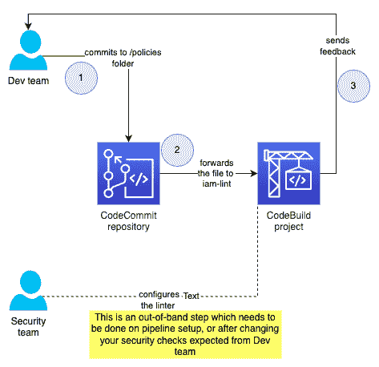
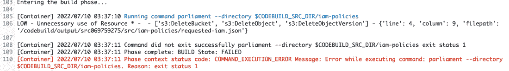

## 第 4 章 通过自动化控制访问

在本章中，我们将重点关注身份。具体而言，我们将讨论如何通过自动化实现身份验证和授权。你将了解可用于防止和检�环境中与身份和访问管理 (IAM) 相关误配置工具。

作为提醒，*身份验证* 是你证明自己是谁、验证身份的方式；*授权* 是授予用户执行某项操作的权限。

让我们先思考一下你目前所处的工作环境（如果适用）。你知道有多少账户过度授权吗？你实际使用了多少权限？

有两种类型的身份：人和机器。*人工身份* 是人类用于日常、非关键或一次性操作的账户。具有 *机器身份* 的账户则由机器用于自动化或执行某些特权操作。在理想世界中，人工身份仅用于读取由机器身份维护的数据。所有操作都应尽可能通过机器身份实现自动化。

在我们的案例研究中，Automatoonz DevSecOps 团队成员需要为其基础设施的用户（人类）以及基础设施本身（机器）提供身份。机器身份将允许诸如 EC2 或 S3 等服务相互通信。如果 AWS 内的基础设施没有正确的权限，你将始终收到 “Permission Denied（拒绝访问）” 错误。

我们将通过考察最小权限原则如何对你的信息安全计划至关重要来开始本章。然后我们将转向微调权限，介绍如何利用资源标签和职责分离来扩展 IAM 权限。我们还将讨论为什么在 IAM 安全控制方面，预防与检测同样重要。最后，我们将创建一个管道，用于检测不符合安全最佳实践的 IAM 策略。

### 注意

本书假设你具备一定的 AWS �础知识，因此我们不会深入讲解 AWS IAM 的基础知识。如果你需要复习 IAM，请访问 [AWS 文档](https://docs.aws.amazon.com/IAM/latest/UserGuide/intro-structure.xhtml)。

#### 最小权限原则


### 最小权限原则

“你能给我和罗兰一样的权限吗，这样我能更快地完成工作？”我们 100% 确定你要么问过这个问题，要么被问过这个问题。没有上下文的情况下，这个请求听起来无害，但罗兰的账户*可能*包含删除基础设施、数据或两者的权限。为用户分配适当的权限并不简单，要做到恰当通常需要一些尝试和错误。

*最小权限原则*规定，任何账户——无论是人还是机器——都应仅被授予其用户完成工作所需的权限。让我们看看这在我们的案例研究中是如何体现的。目前，Automatoonz 环境设置为向开发团队的所有成员授予广泛的权限。这是怎么发生的？最初，安全团队锁定了他们的权限，但开发团队向安全团队请求更广泛的权限，以免阻碍开发工作。开发团队负责人艾莎和戴夫发现自己与安全团队进行了大量的来回协商。他们最终施压安全团队授予更广泛的权限。

### Automatoonz 案例研究

随着 Automatoonz 的发展，合规团队负责人洛雷娜明确表示这种安全安排是个问题。除非他们改变这一点，否则公司将无法获得在不同地区工作的认证，也无法遵守诸如 `NIST 800-53` 之类的安全框架，这是一个与行业无关的安全框架，被全球合规团队用于标准化其安全能力。`NIST 800-53` 标准[要求](https://csf.tools/reference/nist-sp-800-53/r5/ac/ac-6/)组织使用（并提供使用证明）最小权限原则。不遵循该标准将阻碍合作伙伴关系，并阻止公司客户群的增长。

为了证明这一点，洛雷娜引用了大量近期使 Automatoonz 业务目标面临风险的事件——这些事件都是由这些过宽的权限导致的。例如，上个季度，审计团队和开发团队都被授予了其 `AWS` 账户的超级用户权限。这意味着他们可以以自己的速度修复错误配置和开发产品。安全团队注意到他们的一些 `AWS` 资源（如 `S3` 和 `EBS` 卷）未加密，因此他们创建了一个 `KMS` 加密密钥并开始加密这些卷。由于安全团队不知道谁在访问数据，也不清楚访问来源，他们无法将 `KMS` 密钥策略定制为适当的角色。他们直接锁定了整个开发团队存储的访问权限。洛雷娜指出，如果安全团队有能力*读取*资源错误配置，他们就不会暂时锁定开发团队存储的访问权限。

在本季度的另一个例子中，财务团队反复警告开发团队，他们的 `EC2` 账单超出了预算。为了不再让财务团队纠缠，戴夫和艾莎决定删除一些他们不认识的实例，以为那些是旧资源。几小时后，很明显他们实际上删除了美术设计团队正在使用的活跃资源。洛雷娜指出，戴夫和艾莎不应拥有删除其他团队资源的权限。

根据合规团队的说法，Automatoonz 对谁拥有哪些权限只有松散的定义，这种情况正在影响多个团队的生产力。

### 全面评估：人员-流程-技术

首先，必须明确这些问题不仅仅是 `IAM` 问题。`IAM` 是用于防止洛雷娜上述所述事故的众多技术控制之一。我们需要从宏观角度（10,000 英尺高空）全面评估形势。我们可以使用 `IAM` 安全的人员-流程-技术三要素来做到这一点，如表 4-1 所示。

**表 4-1. IAM 安全中人员-流程-技术三要素的总体主题**

| 人员 | 流程 | 技术 |
| --- | --- | --- |
| 谁负责修复问题？ | 任务和职责如何划分？ | 使用哪些 `AWS` 工具进行预防和检测？（例如 `GuardDuty`、`IAM Access Analyzer`、`服务控制策略`、`权限边界`） |
| 谁负责制定标准？ | 升级路径是什么？ | 使用哪些指标来衡量这些工具的健康状况？ |
| 哪个团队负责测试新的预防/纠正/检测控制措施？ | 例外情况如何处理？ | 通过 `Simple Notification Service` 通知负责团队 |

这就是最小权限原则发挥作用的地方。如果用户被授予了超出其工作所需范围的权限，你就有一个等待发生的问题。Automatoonz 在短短一年内发生了两起重大事件，拥有过度权限的人员无意中阻碍了另一个团队的生产力。尽管他们的意图不容置疑，但他们的行为给整个公司带来了负面影响。此外，从审计角度来看，最小权限原则是大多数合规框架的必备要求，因此不遵循它也会给公司带来负面影响。

在我们的职业生涯中，我们见过整个生产数据库被删除，仅仅因为某人拥有执行该操作的权限，且没有第二层防御或验证机制。在初创公司中，当团队还很小时，这通常是因为少数人被授予了广泛的管理权限。公司随后发展壮大，但权限从未被撤销或重新评估。

### 微调访问控制

我们见过人们抵制通过 `IAM` 实施细粒度访问控制，因为 `IAM` 策略的微调永无止境。如果你在第 1 天给用户 10 个权限，他们在第 10 天需要再加 2 个，第 20 天再加 5 个。快进到第 365 天，用户已被授予几乎所有权限，因为“他们需要这些权限。”这到哪里才算完？如果最终还是会变成宽泛的权限，为什么要花这么大力气授予细粒度的用户权限？

首先，你需要知道，*不可能*一次性就把访问控制做对。你需要在一定程度上进行迭代。为了合理地将 `IAM` 控制纳入你的 `DevSecOps` 计划，我们建议将一些总体策略构建到你的 `IAM` 自动化流水线中。让我们逐一过一遍这些策略并逐个拆解。

#### 使用标签系统

要构建的第一个组件是标签系统。`AWS` 提供资源标签作为一项治理功能：你可以使用键值对标记 `AWS` 资源，例如 `IAM` 策略和角色，或非 `IAM` 资源，如 `EC2` 实例。例如，如果你想标识游戏开发团队使用的 `IAM` 角色，可以使用标签值 `team:gamedev`。在此例中，`team` 是键，`gamedev` 是值。

`IAM` 和 `AWS` 资源标签配合得很好。使用标签的好处包括：

*   标准化资源命名，便于理解
*   数据分类，以识别敏感资源
*   所有者或团队标签，显示哪个团队拥有哪些资源
*   自动化和/或安全标签，防止对某些资源执行自动化操作

在 `AWS` 中，资源允许通过标签及其相应的值访问特定权限。

让我们看一个实现标签的权限策略示例：

```json
{
  "Version": "2012-10-17",
  "Statement": [{
    "Effect": "Allow",
    "Action": "iam:DeleteUser",
    "Resource": "*",
    "Condition": {"StringEquals": {"iam:ResourceTag/type": "temp"}}
  }]
}
```

上述策略允许删除具有标签键 `type` 和值 `temp` 的 `IAM` 用户。该策略的目的是仅允许删除临时用户（如外部审计员、承包商或实习生），以防止意外删除任何其他类型的用户。


#### 明确团队职责

如果不了解用户需要做什么，就很难为任何用户（无论是人还是机器）构建和/或验证 IAM 权限。每个团队都有一组职责，并且必须访问特定资源作为其操作的一部分。越早了解团队工作所需使用的内容，构建适当的 IAM 策略就越容易。例如，在 Automatoonz 中，开发团队仅负责启动或关闭他们拥有的 EC2 实例。他们不应被允许终止或停止不属于他们的实例。

随着您越接近生产环境，IAM 控制的严格程度和粒度应当增加。同样，随着越接近生产环境，人类身份与机器身份的比例应大幅降低。您的自动化（通过机器身份）应执行可预测的、已知的部署。尽可能让人员远离生产环境，以避免人为错误。

团队在学习或构建新事物时，通常会探索各种服务。例如，您的开发团队可能拥有启动 SageMaker 实例用于学习或探索的权限，但在生产环境中则没有。此类检查可在 AWS Organizations 层面使用*服务控制策略*（SCP）来实现。SCP 是类 IAM 的 JSON 文档，允许或拒绝在 AWS 账户或一组 AWS 账户上执行 AWS API 调用（如果将 SCP 应用于组织单元）。

#### 预防与检测

在第 3 章中，您了解了预防和检测在安全中的重要性。秉承这一思路，我们建议在预防和检测两个层面实施 IAM 控制。

简要回顾一下，*预防性控制*会在错误配置发生在 AWS 基础设施中之前将其阻止。例如，如果您尝试创建一个公共 S3 存储桶，预防性控制可能会禁止该操作，以防止您暴露数据。

*检测性控制*会告知您 AWS 环境中的任何错误配置（在资源启动/构建之后）。AWS 服务 GuardDuty 就是检测性控制的一个好例子。

这两类控制相辅相成。检测性控制可以帮助您发现预防性控制*未*覆盖的内容，以及它们的有效性如何。沿用前面的例子，如果您添加了一项预防性控制以阻止任何人创建公共 S3 存储桶，您会使用检测性控制来检查是否存在公共 S3 存储桶。如果发现了一个，这表明您的预防性控制未正常工作。

未映射到预防性控制的检测性控制，也是预防性控制的一个极佳反馈回路。如果您的检测性控制在环境中发现某类违规激增，这可能意味着您应该投资于预防性控制以避免此类违规。

AWS 以服务形式提供了许多预防性和检测性控制。让我们看看其中的几个。

**AWS 中的预防性控制包括：**

**服务控制策略 (SCP)**  
SCP 允许或拒绝特定的 API，可应用于单个 AWS 账户或一组 AWS 账户。

**权限边界**  
一种额外的权限层，可防止任何 IAM 角色在未将权限添加到权限边界的情况下扩展其权限。

**AWS 中的检测性控制包括：**

**IAM Access Analyzer**  
它会告诉您您的资源是否正在访问、或被您信任区域之外（即您的账户或组织之外）的实体访问。

**GuardDuty**  
一种基于机器学习的检测性控制，当 IAM 访问模式偏离基线时会向您发出警报。

**AWS Config 规则**  
AWS Config 是一项跟踪 AWS 资源状态及其各自配置的服务。AWS Config 规则允许您针对资源的特定配置更改采取操作或设置警报。这些规则可以是自定义的，也可以由 AWS 托管。例如，如果您想检查所创建的数据库是否启用了备份，可以使用 Config 规则来检测。AWS 提供了不断增长的 Config 规则列表，详见其[文档](https://docs.aws.amazon.com/config/latest/developerguide/managed-rules-by-aws-config.xhtml)。

### IAM 流水线

为了实施您刚学到的概念，让我们回到 Automatoonz，那里安全团队正收到批准开发团队 IAM 策略的请求。在本节中，您将帮助他们创建一个流水线，允许开发人员自助服务并验证其 IAM 策略的合理性，或协助安全团队自动评估多个 IAM 策略，以便尽早向开发团队发出批准。流水线的功能取决于谁将使用该流水线。

#### 注意

我们在此建议的架构是前几章创建的流水线的扩展。为求简单，它仅使用一个开源工具。请随意根据您的需求修改和使用它。

图 4-1 中的架构图展示了我们将构建的 IAM 流水线。假设 Dave（Automatoonz 的开发团队负责人）首先将他的 IAM 策略提交到包含所有 IaC 组件的 CodeCommit 仓库中。提交这些 IAM 策略的事件将触发我们在此构建的流水线，该流水线包含一个开源 IAM 扫描器。该扫描器将通过构建日志提供反馈，告知 Dave 他刚提交的 IAM 策略是否安全。通常，这类工具被称为 linter（静态代码分析工具）。它们会在不实际执行代码的情况下扫描代码中的问题。

图 4-1 中从安全团队指向 CodeBuild 项目的虚线旨在表明：流水线中的 IAM 扫描器由安全团队成员配置，但不属于流水线代码的一部分。



要构建 IAM 流水线，您首先将在第 2 章创建的 Automatoonz 仓库中创建一个新目录。为此，请转到您系统中的克隆仓库，并运行以下命令：

`mkdir iam-policies/`

在此目录中创建一个名为 `requested-iam.json` 的新文件。这是 Dave 请求安全团队评估的文件。将下面的内容复制并粘贴到您创建的 `requested-iam.json` 文件中。

```
{
  "Version": "2012-10-17",
  "Statement": [
    {
      "Sid": "VisualEditor0",
      "Effect": "Allow",
      "Action": [
        "s3:DeleteObjectVersion",
        "s3:DeleteObject",
        "s3:DeleteBucket"
      ],
      "Resource": "*"
    }
  ]
}
```

使用 `git commit` 命令将此新文件上传到 Automatoonz 仓库。

现在，让我们转向 Automatoonz 安全团队，看看他们如何大规模扫描不安全的 IAM 文件。对于此任务，我们将使用另一个名为 [Parliament](https://github.com/duo-labs/parliament) 的流行开源工具。Parliament 有助于识别 IAM JSON 文件中可能存在的安全问题。为了自动化此扫描，请在 CodeBuild 项目中安装 Parliament。

修改后的构建文件将如下所示：

```
version: 0.2
phases:
  install:
    commands:
      - echo Entering the install phase...
      - gem install cfn-nag
      - pip install parliament
  build:
    commands:
      - echo Entering the build phase...
      - cfn_nag_scan --input-path $CODEBUILD_SRC_DIR
      - parliament --directory $CODEBUILD_SRC_DIR/iam-policies
```


### 总结

一旦你在本地机器上编辑了构建文件，将其提交到代码库，以便新的构建文件更新到你的 CodePipeline。推送提交后，你将看到 CodePipeline 开始运行。如果一切运行正常，你的 CodeBuild 日志应如 图 4-2 所示。



让我们更仔细地查看 图 4-2 中的代码，特别是以单词 `LOW` 开头的那一行：

```
LOW - Unnecessary use of Resource * - ['s3:DeleteBucket','s3:DeleteObject','s3:DeleteObjectVersion']-
          {'line':4,'column':9,'filepath':'/codebuild/output/src/iam-policies/requestied-iam.json'}
```

这是 `Parliament` 扫描器的一个发现结果，指出你上传的 IAM 策略包含一个星号：`*`。这意味着它适用于所有资源。正如你所知，最小权限原则要求你仅授予每个用户所需的权限——包括资源。

输出表明构建失败，因为将 `*` 用作策略资源对于一般用途来说过于宽松。现有的预防性控制规定因此应拒绝该策略。要进一步自动化此过程，你可以创建一个简单通知服务 (SNS) 主题，将此失败消息发送回提交者，从而缩短 IAM 策略验证的周转时间。

除了 `iam-lint` 和 `Parliament` 等开源工具外，AWS 还在 IAM Access Analyzer 中推出了一个 API，用于验证 IAM 策略的语法和安全问题。你可以将此 API 纳入你的 CI/CD 流水线。

#### 关键要点

*   IAM 很难一次就配置正确。通过预防和检测机制不断优化你的 IAM。
*   利用 AWS 基于标签的访问控制机制，更好地扩展你的 IAM 控制。
*   在 AWS 环境中构建和测试 IAM 策略时，明确划分团队职责。
*   你的团队应深入研究所配置的 IAM 角色，枚举权限并识别未使用的角色。简而言之，清理 IAM 基础设施中的“蛛网”是明智之举。
