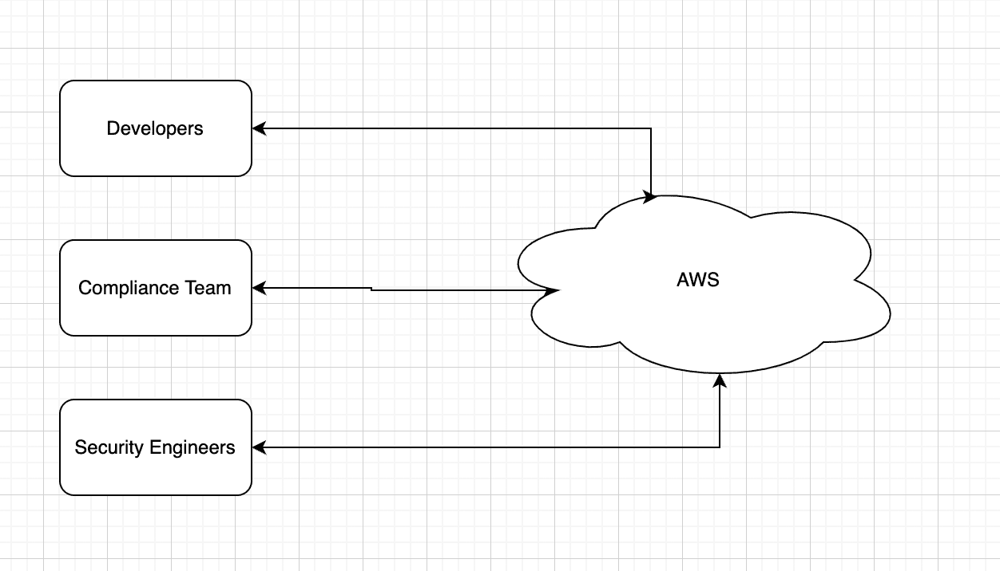
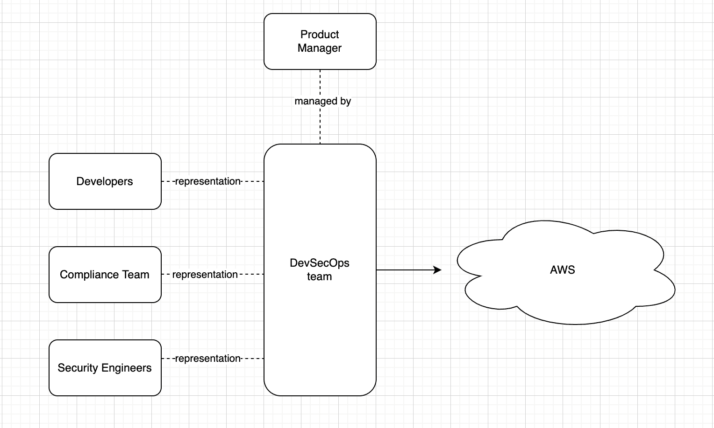

## 第 5 章 人员与流程

直到本章，我们一直专注于技术。我们讨论了不同类型的工具如何帮助我们实现不同的安全功能。但正如每个可靠的安全计划一样，我们必须关注人员、流程和技术框架的整体，我们在第 5 章中简要介绍了该框架。该框架由密码学专家布鲁斯·施奈尔在 [20 世纪 90 年代推广](https://www.mirrorreview.com/ppt-framework-an-overview/)，他认为这三者构成了安全的基础。安全不能仅靠技术实现，也不能仅靠人员或仅靠流程实现。平衡这三者让我们这些关注安全的人能专注于构建安全的事物，而不是花费 99% 的时间响应事件。

现在你已经了解了让技术达到最小可行状态所需的安全工具和设置，本章将涵盖与保护 IaC 相关的人员和流程。在深入探讨之前，我们要明确指出：没有唯一的正确方式来管理与保护基础设施相关的人员或流程。每个组织都有基于其规模、文化和团队结构的独特方法。本章提供的指引源于我们的个人经验，以及我们在成功实施 DevSecOps 的组织中观察到的共同主题。

### 人员：团队结构与角色

在本章中，我们将提到一个 DevSecOps“团队”，其成员专注于这一历程。一个理想的 DevSecOps 团队应具备某些高层角色。在此语境下，*角色* 不一定意味着一两个人；根据预算和可用员工，你可以指派单人或多人承担一个角色的职责，或让一人身兼多职。在本节中，我们将讨论与安全、开发、合规和产品经理相关的角色。

#### 安全工程师

安全领域包含多个子学科：应用安全、密码学、网络安全等。在 DevSecOps 语境下，你可能需要一位安全通才。候选人当然应掌握安全的基本概念；如果他们不懂安全基础，就无法指导他人。如果此人是专家，在容器安全方面有丰富经验，那是加分项！但这并非必需。AWS 通过其公开 [文档](https://docs.aws.amazon.com/security/) 提供安全指引。AWS 还以惊人的速度更新和推出功能及服务。要跟上其步伐已属不易，更别说精通其所有产品。因此，你的安全团队从第一天起就由精通每个 AWS 服务的专家组成并非强制要求（如果硬性要求，你将很难招到人）。你希望你的安全团队大体了解 AWS 服务和功能，并熟悉其相关安全服务。

为安全团队的熟练度提供可衡量里程碑的一种方式是帮助他们获得 [AWS 安全认证](https://aws.amazon.com/certification/certified-security-specialty/)。AWS 安全与其他安全概念并无不同，但熟悉 AWS 安全工具特别是可能有助于消除顾虑，让安全团队专注于工作中最重要的事项。

#### 开发人员

为了自动化、维护和调试你的 DevOps 工具链，你需要团队中有开发人员。请记住，DevSecOps 不是一个终点；你将持续构建、改进和优化你的方法。没有单一的代码库可供克隆以完美实现 DevSecOps。对某些组织而言，以开发人员为主的 DevSecOps 团队已足够；而其他组织则由懂编程的安全专家组成的团队表现良好。关键在于，你的 DevSecOps 计划的首席开发人员角色 *不应* 分配给兼职人员。

### 人员：DevSecOps 团队角色与技能

我们见过组织以临时的方式将开发人员分配到 DevSecOps 计划中（这是你**不应该**做的）。在这种框架下，开发人员构建 DevSecOps 工具链，然后回到他们主要的团队职能中去。这种结构有两个主要问题。第一，组织花费时间和资源构建一些长期不会使用的东西，造成资源浪费。第二，组织最终从未真正持续地使用 DevSecOps，这给了他们一种虚假的安全感。随着时间的推移，如果没有人维护和更新开发人员构建的工具链和安全检查，它们就会被废弃。你的工具必须持续校准，以适应你的环境使用 IaC 方式的变化，否则它将失效或被停用。

说“我需要一个开发人员”是一个非常宽泛的说法。根据我们的经验，大多数 DevSecOps 团队包含熟悉以下领域的人员（顺序不分先后）：

#### 编程语言

如果你在科技行业工作，你就会知道外面有数不尽的编程语言。根据经验法则，你开发团队的成员应该至少掌握 AWS 软件开发工具包（SDK）支持的一种语言。我们推荐将 Python 和 Go 用于 AWS DevSecOps 角色。你可以在[文档](https://aws.amazon.com/developer/tools/)中找到关于 AWS SDK 支持语言的更多详细信息。

#### IaC 语言

当你在 AWS 中构建基础设施和自动化时，你极有可能需要使用 CloudFormation、Terraform 或云开发工具包（CDK）。我们也见过一些组织为这些工具添加自己的特色——例如，围绕 Terraform 创建封装器，以定制其开发人员的使用方式。DevSecOps 工程师应该至少掌握一种 IaC 语言，以便能在 AWS 中构建基础设施。

#### AWS

对于你开发团队的成员，我们建议具备一年或以上的实操经验和/或一项 AWS 联合认证。我们深信安东·契诃夫的格言：“知识除非付诸实践，否则毫无价值。”我们强烈建议优先考虑实践知识而非理论知识。了解在 AWS 上实施某事的棘手之处的开发人员，在构建你的 DevSecOps 实践时将提供宝贵的视角。

#### 版本控制系统（VCS）

这再简单不过了：如果你在写代码，你就需要某种方式来管理代码的版本控制和存储。最常见的两种版本控制系统是 Git 和 Mercurial。我们不偏向任何一个，但拥有 VCS 的实操经验有助于开发人员快速上手。

#### Shell 脚本

你需要一定程度的 Shell 脚本来将基础设施中使用的开源工具拼凑在一起（就像本书中展示的基础设施一样）。能够读写一定程度的 Bash 脚本在 DevSecOps 领域也非常有帮助。

这绝不是一份详尽的 DevSecOps 工程技能清单。根据你的组织情况，你的团队将需要提升额外的技能和工具。

#### 合规团队

当我们构建安全基础设施时，跟踪系统的合规状态和运行健康状况至关重要。有人可能会问：“为什么合规应该成为 DevSecOps 计划的一部分？合规全是关于审计和报告的。”

请听我们解释：根据我们的经验，DevSecOps 团队往往只在出现升级事件或即将迎来审计时才让合规团队介入。这种最后时刻的介入有时会导致匆忙赶工以按时提供数据。然而，当几位合规团队成员在前期就帮助 DevSecOps 工程师决定应收集什么数据时，事情往往会运行得顺畅得多。工程师/开发人员还可以帮助构建报告功能，将数据直接提供给合规团队。这在审计发生时能显著减少混乱。

事实上，我们合作过的最成功的团队之一，就是根据其合规团队的规范构建了报告仪表板。战术仪表板主要供工程师使用，而合规团队则拥有一个“风险态势”仪表板，展示所有检查和平衡机制的 10,000 英尺高度（注：宏观全景）视图。你的合规团队应以标准化（或清洗后）的方式获得来自所有检查和平衡机制的数据，以便他们掌握组织安全态势的最新信息。

在 DevSecOps 旅程早期就让合规团队参与进来至关重要。这有助于确保你的辛勤工作能扩展到多个团队，并让业务获得可靠的投资回报。

#### 产品经理

并非每个安全团队都有工程经理或技术产品经理。这里头衔不如职能重要。我们建议将此角色定义为：从整体上审视 DevSecOps 计划，并在战略层面代表 DevSecOps 团队的人。

一个孤立工作、缺乏与更广泛的 DevSecOps 计划战略对齐的工程师团队，最终会被忽视。他们甚至可能不被视为对公司整体目标有贡献。这正是“产品经理”角色发挥作用的地方。该角色的职责包括管理工作流、确保团队工程师不因多重请求而过载，并充当请求和工作优先级的“负载均衡器”。该角色还应帮助 DevSecOps 团队与组织的战略目标保持一致，专注于团队目标并提升士气。

#### 团队结构

贯穿全书，我们一直在跟随 Automatoonz 如何利用现有团队和技术大规模保护 IaC。你已经看到 Automatoonz 的结构是孤岛式的团队，各自有独立的团队目标。这些团队目标未与其他团队沟通，从而导致了业务中断。

如果我们要描绘 Automatoonz 的 DevSecOps 运营模型，它看起来会像图 5-1 那样。

每个人都拥有对 AWS 云基础设施的直接访问权限，并且每个人都有自己使用云的方法。缺乏一致性和标准化是公司“适合你就行”这种做法的结果。

在一个已将运营迁移到云端、并围绕本节提到的技能和职责构建起来的成熟组织中，这些孤岛会被打通。这种统一归功于 DevSecOps 原则所培养的共同目标、实践和流程。这些原则包括标准化更改基础设施的程序。简而言之，如果任何人需要访问（或更改）云基础设施，都必须遵守特定规则。基于 DevSecOps 原则的这种更聚焦的结构如图 5-2 所示。

现在我们已经探讨了保护 IaC 涉及的人员，接下来让我们探讨流程——团队如何在这种聚焦的结构中运作。

### 流程：实践与沟通

与上一节一样，我们要提醒你，本节讨论的流程并非详尽清单。相反，我们提供一些指导原则，你可以根据组织的规模和现有实践酌情实施。

#### 提示

无论您遵循哪种实践，我们强烈建议设定可衡量的目标，并使用指标来定义流程的有效性。定义和设置指标本身就是一门科学；我们将不会在本章中详细展开。如果您有兴趣了解更多，我们推荐道格拉斯·W·哈伯德（Douglas W. Hubbard）编著的[《如何衡量任何事物》](https://www.oreilly.com/library/view/how-to-measure/9781118836446/)（第 3 版，Wiley 出版）以及道格拉斯·W·哈伯德等人编著的[《网络安全风险中如何衡量任何事物》](https://www.oreilly.com/library/view/how-to-measure/9781119085294/)（Wiley 出版）。

#### 始终与正确的人沟通

一旦您开始在组织中实施任何类型的变更，就需要通知各个层面的利益相关者，从领导层到一线员工。解释该变更给组织带来的影响以及所需的资源，并让利益相关者随时了解您的进展。

在此过程中，我们经常看到人们过于专注于好消息，以至于最终不传达坏消息。这是一个大错。如果您将阻碍因素和障碍隐瞒不报，利益相关者将永远不知道如何帮助您。要对哪些有效、哪些无效保持透明和诚实。表 5-1 概述了典型状态报告的基本构建模块。

##### 表 5-1. 状态报告结构示例

| 板块 | 包含内容 | 示例 |
| --- | --- | --- |
| 亮点 | 您的团队成功完成的事项 | 我们在环境中为 60% 的项目实施了 IAM 检查。 |
| 不足 | 您的团队未能成功实施的事项 | 我们的团队被要求修复安全配置错误，这占用了我们 40% 的时间。 |
| 趋势 | 显示亮点和不足趋势的指标 | 在提交时实施 IAM 扫描后，我们发现检测到的安全配置错误增加了 15%。 |
| 即将开展的目标 | 下一周期的重点领域 | 我们计划确保环境中运行的所有容器都已启用日志记录且无法被篡改。 |
| 阻碍项 | 目前处于停滞状态的事项，以及问题的潜在根本原因 | 我们未能确定容器方面的 SME（主题专家）。 |

提供这些高层级详细信息有助于您清晰简洁地向利益相关者传达您一直在从事的工作以及它如何帮助组织。这也为团队外部的人员提供贡献或指导团队克服阻碍项敞开了大门。

#### 让产品负责人对其安全发现负责

如果我们能纠正各地组织中存在的一个错误观念，那将是：“这是安全问题，所以安全团队应该修复它。”

我们不同意这种观点。安全团队通过确保事务安全运行来增强和协助业务目标，但关于*为什么*以某种方式构建某事物的机构知识属于相关团队。例如，当开发团队开始构建特定功能时，他们会经历设计过程、权衡风险与收益、做出决策，然后构建它。没有人比构建该功能的开发团队更能解释该功能或提供背景知识。因此，当安全团队检测到该功能存在漏洞时，最有能力解决它的团队实际上是*开发*团队。安全团队可以提供第二双眼睛进行验证，或协助实施解决方案，但如果安全团队被卷入修复发现的每一个配置错误，清单很快就会变得如此之长，以至于仅跟进进度就需要第二个团队。我们见过许多安全团队因此不堪重负，尤其是在大型企业中。

每个产品团队都应该乐于与安全团队合作修复其配置错误，而不仅仅是将修复工作甩给安全团队。同样，如果安全团队发现组织其他地方重复出现类似问题的模式，他们应该投入时间寻找并修复根本原因。如果新的预防性或纠正性控制能在更大范围内解决问题，安全团队应牵头实施。

#### 将威胁建模融入您的流程

如果您不习惯在流程中包含威胁建模，这肯定会让人感觉像是额外的开销。是的，这是一个额外的步骤。但是，构建威胁模型能告诉您，您的控制措施是否覆盖了那些最有可能影响您工作负载的攻击路径。

每次构建威胁模型时，某些安全漏洞都会有相应的固定安全控制与之关联。这完全没问题；事实上，这就是您构建控制矩阵的方式——一种将控制措施映射到威胁的库。大型组织通常使用治理工具（如 RSA Archer）来跟踪此控制矩阵。小型组织通常将其存储在易于访问的地方，如 Wiki 中。无论您的控制矩阵存储在哪里，都应定期更新。

开始创建控制矩阵的一个好方法是遵循[云安全联盟的云控制矩阵 (CCM)](https://cloudsecurityalliance.org/research/cloud-controls-matrix/) 模型。在撰写本文时，CCM 拥有近 200 项控制措施，分布在 17 个安全域中，为云基础设施中应实施的安全控制提供指导。它还包含一份安全问卷，旨在作为合规团队的切入点。

##### 警告
遵循 CCM *并不*意味着您可以忘记威胁建模。CCM 旨在与行业无关，因此它并不涵盖所有内容。其控制措施本质上是客观的，而您将需要就如何保护应用程序的特定部分做出主观判断。对*您*的系统构成威胁的事物，对其他人可能不构成威胁。如果您决定将 CCM 用作清单，您*将*受其约束。我们建议将 CCM 用作基线，然后利用威胁建模来发现安全态势中的差距。

总之：以 CCM 作为您构建的任何应用程序中必备控制措施的清单，然后使用威胁模型查找您应添加或移除的任何控制措施。让我们通过一个例子来说明这一想法。

假设您和我们的朋友 Automatoonz 一样，拥有一个面向外部暴露的应用程序。您的用户需要登录才能使用该应用程序。根据我们在第 3 章讨论的 STRIDE 模型，如果为用户启用了多因素认证 (MFA)，任何恶意行为者都无法欺骗真实用户的账户。如果您从 CCM 入手，您的控制矩阵中就已经包含一条 MFA 的控制声明。因此，下次如果您看到另一个有外部用户登录的应用程序，您就会知道可以用现有的 MFA 模式来解决欺骗和抵赖问题。

现在假设，在同一个应用程序中，您需要使用双向传输层安全性 (mTLS) 对后端服务进行身份验证。CCM 中不存在这一特定控制措施，但 mTLS 是一项安全控制，因此您可以将其添加到控制矩阵中以备将来使用。您最终的控制矩阵应包含对应用程序部署所需的所有在用、缺失或需整改的安全控制的引用。

请尽可能标准化 CCM 控制措施，无论它们是检测性、纠正性还是预防性控制。我们看到威胁模型通过安全模式生成工具提供了价值。让我们看一个来自 Automatoonz 的例子。

几年前，负责 Automatoonz 安全团队威胁建模的 Lupe 被要求对四个独立的应用程序进行威胁建模，这些应用程序全部使用 SSH 实现其功能。每一个应用程序都有相同的需求，但 Lupe 和安全团队不得不就同一件事分别指导不同的团队四次。安全团队决定不再这样重复劳动，而是构建一个标准化的安全 SSH 模式，因为这是所有 SSH 用例的共同点。

下一次有团队找 Lupe 寻求 SSH 实施帮助时，她只需提供已批准的模式及其相关要求。现在，如果应用程序满足这些要求，大家就可以放心，它正在使用一个安全的、已批准的模式，从而加快了安全团队的审查速度。如果应用所有者在满足要求方面遇到困难，或者有模式未涵盖的特殊需求，团队仍可与他们协商，但他们不再浪费时间和精力重复做同一件事多次。

### 制定路线图以达成您的 DevSecOps 目标

在构建新举措时，必须为团队设定 SMART（具体的、可衡量的、可达成的、相关的、有时限的）目标，至少按季度设定一次。这些团队目标当然也应与企业的总体目标保持一致。

以下是 Automatoonz 伙伴们下一季度 SMART 目标的一些示例：

*   作为一名安全工程师，我应该能够识别我们 AWS 账户中的 AWS 资源。（Scott，资产清单与资产管理）
*   作为一名合规官，我应该能够查看我们 AWS 工作负载的合规覆盖率。（Lorena，审计与合规）
*   作为一名产品经理，我应该能够识别主要安全用例并为 DevSecOps 团队确定工作负载优先级。（Bex，产品经理，安全）

### 下一步？

您现已处于关键阶段，准备好将本书所学应用到自己的工作场所。如果您身处企业环境，且 Automatoonz 面临的问题听起来很熟悉，那么您的工作场所很可能是采用 DevSecOps 的良好候选者。

我们知道，采用 DevSecOps 说起来容易做起来难。作为第一步，我们敦促您列出安全导向自动化能提供帮助的用例。估算推出此类自动化所需的工作量，并与团队和管理层进行开放对话以探索可能性。一旦大家共同同意部署某项自动化，便开始部署并记录指标以展示进展。如果您能用指标证明您的解决方案减少了人工劳动并为多个团队节省了时间，那么您就拥有了可以说服公司采取更全面的项目级 DevSecOps 方法的数据。

我们将以几条源自我们运行 DevSecOps 项目经验的最终建议作为结语：

**识别最关键的痛点。**

每个人都有想解决的问题，但要专注于最重要的事情。找出哪些问题全面影响生产力，并按其影响程度、发生频率或两者兼有进行排序。

**从小处着手，频繁迭代。**

在寻找完美解决方案的过程中，不要陷入“分析瘫痪”，即消耗人们的时间（从而浪费金钱），却无法产出任何有用的东西。不要回避构建概念验证来展示您的想法。即使概念验证推翻了您的假设，它仍能产出宝贵的数据。一旦构建了 `v1`，询问用户希望优先修复哪些高价值项目。在构建 `v2` 时对它们进行优先级排序。

**尽可能多地度量。**

在确定要解决的问题时，您需要确保该问题值得解决。数据在此同样重要。如果您能证明该问题几乎每周都会发生，且需要 `Y` 名工程师花费 `X` 小时来解决，您就展示了解决该问题的明确需求。而在实施了解决方案后，如何证明它有效？度量。使用您用来展示问题影响的相同指标，您可以演示问题在解决方案实施后是如何减少的，从而证明解决方案的有效性。

构建成功的 DevSecOps 项目需要迭代和度量。其他一切皆由此而来。如果您拥有一支具备正确心态和技能的团队，您就能进化以解决工作场所中更大的问题。

### 总结

读完本书，我们希望您已学会识别正确的人员、正确的工具和正确的方法，以开启您的 DevSecOps 之旅。找到适合此旅程的合作伙伴很重要，因此请确保您的团队也对朝着正确方向前进充满热情和决心。

本章关键要点快速回顾：

*   团队角色的规模和构成取决于您的预算和公司需求。没有放之四海而皆准的模式。
*   您的 DevSecOps 项目/举措应包含开发人员、安全工程师和产品经理组成的团队。该团队的主要职能是构建和维护支持 DevSecOps 原则的应用程序。
*   在 DevSecOps 项目/举措启动之初，就应包含合规团队；这不应是最后一刻才添加的。
*   确保团队内部及与利益相关者之间保持一致的沟通，理想方式是通过简明的状态报告。透明的沟通建立信任并鼓励数据驱动的推理。
*   在应用程序中引入错误配置的开发人员应对修复它们负责。安全团队可以协助他们，但错误配置的制造者应成为修复工作的驱动力。
*   随着威胁模型和架构模式的发现，对其进行文档记录。拥有一个模块化模式库可促进可复用、安全架构的创建。
*   给安全团队时间去预防重复出现的错误配置。安全团队不应天天忙于救火。如果存在反复出现的问题，应允许安全团队花时间调查根因并加以修复。
