### 前言

医院和其他医疗机构每天产生的大量数据需要得到妥善的利用和分析，以便获得有用的见解。换句话说，健康相关数据需要被探索，以揭示可能导致医疗实践改善和更好生物医学产品开发的有价值信息。然而，在实现这一目标之前，还有许多挑战需要解决。其中一个主要挑战是健康和医疗数据的互操作性。数据不仅来自不同的来源，而且在命名、结构和格式上也存在不一致。重要的要求是捕获相关数据并使其广泛可供他人使用。除了数据集成问题外，用户与数据的交互也是另一个挑战。困难在于搜索处理、数据导航和数据呈现。最后，另一个挑战是如何利用这庞大的数据量发现有价值的新模式，并将此类数据转化为有价值的知识，从而可能改善资源利用和患者健康，并开发生物医学产品。数据挖掘和数据分析工具在医疗保健中具有巨大的潜力，可以为决策提供有用的信息。近年来，语义网在应对这些挑战方面取得了进展。本书旨在分析语义网当前如何用于解决各种挑战，并向读者介绍医疗保健领域基于本体的信息检索技术的关键进展。以下是本书涵盖的广泛主题的简要总结。

- 第 1 章讨论了用于对文档产品/服务评论建模的各种信息提取技术。还讨论了使用语义网来促进企业间沟通并改善流程的优势。


- 完善了机器人程序的设计和方法，同时保持了无可挑剔的指标。
- 第8章介绍了物联网在医疗保健中的应用，以及如何借助各种传感器使用这些应用。它讨论了基于物联网的设备为提供更智能、更快速的服务而用于处理患者、医生和医院的既定策略。作者提出了一种用于远程监测患者健康的基于物联网的架构。
- 第9章讨论了本体论背景下精准医学的使用。它解释了本体及其在计算推理中的应用，以促进患者诊断的准确分类和管理护理，并用于转化研究。
- 第10章讨论了知识图谱用于知识表示。提出了一种此类知识库的模型，该模型利用开放信息抽取系统从医学文献中捕获相关知识，并将其整理到临床决策支持系统的知识库中。
- 第11章涵盖了与数据语义、本体、临床工作和自由学习成功定制相关的所有方面，并描述了在 AQ21 规则学习编程内部使用的统一医学语言系统（UMLS）框架。本体是临床和繁荣领域中表达真实变量的质量系统。
- 第12章提供了有关罕见疾病的信息，并探讨了罕见疾病、诊断和信息检索之间的关系。特别是，它说明了罕见疾病信息的历史、特征、类型和分类以及数据库。它还探讨了研究人员在罕见疾病信息检索方面面临的挑战，以及如何通过搜索查询优化来解决这些挑战。
- 第13章回顾了目前用于医疗保健中语义推理和互操作性的医学术语工具和应用策略的最新进展。讨论了健康信息和技术中使用的通用术语标准，例如 SNOMED CT、RxNorm、LOINC、ICD-x-CM 和 UCUM。还讨论了当前能够实现医疗系统之间数据语义互操作性的参考术语映射解决方案。
- 第14章在现有基于人工智能的模型基础上构建，以便发现新的模型来改善医疗设施，以实现 COVID-19 患者的更快康复。本章讨论了为医疗行业提供的不同人工智能相关解决方案。

总之，我们感谢所有直接和间接为本书做出贡献的人。我们也感谢出版社给予我们出版它的机会。

**Vishal Jain**
**Jyotir Moy Chatterjee**
**Ankita Bansal**
**Abha Jain**
September 2021

### Acknowledgment

我谨向我生命中最重要的人表示感谢——我的已故祖父 Shri Gopal Chatterjee，我的已故祖母 Smt. Subhankori Chatterjee，我的已故母亲 Nomita Chatterjee，我的叔叔 Shri. Moni Moy Chatterjee，以及我的父亲 Shri. Aloke Moy Chatterjee。这本书是我长期珍视的梦想，如果没有这些了不起的人的支持和爱，它就不可能成为现实。尽管我未能给予他们应有的时间和关注，他们仍不断鼓励我。我还要感谢我的朋友们，他们以无条件的爱和耐心鼓励并祝福这项工作。

Jyotir Moy Chatterjee
Department of IT
Lord Buddha Education Foundation
(Asia Pacific University of Technology & Innovation)
Kathmandu, Nepal

# An Ontology-Based Contextual Data Modeling for Process Improvement in Healthcare

A. M. Abirami¹* and A. Askarunisa²

¹Department of Information Technology, Thiagarajar College of Engineering, Madurai, Tamil Nadu, India

²Department of Computer Science and Engineering, KLN College of Information Technology, Madurai, Tamil Nadu, India

#### Abstract

互联网世界包含大量文本数据。需要整合网络资源以获取所需信息。人工标注非常困难且繁琐。需要自动化处理才能使这些数据可被机器读取。但它们大多以非结构化格式存在，需要格式化为结构化形式。从非结构化或半结构化文本中检索结构化信息被定义为文本分析。有许多信息抽取（IE）技术可用于建模文档（产品/服务评论）。向量空间模型仅使用内容而不使用上下文表示。这一复杂性通过万维网联盟的语义网倡议得到解决。使用语义网的优势在于企业之间沟通的便利性和流程改进。

Keywords: Ontology, semantic-web, decision making, healthcare, service, reviews

#### 1.1 Introduction

文本分析被定义为从非结构化文本中提取结构化数据。可以使用文本分析技术从非结构化数据源中检索有关产品或服务的客户洞察等附加信息。其技术具有不同的应用，例如保险索赔评估、竞争对手分析、情感分析等。许多行业使用文本分析来改进业务。社交媒体对产品业务 [1, 2]、旅游业 [3, 4] 和医疗保健服务 [5] 等不同行业产生了巨大影响，近年来发生了巨大变化。

检索和汇总分散在不同网页中的网络数据是困难且复杂的过程；同时，它们消耗了大部分人工努力和时间。网络文档没有标准数据模型。这增加了对万维网（WWW）中大量文本文档进行注释的必要性。从这些文本中提取和汇总信息是一项复杂任务。与数值数据集不同，文本文档包含更多特征。通过用最需要的非冗余特征表示文本文档，可以改善表示大数据集所需的资源量。分类或聚类算法可用于从文本文档中识别特征。文档经过分析、建模，然后用于业务改进过程或个人兴趣。因此，注释后的文本改进了自动决策过程，这反过来又减少了文本分析所需的人工努力和时间。

不列颠哥伦比亚省安全与质量委员会的报告称，当患者和医疗保健服务实体参与在线平台时，提供医疗保健服务将有更大的改善。当从患者体验中获得的见解被分析时，医疗保健服务的改善是可见的 [5]。因此，有必要整合客户或客户的意见，以便改进业务、决策并增加收入。图 1.1 给出了使用不同信息抽取和文本分析技术从在线产品/服务评论中进行决策过程的概述。

在分析社交媒体文本或用户生成内容时存在许多挑战。在英语等语言中，同一个词有多种含义（多义词），不同的词有相同的含义（同义词）。人们在表达观点时会表现出“多样性”并使用异构词汇。这通常会导致文本数据处理复杂化。大多数特征提取技术不考虑术语之间的语义关系。文本处理技术中存在的客观性增加了过程的复杂性，进而影响结果的评估。此外，不同领域缺乏金标准或注释文本数据，也给文本分析带来了更多挑战 [6]。因此，识别和应用合适的自然语言

*Corresponding author: abiramiam@tce.edu

#### 2 Semantic Web for Effective Healthcare

analytics techniques. Its techniques have different applications such as insurance claims assessment, competitor analysis, sentiment analysis and the like. Many industries use text analytics for their business improvement. Social media impacts different industries like product business [1, 2], tourism [3, 4], and healthcare service [5] with the tremendous changes in the recent past years.


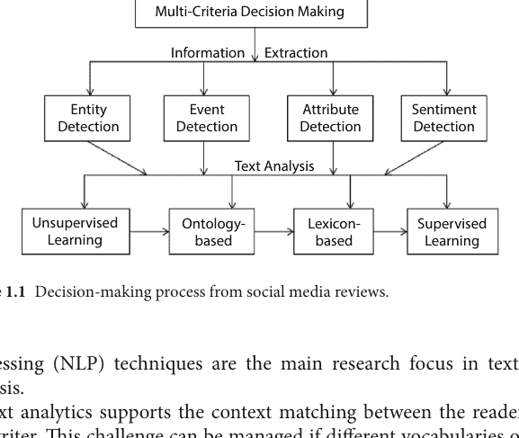

图 1.1 来自社交媒体评论的决策过程。

处理（NLP）技术是文本数据分析中的主要研究重点。

文本分析支持读者与作者之间的上下文匹配。如果特征的不同词汇及其关系在数据模型中得到良好表示，则可以管理这一挑战。例如，基于内容的上下文用户反馈分析能够通过突出产品或服务的最佳特性，使用户能够购买新产品或享受任何服务。如果在建模文本文档时使用本体表示和主题建模技术，则可以克服信息检索问题中的挑战和问题。本章重点是从文档集合中提取相关特征并为其构建领域本体。本体有助于使用合适的检索信息（IR）技术和数据的上下文表示来构建预测或情感分析模型，以便在购买新产品或享受新服务之前实现自动决策过程，如图 1.2 所示。

### 1.1.1 基于本体的信息抽取

本体描述了一个类的域。它被定义为知识表示的概念模型。域的概念（类）、其属性、其属性及其关系都由本体模型很好地描述。它还解释了适用于该域的术语的含义。本体是语义网技术中的关键组件之一。语义网技术如本体、RDF 和 Sparql 用于通过建模文本数据来描述不同的词语及其依赖关系。

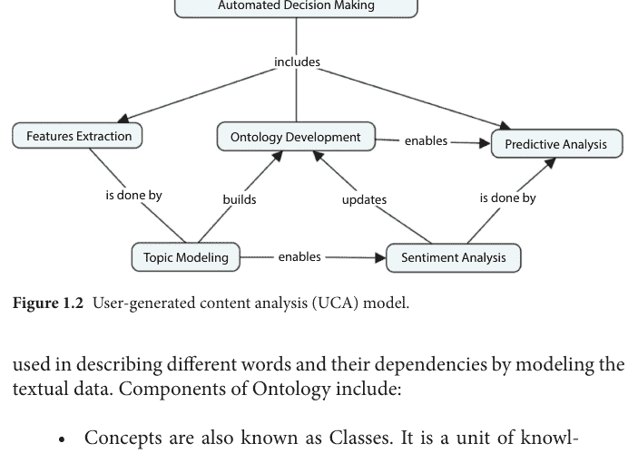

图 1.2 用户生成内容分析（UCA）模型。

本体组件包括：

- 概念也称为类。它是知识单元，在概念域的已识别人群中共享。概念之间存在关系。
- 实例是概念的个体。它们代表附加到领域本体的特定元素。实例是由概念表示的“事物”。

信息抽取（IE）和本体相互关联：本体在理解域的过程中用于信息抽取；另一方面，IE 用于设计和丰富本体 [7]。本体使不同人之间具有共同词汇和共同理解成为可能。数据的上下文语义表示由本体很好地描述 [8]。UML 图表与本体一起支持生物学家对蛋白质和基因之间的实体和相互作用进行分类 [9]。源本体中的术语（词汇）和概念（类）用于术语匹配，从而用于标记文本文档。因此，本体及其规范用于信息抽取过程。

### 1.1.2 基于本体的知识表示

知识是表示计算机认知过程的结果的数据，例如感知、学习、联想和推理，或人类获得的知识的翻译 [10]。它是人类表达他们对概念理解的语言。特定域的概念和实例在知识库中表达，也称为语义知识词典。它是表示域知识的最重要技术之一。领域本体被开发以正式定义概念、关系和规则，以便包含域的语义内容。语义方法使用文档中的概念来建立上下文关系而不是术语。如果在建模文本文档时使用术语作为索引，则诸如同义词和多义词等问题可能无法解决。各种基于语义的信息抽取方法，如潜在语义索引 [11] 和潜在狄利克雷分配 [12, 13] 技术用于建立索引术语之间的关系，以便在概念之间表示上下文。本章重点是开发领域本体，以表示在社交媒体网站上生成的产品/服务评论中提到的特征及其相关术语。

### 1.2 相关工作

本体通过形式化特定域的概念化来促进人们之间的共同理解。数据的上下文语义表示由本体很好地描述 [8]。本体使用通用词汇定义概念（域）并描述属性、行为、关系和约束。UML 图表与本体一起，蛋白质和基因之间的相互作用通过本体表示得到很好的解释，这将支持生物学家进行分类 [9]。酒店和电影的评论使用基于规则的系统和本体进行分类 [14–16]。文档注释和规则用于从语义数据的提取中创建网络文档的知识库，例如命名实体 [14, 17, 18]。本体学习和 RDF 存储库用于构建知识和信息管理，这反过来又实现了文档的自动注释和检索 [19]。Wordnet 本体用于基于词典的情感提取 [20, 21]。

信息抽取过程使用本体来理解域并提取相关信息。其复杂性降低，因为它是特定领域的。然后使用 IE 技术来填充和增强本体。这些本体可以从有用的知识来源中丰富 [7]。SVM 分类与

# 6 有效医疗保健的语义网

SentiWordNet 实现了用于文本文档的积极和消极分类的情感词典的构建 [23]。意见抽取技术与基于熵的分类技术一起用于为数据集数字相机构建结构化本体 [24]。产品及其属性的分类是基于其层次结构，使用分层学习情感本体树（HL-SOT）算法，这反过来又用于产品及其特征的观点挖掘 [25]。

知识库指的是用于表示特定域概念的词汇的词典。本体为类实例提供语义知识，如词典。通过在文档内建立合适的上下文，而不是使用文档中存在的术语，可以使用基于语义的方法提取文档的含义。相关术语使用基于语义的方法提取和分类，例如 LSI [11] 和 LDA [13] 技术。基于本体的情感分析模型被开发用于从客户评论中挖掘产品特征 [1]。本体与遗传算法的混合模型用于将中文提案自动分组到不同的簇中，结果 F 测度值 >90% [26]。通过使用本体学习和基于词典的技术，从移动产品的推文中派生出情感类别的情感词典 [27]。本体和向量分析方法用于电影评论的特征选择和情感分析 [22]。基于本体的情感分析模型与基于规则的分类一起用于美国和加拿大的邮政服务 [28]。使用本体、概率 LDA 和文本注释开发了情感抓取模型 [13]。酒店评论通过使用 SVM 和模糊领域本体自动分类 [29]。

用户生成内容的研究也集中在基于词典或基于语言的方法上。命名实体识别、特征提取、内容可靠性、使用的语言是文本分析存在的一些挑战。信息检索（IR）技术如向量空间建模、潜在语义索引（LSI）和潜在狄利克雷分配（LDA）用于将非结构化自由文本转换为结构化格式。通过使用 PMI 测量，从消费者产品评论中删除不代表实体的词，以提高特征提取方法的精度 [30]。在基于词典的方法中，从意见中提取积极和消极的词 [31–34]，并为文档确定整体情感聚合。在存在连词和连词词的情况下，考虑构建词依赖。随后使用朴素


贝叶斯分类算法[31, 34]。使用NLP技术构建了意见观察器，用于检测意见极性，并使用意见聚合函数[35]。有研究提出从博客和评论中自动提取与情感相关的形容词，并使用关联规则挖掘构建词典[32]，其对积极形容词的准确率超过70%，对消极形容词的准确率超过60%。类似地，有研究利用朴素贝叶斯算法和NLP技术创建情感词典，以开发针对电影评论的观点挖掘模型[36]。Poirier等人总结认为，机器学习算法适用于较大的数据集，而语言学方法适用于较小的数据集。

有研究提出了双传播方法，用于从句子中检索新的情感，并为它们分配积极或消极极性[33]。利用无监督学习技术[11]从评论文档中提取产品特征，并使用潜在语义关联（LaSA）模型将属于同一概念的词语进行分组。文本分析和统计技术被用于对网站中的产品质量进行排名[31]。NLP技术被用于识别最常用的积极和消极情感词，以对电影文档进行分类[37]。非负矩阵分解和聚类技术被用作文本摘要技术，为给定查询检索合适的答案[38]。基于词典的NLP技术被用于提取连词、连接词、情态动词和条件词，以检测推文的情感极性[34]。Basiri等人[39]使用Dempster–Shafer理论，通过质量函数在文档级别进行情感聚合。基于概率的潜在狄利克雷分配（LDA）被用于文本文档中的语义标注[13]。

用户生成的内容是非结构化或半结构化格式的，可以利用NLP和机器学习技术转换为结构化格式，并用于决策目的。多准则决策（MCDM）技术被应用于不同领域，例如快餐店的服务质量测量[40]、大学排名[41]，以及各种简单和复杂的工业应用[42–45]。通过结合层次分析法（AHP）和关联规则挖掘的混合方法，评估了客户终身价值和忠诚度[46]。利用AHP进行权重识别和模糊TOPSIS进行排序，对石油项目领域的最佳备选方案进行了评估[44]，该方法也用作伊朗旅游行业的服务质量指标[47]。不同的MCDM技术和统计技术被应用于医疗保健部门[48]、电影推荐系统[49]等不同领域，进行绩效评估，以提高其服务质量。VIKOR等MCDM技术被用于测量客户满意度、对移动服务进行排名[50]以及给供应商排名[51]。

本体学习包括从信息源中提取领域术语、通过本体开发进行数据建模以及查询时的便捷检索。手动构建本体需要付出更大的努力，而且复杂且具有挑战性。这促使研究人员自动为社交媒体上针对产品/服务撰写的评论中的领域特定术语生成本体。基于本体的语义索引（OnSI）方法使用上下文相关的词语将概念和属性标记到本体中。它使查询处理和后续的信息检索处理更加容易。这种基于语义的索引方法在从文本文档内容中识别概念或属性（或特征）时具有更高的准确性[26, 27]。基于本体的移动产品评论分类方法的精确率为75%，召回率为40%[52]；而在[27]中召回率超过82%。

### 1.3 研究动机

从产品或服务评论文档中提取特征通常包括多个步骤，如数据预处理、文档索引、降维、模型训练、测试和评估。使用文档集合的标记数据集来训练或学习模型。进一步地，学习到的模型用于从新的文档集中识别未标记的概念实例。文档索引是文本分析中最关键、最复杂的任务。它决定用于表示文档的一组关键特征。它还能增强词语（或特征）与文档之间的相关性。它必须非常有效，因为它决定了文档所需的存储空间和查询处理时间。

基于本体或基于语义的方法通过建立上下文关系从文档中检索概念。在基于内容的方法中，使用词袋模型表示文本，由于它们使用术语作为索引，无法解决同义词和多义词问题。然而，在基于上下文的语义方法中，如主题建模技术，使用概念来提取信息并对其进行分类。它映射了文档中术语之间的上下文关系。

为了在用户生成内容分析过程中发挥本体的优势，本章提出了一种基于领域本体的语义索引（OnSI）技术，用于处理用户在社交媒体平台上生成的产品或服务评论。OnSI方法阐述了主题建模技术与本体学习的集成；该方法是通用的，适用于任何领域。

### 1.4 特征提取

万维网包含大量文本文档，对其进行标注的必要性已变得至关重要。客户通常通过以描述性格式撰写产品评论、用户反馈来表达自己的观点，而这些内容大多是非结构化的。这种格式使得机器难以处理这些文本文档。因此，为了开发商业智能或自动化解决方案，有必要对大量文本进行标注。这些数据必须经过分析和建模，以支持决策过程。通过添加和标注文档，提取信息这一具有挑战性的任务变得更容易，这反过来为自动化解决方案铺平了道路[53]。

特征提取是从初始数据集构建具有信息丰富且非冗余特征的数据集的过程。特征选择等后续方法可减少表示数据所需的资源量。许多机器学习算法（如分类和聚类）利用文本文档中相似的属性，从中提取实体和属性等特征。在特征选择过程中实体之间缺乏语义关系以及领域先验知识不足等挑战，可以通过应用合适的NLP和IE技术来克服[54, 55]。

从产品或服务评论文档中提取特征通常包括多个步骤，如数据预处理、文档索引、降维、模型训练、测试和评估。使用文档集合的标记数据集来训练或学习模型。进一步地，学习到的模型用于从新的文档集中识别未标记的概念实例。文档索引是文本分析中最关键、最复杂的任务。它决定用于表示文档的一组关键特征。它还能增强词语（或特征）与文档之间的相关性。它必须非常有效，因为它决定了文档所需的存储空间和查询处理时间。

预处理后的数据通过术语加权方案构建为术语-文档（TD）矩阵，如图1.3所示。文本文档是


其中 tf_ij 是词 “i” 在文档 “j” 中的词频，N 是语料库中文档的总数，df_i 是语料库中词 “i” 的文档频率，而 w_ij 是词 “i” 在文档 “j” 中的权重。一般来说，大小为 “m x n” 的词文档（TD）矩阵是在词语和文档之间构建的，其中 “m” 表示词项（行），“n” 表示文档（列），“w” 表示词项的权重。

#### 1.4.2 潜在语义索引（LSI）

如果为文档集合中的所有词语构建，词文档矩阵本质上是非常稀疏的。词语可能在文档间是唯一的，并且可能不会在所有文档中重复出现。这会增加矩阵的大小。简单向量空间模型的缺点是它无法关联文档中存在的两个同义词。为了减少矩阵中的稀疏性并解决同义词问题，可以扩展向量空间模型并使用潜在语义索引（LSI）进行文档索引。图 1.4 显示了英语中词语的同义词和多义词表示。LSI 技术分析文本文档以确定隐藏的含义或概念。例如，当词语 “bank” 与 mortgage 和 loan 等其他词语一起出现时，可以得出结论它与金融部门相关。如果词语 “bank” 与 fish 和 pond 等其他词语一起出现，则它与水体相关。LSI 技术通过不仅仅在文档空间中比较词语，而是在概念空间中比较词语和文档来解决了这个问题。

LSI 使用奇异值分解（SVD）来降低 TD 矩阵的维度。它用尽可能少的信息重构矩阵。这是一种矩阵分解技术，将 “m x n” 矩阵分解为三个矩阵 USV^T，其中矩阵 U 表示概念空间中的词矩阵，矩阵 V^T 表示概念空间中的文档矩阵，而 S 矩阵是奇异值矩阵，通过它可以选择维数或概念的数量

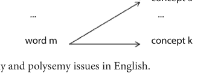

图 1.4 英语中同义词和多义词问题。

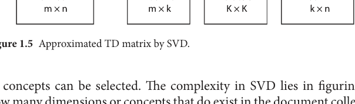

图 1.5 SVD 近似的 TD 矩阵。

或概念。SVD 中的复杂性在于弄清楚在近似矩阵时文档集合中实际存在多少维或概念。原始 TD 矩阵可以近似为 “k” 维，其中 k 远小于 TD 矩阵的秩。“k” 的值可以经验确定。通常，对于大型数据集合，其值在 100 到 350 之间。图 1.5 显示了在 TD 矩阵上截断矩阵的示意表示。

LSI 使用低维表示和词共现对词语进行索引。词与文档的关联，即语义结构，提高了查询结果的相关性 [56]。低百位范围内的 “k” 值可提高查全率和查准率。LSI 也有其自身的缺点，如计算时间更长以及近似 TD 矩阵中存在负值。

#### 1.4.3 聚类技术

聚类方法识别数据集集合中相似的数据组。质心模型 K-Means 算法是一种迭代聚类算法，将所有数据点分组到离质心更近的位置。在数据集中具有先验知识很重要，因为该算法将聚类数作为输入。它将 “n” 个数据点划分为 “k” 个聚类，其中每个数据点都属于具有最近均值的聚类。K-Means 算法存在许多变体，例如使用质心和数据点之间的欧几里得距离、模糊 C-Means 聚类等。与 LDA 一样，K-Means 也是一种无监督学习算法，用户需要给出所需的聚类数。唯一的区别是 K-Means 产生 “k” 个不相交的聚类，而 LDA 将文档分配给主题的混合。与 K-Means 算法技术相比，使用 LDA 可以更好地解决同义词和多义词问题。

#### 1.4.4 主题建模

向量空间模型（VSM）获取原始文本数据并对词项相对于文档进行索引。LSI 技术与传统 VSM 相比显示出 30% 的准确率提升 [29]。此外，在 IR 领域使用 LSI 技术进行的先前研究表明，LSI 提高了 *查全率*，但 *查准率* 并未相应提高 [22, 26]。这种缺点可以通过在应用索引技术之前处理原始数据来克服。在索引词项和文档时包含文档集合中的隐藏概念可大幅提高准确性 [58]。潜在狄利克雷分配（LDA）技术 [58] 在文档集合中揭示潜在的 “主题”，主题是一种特征。它是一种用于以概率方法对文档主题进行建模的语言模型。每个文档可能包含不同主题的混合。每个主题可能包含与其相关的许多词语在文档中的出现。图 1.6 显示了 LDA 模型用于文本文档主题（或特征）分类的框架。

例如，Word 2 被归类到两个不同的主题，即 “topic 1” 和 “topic 2”。该词的上下文各不相同，并且由其他词语的共现决定。因此，具有上下文 “topic 1” 的词 2 与 “Doc 1” 更相关，而具有上下文 “topic 2” 的同一词语与 “Doc 2” 更相关。识别潜在概念从而提高了特征分类的准确性。

LDA 是一种矩阵分解技术。它将 TD 矩阵减少为两个低维矩阵，M1 和 M2。M1 是文档-主题矩阵（NxK），M2 是主题-词矩阵（KxM），其中 N 是文档数，K 是主题数，M 是词数。LDA 使用采样技术来改进这些矩阵。该模型假设所有词-主题映射都是正确的，除了当前词。该技术对每个文档 “d” 中的每个词 “w” 迭代，并通过将两个概率 p₁ 和 p₂ 相乘来调整 “w” 的当前主题分配，其中 p₁ 是 p(topicₜ/documentⱼ)，p₂ 是 p(word_w/topicₜ)，即词 “w” 在所有文档中分配主题 “t” 的概率。达到稳定状态后，经过多次迭代，词-主题和主题-文档的分布在某一时刻可能相当不错。


图 1.6 LDA 框架。

对于 LDA 模型，主题数 K 必须事先固定。它假设文档 **w** = (w₁, . . . , w_N) 的生成过程为语料库 D 包含 N 个词，来自包含 V 个不同词项的词汇表，w ∈ {1, . . . , V} 对所有 i = {1, . . . , N}。LDA 包含以下步骤 [12]

- 1. 对于每个主题 *k*，从词分布 Φ(*k*) ∼ Dir(α) 中抽取。
- 2. 对于每个文档 *d*，
  - (a) 从主题比例向量 θ(*d*) ∼ Dir(β) 中抽取。
  - (b) 对于每个词 *i*，
    - (i) 从主题分配 z<sub>d,i</sub> ∼ Mult(θ<sub>d</sub>) 中抽取，z<sub>d,n</sub> ∈ {1, . . . , K}，
    - (ii) 从词 w<sub>d,i</sub> ∼ Mult(Φ<sub>z<sub>d,i</sub></sub>) 中抽取，w<sub>d,i</sub> ∈ {1, . . . , V}

其中 α 是文档主题分布上的狄利克雷先验，β 是主题词分布上的狄利克雷先验。设 θ<sub>td</sub> 为文档 *d* 的主题 *t* 的概率，z<sub>di</sub> 为主题分布，并设 Φ<sub>tw</sub> 为主题 *t* 中词 *w* 的概率。生成文档 *d* 中词 *w* 的概率为：

$$p(w|d)=\sum_{t=1}^{K}\theta_{td}\Phi_{tw}$$  (1.2)

公式 1.2 给出了按主题加权的每主题词概率的加权平均值，其中权重为每文档主题概率。 resulting 分布 p(w|d) 因文档而异，因为文档之间的主题权重发生变化。语料库文档通过推断一组隐藏变量拟合到 LDA 模型。这些变量用 θ = {θ<sub>td</sub>} 表示，即 |K| × |D| 的每文档主题权重矩阵，以及 Φ = {Φ<sub>tw</sub>}，即 |K| × |N| 的每主题词权重矩阵。LDA 的推断是观察到文档语料库后确定 θ 和 Φ 的联合后验分布的问题，这些文档受 LDA 参数的影响。

简单的 LDA 模型为每个主题下的所有词给出词-主题概率。根据文献 [59, 60]，仅为每个主题选择前 5 或 10 个词进行建模。然而，CFS<sub>LDA</sub> 模型（*Contextual Feature Selection LDA*）从数据集中选择一组可能的词，这些词代表域的主题或概念。它构建


产生 θ 和 Φ 来自期望的分布，但只有在大量迭代之后才可能实现。因此，有必要丢弃（或烧掉）初始观测值“b” [60]。Gibbs 设置“n”决定了从两个 Gibbs 序列中保留多少观测值。设置“iter”指定 Gibbs 采样器在返回下一个有用的观测值之前运行多少次迭代 [60]。CFS_LDA 模型的过程如下所示：

```
CFSlda (documents d)
begin
1. for every product or service review document ‘d’,
   do pre-processing
   do PoS tagging
   extract nouns
2. for each document ‘d’,
   create TermDocument Matrix M for nouns
// LDA modeling
3. set values for LDA parameters ‘params’
// Heuristic values are given for numberOfTopics ‘k’, α, β, and
// Gibbs’ sampling parameters (b, n, iterations) initially
4. for k =2 to 100
   ldaOut <- LDA(TD, params)
// ldaOut consists of matrices of term-topic probabilities,
// topic-document probabilities, topic assignment to documents
   numTopics <- maximum Harmonic mean of Marginal likelihood (ldaOut)
5. repeat step 4 for each burn-in iteration value ‘b’ to decide the approximated value for ‘k’ and ‘b’
// for each iteration, one LDA parameter is varied while all other parameters
// are kept constant
6. for each params
   perplexity ‘p’ <- firstMinimum(perplexity(LDA(TD, params)))
7. repeat step 6, until all LDA parameters are defined
// LDA model evaluation
8. determine precision and recall values for the LDA model
9. repeat steps 6 and 7, if necessary, until recall value has acceptable improvement
10. topTerm_i <- higher probability term for each topic ‘i’, where i ∈ k

11. Let T_i include the set of terms for each topic ‘i’
12. T_i <- φ   // T_i be initially empty
    for each term ‘j’ in topic ‘i’
        corValue_ij <- correlation(topTerm_i, term_j)
            if corValue_ij > 0, then
                topicTerms_i <- term_j U { T_i }
13. return T_i
end
```

### 1.5 Ontology Development

本体开发包括各种方法，如形式概念分析（FCA）或本体学习。FCA 应用用户驱动的逐步方法来创建领域模型，而本体学习是指通过从给定数据集提取概念和关系来自动创建领域本体的任务 [27]。本章重点介绍使用本体为在线产品/服务评论构建自动语义索引器。文档的表示通过使用上下文特征选择 LDA（CFS_LDA）主题建模技术在语义和上下文上得到丰富。搜索查询产生改进的相关结果，从而提高召回值 [26, 27]。

问题陈述简单表述为“从语料库中提取所有可能的相關特征”。给定每个特征（或主题）的一组术语，目标是构建索引，该索引嵌入在本体中以减少查询处理时间。本体语义索引（OnSI）模型包括三个主要过程，如图 1.8 所示，即语义索引、本体开发和评估。

语义索引模块包括主题映射和术语索引。本体开发模块使用这些术语及其权重（LDA 权重）填充本体。OnSI 评估模块通过查询处理评估构建的本体。

#### 1.5.1 Ontology-Based Semantic Indexing (OnSI) Model

语义索引模块在 CFS_LDA 模型的支持下为评论文档构建索引器。主题建模技术 CFS_LDA 用于特征选择过程中提取特征（或主题）及其相关术语。那些在同一主题下分组的术语被选中并标记以表示域（或概念）的特征。

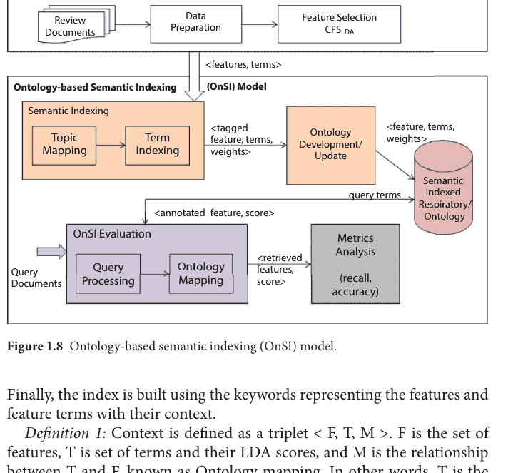

最后，使用表示特征和特征术语及其上下文的关键词构建索引。

定义 1：上下文定义为三元组 < F, T, M >。F 是特征集，T 是术语集及其 LDA 分数，M 是 T 与 F 之间的关系，称为本体映射。换句话说，T 是用于描述 F 概念特征的术语集。它们的上下文关系由 M 识别，M 是使用分数在 T 和 F 之间映射函数。

#### 1.5.2 Ontology Development

主题（或特征）是一个二元组 <F, T>，F 是域的特征集，T 是表示 F 的候选术语集。CFS_LDA 模型选择 T = {tc | tc 与 tp 相关}，其中 tp 是模型选出的 F 的更高概率术语。该二元组的上下文关系由三元组 <F, T, M> 表示，其中 M 表示 F 与 T 之间的映射。本体开发或更新过程如下所示：

```
createOrUpdateOntology(documents)
// creates the domain Ontology for the features F, supported by the set of correlated terms T of features
// returned by CFS_lda model along with their score
begin
    featureSet <- CFS_lda(documents)
    for each feature f in featureSet, where f ∈ F
        for each term t in featureSet, where t ∈ T
            if <f, t> is a pair in featureSet, then
                domOntology <- buildOntology(f, t, LDA Score_i);
end
```

本体树为每个 <F, T> 构造不同级别的层次结构，使得 F 形成更高级别，T 形成对应 F 的下一级别，如图 1.9 所示。

每个术语的 LDA 权重包含在本体表示中。本体用于通过概念推理构建索引。

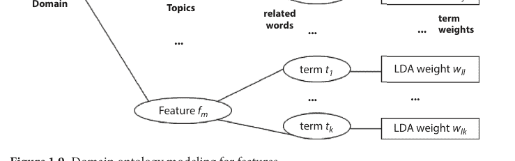

#### 1.5.3 OnSI Model Evaluation

OnSI 评估模块包括查询处理、标记和本体映射以进行特征评分。它从构建的领域本体中检索相关特征（或主题）及其分数，用于查询术语集。

##### (i) Query Processing

当数据在上下文中分组并进行索引时，搜索数据变得更容易且速度更快。否则在关系模式中搜索数据相当昂贵。每个查询文档经过预处理，PoS 标记的名词被发送到本体。

##### (ii) Ontology Mapping

从领域本体中得到的结果特征映射到使用其特征分数最接近的特征。它能够为查询文档检索相关特征及其分数。SPARQL，一种基于 XML 的查询语言，用于从构建的本体中检索数据。它描述如下：

设 Q 为为 F 特征使用 T 术语编写的产品/服务评论的查询文档集。这些文档经过预处理并从中提取名词。每个查询文档由 q = {t_1, t_2, …, t_n} 表示，其中 t_i 是表示特征 f 的术语。函数 M(t, f) 将每个术语 t ∈ T 与特征 f ∈ F 映射并返回 fScore。

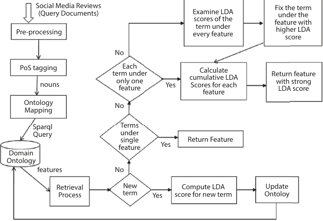

该模块处理四种不同类型的查询，如图 1.10 所示。

##### (iii) Retrieval Process From Ontology

当使用 SPARQL，即本体的查询语言查询本体时，可能存在四种不同类型的查询。从本体中检索数据的过程解释如下：

```
<fScore> queryOntology(Q)
// Q_t is the set of terms of query documents
// search Q_t in domOntology
begin
  for each q in Q
    for each t in q
      f_i <- ontoMap(t)
        where t ∈ Q_t , f_j ∈ F, i = 1, ..., k and k is the number of features (or topics)
// Type 1 Query
  if t maps to same f_i
    fScore (f_i) = Σ LDAscore(t), t ∈ Q_t
    cum_fScore (f_i) = fScore (f_i) + LDAscore(f_i)
    q(f) <- cum_fScore (f_i) // returns f' for query document 'q'
// Type 2 Query
  else if {t_i} maps to f_a and {t_j} maps to f_b (f_a ≠ f_b)
    cum_fScore (f_a) = LDAscore(f_a) + Σ LDAscore(t_i), t_i ∈ Q_t
    cum_fScore (f_b) = LDAscore(f_b) + Σ LDAscore(t_j), t_j ∈ Q_t
    q(f) <- max(cum_fScore (f_a), cum_fScore (f_b))
// Type 3 Query
  else if t_i maps to f_a , f_b (f_a ≠ f_b)
    cum_fScore (f_a) = LDAscore(f_a) + score(nearestTerms), t_i ∈ Q_t
    cum_fScore (f_b) = LDAscore(f_b) + score(nearestTerms), t_i ∈ Q_t
    q(f) <- max( cum_fScore (f_a), cum_fScore (f_b))
// Type 4 Query
  else 't' is a new term
    CreateOrUpdateOntology(q)
      // rebuild CFSlda model, then Ontology
end
```


#### 类型 1：仅属于一个特征的术语

如果所有术语 *t₁, t₂, …, tₙ* 映射到同一个特征 *f*，则 *f* 将作为结果返回，并附带每个术语的累积 LDA 得分。对于所有 *i*，1 < *i* < *n*，存在 *f* 使得

```
f ← ontoMap(tᵢ), where t ∈ T, and f ∈ F
fScore(f) = Σ LDA score(tᵢ), tᵢ ∈ T and i = 1, … n
cum_fScore(f) = LDA score(f) + fScore(f)
```

例如，“treatment is good” 被认为是类型 1 查询。这里提取出单词 *treatment*。它属于特征（或主题）“Medicare”，并作为特征返回。

#### 类型 2：术语属于多个特征，每个术语仅属于一个特征

如果术语 { *tᵢ* } 映射到特征 *fₐ* ∈ F，且术语 { *tⱼ* } 映射到特征 *fᵦ* ∈ F，则返回 *fScore* 较高的 *f*。在这种情况下，为每个特征 *f* 计算累积 *fScore*，并选择得分较高的特征。特征 *f* 的累积 *fScore* 由对应于该特征 *f* 的术语的 LDA 得分之和决定。

```
fₐ ← ontoMap(tᵢ), where t ∈ T, and f ∈ F
fᵦ ← ontoMap(tⱼ), where t ∈ T, and f ∈ F where tᵢ ≠ tⱼ, and fₐ ≠ fᵦ
cum_fScore(f) = Σ LDA score(t), t ∈ T and i = 1, … n
fScore(f) = max (cum_fScore(fₐ), cum_fScore(fᵦ))
```

例如，“the treatment is good but the rent is costly” 被认为是类型 2 查询。这里提取出术语 *treatment* 和 *rent*。术语 *treatment* 属于主题“Medicare”，而术语 *rent* 属于主题“Cost”。

#### 类型 3：术语属于多个特征，一个术语属于多个特征

如果某个术语 *tᵢ* 映射到特征 *fₐ, fᵦ* ∈ F，则考虑最近的术语，例如 *tᵢ₋₁* 或 *tᵢ₊₁* 来确定文档中术语 *tᵢ* 的特征类别。在这种情况下，通过比较每个特征的 *fScore* 将术语关联到一个特征。为每个特征 *f* 计算累积 *fScore*，并将结果的强特征返回为结果。特征 *f* 的累积 *fScore* 由对应于该特征 *f* 的术语的 LDA 得分之和决定。

```
f_a ← ontoMap(t), where t ∈ T, and f ∈ F
f_b ← ontoMap(t), where t ∈ T, and f ∈ F where f_a ≠ f_b
cum_fScore(f) = Σ LDAscore(t), i ∈ i-1^st, i^th or i+1^st terms
fScore(f) = max(cum_fScore(f_a), cum_fScore(f_b))
```

例如，“the rooms are maintained neatly but the room rent is costly” 被认为是类型 3 查询。这里提取出术语 *rooms*、*room* 和 *rent*。术语 *room* 同时属于主题“基础设施”和“成本”，而术语 *rent* 属于主题“成本”。术语 *room* 需要固定到单一主题（基础设施或成本）。这是通过计算术语出现的特征（或主题）的累积得分来完成的。假设，LDAscore(room, Infrastructure) = 0.17，LDAscore(room, Cost) = 0.38，且 LDAscore(rent, Cost) = 0.26。那么 cum_fScore(f = “Infrastructure”) 为 0.17，而 cum_fScore(f = “Cost”) 为 0.64。由于 0.64 > 0.17，因此在此上下文中术语 *room* 被分配为特征“Cost”。

#### 类型 4：本体中不存在的术语

如果给定的术语不存在，则为其计算新的 LDA 得分并使用 update-Ontology() 对新术语进行更新。如果 ontoMap(t) 为 *null*，其中 t ∈ T，则需要用新术语更新本体。对本体更新再次进行 CFS_LDA 建模。查询过程重复为前面描述的另外三种类型之一。

### 1.5.4 指标分析

准确率被用作正确识别出属于主题（或特征）的术语数量的性能度量。然而，该模型还通过诸如精确率、召回率和 F 测度等指标进行进一步评估。精确率定义了模型的精确程度，而召回率定义了模型的完整程度。它表示为混淆矩阵，其中包含关于实际结果和预测结果的信息，如表 1.1 所示。

精确率定义为返回的文档中正确识别文档的百分比；而召回率定义为正确识别文档中相关结果的百分比。实际上，以牺牲精确率为代价可以获得较高的召回率，反之亦然 [61]。然而，当需要单一指标来比较不同模型时，F 测度指标是合适的。它定义为精确率和召回率的调和平均数。

**表 1.1 混淆矩阵。**

| | 预测为阳性 | 预测为阴性 |
|---|---|---|
| 实际阳性 | TP | FN |
| 实际阴性 | FP | TN |

其中：

- TP：阳性示例的正确分类数量（真正例）
- FN：阳性示例的错误分类数量（假阴性）
- FP：阴性示例的错误分类数量（假阳性）
- TN：阴性示例的正确分类数量（真阴性）

基于混淆矩阵，正类的精确率、召回率和 F 测度定义为

```
precision = TP / (TP + FP)    (1.3)

recall = TP / (TP + FN)    (1.4)

F − measure = 2 · (p · r) / (p + r)    (1.5)

accuracy = (TP + TN) / (TP + TN + FP + FN)    (1.6)
```

本体语义索引（OnSI）模型通过诸如精确率、召回率和准确率等指标进行评估，如公式 1.3、1.4、1.5 和 1.6 所示。

### 1.6 数据集描述

类似医疗服务评论的文档集合（数据集 DS1）从不同社交媒体网站收集，共涉及 10 家不同医院，详细情况见表 1.2 和 1.3。

**表 1.2 医疗服务社交媒体评论（DS1）。**

| 数据来源 | 评论数量（正面） | 评论数量（负面） |
|---|---|---|
| Twitter | 1200 | 525 |
| Mouthshut.com | 425 | 110 |
| BestHospitalAdvisor.com | 200 | 85 |
| Google Reviews | 580 | 320 |
| 总评论数 | 2405 | 1040 |

**表 1.3 特征和医院的评论数量（DS1）。**

| 特征 | 评论数 |
|---|---|
| Cost | 663 |
| Medicare | 748 |
| Nursing | 776 |
| Infrastructure | 554 |
| Time | 704 |

| 医院 | 评论数量 | 医院 | 评论数量 |
|---|---|---|---|
| H1 | 596 | H6 | 308 |
| H2 | 411 | H7 | 313 |
| H3 | 399 | H8 | 297 |
| H4 | 227 | H9 | 281 |
| H5 | 252 | H10 | 361 |

表 1.3 显示，为特征“cost”收集了 663 条评论，为医院 H1 收集了 596 条评论。特征列表来自先前的工作、相关文章和社交媒体网站。例如，文献 [62] 明确指出了医疗服务所需的必要标准。文献 [63] 中明确提到了患者期望，例如成本、医院特征、基础设施设施、其他用户的推荐、治疗和护理以及医疗专业知识。特征还通过参考 BestHospitalAdvisor、Mouthshut.com、webometrics 等网站进行选择。对这些网站中患者或其护理人员提供的评论进行了分析，以了解这些不同医院医疗服务的各个特征。

### 1.7 结果与讨论

本体语义索引（OnSI）模型使用 CFS_LDA 模型中选择的特征为每个产品/服务评论文档构建领域本体。使用 Protégé 软件构建和查询本体模型。LDA 模型为该数据集的每个主题选择的 top five 术语如表 1.4 所示。每个主题根据列表中的第一个术语在上下文中手动标记。很难对归属于主题下的所有术语进行人工标注。

例如，术语“bill”是主题“medicare”下的 top 词之一。然而，它更与主题“cost”或“infrastructure”或“time”相关。同样，术语“appointment”在 top 5 或 top 10 术语列表中均未出现；然而，它更适用于主题“time”和“medicare”。为缓解此问题，CFS_LDA 模型使用相关性分析，参考列表中第一个术语（每个主题中具有最高术语-主题概率的术语），选择每个主题的代表性术语。如前例所述，术语“bill”与术语“doctor”无关，且与术语“cost”、“hospital”和“time”高度相关。这些术语的相关值如表 1.5 所示。例如，“room”的术语-主题概率“Φ_tw”为 0.0134，与“cost”的相关值“c”为 0.0222。如另一示例所述，术语“appointment”与术语“doctor”和“time”高度相关，并被归入主题“medicare”和“time”，如表 1.5 所示。另一个例子是，术语“disease”与“doctor”和“hospital”相关，而与术语“cost”、“time”和“staff”无关，如表 1.5 所示。

表 1.6 显示了 CFS_LDA 模型选择的特征术语列表。在预处理和 PoS 标注的名词中，68 个术语被选为“cost”主题，110 个为“medicare”，112 个为“staff”，101 个为“infrastructure”，73 个为“time”。

因此，特征提取过程模型 CFS_LDA 不仅选择具有高术语-主题概率值的术语，还选择与每个主题下最顶层术语高度相关的术语。

**表 1.4 LDA 模型按主题列出的前五项术语。**

| Topics/features of (DS1) | Feature terms by FS_LDA model (DS1) |
|---|---|
| Topic 1—Cost | cost, test, money, charge, day |
| Topic 2—Medicare | doctor, nurse, team, treatment, bill |
| Topic 3—Staff | staff, patient, child, problem, face |
| Topic 4—Infrastructure | hospital, people, room, experience, surgery |
| Topic 5—Time | time, operation, hour, service, check |


**表1.5** CFS_LDA选择的示例相关术语。

| 特征 | 费用 | 医疗保险 | 员工 | 基础设施 | 时间 |
|---|---|---|---|---|---|
| 高概率术语 | 费用 | 医生 | 员工 | 医院 | 时间 |
| 术语-主题概率（Φ_tw） | 0.0923 | 0.2132 | 0.2488 | 0.3152 | 0.1247 |
| 相关值（c） | 1 | 1 | 1 | 1 | 1 |

**CFS_LDA建模的示例术语**

| 特征 | 费用 Φ_tw | 费用 C | 医疗保险 Φ_tw | 医疗保险 C | 员工 Φ_tw | 员工 C | 基础设施 Φ_tw | 基础设施 C | 时间 Φ_tw | 时间 C |
|---|---|---|---|---|---|---|---|---|---|---|
| 病房 | 0.0134 | 0.0222 | 0.0004 | 0.1378 | 0.0005 | 0.2392 | 0.0471 | 0.0402 | 0.0134 | 0.0222 |
| 疾病 | 0.0004 | -0.0347 | 0.0222 | 0.0547 | 0.0005 | -0.0462 | 0.0004 | 0.0948 | 0.0004 | -0.0408 |
| 预约 | 0.0134 | -0.0343 | 0.0092 | 0.1802 | 0.0005 | -0.0462 | 0.0004 | -0.0414 | 0.0004 | 0.0477 |
| 患者 | 0.0177 | 0.0042 | 0.0004 | 0.1415 | 0.1247 | 0.1429 | 0.0004 | 0.1502 | 0.0005 | 0.2238 |
| 账单 | 0.0004 | 0.0468 | 0.0265 | -0.0015 | 0.0001 | 0.1614 | 0.0121 | 0.1176 | 0.0005 | 0.2111 |

#### 精确率与召回率曲线

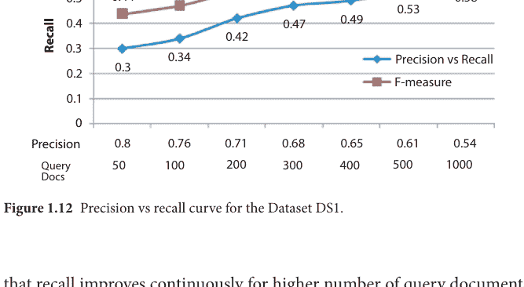

**图1.12** 数据集DS1的精确率与召回率曲线。

随着查询文档数量的增加，召回率持续提高。当文档大小为500时，OnSI模型给出的精确率为0.61、召回率为0.53、F值为0.57。

##### 1.7.1 讨论1

本体查询涉及从其存储库中直接提取特征，而不是像朴素贝叶斯算法等其他技术那样进行相似性度量。术语之间的相似性在CFS_LDA建模技术本身的过程中就被纳入模型，而不是在查询阶段。这是非常必要的，因为基于词典的索引技术只使用一对一映射的关键字，不会查找同义术语和上下文相关的术语。OnSI模型从文档集合中为这些特征或主题检索此类术语，从而提高了召回率。有时可能无法达到100%的准确率，因为查询文档中存在的某些术语可能不在本体中，因此可能需要更新本体。在下一次迭代中，该值会得到改进。

##### 1.7.2 讨论2

对文本文档进行建模和查询（训练和测试）所需的时间进行了测量。OnSI模型建模（DS1的70%）耗时2.1秒，查询（DS1的30%）耗时0.35秒。OnSI模型中使用SPARQL语言大大减少了查询处理的时间。查询的时间复杂度取决于文档中存在的术语数量以及每个术语与其他主题冲突的次数。将OnSI模型的特征提取方法与朴素贝叶斯分类器和k均值聚类技术进行了比较，结果如表1.7所示。

**表1.7** 性能评估。

| 技术 | 召回率 | 准确率 | 时间 |
|---|---|---|---|
| 朴素贝叶斯分类器 | 30% | 69% | 3.98 s |
| k均值聚类 | 37% | 79% | 4.25 s |
| OnSI（基于本体的CFS_LDA） | 57% | 88% | 2.45 s |

##### 1.7.3 讨论3

通常，术语-文档（TD）矩阵以.csv格式存储，需要数兆字节的存储空间，而.owl格式（本体文件）仅需数千字节的存储空间。例如，当将数据集DS1的评论文档转换为TD矩阵时，.csv文件的大小约为3.5MB。每篇评论文档约占用1KB存储空间，并且还取决于数据集中存在的术语数量。然而，当使用.owl格式时，DS1仅占用约360KB。

本章重点研究为上下文表示用户生成的内容（即评论文档）而构建本体。利用基于本体的语义索引（OnSI）模型，将上下文对齐的文档连同其语义一起表示在领域本体中。

研究已经确定，文档建模对查询处理时间及其召回率有很大影响。与朴素贝叶斯技术相比，OnSI模型将召回率提高了27%，并将时间缩短了1.53秒。同样，与k均值算法相比，它将召回率提高了20%，并将时间缩短了1.8秒。LDA参数及其值的正确选择，以及CFS_LDA特征选择过程中涉及的关联分析，提高了模型的准确率。在掌握正确特征集的情况下，可以使用有监督机器学习技术对数据集进行基于上下文特征的情感分析和预测分析。

### 1.8 应用

许多社交媒体文本研究已被用于对公共/私营部门或产品进行排名[41]、提高客户满意度[64]或推荐产品的新服务[50]。多准则决策（MCDM）问题可以通过使用OnSI模型来解决。在这里，OnSI模型可应用于从给定的评论文档集中提取特征集。排序方法为每个特征以及情感分析过程中的情感得分分配适当的权重。图1.13显示了用于确定更优医疗服务提供者的MCDM层次结构问题。

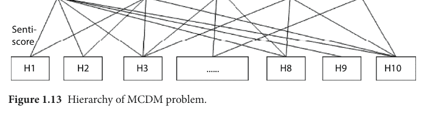

**图1.13** MCDM问题的层次结构。

目前有许多MCDM方法可用，如SAW（简单加性加权）、TOPSIS、VIKOR等。本章重点介绍应用VIKOR技术根据医院的特征来确定更优的医院。VIKOR是一种通过折中优化多响应过程的排序方法[42]。它比较每个准则与备选方案的接近程度，并为每个准则得出排序指数。VIKOR的核心概念是在存在冲突准则的情况下，从一组不同的备选方案中对准则进行排序[43]。图1.14显示了正在考虑的各种备选方案（医院）的特征排序。

图1.14显示，备选方案H10在“费用”“医疗保险”和“基础设施”特征上排名第一，备选方案H6在“员工”特征上排名第一，备选方案H9在“时间”特征上排名第一。所有医院都可以使用这些数据进行基准测试，以改进其流程。

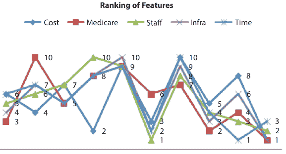

**图1.14** 通过VIKOR方法对特征进行排序。

### 1.9 结论

社交媒体文本分析可以用于“品牌体验”研究。它为建立长期的客户与品牌关系提供了经验和策略。文本分析研究发现，将内容分析应用于用户生成的内容，为研究用户的写作风格、模式或偏好提供了丰富的机会。内容分析研究有助于所有其他数据分析人员将研究方向转向社交媒体文本分析。来自不同医疗服务提供者的报告指出，医院地位和服务质量是两个密切相关的重要因素。他们还报告说，医院必须密切关注其在线声誉，以管理与客户或患者之间的信任和关系。本章重点从用户评论中识别特征，使用多准则决策技术对其进行排序，并确定了医疗服务及其运营的特定方面需要改进的领域。这项工作可以扩展到对所提取特征进行基于时间序列的情感分析，这将非常有助于预测产品或组织的利润以及客户满意度。评论文档中的讽刺表达识别和虚假评论分类将进一步提升这种文本分析的效果。

### 1.10 未来工作

这项工作可以通过完全自动化地构建领域本体，以及探索各种可视化结果的方法来加以改进，这使用户能够获取更多信息。在本研究中，个体、兄弟类（siblings）和概念是本体学习仅考虑的项。它可以进一步扩展，并建模为带有正负词集合的“情感领域词典”。

然而，除了现有术语之外，这项工作还可以扩展到映射概念之间的关系。这可以通过开发多智能体系统，利用不同领域本体的属性对其进行集成来实现。这反过来又有助于为任何决策问题开发专家系统解决方案或决策支持系统。

### 参考文献

- 1. Somprasertsri, G. and Lalitrojwong, P., Mining feature-opinion in online customer reviews for opinion summarization. J. Universal Comput. Sci., 16, 6, 938–955, 2010.
- 2. Yang, J.Y., Kim, H.J., Lee, S.G., Feature-based product review summarization utilizing user score. J. Inf. Sci. Eng., 26, 6, 1973–1990, 2010.
- 3. Jacobsen, J.S. and Munar, A.M., Motivations for sharing tourism experiences through social media. Tourism Management, 43, 46–54, 2014.
- 4. Olga, L.P. and Raj, R., Evolution of social media and consumer behaviour changes in tourism destination promotion. Int. J. Bus. Globalisation, 12, 3, 358–368, 2014.
- 5. Varanasi, P. and Tanniru, M., Seeking intelligence from Patient experience using text mining: analysis of emergency data. Inf. Syst. Manage., 32, 3, 220–228, 2015.
- 6. Ittoo, A., Nguyen, L.M., Bosch, A., Text analytics in industry: Challenges, desiderata and trends. Comput. Ind., 78, 96–107, 2016.
- 7. Nedelec, C. and Nazarenko, A., Ontology and information extraction: A necessary symbiosis, in: Ontology Learning from Text: Methods, Evaluation and Applications, P. Buitelaar, P. Cimiano, B. Magnini (Eds.), pp. 3–14, IOS Press Publications, Amsterdam, The Netherlands, 2005.
- 8. Maedche, A., Pekar, V., Staab, S., Ontology learning part one—on discovering taxonomic relations from the web, N. Zhong (Ed.), pp. 301–320, Web Intelligence, Springer, Berlin Heidelberg, 2003.
- 9. Rindflesch, T.C., Tanabe, L., Weinstein, J.N., Hunter, L., EDGAR: Extraction of Drugs, Genes and Relations from the Biomedical Literature, in: Proceedings


of *Pacific Symposium on Biocomputing*，新加坡，pp. 517–528，NIH 公共获取，2000 年。

- 10. Chen, M., Ebert, D., Hagen, H., Data, information, and knowledge in visualization. *J. IEEE Comput. Graphics Appl.*，29，1，12–19，2009。
- 11. Guo, H., Zhu, H., Guo, Z., Su, Z., Product feature categorization with multilevel latent semantic association, in: *Proceedings of the Eighteenth ACM Conference on Information and Knowledge Management CIKM ’09*，Association for Computing Machinery，New York, NY, USA，pp. 1087–1096，2009。
- 12. Blei, D.M. and Lafferty, J.D., A correlated topic model of science. *Ann. Appl. Stat.*，1，1，17–35，2007。
- 13. Colace, F., Santo, M.D., Greco, L., Moscato, V., Picariello, A., Probabilistic approaches for sentiment analysis: Latent dirichlet allocation for ontology building and sentiment extraction, in: *Studies in Computational Intelligence: Sentiment Analysis and Ontology Engineering*，W. Pedrycz and S.-M. Chen (Eds.)，vol. 639，pp. 75–91，Springer，Switzerland，2016。
- 14. Maynard, D., Bontcheva, K., Cunningham, H., Towards a semantic extraction of named entities. *Recent Adv. Nat. Lang. Process.*，Bulgaria，Vol. 1，pp. 257–263，2003。
- 15. Castells, P., Fernández, M., Vallet, D., An adaptation of the vector-space model for ontology-based information retrieval. *IEEE Trans. Knowl. Eng.*，19，2，261–271，2007。
- 16. Freitas, L.A. and Vieira, R., Ontology based feature level opinion mining for Portuguese reviews. *WWW’13 Companion Proceedings of the 22nd International Conference on World Wide Web*，Rio de Janeiro, Brazil，pp. 367–370，2013。
- 17. Ciravegna, F., Dingli, A., Petrelli, D., Wilks, Y., User-system cooperation in document annotation based on information extraction, International Conference on Knowledge Engineering and Knowledge Management: Ontologies and the Semantic Web EKAW02. *Lecture Notes in Computer Science LNCS*，vol. 2473，pp. 122–137，2002。
- 18. Alani, H., Kim, S., Millard, D.E., Weal, M.J., Hall, W., Lewis, P.H., Shadbolt, N.R., Automatic ontology-based knowledge extraction from web documents. *IEEE Intell. Syst.*，18，1，14–21，2003。
- 19. Popov, B., Kiryakov, A., Ognyanoff, D., KIM – A semantic platform for information extraction. *J. Nat. Lang. Eng.*，10，3–4，375–392，2004。
- 20. Kamps, J., Marx, M., Mokken, R.J., Rijke, M.D., Using wordnet to measure semantic orientation of adjectives. *Proceedings of 4th International Conference on Language Resources and Evaluation*，Lisbon, Portugal，pp. 1115–1118，2004。
- 21. Taboada, M., Brooke, J., Tofiloski, M., Voll, K., Stede, M., Lexicon-based methods for sentiment analysis, in: *Computational linguistics*，vol. 37，2，P. Merlo (Ed.)，pp. 267–307，MIT Press，Cambridge, USA，2011。
- 22. Penlaver-Martinez, I., Garcia-Sanchez, F., Valencia-Garcia, R., Feature-based opinion mining through ontologies. *Expert Syst. Appl.*，41，13，5995–6008，2014。
- 23. Verma, S. and Bhattacharyya, P., Incorporating semantic knowledge for sentiment analysis, proceedings of ICON-2008. *6th International Conference on Natural Language Processing*，2008，Macmillan Publishers，India. Available from: <https://www.sc.iiit.ac.in/~pb/papers/icon09-sa.pdf> [20-Oct-2014]。
- 24. Lu, Y., Duan, H., Wang, H., Zhai, C.X., Exploiting structured ontology to organize scattered online opinions. *proceedings of the Twenty Third International Conference on Computational Linguistics*，Beijing，pp. 734–742，2010。
- 25. Wei, W. and Gulla, J.A., Sentiment learning on product reviews via sentiment ontology tree. *proceedings of the 48th Annual Meeting of the Association for Computational Linguistics ACL 10*，Uppsala, Sweden，pp. 404–413，2010。
- 26. Ma, J., Xu, W., Sun, Y., Turban, E., Wang, S., Liu, O., An ontology-based text-mining method to cluster proposals for research project selection. *IEEE Trans. Syst. Man Cybern. Part A Syst. Humans*，42，3，784–790，2012。
- 27. Kontopoulos, E., Berberidis, C., Dergiades, T., Bassiliades, N., Ontology-based sentiment analysis of twitter posts. *Expert Syst. Appl.*，40 10，4065–4074，2013。
- 28. Thakor, P. and Sasi, S., Ontology-based sentiment analysis process for social media content. *INNS Conference on Big Data 2015 Procedia Computer Science*，vol. 53，pp. 199–207，2015。
- 29. Ali, F., Kwak, K.S., Kim, Y.G., Opinion mining based on fuzzy domain ontology and Support Vector Machine: A proposal to automate online review classification. *Appl. Soft Comput.*，47，3，235–250，2016。
- 30. Popescu, O. and Etzioni, Extracting product features and opinions from reviews. *Proceedings of the Conference on Human Language Technology and Empirical Methods in Natural Language Processing HLT-EMNLP*，pp. 339–346，2005。
- 31. McGlohon, M., Glance, N., Reiter, Z., Star quality: Aggregating reviews to rank products and merchants. *Proceedings of the Fourth International AAAI Conference on Weblogs and Social Media*，pp. 114–121，2010。
- 32. Harb, A., Plantié, M., Dray, G., Roche, M., Trousset, F., Poncelet, P., Web opinion mining: How to extract opinions from blogs? *Proceedings of C5ST ’08 International Conference on Soft Computing as Transdisciplinary Science and Technology*，pp. 211–217，2008。
- 33. Qiu, G., Liu, B., Bu, J., Chen, C., Expanding domain sentiment lexicon through double propagation. *Comput. Ling.*，37，1，9–27，2008。
- 34. Chawla, K., Ramteke, A., Bhattacharyya, P., IITB-sentiment-analyzers: Participation in sentiment analysis in twitter semeval 2013 task. *Proceedings of Seventh International Workshop on Semantic Evaluation*，pp. 495–500，2013。
- 35. Ding, X. and Liu, B., The utility of linguistic rules in opinion mining. *Proceedings of the 30th Annual International ACM SIGIR Conference on Research and Development on Information Retrieval, SIGIR’07*，Amsterdam，2007。
- 36. Poirier, D., Bothorel, C., Neef, E.C.D., Boull’e, M., Automating opinion analysis in film reviews: The case of statistic versus Linguistic approach. Language Resources and Evaluation Conference，Morocco，pp. 94–101，2008。
- 37. Na, J.C., Thet, T.T., Khoo, C., Comparing sentiment expression in movie reviews from four online genres. Online Inf. Rev.，34，2，317–338，2010。
- 38. Park, S., Cha, B., An, D.U., ‘Automatic multi-document summarization based on clustering and nonnegative matrix factorization. IETE Tech. Rev.，27，2，167–178，2010。
- 39. Basiri, M.E., Naghsh-Nilchi, A.R., Ghasem-Aghaee, N., Sentiment prediction based on dempster-shafer theory of evidence. Math. Prob. Eng.，2014，361201，Vol. 1，pp. 1–13。
- 40. Chow, C.C., A strategic service quality approach using analytic hierarchy process. Managing Service Quality，15，3，278–289，2005。
- 41. Uddin, A. and Singh, V.K., A quantity–quality composite ranking of indian institutions in CS research. IETE Tech. Rev.，32，5，273–283，2015。
- 42. Opricovic, S. and Tzeng, G.H., Compromise solution by MCDM methods: A comparative analysis of TOPSIS and VIKOR approach. Eur. J. Oper. Res.，156，445–455，2004。
- 43. Opricovic, S. and Tzeng, G.H., Extended VIKOR method in comparison with outranking methods. Eur. J. Oper. Res.，178，514–529，2007。
- 44. Amiri, M.P., Project selection for oil-fields development by using AHP and fuzzy TOPSIS methods. Expert Syst. Appl.，37，9，6218–6224，2010。
- 45. Velasquez, M. and Hester, P.T., An analysis of multi-criteria decision making methods. Int. J. Oper. Res.，10，2，56–66，2013。
- 46. Liu, D.R. and Shih, Y.Y., Integrating AHP and data mining for product recommendation based on customer lifetime value. Inf. Manage.，42，387–400，2005。
- 47. Yazdi, A.K., Designing a mathematical model for indicators of service quality in the tourism industry based on SERVQUAL and Rembrandt methods. Int. J. Productivity Qual. Manage.，15，4，511–527，2015。
- 48. Buyukozkan, G. and Cifci, G., A combined fuzzy AHP and fuzzy TOPSIS based strategic analysis of electronic service quality in healthcare industry. Expert Syst. Appl.，39，3，2341–2354，2012。
- 49. Hdioud, F., Frikh, B., Ouhbi, B., Multi-criteria recommender systems based on multi-attribute decision making. Proceedings of the 15th International Conference on Information Integration and Web based Application and Services IIWAS 2013，Vienna, Austria，pp. 203–210，2013。
- 50. Kang, D. and Park, Y., Review-based measurement of customer satisfaction in mobile service: Sentiment analysis and VIKOR approach. Expert Syst. Appl.，41，4，1041–1050，2014。


51. Sanayei, S., Mousavi, F., Vazdankhah, A., 基于模糊环境的供应商选择 VIKOR 群体决策过程。*Expert Syst. Appl.*，37，24–30，2010。

52. Paralic, J. and Kostial, I., 基于本体关联的文档检索方法。*J. Inf. Org. Sci.*，27，2，93–99，2003。

53. Saif, H., He, Y., Alani, H., Twitter 情感分析的上下文语义。*Inf. Process. Manage.*，52，1，5–19，2016。

54. Liu, B., *情感分析与观点挖掘*，Morgan & Claypool Publishers，San Rafael，California，USA，2012。

55. Astudillo, R.F., Amir, S.F., Ling, W., Martins, B., Silva, M., Trancoso, I., INESC-ID：用于大规模 Twitter 情感词典诱导的回归模型。*Association for Computational Linguistics, Proceedings of the 9th International Workshop on Semantic Evaluation (SemEval 2015)*，Colorado，pp. 613–618，2015。

56. Zhang, W., Yoshida, T., Tang, X., TF_IDF、LSI 和多词文本分类的比较研究。*Expert Syst. Appl.*，38，2758–2765，2011。

57. Kumar, A. and Srinivas, S., 基于潜在语义索引的信息检索性能研究。*J. Comput. Inf. Technol.*，3，259–264，2009。

58. Blei, D.M., Ng, A.Y., Jordan, M.I., 潜在狄利克雷分配。*J. Mach. Learn. Res.*，3，993–1022，2003。

59. Griffiths, T.L. and Steyvers, M., 寻找科学主题。*PNAS*，101，1，5228–5235，2004。

60. Binkley, D., Heinz, D., Lawrie, D., Overfelt, J., 理解源代码分析中的 LDA。*Proceedings of 22nd International Conference on Programme Comprehension ICPC*，Hyderabad，India，vol. 14，pp. 26–36，2014。

61. Liu, B., *Web 数据挖掘*，Springer，New York，USA，2007。

62. Robert, J.D., 消费者选择医院服务标准的考察，1995。Available from: http://library3.sage.edu/archive/thesis/MGT/MGT-d25d-am-dne.pdf，pp. 1–41，January 2016。

63. Agarwal, P. and Janssens, B., 赋能患者：印度提供商的新增长范式。*BCG perspectives*，2014。Vol. 1，pp.1–2。Available from: <https://www.bcgperspectives.com/content/articles/health_care_payers_providers_power_to_patient_new_growth_paradigm_for_indian_providers/>。 [9-Nov-2015]。

64. Kang, H., Yoo, S.J., Han, D., 餐厅评论情感分析的情感词典和改进的朴素贝叶斯算法。*Expert Syst. Appl.*，39，5，6000–6010，2012。Elsevier。

# Semantic Web for Effective Healthcare Systems: Impact and Challenges

**Hemendra Shankar Sharma and Ashish Sharma***

*Department of Computer Engineering & Applications, GLA University,*
*Post Ajhai, Mathura (UP), India*

#### Abstract

信息技术在医疗保健行业的使用使用许多类型的电子媒介来维护和处理所有类型患者的 information，患者可以是单个或患者群体。

数据异构行为的复杂性也是一个挑战。医疗保健服务动态需求高效地整合来自各种来源的知识、从业者的知识路径等。通过这样，用户将能够从一个地方浏览信息，但挑战在于信息必须经过验证和真实，否则可能对生命构成危险。

另一个问题是用户不熟悉搜索词，因为语言与常规关键词相比非常不同，而且信息存储库管理也很差。这种情况使信息检索变得困难。同样，安全管理网络健康应用时，安全性是一个重要问题，因为它涉及患者的私人且敏感的医疗保健信息。科学家和专业人员需要使框架互操作并将其整合，以服务于包括医院、临床医生、临床护理人员和患者在内的所有利益相关者 [1]。

在本章中，我们详细探讨了医疗保健的影响和挑战，并讨论了当前技术可以提出的解决方案。我们将讨论一些算法、框架、实时数据库系统，并借助人工智能和基于网络技术的解决方案。

**关键词：** 医疗保健、基于本体的医疗保健系统、机器学习、深度学习、医学影像

*通讯作者：* Ashishs.sharma@gla.ac.in

#### 2.1 Introduction

在单个域上收集的互联网页，可通过互联网公开访问，这是一个网站，可以由个人或团体以及组织创建，以满足许多类型的目的。网站上的页面（网页）包括媒体、图像、控件和文本。该网站由 Tim Berners-Lee 于 1991 年 8 月 6 日在 CERN 启动。网络最初是设想并创建为满足大学和分析师在世界各地自动共享信息的需求，但如今网站的用途几乎无穷，如教育、新闻网站、论坛、社交媒体、电子商务和医疗保健。

医疗管理体系几乎不能被视为一个结构。或者说，它是一个令人困惑的高度分散部门的展示。网络技术提供了高效、改进的医疗保健服务体系的承诺。患者受益于对护理的更大访问，医生在护理交付方面拥有更大的灵活性，而医疗保健体系本身则受益于提供这种护理的成本降低。

电子病历的流通和基本和辅助护理的网络化可以提高健康组织的质量和生产力。网络也可以用作健康研究的载体——使用在线访谈、焦点小组和定量调查方法。

在线发展准备在国家医疗保健体系中实现重大而重要的变革，在此互联网作为重要专家发挥作用。质量报告集中于临床、财务、行政交流的自动化对于提高质量、防止错误、增强客户对医疗保健 Skelton 的信任和改革效率至关重要 [1]。该报告和其他报告，以及 William Richardson 在顶峰地区提出的完整领域，都不同于通信和信息发展可以显著提高医疗服务体系的主要领域 [1]。这些可能的职责包括通过开放可靠数据提高临床动态，通过远程临床建议等方式在医疗提供者和患者之间建立调整，收集和汇总临床信息和确认到数据库中的可用数据，促进患者访问可靠的健康信息，并减少临床错误。无论通信和信息改进可能在多大程度上在提高社会保障、质量、关联的同时降低成本方面做出谦虚的誓言，交流已被推迟以投资和处理此类发展。此外，一个基本的客观程序经历了其资本支出的程度变化，数据发展假设的差距正在设置 [2]。

网络提供了减少医疗保健差异的机会——通过低成本传播消费者和专业数据、远程提供健康服务以及评估获取障碍。然而，必须谨慎确保对技术的差异化访问不会加剧现有的健康差异。世界卫生组织对发达世界和发展中国家之间的数字鸿沟表示担忧，这导致了诸如 Health Internetwork（www.healthinternetwork.net）的活动，该活动旨在为生物医学出版物等资源提供免费访问。

网络是一个影响健康和医疗保健的因素。它可以改善医疗服务的有效和高效交付，赋能和教育消费者，支持决策，促进消费者和专业人士之间的沟通，支持专业人士的培训和再认证，并减少健康不平等。然而，对于网络带来的对健康的新兴和新风险，需要谨慎。必须继续对这一新兴技术对健康的积极和消极影响进行研究。到目前为止，对网络健康影响的系统研究很少。围绕它的工作必须认识到更广泛的健康决定因素的重要性：除了更直接的影响外，网络对经济、商业、环境和交通等领域的影响都将影响健康和医疗保健服务。

有许多技术代理提供基于在线的医疗保健服务。

**LiveHealth:** LiveHealth 是 Creliant Software Pvt. Ltd 的一部分，由计算机科学工程师 Abhimanyu Bhosale 和 Mukund Malani 于 2013 年创立，他们在大学毕业后不久就建立了该企业。

该公司最初作为医疗服务提供商的管理信息系统（MIS）平台启动。同时，它还作为软件即服务平台运营，并将其产品贡献扩展到个人和公司，作为员工医疗福利计划的一部分。该初创公司还通过可在 Android 和 iOS 上使用的移动应用程序提供其服务。对于医疗服务


供应商和指示性重点，它监督患者、预算交流，临床仪器和库存之间实现自动化。此外，根据公司的声明，它还为他们提供重要的见解以推动收入和生产力，并优化与其他医疗服务提供商的数据交换。

对于医生来说，该平台为他们提供标准化的临床记录，而患者可以使用该应用程序获取报告、分析过去的健康数据，并利用健康追踪器监测自己的健康状况，也可用于家人，甚至远程进行。该 5 年历史的初创公司还与健康专家 cope up 合作，可上门采集样本。

### How it worked
当患者选择与该初创公司合作的 135 家医疗供应商之一进行诊断测试时，系统会执行以下操作：它将患者注册到供应商；为样本生成唯一的条形码；跟踪样本状态，并直接从实验室的医疗仪器收集结果。利用之前生成的条形码，测试结果随后会自动填入患者的对应报告中，并由医生通过应用程序本身进行核查。

报告易于阅读，并且会动态显示测试结果的参考范围。同样，最大的区别在于普通报告，而它们会让医生和病理学家给出结论或诊断，而这在普通报告中通常不存在。它并不是用于诊断或治疗疾病的平台；我们只信任医生来做这件事。我们只是帮助减少手动错误的可能性。

### Lybrate
Lybrate 是一个在线医生平台，旨在解决印度医疗服务交付系统的问题，即由于该国存在严重的医生短缺问题，导致医生不可用。该平台由 Saurabh Arora 和 Rahul Narang 于 2013 年创立，两人均来自 Facebook 和 Snapdeal 的专业人士。

该平台允许用户从任何地方、任何时间与医生在线无缝便捷地沟通，并在医疗保健医生短缺是一个重大问题的情况下，通过技术扩大医生的存在感，将其覆盖范围扩展到全国任何地方的任何人。几年前在印度是不可能实现的，因为医生通常局限于其地理范围。

使用 Lybrate 平台，用户可以通过文本、语音和视频与来自 80 多个城市的超过 100,000 名“值得信赖”的医生聊天。据创始人称，Lybrate 是唯一一个体现这三种沟通方式的平台，使医生和用户能够轻松连接。

该公司最近涉足实验室领域，并推出了印度首个综合医疗解决方案 Lybrate Lab。该平台使用户能够在线咨询医生，无需外出即可完成建议的实验室检查，并在报告自动与医疗保健专业人员共享后继续咨询，从而不会中断医生咨询的循环。

### Procto
两位医生 Shashank ND 和来自 NIT Suratk al 的 Abhinav Lal 于 2008 年创立了 Practo Technologies Private Limited。

该公司崛起的故事始于 Shashank 的父亲需要膝关节手术，他需要一个可靠的第二意见。他四处寻找；筛选出最好的医生，并锁定了一位美国专家。该医生准备查看报告，但问题是医生需要在提供任何意见之前查看所有临床记录。然而，没有简单、安全、快速的方式将这些记录传递过去。

Procto 是一项基于在线的与医生会面的服务。有了 Procto 的帮助，您可以根据专业领域和地区、专家姓名或中心名称查找专家。您也可以根据城市内的区域、可用性、时间以及咨询费用进行搜索。在为自己找到合适的专家后，您可以真正通过应用程序安排预约。它提供无忧的预约安排、全天候访问报告和记录。数百万客户每天定期通过该渠道搜索数百万专家并安排数千次预约。

主要挑战是记录结构、记录安全、数据标准化、聚合和迁移以及管理技能能力等问题，例如统计管理。发现的主要机遇是质量改进、人口管理与健康、早期发现新疾病、数据精细化、结构化和可访问性、数据驱动决策以及成本降低。

医疗保健中存在许多参与者，但与数据相关时也存在许多问题。我们将讨论一些与医疗保健相关的问题。

个性化医疗服务、信息共享程序以及立法方面的最新进展要求患者参与其电子临床记录的详细信息，这些记录通常存储在远程和分散的平台中。这些平台中的数据通常分散在各个组织中，存在对其准确性和清晰度的重大问题。隐私和私密性对患者至关重要。患者需要管理谁可以看到他们的统计数据。医疗服务提供者需要访问相关（患者）数据以澄清判断。专家需要访问大量患者的统计数据以验证和改善医疗服务。因此，社会保障应用程序需要以确保患者安全并控制数据访问的方式执行。有一系列技术和程序性补充旨在保护保密性；限制允许用户访问信息。

数据已成为我们日常生活中无处不在的概念，涉及大量数据的常规收集、存储、处理和分析。这种特征是跨领域的，从人工智能和工程到经济和医学。

在最近几十年中，人们对这些庞大数据，即大数据，在改变个性化护理、临床关注和公共健康方面的潜在实用性的兴趣日益增长。电子医疗记录的日益普及为寻找合适的临床研究患者提供了巨大潜力。然而，数据异构性使得临床科学家难以可靠地查询资源。现有的首选查询语言通常不足以在不同的描述中进行查询。因此，需要更高级别的位置语言，以便查询变得与数据表示无关。为此，我们提出了一种对临床医生重要的计算语言，用于查询患者是否符合临床试验的资格标准。该语言能够执行多个 EC 所需的时态语义，并且可以因此在异构数据资源上进行评估。人工智能也可以在检索数据时发挥关键作用，以提供更好的结果。

正如我们所知，存在许多参与者，需要一个通用平台，让患者能够控制数据和数据加密以防止黑客攻击数据，系统还应能够存储大量异构数据。系统应该能够


维护患者的病史并且可以与专科医生共享。此外，还可以为药物选择医疗提供者 [3]。

本文呈现的检查结果值得注意，因为它们提供了利用数据创新来提高医疗服务行业质量和有效性的最新信息。这一改进的关键在于利用互联网作为全球通信网络。本文将讨论所有新兴技术以提供问题的解决方案，以及它如何对所有类型的用户都非常有用。

#### 2.2 医疗保健中的网站概述

##### 2.2.1 什么是网站？

网站是一组页面，例如通过互联网获取的页面，例如你现在正在查看的页面。网站页面是你输入网页地址时输入的内容。看屏幕。点击一个连接，或者你通过查询在网络搜索引擎上搜索。页面可以包含任意数量的信息，可以包括内容、媒体、设计、鲜艳度和声音。

每当有人给你他们的网站地址时，名为网络浏览器的软件会将你连接到他们的网页，该网页通常是网站的主页。它为你提供界面、不同格式的数据和链接？你可以点击链接到达网站的不同区域。网站可以包含一个页面，也可以包含大量页面，这取决于网站所有者试图实现的目标。

##### 2.2.2 网站类型

###### 2.2.2.1 静态网站

静态网站是指不使用任何外部数据库并且完全用 HTML 编写的网站。这意味着每个访问该网站的客户都会获得完全相同的信息。此外，对静态网站的更新意味着直接进入 HTML 并从那里进行更改。

尽管有大量网站希望向访客展示动态内容，但静态网站的开发正在上升。

###### 2.2.2.2 动态网站

动态网站则可以根据客户生成内容。以 Facebook 为例，当你登录时，你会看到一个根据你的偏好、朋友等量身定制的更新页面。该内容页面特定于你作为客户，并且会随着时间的推移实时更新。

强大的网站也可以使没有 HTML 知识的客户更容易更新网站上的信息。许多基于内容管理系统（CMS）的动态网站使通过易于使用的界面更新信息变得容易。动态网站还使用服务器端语言，例如 PHP、Java 等，以及一个数据库，所有帖子、页面和媒体都存储在其中。

##### 2.2.3 什么是语义网？

语义网的起源有一个非常好的动机，即管理、处理和理解信息，不仅是机器，而且是人类。另一个重要目的是创造一个人类和机器可以共同工作的环境。大约 50 年前，似乎非常冒险地制作一个带有信息的大规模语义网络并尝试得出结论。那时甚至你可以描述它。但现在，我们看到了它的优势。我们看到了它的最初迹象，它将利用一些关键的知识、工具和程序，这些都来自 50 年的 AI 研究。语义网意味着机器可理解的信息 [4]。

网络上的信息集合是一个语义网。信息可以被视为数字、日期、标题或其他信息。万维网联盟（W3C）试图将各种方法汇集在一起，这些努力的结果是资源描述框架（RDF）——当前传输元数据的标准，也是语义网的重要支柱。RDF 允许我们描述除网络报告之外的概念。

RDF 为发布和链接你的信息提供了基础。其他技术允许你将信息嵌入到记录中（RDF、GRDDL）或公开你在 SQL 数据库中拥有的内容或将其作为 RDF 文档提供 [4]。

当我们理解语义网的含义时，我们需要理解该领域的挑战。主要挑战是提取异构数据并创建存储数据的模式。一些数据源如图 2.1 所示。

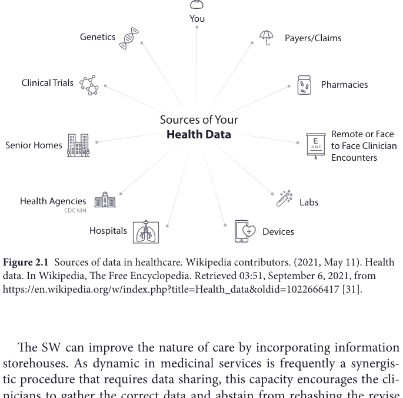

图 2.1 医疗保健中的数据源。Wikipedia contributors. (2021, May 11). Health data. In Wikipedia, The Free Encyclopedia. Retrieved 03:51, September 6, 2021, from https://en.wikipedia.org/w/index.php?title=Health_data&oldid=1022666417 [31]。

SW 可以通过整合信息存储库来提高护理质量。由于医疗保健中的动态通常是需要信息共享的协作过程，因此这种能力有助于临床医生收集正确的信息并避免重复纠正（图 2.1）。

##### 2.2.4 语义网的作用

语义网让我们能够无缝集成多学科数据。它有很多用例可以讨论。在这里，我们将讨论一些与医疗保健相关的用例示例。

药物发现 语义网架构使无限的协作成为可能，并且还连接了高度连接的数据和文本。合成、途径、系统生物学将我们带到主动药物发现的下一个水平，语义网工程使无限的合作成为可能并连接了高度关联的信息和文本。组合、途径、框架科学将我们带到主动药物发现的下一个程度 [5]。

###### 结构化实验结果

所有完整的机构知识和可回忆的代码都遥不可及。一种能够实现明确回顾的描述，结合对资源战略评估的关键评估，为逐步发展更可重复使用的数据基础设施提供了直接价值；试验方案和发现与有限的合作伙伴交换或获取。此类关联需要各方在合作各方之间没有时间进行文化共享的情况下理解 [5]。

实验元数据和结果的课程捕获可以显示即时价值并激励随着用例的推动而逐步提高精度。

###### 比较臂

FDA 发布是“比较臂”临床试验数据。这些数据与新药的发现无关，但作为新药检查的一部分收集。它是关于市场上药物或疾病状况的比较信息。它永远不会对收集它的制药公司具有竞争力。一旦数据发布在网络上，就有许多机会将其集成。直接获得用于设计、提问和管理它的规范将是巨大的，并且坐在桌子上的组织将是最准备好首先利用信息的人 [5]。

###### 患者数据所有权

传统的健康数据到健康数据的先进版本，基因组数据。患者正在越来越多地捕获他们的数据。准则并不很好地将数据在这条链上统一到一个强大、可使用和集成的系统中。如果制药公司不为数据制定良好的标准，那么私营企业将占主导地位，并将开始向需要访问大量人群进行临床分析的人出租数据。

###### 生物技术收购

复杂的逻辑数据业务可以通过网络标准尤其是 RDF/OWL/SPARQL 使尽职调查网络变得有用。项目、产品、生物技术协会，以及每个其他努力通过制药不断获得。它们通常通过彼此之间的协议形成组织，并且绝大多数基本信息将更容易协调，只要将其放在网站架构中。这项工作基本上比当前的医疗保健工作更少探索性，因为这些数据位置现在已经完全研究出来，并且在将收购所需的财务基础降低到完成它所需的高水平时是最好的时机。

###### 网络集成

语义网的建立促进了断言系统与传统网络设计和工具的融合。网络标准如 HTML 和 Path 由普遍性支持


设备并支持结构化信息，其目标是以适合人和机器的语言记录并分享这些信息。网页设计使得终端用户无需培训或只需少量培训即可搜索和浏览结果。开发这种结构以帮助资源关联和注释，以及制作结构化数据，将是最容易转变为有意义数据的途径 [5]。

##### 2.2.4.1 语义网的优点与缺点

###### 缺点

总体而言，有大量网站所有者并不了解语义网的重要性。由于这种无知，他们没有动力。因为很难期望他们手动将元数据包含到 OWL（Web 本体语言）语义标记中。

此外，还有一个重要的原因让内容作者对语义网感到担忧，尤其是那些依赖广告收入的网站所有者。他们认为，为一个特定目的创建语义网站比创建普通网站或通用搜索引擎所获利润更少，因为客户端只需浏览程序上的任何内容，结果——如重要日期、常规可测量数据或可验证信息——可能会立即出现，使得像索引列表这样的普通连接变得过时，并且彻底消除了打开网站的需要。这样一来，网站所有者几乎不可能支持这种做法。

个人信息的用途和管理可能成为一个问题，因为建立强有力的隐私保护将比以往任何时候都更加重要。从根本上说，你在网上发布的所有内容都可能被暴露，因为内容生成者（或基本上每个人）的能力将被削弱，因为他们发布内容的位置将决定是否不加区分地共享数据。

###### 优点

最终用户将是受益最多的人，因为他们将看到与机器协作、搜索数据和浏览互联网方式的改进。

用户可以与机器进行如同与其他用户交流一样的沟通。无需理解或使用无关的词语或表达；我们可以使用日常使用的表达方式。

机器可以通过网络像人类一样与终端用户对话；看起来就像机器在与你交谈并试图理解你的需求。如果你查找或询问任何内容，它不再返回链接列表，而是返回给你基本答案，并给你提供从其他许多网站获取的数据。这就是语义网的基础：链接列表不再适用，因为你请求的不是链接；而是当你在请求某些内容时，你需要以基本结构形式得到结果 [11, 12] (g, h)。

毫无疑问，在不远的将来，将会出现能够以精确、自然的方式回答人们问题的创新技术，尽管如今我们希望得到自然的反应。机器将比以往任何时候都更准备好参与与人类的自然交流系统。这可能有助于使计算机越来越适应人类的需求，而且，语义网的这种全面应用可能会在交流方式上引发又一次变革。

### 健康等级七（HL7）

国际健康等级七（Health Level Seven International），也称为 HL7 [18]，于 1996 年成立了词汇特别兴趣小组。1998 年，该小组升格为技术委员会（TC）[5–7]。HL7 标准并非以收入为导向；它是由美国国家标准学会认证的标准制定协会。该标准主要致力于为电子医疗保健数据的交换、集成、共享和收集提供一个全面的框架和相关标准。这支持临床实践以及医疗保健服务组织的组织、管理和评估 [8]。

医院和医疗保健提供者使用许多不同类型的计算机系统或软件来执行不同的功能，例如计费、患者记录和追踪。这些系统在需要获取新信息或检索数据时应该相互通信；但并非所有系统都能做到这一点。

HL7 国际组织规定了大量的标准、规则和方法，医疗保健系统可通过这些标准相互通信。此类指南或信息标准是一组规则，允许数据以相同且一致的方式共享和处理。这些数据标准旨在让医疗保健组织轻松共享临床数据 [9]。数据库管理系统的基本操作是存储和管理数据。这可用于企业和组织目的，例如医院、私人医疗中心、诊所和办公室。有效的卫生管理系统必须包含其患者、病历、科室和医生的所有相关信息。从理论上讲，这种信息交换能力应该通过减少临床护理在地理上孤立且高度多变的趋势来缓解压力 [10]。

#### 2.2.4.2 对患者的影响

患者的观点与提供者和专家的观点本质上不同，因为他们是服务的消费者而非提供者。由于他们在诊所就诊，他们通常也可能焦躁不安、害怕、痛苦，或者无论如何都不处于最佳状态。

在医疗保健技术中，包含支持患者的产品创新工具：如预约提醒、候诊区、信息显示屏和电子患者记录等设备。这些工具可以与临床医生一起、在诊所或其他地方使用，要么在就诊之前准备，要么在就诊之后使用。

这些基础设备有助于提高患者达成目标的效率。如今，没有人愿意花费精力和时间填写表格，无论是手动还是数字形式。患者需要在 5 到 10 分钟内快速、简单、直接地检索到他们的数据。

如今，患者不仅拥有关于自己的数据，而且还有更多信息可以带给专科医生。通过这种方式，他们在许多情况下可以获得适用于医疗保健的数据，如他们摄入的营养价值、食物日志、睡眠日志和遗传信息。他们可以更好地照顾自己。通过诊所或任何第三方提供的框架，他们还可以监控他们的健康记录、病历、处方和其他数据。然而，尽管许多患者目前拥有这些信息，但他们并不总是确定如何处理这些信息，或者他们的提供者是否会使用以及如何使用这些信息。

语义网可以支持个体患者，但在个人健康之外，它可以通过向患者提供关于副作用、诊断和药物的大量、合法性程度各不相同的数据来提供帮助。许多患者需要或希望对自身健康拥有更多控制权，尤其是在可以获得的替代方案如此之多的情况下，因为他们能够更多地进入医疗保健领域。大量关于患者护理、教育和支持的数据都是可获取的。大多数健康网站传统上以信息为基础，而互联网（Internet）例如是寻找任何疾病支持小组的最佳途径。它也是关于个别疾病（无论多么罕见）详情的巨大来源，并越来越多地被患者用作寻找最佳医院和专科医生的一种方式。

这是一个日益融合的原则、创新和社会实践的集合，叠加在现存最佳的数据分发和共享机制——万维网之上。

加速研究的语义网愿景，关键在于生物和临床信息的持有者以可重用的结构提供这些信息。通常情况下，为准备和提供这些信息所付出的努力并不会直接使提供者受益。相反，研究人员因产生科学发现并撰写相关论文而获得回报，临床医生因帮助患者而获得回报，制药公司因开发安全有效的药物而获得回报。共享个人数据也存在隐私风险。敏感的患者信息必须在获得适当同意的情况下获取，并对这些隐私问题保持敏感。如何设计激励措施，让这些有价值数据的持有者相信这一推动符合他们的最大利益，仍然是一个悬而未决的问题。

如果研究界今天决定有动力以语义方式发布信息，我们还没有足够数量的熟练数据工作者。数据建模，即使不考虑互操作性的期望，也是一项难以掌握的技能，而当目标是为不可预见的使用场景共享数据时，挑战会大大增加。我们必须建立并充实另一门学科，一种融合了跨学科技能的学科，这些技能包括对生物医学、软件工程、推理以及科学和计算的社会研究的深入理解。

#### 2.3 数据与数据库

如今，没有人会注意不到医疗保健服务或组织的各个方面发生的巨大变化，无论这些变化的方向——更不用说细节——是否有争议。对于医疗保健服务的利用以及这些护理结果的数据，存在广泛而巨大的需求，需要更多且更好的数据 [13]。

从各种来源获取数据极其困难。获取信息的过程使那些为此努力的人们（如政策制定者、科学家、健康专家、消费者和患者）持续感到沮丧 [13]。

由于数字化，医疗保健行业中处理医疗保健数据的方式已经改变。无论你考虑人工智能、机器学习，还是计算机化……这个领域的技术都在不断增长。


记录，医疗保健处于变动状态。医疗中心获得的每个患者的数据量庞大，需要管理和分析。医疗记录的数字化形式简化了熟练办公室的许多任务 [13]。

##### 2.3.1 什么是数据？

信息在数据库中具有极大的意义。它从少量到巨大数量不等，并构成了其余部分相互通信的主要热点。信息被进一步分为两种类型，一种是负责数据库的客户数据。它以行和列的形式存储在不同的表中。第二种是元数据，也称为关于数据的信息？它包含有关信息的信息，例如数据库中表的名称、数据库的要求、主键和外键等。

##### 2.3.2 什么是数据库？

数据库可以被视为一类信息，其管理方式使得可以轻松检索、管理和访问。

###### 数据库的不同定义

- 1. “通常是大量数据，尤其为快速检索而组织的集合（如由计算机）在线数据库”（Merriam-Webster）
- 2. “为方便访问而组织的相关的综合数据集合，通常在计算机中。”（dictionary）
- 3. “数据库是有组织的集合数据。”（Wikipedia）

数据库在 1960 年代开发，最初是分层数据库。关系数据库由 E.F. Codd 在 1970 年代创建，而面向对象的数据库则在 1980 年代设计。在 1990 年代，随着面向对象编程语言的发展，面向对象数据库兴起。如今，带有 SQL 和 NoSQL 的数据库很知名。数据库的演变在表 2.1 中给出。

##### 2.3.3 医疗保健系统中的数据源

在本部分，我们将讨论不同的医疗保健信息来源以及普遍用于此类信息准备和分析的基本研究方法。患者数据、临床和非临床情况，目前正以不同的形式收集。临床形式中的信息将具有结构化的医疗保健记录和生物医学记录图像。我们还将讨论传感器数据的挖掘和生物医学信号分析。由于基因组数据的进步，个性化医疗获得了很大的重要性。还将讨论与基因组数据分析相关的几种统计程序。生物医学文献、患者在非结构化医院数据中也将被讨论 [17]。

**Table 2.1** Growth of data [15]。

| Evolution of database | 1960–1970 | Files processing system | First Database system developed |
|---|---|---|---|
| 1970–1980 | Hierarchical and network | DBMS commercial use | Relational model (E.F. Codd) |
| 1980–1990 | Relational model used widely | Use of SQL | |
| 1990–2000 | Use of heterogeneous data | Use of relational and object oriented database | Use of NOSQL | Research to develop a common database |
| 2000 & Beyond | Data mining & Distributed database | Data warehousing and data | Big data analytic | Data shearing and processing on cloud |

###### 2.3.3.1 电子健康记录 (EHR)

电子记录也称为 EHR，仅仅是患者临床历史的数字化形式。它包含有关患者护理的全部信息，如同用药、问题、实验室报告和放射学报告、医生的观察、进展记录等。各种 EHR 超越了患者的临床或治疗历史，可能包含患者护理的更广泛的额外视角。EHR 的一个重要属性是它们为人类服务提供者和关系提供了一种令人信服和有益的方式，使他们能够相互授予。在这种新颖的情况下，EHR 本质上被设计为持续的，并且可以立即被授权用户访问和调整。这可能很有用，例如医院或在诊所和权威机构可以访问供应商的临床记录。EHR 通过允许访问实时记录使工作流程更顺畅。它可以提供患者临床经历的完整记录，并支持其他与思考相关的活动，例如循证决策支持、质量管理、和结果报告。使用 EHR，健康相关数据的限制和恢复变得越来越有利。它有助于提高患者护理的质量和舒适度，增加对人类服务流程的持续兴趣，提高结论和健康结果的准确性，并改善护理协调 [17]。

###### 2.3.3.2 生物医学图像分析

在医疗保健的当下，由于其提供人体内部解剖结构高质量图像的巨大潜力，医学成像系统发挥着至关重要的作用。高效分析这些图片对医生和健康专业人员很有用，因为它可以帮助追踪疾病、组织护理和预测。

即使如此，研究这些器官的初始阶段只是借助图像。生物医学图像分析的最终目标是能够生成定量数据并从图像中做出推导，这最终将提供有关疾病的进一步信息。这种检查具有重大的文化意义，因为它是理解生物系统和解决医疗问题的关键。

无论如何，它包含各种困难，因为图像是多样、复杂、并且具有噪声特征，可能包括间歇形式。当检查图片时出现的不同一般分析问题类别是对象发现、图片分割、相机登记、和提取特征。当解释时，这两个困难都将激发大量分析数字的产生，这些数字可以用作医疗服务知识调查的各个领域的输入。所以这是医疗专业人员和研究人员的另一个数据源 [17]。

###### 2.3.3.3 传感器数据分析

传感器数据在临床领域无处不在，既用于进展评估，也用于调查评估。一些类型的临床数据整理工具，例如心电图（ECG）、脑电图（EEG）是收集人体各个部位信号的传感器。这些收集的数据工具有时用于审核评估，但更常用于持续分析也许；持续分析的最大用例是关于重症监护单元（ICUs）和对患有特定疾病的患者进行远程持续监测。

在这些情况中，每个被治疗的细节量可能相对较大。例如，在 ICU 中，传感器来自多个来源的输入并不少见，并且警报应逐步触发。这类需要使用此类大数据框架和专用设备平台的应用。那实时活动和长期分析不同趋势和治疗决策在远程观察应用中都具有巨大意义 [17]。

尽管传感器信息的快速产生提供了它将影响医疗服务的重要保证，但它也带来了信息过载问题。因此，设计新的知识取证方法，将这些收集的海量信息转化为有意义且可互操作的信息变得至关重要。这些分析方法不仅能更好地考虑患者的生理体征并帮助提供床边情况焦点，还能为可能导致成本激增的医疗系统效率低下提供更好的见解。

###### 2.3.3.4 基因组数据分析

许多疾病是遗传的，但遗传标记与疾病之间的因果概念尚未完全确立。例如，糖尿病被很好地理解为一种遗传感染；然而，使一个人易患糖尿病的精确遗传标记组合是不明确的。例如，由疾病引起的视力障碍在几种特定情况下，重要属性被识别但并非所有可能的改变都已完全分离。对不同遗传基因、修改和感染条件之间相互作用的更好理解，有巨大的潜力帮助推进各种质量基因疗法来修复这些状况。


人们通常会兴奋地思考，通过常规的数据驱动研究，利用基因组数据的原位评估可以解决哪些类型的福祉相关请求。同样，将遗传发现解读为个性化医疗实践是一项非常非平凡的任务，存在大量有争议的挑战 [17]。

例如，复杂疾病（如癌症、恶性肿瘤）中的基因组图景极其复杂，揭示了不同个体之间存在高度的异质性需求。解决这些问题将非常适合拼图的重要部分，它将个性化医疗的概念带得更接近现实。生物技术领域的最新进展导致了大量生物和临床数据的快速产生以及先进的基因组研究。这也带来了在生命科学中对测试问题的基因组规模分析的非凡机会和希望。例如，基因组技术的进步使得有可能研究健康人群的完整基因组图景以应对复杂疾病。

其中许多研究方向已经显示出有希望的结果，就开发对人类疾病科学的新见解以及预测个人对特定治疗的定制反应而言。同样，遗传数据通常以序列或网络的形式呈现。因此，这项工作需要对序列和网络挖掘技术有良好的理解。正在开发各种基于数据分析的解决方案来处理医学中的关键研究问题，例如疾病生物标志物和治疗靶点的识别以及临床结果的预测 [17]。

###### 临床文本挖掘

很大比例的医疗记录都是以临床笔记的形式收集的。此类笔记通常存放在非结构化的知识位置中，是医疗机构大量信息的重要来源。这包括来自转录传输的临床数据、供应商的直接输入，或用于语音识别的应用程序的使用。这些可能是最丰富的未使用信息来源。对大量临床数据的这种自由文本结构的 manual 编码是不必要昂贵和单调的；然而，它被限制在基本和辅助分析以及计费目的的系统中 [17]。

由于将可用的自由文本中的临床内容转换为结构化格式所涉及的复杂性，这类笔记众所周知难以自然分析。主要是由于其非结构化性质、异质性、不同的设计以及在不同患者和从业者之间变化的设置而变得困难。自然语言处理（NLP）和内容提取在从大量临床内容中收集有价值的信息以自动及时编码临床数据方面发挥着重要作用。

通常，在这些环境中，信息预处理策略在与真正的挖掘过程相比时变得越来越重要。利用 NLP 技术对临床内容进行准备，与其他消息的文本相比更具挑战性，因为短语和传输表达式的语法错误性质、通信、缩写词汇，例如缩写和缩写，以及经常拼写错误的临床术语。所有这些问题都会直接影响各种标准 NLP 任务，例如浅层或完整解析、句子分割、文本分类等。因此使临床内容处理极具挑战性。

###### 社交媒体

各种基于互联网的社会资源（如社交网络网站、博客/微博、讨论、问答邮件和在线网络）的快速发展提供了公众对医疗保健各个方面看法的丰富信息。社交媒体信息可以被挖掘以获取模式和数据，这些数据可用于对人口健康和公共卫生监测做出有用的推断。大量公共卫生数据可以从不同成员在基于网络的社交网络网站上的贡献中收集 [17]。

尽管大多数个人社交媒体帖子和消息包含最小的信息价值，但大量此类消息的积累可以产生重要信息。成功分析这些庞大的信息片段可以大大减少收集此类复杂数据的延迟。过去通过基于网络的社交媒体分析对医疗保健的研究集中于捕捉总体健康模式，例如传染病爆发、识别不良药物反应的报告，以及改善与健康相关活动的干预能力。疾病爆发检测通常在社交媒体内容中得到明确反映，并且对内容的历史背景的分析提供了关于疾病发作的重要见解。主题模型通常用于此类健康相关内容的高级分析。通过基于网络的社交媒体网站获得的额外信息来源来自在线专家和患者网络。由于疾病在不同个体中反复出现，在线网络提供了关于各种疾病的重要信息来源。社交媒体分析中的一个重要挑战是信息通常是模糊的，因此结果必须谨慎解释 [17]。

### 为什么数据库很重要？

个人患者有记录；当他们访问任何医疗中心时，会从不同从业者、处方诊断和其他报告中收集大量信息，需要为当前以及未来使用而记录。

现在以任何一天的就诊次数为例。在这种情况下，医院需要一个设计良好的患者信息数据库。它也将有助于实现效率，因为信息的处理；因此为医疗保健提供者提供一键式的重要信息。为了让我们更容易，需要对数据执行许多操作。从业者日程非常繁忙，需要快速高效的访问。因此，信息会使用相关技术进行查询、过滤和检索。

因此，重要的是通过诸如患者识别、对医疗保健数据的访问控制、管理服务等事项来实现工作统一。技术创新是必需的，因为工作流程的标准是一个重要前提。创新是必要的，因为工作流程的标准是一个关键前提。

在医疗服务中，医疗保健数据库在监控和提高服务价值方面发挥着关键作用。医疗保健提供者可以为其医疗实践获取数据库；数据可以帮助在地方层面进行医疗保健服务的质量认证和开发计划。信息可以为围绕变化的角色问题提供重要答案的方法。

医院、诊所、政府机构、卫生部门等也是医疗保健数据的重要来源。这种类型的数据发布对质量估算非常重要。这些类型适当的數據包括诊断、治疗、住院时间、费用等。它有助于质量评估以进行质量检查，因为他们使用医院数据来评估医疗保健质量。

### 医疗保健系统中的数据库挑战

完整性保证信息准确且未被更改。电子健康记录（EHR）作为改善患者健康安全的一种方式，通过减少医疗服务错误、减少医疗保健差异并总体改善公共卫生发挥作用。然而，人们对输入到电子记录中的信息的准确性和可靠性提出了担忧 [16]。

信息丢失或破坏发生在数据不适当或不正确时；因为这些数据引发了人们对数据库完整性的担忧，因为患者认为决策依赖于它们。这类发展问题属于临床数据欺诈。其结果是错误数据进入相关人员记录。个人的保险机构被收取未提供给真正保单持有人的临床服务费用，而患者的未来治疗则由欺骗所指导，而患者和提供者都未立即察觉 [16]。

数据安全的主要问题是，医疗保健数据非常重要且也与患者的个人生活相关，这让黑客印象深刻而瞄准。在这种情况下，医疗保健行业应确保患者记录保持安全。否则，如果其数据被泄露，您将面临患者的法律诉讼。另一个需要记住的风险是电子记录可能被黑客劫持，他们扣押患者信息为人质，直到您支付勒索软件费用来解锁数据 [16]。

医疗信息尤其丰富，它来自传感器、媒体以及以生物医学著作/临床笔记和传统电子记录形式存在的文本等广泛来源。由于来源的多样性，数据的收集是异质的。这导致处理和分析的挑战。同样，分析这些不同信息模式所需的技术的多样性也很广。此外，信息异质性通常会带来统一和数据分析等各种挑战。总的来说，可以从不同信息类型中获得见解，这些信息否则无法从信息的巨大潜力中获得 [16]。

### 大数据与数据库安全和保护

#### 什么是大数据

大数据一词表明了信息的巨大数量。信息可以是有组织的或非组织的。那浸透了


administration on an everyday premise. In the term big data, the measure of information is not significant; however, what we do with the significant information, big data can be considered for knowledge that assists with bettering choices and vital moves [20].

A different definition of big data:

+   1. **Wikipedia:** “Big data is a field that treats ways to analyze, systematically extract information from, or otherwise deal with data sets that are too large or complex to be dealt with by traditional data processing application software” [19].
+   2. **O’Reilly Radar:** “Big data is data that exceeds the processing capacity of conventional database systems. The data is too big, moves too fast, or does not fit the strictures of your database architectures. To gain value from this data, you must choose an alternative way to process it.” By Edd Dumbill.

#### 2.4.2 Five V’s of Big Data

Big data analytics can be considered as a choice in healthcare for solving the data complexity in healthcare. Let us discuss the main dimension of Big data. Some sources describe three, four, or five. We are considering all five dimensions.

+   1. Volume : (The term volume defines the size of data, its quantity, from terabyte to zeta byte)
+   2. Variety: (Variety denotes the type of data, what it is structured or unstructured or it is semistructured)
+   3. Velocity: (The flow of data, how data that are produced, processed, and analyzed)
+   4. Veracity: (The term means quality, relevance, predictive value, the meaningfulness of the data)
+   5. Value: (The usability of data define the value of data the value of information for decision making, developing strategy).

##### 2.4.2.1 Volume

Volume means simply the quantity of data. This data must be used further to gain important knowledge. Healthcare, making current data digitalize, and also developing new types of data is the reason for growth. Now the data in healthcare has exponential growth. if we consider just,

for example, any single patient has his data in gigabytes and it is also increasing day by day. With the same, if we consider the patient data of the hospital or city, the data will be in terabytes or petabytes. currently, the volume of the existing healthcare system includes the sources from personal medical records, radiology images, clinical trial data, FDA submissions, human genetics, and population data, genomic sequences, etc. now the modern variety of data from a source like 3D imaging, genomics, and biometric sensor readings, are also included in healthcare data. Advances in data the board, particularly virtualization and dispersed processing, are empowering the improvement of stages for the progressively convincing catch, storing, and control of immense volumes of data [21, 22].

##### 2.4.2.2 Variety

Variety indicates the variation in healthcare data as it can be structured, semi structured, unstructured. Unstructured data is a challenge for data manipulated. Most of the data in healthcare is unstructured such as medical notes, hospital records, and prescription records. Radiograph, CT scan, MRI, and other images. Data in structured format also include in healthcare such as accounting and billings, actuarial data, (some) clinical data, (some) laboratory instrument readings. Structure data have static schema so it is easy to analyze, store, queried.

However, new data streams like fitness devices, genetics and genomics, social media research, and another source also currently included in healthcare. Relatively little of this data is manipulated and analyzed by computer for extracting information by capture, store, and organizing.

Healthcare applications particularly need progressively beneficial ways to deal with uniting and change over varieties of data, including the automatic change from structured out to unstructured data.

Many tech giant companies like s, Practice Fusion, Athena health Inc., Humedica, and One Health, etc., are also working on mange and analyze data. Let us take the example of IBM Watson. Watson, with its stand out trademark language capacities, is the basic model. In like manner, in this current paper's universe, Health Fidelity is using ordinary language planning to change over unstructured into structured data [21, 22].

##### 2.4.2.3 Velocity

This implies the time where Big Data can be processed. A couple of activities are noteworthy and need speedy responses, which is the explanation brisk

getting ready to intensify profitability. In velocity two related concepts are most preferable in healthcare: the first one is the speed at which data is generated by technological devices and the second one is the need for the process and analyzes data in real time. Let us take as an example so many sensors and devices that are designed to understand the health status of patients but they are meaningless without analyzation over data. There is a need first of all to analyze the data provided by the device and then handover to clinician’s and others.

Nowadays the traditional data is quite static such as paper notes, reports. This data has a lower priority for analyzing purposes. But in another case the real time (such as blood pressure monitoring, room monitor for anesthesia, heart monitors) data analyzing is a higher priority; otherwise, it can become a question of life.

Companies related to the medical device field are working for speedy capturing and display real time data in hospitals, ICU, ambulance.

Some smaller company also focuses on the device which can be usable at home, like blood pressure monitoring, diabetes monitoring. This IoT (Internet of things) will lead to the progressive velocity of big data in healthcare [21, 22].

##### 2.4.2.4 Veracity

Conventional data the administrators expect that warehoused data is certain, clean, and accurate. In any case, as any person who has suffered bank, credit, or insurance botches knows, data maybe once in a while uncertain, unsure, or inside and out misguided.

The data can differ as per the condition like time to time, place to place, and treatment to treatment. For example, what clinician learned during the course curriculum, during practice, by the experience? The patient can be the main factor in how they express about their health. These factors decide what to be next. Such changeability implies information must be genuinely deciphered when the consideration setting and conveyance process is taken into settings. For example, the diagnosis of CP means differently for person to person, form cardiologist or primary care physician it can be “chest pain” and for the neurologist, it can be “cerebral palsy.”

While various affiliations are stressed over data quality in therapeutic administrations, they are revolved around standard IT issues, e.g., data the administrators, warehousing, consistency, audit, distortion prevention, error uncovering, and regulatory consistency. There radiates an impression of being less focused on the concealed veracity (trustworthiness, essentialness, perceptive estimation) of the data, an issue that will be of extending criticalness in understanding the vision of human administrations Big

Data examination and modified prescription. For example, Watson’s ability to give exact provider decision help relies upon the finish and precision of the data it can get to [21, 22].

##### 2.4.2.5 Value

To wrap things up, the big data must support its qualities. Implies the information ought to be precise and lead to quantifiable improvement by the day’s end. On the off chance that if we are going to utilize the infrastructure need to gather and decipher information that must guarantee the precision. Companies may use comparable gadgets and progressions for the get together and analyzing the data they have available, anyway how they by then set that data to work is finally up to them [21].

#### 2.4.3 Architectural Framework of Big Data

The standard healthcare informatics analytics and the determined big data structure adventure relative nature. The guideline differentiate is about how the taking care of executed, in the standard project, the processing should be conceivable on any business intelligence tool on a standalone system. In any case, in the processing of big data, the processing is isolated and execute on different nodes. So the as the name shows it is used for large datasets as the healthcare provider exploits their tremendous data vaults to get understanding for choosing better taught prosperity related decisions [14].

The user interface of the conventional analytical system provides ease of use as compared to big data tool as the big data tool are very much complex, programming intensive and desire the variety of skills. They emerge as an open source development tool and platforms with a lack of support that vendor proprietary tools possess.

Conceptual architecture of big data, Figure 2.2 below.

As we have already discussed previously the source of the big data can internal and external and format are also can be different and may be placed in different positions. The source data type includes social media, big transaction, biometric information, machine to machine data, human generated data, etc.

There are essentially two ways to deal with information analytics. First methodology architecture. Another is data warehousing. In the first methodology, the information will be in row state and the middleware services need to process, call, recover the information, in the second methodology information from different sources collected and prepared


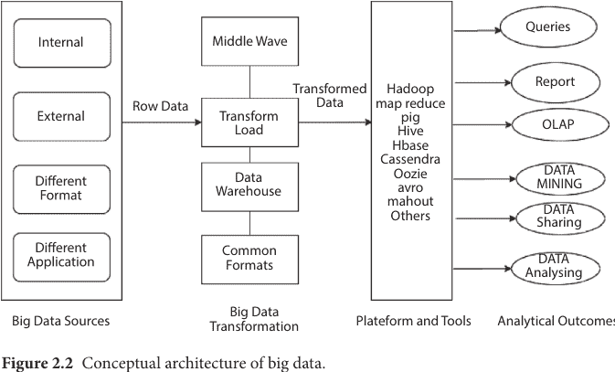

for handling, even though the information is not accessible progressively. Using the means of extract, transform, and load (ETL), information from various sources is purified and prepared. Contingent upon whether the information is organized or unstructured, a few information arrangements can be a contribution to the enormous information investigation stage [14].

Numerous decisions are made in the next period of the architecture concerning the data input approach, appropriated design, tool assembly assurance, and analytical models. Finally, the four uses of big data analytics is shown. These are requests, reports, OLAP, and data mining. Visualization is a sweeping theme over the four applications, a wide collection of techniques and head ways has been made and changed by complete, control, look at, and envision enormous data in social protection for Drawing from such fields as experiences, programming building, applied science, and economic related issues [14].

The developments in information technology in recent years computerizing many applications in various areas as a result. Now the data become very important assets for any organization, and that is why ease of data access, sharing, retrieving information, making it easy to use is the basic need [28].

Additionally, the security of data is the main concern as it containing very confidential information. For patients, privacy is very important and they want to have full control over their data [14].

#### 2.4.4 Data Protection Versus Data Security in Healthcare

At this time, it is very important to understand the basic difference between both data protection and data security. Data protection means keeping data private. This can be accomplished by defining organizational measures and security rules which include user agreements policies, accessibility, and guidelines for data access. Data security relates to the mechanism for data storage, data access ability for the authenticated user [25].

##### 2.4.4.1 Phishing Attacks

Phishing attacks are becoming more common nowadays and the user must be educated on the possible threat that are hiding in their inbox. It can be coming from email, text messages, or can be from web chat links. It will look like the general message which is dealt with by users daily. It is generally a kind of link which redirect user on the suspicious website and ask from the user for the credentials [25].

These types of attacks can be thwarted by the smartness of the user. The hospital staff and general user as well should make sure the link is coming from an authenticated source or not. If it is not then the user should not open the link and mail or even download any attachment coming from the unknown link, mail.

##### 2.4.4.2 Malware and Ransomware

Malware is a type of program which can enter into the system through several channels such as network, downloaded file, and utility software. They hack the access and sneak the information or can damage the system.

Ransomware is very popular on the list because the semantic web is frequently updated and also stored much information, so they are ideal for hackers. This type of attack is dangerous because the patient can suffer in emergency conditions. There is a need to make a strong network so the hackers are not able to acquire the access which they are looking for. Additionally, IT staff should also continuously inspect the network for the possible loophole for malware [25].

##### 2.4.4.3 Cloud Threats

Nowadays healthcare provider is moving their stuff on the cloud, in past healthcare providers don’t want to adopt to cloud. But the feature of the cloud impresses them to come on the cloud. If healthcare provider usage cloud means check which information is need to upload. Many healthcare providers at this time there is a need to enhance the security and privacy level because the data is globally reached. Before shifting to the cloud, a healthcare provider should know which data and assets should reside on the cloud and what data should be on its server [25, 26].

In this scenario, data encryption can play a vital role. A strong encryption technique can ensure that data is protected while it is going to migrate from a personal server to a cloud.

Cloud Access Security Broker (CASB) courses of action can in like manner go about as security and consistency procedure execution points, put between cloud pro communities and the staff to join and contribute in security approaches as the cloud based assets are gotten too. These plans can in like manner log coordinated efforts with oversaw data to support the survey necessities that are a great part of the time some bit of consistency frameworks, for instance, HIPAA [25, 26].

#### 2.4.5 Technology in Use to Secure the Healthcare Data

Many technologies are now being used to secure the data. Some of them we are going to discuss over here.

Authentication: In the healthcare system, there is a need to be verified both information users and information providers at each point. The use of data authentication can face a special problem like man in the middle and also can help to prevent this. many cryptographic protocols also use some type of authentication to prevent these types of invasion, for example, cryptographic protocols like TLS (Transport layer security) and SSL (Secure socket layer) which mainly responsible to provide the secure communication over the Network, these protocols encrypt the fragment of the network connection at the transport layer end to end, an application like internet surfing, email, fax, messaging, and calling use widely some version of the protocol.

Additionally, another cryptography algorithm hash function SHA-256 can also implement to achieve authentication. The hashing technique and Kerberos mechanism are based on the ticket tracking service for authentication. One another technique is known as the bull eye which is used to monitoring all suspicion information in 360°. These techniques ensure information security and also maintain the connection between original data and replica. With the same, it also confirms that the user is allowed to read and write data [27].

**Data Encryption:** To prevent unwanted access to sensitive information encryption of data can be an effective way. Encryption is useful to dodge exposure to intruders, for instance, packet-sniffing and thievery of the storage device.

The encryption technique should be able to understand a new variety of electronic forms of data and also easy enough to implement. there are so many types of encryption algorithm provided such as RSA, Rijndael, AES and RC6, DES, 3DES, RC4, IDEA, Blowfish, etc., which can be used for security purposes. Sometimes it is hard to make the decision which one should be used for the application [27].

**Data Masking:** Data masking or data obfuscation is another way for data security used by many healthcare providers. This is not like encryption technique but at the place of encryption, the original data will be replaced with the unidentified data. The first solution is proposed by Swaney and Samrati and is K-ANONYMITY. This is okay for the identity disclosure but fails for the attribute disclosure, another sensitive proposed, which can protect against identity disclosure and attribute disclosure both. Other methods like adding noise, swapping cells, replacing group with copies of a single representative are also available [27].

##### 2.4.5.1 Access Control Policy

The access control policy provides control over data. It checks the user credential and the permission which allowed accessing the data when the user enters the system access will be controlled by access control policy. It checks your privileges and allows you to access what you are authorized. For example, a patient is allowed to enter/modify their information, access their information, and maintain their record but, they cannot do the same for another person however the administrator can do this because the administrator has permission for that. The most popular access control policy is Role based access control (RBAC) and another one is the attribute based access control (ABAC) [27].

#### 2.4.6 Monitoring and Auditing

Security can be also provided by monitoring and auditing. This is not compulsory but optional can be used as a security layer. Monitoring means simply inspect the data and auditing mean is to create the log record for the activities. The security monitoring architecture is developed to detect intrusion and prevention procedures via inspecting DNS flow, IP flow, HTTP traffic, and honey pot data. It also can store the data and process


在分布式源中。在此阶段，已确定三个概率测量值以识别域名、数据包或流是否具有恶意。根据通过此计算获得的分数，警报会在检测框架中发生或由预测系统终止该过程 [27]。

#### 2.4.7 数据保护标准

随着医疗数据的数字化与发展。新的威胁类型正在被认知用于医疗记录。起初并没有强有力的安全和隐私政策。此外，鉴于这些新兴威胁，需要一个强大的医疗保护标准。

美国（US）实施了多项规则和法规，其中还包括 HIPAA（1996）下的隐私和安全规则以及 State Alliance for eHealth（2007）。

在美国医疗提供者受 HIPAA 法规的强烈影响。它确认医疗提供者和组织是最新且也满足最新要求。它还确保组织和医疗基本上 HIPAA 包括两个关键主要组成部分。

管理、物理和技术处理个人健康信息需要一些标准，这些标准由安全规则描述。

HIPAA 安全规则—HIPAA 安全为数字健康信息提供安全。它保护医疗数据的创建、利用和备份。这是由 HIPAA 覆盖组织提供的。该规则的主要目的是为电子健康信息的标准管理、物理和技术处理设定标准 [29]。

HIPAA 隐私规则—隐私对于健康记录非常重要，因为健康记录包含非常敏感的信息。需要为健康记录、保险记录、医院记录、实验室报告和其他私人细节提供保障。此 HIPAA 隐私规则通过控制信息的使用来保护信息免受滥用 [29]。

##### 2.4.7.1 印度的医疗标准

让我们也讨论一下印度的安全和隐私政策。安全和隐私有三个标准

- 1. 安全技术标准
- 2. 管理保障标准
- 3. 物理保障标准

##### 2.4.7.2 安全技术标准

此标准的实际目的是根据技术方面保护和保护数据。医疗包括以下要求（30）。

- 1. 身份验证
- 2. 自动注销
- 3. 访问控制
- 4. 访问权限
- 5. 审计日志
- 6. 完整性
- 7. 加密
- 8. 数字证书

##### 2.4.7.3 管理保障标准

此保障需要医疗服务提供者创建和执行安全行政管理程序，该程序包含解决其安全弱点全部范围的安排和政策。它包括安全管理流程标准、指定安全责任、安全意识计划、信息访问管理、安全事件程序、评估 [30]。

##### 2.4.7.4 物理保障标准

物理保障标准是为保护医疗服务供应商的电子数据框架、相关硬件、容纳框架的建筑物免受常见和自然危险以及未经授权的入侵而采取的安全措施。医疗服务提供者必须满足以下标准。这些类型的标准是访问控制标准、工作站使用标准、工作站安全标准、设备和媒体设备控制标准 [30]。

### 参考文献

- 1. Institute of Medicine (US) Committee on the Health Professions Education Summit, Chapter 2, Challenges Facing the Health System and Implications for Educational Reform. Greiner, A.C. and Knebel, E. (eds), Health Professions Education: A Bridge to Quality. National Academies Press, Washington, DC, 2003. Available from: https://www.ncbi.nlm.nih.gov/books/NBK221522/
- 2. Ruttenberg, A. et al., Advancing translational research with the Semantic Web. BMC Bioinf., 8, 3, 1–16, 2007.
- 3. Karami, M. and Rahimi, A., Semantic web technologies for sharing clinical information in healthcare systems. Acta Informatica Medica, 27, 1, 4, 2019.
- 4. Shadbolt, N., Berners-Lee, T., Hall, W., The semantic web revisited IEEE Intell Syst., 21, 3, 96–101, 2006.
- 5. Dolin, R.H. et al., The HL7 clinical document architecture. J. Am. Med. Inf. Assoc., 8, 6, 552–569, 2001.
- 6. Jain, V. Dr. and Singh, M., Ontology Development and Query Retrieval using Protégé Tool. Int. J. Intell. Syst. Appl. (IJISA), Hongkong, 5, 9, 67–75, August 2013.
- 7. https://www.w3.org/standards/semanticweb/, last updated on Oct 5, 2020
- 8. Bakken, S. et al., Toward vocabulary domain specifications for Health Level 7—Coded data elements. J. Am. Med. Inf. Assoc., 7, 4, 333–342, 2000.
- 9. Mahmudova, N., The Importance of Using Database Management Systems in Hospitals, Khazar University Periodicals Khazar Journal of Science and Technology, 3, 2, 2019.
- 10. Wikipedia contributors, Health Level 7, 2020, Wikipedia, The Free Encyclopedia. Wikipedia, The Free Encyclopedia, 1 Jun. 2020. Web. 28 Jul.
- 11. Yadav, U., Narula, G.S., Duhan, N., Jain, V., Murthy, B.K., Development and Visualization of Domain Specific Ontology using protégé. Indian J. Sci. Technol., 9, 16, 1–7, April, 2016. having.
- 12. https://www.bypeople.com/semantic-web-pros-and-cons/, last updated on Oct 5, 2020
- 13. Donaldson, M.S. and Lohr., K.N., Health databases and health database organizations: uses, benefits, and concerns, in: Health Data in the information age: use, disclosure, and privacy, National Academies Press, US, 1994 https://www.ncbi.nlm.nih.gov/books/NBK236556/.
- 14. https://www.ibm.com/blogs/watson-health/the-5-vs-of-big-data/, last updated on Oct 5, 2020.
- 15. https://towardsdatascience.com/how-to-secure-health-data-in-the-cloud-541fbdad811a, last updated on Oct 5, 2020.
- 16. Ozair, F.F. et al., Ethical issues in electronic health records: A general overview. Perspect. Clin. Res., 6, 2, 73, 2015.
- 17. Reddy, C.K. and Aggarwal, C.C., Healthcare data analytics, vol. 36, CRC Press, 2015.
- 18. Wikipedia contributors, Health Level Seven International, 2020, Wikipedia, The Free Encyclopedia. Wikipedia, The Free Encyclopedia, 8 May. 2020. Web. 28 Jul.
- 19. Wikipedia contributors, Big data, 2020, Wikipedia, The Free Encyclopedia. Wikipedia, The Free Encyclopedia, 1 Jul. 2020. Web. 28 Jul.
- 20. Feldman, B., Martin, E.M., Skotnes, T., Big data in healthcare hype and hope. 360, 122–125, 2012. Dr. Bonnie.
- 21. Hadi, H.J. et al., Big data and five v’s characteristics. Int. J. Adv. Electron. Comput. Sci., 2, 1, 16–23, 2015.
- 22. Raghupathi, W. and Raghupathi, V., Big data analytics in healthcare: Promise and potential. Health information science and systems, 2, 1, 3, 2014.
- 23. Sachdeva, S., Mchome, S., Bhalla, S., Web services security issues in healthcare applications. 2010 IEEE/ACIS 9th International Conference on Computer and Information Science, IEEE, 2x1010.
- 24. Yadav, D.P. et al., Feature extraction based machine learning for human burn diagnosis from burn images. IEEE J. Trans. Eng. Health Med., 7, 1–7, 2019.
- 25. Sharma, A., Sharma, A., Jalal, A.S., Distance-based facility location problem for fuzzy demand with simultaneous opening of two facilities. Int. J. Comput. Sci. Math., 9, 6, 590–601, 2018.
- 26. https://www.beckershospitalreview.com/healthcare-information-technology/the-top-5-cybersecurity-threats-hospitals-need-to-watch-for.html, last updated on Oct 5, 2020.
- 27. Abouele mehdi, K., A Beni-Hessane, and Hayat Khaloufi. “Big healthcare data: preserving security and privacy. J. Big Data, 5, 1, 1, 2018.
- 28. Sharma, A. and Upadhyay, D., VDBSCAN Clustering with Map-Reduce Technique, in: Recent Findings in Intelligent Computing Techniques, pp. 305–314, Springer, Singapore, 2018.
- 29. https://digitalguardian.com/blog/healthcare-cybersecurity-tips-securing-private-health-data, last updated on Oct 5, 2020.
- 30. EMR Standards Committee, Recommendations on Electronic Medical Records Standards in India. Ministry of Health and Family Welfare, Government of India, New Delhi, 2013. https://mohfw.gov.in/sites/default/files/24539108839988920051EHR%20Standards-v5%20Apr 202013.
- 31. Wikipedia contributors. (2021, May 11). Health data. In Wikipedia, The Free Encyclopedia. Retrieved 03:51, September 6, 2021, from https://en.wikipedia.org/w/index.php?title=Health_data&oldid=1022666417


# 基于本体论的患者监测系统

R. Mervin¹*, Tintu Thomas² 和 A. Jaya³

¹信息技术系，沙特电子大学，利雅得，沙特阿拉伯  
²公共卫生系，沙特电子大学，利雅得，沙特阿拉伯  
³计算机应用系，B.S. 阿卜杜勒·拉赫曼新月科学与技术学院，金奈，泰米尔纳德邦，印度

#### 摘要

在当前情况下，网络来源充斥着信息，用户可以从中搜索所需信息。搜索关键词的输出可能与搜索关键词相关或不相关。鉴于绝大多数网络来源都是以句法而非语义的方式查找结果，机器必须理解搜索关键词的含义才能给出相关搜索结果。研究人员的责任是为患者监测系统找到解决方案，该系统必须为搜索关键词提供准确的结果。需要构建一个在本体支持下进行患者监测的系统。患者的每个细节和健康信息都必须存储在本体中。

本研究工作侧重于本体论系统对患者监测系统的重要性。已构建领域本体以保存患者健康问题的详细信息。该系统包括四个阶段：领域本体构建、预处理、规则构建和查询推理。查询有效后，必须自动产生最相关的结果。查询的正确性必须在推理器的支持下得到验证。

三元组的格式。它是图的形式，以图形方式表示知识库中的信息，称为图。SPARQL（简单协议和 RDF 查询语言）是一种特定的查询语言，用于检索 RDF 中的数据 [17]。

本文其余部分安排如下：第 3.1 节介绍本体的基础知识。第 3.2 节讨论文献综述，第 3.3 节描述架构设计，第 3.4 节讨论实验结果。最后，第 3.5 节讨论结论以及本研究未来方向的启示。

##### 3.1.1 本体的基础

本体学习是一种语义知识表示方式，可将非结构化数据源转换为结构化数据。它提供了类的语义含义，并给出对象属性之间的关系，作为领域的知识库。本体是识别整个领域中数据库关系的领域。

少数科学家正朝着为健康推荐系统创建基于本体的模型方向发展。本体有助于找到所选领域中各种类及其个体之间的关系。本体系统的用途有很多，与信息检索、人工智能、机器学习应用等有关 [3]。

本体的目的是以正式的方式表示知识，即称为概念的类、每个类的数据和对象属性，关联类的各种特征和属性。在人工智能时代，本体成为不可避免的知识库，其中一组类及其属性以及其关系构成了一个知识库。许多研究人员开始在医学领域开发标准化本体，并用于共享和注释信息。本体的类型如下：

- 顶层本体或上层本体：这类本体描述大多数领域共有的一般概念。这些本体可以根据研究的不同的目的重复使用。本体的例子有对象、目的、原因、时间、空间等。
- 领域本体：这些本体是为特定封闭领域开发的。例如，棒球是领域本体的一个例子。
- 任务本体：它们描述涉及某些输入、处理和输出的任务或活动。本体与任何特定任务相关，并且有助于在完成任务后做出决策。
- 应用本体：这些本体是为任何应用程序开发的，可能包括领域、任务和顶层本体。本体的例子是银行应用程序或医疗保健应用程序。

##### 3.1.2 患者监测中本体的需求

在最近的日子里，本体在任何领域都是不可或缺的。本体在医学领域的需求也很重要。开发患者监测系统本体的原因如下 [1]：

- 在患者和医疗从业者之间表示和共享知识。
- 基于语义而非句法搜索检索信息。
- 应用推理机制验证本体的正确性。
- 定义“N”条规则。
- 与不同的人共享知识库及其信息结构。
- 支持信息重用。
- 创建显式知识库。
- 将领域知识库与操作知识库区分开来。
- 调查领域知识库。

#### 3.2 文献综述

文献综述提供了对患者监测系统各种研究、模型、方法论和评估方法的调查的详细综述。通过参考各种作者，讨论了患者监测系统的不同方面。总结列出了与患者监测系统相关的基本信息的定义和讨论，这对于设计任何成功的系统都很重要。

##### 3.2.1 本体在各个领域的应用

Sabbah 等人提出了一种使用术语加权技术的方法，通过文本信息计算恐怖活动检测。该方法从不同的网页收集特征集，然后对收集到的特征应用术语加权。特征的降维可以通过 UNION 和对称差组合函数计算 [5]。

Kumari 等人遵循传统的词频-逆文档频率（TF-IDF）方法，并使用特定领域的词典。词典定义了每个词的同义词，并且词之间的语义相似性可以通过 TF-IDF 计算。它是一种信息检索技术，可以计算文档相关词的权重 [6]。Escalante 等人开发了一个框架，用于研究将一组基本词组合成一个判别性术语加权系统 [9]。

Narula 等人开发了一个多媒体信息检索（MIR）模型，可处理包括文本、图像和视频文档在内的不同数据类型 [10]。它使用不同的 IR 技术，如扩展布尔方法、贝叶斯网络模型等，提供相关性，从而满足用户的查询。

Amir Zidi 和 Mourad Abed 描述了一个使用本体进行公共交通系统的通用框架，该框架支持检索与公共交通系统相关信息。在这里，关于公共交通系统的语义信息是从不同的数据源提取的，并且映射将通过本体进行。可扩展性是基于实体的语义索引检索方法的改进版本。最后，它使用真实世界的数据源进行评估并提供有意义的搜索结果 [13]。

Suganyakala 和 Rajalaxmi 开发了一个使用本体进行电影相关语义搜索系统的框架。该框架旨在解决传统信息检索的局限性并提高检索效果。查询界面需要用户以自然语言输入，并开发了电影领域特定本体以给出输出。所提出的语义本体原型提高了搜索准确性 [15]。

K. Soner 等人开发了一个使用语义索引的基于本体的检索系统。它处理语义搜索中的问题，即可用性、可扩展性和检索性能，并提出了一种基于关键字的语义检索方法 [16, 24]。

Turhan 讨论了描述逻辑推理对语义网本体的重要性。存在具有形式语义的知识表示形式主义家族。这个逻辑家族以结构化的方式表示应用领域的术语知识 [20, 29]。


#### 3.2.2 患者监护系统中的本体

医学领域的决策过程非常困难。研究人员必须分析来自异构知识源的大量输入信息。这也是一个协作过程，专家们相互分享关于临床数据的信息，以做出正确的决策。交流必须是语义层面的，而非句法层面的，并且信息的上下文不应影响其含义[2]。

Lee等人提出了一种使用本体的患者饮食菜单推荐系统。饮食被认为是对所有人来说都是一个重要因素，尤其是对糖尿病患者而言。该系统通过考虑患者的临床信息，为患者的饮食菜单提供有价值的建议，同时还为糖尿病患者推荐膳食计划[23]。

Beale和Heard开发了一个基于临床信息本体的模型框架。所有类型的临床信息都基于本体进行存储，包括各类需求，范围从语义需求到软件运行时的性能。分类临床信息由临床研究者记录（CIR）本体处理，该本体有助于问题解决过程[26]。

Jayaweera开发了一个基于以患者为中心的过程本体的诊所管理系统（CMS）。它在患者健康推荐系统中不断创建新的专业、不同的角色、公立和私立组织，为关键问题提供支持。它还为健康推荐系统的各个领域提供与IT相关的解决方案[28]。Jayaweera和Johannesson创建了一个患者本体知识库，用于医疗保健系统的信息检索。该系统针对患者的健康问题提供更好的建议。它还关注患者的健康史，并且可以基于健康史进行可视化[30]。

Kumar等人在医疗保健系统领域构建了一个临床指南本体知识库[31]。这项研究工作简要介绍了与医疗保健指南相关的本体。该框架通过分析患者的健康状况和特定疾病的症状，帮助对患者的健康问题做出决策。

#### 3.3 架构设计

本研究工作重点探讨基于本体的系统对患者监护系统的重要性。构建领域本体的目的是保存患者健康问题的详细信息。该系统由四个阶段组成，包括领域本体构建、预处理、规则构建和查询推理。在验证查询的有效性之后，系统必须自动产生最相关的结果。查询的正确性必须在推理机的支持下进行验证。图3.1显示了患者监护系统的概念图，并解释了系统的不同阶段。

在预处理阶段，系统使用词性（POS）标注器，帮助从用户输入的查询中识别搜索词。必须应用词干提取过程来查找词根，并在本体内部建立搜索。如果该词已存储在本体中，系统将给出查询结果。否则，必须用新的关键词自动更新本体。然后，必须构建解析树以更好地理解查询。对于预处理后的关键词，必须与本体中的词进行相似度度量。使用TF-IDF（词频—逆文档频率）方法进行权重计算和词间距离度量。

本体系统还支持有助于推断新知识的规则。在OWL（Web本体语言）中，规则借助SWRL（语义网规则语言）来表达，SWRL是语义网的规则语言。在描述逻辑的支持下，有必要针对给定的概念及其与类的关系编写SWRL规则。推理机（Reasoner）用于借助推理引擎从知识库中推导信息。推理机能够检测不一致的本体。使用三个推理机（即Fact++、HermiT和Pellet）检查整个搜索关键词的正确性。与其他两个推理机相比，Pellet是最佳的推理机，因为它具有调试功能。推理引擎支持根据搜索关键词生成新规则。推理的正确性由推理机进行验证。最后，通过SPARQL检索信息。SPARQL是用于以RDF（资源描述框架）格式检索数据的查询语言。

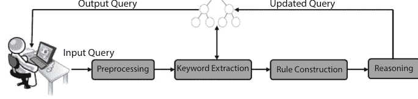

图3.1 患者监护系统的概念图。

基于本体的患者监护系统在医学科学领域必定会很有帮助。患者病史的所有详细信息都可以毫无障碍地检索到，并且它还为疾病提供意见。它解决了传统数据库中的全部问题，并为查询提供更准确的语义结果。查询的正确性也由推理机进行验证，从而为查询提供更准确的结果。

##### 3.3.1 患者监护系统的阶段

本体包含领域类及其关系，以检索类之间的新关系。本体用于从领域知识中提取信息、表示类之间的关系、建立知识库、发现知识、重用知识、根据需求集成不同的类[14]。

类的领域知识称为概念。属性表示类的不同特征，类的属性被称为属性，限制或角色限制也是可以接受的。类也被划分为不同类型的子类和父类。例如，性别类可以分为男性、女性和跨性别者子类。

一般来说，创建本体是一个迭代过程，包括定义类、在分类体系中排列类（如子类—父类层次结构）、定义属性及这些属性的值、查找实例的值。描述领域对象的属性、查找对象与类之间的关系，需要用到专家的知识。迭代过程可能如下：

- 1. 选择领域并开始构建本体的第一版。
- 2. 查找对象、类及其关系，以重新定义本体。
- 3. 如果需要根据给定情况修改本体，则找出不同的修改方案并重新构建本体。
- 4. 如有必要，完善该过程。

对于所选领域，总是存在可行的替代方案。在创建新本体之前，必须先识别现有的本体。对于任何类型的领域，本体总是支持可重用性属性。患者本体构建中的一些基本规则描述如下：

### 步骤1：查找并分析本体的领域和目标

初始步骤是查找本体的领域和目标。在本研究中，选择患者信息作为核心本体。在医学领域，患者的详细信息及其疾病信息由本体进行管理。该本体可以在医学领域的应用中重用。自然地，这些概念描述了不同类型的人员信息，如姓名、年龄、性别、住址、疾病类型等。

### 步骤2：查找可重用的本体

本体的可重用性是任何领域中最好的特性之一。始终需要分析由同一领域的其他人创建的现有本体，并尝试在适当的领域中重用该本体。例如，Ontolingua本体库或DAML本体库，以及一些流行的领域本体，如UNSPSC、RosettaNet、DMOZ等。

### 步骤3：识别本体中所需的类

有必要找出构建领域本体所需的所有类及其对象。接下来的两个步骤紧密相连，即开发类层次结构，以及定义类的对象属性和数据属性。

### 步骤4：定义类和类层次结构

类层次结构的定义取决于自顶向下方法、自底向上方法和混合方法。在自顶向下方法中，首先识别核心类，然后通过查找后续类开始迭代。自底向上方法被定义为对具有层次级别的精确概念进行特征化描述，最终将子类合并为更具体的父类。混合方法是自顶向下方法和自底向上方法的组合。还有必要检查以下标准。

- 验证所定义的类层次结构是否准确
- 检查子类在类层次结构中的位置
- 检查多重继承

### 步骤5：定义类的属性

对于选定的类，必须根据应用的需求定义属性列表。对象属性可以分为：


“intrinsic” 属性例如性别；“extrinsic” 属性例如患者的姓名、年龄、性别等，而 “Is-a” 是类对象个体与其他对象之间的关系。

### Step 6: Create instances

下一步是构建类对象的个体，这需要 1. 选择一个类，2. 为该类创建个体实例，以及 3. 为类和个体创建限制。图 3.2 显示了患者监测系统的本体，其中 Patient 是根或父类，Name、Gender、Phone_Number 和 AgeGroup 是子或子类。同样 Gender 类被分为三个子类，如 Male、Female 和 Transgender 子类。

构建本体后，预处理查询开始于词性标注 Part-of-Speech (POS)。POS 标注是一种查询分类方法，可定义为将语法描述自动分配给查询。描述符称为 POS 的标签，它提供了短语的语义信息。标签将被分配给短语的每个单词，这称为标注。标注过程是对与其实质范畴相关的单词分配 POS 标签。POS 标注器将分割单词并根据给定的上下文分配适当的标注。通常，单词可以分为名词、动词、副词、形容词、代词、连词及其子类别。

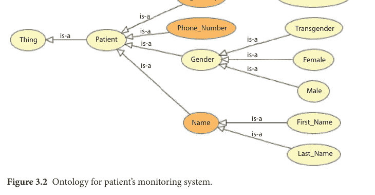

图 3.2 患者监测系统的本体。

- **N(oun):** 称为名词的活的或非活的物体或实体。示例为 name、age 等。**N** 是 POS 标注中用于表示名词的符号。
- **V(erb):** 单词的动作称为动词。动词的例子有 visiting、breathing、see 等。**V** 是 POS 标注中用于表示动词的符号。
- **Adj(ective):** 形容词用于描述名词或名词短语。**ADJ** 是 POS 标注中用于表示形容词的符号。
- **Adv(erb):** 副词是名词、形容词、动词或其他副词的修饰语。**ADV** 是 POS 标注中用于表示副词的符号。

名词 POS 标签可进一步分为单数名词 (NN)、单数专有名词 (NNP) 和复数名词 (NNS)。患者监测系统利用 POS 标注器识别查询并从用户输入查询中提取根词。例如，查询 “Find the patient’s name affected by Corona?” 将被分类如下：

```
[S [NP Find][DT the][VP [V patient’s name affected][IN by] [NP Corona]]]
```

完成 POS 标注器过程后，构建解析树以查找查询关键字并快速理解概念。这是通过 Stanford Parser 的帮助实现的。解析是将句子拆分为单词以找出每个单词之间语法关系的图形结构表示的过程。它是将句子拆分为原子单词的过程，有助于研究数据、句子的结构以及其含义。解析树通过提供详细分析来描述语法如何用于生成句子，从而识别句子与语法之间的基本连接。解析技术包括自上而下和自下而上，用于描述解析过程的方向 [32]。图 3.3 显示了查询的示例解析树。

为了找到特定查询的答案，我们需要依赖搜索引擎通过计算查询中的术语 [18]。完成预处理后，必须提取根词以检索查询的结果。关键词提取是通过计算 TF*IDF 权重来执行的。它是根据公式计算的：

```
TF(t) = (Number of times term ‘t’ appears in a document) / (Total number of terms in the document) (3.1)
```

```
IDF(t) = logₑ (Total number of documents) / Number of documents with term ‘t’ in it (3.2)
```

```
TF*IDF(term) = TF(t) * IDF(t) (3.3)
```

其中 TF(term) 表示给定文档中术语的频率，IDF 表示逆文档频率。

在 POS 标注器的支持下对查询进行分析后，提取的关键词将被用于查找其结果。在提取结果之前，在描述逻辑的支持下，有必要为给定概念及其与类的关系编写 SWRL 规则。在 OWL（Web Ontology Language）中，规则是借助 SWRL（Semantic Web Rule Language）表达的，这是语义网的规则语言。在 SWRL 规则处理中，用户查询被作为输入并在先前知识的帮助下处理到规则引擎。

在 SWRL 中，事实和规则存储在规则数据库中，其中事实被视为类或子类，规则用作 URI 引用。根据用户查询，规则引擎检查给定查询的规则并在推理引擎的支持下产生结果，推理引擎充当产生结果的中介。图 3.4 显示了患者监测系统的 SWRL 规则结果。

```
Rule 1: hasName(?x, ?y) -> hasFName(?x, ?y), hasLName(?x, ?y)
Rule 2: Patient (?x), hasName(?x, ?y), hasAge(?y) -> hasGender(?x, ?y)
```

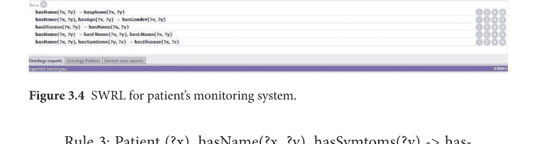

图 3.4 患者监测系统的 SWRL。

Rule 3: Patient (?x), hasName(?x, ?y), hasSymtoms(?y) -> hasDisease(?x, ?y)
Rule 4: hasDisease (?x, ?z) -> hasName(?x, ?y)
Rule 5: hasDisease (?x, ??z) -> select(?x), count(?z), orderByDescending(?z)

#### 3.3.2 Reasoner in Patient Monitoring

推理器用于在推理引擎的支持下从知识库获取数据。在本体构建时，推理器有助于检测不一致的本体。通过纠正不一致的本体，保持了本体的质量 [19]。整个查询使用三个推理器 Fact++、HermiT 和 Pellet 进行正确性验证。Pellet 是通过与其他两个推理器比较的最佳推理器，因为它具有调试功能。它是开源软件，用 Java 实现并遵循 tableau 算法。为了处理不一致的本体，Pellet 遵循以下准则。

- service clash detection 是检测根本不一致的方法
- axiom tracing 用于通过在对象上创建更多公理来查找无关本体。

推理器与 450 个显著不同的本体集成，可为预测模型实现高精度结果。此类预测模型具有广泛的应用范围。它甚至对大型和复杂本体也能提供更好的准确性 [11]。FaCT++ 是开源软件，遵循基于 tableaux 的算法并支持 C++ 语言。它遵循类上的描述逻辑。概念及其相关实例可以使用 OWL 表示 [22, 25]。

HermiT 是另一个用于识别不一致本体并清晰识别类之间及其对象之间关系的推理器。它遵循新颖的 hypertableau 算法，具有良好的推理能力。pallet 与其他推理器相比具有最佳功能。

- Consistency checking 用于找出矛盾的本体。
- Concept satisfiability 处理特定类的多个实例。
- Classification 为每个类及其子类创建类层次结构
- Realization 有助于识别每个类的个体。

Jena 是一个开源软件，包括不同的推理模块，如断言框 Abox、术语框 Tbox 和知识库 KB。Abox 描述了关于个体的断言，例如类型和属性值。实现 ABox 定义了每个个体的最精确概念及其与其实例的关系。类和子类上的公理列表可以在 Tbox 中定义。任何知识库都可以通过 ABox 和 TBox 的组合形成完整的 OWL 本体。

Jena ontology API 是一种本体语言，Java 本体类表示 OWL 类、RDFS 类或 DAML 类。每个本体模型都与一个 Profile 绑定 [12]。推理器所做的推理遵循归纳推理并经过大量事实和规则。它帮助医疗从业者对患者的健康问题做出有效决策。因此，系统将作为更好的推荐系统。因此，患者也相信所提供的信息是可靠的，其准确性也比未经过推理器的系统更相关。

#### 3.4 Experimental Results

在执行查询之前，所有预处理、关键词提取、规则构建和验证必须由推理器完成。最后，使用 SPARQL 执行查询。然后与传统数据库进行比较。结果证明，本体的结果更准确且更具语义。传统数据库中识别出的任何问题都已得到恢复。


#### 3.4.1 SPARQL 结果

任何语义应用都需要语义查询语言来检索数据。SPARQL 是检索基于 RDF 的语义数据的查询语言。本研究工作依赖于语义信息，数据库也是以语义含义创建的。本体中存储的数据遵循语义结构。图3.5显示了一个示例查询。

```
PREFIX rdf: <http://www.w3.org/1999/02/22-rdf-syntax-ns#>
PREFIX owl: <http://www.w3.org/2002/07/owl#>
PREFIX rdfs: <http://www.w3.org/2000/01/rdf-schema#>
PREFIX xsd: <http://www.w3.org/2001/XMLSchema#>
PREFIX info: <http://www.patinfor.com/info#>
SELECT ?Patient ?DName
WHERE { ?Patient info:DName ?DName }
```

#### 3.4.2 与其他系统的比较

传统数据库存在很多问题，如缺失值、冗余，并且大多数系统提供的是语法结果而非语义结果。更好的方法是在本体的支持下解决整个问题。图3.6展示了 SQL 和 SPARQL 之间的比较，并讨论了语义数据库的重要性。

- 数据冗余已减少。
- 错误已减少，一致性提高。


图3.5 患者监控系统的SPARQL查询。

### SQL与SPARQL的比较

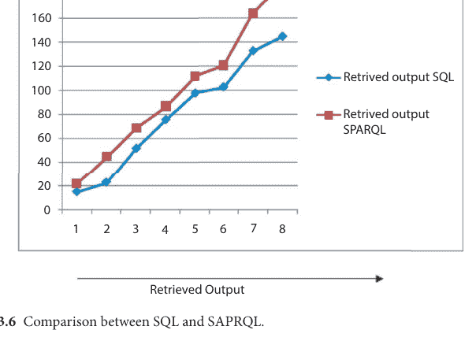

图3.6 SQL与SPARQL的比较。

- 它支持数据完整性。
- 可通过不同的查询语言轻松访问数据。
- 数据安全性得到改善。
- 数据输入、存储和检索成本已降低。
- 它还支持开发许多新的应用程序。

#### 3.5 结论与未来改进

一个基于本体的患者监控系统已经开发出来，同时包含健康信息和患者信息。在本研究工作中，患者监控系统是基于医疗系统领域的本体构建而开发的，该系统使用 SWRL 规则构建。患者本体包含所有必要的类、个体，并且它们之间的关系相互连接。为了增强系统的健壮性，生成了更多规则，并通过推理器评估系统的正确性。患者监控系统能够基于人工智能推理技术，比较其创新结果，并更好地理解其创新背景。该框架可以在该领域进行扩展。

14. Meraji, M., Sadoughi, F., Ahmadi, M., Kahani, M., 设计基于本体的健康信息系统：一种系统方法. Life Sci. J., 10, 7, 735–739, 2013.

15. Suganyakala, R. 和 Rajalaxmi, R.R., 使用基于本体的语义搜索进行电影相关信息检索. IEEE International Conference on Information Communication and Embedded Systems (ICICES), 第1–6页, 2013.

16. Soner K., K., Özgür, A., Orkunt, S., Samet, A., Nihan K., C., Ferda, N.A., 使用语义索引的基于本体的检索系统. Inf. Syst., 37, 4, 294–305, 2012.

17. Shazmeen, S.F 和 Ramyasree, E., 语义网挖掘：益处、挑战与机遇. Int. J. Adv. Comput. Res., 2, 4, 7, 2012.

18. Carpineto, C. 和 Romano, G., 信息检索中自动查询扩展综述. ACM Comput. Surv., 44, 1, Article1, 50页, 2012.

19. Dentler, K., Cornet, R., ten Teije, A., de Keizer, N., OWL 2 EL 文件中大型本体的推理机比较. Semantic Web 1 IOS Press, 1, 1–5, 2011.

20. Turhan, A.-Y., 语义网本体的描述逻辑推理. ACMWIMS'11, 1, 1–5, 2011.

21. Fernández, M., Cantador, I., López, V., Vallet, D., Castells, P., Motta, E., 语义增强的信息检索：一种基于本体的方法. Web Semantic, 9, 4, 434–452, 2011.

22. Hafizullah, A.H. 和 Aniza, A., 螺旋OWL模型？走向螺旋知识工程. World Knowl. Eng. World Acad. Sci. Eng. Technol., 38, 45–52, 2010.

23. Lee, C.S., Chen, M.H., Hagras, H., 二型模糊本体及其在个人糖尿病饮食推荐中的应用. IEEE T Fuzzy System, 18, 2, 374–395, 2010.

24. Saravanan, Ravindran, Raman, 使用本体框架改进法律信息检索. Arti. Intell. Law, 17, 2, 101–124, 2009.

25. Chi 和 Chen, 文档调度中的本体与语义规则, 第27卷, 第4期, 第694–707页, The Electronic Library, 2009.

26. Beale, T. 和 Heard, S., 基于本体的临床信息模型. In Proc. MedInfo, 1, 760–764, 2007.

27. Li, Z., Raskin, V., Ramani, K., 面向信息检索的工程本体开发方法论. International Conference on Engineering Design, ICED'07, 法国巴黎, 第1–12页, 2007.

28. Jayaweera, P., Jayasinghe, J., Wellakkage, L., Malawaraarachchi, V., Liyanage, S., Perera, P., 基于以患者为中心的过程本体的诊所管理系统(CMS). Ruhuna J. Sci., 1, 1, 40–39, 2006.

29. Jun-feng, S., Wei-ming, Z., Wei-dong, X., Zhen-ning, X., 面向语义网的基于本体的信息检索模型. 2005 IEEE International Conference on e-Technology, e-Commerce and e-Service, 第152–155页, 2005.

# 医疗系统中改进搜索的语义网解决方案

Nidhi Malik¹、Aditi Sharan¹ 和 Sadika Verma²

¹ 印度新德里尼赫鲁大学计算机与系统科学学院
² Sadika Verma，印度旁遮普邦班努尔SVIET

#### 摘要

过去几十年里，医疗行业也取得了巨大发展，数字化在这一增长中发挥了重要作用。医疗系统的要求是其正确、交互、及时且准确。为了实现这些目标，语义网技术正被证明具有极大的用处。万维网联盟已成立医疗与生命科学小组，其目标是在医疗及相关领域开发和扶持这些技术。在本章中，我们希望强调语义网解决方案，这些方案相比传统方法改进了搜索过程。

**关键词：** 语义网、搜索引擎、本体、词汇表

#### 4.1 引言

生活各个方面都受益于信息技术的使用，包括医疗行业[1]。医疗服务的效率、效果和可及性都得到了极大改善。在许多医疗组织中，使用能够快速管理和定位重要信息的信息系统已成为标准做法。随着网络的民主化和Web 3.0的出现，大量健康相关信息已在公共领域可用。这些信息的利益相关者

*通讯作者：nidhimalik14@gmail.com*

Vishal Jain、Jyotir Moy Chatterjee、Ankita Bansal 和 Abha Jain（编）《语义网在高效医疗中的应用》，(95–114) © 2022 Scrivener Publishing LLC

包括医生、患者、研究人员等。尽管健康相关信息在网络上可用且易于访问，但在处理和可理解性方面仍存在许多问题。小问题与人类的理解和使用有关，但主要限制在于机器本身的可解释性。

本章重点介绍语义网技术在改善医疗系统服务中所发挥的作用。第二节详细介绍了该领域研究人员用于查找所需信息的搜索技术。第三节详细阐述了语义的作用、它们在搜索过程中的优势以及领域特定资源。第四节讨论了生物医学领域的最新技术进展和资源。还讨论了一些流行和最新的技术与资源。第五节总结本章。

##### 4.1.1 技术在医疗系统中的主要优势和使用

由于网络数据的持续增长和全球化背景，健康信息技术也变得非常抢手[36]。这些信息的利益相关者访问它，用于共享、与其他替代信息源进行比较，并通过网络传递给他人[2]。医疗服务方面的所有发展都考虑到了这一点。因此，使用技术已成为促进这种信息广泛使用的必要条件。对医疗行业至关重要的一些主要优势包括：

- 几乎所有医疗服务都受益于信息技术，尤其是电子医疗记录（EMR）的发展。信息以单一数据库的形式维护，这将最大程度地减少文书工作，并跟踪患者的病史。
- 用于保存患者数据的管理系统会根据患者在医疗设备、药物等方面的需求自动检索对应患者的数据[3]。在进行基本汇总和整理后，这些数据有助于医疗服务提供者对数据进行解读。
- 用于临床环境的决策支持系统也需要决策工具和系统运行工具[3]。临床系统需要及时跟踪患者的需求，设置通知、警报、提醒，用于


使用形式化陈述和推理来提供目前网络上尚不可用的高级服务 [2]。语义网是传统网络的扩展，意义在于自然文本中包含的信息通过基于知识形式化表示的清晰语义得到补充。它也被设想为万维网的扩展，允许计算机基于对人们的理解来搜索、组合和智能处理网络内容 [6]。为了促进机器可读性和知识处理，世界万维网联盟（W3C）提出了标准、查询语言和语义栈的一套方案。

医疗/健康科学的知识和术语的复杂性和多样性需要被解决，才能充分利用它。由于这种多样性，从以往实践和过去病史中提取知识也非常困难 [6]。此外，信息共享在该领域非常重要，这也是语义网出现的原因。

#### 4.2.2 语义在医疗保健系统中的范围和益处

语义网技术已成为电子商务、教育、电子政务、娱乐、医疗保健、社会网络和软件工程等众多领域创新和变革的关键驱动力。语义网技术和语义为我们提供了一种新的信息管理和流程方法，其基本原则是语义元数据的创建和使用。元数据是一组提供有关其他数据信息的数据集 [6]。使用语义元数据对于整合来自异构源的信息至关重要，无论是在组织内部还是跨组织。各种方案用于描述和分类信息，并且与信息一起使用不同的术语。通过创建不同的方案，可以创建统一的视图并实现使用信息的流程之间的交互。语义描述也可以应用于作为网络服务呈现的流程。当互联网服务的功能能够以语义方式描述时，则该网络服务可以更容易被检测到。当现有网络服务提供描述其功能和上下文的元数据时，则可以从现有服务的组合中自动编译新服务。

#### 4.2.3 语义融合的问题

语义网支持的解决方案可以为所有利益相关者之间提供端到端的信息共享解决方案，并且以有意义的方式进行 [6]。

信息存储在异构分布式的健康信息系统中，采用不同的文件格式，主要是专有的 [3]。因此，共享信息的系统需要互操作性兼容，以便保留共享信息的语义，并且由于语义和语法差异而不会丢失信息 [7]。需要考虑的一些问题是 [8]：

- **通用标准/指南：** 为了信息共享和重用，需要分析和决定解决政策冲突的规则，以确保修改后的规则在语法上和/或语义上有效。
- **确保数据映射：** 从不同系统获取属性和值并将它们组合在一起通常会导致语义差异，进而导致数据部分映射。这是因为数据结构不兼容或未形式化。
- **用户参与：** 为用户开发系统需要让他们参与，以便正确识别所有通用术语及其含义。如果没有这样做，会导致数据不当披露。
- **领域词汇：** 创建一个词汇表，正确识别具有多重含义的术语，可用于确定一个属性值与另一个属性值之间的语义关系。
- **本体映射：** 为了达到适合整个领域的全局最优解决方案来映射不同本体中的概念。它们相关的语义也需要被考虑。

#### 4.2.4 现有的语义网技术

简单来说，语义网为信息添加了意义，这进一步使计算机和人能够协同工作。语义技术正在兴起，从业务流程管理到信息安全等多个应用已展示出其益处的良好前景。

语义网栈如图 [9] 所示，说明了语义网的架构。其组件的功能和关系可总结如下 [9]。

- XML 是一种标记语言，定义了文档内的基本结构。
- XML Schema 描述 XML 文档的结构。
- RDF 指对象及其关系，并为各种数据模型提供语言支持。
- RDF Schema 是描述属性和类层次结构的基本词汇。
- OWL 扩展了属性和类的词汇支持。
- SPARQL 是语义网数据源的协议和查询语言。
- RIF 是一种 XML 语言，用于实现规则交换，使不同系统可以执行。它代表规则交换格式。

#### 4.3 医疗保健系统中的搜索技术

搜索引擎根据各种标准从大型索引中检索用户关键词的文档并对其进行排序。虽然这种基于关键词的搜索快速而强大，能够检索单个文档，但它远非通过“理解”用户查询来回答用户问题的愿景。网络也被公众用来获取医疗和健康信息 [11]。研究发现，公众在互联网上搜索的最常见的健康和医疗主题是关于特定疾病或医疗问题、特定医疗治疗、饮食、营养和维生素，以及锻炼或健身，以及处方药 [11]。特别是，研究人员对用户的信息需求进行了分类和分析，以改进搜索引擎 [11]。医学相关信息搜索与其他信息搜索不同，因为用户经常使用医学术语、疾病知识、治疗选择等。

##### 4.3.1 基于关键词的搜索

基于关键词的搜索会根据用户输入的词给出输出，但也需要使用同义词和搜索词的变体进行搜索，以确保检索到所有相关记录 [12]。

例如，如果用户使用文本词搜索查找“心脏病发作”的信息，还需要使用“心脏病发作”、“心肌梗死”、“心肌梗塞”等术语进行搜索。然而，关键词通常存在歧义，可能具有多种含义。例如，给定关键词‘Alzheimer’，用户意图可能是搜索该疾病的信息，也可能是搜索治疗它的药物 [13]。

为了解决这个问题，提出了*语义搜索*，通过理解用户意图和搜索上下文来提高搜索准确性。

##### 4.3.2 基于受控词汇表的搜索

受控词汇表也被研究人员使用，它们是标准化的、层次化的列表，用于表示数据库中包含的主要主题概念和条件 [12]。它们可能因数据库而异。词汇表的层次结构通过允许在该框架内保持一致的方式缩小广泛概念，从而使搜索策略受益。

##### 4.3.3 利用语义网解决方案改进搜索

- 处理异构数据是查询信息时的主要问题。由于词汇的多样性，按意义获取所需数据更具挑战性 [13]。本体论的形式化表示机制通过匹配类、不同类型的属性和实例来实现统一。
- 语义网的意图允许在应用程序和组织之间促进知识共享和重用。信息交换标准不可用、不当的语法和语义规则一直是医学科学领域信息共享的问题。语义网技术可以应用于解决所有这些问题。
- 语义搜索通过理解搜索目的和单词在可搜索数据空间中出现的上下文意义来提高搜索精度 [16]，无论是在网络上生成更相关结果 [14]。
- 数据模型，资源描述框架 [5] 基于图论，它适合使用主语-谓语-宾语三元组来表示生物医学数据。
- 用于从本体获取信息的语言支持是可用的，例如本体编辑器如 Protege [8]、本体推理器如 Pellet、SPARQL 端点等。


- 具体来说，对于生物医学本体 [35]，使用的是基于图的表示语言的平面文件格式 OBO。

#### 4.3.4 用于语义搜索的健康领域特定资源

在讨论了网络、语义网以及其他技术进步带来的变化之后，我们希望讨论语义网在健康领域的作用，该领域主要由生物医学领域驱动。语义网将有助于在线数据的互联、有效搜索和浏览、有效沟通以及人类

**表 4.1** 热门生物医学本体列表。

| Ontology | Purpose |
|---|---|
| **Common anatomy reference ontology** | Defines interoperability between various anatomy ontologies for different species |
| **Disease ontology** | Cross maps terms of disease ontology to SNOMED OMIM, MeSH, ICD, NCI’s thesaurus |
| **Foundational model of anatomy** | Knowledge representation about human anatomy |
| **GENE ontology** | Information about molecular functions, biological processes and cellular components |
| **Ontology for biomedical investigations** | Description of life-science and clinical investigations in the form of integrated ontology |
| **Ontology for general medical science** | Covers research based on the papers Toward an Ontological Treatment of Disease and Diagnosis. Also include Carcinomas and Other Pathological Entities |
| **Vaccine ontology** | Represents vaccine knowledge and supports automated reasoning also |
| **Human phenotype ontology** | Covers phenotypic abnormalities encountered in human disease |
| **Infectious disease ontology** | Set of interoperable ontologies in the domain of infectious disease |

交互。生物医学领域对于健康相关信息非常重要，并为解释和分析这些信息提供了丰富的背景。

生物医学领域很早就建立了数字存在，生物医学资源被开发用于生物医学信息的交流和互换。为了深入生物医学领域的世界，需要了解丰富的生物医学资源、它们的表示、分类、使用机制。最初，从任何领域寻求信息仅限于查阅期刊，而且仅限于学术人员。但随着技术的进步，情况已不再如此。

在这里，我们详细阐述了生物医学领域的研究人员广泛使用的资源。

##### 4.3.4.1 Ontologies

大约在 1988 年，生物和生物医学领域的科研人员开始使用本体 [32]。到 2007 年，研究人员在该领域进行了足够的兴趣和研究，并由开放生物医学本体 OBO Foundry [33] 或国家生物医学本体中心 NCBO [34] 发起。作为 [37] 所说，该领域最常用的一些本体列于表 4.1 中。

##### 4.3.4.2 Libraries

几乎所有领域都有托管不同本体、词汇表和其他元数据的图书馆。生物医学领域研究人员常用的一些图书馆列于下表 4.2 中：

##### 4.3.4.3 Search Engines

生物医学领域的研究人员在搜索时已致力于纳入语义网方面 [10]。下面讨论了一些流行的搜索引擎及其功能 [39]：

###### 4.3.4.3.1 PUBMED

它是一个基于关键字的搜索引擎，使用 Entrez 搜索引擎将搜索词与每篇文档的标题、摘要和引文信息中的文本进行关键字匹配，不进行全文文档搜索 [22]。搜索引擎还会将搜索词与 MeSH 主题词匹配以查找文档。

- **Ranking Results:** 结果不是按相关性排序，而是默认按日期排序。还可以根据作者、期刊或标题进行进一步筛选。

| Library | Contains | Features |
|---|---|---|
| BioPortal | Hosts 885 ontologies having 12,045,609 classes | Browse through library of ontologies, options for advanced search are also there |
| OBO Foundry | Hosts more than 185 active ontologies | Well formed and scientifically accurate interoperable ontologies |
| OLS—Ontology Lookup Service | Repository for biomedical ontologies; 257 ontologies 6,253,863 terms | Provides cross-ontology mappings between terms from different ontologies, assist in mapping data to ontologies and tool for building ontologies from spreadsheets |
| Ontobee | Facilitates data sharing, visualization of data, query analysis, and integration | Applied for more than 230 ontologies |
| ICD—International classification of Diseases | For classification of disease, it provides diagnostic codes | Provides injury or disease specific classification of symptoms, complaints, findings, and various causes |
| Logical observational identifiers, names and codes | Information in the form of database for medical laboratory observations and their standards | Medical observations characterized by laboratory code, types of outcomes, and inputs about patients |

# Table 4.2 List of popular biomedical libraries.

# Table 4.2 List of popular biomedical libraries. (Continued)

| Library | Contains | Features |
|---|---|---|
| MeSH—Medical Subject Headings | Domain information in the form of hierarchy for creating index and catalog | Database from National Library of Medicine and popular MEDLINE/PubMed |
| RxNorm | Standardized representation for clinical drugs | Software and vocabulary need not be same when mediating messages between different systems |
| SNOMED-CT [24] | Medical terms with codes, different forms of terms, and their definitions | EHR nomenclature for symptoms, clinical findings, devices, organisms, substances, etc. |
| UMLS—Unified Medical Language System | Collection of files and tools for health and biomedical vocabularies | Interoperability standards |
| NCBI taxonomy | Nomenclature for organisms in public sequence database | Represents 10% species of life on the planet |
| NDF—National Drug File | Electronic drug list used by the VHA hospitals and clinics | Manage drug interactions and send prescriptions to pharmacies |

###### 4.3.4.3.2 Quertle

它依赖自然语言处理技术将搜索与作者实际提出的断言进行匹配，而非简单的关键字匹配或邻近匹配。它大量使用本体，以便自动应用搜索词的所有含义、形式、别名 [40]。本体还允许找到子概念；例如，搜索“啮齿动物”会找到“老鼠”、“大鼠”等。

- **Ranking Results:** 结果的相关性由文档支持该断言的次数决定。

###### 4.3.4.3.3 FACTA+

它是一个基于索引的实体搜索引擎 [41]。它用于查找相关的生物医学概念，并将这些概念连同查询项与概念之间关联的文本证据一起呈现给用户。多个生物医学数据库如 UniProt、BioThesaurus、UMLS、KEGG 和 DrugBank 用于使用 conceptID 及其名称/同义词构建索引。

- **Ranking Results:** 排名基于共现统计。使用的搜索空间是 PubMed。

###### 4.3.4.3.4 THALIA

该语义搜索引擎识别生物医学摘要中出现的概念 [42]。Thalia 代表 Highlighting, Aggregating and Linking Information in Articles。它使用文本挖掘工具 Argo 来识别实体，使用基于词典匹配和 CRF 模型训练的人工标注数据。

- **Ranking Results:** 它使用的搜索空间是 PubMed。查询和检索的文档中存在相同概念。搜索 API 还提供按出版年份、期刊名称、作者、出版类型和 MeSH 标签筛选文档的选项。

###### 4.3.4.3.5 LitVar

它是一个基于实体的搜索引擎，用于链接基因组变异数据。它使用先进的文本挖掘技术处理整套文章（PUBMED 摘要和 PMC-OA 全文），通过整合 Pubmed、PMC-OA、dbSNP 和 ClinVar 计算并提取变异与其他相关实体如疾病和化学品/药物之间的关系 [43]。

- **Ranking Results:** LitVar 使用的搜索空间是 PubMed + PMC-OA。结果按出版日期排序。结果可以根据顶级期刊、出版物、年份、出版类型以及与查询匹配的出版物部分进行筛选。借助实体级筛选器，可以聚焦于基因、疾病、化学物质、变异实体在句子级别共现的文章。

###### 4.3.4.3.6 CTGA

如 [38] 中所述，在这种基于图的搜索中，使用神经信息抽取模型将文本转换为元组。然后，这些查询或文档的元组被表示为链接概念节点的知识图，最后使用高效的基于图的算法根据结构化知识返回相关文档。它应用 MIMO（多输入多输出），即一种深度神经信息抽取模型，用于从非结构化内容中抽取事实性和条件性元组。然后将提取的信息使用三层知识图表示。

- **Ranking Results:** 它使用的搜索空间是 PubMed，并使用平均倒数排名 MRR 对结果进行排名。

###### 4.3.4.3.7 GoWeb

它是一个语义搜索引擎，使用语义网中的文本挖掘和本体。它使用筛选机制来处理长长的搜索结果列表，这些列表符合 GENE 本体和医学主题词表 MeSH [23] 提供的类别。搜索操作的结果以文本形式给出网页文档的摘要，称为摘要片段。此外，还使用实体识别技术将背景知识中的概念映射到摘要片段。


- **排名结果：** 基于背景知识（即本体）中突出的关键词和概念，采用基于代理的解决方案。过滤机制将搜索结果大幅缩减为少量相关结果。

###### 4.3.4.3.8 BioTCM

BioTCM 是一个用于现代生物学和传统中医药信息检索（IR）的语义搜索引擎原型。它构建了一个本体，整合了来自不同数据源的内容，并基于相应的本体模式将其转换为 RDF 格式 [15]。

- **排名结果：** 提供了一个 Web 应用程序，可通过单一访问点浏览生物医学知识。SPARQL 用于基于语义规则集执行用户查询。

###### 4.3.4.3.9 BEST

BEST 是一个基于关键词的搜索引擎，采用基于字典的方法从文本中提取实体 [44]。在构建实体词典时，整合了来自 12 个不同来源的实体名称。然后基于文档-实体列表对索引，对实体和摘要进行索引。

- **排名结果：** 支持布尔运算符、邻近搜索和词项加权等常见搜索操作。结果基于：
  - 词项匹配得分（T<sub>d</sub>(q)）
  - 实体数量得分（N<sub>d</sub>）
  - 信誉得分（Q<sub>d</sub>）
  - 新近度得分（R<sub>d</sub>）

#### 4.4 医疗领域的新兴技术/资源

当今时代的技术发展速度非常快。早期，只有学术界人士通过发表的期刊和报告来获取领域信息。现在情况不同了。随着信息技术的进步，基于证据的医学、临床试验、诊断数据、远程监测、与专家的远程互动等概念已经得到人们的开发和管理。

语义在这些任务中的参与，某种程度上完善了医疗服务提供者与医疗服务接受者之间的互动。每年有数千篇新文章发表在同行评审期刊上 [17]。这些信息的利益相关者包括医生、患者、研究人员等。以下讨论研究人员在医疗领域使用的一些新兴技术：

##### 4.4.1 Elasticsearch

> “Elasticsearch 是一个分布式、开源的搜索和分析引擎，基于 Apache Lucene 构建，使用 Java 开发。它最初是 Lucene 开源搜索框架的可扩展版本，后来增加了水平扩展 Lucene 索引的能力。Elasticsearch 允许你快速、近乎实时地存储、搜索和分析海量数据，并在毫秒级内给出答案 [18]。它之所以能快速响应，是因为它检索的是索引而非文本。它使用基于文档的结构而非表和模式，并附带丰富的 REST API 用于存储和搜索数据。”

专门针对癌症患者的精准医学稳健肿瘤学搜索引擎（PRIMROSE）由 [29] 提出，可根据患者病情、基因图谱、年龄和性别检索科学文章和临床试验。该搜索引擎利用 Elasticsearch 索引进行信息存储和检索，并开发了一个知识图谱用于查询扩展以提高召回率。

Elasticsearch 已被 [30] 与大数据平台结合使用，以处理海量临床数据。[31] 提出了一个使用 Elasticsearch 进行社交媒体数据分析的框架。该研究强调了如何标准化和配置 Elasticsearch 流程的见解，从而提高了分析效率。

##### 4.4.2 BioBERT

BioBERT 是针对生物医学领域的预训练语言表示模型 [17]。随着自然语言处理（NLP）的进步，从生物医学文献中提取有价值的信息受到研究人员的广泛关注，深度学习也推动了有效生物医学文本挖掘模型的发展 [17]。然而，由于词分布从通用领域转向生物医学领域，将 NLP 领域的进展直接应用于生物医学信息挖掘时效果并不理想 [17]。BioBERT 已在由 PubMed 摘要和 PMC 全文文章组成的生物医学领域语料库上进行了预训练。

同时，用于生物医学信息交流和交换的生物医学资源也在不断发展。

引入语义网概念的目的是使信息不仅能被机器理解和处理，也能被人类理解和处理。语义网将有助于在线数据的互联、高效的搜索和浏览、有效的沟通以及人机交互。语义网技术是促进系统间知识管理和共享的工具。本章旨在强调语义网技术在改善医疗领域搜索解决方案方面所能发挥的作用。本章深入讨论了纳入语义的重要性、如何利用语义，以及可用的不同类型资源。

### 参考文献

- 1. Almunawar, M.N. and Anshari, M., Health Information Systems (HIS), in: *Concept and Technology*, 2012.
- 2. Simba, D.O. and Mwangu, M., Application of ICT in strengthening health information systems in developing countries in the wake of globalisation. *African Health Sci.*, 4, 3, 194–198, 2004.
- 3. Alotaibi, Y.K. and Federico, F., The impact of health information technology on patient safety. *Saudi Med. J.*, 38, 12, 1173–1180, 2017. https://doi.org/10.15537/smj.2017.12.20631.
- 4. Gulavani, S. and Kulkarni, R.V., Role of information technology in healthcare. *Proceedings of 4th National Conference*, INDIACom-2010.
- 5. Yamin, M., IT applications in healthcare management: a survey. *Int. J. Inf. Technol.*, 10, 503–509, 2018. https://doi.org/10.1007/s41870-018-0203-3.
- 6. Manika, P., Xhumari, E., Ktona, A., Demiri, A., Application of ontologies and semantic web technologies in the field of medicine. *International Conference of Recent Trends and Applications in Computer Sciences and Information Technology*, 2018.
- 7. Iroju, O., Soriyan, A., Gambo, I., Olaleke, J., Interoperability in Healthcare: Benefits, Challenges and Resolutions. *Int. J. Innovation Appl. Stud.*, 3, 1, 262–270, May 2013.
- 8. Bhartiya, S., Mehrotra, D., Girdhar, A., Issues in achieving complete interoperability while sharing electronic health records. *Proc. Comput. Sci.*, 78, 192–198, 2016.
- 9. https://en.wikipedia.org/wiki/Semantic_Web
- 10. Trivedi, M., A study of search engines for health sciences. *Int. J. Lib. Inf. Sci.*, 1, 5, 69–73, 2009.
- 11. Wang, L., Wang, J., Wang, M., Li, Y., Liang, Y., Xu, D., Using Internet Search Engines to Obtain Medical Information: A Comparative Study. *J. Med. Internet Res.*, 14, 3, e74, 2012. URL: https://www.jmir.org/2012/3/e74.
- 12. https://research.library.gsu.edu/c.php?g=115556&p=751704
- 13. Hu, W., Qiu, H., Huang, J., Dumontier, M., BioSearch: a semantic search engine for Bio2RDF. *Database*, 2017, 1–13, 2017.
- 14. Roy, S., Modak, A., Barik, D., Goon, S., An overview of Semantic Search Engines. *Int. J. Res. Rev.*, 6, 10, 73–85, 2019.
- 15. Chen, X., Chen, H., Bi, X., Gu, P., Chen, J., Wu, Z., BioTCM-SE: A Semantic Search Engine for the Information Retrieval of Modern Biology and Traditional Chinese Medicine. *Comput. Math. Methods Med.*, 2014, 1–3, 2014.
- 16. Gandon, F., A Survey of the First 20 Years of Research on Semantic Web and Linked Data, in: *Revue des Sciences et Technologies de l’Information - Série ISI: Ingénierie des Systèmes d’Information*, Lavoisier, (Ed.), 2018, ff10.3166/ISI.23.3-4.11-56ff. ffhal-01935898f.
- 17. Lee, J., Yoon, W., Kim, S., Kim, D., Kim, S., Ho So, C., Kang, J., BioBERT: A pre-trained biomedical language representation model for biomedical text mining. *Bioinformatics*, 36, 4, 1234–1240, 15, February 2020.
- 18. https://www.knowi.com/blog/what-is-elastic-search/
- 19. Nakashole, N., Theobald, M., Weikum, G., Scalable knowledge harvesting with high precision and high recall. *WSDM*, pp. 227–236, 2011, [20] Constructing knowledge graphs and their biomedical applications.
- 20. Xu, J., Kim, S., Song, M. *et al.*, Building a PubMed knowledge graph. *Sci. Data*, 7, 205, 2020. https://doi.org/10.1038/s41597-020-0543-2.
- 21. Tsatsaronis, G., Balikas, G., Malakasiotis, P. *et al.*, An overview of the BIOASQ large-scale biomedical semantic indexing and question answering competition. *BMC Bioinf.*, 16, 138, 1–28, 2015. https://doi.org/10.1186/s12859-015-0564-6.
- 22. https://pubmed.ncbi.nlm.nih.gov/
- 23. Dietze, H. and Schroeder, M., GoWeb: a semantic search engine for the life science web. *BMC Bioinf.*, 10, S7, 1–13, 2009. https://doi.org/10.1186/1471-2105-10-S10-S7.
- 24. http://www.snomed.org/
- 25. *The BioASQ Challenge*, *BMC Bioinformatics*, 2015, http://www.bioasq.org/
- 26. https://blog.grakn.ai/biograkn-accelerating-biomedical-knowledge-discovery-with-a-grakn-knowledge-graph-84706768d74
- 27. Messina, A., Pribadi, H., Stichbury, J., Bucci, M., Klarman, S., Urso, A., BioGrakn: A Knowledge Graph-Based Semantic Database for Biomedical Sciences, in: *Complex, Intelligent, and Software Intensive Systems. CISIS 2017. Advances in Intelligent Systems and Computing*, vol. 611, I. Barolli and O. Terzo (Eds.), Springer, Cham, 2018, http://doi-org-443.webvpn.fjmu.edu.cn/10.1007/978-3-319-61566-0_28.
- 28. Shenoi, S.J., Ly, V., Soni, S., Roberts, K., Developing a Search Engine for Precision Medicine. *AMIA Joint Summits Trans. Sci. Proc. AMIA Joint Summits Trans. Sci.*, 2020, 579–588, 2020.


29. Chen, D. 等，《在大数据平台中将日常医疗数据实时或近实时持久化至HDFS及ElasticSearch索引》，载于《IEEE工业信息学汇刊》，第13卷，第595–606页，2017年4月。

30. Shah, N.、Willick, D.、Mago, V.，《使用Elasticsearch和Kibana进行社交媒体数据分析的框架》，《无线网络》，2018年，第1–9页，2018年。10.1007/s11276-018-01896-2.

31. Hoehndorf, R.、Schofield, P.N.、Gkoutos, G.V.，《本体论在生物学和生物医学研究中的作用：功能视角》，《生物信息学简报》，第16卷，第6期，第1069–1080页，2015年。https://doi.org/10.1093/bib/bbv011.

32. Ashburner, M.、Ball, C.A.、Blake, J.A. 等，《基因本体论：生物学统一的工具》，《自然遗传学》，第25卷，第25–29页，2000年。[PMC免费文章] [PubMed] [Google Scholar].

33. Smith, B.、Ashburner, M.、Rosse, C. 等，《OBO Foundry：协同演化本体论以支持生物医学数据集成》，《自然生物技术》，第25卷，第1251–1255页，2007年。[PMC免费文章] [PubMed] [Google Scholar].

34. Musen, M.A.、Noy, N.F.、Shah, N.H. 等，《国家生物医学本体论中心》，《美国医学信息学协会杂志》，第19卷，第190–195页，2012年。[PMC免费文章] [PubMed] [Google Scholar].

35. Horrocks, I.，《OBO平面文件格式的语法与语义及其到OWL Web本体语言的映射》，曼彻斯特大学，2007年。

36. Heath, T. 与 Bizer, C.，《关联数据：将Web演变为全球数据空间》，第1版，Morgan & Claypool，美国加利福尼亚州圣拉斐尔，2011年。

37. 编辑版本，曼彻斯特，2007年，https://guides.lib.umich.edu/ontology/ontologies

38. Jiang, T. 等，《CTGA：基于图的生物医学文献检索》，2019年IEEE生物信息学与生物医学国际会议（BIBM），美国加利福尼亚州圣迭戈，第395–400页，2019年。

39. http://www.biomedicalsearchengines.com/

40. https://quertle.com/

41. http://www.nactem.ac.uk/facta/

42. Soto, A.J.、Przybyła, P.、Ananiadou, S.，《Thalia：面向生物医学摘要的语义搜索引擎》，《生物信息学》，第35卷，第10期，第1799–1801页，2019年5月15日。

43. Ilot, A.、Peng, Y.、Wei, C.H.、Lee, K.、Phan, L.、Lu, Z.，《LitVar：用于链接PubMed和PMC中基因组变异数据的语义搜索引擎》，《核酸研究》，第46卷，第W1期，第W530–W536页，2018年。

44. Lee, S.、Kim, D.、Lee, K.、Choi, J.、Kim, S.、Jeon, M. 等，《BEST：下一代生物医学实体搜索工具，用于从生物医学文献中发现知识》，《公共科学图书馆·综合》，第11卷，第10期，e0164680，2016年。https://doi.org/10.1371/journal.pone.0164680.

45. https://www.nlm.nih.gov/bsd/medline.html

# 可操作内容发现
面向医疗保健

Ujwala Bharambe¹* 和 Anuradha Srinivasaraghavan²†

¹Thadomal Shahani工程学院计算机工程系，
印度孟买

²圣弗朗西斯技术学院计算机工程系，
印度孟买

#### 摘要

临床决策由医疗和患者病史的所有可用信息驱动。当前面临的问题是，在提供当时最佳护理所需时，如何即时提供基于证据的医疗信息。这可以通过在当时将“基于证据的可操作内容”提供给医疗保健专业人员来实现，以便他能够做出当时的最佳决策。可操作内容以可查询的建议、相关上下文链接和可操作项目的形式提供临床指导。为了在医疗保健领域发现可操作内容，健康分析需要依次进行三种类型的分析：描述性、预测性和规范性分析。这些分析有助于检索能够代表可操作内容的连贯而有意义的信息。传统的机器学习技术有助于将描述性分析转化为预测性分析。然而，这些技术对数据的需求量很大，而在医疗保健领域，数据来自多个异构来源。这些异构性问题通过语义技术（即本体论）来解决。本章讨论了本体论的可用性，并提出了一种本体驱动的三层架构，用于从医疗保健领域的多个异构信息源中提取可操作内容。

**关键词：** 分析、描述性分析、预测性分析、规范性分析、本体论、可操作内容

#### 5.1 引言

医疗数据的收集和分析旨在提高患者的健康质量、降低治疗成本，并为患者和研究人员产生有意义的见解。医疗系统做出的临床决策由有关医疗数据的所有可用信息以及特定疾病类型的患者病史所驱动。这需要医疗从业者的验证[34]。然而，通过提供基于证据的医疗信息可以保证最佳护理。为此，医疗保健专业人员需要“可操作内容”。

问题仍然在于，如何将可操作内容纳入实践，并通过帮助临床决策和行政管理能力使其高效可用。例如，假设一位肿瘤科医生预约了一名44岁的绝经前女性。

经过初步检查，发现该女性患有早期乳腺癌。检查发现她属于三阴性乳腺癌（ER、PR、Her-2均为阴性），并且该女性有家族性乳腺癌病史。尽管这对诊断至关重要，但她尚未进行BRCA1或BRCA2突变基因检测，而该检测可以确认（或排除）她对乳腺癌或卵巢恶性肿瘤的易感性。

在患者与肿瘤科医生会诊期间，应只需点击一下按钮，即可提供治疗方案选项、患者健康保险计划以及应给予患者的调整后临床特征等详细信息。换句话说，应生成工作流程。处理过程中的挑战是多方面的。不仅需要提供信息，还必须对其进行过滤和处理以形成可操作内容。还需要高质量的数据和良好的元数据，这些数据必须有效且可与其他资源进行比较。此外，人工智能（AI）和临床决策在这种情境中扮演重要角色。带有本体论的AI模型将有助于从多个来源访问信息，并将其转化为逐步流程。这将影响医生或医疗从业者的决策过程。

“可操作内容是通过分析任何类型的原始数据获得的有意义行动。它们帮助组织做出明智的决策，并且是数据分析的结果。”然而，并非所有见解都可操作。本章的目标是介绍本体论在医疗保健领域提取可操作内容中的应用。这可以通过首先概述新兴的
健康分析学科，并提出本体论作为提取可操作内容的工具之一来实现。

本章结构如下。第5.2节给出了可操作内容的多种定义及其描述。第5.3节重点介绍健康分析的各个阶段，第5.4节则专门讨论如何将本体论用于规范性健康分析。

#### 5.2 可操作内容

可操作情报/知识/内容“不仅与实践世界相关，而且也是人们用来创造那个世界的知识”[5, 14]。数据挖掘算法的输出与该输出在可操作结果方面的效果之间存在巨大差距。这种差距源于已识别模式与可交付成果之间的学术目标与业务目标。这就产生了对可操作知识的需求，这些知识必须以行动计划的形式被识别和交付。

##### 5.2.1 理论中的可操作内容

“可操作内容”这一术语的概念化始于2001年Cleveland[6]提出“行动计划”一词时。随后，在2010年，Cao等人[7,10,11]提出了可操作知识发现（AKD）的传统观点。该观点从系统和决策的角度进行了阐释。可操作知识发现被定义为一个“封闭优化问题”¹。AKD旨在交付可操作且与业务流程和系统无缝集成的业务规则。AKD的六个维度被描述为一个优化过程，具体如下。这是一个适用于任何领域的通用结构。根据[8,9]，AKD是一个五维优化过程。

```
AKD ::=optimization(problem, environment, model, decision, data)
```


- **优化：** 通过提供合适的优化技术，帮助在模型、问题、数据和环境之间实现同步。
- **问题：** 这是知识发现的目标，其输入数据、业务协议和环境，旨在为相应的知识发现目标和业务分析目标做出贡献，并对知识发现结果进行评估和验证。
- **数据：** 与问题相对应的特征，反映了业务问题与决策之间的映射。这种映射在选择适当的数据时至关重要。
- **环境：** 问题及其相关数据被包含在一定的环境中，通过组织或社会因素体现出来。
- **模型：** 需要一个模型来在环境的约束下将数据转化为与手头问题相关的适当决策。模型如果存在偏差，就不能完全反映问题、数据环境或决策。
- **决策：** 决策是被发现的知识，并以识别出的模式的形式呈现。

AKD 识别出的知识通过可操作性计算来量化。这也指的是 AKD 发现对直接决策的影响。可操作知识发现的总体架构如图 5.1 所示。在该架构中，输入数据依次输入模型（图 5.1a）或以并行方式输入（图 5.1b）。该组合负责更新不同模型产生的通用模式。最终的可操作模式是通过借助领域知识和元知识获得的融合。

AKD 通过精确地包含“人类、领域知识、组织结构和社会洞察力及其综合”来补充数据挖掘相关程序。这使得终端用户和管理用户能够轻松理解结果，并对发现采取行动。

通过数据挖掘技术辅以 AKD，利用了人类专家的领域知识、组织结构和社会智能。这保证了终端用户和决策者对结果的理解，并有助于对发现采取行动。

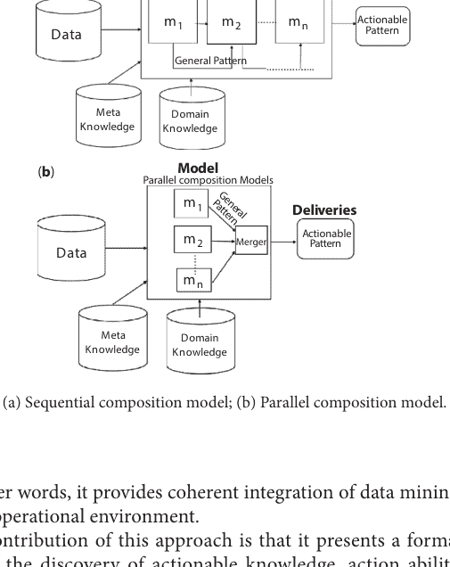

图 5.1 （a）顺序组合模型；（b）并行组合模型。

换句话说，它提供了将数据挖掘输出与运营环境进行连贯集成的方法。

该方法的贡献在于它为可操作知识的发现、模式的可操作性以及交付成果提供了一个正式框架。但该方法的主要局限性在于它没有考虑数据中的特征和多样性。随着过去十年来数据流入量和速度增加了数倍，数据在句法和语义方面的异构性也必须考虑，而这并非如此。

Fantuzzo 等人 [15] 使用了可操作情报这一术语来表示可操作知识。可操作情报一词涉及数据和研究。它源于执行领导者、从业者、研究人员和公民等各种关键贡献者的共同贡献 [14]。数据挖掘的输出是带有某种意义的数据，这有助于形成变革理论并进一步进行测试。因此得名可操作情报，因为它在从数据中提炼情报方面做出了贡献。

> “它是不断演进的数据 → 对话 → 行动循环的产物。”

来自不同公共服务机构的数据首先被收集和整合。整合后的数据可以作为一种共同语言，促进合作伙伴之间关于不同需求和服务的对话，并保持以人为中心的关注。来自不同机构的数据如果有助于决策制定以及关键贡献者之间的数据共享，则被认为是有用的。这种对话有助于合作伙伴生成工作假设并制定变革理论，这将进一步导致可行的行动。

如果这些信息有助于关键支持者和信息共享机构之间进行有益的对话和决策，以解决主要问题，则被认为是有帮助的。

相关贡献者之间的这种对话是有价值的，如果它有助于同伴创建工作理论和进展假设，从而推动行动（Do），组织可以采取行动以取得更好的成果。

这种数据 → 对话 → 行动采用了不断演进的数据驱动迭代决策过程，产生对问题日益有效和合乎道德的响应。

为了深入理解这一过程，我们需要识别（1）关键贡献者可以是组织中处于能够为其组织做出关键决策地位的执行者、研究人员和从业者；（2）关键贡献者之间的相互共识本质上是动态的，需要遵守；以及（3）整合数据具有丰硕的对话，从而产生可操作情报。

当可操作情报支持决策制定时，就会产生可操作内容（图 5.3）。可操作内容是可行的行动，是数据挖掘任务的最终产品，其结果是产品增强或开发，从而缩小了识别出的模式与交付成果之间的差距。它可以被视为执行特定活动的逐步程序或规则集。为了从各种不同的来源得出这种内容，[10] 提出了领域驱动数据挖掘（D³M）来分析潜在问题。

领域驱动深度模式发现（DDID-PD）过程包括四个基本程序。它们是（i）闭环挖掘，（ii）人机协作挖掘，（iii）深度挖掘，以及（iv）约束挖掘。

对任何业务问题的约束都是领域特定的、功能性的、非功能性的和环境的，并在发现对业务可操作的知识方面发挥重要作用。提到的这些约束是领域特定的，在发现业务可操作知识方面具有重要作用。这些约束构成了可操作知识发现的背景。在 DDID-PD 的相关阶段，必须以不同程度考虑它们。

总之，当前可操作内容关键词在过去二十年中得到了其根源和完善，如图 5.2 所示。行动计划一词由 [6] Cleveland 于 2001 年提出，随后主要是使用不同的数据挖掘技术从数据中提取的信息中提取的知识 [16]。这些数据挖掘技术的输出有很多模式，但它们对业务人员来说并不具有信息性和透明性，因为用户不知道最适合业务需求的模式。研究人员提出的专业知识和知识未能作为可行项目实施，因为它未能满足行业的目标。出现了空白，这就需要行动计划在考虑不同参与者的情况下转变为可操作情报。然而，可操作知识与人工智能和机器学习的结合仅在最近几年才出现，如图 5.3 中三角形的顶点所示。

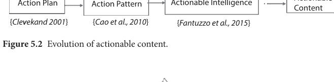

图 5.2 可操作内容演变。

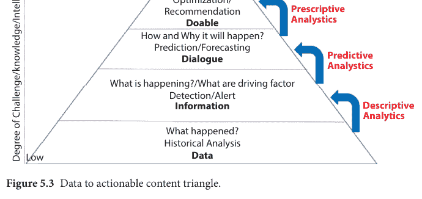

图 5.3 数据到可操作内容三角形。

##### 5.2.2 实践中的可操作内容

可操作洞察的三个主要组成部分是分析性、协同性和预测性洞察。分析性洞察专注于对分析结果的理解。它是某些数据库查询或某些计算的输出，将原始数据转换为某些信息。对于患者表，它可以是统计某一天患者数量的查询。下一个层次是协同洞察，它基于所有目标和约束整合所有分析性洞察的输出。如果我们能理解所有分析性洞察并在它们之间建立某种关系，用户就可以做出协同洞察。关于医疗保健的协同洞察的一个例子是医院某个科室竞争优势的下降。其他突出例子包括从数据可视化和关于新仪器购买的文本挖掘中观察到，某医院科室雇用了新医生，或购买了世界级声誉的新工具或仪器。预测性洞察发生在用户能够生成假设并预测问题在不同情景下对假设的反应时。对于支持该假设的每个情景，所涉及的风险也必须进行分析。

在文献中，可操作内容和可操作洞察这两个术语经常被互换使用。然而，在我们看来，可操作内容的水准比可操作洞察高一个层次 [2, 27]。可操作内容是通过对齐不同来源并分析它们之间的相互关系而验证的内容。然而，可操作洞察可以是对数据的主观解释，对终端用户有用且对他们有价值。它使用程序性知识并整合从原始数据获得的不同洞察，并据此提供内容 [25]。根据定义，用户在数据分析过程的不同阶段获得的理解，有助于得出不同的替代解决方案。从这些替代解决方案集合中，最适合用户情景和预期目标的就是可操作内容。

在医疗保健领域，这种连贯的理解集合包括临床指导，具体为：

- 提供替代解决方案的建议
- 与相关上下文的链接
- 可操作项目

**提供替代解决方案的建议：** 在这种情况下，可以存在不同治疗方案的比较。治疗方案可以针对个性化药物或治疗植入物进行优化。


**相关上下文的链接：** 这可以采用案例研究、现有研究项目、临床试验结果、疾病结局的纵向队列研究、来自相关领域的信息，如卫生经济学模型、以及用于个性化医疗的制药经济学模型的形式。这可能会为新开发的个性化医疗方法提供洞见。

**可操作项目：** 这将改善对抗该疾病的整体流程。此可操作项目可以作为与来源相关的疾病词汇的标准定义、疾病分类以及对所用关键词的解释的融合的输出。

在上述引用的示例中，在肿瘤管理中，医疗肿瘤科医生将被提供各种已批准的全身治疗指南。建议治疗方案在患者保险公司方面的有效性以及其获批的地点也将被提供。[content]

**相关上下文的链接：** 这可以采用案例研究、现有研究项目、临床试验结果、疾病结局的纵向队列研究、来自相关领域的信息，如卫生经济学模型、以及用于个性化医疗的制药经济学模型的形式。这可能会为新开发的个性化医疗方法提供洞见。

**可操作项目：** 这将改善对抗该疾病的整体流程。此可操作项目可以作为与来源相关的疾病词汇的标准定义、疾病分类以及对所用关键词的解释的融合的输出。

在上述引用的示例中，在肿瘤管理中，医疗肿瘤科医生将被提供各种已批准的全身治疗指南。建议治疗方案在患者保险公司方面的有效性以及其获批的地点也将被提供。连同这一点，如果患者符合任何正在进行的临床试验的条件，也将提供给肿瘤科医生。

肿瘤科医生可以在与患者在临床咨询室就坐时访问此信息。在向患者充分告知后，他/她可以确定患者接受的治疗。治疗计划始于患者在肿瘤科的注册，为整个治疗过程安排预约，管理患者的保险索赔及其转诊。所有这些都将在肿瘤科医生在与患者达成共识后点击“确定”按钮时发生 [20]。此可操作内容来自各种来源，其中最突出的是基于现有证据、患者和/或可用设施。

- 基于证据：不同医疗部门提供的指南、特定疾病治疗的临床代码、基于已发布结果的研究。
- 基于患者特定数据：这可以是实验室和其他检查结果，这些结果作为电子病历（EMR）可用，以及从保险公司收集的数据或与保险相关信息。
- 基于实践：这可以基于医院为治疗特定疾病提供的设施、该地区的研究设施以及与保险公司的报酬合同

可操作内容为医疗工作者、保险公司和患者提供了各种益处。提供给医疗提供者的益处体现了最佳的临床知识，这将给予患者。对于保险公司，它可以与所有利益相关者建立联系并提供保障。对于患者，提供个性化关注。

但是，这里的主要挑战是整合从所有这些来源收集的数据。必须进行句法上的整合，以提供有意义的结果（可互操作）。在数据和良好的分析方法到位的情况下，是否能够以易于理解的方式向利益相关者呈现可操作内容，这也是另一个值得思考的问题。上述问题从整合到有意义的洞察，再到用于良好健康分析的连贯统计方法，形成了一个流程，如图 5.1 所示。然而，在医疗保健领域发现可操作内容具有挑战性。

文献中提出了三种类型的数据分析。它们是描述性、预测性和规范性分析，其在第 5.3 节中进行了阐述。然而，目前在医疗保健领域，应用严重依赖于仅预测性分析，而规范性分析仍然是一个挑战 [23]。

#### 5.3 健康分析

医疗保健分析是一种由医疗保健专业人员使用的数据分析类型，可改善卫生系统管理、患者诊断和支出 [23]。它大致分为三种类型，如图 5.4 所示。

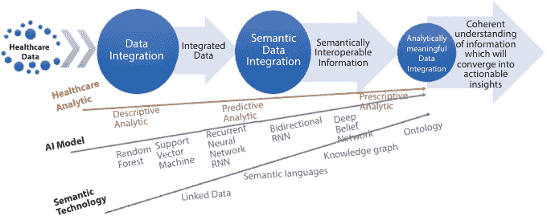

**图 5.4** 医疗保健分析谱系。

**描述性分析**顾名思义是指对数据进行统计推断，可用于其他有用的操作 [9]。它更以数据为驱动，并描述数据“原样”，因此得名。它使用大量可视化。这可以图形化地表示患者住院、医生绩效和资源利用等细节。关于患者数量、产生的收入、识别高风险患者等查询都可以通过描述性分析来回答。

正如其名称所示，预测分析使用高级分析对未知未来事件进行预测并提供推理 [9]。预测分析。在医疗保健领域，预测分析使决策成为可能，从而为每个个体提供个性化护理。为了实施预测分析，需要生成大量实时数据以确保准确，并为临床医生提供精确信息 [12]。

临床医生思维与软件工具的融合产生了预测分析，其主要目标是将训练数据集扩展到个人经验之外，从而有助于及时、准确地为患者提供治疗。

**规范性分析**是指推荐行动以实现智能决策的数据分析类型 [17]。它可以告诉用户哪种行动方案在预测事件发生时最有可能产生最大益处。因此，它不仅提供对某个问题的答案的信息，还提供这些选择的结果。

##### 5.3.1 基于人工智能/机器学习的预测分析

医疗保健分析和人工智能（AI）/机器学习（ML）携手并进，使患者在未察觉的情况下得到服务 [18]。机器学习可用于医疗保健中的各种关键应用，例如基于机器学习的健康行为改变、临床试验和研究以及流行病预测。此外，机器学习在图像分析方面在医疗保健中更受欢迎（例如，癌细胞药物敏感性预测、药物靶向相互作用强度预测等）。

目前，基于图像的诊断主要集中在基于深度学习和放射组学的机器学习上。这些旨在从医学图像中提取结构化、可重复、定量、可机器读取的信息，并补充医疗从业者的预后。

然而，传统的机器学习在处理多样化、多因素、多维度、高度相互关联的医疗保健数据时存在一些局限性。这主要是因为

- 人工智能/ML 需要大量数据。当试图将深度学习算法应用于发病率较低的疾病过程时，这可能成为医疗保健中的一个问题。这进一步得到以下事实的补充：临床信息在多个系统之间并不通用。
- 缺乏信息共享框架以供医疗机构使用，信息收集的异质性和不足，以及机构/组织之间的竞争。
- 此 FAIR（可发现、可访问、可互操作、可重用）指南确保数据可被发现，通过分配全局唯一且持久的标识符 [31]。通过可访问，数据及其元数据应可免费轻松获取。可互操作是指数据必须使用正式的、可访问的、共享的知识表示形式这一特征。

它无法确保临床信息在多个系统之间传输和解释。预测分析通常由传统的 AI/ML 技术采用。

##### 5.3.2 用于规范性健康分析的语义技术

如上所述，传统的 人工智能（AI）/ML 技术并未解决异质性、可解释性和多个系统之间信息共享的问题。然而，所有这些问题都可以通过语义技术来解决，这也将有助于从数据中发现可操作内容。语义技术是一种建立各种底层数据源之间语义链接的工具，这将有助于以有意义的方式对信息进行连贯理解，从而转化为可操作信息。

语义技术是“以意义为中心”的。语义技术开发其语言来表达数据的丰富自描述相互关系，并以可被机器处理的形式链接它，尽管它可能是一长串字符和索引大量数据 [32]。它还识别数据的含义和逻辑关系，并可以存储、管理并限制其信息。


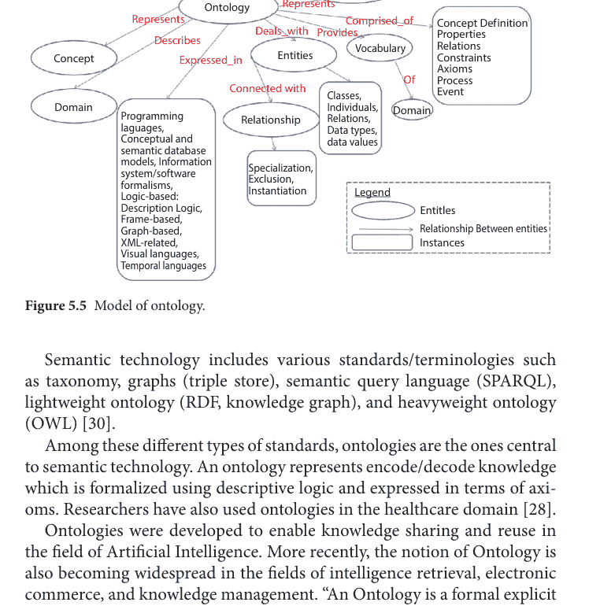

图 5.5 本体模型。

语义技术包含了多种标准/术语体系，例如分类法、图（三元组存储）、语义查询语言（SPARQL）、轻量级本体（RDF、知识图谱）以及重量级本体（OWL）[30]。

在这些不同类型的标准中，本体是语义技术的核心。本体表示知识的编码/解码，这些知识通过描述逻辑形式化，并以公理的形式表达。研究人员也已在医疗领域使用本体[28]。

本体最初是为了在人工智能领域实现知识共享和复用而开发的。近来，本体的概念也越来越多地应用于智能检索、电子商务和知识管理等领域。“本体是共享概念化的形式化显式规范”[13]。本体提供了用于对领域建模的术语和关系词汇表，如图 5.5 所示。

#### 5.4 本体与可操作内容

领域知识和元知识是可操作知识发现架构中不可或缺的一部分。本体是表示知识以及不同知识片段之间关联的方法之一。

这可以通过本体匹配技术轻松实现。本体匹配的主要目标是协调两个本体之间的差异，这些本体通常以不同的视角设计，并使用不同的词汇表描述。

本体匹配的优势如下：

-   将本体与其描述的信息源连接起来，有助于发现两个信息源之间的共同语义；
-   连接集成系统中使用的不同本体，从而促进术语标准化的融合；
-   向用户查询中添加知识（查询概念扩展），从而实现语义检索。

文献中提出了多种方案，利用本体和本体匹配技术将本体与深度学习技术相结合，用于提取临床智能。然而，将这些结果转化为可操作内容仍然是一个挑战，其中的问题包括设计一个能够访问和处理本体所提供的临床知识抽象表示的机器学习模型。第二个挑战是，在医疗领域，用少量公理（即本体）来表示知识是一个艰巨的过程。

在接下来的两节中，我们将给出可操作内容发现的总体框图，并进一步解释本体如何用于医疗分析。

#### 5.5 面向医疗领域可操作内容发现的通用架构

医疗领域利用当前技术所取得的进步，催生了来自各种异构数据源的大量临床信息，例如诊断、监测、临床记录、医疗管理以及许多其他相关信息源。

需要将所有来自这些异构系统的患者数据集成起来，这对于可操作内容发现是必不可少的（图 5.7）。为此，不仅需要集成，还需要语义互操作。语义互操作性对于连贯一致地理解信息并从中生成可操作内容至关重要。

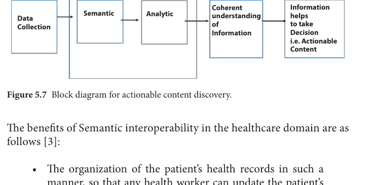

图 5.7 可操作内容发现框图。

语义互操作性在医疗领域的优势如下[3]：

-   以某种方式组织患者的健康记录，使任何医疗工作者都能以简单方式有效地更新患者信息。
-   聚合来自多个不同来源的所有患者临床数据。
-   向其他医疗系统通信并共享标准化信息。
-   加快在任何时间、任何地点访问患者病历的速度。
-   通过消除重复检查、减少纸质医疗报告，以及避免不必要的医学检查和影像检查，降低医疗成本。

##### 5.5.1 医疗领域中本体驱动的可操作内容发现

可操作内容是一种辅助为患者提供医疗方案选择的信息。它可能提供行动或做出医疗决策所需的过程、概念理论或描述。任何可操作内容都具有六个属性[33]：对齐性、情境性、相关性、明确性、新颖性和清晰性。要生成具备这些属性的可操作内容，需要大规模且多样化的数据源，并且需要在这些数据源之间建立对齐或连贯的关联。同时还必须理解所需提供信息的情境和相关性。

可操作内容应具有足够的说服力以促使行动。为此，它需要具备新颖性、清晰性和具体性。为了发现能够

医疗领域适应这种结构和语义特征的可操作内容。医疗领域的本体本质上围绕医学术语的表示、组织和（重新）关联展开。

医生/医疗工作者构建他们特定的语言和词汇，以便高效地存储和传达一般临床信息以及患者相关数据。这类术语包含大量隐式知识，并且针对人工处理进行了优化。

另一方面，医疗信息系统需要能够无歧义地传达复杂而详细的医疗概念。

这是一项具有挑战性的任务，需要对医疗术语的结构和思想进行深入研究。然而，这往往可以通过开发医疗领域本体来表示医疗术语来实现。本体存储在知识库中。

知识库包含来自领域本体的不同本体。这些领域本体主要包括疾病本体、应用本体、医学术语[1]。不仅如此，诸如诊断和治疗本体等任务本体也存储在知识库中。结构化与非结构化信息包括从医院信息系统（HIS）生成的信息。这些信息可以是患者相关数据、其医疗数据、实验室报告和电子病历（EMR）。外部信息包括指南、国际和国家协议、案例研究、研究文章和/或研究论文。

2.  处理层：该层涉及知识集成、情境建模、领域学习、临床决策和推荐等主要操作。存储库中的信息是多样化的（即不同格式、不同结构、不同语义）。首先需要对这些信息进行集成。然后，集成后的信息需要以一种能够被共享并分发到各种人工智能模型中的方式加以疏导，以支持预测性和规范性分析。此外，这些知识还应能提供各种临床指导。这些可以以可操作内容的形式体现，而这需要融入模式提取、摘要生成、优化以及多准则决策模型。所有这些都将有助于医疗工作者或医生提供建议，以做出更好的临床决策。

3.  **应用层**：该层以可操作内容的形式向最终用户提供输出。该层根据用户现有状况、历史数据以及经过处理的知识库，向最终用户提供各种选择。在这一层中，使用人工智能模型，解读模型结果，并将信息提供给最终用户。

##### 5.5.2 癌症领域可操作内容发现的案例研究

让我们通过图 5.9 中引用的示例，看看如何通过可操作洞察的不同模块对所提出的架构进行电子化的患者画像分析，以及其内部机制。考虑上述情况，患者因乳房出现肿块和/或该区域伴有疼痛而就诊于肿瘤科。患者提供了其发生的详细病史，说明她发现肿块的时间，并提供了所有相关检查报告。医疗从业者建议的这些检查包括详细的

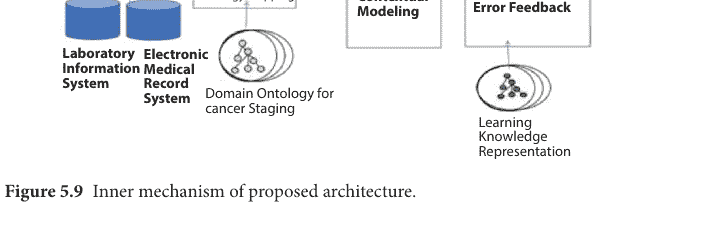

图 5.9 所提架构的内部机制。


肾功能、肝功能检查和全血细胞计数的实验室检查。她还有乳腺X线摄影/超声检查的放射学报告和图像、显示恶性肿瘤组织病理学确诊的活检报告、相关的雌激素/孕激素受体免疫组织化学报告，以及她的其他报告。可能还有详细的放射学报告和图像，以排除任何转移性疾病。这些报告会自动存储在实验室信息系统（LIS）中。

肿瘤科医生通过从存储层检索上述资料进行审阅，并在详细医学检查后记录其发现。他还会建议完成并复核任何待做的医学检查。所有报告和发现均被输入医院信息系统（HIS），系统对其进行评估并提供患者的详细诊断和分期。系统还会针对肿瘤外科、肿瘤内科、放射肿瘤学、激素治疗和免疫治疗等可用治疗方案，以不同组合提供最适合的治疗选项[1]。这些建议帮助肿瘤科医生确定最佳的治疗流程，并将其推荐给患者。医生会与患者详细讨论这些建议，并辅以支持这些建议的试验结果。在肿瘤科医生及其家人的支持下，患者会选择最佳方案。如果保险计划可用，则与所接受的方案一并讨论，并安排治疗日期。

为了执行所有这些活动，需要先将以各种不同格式提供的多样化信息统一对齐，供 AI 模型使用。医疗领域存在不同类型的格式，例如乳腺X线摄影、PET扫描图像，这些格式将与自然语言相结合。病理报告将以数值形式呈现。医生笔记将采用自然语言，而领域知识将采用 OWL 格式。所有这些格式都必须转换为一种通用格式，即定量数据形式，作为 AI 模型的输入。这里的主要挑战是如何在量化过程中保留输入源的结构、上下文和语义[19]。本章介绍了一种基于本体的解决方案，将结构、上下文和语义注入 AI 模型。详细机制如图5.10所示。

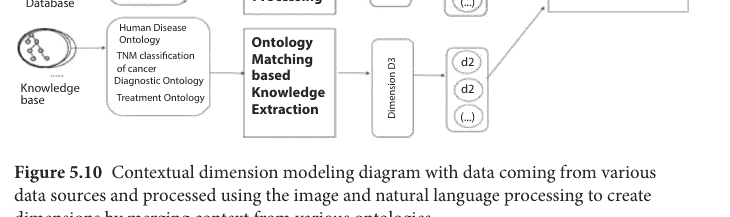

图5.10 上下文维度建模图：来自不同数据源的数据经过图像处理和自然语言处理，通过合并来自不同本体的上下文来创建维度。

#### 5.6 结论

医疗领域需要可操作内容，以支持临床医生和医务工作者实现更好的诊断、治疗和患者护理。为了在医疗领域中发现可操作内容，健康分析需要依次采用三类分析：描述性分析、预测性分析和规范性分析。这些分析有助于检索连贯而有意义的信息，从而呈现可操作内容。传统的机器学习技术有助于将描述性分析转化为预测性分析。然而，这些技术对数据的需求量很大，而在医疗领域，数据来自多个异构来源。异构性，尤其是这些来源之间的语义异构性，是一个重要问题。这个问题可以通过语义技术（即本体）来解决。本章阐述了本体在医疗领域中的实用性，可从多个异构信息源中提取可操作内容。我们提出了一种三层架构，用于在医疗领域进行本体驱动的可操作内容发现。我们还展示了一个来自癌症领域的案例研究，以演示所提出的架构。

### 参考文献

- 1. Alfonse, M., Aref, M.M., Salem, A.B.M., 基于本体的癌症疾病知识管理系统. Int. J. Inf. Eng. Electron. Bus., 6, 6, 55–63, 2014.
- 2. Argyris, C., 可操作知识：意图与现实. J. Appl. Behav. Sci., 32, 441–444, 1996.
- 3. Adel, E., El-Sappagh, S., Barakat, S., Elmogy, M., 基于本体的电子健康记录语义互操作性：综述，载于：U-Healthcare 监控系统，第315–352页，Academic Press, 2019.

# 采用医学本体的智能代理系统

**Tintu Thomas¹\*** 和 **R. Mervin²**

¹沙特电子大学公共卫生学系，利雅得，沙特阿拉伯

²沙特电子大学信息技术系，利雅得，沙特阿拉伯

#### 摘要

由于医学文献的急剧增长，检索准确的医学信息是当今的一大挑战。本体可用于在不同层面增强数据库，并可消除数据库结构化查询语言中的模糊性。在此，我们描述了基于本体的医学文献数据库 MEDLINE 信息检索。本文的主要焦点是增强医学文献数据库的信息检索功能，使搜索更加清晰。在本研究中，我们的方法是初步设计和实现一个基于本体的智能代理系统，并应用语义网语言，这有助于高效、系统地检索医学信息。

MEDLINE 本体系统在医学和健康科学领域将非常有用。可以以更简单的方式检索医学信息细节。它将减轻 MEDLINE 信息搜索的认知负担。它可以克服传统数据库所面临的困难，并为查询提供更准确的语义结果。为了获得更准确的结果，可以借助推理机来测试查询的精确度。本研究探讨了基于应用本体的智能系统在医学领域的语义搜索。我们创建了领域本体，该系统包括多个阶段，即预处理、基于规则的方法和用户查询推理。在最后阶段，我们检查了有效性，借助推理机确定了查询的正确性，并得出了最相关的结果。

*通讯作者：* thomas.tintu@gmail.com

Vishal Jain、Jyotir Moy Chatterjee、Ankita Bansal 和 Abha Jain（编），《面向有效医疗保健的语义网》，（139–158）© 2022 Scrivener Publishing LLC

关键词：语义网、本体、Web 本体语言、描述逻辑、模糊推理和语义网规则语言

#### 6.1 语义搜索简介

语义搜索是指查询理解、数据理解以及知识的适当描述，从而实现有意义的检索。语义搜索也被称为“带意义的搜索”[1]。它通过区分用户查询的含义、上下文和意图这三个关键方面，帮助实现高水平的准确性和针对性。这是一种可修改的语义结构，系统可以借此从关系数据库中检索信息，并根据科学文章中的不同交叉引用对书目内容进行有效排序[2]。语义和统计技术的组合也可以用于从 XML 数据库检索信息，其中对结果进行排序的权重基于 XML 文件中术语的结构位置[3]。典型的语义网被分为两种不同的类型，称为本体数据和实例数据。在实例数据中，用户寻找的是个体类效果；而在本体数据中，知识领域和关系主要被指定为类关系。语义搜索通过增强查询部分或与各种实体特征交互来实现，这可以让人了解最常出现的实体，从而缩小检索到的信息范围[4]。

##### 6.1.1 从医学角度看什么是本体？

本体是一种明确的表示，它包含以高度语义化方式定义的共同概念，这在复杂情境中是必需的[5]。在医学领域，本体定义了医学术语的重要概念，并说明了它们之间的相互联系，因此它是共享医学知识的可能方式之一。然而，基于本体的研究存在风险，建模中的不准确之处可能会降低结果质量[6]。本体主要由个体、类、属性、关系、函数项、限制、规则和公理组成。个体实例或对象是本体必不可少的部分；类是一种概念，也称为类型、种类、类别等。关系则说明类与个体如何关联。函数项被称为一种基于特定关系生成的复杂结构，并且可以被特定的

词。个体或实例组成了构成本体的基本要素。类也可以被称为类型或类别，而种类被指定为一种扩展。对象可以在本体中进行分类，用于与相似类型的事物进行比较，特别是特质。相似类型的事物被描述为属性，尽管它们可能不依赖于彼此，且属性是对象的可能参数。它以类或个体的形式来表示。连接表示对象之间的关系。通常，连接描述了具体的关系以及它们在内部进行分类的逻辑类型。

#### 6.1.2 本体论在医学搜索中的需求与优势

本体论能够帮助在医疗保健中构建更强大、更具交互性的信息系统。在本体中，形式化定义表示对通用概念化的常规描述。它意味着问题领域的一个经认可或全面的模型。本体论具有一些优势，能够解决数据中存在的语义多样性。本体论刻画了各种语义信息之间的联系。它特别有助于确定查询的各个方面和不同的常见搜索方法，从而改进呈现给医疗专业人员的查询项目。本体论可以直接被机器理解，人类也可以处理它[7]。

在医疗实践中，患者从依赖医生或专家转变为主动搜索与自身健康相关的信息资源。梅奥诊所和Medscape等主要治疗网站以用户为中心，向用户提供足够的信息，如与常见治疗主题相关的建议和详情[8]。本体论提供了稳定的词汇和词，表示知识领域内的关键信息。本体论涉及感兴趣领域的知识和各种理解，并可以合并形成框架。这可以体现对象、概念以及它们之间的相关描述[8, 9]。

大量重要工作被提出来展示治疗概念，这些概念可以用描述逻辑表示[10]，并通过概念图形式主义紧密连接[11, 12]。本体论利用描述逻辑来指定可用的内容，例如疾病状况、解剖特征、过程等。然而，尽管形式主义和本体论协同工作，它们共享许多属性，但也有一些规范的差异[12]。指南是在特定医疗环境中创建众多本体的基础，这些本体随后可用于帮助识别任务和子任务，而这些任务和子任务是那些从不同角度实施指令的人所需要的[13]。

内容任务本体的优势在于包含本体的情境化，提供针对特定视角定制的本体，打破在生成本体到多样化阶段时所涉及的困难，提供包含更好建议的计划，这些建议由需要与医疗实践相结合的策略组成[13]。医疗保健领域的重要挑战之一是确保医疗系统之间的交互。本体论可以帮助构建强大且更具互操作性的信息系统。它还可以为医疗过程中患者个人数据的重用、传输和共享的基本需求做出重大贡献。本体论在医学中的使用主要集中在医学术语的表示和组织或重组上。如果可理解，本体论是医学术语领域多种解决方案的关键组成部分[14]。

#### 6.2 语义搜索

语义搜索有助于减少搜索并提供最相关的结果。它可以通过语义化表示知识的本体论来实现。文献综述以全面的方式解释了不同相关研究的信息，以及医学领域语义搜索的智能代理系统的现有方法。

##### 6.2.1 NLP如何在语义搜索中工作？

语义搜索可以解释为允许有意义的搜索。在文本的情况下，意义以自然语言的方式表达。在考虑知识库时，大多数意义嵌入在其配置中，其组成部分被视为自然语言。识别自然语言中意义特征的基本方法通过各种技术来阐明。这些包括词性标注、组块分析、实体识别、消歧、句子解析和词向量。

##### 6.2.2 词性标注和组块分析

词性标注（POS标记）的角色是指定为特定句子中的每个单词分配一个来自预定义形式的标记，该标记指定了

一个句子的成分解析可以用树结构来描述，每个单词以叶子的形式表示。内部节点表示子树中单词顺序中存在的类别。
示例如下：

- 名词短语（NP），
- 动词短语（VP），
- 从句（SBAR）或独立分句（S）。
- 树中的根表示为S

依存解析中，句子中的每个单词恰好基于句子中的另一个单词，该单词是中心词；树中的根指向句子中的关键动词。依存解析句子可以表示为树，每个单词作为节点。每个节点恰好指向一个中心词。边表示词之间的语法联系。

##### 6.2.4 关于医学数据库中各种语义搜索的讨论

自然语言处理（NLP）通过提取和构建基于文本的生物医学数据，使这些信息可供当前使用和未来分析，从而在解决生物医学领域问题方面具有潜在作用[15]。近年来在医学领域已经开发了一些本体和框架。CODE是一个例子，称为“曼彻斯特大学医学信息学组的合作开放环境开发项目”[16]。另一个是LinkBase，被称为生物医学本体，它具有分类模式、覆盖范围、操作使用、形式和语言联系，与基础语言知识共同连接，构成卓越的本体，以支持自然语言处理与理解（NLP或NLU）以及信息整合应用[17]。MedO也是一个生物医学本体，在德国“形式本体论和医学信息系统研究所”建立。基础解剖模型是一个本体，它指定了关于人体解剖结构的清晰易懂的明确公开信息。日内瓦本体联盟旨在创建一个有组织的字典，它适合所有类别的实体作为知识，尽管基因或蛋白质在细胞中的作用是收集或改变[14]。

所提供的信息用于更新基于解剖学的本体，包括基于框架的配置（例如“生命解剖学基础模型”）和描述逻辑（例如GALEN、SNOMED CT®）[18]。基因本体论（GO）[19]是生物数据说明中最有效和最常用的本体之一。序列本体论（SO）是另一种表示基因组特征及其相互关系的本体。本体包含更新基因组所需的基本特征类型和基因组变异注释所需的术语[20]。支持向量机（SVM）技术用于分类提取的基因本体术语是否适合cDNA序列[21]。一种称为OWSVM的新型本体和鲸鱼优化支持向量机方法，用于心脏病数据集中的核参数选择[22]。一个智能身体环境结构采用了面向本体的方法，识别患者的健康阶段并提供适当的行动，该本体特别用于COPD患者的基本健康监测[23]。

搜索本体生成器（SONG）从Excel模板生成复杂查询，一旦生成，可以再次使用，这些特性保证了搜索的清晰性和可重复性，是治疗设备上市后监管的授权机构[24]。microRNA靶标本体（OMIT），用于语义注释、数据整合和语义搜索[25]。从原始搜索查询中，从本体中选择最相似的术语以整合到搜索查询中，并利用语义相似性进行查询扩展，这主要通过本体中的距离概念和层级位置来实现[26]。思想实体、语言原语、知识表示（KR）原语和查询元素是一组模型，用于获取与心理、用户系统和查询相关的信息[27]。基于多个本体的搜索也可以有效地用于信息检索。它能够通过多个本体在用户查询中包含语义信息来重写用户查询[28]。

##### 6.2.5 关于Medline中用于语义搜索的检索工具的讨论

多年来存储的大量生物信息目前可在称为Medline的在线文本库中获取。这些信息对生物医学研究人员的行动计划、执行新实验和结果验证非常重要[29]。MEDLINE的一个独特结构是记录由国家医学图书馆（NLM）的医学主题词表（MeSH®）进行索引。Medline是PubMed的主要组成部分之一，也是Entrez数据库系列的一部分。Medline Ranker是一个Web服务器，它允许自适应


ranking in Medline for a subject of interest with limited knowledge and if the input comprises thoroughly connected abstracts, the program gives back to relevant abstracts from the latest bibliography with great accuracy [30]。

对于自由文本和自然语言查询，我们可以利用 AskMEDLINE，它有助于探索 MEDLINE 或 PubMed。它利用多轮搜索方法。最初解析器不包含标点符号或删除“停用词”中存在的参数。停用词数据包含“PubMed 停用词”或基于知识的参数，这对之前的分析并不有利。解析器是一个 PHP 脚本，通过 PubMed“Entrez E-Utilities”发布更新请求。从 E-Utilities 接收到的可扩展标记语言（XML）文件指定了所需信息类型 [31]。使用 MEDLINE 过滤器来改进搜索方法，有了这些过滤器的帮助，临床用户可以轻松获取信息而无需搜索整个 MEDLINE 数据库。研究人员使用了两种重要的过滤器类型，即“方法”和“内容”。

第一种识别出方法学精度很高的文章，用于健康问题的治疗方法，不依赖于任何临床学科 [32, 33]。高性能过滤器目前是 PubMed 界面的组成部分，并且也可以通过 Clinical Queries 字段直接使用。第二种称为“内容过滤器”，在临床实践领域更适用 [32]（“内容”过滤器）[34]。BioMedLEE 是一个系统，它以良好的精度从生物医学文献中识别出广泛的表型信息，并且与此相关的问题易于解决 [15]。研究人员利用领域特定知识来利用染色体定位和基因表达定位系统中的信息 [29]。SciMiner 是基于网络的文献挖掘和功能分析工具，它通过对 MEDILINE 摘要和全文进行上下文特定分析来探索基因和蛋白质 [29]。当缺乏全文的情况时，它也特别有帮助 [35]。

#### 6.3 语义搜索的结构模式

在通用领域中，实体之间语义联系的识别利用了基于语言模型形式的统计方法或机器学习技术 [36]，或两种方法的结合使用。在医学领域，关系抽取（RE）系统通常利用 UMLS（统一医学语言系统）[37]作为知识库。提出了一个系统用于抽取不同类型的关系，即在医学实体之间检测、治疗、征兆和治愈 [38]。

##### 6.3.1 架构图

研究强调了从医学文献数据库中检索信息的特征，并借助基于本体系统改进搜索质量。整体过程包括各个阶段，其中包括预处理程序、关键词提取、规则构建和查询推理。最后一步包括验证技术实现，这将有助于产生最相关和准确结果的净效应。

该过程的首要步骤是知识提取，随后是预处理。使用词性（POS）方法，其中将语法医学信息类型分配给文本中的每个单词。系统使用的 POS 标注器从用户查询中搜索信息。词干提取方法可以在本体内的搜索过程中得到演示，这有助于识别药物的词根。系统将提供查询现有本体中存储的药物信息的查询结果。如果不是，则本体将用新关键词进行更新。借助句法树方法可以更好地理解查询。本体解析器有两个重要的功能元素，即词法分析器和解析器。句子词法分析器接收一个句子并将其转换为本体实体的序列，而解析器将本体实体的序列转换为谓词结构。

SVM 基于标注器在 Tej Bahadur *et al.* [39] 研究中使用，其中显示出高效、可移植、可访问且可训练。支持向量机（SVM）在监督学习方法中引入，并显示出良好的性能和泛化能力。SVM 已在文本分类中得到有效实施，并显示出 SVM 可以处理大量特征并且具有抗过拟合能力 [39]。图 6.1 和 6.2 分别表示架构图的示意表示和句法树方法。

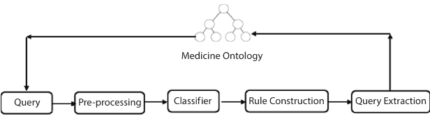

图 6.1 架构图。

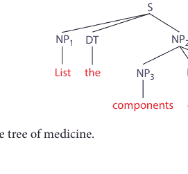

图 6.2 药物的句法树。

##### 6.3.2 代理本体

本体描述了词汇的使用，包括代理、其特征功能和操作域。多代理系统允许应用程序开发人员将复杂任务分解为最简单的子任务。根据其角色，各个代理将获得特定任务。在多代理系统的上下文中，可以用两种组织来描述。任务分配给代理确定了 MAS 开发的基于任务的组织。知识嵌入在代理中是知识依赖组织不可分割的一部分。在 MAS 系统中的单个代理中，对于三种不同来源的知识至关重要，即领域知识、代理知识和计算知识。代理控制与某些特定应用域相关信息，领域知识可以整合到领域本体中。

有必要对在各种代理之间共享的基于领域的知识进行结构化，并再次使用以制作在相同类型域上工作的多代理系统。代理必须知道交互或连接代理的特征。适当的代理本体绝对有助于解释一组通用且无歧义的特征来描绘各种代理类。语义网提供异构、分散的信息，允许应用程序传达用户需求并获取数据资源。代理贡献很大，并且能够在语义网应用程序的进展中提供技能。然而，直到多代理系统基础设施的充分扩展可用，代理中心工具才可能实现通用可用性 [40]。

代理是一个系统，需要基本特征，即环境，能够独立执行以实现目标，最后能够与其他代理进行有效通信 [41]。因此代理将是情境系统，其中环境将提供

OWL 构建在 RDF 和 RDF 模式之上，并补充了更多用于定义特征和类的词汇。有许多因素有助于在设计语言中发挥主要作用。描述逻辑、基于框架的建模范式以及 Web 语言 RDF 和 RDF 模式是一些重要输入。

OWL 使用 URI 进行命名，并扩展了 RDF 为 Web 提供的描述框架，以解决各种类别的问题。主要 OWL 描述了三类语言，即 OWL Lite、OWL DL 和 OWL Full。其中 OWL Full 是 RDF 的扩展形式，增加了额外词汇而没有对词汇使用的任何限制。而 OWL DL 在词汇使用上有一些限制，并且主要基于不同的关键推理任务进行描述。OWL DL 和 OWL Lite 都专注于基于描述逻辑的模型理论语义，并使 DL 推理器能够为语言提供推理支持。

语义网规则语言（SWRL）用于显示规则和逻辑。SWRL 也被称为 Horn 类似规则的高级抽象语法。并且所有规则都基于 OWL 概念的术语，即类、属性和个体。SWRL 增强了 OWL 的表达能力，并使其能够建模比单独 OWL 更多领域的知识。SWRL 规则可以在生产规则风格中使用，其中它们用于计算输出或验证目的。SWRL 内置也提供了一种自然的扩展机制，其中建模语言可以通过特定领域的内置进行改进。

OWL（Web 本体语言）和 SWRL（语义网规则语言）都提供了以相关术语序列形式表示信息的路径。然而，SWRL 实现在 OWL 上运行的规则。SWRL 规则由前件-后件对构建，表示为规则体和头部。SWRL 规则和本体模型用于表示复杂关系，验证过程将借助推理器完成。规则的构建在图 6.4 中以示意图表示。

```
Rule 1: hasName(?x, ?y) ->hasFName(?x, ?y), hasLName(?x, ?y)
Rule 2: Medicine (?x), hasName(?x, ?y), hasDate(?y) ->hasMName(?x, ?y)
Rule 3: Medicine (?x), hasDate(?x, ?y), hasMDate(?y) ->hasEDate(?x, ?y)
Rule 4: hasDate (?x, ?z) ->hasMDate(?x, ?y), hasEDate(?x, ?y)
```


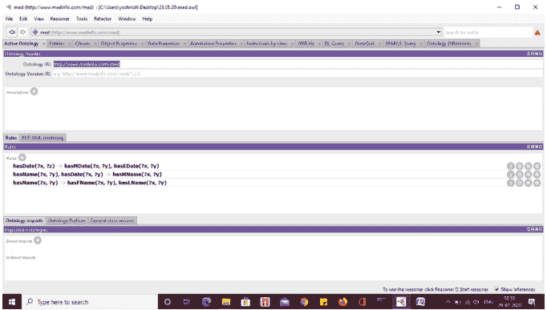

图6.4 构造规则。

#### 6.3.4 基于推理器的方法

### 基于SVM的方法

SVM是一种监督学习方法，主要用于分类目的，它有能力识别最可能的边界，以区分相关样本和不相关样本。SVM的主要目标之一是在训练过程中确定最大间隔超平面来解决分类问题。SVM的第一步是建立训练数据集模型，并利用该模型为测试数据集获取事实。一旦对检索到的文档完成预处理，文本分类可以按以下流程进行：

Ø : (DS × CS ) → {R,IR}，其中DS和CS分别表示文档和类别的集合

如果 Ø : (DS × CS) = R，那么 DSi 是 CSj 的重要成员；如果 Ø : (DS × CS) = IR，则 DSi 不是 CSj 的相关成员。

这些算法专注于对文本或评论句进行分类。SVM函数对最重要的数据点赋予(+1)值，在非重要或不相关的情况下赋予(−1)值。训练数据可以通过非线性映射函数进行映射，即 Φ:R^N → R^F，其中 R^F 表示特征空间，其训练数据通过非线性映射 R^N 呈现。

### 基于模糊的方法

本体可以分为两类：经典本体和基于模糊的本体。在经典类型本体的情况下，清晰值被认为是概念的取值，然而大多数实际系统是以模糊表达的形式存在的。因此，清晰本体和模糊逻辑相结合，可以更好地维护系统，使其免受不精确信息的影响，并获得指标值。在模糊集合中，通过合适的集合将值表示在0和1之间，这被称为隶属度。从数学上讲，隶属函数 μF 可用于描述模糊集合 F 和 A，其中元素 A 位于区间 [0,1] 内。

μF (A) : A 0 → [0, 1]

模糊推理层主要由四个元素组成：模糊化、推理、去模糊化以及知识和基于规则的本体。模糊本体涵盖所有访问过的URL、支持词、治疗术语、不当表达和正常词汇。它还为相关信息挖掘和智能分类提供了基于语义网规则语言（SWRL）规则的知识平台，以自动识别网页或文档的类型。

本体的使用有助于明确不同类别的信息，包括特征和关键词。用户对URL的查询被分配给网络爬虫，检索内容信息，然后借助模糊本体从检索到的信息中挖掘关键词和值，以计算决策系统的指标值。此外，基于知识和SWRL规则的本体为决策系统规定了规则（if-then）。模糊推理层与本体结合，以准确地挖掘信息并找到相关的文档类型。

#### 6.4 推理器的实现

推理器会识别不可靠的本体，但不支持对缺陷进行诊断和解决。基于信息语义上下文来验证和改进关键词正确性的工作可以通过模糊推理完成。模糊本体已应用于多元化领域[43]，例如人类行为[44]、糖尿病领域的建模，尤其是饮食和诊断方面[45]。与其他系统相比，模糊本体与基于规则的系统的应用并不广泛，因为它本质上需要汇集领域的明确模型[43]。

基于推理器的方法主要包含以下五个重要步骤：

- **步骤 1**
- *从知识库中提取信息*
- **步骤 2**
- *识别任何不一致的本体*
- **步骤 3**
- *使用模糊推理器执行正确性检查*
- **步骤 4**
- *生成新规则*
- **步骤 5**
- *完成推理的验证*

#### 6.5 实现与结果

在医学信息检索的最后阶段，可以通过SPARQL（简单协议和RDF查询语言）来实现，SPARQL允许查询包含三元组模式、合取、析取和可选模式。药物本体借助SPARQL执行，SPARQL查询输出如图6.5所示。

```
PREFIX rdf: <http://www.w3.org/1999/02/22-rdf-syntax-ns#>
PREFIX owl: <http://www.w3.org/2002/07/owl#>
PREFIX rdfs: <http://www.w3.org/2000/01/rdf-schema#>
PREFIX xsd: <http://www.w3.org/2001/XMLSchema#>
PREFIX med: <http://www.medinfo.com/med#>
SELECT ?Medicine ?MComp
WHERE { ?Medicine med:MComp ?MComp }
```

#### 6.6 结论与未来展望

本体定义了实体之间的依赖关系，这使得RDF存储能够用相关的、未在数据中显式定义的结果来增强用户的答案。

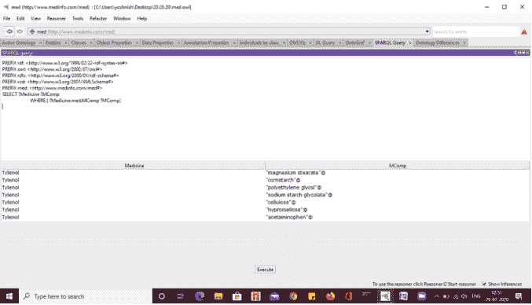

**图6.5** SPARQL查询输出。

查询通常用SPARQL表达，而RDF存储的关键计算服务是评估针对显式事实和背景知识所蕴含事实的查询。对于任意OWL本体，查询结果的检索在实践中往往不太容易实现，因为计算复杂度高且存储信息量巨大。

尽管SWRL规则能够有效增强基于OWL本体的表达能力，但基于规则的方法是为用户提供良好查询服务的有前景的方法之一。除了使用通用基于规则的方法外，未来工作还期望在基于统计的方法中实现。未来的研究将集中于SWRL概率扩展技术的扩展方法上，该方法与推理方法相结合，用于处理不确定性，并为活跃用户提供更高效的查询服务。

### 参考文献

- 1. Bast, H., Björn, B., Haussmann, E., 文本和知识库上的语义搜索. *信息检索基础与趋势*, 10, 119–271, 2016.
- 2. Balmin, A., Hristidis, V., Papakonstantinou, Y., 对象排名：数据库中基于权威的关键词搜索. *第30届VLDB会议录*, pp. 564–575, 2004.
- 3. Kotsakis, E., XML文档中的结构化信息检索. *第17届ACM应用计算研讨会会议录*, pp. 663–667, 2002.
- 4. Axel, J.S., Przybyła., P, Ananiadou., S., Thalia., 生物医学摘要的语义搜索引擎. *生物信息学*, 35, 10, 1799–1801, 2019.
- 5. Feilmayr, C. and Wolfram, W., 本体及其在商业中应用的成功因素分析. *数据与知识工程*, 101, 1–23, 2016.
- 6. Aldosari., B., Alanazi., A., Househ., M., 医学中本体的陷阱. *健康技术与信息学研究*, 238, 15–18, 2017.
- 7. Gomez-Perez, A. and Corcho., O., 语义Web的本体语言. *IEEE智能系统*, 17, 1, 54–60, 2002.
- 8. Leroy, G. and Chen, H., 满足医学术语需求：本体增强的医学概念映射器. *IEEE生物医学信息技术汇刊*, 5, 4, 261–270, 2001.
- 9. Gruber, T., 可移植本体规范的一种翻译方法. *知识获取*, 5, 199–220, 1993.
- 10. MacGregor, R., 基于分类的知识表示系统的演进技术，载：*语义网络原理：知识表示探索*, pp. 385–400, 1991.
- 11. Aubert, J.P., Baget, J.F., Chein, M., 简单概念图与简单概念图. *第14届概念结构国际会议——会议录*, pp. 87–101, 2006.
- 12. Rector, A.L., Zanstra, P.E., Solomon, W.D., Rogers, J.E., Baud, R. *等*, 协调用户需求与形式化要求：开发可重用医学本体中的问题. *IEEE生物医学信息技术汇刊*, 2, 4, 229–242, 1999.
- 13. Kumar., A., Ciccare se., P., Smith., B., Piazza., M., 基于上下文的临床指南任务本体——医学中的本体. *医学本体研讨会会议录*, V102, 81–94, 2004.
- 14. Manika., P., Xhumari., E., Ktona., A., Demiri., A., 本体和语义Web技术在医学领域的应用. *第三届计算机科学与技术近期趋势与应用国际会议会议录*, v-2280, 24–30, 2018.
- 15. Chen, L. and Friedman, C., 通过自然语言处理从文献中提取表型信息. *医学信息学*, 11, 2, 758–762, 2004.
- 16. Musen, M.A. *等*, Protégé项目：回顾与展望. *AI事务*, 1, 4, 4–12, 2015.
- 17. van Gurp., M., Decoene., M., Holvoet., M., Casella dos, M., LinKBase：一个受哲学启发的面向NLP/NLU应用的本体. *第二届正式生物医学知识表示国际研讨会会议录*, pp. 67–75, 2006.
- 18. Zhang, S. and Bodenreider, O., 对齐解剖学本体的经验. *国际语义Web与信息系统杂志*, 3, 2, 1–26, 2007.


19. Ashburner, M., Ball, C., Blake, J., Botstein, D., Butler, H., Cherry, J., Davis, A., Dolinski, K., Dwight, S., Eppig, J., Harris, M., Hill, D., Issel-Tarver, L., Kasarskis, A., Lewis, S., Matese, J., Richardson, J., Ringwald, M., Rubin, G., Sherlock, G., 基因本体：统一生物学的工具——基因本体联盟. Nat. Genet., 25, 1, 25–9, 2000.

20. Eilbeck, K., Lewis, S., Mungall, C., Yandell, M., Stein, L., Durbin, R., Ashburner, M., 序列本体：统一基因组注释的工具. Genome Biol., 6, R44, 1–12, 2005.

21. Vinayagam, A., König, R., Moormann, J., Schubert, F, Eils, R., Glatting, K.-H., Suhai, S., 应用支持向量机进行基于基因本体的基因功能预测. BMC Bioinformatics, 5, 116, 1–14, 2004.

22. Karlekar, N.P. and Gomathi, N., OW-SVM：基于本体和鲸鱼优化算法的支持向量机用于云环境中隐私保护的医疗数据分类. Int J. Commun. Syst., 31, 12, 1–19, 2018.

23. Ajami, H. and Mcheick, H., 支持慢性阻塞性肺疾病（COPD）患者泛在医疗系统的基于本体模型. Electronics., 7, 371, 1–21, 2018.

24. Uciteli, et al., 基于本体的上市后监测搜索查询规范与生成. J. Biomed. Semant., 10, 9, 1–13, 2019.

25. Huang, et al., OmniSearch：基于miRNA靶标本体（OMIT）的语义搜索系统，用于miRNA-靶基因相互作用数据. J. Biomed. Semant., 7, 25, 2–17, 2016.

26. Chauhan, R., Goudar, R., Sharma, R., Chauhan, A., 基于领域本体的语义搜索，通过自动查询扩展实现高效信息检索. Proc. Intelligent Systems and Signal Processing (ISSP), pp. 397–402, 2013.

27. Tran, T., Cimiano, P., Rudolph, S., Studer, R., 基于本体的关键词语义解释用于语义搜索, pp. 523–536, Springer-Verlag Berlin Heidelberg, 2007.

28. Viji Rajendran, V. and Swamynathan, S., MOSS-IR：电子健康领域信息检索的多本体搜索系统. Procedia Comput. Sci., V47, 179–187, 2015.

29. Manconi, A., Vargiu, E., Armano, G., Milanesi, L., 生物信息学中的文献检索与挖掘：研究现状与挑战. Adv. Bioinf., V2012, 1–10, 2012.

30. Fontaine, J.-F., Barbosa-Silva, A., Schaefer, M., Huska, M.R., Muro, E.M., Andrade-Navarro, M.A., Medline Ranker：生物医学文献的灵活排序. Nucleic Acids Res., 37, 141–146, 2009.

31. Fontelo, P., Liu, F., Ackerman, M., ask MEDLINE：面向MEDLINE/PubMed的免费文本自然语言查询工具. BMC Med. Inf. Decision Making, 5, 5, 1–6, 2005.

32. Garg, A.X., Iansavichus, A.V., Wilczynski, N.L., Kastner, M., Baier, L.A., Shariff, S.Z., Rehman, F., Weir, M., McKibbon, K.A., Haynes, R.B., 面向临床学科的MEDLINE过滤：诊断测试评估框架. BMJ, v339, 1–5, 2009.

33. Haynes, R.B., McKibbon, K.A., Wilczynski, N.L., Walter, S.D., Werre, S.R., 从MEDLINE检索科学可靠治疗研究的最优检索策略：分析性调查. BMJ, 330, 1179–1185, 2005.

34. Shariff, S.Z., Cuerden, M.S., Haynes, R.B., McKibbon, K.A., Wilczynski, N.L., Iansavichus, A.V., Speechley, M.R., Thind, A., Garg, A.X., 评估MEDLINE过滤器对证据检索的影响：研究方案. Implementation Sci., 5, 58, 1–28, 2010.

35. Hur, J., Schuyler, A.D., States, D.J., Feldman, E.L., SciMiner：用于靶标识别和功能富集分析的基于网络的文献挖掘工具. Bioinformatics, 25, 6, 838–840, 2009.

36. Hearst, M.A., 从大型文本语料库中自动获取下位词. Proceedings of the 14th conference on Computational linguistics, pp. 268–275, 1992.

37. Bodenreider, O., 统一医学语言系统（UMLS）：整合生物医学术语. Nucleic Acids Res., 32, 1, 267–270, 2004.

38. Embarek, M. and Ferret, O., 学习构建医学领域语义关系资源的模式. Proceedings of the International Conference on Language Resources and Evaluation, pp. 2006–2012, 2008.

39. Shahi, T.B., Dhamala, T.N., Balami, B., 基于支持向量机的尼泊尔文本词性标注. Int. J. Comput. Appl., 70, 24, 38–42, 2013.

40. Blois, M., Escobar, M., Choren, R., 在语义网上使用代理和本体进行应用开发. J. Braz. Comp. Soc., 13, 2, 36–44, 2007.

41. Silva, N., Rocha, J., Cardoso, J., 通过本体语义映射实现电子商务互操作性. Proceedings of Processes and Foundations for Virtual Organizations, pp. 315–322, 2003.

42. Hendler, J.A., 代理与语义网. IEEE Intell. Syst., 16, 2, 30–37, 2001.

43. El-Sappag, S. and Elmog y, M., 糖尿病领域案例库知识的模糊本体建模. Eng. Sci. Technol., 20, 3, 1025–1040, 2017.

44. Rodríguez, N., Cuéllar, M., Lilius, J., Calvo-Flores, M., 用于人类行为语义建模与识别的模糊本体. Knowl. Based Syst., 66, 46–60, 2014.

45. Lee, C., Wang, M., Acampora, G., Loia, V., Hsu, C., 基于本体的智能模糊代理在糖尿病应用中. IA’09 IEEE Symposium on Intelligent Agents, IEEE, pp. 16–22, 2009.

# 7.1 手术机器人的历史沿革

犯错是人类进化过程中的固有特征。诚然，专注于掌握某项特定技能可以显著降低出错率，但彻底消除所有错误的可能性在统计学上是不可能实现的。必须认识到，这种无法保证消除所有错误的情况，或许不会妨碍甚至显著影响我们的日常生活和大多数职业；然而，外科和医学等领域绝不能对这一事实视而不见。当问题归结为挽救他人生命，而面对像人体这样错综复杂的系统时，发生不可预见错误的概率会急剧增加，从而极大阻碍了集中注意力与缩小误差范围的可能路径。值得注意的是，外科手术在最简化的形式上，不过是一系列按步骤执行的指令；当对个体解剖结构作出特定观察或推断后，即可依序实施。这种对21世纪研究复杂性的还原论视角，迫使我们思考一个问题——这一过程能否实现自动化？[5]

人类是机器的创造者，而机器是自动化的基石。机器依靠算法运行，不受周围环境随机性和瞬时变化的干扰，因此最适合执行指令集极为复杂且风险看似极高的任务。在机器人手术的背景下，Puma 560 站在了这场竞赛的起点。机器人手术的发展历程错综复杂。从多维度出发，人们在引导组织、个人和机构关注机器人手术的积极方面及其作为医疗基础设施新常态实施的必要性上，取得了诸多重大进展。

作为 Kwoh 等人的心血结晶，Puma 560 是当时的手术机器人。它配备了当时最先进的 CT 扫描仪、探针引导装置以及极为复杂的指令集，使 Puma 560 能够执行多种外科侵入性操作——从 Kwoh 实施的神经活检到 Davies 实施的经尿道切除术[10]。

Puma 560 的继任者是由 Burgar 和 Paul 开发的集成式外科手术系统，名为 Robodoc，这一系统在当时远未普及。Robodoc 的唯一应用场景是执行假体髋关节置换术。配备视觉引导系统后，这一手术辅助设备至今仍在使用，然而其应用范围仍然局限于


亚洲和欧洲。Robodoc 和 PUMA 560 实现了并行发展在该领域无法实现的事情——它们使机器人外科手术领域民主化 [7–9]。正如图 7.1 和图 7.2 所描绘的那样，机器人外科手术领域研究的这种民主化吸引了 NASA 和斯坦福大学研究人员的注意，他们在 20 世纪 90 年代初展开了合作，以进一步研究和部署具有单侧用例的手术机器人。他们的重点更多地转向设计和部署一种灵巧的遥操作器，能够执行手部手术。随着工作的继续，美国陆军观察到了其研究的潜在价值，并意识到为其武装部队需要一个类似（或相同）的系统。美国陆军最突出的痛点是借助这些进步和移动手术机器人有可能防止伤员的任何形式失血 [1–6]。

美国陆军的介入标志着机器人外科手术时间线中的最后阶段——学术和工业商业化。在接下来的十年里，机器人外科手术变得高度商业化。麻省理工学院和哈佛大学等学术机构抓住机会

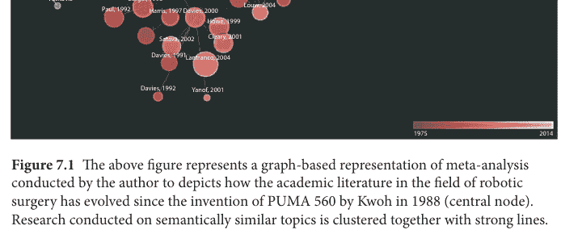

图 7.1 上图代表了作者进行的荟萃分析的基于图的表示，描绘了自 Kwoh 于 1988 年发明 PUMA 560（中心节点）以来，机器人外科手术领域的学术文献是如何演变的。对语义相似主题进行的研究被强线聚类在一起。每个节点代表一篇学术作品，其节点大小描绘了其引用次数，其颜色渐变基于研究论文的发表年份。

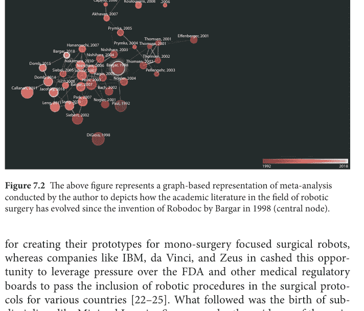

图 7.2 上图代表了作者进行的荟萃分析的基于图的表示，描绘了自 Bargar 于 1998 年发明 Robodoc（中心节点）以来，机器人外科手术领域的学术文献是如何演变的。

为创建他们针对单手术聚焦的手术机器人的原型，而 IBM、da Vinci 和 Zeus 等公司则利用这一机会施压 FDA 和其他医疗监管机构，以便将机器人手术纳入各国手术方案 [22–25]。随之而来的是微创手术等子学科的诞生，其指导下的主要母学科是机器人外科手术。

# 7.2 手术机器人的必要性

微创手术经历了各种形式，然而，可以说机器人外科手术是最先进的。机器人和自动化的最早工作可以追溯到公元前 400 年，然而，其在外科手术领域的应用只有 20 年的历史 [3]。

该领域建立和发展的一个主要作用是 Archytas of Arentum 等外科医生以及 Vinci 和 Jaquet-Droz 等远见者的开创性努力的成果。他们是第一个设想微创手术概念的人，这成为机器人外科手术兴起的基石。

微创手术首次于 1987 年实施。那是一例腹腔镜胆囊切除术。随着腹腔镜手术的程序列表以不断增长的速度增加，外科医生的技术进步和技能的整体改进也在同步进行。微创手术是一个大众在构思后立即接受的想法。MIS 为公众和外科医生提供了大量优势。微创手术开启了更小的切口、降低感染风险和缩短住院时间的世界。它还能够根据需要显著减少恢复期。

尽管 MIS 吸引了大众并提供了一个简化的手术系统，但它涉及许多技术和机械困难。触觉反馈、灵活性以及手眼协调的缺乏给外科医生带来了主要困难。上述的一个例子是腹腔镜器械的移动方向与感兴趣的方向相反才能到达目标。这抵消了手眼之间的协调。这种情况也被称为“支点效应”。

人手腕有 7 个自由度，这是指手可以在总共七个独特方向上独立移动和旋转。然而，目前的腹腔镜器械只有 4 个自由度，这再次给外科医生带来了困难。这些器械也缺乏触觉，这使得与组织操作相关的手术依赖于可视化。此外，外科医生在手术过程中产生的生理性颤抖现在很容易通过刚性器械的长度传递。

这些限制解释了为什么使用自动化腹腔镜器械进行 MIS 会使吻合和精细解剖变得困难甚至不可能。克服此类限制的迫切需求为手术机器人的构想奠定了基石。

# 7.3 机器人外科手术在各领域的本体论演变

随着微创手术为技术进步开辟新前沿，机器人手术通过提供最大附加优势、极大缩短住院时间以及最少的术中并发症数量引领潮流。手术程序经历了漫长的发展，从使用 PUMA 560 插入针头到

该行业被两大企业超级大国——ZEUS 和 da Vinci 所主导。

为了提供一点视角，下表代表了在土耳其埃尔祖鲁姆地区培训和研究医院进行的 221 例机器人手术研究中，于 2015 年 2 月至 2018 年 7 月期间在机器人手术期间术中和术后遇到的并发症数量。患者数据，如年龄、性别、美国麻醉医师协会（ASA）评分、基础疾病、吸烟习惯、手术类型、侵入性操作（动脉插管或中心静脉导管）、剖腹术需求、麻醉持续时间、头低脚高位、手术和出院时间、出血量以及术中和术后并发症，均从数字数据库系统和麻醉记录中记录。手术分为三个大类——泌尿外科、普通外科和妇科。

# 7.4 从表中得出的推断

在研究期间共进行了 221 例机器人手术（泌尿外科 112 例 [50.6%]、普通外科 53 例 [23.9%]、妇科 46 例 [20.8%]、耳鼻喉科 10 例 [4.5%]）。患者中位年龄为 61（17–91）岁。耳鼻喉科手术的患者年龄最小，普通外科手术的患者年龄最大。大多数患者为男性，其中大多数（63.3%）为 ASA-II 分级。高血压是最常见的潜在疾病。手术类型的分布见表 7.1。

只有 10 名（4.7%）患者需要剖腹手术。麻醉和手术的平均持续时间在普通外科手术中最长。泌尿外科患者出院时间最长。头低脚高位仅在泌尿外科和妇科手术中使用。

低血压是机器人手术中遇到的最频繁的术中并发症，其次是代谢性酸中毒和心动过缓——舌或颊神经损伤在任何科室均未见。恶心是机器人手术后最常见的术后并发症，其次是低氧血症和代谢性酸中毒。术后任何科室均未见心脏或呼吸骤停、喉痉挛、心肌缺血或视觉障碍。术中和术后并发症均在泌尿外科最常见。耳鼻喉科手术中既未遇到任何术中并发症，也未遇到任何术后并发症。


**表 7.1** 该表格显示了在 2015 年 2 月至 2018 年 7 月期间在土耳其埃尔祖鲁姆地区培训与研究医院进行的 221 例机器人手术研究中术中和术后遇到的并发症的计数。

| | 泌尿外科 (n = 112) | 普外科 (n = 53) | 妇科 (n = 46) | 合计 |
|---|---|---|---|---|
| **术中并发症** | | | | |
| 低血压 | 11 | 8 | 7 | 26 |
| 高血压 | 4 | 0 | 0 | 4 |
| 出血 | 0 | 1 | 1 | 2 |
| 心动过速 | 4 | 0 | 0 | 4 |
| 心动过缓 | 12 | 0 | 0 | 12 |
| 心肌缺血 | 1 | 0 | 0 | 1 |
| 低氧血症 | 0 | 1 | 2 | 3 |
| 代谢性酸中毒 | 8 | 3 | 2 | 13 |
| 面部水肿 | 9 | 0 | 0 | 9 |
| 结膜水肿 | 11 | 0 | 0 | 11 |
| 舌水肿 | 3 | 0 | 0 | 3 |
| **总计** | 63 | 13 | 12 | 88 |
| **术后并发症** | | | | |
| 低氧血症 | 7 | 4 | 2 | 13 |
| 代谢性酸中毒 | 5 | 3 | 2 | 10 |
| 呼吸性酸中毒 | 1 | 2 | 1 | 4 |
| 恶心 | 18 | 4 | 4 | 26 |
| 呕吐 | 7 | 1 | 1 | 9 |
| 心动过缓 | 5 | 0 | 0 | 5 |
| 心动过速 | 1 | 0 | 0 | 1 |
| 低血压 | 2 | 2 | 2 | 6 |
| 高血压 | 2 | 0 | 0 | 2 |
| 谵妄 | 2 | 0 | 0 | 2 |
| **总计** | 50 | 16 | 12 | 78 |

*并发症总数是在 221 名患者中计算的。*

# 调查结论

本研究从麻醉医师的角度呈现了在普外科、泌尿外科、妇科和耳鼻喉科接受机器人手术的患者的临床特征。随着经验的增加和担忧的减少，似乎很可能 RAS 会发展成为一种标准程序。现在，我们提出一个案例研究，我们在其中讨论了机器人外科手术在外科各个方面的应用。我们并不期望读者具备任何医学知识来理解应用的范围，然而，对于医学术语了解程度低到中等的读者来说，本文可能会更有信息量。案例研究仅是为了描绘机器人手术在医院中已成为一种领先的常见做法的程度。手术的细节已得到介绍，并且将机器人外科手术程序与传统手术进行了对比。

# 7.5 经口机器人手术

机器人自动化现在已成为许多外科领域的一个基本组成部分。其中一个显著的例子是扁桃体切除术。最近，一种新的自动方法已被实施用于同一手术——TORS（经口机器人手术）根治性扁桃体切除术。TORS 主要用于治疗和管理扁桃体性质的癌症，为外科医生提供了各种优势。非机器人手术限制了手术入路，因此限制了经口切除术对恶性肿瘤的适应症仅限于扁桃体窝的有限区域。另一方面，TORS 使用高质量的内窥镜光学系统来提高手术机器人的器械灵活性，从而进一步促进了对扁桃体癌的经口切除术的操作和广泛切除。这同时减少了通常与开放手术过程相关的额外不适[13–20]。如今，TORS 的使用已不仅限于扁桃体切除术。它还被用于上呼吸道部分喉切除术、声门上喉切除术的犬模型、晚期咽癌以及头颈部癌症手术等类似领域。

# 7.6 胰十二指肠切除术

胰腺在消化和调节血糖方面发挥着至关重要的作用。主要有三种疾病会侵袭胰腺——糖尿病、胰腺炎和胰腺癌。

胰腺癌在美国最主要的死亡原因中位居第四[11, 26–30]。当统计数据显示被诊断的患者中只有极小比例（2019 年超过 50,000 人）可手术时，生存几率进一步降低[12]。这就需要对该过程进行自动化并尽早诊断，因为胰十二指肠切除术本身就是对最好的外科医生来说都极具挑战性的手术。今天，随着关于机器人 PD 与腹腔镜或“开放”PD 优势的争论仍在继续，10 年前外科医生就开始使用达芬奇系统进行胰十二指肠切除术的考虑[2]。最近关于胰十二指肠切除术的文献研究表明，虽然 RPD（机器人 PD）通过改善器械灵活性、更好的人体工学和 3D 可视化在理论上优于腹腔镜 PD，但实际上与腹腔镜方法不相上下[4]。然而，这并不否认它所提供的优势超过了其其他方面。

目前可以肯定地说，机器人辅助 PD 更适合患者。这基于术后恢复速度普遍更快以及手术中出血减少的观察[21]。这也引起了人们对迫切需要一项更全面的 RCT 来帮助我们得出关于机器人 PD 及其对患者术后体征影响的更审慎结论的关注。

# 7.7 机器人二尖瓣手术

1998 年，机器人二尖瓣手术被引入。由于在传统胸骨切开术中以微创技术再现准确结果的卓越表现，它取得了巨大的成功。因此，它已成为一种被广泛接受的技术，可在所有类别的二尖瓣脱垂中提供解剖学矫正，无论疾病的复杂程度如何。各种研究都指出了机器人辅助手术的好处。与机械通气机的相互作用减少、住院时间缩短、出血更少以及美容效果更优等都是优势之一。

一项研究于 1996 年启动，以比较接受机器人手术和非机器人手术的患者。研究共纳入 129 名患有非缺血性二尖瓣疾病的患者。然后他们被分为两组。1 组接受非机器人手术，2 组接受机器人手术。

该研究的結果总结在图 7.3–7.5 中。

通过前三个图表可以看出，第 2 组的患者在插管、ICU 和住院时间方面出现了显著且持续的减少。患者术前和术后并发症更少。虽然某些指标与第 1 组的人相当，但可以达成共识，即接受机器人手术的患者总体上经历的并发症和住院时间比接受非机器人手术的患者少。

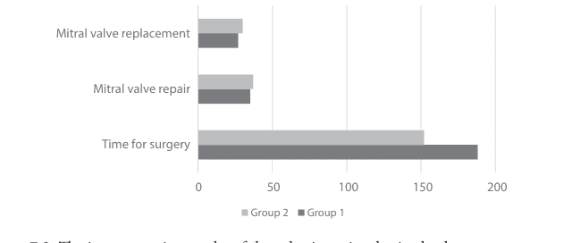

图 7.3 提到了机器人辅助二尖瓣手术的术中结果。

### 第 I 组与第 II 组并发症比较研究

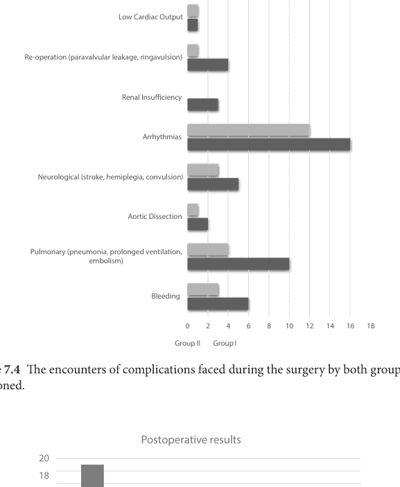

图 7.4 提到了两组在手术期间遇到的并发症。

### 术后结果

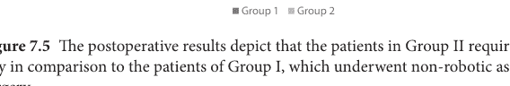

图 7.5 术后结果显示，与接受非机器人辅助手术的第 I 组患者相比，第 II 组患者所需的住院时间更少。

# 7.8 直肠肿瘤手术

最近发表的一篇论文对直肠手术的腹腔镜和机器人手术进行了评估。考虑的参数包括短期结果、围手术期数据以及对 ERAS 方案（加速康复外科）的依从程度。虽然论文显示腹腔镜组与机器人组在依从程度上的差异为 2.4%，但与腹腔镜手术相比，机器人手术被发现可缩短 LOS、降低转换率并减少术后手术并发症。在直肠肿瘤手术中提高机器人手术对 ERAS 方案的依从性方面仍有许多工作要做。

# 7.9 机器人肺癌手术

对于一个高度依赖视频辅助胸外科手术的领域来说，机器人手术带来了巨大的升级。机器人手术具有一些与 VATS 相似的特征，有助于外科医生在不失去使用便利性和技能精度的情况下轻松适应新系统。

当谈到最大化机器人手术优势时，适当的端口放置至关重要。当深入到特定机制的重要性时，整体目标的效用通常超过了对微小调整的成本。机器人手术竞赛中处于领先地位的企业巨头 Zeus 指定了一个专门的研究团队，负责绘制端口放置的位置和解剖坐标。考虑了多种策略；这些包括后外侧、前外侧和中外侧入路。最后，在对假体进行一系列仔细实验后，发现应指定前外侧入路来设计并在人体上找到端口放置的物理标记。

随后，Zeus 研究实验室的团队和其他在机器人手术领域工作的独立组织进行了研究，以确定手术中是否存在多余的端口可以移除，从而符合微创手术的原则。在进行数千次实验和多年的研究后，得出结论：后部端口可以从机器人手术方案中移除。这种减少的回报是总端口数量的最小化和相邻机器人臂之间间隙的优化。然而，这种回报并不局限于某些数学量的减少。


# 7.12 结论

从上述比较研究中，我们可以安全地得出结论，机器人手术的应用已扩展到多维领域。毫无疑问，机器人手术相比传统手术程序如VATS或腹腔镜胰十二指肠切除术具有各种关键优势。在对患者病史和状况进行深入分析后，在个案基础上出现严重并发症或情况时，传统方法可能看起来是一个合适的选择。然而，共识始终倾向于手术程序的机器人自动化。

# 7.13 未来工作

在医学上，机器人手术是首选。鉴于它们提供较少的失血、较少的术后并发症，最重要的是为患者缩短住院时间。然而，问题出现了，鉴于机器人辅助手术为患者提供的优势，在患者以及外科医生选择采用它时，产生了一种恐惧和怀疑的情绪。这是与机器人手术程序相关的潜在失败和故障病例，还是外科医生缺乏处理复杂系统的技能？本系列的后续章节将对此进行探讨。

### 参考文献

- 1. Ewing, D., Pigazzi, A., Wang, Y., Ballantyne, G., “Robots in the Operating Room The History”. *Surg. Innovation*, 11, 2, 63–71, 2004.
- 2. Giulianotti, P., “Robotics in General Surgery”. *Arch. Surgery*, 138, 7, 777, 2003.
- 3. Kalan, S. *et al.*, “History of robotic surgery”. *J. Rob. Surgery*, 4, 3, 141–147, 2010.
- 4. Kamarajah, S. *et al.*, “Robotic versus conventional laparoscopic pancreaticoduodenectomy a systematic review and meta-analysis”. *Eur. J. Surg. Oncol.*, 46, 1, 6–14, 2020.
- 5. Kwoh, Y., Hou, J., Jonckheere, E., Hayati, S., “A robot with improved absolute positioning accuracy for CT guided stereotactic brain surgery”. *IEEE Trans. Biomed. Eng.*, 35, 2, 153–160, 1988.
- 6. Lanfranco, Castellanos, A., Desai, J., Meyers, W., “Robotic Surgery”. *Ann. Surgery*, 239, 1, 14–21, 2004.
- 7. Cianchetti, M., Laschi, C., Menciassi, A., Dario, P., “Biomedical applications of soft robotics”. *Nat. Rev. Mater.*, 3, 6, 143–153, 2018.
- 8. Dziegielewski, P., Durmus, K., Ozer, E., “Transoral robotic surgery for the excision of base of tongue vascular lesions”. *Head Neck*, 37, 8, 1211–1212, 2015.
- 9. Rashid, O., Mullinax, J., Pimiento, J., Meredith, K., Malafa, M., “Robotic Whipple Procedure for Pancreatic Cancer: The Moffitt Cancer Center Pathway”. *Cancer Control*, 22, 3, 340–351, 2015.
- 10. Saravanan, R., Ramabalan, S., Balamurugan, C., “Evolutionary collision-free optimal trajectory planning for intelligent robots”. *Int. J. Adv. Manuf. Technol.*, 36, 11–12, 1234–1251, 2007.
- 11. Siegel, R., Miller, K., Jemal, A., “Cancer statistics, 2019”. *CA: Cancer J. Clin.*, 69, 1, 7–34, 2019.
- 12. Wecowski, J, Ross, S., Sucandy, I., Rosemurgy, A., “Robotic pancreaticoduodenectomy: A safe minimally invasive option”. *Laparoscopic Surgery*, 3, 8–8, 2019.
- 13. Weinstein, G., O’Malley, B., Snyder, W., Sherman, E., Quon, H., “Transoral Robotic Surgery”. *Arch. Otolaryngol. Head Neck Surgery*, 133, 12, 1220, 2007.
- 14. Malley, B.O., Weinstein, G., Snyder, W., Hockstein, N., “Transoral Robotic Surgery (TORS) for Base of Tongue Neoplasms”. *Laryngoscope*, 116, 8, 1465–1472, 2006.
- 15. Weinstein, G., O’Malley, B., Snyder, W., Hockstein, N., “Transoral Robotic Surgery: Supraglottic Partial Laryngectomy”. *Ann. Otol. Rhinol. Laryngol.*, 116, 1, 19–23, 2007.
- 16. Boudreaux, B. et al., “Robot-Assisted Surgery for Upper Aerodigestive Tract Neoplasms”. *Arch. Otolaryngol. Head Neck Surgery*, 135, 4, 397, 2009.
- 17. Hockstein, N., O’Malley, B., Weinstein, G., “Assessment of Intraoperative Safety in Transoral Robotic Surgery”. *Laryngoscope*, 116, 2, 165–168, 2006.
- 18. Weinstein, G., O’Malley, B., Desai, S., Quon, H., “Transoral robotic surgery: does the ends justify the means?”. *Curr. Opin. Otolaryngol. Head Neck Surgery*, 17, 2, 126–131, 2009.
- 19. Solares, C. and Strome, M., “Transoral Robot-Assisted CO2 Laser Supraglottic Laryngectomy: Experimental and Clinical Data”. *Laryngoscope*, 117, 5, 817–820, 2007.
- 20. Selber, J., Robb, G., Serletti, J., Weinstein, G., Weber, R., Holsinger, F., “Transoral Robotic Free Flap Reconstruction of Oropharyngeal Defects: A Preclinical Investigation”. *Plastic Reconstructive Surgery*, 125, 3, 896–900, 2010.
- 21. Zhou, N. et al., “Outcomes of pancreatoduodenectomy with robotic surgery versus open surgery”. *Int. J. Med. Rob. Comput. Assisted Surgery*, 7, 2, 131–137, 2011.
- 22. Narula, V., Mikami, D., Melvin, W., “Robotic and Laparoscopic Pancreaticoduodenectomy”. *Pancreas*, 39, 2, 160–164, 2010.
- 23. Satava, R., “Robotic surgery: From past to future—A personal journey”. *Surg. Clinics North Am.*, 83, 6, 1491–1500, 2003.
- 24. Lofthouse, M., “Risk factors for gastrointestinal complications after cardiac surgery”. *Nat. Clin. Practice Gastroenterol. Hepatol.*, 2, 9, 385–385, 2005.
- 25. Wang, Y., Butner, S., Darzi, A., “The Developing Market for Medical Robotics”. *Proc. IEEE*, 94, 9, 1763–1771, 2006.
- 26. Siegel, R., Miller, K., Jemal, A., “Cancer statistics, 2016”. *CA: Cancer J. Clin.*, 66, 1, 7–30, 2016.
- 27. Siegel, R., Miller, K., Jemal, A., “Cancer statistics, 2015”. *CA: Cancer J. Clin.*, 65, 1, 5–29, 2015.
- 28. Siegel, R., Naishadham, D., Jemal, A., “Cancer statistics, 2012”. *CA: Cancer J. Clin.*, 62, 1, 10–29, 2012.
- 29. Hanahan, D. and Weinberg, R., “Hallmarks of Cancer: The Next Generation”. *Cell*, 144, 5, 646–674, 2011.
- 30. Islami, F., Siegel, R., Jemal, A., The changing landscape of cancer in the USA — opportunities for advancing prevention and treatment. *Nat. Rev. Clin. Oncol.*, 17, 631–649, 2020.

# 使用语义网的物联网使能有效医疗健康监测系统

Sapna Juneja¹*, Abhinav Juneja², Annu Dhankhar² and Vishal Jain³

¹IMS Engineering College, Ghaziabad, India
²KIET Group of Institutions, Ghaziabad, India
³Sharda University, Noida, India

#### 摘要

物联网技术的发展在医疗领域和医疗保健行业的发展中发挥着主要作用，因为患者可以随时通过虚拟方式轻松经济地与医生和医疗专业人员保持联系。现在不需要每次都进行面对面的医生咨询，所有这些都只是物联网的发展所致。在这项研究工作中，定义了物联网在医疗保健中的应用。进一步还提到了这些应用如何借助各种传感器使用。从这些传感器收集的数据被共享到云端以供存储。患者可以使用各种可穿戴设备和传感器随时与医生保持联系。医生甚至可以在偏远地区为患者建议治疗。整个系统对危重患者非常有益，因为当传感器数据提供有关患者的异常信息时，医生可以立即向患者或其家人发送通知，告知需要立即采取什么行动。

关键词：云，医疗保健，传感器，物联网

#### 8.1 引言

智能健康是一种不断发展的技术，已在医疗保健行业中用于在任何时间、任何地点通过连接物联网设备 [1]、患者和医生彼此之间进行疾病的预防、识别、治疗和随访。智能健康基本上通过实现全天候连接、使用智能技术和应用技术来实现医疗保健的数字化 [2]。物联网帮助设备自动收集数据并交换数据。医生现在能够更有效地提供早期诊断、预防性护理方法和更好的治疗选择。患者可以在实时环境中获得问题的解决方案 [3]。在这篇研究论文中，主要关注可用于医疗保健中收集患者数据并将该数据传达给医疗保健专业人员进行评估的物联网设备。物联网在医疗保健行业对患者、医生、医院、患者家属甚至医疗保健保险公司都有益 [4]。

- 物联网的患者护理——如今，有很多可穿戴物联网设备 [4] 可供使用，患者已使用这些设备来监测生命参数如血压、心率等。这些设备还可以用于向患者发送定期提醒 [5] 例如饮水提醒、卡路里计数器、参数变化等。人们的生活因物联网在医疗保健中的发明和应用而改变，特别是对于老年人 [6] 和独自生活的患者而言，他们从这项技术的出现中受益匪浅 [4]。此外，这些物联网设备如果发现日常参数或日常活动有异常，还会向患者家属发送信号 [7]。

- 物联网对医生的使用——利用物联网，医生现在能够随时关注患者的健康状况，患者可以使用可穿戴设备和其他传感器或监测设备与医生保持联系 [8]。医生还可以检查患者对治疗的依从性 [9]。物联网使医疗工作者能够更加警惕，并在紧急情况下动态地与医生联系。除此之外，物联网收集的数据还有助于医生找到可给予患者以获得更好治愈的最佳治疗方案 [10]。


**c) 物联网在医院中的应用**——不仅医生和患者，医院也受到物联网设备使用的影响。物联网设备中的传感器可用于实时跟踪各种医疗工具和设备的位置，例如轮椅、氧气瓶、担架等 [11]。除此之外，医院还可以决定医院工作人员的位置安排。医院的资源管理也可以通过物联网设备来完成 [12]，例如药房目录记录管理、整个或局部区域的温度控制等 [13]。

**d) 物联网在保险公司中的应用**——健康保险公司也可以利用物联网设备为其业务活动获得更好的机会。这些组织可以使用从物联网设备收集的数据来核验患者提出的索赔 [14]。利用这些数据，公司可以核实索赔是真实的还是存在欺诈 [15]。此外，保险公司还会在客户使用物联网设备并与公司共享数据时，向客户提供各种福利 [16]。这些公司会向客户支付使用物联网设备的报酬，以监控患者的日常活动。这有助于保险公司尽量减少索赔 [17]。

#### 8.2 文献综述

物联网与云计算技术相结合，可用于医疗保健领域，对患者进行监测并提供治疗 [18]。整个系统的主要任务是通过各种传感器密切关注患者的生命健康参数 [19]，即可穿戴身体传感器和家庭安装的传感器。这些数据会进一步提供给医生，医生在检查这些参数后，无需任何身体接触即可与患者互动 [20]。云系统已被用于存储这些数据，因此可以在全球范围内访问。事实上，在世界农村地区，由于缺乏设施，患者很难及时获得治疗，这种方法更为有益。以下是先前研究人员在同一领域所做研究工作的列表：

文献[21]聚焦于利用技术的医疗保健，即基于物联网的医疗保健，并具体说明了如何确保通过物联网设备传输的数据安全。文献[19]提到了各种医疗物联网、其特性、用途以及该领域的挑战。

文献[22]还在其研究中讨论了医疗物联网，并提到物联网在医疗行业的数字化转型中发挥着重要作用。它基本上提高了医疗专业人员提供的服务质量。研究人员还提到了各种面向患者的可穿戴传感器和设备。文献[23]提出有必要将物联网与医疗保健相结合，因为这对远程患者监测非常有用，但在医疗保健中实施物联网应有固定的条件和标准。该研究还提到了物联网在医疗保健中的用途。文献[24]提出了一种基于物联网的可穿戴设备，患者可以将其戴在手腕上。该设备可以监测患者的体温和活动，对患有严重疾病的老年人非常有用 [25]。在这项工作中，研究者使用了一些家庭传感器来检查老年人的活动率和跌倒率。这些无线传感器通过验证个人的当前位置来收集其数据 [26]。通过分析位置的变化，可以诊断出患者问题的严重程度。他们研究工作的缺点是没有在任何地方定义数据安全问题 [27]，同时该文献还介绍了基于物联网的医疗保健的各种应用。他还详细阐述了如何通过使系统更节能来为整个系统提供数据安全。他规定，物联网设备的使用权限不会对所有人开放；相反，在访问设备之前，应对每个用户应用某种身份验证机制。

#### 8.3 基于物联网的医疗保健阶段

物联网设备在医疗保健领域的快速增长开辟了巨大的机遇，因为这些设备收集的大量数据具有改变医疗保健的潜力 [28]。医疗保健行业使用的物联网架构可分为四个阶段。这些阶段的连接方式是：一个阶段的输出数据用作下一个后续阶段的输入数据，依此类推 [29]。

- 阶段 1：第一阶段由各种相互连接的设备组成，如摄像头、传感器、监视器等，用于收集数据 [16]。
- 阶段 2：从这些设备收集的数据被数字化以进行处理 [30]。
- 阶段 3：经过预处理后，数据被保存到云端进行存储 [31]。
- 阶段 4：最后，对数据进行分析，并基于此分析做出决策。

#### 8.4 基于物联网的医疗保健架构

基于物联网的医疗保健架构可以很容易地用图 8.1 表示。最底层是定义患者位置的层级。在此处，各种传感器

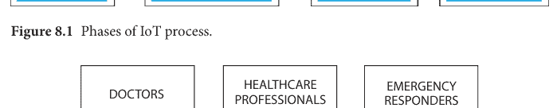

图 8.1 物联网过程的各个阶段。

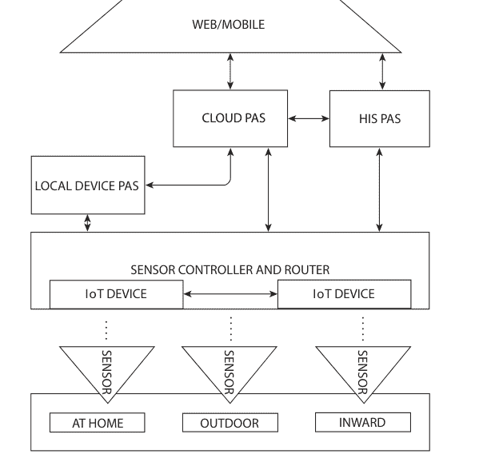

图 8.2 基于物联网的医疗保健架构。

被安装用于收集患者的生命体征数据。如果这些传感器基于无线系统，则可以随处使用，例如在家中，或者当患者不在家时在其他地方。这些传感器进一步连接到物联网设备，物联网设备在分析后，借助云将数据传输给医疗保健工作者。云负责存储和处理数据 [11]。应用层包含各种工具，这些工具可在数据交付给医生之前帮助监测和分析收集到的数据（图 8.2）。

#### 8.5 用于健康监测的物联网传感器

智慧医疗帮助患者和老年人独立生活。在这里，物联网传感器已被用于记录他们的健康状况，并在发现任何紧急情况时发出警报。但如果患者的生命体征出现轻微变化，基于物联网的应用能够自行建议治疗方案 [32]。下面详细说明物联网在医疗保健领域的基于传感器的应用，这些应用大致分为：

- 1. 基于单一状况的应用——这些应用用于治疗单一疾病。
- 2. 基于多种或聚集状况的应用——这些应用用于同时治疗多种疾病 [33]。

基于单一状况的应用分为：

- a) 监测血糖水平的传感器：在糖尿病中，患者血液中的糖水平在很长一段时间内保持较高。血糖监测设备监测人的血糖水平，并根据疾病的严重程度向患者推荐饮食、运动和药物。如果该监测系统与基于互联网的物联网设备相连，物联网设备将收集数据并将数据传输给医疗保健工作者或医生，以便在适当的时间做出合适的用药决策，减少任何意外事件发生的可能性 [11]。
- b) 监测血压的传感器：血压是心脏将血液循环到全身时所产生的压力。基于物联网的技术可以利用各种传感器监测血压和其他必要的身体生命体征。物联网设备检查常规血压，并在数值偏离正常值时发出信号 [34]。监测体温的传感器：传感器可以附着在身体上测量体温，然后将信息发送给物联网设备，物联网设备进一步收集数据并将其发送给医生 [35]。
- c) 测量身体血氧吸收的监测系统：一种名为血氧仪的设备已被患者和医生用来监测血液中的氧气吸收情况。为了改进服务，这种血氧仪可以与基于物联网的技术结合使用，为远程患者提供治疗 [36]。
- d) 测量身体心电图的监测系统：心电图设备已被用于观察身体的心电图波形，并根据这些波形生成报告以检查心脏功能。IOIO-OTG 微控制器
通过模数转换器将心电图信号转换为数字信号，然后将生成的二进制文件上传到云网络，用于分析和识别异常健康状态 [13]。

基于多种状况的应用包括：

- a) 设备管理——由于轮椅或担架对患者或有某些身体残疾的人非常有用，如果这些设备能够配备基于物联网的传感器，就可以很容易地跟踪患者的活动并监测患者的状况 [37]。
- b) 基于手机的医疗保健解决方案——在当前的场景中；手机与传感器一起控制着各种电子设备。在医疗保健行业，各种基于移动的应用已被用于为患者提供服务 [38]。各种医疗保健解决方案提供商的应用示例包括 BP Watch、Pulse Watch 等。


#### 8.6 物联网在医疗保健中的应用

医疗保健行业的许多问题都可以通过物联网的使用得到解决。物联网设备提供的解决方案有助于提供更好的治疗，也能更好地监测患者。以下是物联网在医疗保健中的一些应用：

- 1. 远程患者监护——尽管医疗设施正在迅速增加，但在发展中国家，患者的远程监护仍然是难以处理的情况。此外，如果在适当的时间为患者提供医疗服务，许多紧急情况都可以得到控制。因此，借助基于物联网的解决方案，上述问题可以解决，患者远程监护将更加有效。患者可以使用基于传感器的可穿戴设备，及时将健康状况通知医生[13]。
- 2. 照看患者的机器人——基于物联网的机器人可以在医院以及独居患者的家中充当助手，协助为患者提供更好的护理。它可以监测患者的生命体征，帮助患者按时服药，并能及时提醒日常活动[39]。
- 3. 临床废物管理——医疗领域的临床废物管理是一个大问题。如果处理不当，这个问题可能导致患者或医院工作人员之间发生感染。因此，可以使用基于传感器的垃圾桶来解决此问题。这些传感器在垃圾桶装满时及时发送警报，以便垃圾能及时倾倒在合适的地点[40]。
- 4. 为痴呆患者配备的GPS定位鞋[41]——患有痴呆症或其他相关神经疾病的患者会忘记日常活动，甚至可能忘记自己的家庭位置。GPS定位鞋可用于随时跟踪患者的位置；如果患者离开其家庭位置，鞋子会通过物联网设备向患者家属发送警报。
- 5. 医院的全面管理——物联网设备有助于医院的全面管理，包括预约挂号、医院人员管理、减少门诊（OPD）排队、库存管理等[39]。
- 6. 哮喘患者的主动治疗——哮喘的不可逆性使其成为一种危及生命的重大疾病，唯一的补救措施是患者终生使用吸入器[27]。患者即将发作时的明确症状会在发作前半小时至8小时内显现。物联网工具在向患者提供帮助方面可能非常有用。一种与智能传感器相连的吸入器，该传感器能够根据温度或空气中花粉等因素触发，以避免患者发生此类哮喘发作[7]。

#### 8.7 语义网、本体及其在医疗保健领域的应用

语义网是万维网的扩展，但主要区别在于，在语义网中，信息不仅由机器生成，也由人类生成。语义网的主要任务是提高机器与人类并行工作的可能性。语义网提供的工具使得信息能够在各种系统之间分发。语义网本质上是一个状态空间，所有知识库都可以集中保存在其中，并以向用户呈现有意义信息的方式组织。语义网负责在众多网站上展示有意义的信息，也有助于研究社区在各个网站上搜索数据。由于医学领域的主要问题是从多种数据源产生信息和知识，语义网有能力向医疗保健系统提供此类信息。语义网可以促进各种数据源的融合，以获得更合适的结果。

语义网领域中的本体可以被定义为用于表示各种对象之间关系的文件。本体关系赋予了语义网一种树状结构。在某些本体中，这种树状结构增强了本体的特性。设计本体之前要遵循的关键点是使其能够被用户理解且易于使用。

#### 8.8 基于语义网的物联网医疗保健

语义网是一种扩展的Web，其中数据以提供完整含义的形式表示，从而促成了人与机器之间更加良好的关联。在语义网中，可用信息基于现实世界的问题。利用这些数据或信息，可以在人、机器、设备和服务之间建立兼容性。本体在实现各种机器之间的兼容性方面发挥着重要作用。为了在系统之间实现完全兼容，它们基于语义网的内容应当相同。本体基本上代表了任何系统信息表示的设计或结构。在医疗保健领域，使用了大量信息。为了将这些数据用于各种目的，这些数据必须在机器之间共享。因此，本体被用作医疗保健系统通用架构的信息基础。如今，基于物联网的设备非常普及，因为它能够普遍且精确地共享数据。医疗保健部门旨在为每位患者提供定制化服务。为了实现这一目标，基于物联网的系统借助各种传感器和基于物联网的设备收集远程患者的数据，并将数据传输给医疗保健专业人员，以便为患者提供及时、良好的治疗服务。整个系统的工作方式是：从血压计、血糖仪等医疗保健设备收集数据到智能设备，然后将智能设备中的数据进一步传输到云端。在传输这些数据时，系统还关注数据的安全性和准确性。

以下是所提出的基于语义网的物联网医疗保健系统架构（图8.3）。

该架构旨在为患有慢性疾病的患者提供服务。该架构能够定期检查

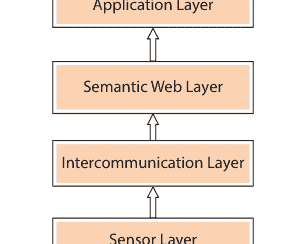

图8.3 基于语义网的物联网医疗保健。

患者的状况。系统通过收集安装在患者所在地的不同传感器的数值，然后分析这些数值，得出关于患者健康状况的结论。

该系统的主要目标是通过利用收集到的信息做出决策，并使用医疗保健语义网验证所收集的有关医疗保健系统的信息和知识，从而为患者服务。上述系统包含四个组成部分：最底层是基于传感器的层，其中有各种传感器和基于物联网的设备，用于收集患者的数据。基于传感器的层之上是互通信层，其目的是在基于传感器的层与上层之间提供通信。该层包含多种网络和通信手段。互通信层之上是语义网层。该层按顺序执行多项任务。首先，它从传感器和物联网设备等多个可用来源收集数据，获取患者的详细信息。收集信息后，提取与医生当时正在治疗的特定疾病相关的数据。提取相关数据后，将其与可用的基于规则的模型进行比较。根据基于规则的模型，得出问题的解决方案，并存储在患者数据库中，以供将来参考。系统的最顶层是应用层，它充当医疗保健部门用户与系统之间的接口。

#### 8.9 物联网在医疗保健行业中的挑战

物联网在医疗保健领域带来了许多巨大好处，但仍有一些问题必须解决。如果不克服这些挑战，就无法实现物联网。

- 1. 管理物联网设备产生的大量数据——由于医疗保健系统中有数百万台设备相互连接，这些设备会产生大量数据，因此存储和管理这些海量数据变得相当困难[42]。尽管可以使用云和人工智能算法来管理这些数据，但其实现仍然是一个非常耗时且复杂的过程[37]。
- 2. 物联网设备及相关数据更容易受到攻击——物联网设备对医疗保健非常有益


但该领域中的这些设备和相关数据更容易受到攻击[18]。攻击者可以攻击这些设备，获取信息并篡改信息。攻击者还可以控制医院所有相关设备，这对患者和医院来说都是一个棘手的问题[43]。

- 3. 通用医疗保健法规——医疗领域的物联网仍需得到世界通用医疗保健法规组织的批准[44]。
- 4. 需要持续更新软件——由于物联网设备基于硬件，且这些硬件设备需要与软件协同工作，因此需要定期更新软件以确保物联网设备的正常运行，而常规软件更新是一项复杂任务，需要耗费大量时间和精力。

#### 8.10 结论

医疗保健与物联网相结合是当前一个新兴领域，也是研究人员的重要研究课题。物联网方法的使用使治疗过程和患者护理实现了机械化。基于物联网的设备建立了应对患者、医生和医院的策略，并开始提供更智能、更快捷的服务。物联网设备使患者能够随时随地告知医生自己的健康状况，使医生能够在远程环境下实时监测患者。在本研究工作中，我们提出了一种基于物联网的架构，用于监测远程患者的健康状况。物联网设备可利用传感器检查心电图（ECG）、血压（BP）、血糖等身体生命体征的指标。该架构对整个医疗保健领域非常有用，并将为健康监测提供更多解决方案。

### 参考文献

- 1. Mekonnen, Y., Namuduri, S., Burton, L., Sarwat, A., Bhansali, S., 综述——基于无线传感器网络的精准农业中的机器学习技术。J. Electrochem. Soc., 167, 037522, 2020.
- 2. Information, H. and Records, P.H., 新兴的21世纪医疗技术, Mohammad Bajwa, Pakistan Journal of Medical Sciences, 30, 1–14, 2014.
- 3. Archip, A., Botezatu, N., Șerban, E., Herhelegiu, P.C., Zală, A., 基于物联网的远程患者监测系统。*Proc. 2016 17th Int. Carpathian Control Conf. ICCC 2016*, pp. 1–6, 2016.
- 4. Banka, S., Madan, I., Saranya, S.S., 利用物联网的智能医疗监测。*Int. J. Appl. Eng. Res.*, 13, 11984–11989, 2018.
- 5. Biswas, I. 等, 基于传感器的轻度痴呆辅助微内容。*ACM Int. Conf. Proceeding Ser*, 2010.
- 6. Fratiglioni, L. 等, 欧洲痴呆及其主要亚型的发病率：基于人群队列的协作研究。*Neurology*, 54, 1–10, 2000.
- 7. Rubi, J.N.S. and Gondim, P.R.L., 基于oneM2M和openEHR的泛在医疗数据聚合、处理和共享的IoMT平台。*Sensors (Switzerland)*, 19, 1–25, 2019.
- 8. Dahiwade, D., Patle, G., Meshram, E., 使用机器学习方法设计疾病预测模型。*Proc. 3rd Int. Conf. Comput. Methodol. Commun. ICCMC 2019*, pp. 1211–1215, 2019, doi: 10.1109/ICCMC.2019.8819872.
- 9. Bhat, M. I., Ahmad, S., Amin, A., Ashraf, S., 基于物联网的电子健康。*Int. J. Comput. Sci. Mob. Comput.*, 6, 357–362, 2017.
- 10. Marques, G., Pitarma, R., Garcia, N.M., Pombo, N., 面向增强生活环境和医疗系统的物联网架构、技术、应用、挑战和未来方向：综述。*Electron.*, 8, 1–27, 2019.
- 11. Pathinarupothi, R.K., Ramesh, M.V., Rangan, E., 用于远程健康监测的多层架构。*2016 IEEE 18th Int. Conf. e-Health Networking, Appl. Serv. Heal.*, vol. 2016, 2016, doi: 10.1109/HealthCom.2016.7749443.
- 12. Rojko, A., 工业4.0概念：背景与概述。*Int. J. Interact. Mob. Technol.*, 11, 77–90, 2017.
- 13. Zanjal, S.V. and Talmale, G.R., 使用物联网的安全健康药物提醒与监测系统。*Phys. Procedia*, 78, 471–476, 2016.
- 14. Shinde, G.R. 等, 冠状病毒病（COVID-19）预测模型：最新技术综述。*SN Comput. Sci.*, 1, 1–15, 2020.
- 15. Almeida, A. 等, 一种感知物联网的老年人行为数据收集与管理架构。*Wirel. Commun. Mob. Comput.*, 2017, 2017.
- 16. Dhillon, D.K. and Uppal, R.S., 物联网——理解下一个大趋势。*J. Netw. Comput. Appl.*, 67, 19, 2016.
- 17. Dewangan, K. and Mishra, M., 物联网在医疗保健中的应用：综述。*Researchgate. Net*, 8, 526–534, 2018.
- 18. Hernandez-Penaloza, G., Belmonte-Hernandez, A., Quintana, M., Alvarez, F., 一种提高认知问题老年人生活自主性的多传感器融合方案。*IEEE Access*, 6, 12775–12789, 2017.
- 19. Kadhim, K.T., Alsahlany, A.M., Wadi, S.M., Kadhum, H.T., 基于物联网（IoT）的患者健康状况监测系统概述。*Wirel. Pers. Commun.*, 2020, doi: 10.1007/s11277-020-07474-0.
- 20. Jatav, S. and Sharma, V. 一种用于医学诊断的预测性数据挖掘方法算法。*Int. J. Comput. Sci. Inf. Technol.*, 10, 11–20, 2018.
- 21. Nanayakkara, N., Halgamuge, M.N., Syed, A., 基于医疗物联网（IoMT）的医疗应用的安全性与隐私性：综述，2019.
- 22. Nazir, S., Ali, Y., Ullah, N., García-Magariño, I., 利用移动计算效应的医疗物联网：系统文献综述。*Wirel. Commun. Mob. Comput.*, 2019, 2019.
- 23. Chacko, A. and Hayajneh, T., 医疗保健中物联网的安全与隐私问题。*EAI Endorsed Trans. Pervasive Heal. Technol.*, 4, 1–7, 2018.
- 24. Evans, J. *et al.*, 针对老年人和心力衰竭患者的远程健康监测：依从性与系统可用性。*Telemed. e-Health*, 22, 480–488, 2016.
- 25. Kearns, W.D., Nams, V.O., Fozard, J.L., 运动路径的曲折度与辅助生活设施居民认知障碍无线分形估计相关。*Methods Inf. Med.*, 49, 592–598, 2010.
- 26. Van Os, H.J.A. *et al.*, 急性缺血性卒中中的伴随性头痛：与CT血管造影和CT灌注特征的关系。*Int. J. Stroke*, 10, 217, 2015.
- 27. Hamdi, M. and Abie, H., 电子健康物联网中基于博弈的自适应安全。*2014 IEEE Int. Conf. Commun. ICC 2014*, pp. 920–925, 2014, doi: 10.1109/ICC.2014.6883437.
- 28. Death, T.H.E. and Cancer, O.F., 监控我！日常物品中的传感器。19, 2019.
- 29. Abaker, I. 等, 多维抗击智慧城市中COVID-19的机器学习解决方案框架。*Medrxiv*, 2020 2020, doi: 10.1101/2020.05.18.20105577. 05.18.20105577.
- 30. Kumar, A., Kuppusamy, K.S., Aghila, G., 一种使用集成特征集检测可移植可执行文件恶意性的学习模型。*J. King Saud Univ. - Comput. Inf. Sci.*, 31, 252–265, 2019.
- 31. Pilloni, V., 数据将如何改变工业流程：群智感知、众包和大数据作为工业4.0的支柱。*Futur. Internet*, 10, 2018.
- 32. Suzuki, S. and Matsui, T., 用于医疗和保健应用的遥感技术。*Remote Sens. - Appl.*, 2012, doi: 10.5772/36924.
- 33. Dziak, D., Jachimczyk, B., Kulesza, W.J., 基于物联网的医疗应用信息系统：设计方法论。*Appl. Sci.*, 7, 2017.
- 34. Karaolis, M.A., Mouritis, J.A., Hadjipanayi, D., Pattichis, C.S., 基于决策树数据挖掘的冠心病事件危险因素评估。*IEEE Trans. Inf. Technol. Biomed.*, 14, 559–566, 2010.
- 35. Najib, S.M., Hassan, N.B., Shair, N.T.A.B.M., Rahim, N., Wahab, N.A., 基于安卓应用和多传感器的智能新生儿监测系统。*ICAIE 2019 - 2019 IEEE Symp. Comput. Appl. Ind. Electron.*, pp. 131–135, 2019, doi: 10.1109/ISCAIE.2019.8743867.
- 36. 面向阿尔茨海默病患者的基于物联网的医疗支持系统，Rozita Jamili Oskouei, wireless communication and mobile computing, wiley, Volume 2020 | Article ID 8822598 | https://doi.org/10.1155/2020/8822598, *物联网对痴呆症患者的支持*, pp. 41–43, 2015.


- 37. Kamišalić, A., Fister, I., Turkanović, M., Karakatić, S.，《非侵入式腕戴设备的功能与传感器：综述》。Sensors (Switzerland)，18, 2018。
- 38. Catarinucci, L. 等，《面向智能医疗系统的物联网感知架构》。IEEE Internet Things J.，2, 515–526, 2015。
- 39. Moosavi, S.R. 等，《SEA：基于物联网的医疗保健中利用智能网关实现安全高效认证与授权的架构》。Procedia Comput. Sci.，52, 452–459, 2015。
- 40. Nilashi, M., Ibrahim, O.B., Ahmadi, H., Shahmoradi, L.，《利用机器学习技术进行疾病预测的分析方法》。Comput. Chem. Eng.，106, 212–223, 2017。
- 41. Peterson, C.B., Prasad, N.R., Prasad, R.，《痴呆症辅助技术的未来》。2012 Proc. 29th Int. Symp. Autom. Robot. Constr. ISARC 2012, 2012, doi: 10.4017/gt.2012.11.02.427.00。
- 42. Dwivedi, A.K.，《不同机器学习技术在心脏病预测中的性能评估》。Neural Comput. Appl.，29, 685–693, 2018。
- 43. Brown, E.L. 等，《基于智能手机的痴呆症护理健康技术：机遇、挑战与当前实践》。J. Appl. Gerontol.，38, 73–91, 2019。
- 44. Nogueira, V.，《物联网与医疗保健概述》。Actas das 6as Jornadas Informática Univ. Évora, 2019。
