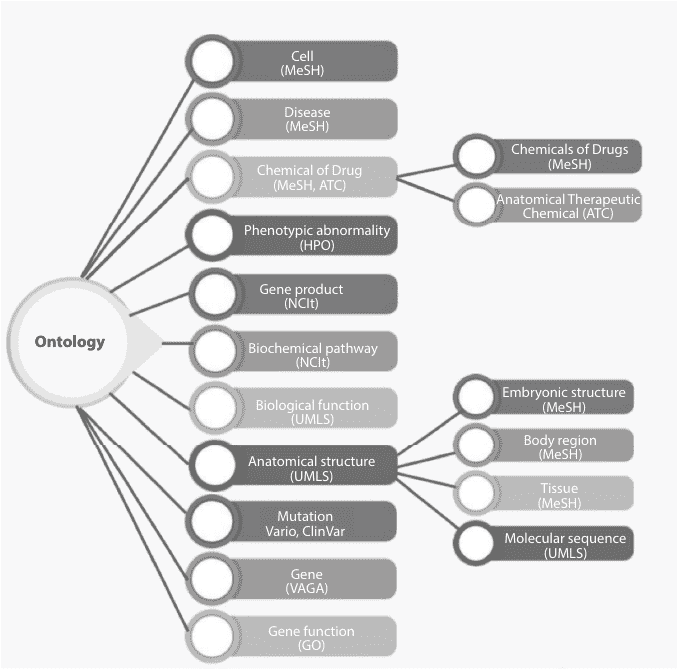

# 本体语境下的精准医疗

Rehab A. Rayan¹* 和 Imran Zafar²

¹埃及亚历山大亚历山大大学公共卫生高等研究院流行病学系

²巴基斯坦拉合尔巴基斯坦虚拟大学生物信息学与计算生物学系

#### 摘要

随着生物医学技术的发展，精准医疗（PM）领域的数据量呈指数级增长。传播的信息中包含关于相关生物医学单元位置及其语义关系的宝贵知识。为此，必须建立一种模型，将信息表示为本体，以正式反映疾病、表型、基因、突变、药物等之间的关系，并实现异构数据的有效整合。本体是对知识的系统性描述，能够组合和检查大量异构数据，从而实现对患者的精准分析。本体在医疗保健中的应用主要旨在描述和重组医学术语。卫生专业人员已经改进其技术表达和词汇，以支持高效地存储和传播通用医学知识和患者特定信息。这些针对人工处理优化的术语带有大量固有知识。卫生信息系统应无歧义地提供复杂而全面的医学概念，这是一项具有挑战性的工作，需要对这些术语的构造和概念进行彻底研究。然而，这可以通过构建医学领域本体来描述这些信息系统来实现。本章的主要目的是解释本体及其在计算推理中的应用，以促进患者诊断和护理管理的准确分类，并用于转化研究。

关键词：精准医疗、个性化医疗保健、本体、分类、机器学习决策支持

*通讯作者：rayanr@alexu.edu.eg；https://orcid.org/0000-0003-3852-5710

#### 9.1 引言

精准医疗（PM）是一种治疗和预防疾病的方法，旨在通过考虑基因、环境因素的差异来最大化疗效[1]。PM网络还连接患者、护理人员、临床实验室和前瞻性研究[2]。随着个性化医疗的快速扩展，异构临床数据和科学信息的数量呈指数级增长，其中如功能性生物医学单元及其语义关系等宝贵知识难以获取。一个关键问题是如何了解并利用这些知识来辅助PM。通过整合、分类和标准化来自不同资源的这些生物医学工具，并在它们之间建立关系，术语、分类和本体可以在计算格式中提供不同程度的复杂性，从而能够分析海量数据集合，并对患者进行正确分类[3]。这些知识模型的构建对于PM研究是必要且适当的。

本体是一种用于务实表示和理解生物医学的强大技术。在同样的情况下，精准或个性化医疗是本体概念中的一种新模式，它以渐进的方式确保个性化患者护理的卓越信心。本体的框架正在兴起，通过提供简便的工具和医疗决策支持系统级方法，在精准医疗中实现多种推理机制，从而改善患者的诊断和治疗。为了处理这些大规模数据集或本质上异构且从个体患者收集的数据，我们在此采用合适的方法来识别每位患者可能不同的基础知识，以专门处理变化或诸如不同疾病体征和症状等问题。本体论信息值得提及，因为科学信息和临床数据是异构的或难以操作的。基于本体领域中的分类方法，它为处理多位患者中关联顶层信息的疾病机制提供了便利[4]。

术语在信息检索方面有着悠久的历史，例如搜索符合特定条件的文档或数据库记录[5]。许多最相关的医学知识检索工具包括：用于PubMed索引和检索的医学主题词表（MeSH）；RxNorm[6]——一种标准化并重新命名的药物术语；以及UMLS（统一医学语言系统），其中包含100多种临床术语和编码系统[7]。这些工具包含常用名称、同义词和交叉引用列表，塑造了搜索和索引数据，并常用于电子健康档案（EHR）和公共数据库。本体不同于词汇表，在于本体以能够进行理性逻辑推理、从类似陈述中得出结论的方式解释概念之间的关系[8]。例如，如果本体将“病毒”归类为传染源，并将“感染性脑膜炎”归类为一种传染病形式，那么它将得出结论：“病毒性脑膜炎”是“感染性脑膜炎”的一个子类。亚里士多德创建了一个概念分类法，在某种程度上模仿了现代生物本体论[9]。研究人员最近使用“本体”一词来表示解释理解认知方面的计算描述。本体包含一组概念（术语）及其同义词，以及描述概念之间正式关系的简洁逻辑定义。

在本体中使用简洁的语法可以保持逻辑一致性，即使跨多个领域有数百或数千个概念，也允许计算过程定义那些隐含但未在原始数据中明确指定的事实。因此，本体可以通过用“可计算”语义编码数据来帮助利用临床大数据的潜在知识，使机器学习和其他算法能够通过将高容量多模态数据分析与临床意义相结合来应对挑战。本体还可以与自然语言结合用于极其清晰的文本概念中，例如临床评论中的概念[10]，并改进从EHR和其他来源的知识提取。本体还将支持整合基础科学数据（如动物模型数据）和一般信息（如遗传变异与疾病之间的关联），从而能够基于远超EHR的数据收集来识别患者，并实现新的临床理解[11]。海量数据的整合和廉价的高容量计算机提供了获取治疗和诊断知识的能力，以实现出色的交互分析、显著的描述性分析和推理性分析。

卡尔·林奈（Carl Linné，1707–1778）将疾病分为11纲、37目和325种，建立了第一个可被视为真正疾病单元（疾病分类学）的高级医学层级。虽然从科学角度看，林奈的分类存在某些错误，例如认为麻风病可通过食用鲱鱼蠕虫感染，但他的分类为最终导致1893年第一版ICD的研究奠定了基础。ICD最初是作为死因分类而开发的，此后发展巨大，但它仍然旨在作为流行病学、健康管理和计费的指南，而非作为衡量患者这一生物实体的标准。历史报告是通常相互兼容的统计分类（它们不会重复计数），并且

Comprehensive（它们有容纳一切的地方）。ICD 的原创性是通过单层级（单一父级）实现的，其中每个代码只有一个父级且仅有一个。这消除了许多账单，但经常造成模糊的连接。例如在 ICD 第 10 版中，甲状腺恶性肿瘤（C73）是恶性肿瘤的子项，但不是甲状腺疾病的子项；只有当 ICD-10 中的术语可以有多个父级时，它才是两者的子项；因此，单层级限制了用于分析和研究的人为关键要素，并阻碍了对疾病和其他环境因素的批判性评估。逻辑疾病的定义可以追溯到希波克拉底，因为它至今仍是研究的重要领域。个体的表型在历史上定义了可测量的特征，这些特征也与基因型相关。该概念正越来越多地由从事组学数据和临床记录边界的转化研究人员组织起来，以根据特定的临床和“组学”功能识别具有相同“诊断”的患者群组 [12]。

在语义网技术中，计算机化医疗记录的广泛部署允许积累描述人口统计学、表现、检查结果、诊断、结论、干预、药物等个人和科学备注的病例档案本体。最近，大量这些大数据，包括在基因组学、蛋白质组学和代谢组学研究中获得的数据，被应用于医学研究。这些数据的数量、范围和流动是人类这一时代独有的。

本体提供了自动整合个体患者数据或关于药物配方和评估的临床研究和试验相关信息的链接机会。与此同时，已开发的本体系统，即 Web 本体语言（OWL），为精准医学挑战识别、生物通路与临床试验的同化或互联以及药基因组学和其他生命科学应用提供了基本发现。在下一代语义网技术中，本体为与全谱临床和实验室研究数据集成的研究数据仓库系统提供了更好的理解，具有时间、成本和复杂性结果的有效性来分析这些源生的生物数据。随着本体中高通量技术的进步，个体健康路径可能以多种形式在创新时间框架内映射，涉及不同基因型、表型和生态系统特征的探索。医疗数据覆盖描述了单基因变异、家族史、实验室结果、笔记、图像、医疗设备、发现和药物。如今，这些特征正与日益强大的大数据配对，而大数据尚未完全配备以分类疾病。这些数据的来源包括可穿戴设备，它们跟踪体重、心率、身体活动、营养、对处方药物的依从性、地理位置，因此在从瞬间到年龄的持续时间内累积。全部接收到的数据，在不测序生殖系的情况下，返回个体健康路径中的特定时间点 [3]。

尽管电子医疗记录报告了许多数据类型，但它们有时会阻碍对患者水平、分子或大数据以及医疗数据的检查；这是因为记录破碎、错误、来源不明或缺少详细记录。此类问题反映了一个更关注发票而非报告临床关键患者数据的框架。基因水平、可穿戴设备、行为和生态数据难以追踪且未被一致收集或嵌入；这是因为它们有时被锁定在文本文件中，这对于计算机在正式研究领域进行分析可能具有挑战性。在这些类型的挑战中，本体通过语义网技术提供可互操作的<|message|> 架构，以支持医学领域中的多种统计聚合。

本体（UMLS、GO 和 EcoCyc 本体）对生物医学数据集的先进贡献对于理解生物医学工作的处理至关重要。生物信息学提供了新颖的见解来处理即将出现的问题，使用生物学、计算机、数学和统计方法的概念来检索、分析和以有效成本和时间框架管理数据。生物医学数据使用生物信息学工具和应用，结合自然语言处理的便利，可以根据网络语义分析进行文本摘要或文档聚类管理。患者表型数据有时无法访问或缺少细节，从而阻碍了相似性的确定以及将患者分类到医学相关类别。这些程序在具有一系列基因型、生物标志物、体征和症状的条件下存在问题且至关重要，这些可能不会在每个患者中表现出来。然而，精准医学主要旨在应用此类数据来分配患者并区分独特疾病之间的相似性 [3]。因此，本体的使用，结合语义网技术的特征，可以通过捕获生物医学领域广泛的概念提供许多有前景的解决方案。

#### 9.2 数据背后的原理

本体的主要属性通常被探索以提供对互联性挑战的新领域显式理解，以增强广泛领域中元数据质量。分离数据的复杂性质需要时间来提供医学实体如病理生理进展、特定遗传组装、疾病、知识、心身和治疗关系等的深入信息。因此，对于数据令人困惑的性质，我们需要特定的本体路径来处理药物，其中我们也知道意味着试图在精准医学世界中找到什么精确实体发生的<|message|> 研究。如今，信息访问的当前趋势是通过理解本体在基于计算语义网网络的自然语言处理操作中的方式而改变，例如 Web 本体语言（OWL）。

**Table 9.1** 不同术语在计算检查中使用的术语 [13]。

| Term | Description |
| --- | --- |
| Terminology | 领域中理想或常规术语的集合，可能是由中央机构认可的标准名称，或仅是源自特定实践的频繁使用 |
| Thesaurus | 将等价词分组到类别中的术语表 |
| Index | 从半结构化或非结构化文本体中自动挑选的关键术语清单。在搜索时，索引可以加快获得相关结果的速度 |
| Controlled Vocabulary | 特别为文本体或领域生成的理想术语集合 |
| Ontology | 使用原则之间常规语义交互的受控术语，表现为叙述性理性，是 FOPL（谓词逻辑一阶）的子类，选择以适应计算可处理性。流行模型是 Web 本体语言（OWL） |
| Classification | 受控词汇，从理论角度彻底定义领域或主题，并且不完全由文本体描述 |
| Statistical Classification | 分类，其中每个原则相互唯一以防止重复计算。这通常使用单层级实现，而每个原则只有一个父级。统计分类是全面的，因为它包括详尽的子类，如“未指明” |

无意义地操作定义数据，如数据未经欣赏就被批准，可能造成困难问题。智力计算技术如统计检查或机器学习（ML）需要对大型连接数据集中的个体特征或变量性质进行分类。然而，为了生成这些数据集的功能类别，我们需要假设，其中一个整个公司对具有分类学分类困难的连续变量很重要。分类在医学本体上下文中定义来自相关领域在匹配平台如表型、暴露、疾病或药物中的组，以进行精准水平研究 [3]。逐步明确的方法可用于从纯术语到本体中表示和解释此类交互，如表 9.1 所述。

#### 9.3 互操作性数据标准

大多数医疗数据类型都有标准，包括体征和症状、诊断、实验室发现、影像、药物、不良事件、程序和其他表型异常（表 9.2）。

**Table 9.2** 医学中常用互操作性标准和本体的示例。

| Data type | Ontology | Organization |
| --- | --- | --- |
| Diagnosis | SNOMED CT | SNOMED Int’l |
| Laboratory Findings | LOINC | Regenstrief Institute, Inc. |
| Imaging | DICOM | ACR and NEMA |
| Medications | RxNorm | National Library of Medicine (NLM) |
| Adverse Events | OAE | He Group, University of Michigan Medical School |
| Procedures | CPT | American Medical Association |
| Phenotypic abnormalities | HPO | Monarch Initiative |

此类标准仅是分类患者并计算数据的初步尝试。将来自不同来源的框架和布局整合以使其互操作具有挑战性 [3]。

从根本上说，数据标准可由两个要素描述：结构和语义。通常，结构是一种数据组织，无论是在计算机化病历的显示上还是后端数据库矩阵中，而语义则表示它们之间的原则和交互。计算机系统需要关于等价术语的确认。例如，不同的等价术语、某个实验室或医院的本地实验室数据的代码，在与其他地方的可比数据进行评估时具有挑战性。同样，通过广为人知的系统化医学名词临床术语 Systematized Nomenclature of Medicine Clinical Terms (SNOMED CT) 获取的诊断，该术语组定义了身体结构、生物样本、症状、生物体、诊断、其他疾病的诱因、药物、物质、程序、设备和医疗结果，不一定与国际疾病分类 International Classification of Diseases (ICD) 中同名疾病一致。简而言之，跨系统追踪医疗数据经常因结构或命名系统偏差而受阻。

语义和结构并非线性而是深深交织，例如在患者的健康记录中，对于看似合理的术语如心肌梗死，其范围应被考虑。如果在计算机化病历的家族史部分中提及心肌梗死，其解释可能是并非患者本人而是其家庭成员发生了心肌梗死。医生会报告一个问题列表，其中可能包含一条合并诊断和范围的陈述，例如，心肌梗死的家族史。尽管此类情况可能看起来微不足道，但整合信息来源应采用各种语义基础（分类法和术语表），并预期根据其本地范围对这些语义进行额外修改。通常存在大量修改，如否定情况（无心肌梗死史）。因此，实现精准医疗的希望依赖于在患者和系统之间以连贯且对应的布局以及相关含义调整数据 [3]。

### 9.4 本体的演进

术语长期以来被用于检索信息。例如，查找符合特定规范的文本文件或数据库条目。在医学领域，由计算机促进的 Metathesaurus 过程通常与广泛分类系统集成。统一医学语言系统 Unified Medical Language System (UMLS)，其包含约 250+ 种医学术语和编码系统；另一方面，医学主题词表 Medical Subject Headings (MeSH) 创新性地对 PubMed 的信息进行排序和查询；RxNorm 用于品牌和通用药物术语；代表了一些检索信息至关重要的存储库。此类存储库整合标准名称、同义词目录和交叉引用以实现查找和排序，经常被用于计算机化病历和国家数据库 [3]。

本体描述了原则之间的交互，从而实现合理计算和从相关声明中得出决策。例如，如果本体将病毒定义为传染因子，并将传染性脑膜炎定义为由传染因子引起的脑膜炎，最终它会推断病毒性脑膜炎是传染性脑膜炎的子集。亚里士多德制定了理论分类法，其类似于当代本体。最近，研究人员将本体术语应用于描述一种计算说明，定义特定层次的知识。本体包含一组原则（词语）、其词表和描述逻辑解释，这些解释分配了此类原则之间的逻辑交互。

在本体中，使用描述逻辑可以确保逻辑一致性，但对于众多领域中的众多原则而言，允许计算共鸣以识别原始数据中的隐含发现。因此，本体可以通过用可计算语义加密这些数据来利用医学大数据中的潜在知识，使机器学习和其他算法能够通过将其与医学解释相结合来处理检查高通量、多模态数据的障碍。本体可以与自然语言处理相结合，以阐明文本中的原则，如医疗记录中所示，并增强从计算机化病历和其他存储库中挖掘知识的能力。本体可以整合基础科学数据（例如，动物模型数据）和通用知识（例如，疾病与基因之间的相关性），从而根据远超计算机化病历的知识体系对患者进行分类，并实现新的医学视角。整合超级计算机和大数据允许揭示关系，并逐步揭示病因逻辑以实现诊断和治疗的认识 [3]。

### 9.5 本体与疾病分类

卡尔·林奈制定了最初的当代临床分类法（疾病学），可被描述为实际疾病的本体。

他将疾病划分为广泛的类别，包括纲（11）、目（37）和种（325）。从当代观点来看，林奈的分类包含某些错误。然而，他的分类一直是 1893 年 ICD 初始版本的基石。在将 ICD 建立为死亡原因的存储库之后，它得到了极大改进。然而，它仍然是管理健康、计费和流行病学的标准，而非作为患者作为生物实体的计算反映。ICD 的古代版本是互斥的统计分类，不会重复列举事物；并且全面，因为它们为任何事物提供输入，因此存在挑战。ICD 的独特性在于单层级体系（单一父系），每个代码仅拥有一个父级，通过避免不必要的关联来防止重复计数。因此，单层级体系故意限制了关键查询和描述，并阻碍了对重要疾病的检查。

疾病的逻辑分类可追溯至希波克拉底；然而，它仍然是当今的动态研究领域 [13]。通常，表型指的是个体明确特征，有时与基因相关。逐渐地，该词被转化科学家采用，他们处理医疗记录和组学数据，用以描述基于类似的医学和组学特征具有相同诊断的患者群体。

电子病历与基因组学 Electronic Medical Records and Genomics (eMERGE) 研究表明，计算表型的算法在运行不同计算机化病历系统的临床机构中具有价值 [14]。这些一致且实用的技术应用标准化的编码系统用于疾病、实验室结果、药物、不良反应、表型畸形，以及自由文本的自然语言处理。几乎所有算法都显示为一组英语指令、指南和过滤器，对于每个操作员而言，都难以计算并与多模态大数据集成。此类算法中使用的 ICD 代码仅用于计费，而非鉴别诊断。挖掘自由文本和结构化数据定义的机器学习和统计方法是有前景的方法 [15]。

SNOMED CT 可以通过整合独立的发现和证据来显示复杂原则。例如，急性穿孔性阑尾炎可通过将阑尾结构添加到穿孔（急性炎症原则）来描述。SNOMED CT 应用描述逻辑来识别逻辑等价方法并传达急性穿孔性阑尾炎，从而提供计算机化且连贯的模型。因此，SNOMED CT 优于简化术语，其可在不同环境和系统中由不同使用者采用并提供类似

理论与可计算解释。与此同时，SNOMED CT 的大部分内容仍处于原始状态，尚未进行逻辑描述。

生物监测和可穿戴设备的日益普及，以及数字成像的进步，预示着医学数据量的演变[16]。本体论能够协调和检查海量数据，这些数据过于庞大，单个临床医生无法处理。患者报告的数据在诸如全基因组关联研究等领域已产生了强有力的结论[17]。通过将规范临床术语与患者报告数据相结合，在正式编码临床术语的普通词表时，可能会增强将患者划分为有意义的疾病群组的能力[18]。

#### 9.6 罕见疾病中的人类表型本体论

本体论对转化研究和罕见疾病的遗传诊断做出了重大贡献。基因组测序促进了多个新的疾病相关基因的发现[19]。在许多受试者中，诊断可能会改变医疗管理和家庭咨询[20]。基于变异的分析可以在典型基因组或外显子组的多个变异中区分出致病性变异。要认识到此类数据的全部医学价值，需要关于表型异常和疾病的额外信息。本体论提供了一种计算机分析模型，在评估表型表现时重新构建分子数据。人类表型本体论（HPO）促进了强表型分析，即通过人类疾病的计算表型模式，在等级结构中连接紧密相关的术语，并根据独特的表型异常进行调整[21]。在子类型等级结构中包含许多术语，它们根据术语在 HPO 存储库中每种疾病中的重复情况，为鉴别诊断编码独特的术语。

HPO 能够提供更全面的医学表型表示[22]。它通过与生物学变量（如基因功能、解剖学、生物化学等）的本体以及计算机化的疾病描述相连接，专为计算机化检查而设计[21]。例如，中性粒细胞减少症通常通过三个本体的术语来描述，包括中性粒细胞（细胞类型）、血液（解剖学）和计数减少（变量）。使用这种多变量分类，可以对存储库中的每种疾病使用相关过程，

以获得最接近的匹配，或定位具有相似表型表现的病例进行表型分组。将基因测序与 HPO 驱动的表型谱匹配相结合，能够对致病基因组的候选形式进行优先级排序[23]。

#### 9.7 注释与本体集成

HPO 是迄今为止罕见疾病的一个基础性综合领域原型，我们之前已经向 OMIM、Orphanet 和 DECIPHER 提供了大量的 HPO 疾病记录配置文件语料库[24]。随着个性化医学的最新进展，为表型驱动的基因组分析和其他医学领域的转化研究建立基础变得越来越重要。因此，我们使用文本断裂策略[25]将工作扩展到人类疾病的常见表型，以分析 PubMed 2014 语料库，这使我们能够对 3145 种常见疾病得出 132,620 条注释[25]。这些注释针对一个手动修复的扰动子集进行了验证，实验结果显示总准确率为 67%。我们展示了在共享一个或多个相关遗传变异（“全基因组关联研究 [GWAS] 命中”）的特定疾病之间具有生物学上有益的表型相似性，以及在与相同基因相关的特定和罕见疾病之间的表型重叠[25]。一些工具已经被整合用于复杂疾病领域的基因型-表型数据，并通过系统性研究（GWAS），如 GWAS Central [26] 和 GWASdb [27]，这些工具未来很可能被用于与电子健康记录相关的全现象关联研究。

如果记录了详细的表型功能列表，计算搜索算法在物种内和跨物种的效率可能会得到提高。可以公平地说，个体对注释集的注释对所有现有表型谱构成了挑战。因此，为文档选择的表型集必须尽可能简洁，并代表最常见和最重要的可观察表型。Monarch 策略开发了一个报告需求计量器，该计量器结合人类和模式生物的所有选定表型，使用五星评级系统测试给定个体的表型注释谱的宽度和深度，旨在帮助注释者构建一个足够特异的注释谱，以排除相关疾病并识别模式生物。Monarch 的报告潜力体现在 PhenoTips [28] 和 PhenomeCentral [29] 中。

#### 9.8 精准注释与集成

用于识别和支持治疗策略的成功表型的实施和准确性，与用于医疗保健行业和护理标准评估的有用表型有很大差异。HPO 与其他本体论的区别在于，它主要用于诊断和医疗保健场景，并旨在允许不同物种之间的比较，从而也可以传递非人类数据。此外，HPO 还需要提供大量概念来执行此任务。在相对于统一医学语言

**图 9.1** 一些本体的示例。

系统（UMLS）中所包含的其他词汇的 HPO 内容评估中，Winnenburg 和 Bodenreider 报告称，HPO 表型术语在 UMLS 中的覆盖率为 54%，而在 SNOMED CT 中仅为 30%。UMLS 是美国开发的术语整合框架。国家医学图书馆包含几个传统的生物医学概念[7]。由于精准医学和本体的高度复杂性和多样性，一些分类系统和术语被按需用于当前和众所周知的生物医学方法中。我们从著名的生物医学资源（如 MeSH、NCIt、UMLS、HPO、变异本体论（VariO）和 NCBI Gene）中，根据不同的顶级类别本体选择并复用了术语和层级结构。这些定义和层级结构被共同整合到一个通用本体范式中，如图 9.1 所示。

截至 2015 年更新，UMLS 现已引入整个 HPO，以扩大表型性能的覆盖范围。这提供了一种简单的方法，将 HPO 编码的数据转换为医疗保健中的常用术语，包括名为 SNOMED CT 的概念方法[30]。HPO 促成了人类表型术语通用联盟的建立，以提供社会指南，允许人类表型特征数据库之间的协作。其成果是一个包含 2300 多个术语的列表，这些术语将被纳入所有术语体系，并与 HPO 术语进行全面比较。这些概念并非由一系列层级结构组成，因此可以适用于任何本体或集成系统。

#### 9.9 基因鉴定研究背景下的本体

HPO 在疾病药物动力学、诊断方法和基因发现程序的研究中已有多种用途。它被用于提供与一个或多个 HPO 术语相关的基因簇，以筛选候选基因簇[31]，通过 PhenIX、Phevor 或 Exomiser 在外显子组测序研究中优先考虑候选基因[32]，以及识别已知或新的疾病基因或检查大队列结构变异[33]。解析发育障碍（DDD）研究调查了 4125 个患有各种发育障碍的家庭，并通过在具有隐性变异的患者中几乎相同的候选基因上结合基因型分析和表型相似性，确定了四个新的疾病基因关联[34]。BRIDGE-BPD 联盟[35]使用基因组测序结合 HPO 编码来识别一个功能获得性变异

将 DIAPH1 划分为两个具有耳聋和巨血小板减少症的独立家系 [36]。该结果由表型相似性回归（SimReg）证实，该算法用于识别与各种基因极端变异相关的合成表型 [38]。

基于 HPO 的表型分析还允许通过交叉测试将人类表型与小鼠表型进行匹配，从而有助于发现导致血小板减少症、骨髓纤维化、出血和骨异常的 SRC 功能突变显性增强 [37]。Matchmaker Exchange 平台（MME）提供了一种系统策略，用于发现罕见基因疾病，通过集成的表型-基因型数据库网络实现数据共享和数据发现 [37]，并通过强大的 API [29] 实现。

HPO 是表型数据交换的主要存储库。目前，MME 通过六个独立的存储库将超过 30,000 例罕见疾病病例与患者连接起来。HPO 是一种计算方法，使算法能够通过不断增长的 HPO 合作工具以及表 9.3 中提到的其他类别“计算”临床表型数据。工具使用 HPO 的本体结构，该结构允许将单个词语连接到知识内容、特异性度量或词语的潜在概念含义，以便 HPO 术语可以与模型等其他资源相关联。

| 资源编号 | 资源名称及说明 |
|---|---|
| **R1** | **基于表型的鉴别诊断工具** |
| 1 | Phenomizer |
| 2 | BOQA |
| 3 | FACE2GENE |
| 4 | Phenolyzer |
| **R2** | **基于表型的外显子组/基因组分析** |
| 1 | Exomiser |
| 2 | PhenIX |
| 3 | Phevor |

表 9.3 人类表型本体上下文中的资源和应用。
（续）

| 资源编号 | 资源名称及说明 |
|---|---|
| 4 | PhenoVar |
| 5 | eXtasy |
| 6 | OMIMExplorer |
| 7 | Phen-Gen |
| 8 | Geno2MP |
| 9 | Genomiser |
| 10 | SimReg |
| R3 | 网络分析的有效工具 |
| 1 | TopGene/ToppFunn |
| 2 | WebGestalt |
| 3 | SUPERFAMILY |
| 4 | GREAT |
| R4 | 异质随机游走网络分析 |
| 1 | PANDA |
| 2 | PREDICT |
| R5 | 管理和分析临床数据 |
| 1 | Phenotips |
| 2 | Patient Archive |
| 3 | GENESIS (GEM.app) |
| R6 | 表型的跨物种研究 |
| 1 | PhenoDigm |
| 2 | MouseFinder |
| 3 | Monarch |

# 表 9.3 人类表型本体上下文中的资源和应用。（续）

| 资源编号 | 资源名称及说明 |
|---|---|
| 4 | PhenomeNet |
| 5 | UberPheno |
| 6 | MORPHIN |
| 7 | PhenogramViz |
| R7 | 表型信息资源和存储库 |
| 1 | Orphanet |
| 2 | MalaCards |
| 3 | NIH 遗传检测注册表 |
| 4 | OMIM |
| 5 | dcGO |
| 6 | ClinVar |
| 7 | GeneSetDB |
| 8 | MSeqDR |
| 9 | DIDA（双基因疾病数据库） |
| 10 | 遗传与罕见疾病（GARD）信息中心 |
| R8 | 可视化工具和方法 |
| 1 | PhenoStacks |
| 2 | PhenoBlocks |
| 3 | DECIPHER（phenogram） |
| 4 | Phenogrid |

#### 9.10 为慢性病个性化护理

慢性病患者是复杂的医疗病例，需要各专业人员和谐配合。对这些

患者进行准确干预需要对每个患者的情况进行关键调查，并遵守基于认证的典型干预方案以应对此类情况。医学科学领域的各种额外实验事件，如误诊、未观察到的合并症、信息缺失、未观察到的相关主诉，或预防，其发现依赖于相关专业人员的推理能力。例如，一种个性化方法将本体内容调整为特定患者医疗记录中观察到的特征，从而形成仅包含处理该患者所需的相关临床信息的个性化本体，供医疗专业人员使用。另一种个性化方法采用长期个体患者的修改本体，将通用医疗干预计划转变为个体化计划。最终，对于合并症患者，该方法通过将各种个人计划纳入统一的个体化计划进行推断。随后，本体还可以作为基于信息、支持决策的计算机辅助工具，用于帮助医疗提供者识别异常事件，如误诊、未观察到的合并症、信息缺失、未观察到的相关主诉或预防性程序 [39]。

#### 9.11 精准医学的障碍

最大的困境是在没有考虑周围庞大的通用大数据的情况下制定保密立法。保护患者的保密性和隐私对于保持患者的信任和合作是必要的。然而，可能需要一种新的伦理模式来匹配保密法律愿望与社区和未来患者对传播临床数据以促进社区福祉的需求。

另一个困境是引入和从计算机化医疗记录中提取数据的努力和成本。由医疗提供者提交的手动结构化数据耗时且不适应。标准化应用门户的不断增长的尝试，使用来自数据和设备的存储库的计算机化医疗记录可能会有所帮助（例如，由患者收集和提交的数据）。一致地从口述备注或患者就诊的语音记录中提取医疗内容变得越来越适用 [39]。由于实验室、计算机化医疗记录系统和仓库的数据和信息存储库缺乏足够的连贯性和统一性，导致互操作性缺失，

标准化可以通过公众参与和对转化研究的强力投资来实现 [21]。

#### 9.12 未来展望

地平线上的梦想是优化海量数据以找到安全有效的疗法。挑战在于需要检查的患者特征的多轴。例如，人群统计学、人体测量学、家族史、体征和症状、实验室检查结果、放射影像、诊断或组学测量。个体患者数字记录系统中 readily 可用数据的需求、患者记录与标准患者的相似性，以及在实践中在医疗机构或人群层面分析此类大数据的能力都是具有挑战性的。因此，升级学习型医疗系统以达到几乎统一的患者亚组阶段的理由 [40]。

由国家研究委员会主持的精准医学组会提交了一种新的生物医学分类法，该分类法将设计用于识别和服务多轴的基础科学和医学特征，作为描述疾病内型 [41] 的矩阵。本体可以嵌入来自研究数据和结构良好的医学数据的发现，从而使基础科学和医学发现可计算化，以展示当前知识并实现新的结论。嵌入此类数据允许在多种类型的数据上对疾病进行结构化分类，以实现进一步潜在的、强大和复杂的患者分类。

#### 9.13 结论

本体有望创建更强大和互操作的医疗信息系统。它们还可以传输、重用和共享患者数据。它们最重要的优势可能是支持数据和知识的同化。精准医学可以被描述为广泛的信息系统以及本体系统，它通过识别独特特征来执行个体患者的模式识别，从而减少复杂性，因为它为该领域提供了一个明确、精确的定义。然而，引入一个现代学科，即个性化和精准医学的案例，引发了对其潜在应用的热情，同时也对其实际实现的不确定性，因为伴随数据的丰富性在分析中似乎构成了重大障碍。

### 参考文献

- 1. Hudson, K.、Lifton, R.、Patrick-Lake, B.，精准医学计划队列项目——为21世纪医学建立研究基础。*精准医学计划（PMI）工作组报告，咨询委员会主任，编*，508，107，2015年。
- 2. Ginsburg, G.S. 和 Phillips, K.A.，精准医学：从科学到价值。*卫生事务*，37，5，694–701，2018年。
- 3. Haendel, M.A.、Chute, C.G.、Robinson, P.N.，分类、本体与精准医学。*新英格兰医学杂志*，379，15，1452–1462，2018年。
- 4. Emmert-Streib, F. 和 Dehmer, M.，机器学习视角下的个性化医学：一个用于模式识别、具备本体的自动化综合知识库。*机器学习与知识提取*，1，1，149–156，2019年。
- 5. Dennis, J.A.、Gittner, L.S.、George, A.K.、Queen, C.M.，阿片类药物使用障碍术语及公共卫生在应对污名化中的作用。*酒精治疗季刊*，1–9，2020年。
- 6. Nelson, S.J.、Zeng, K.、Kilbourne, J.、Powell, T.、Moore, R.，临床药物规范化名称：RxNorm的六年历程。*美国医学信息学协会杂志*，18，4，441–448，2011年。
- 7. Bodenreider, O.，统一医学语言系统（UMLS）：整合生物医学术语。*核酸研究*，32，suppl_1，D267–D270，2004年。
- 8. Chute, C.G.，临床分类与术语：若干历史与当前观察。*美国医学信息学协会杂志*，7，3，298–303，2000年。
- 9. Robinson, P.N. 和 Bauer, S.，*生物本体导论*，CRC Press，佛罗里达州博卡拉顿，2011年。
- 10. Moldovan, D.，在企业应用中利用本体进行自然语言处理，载于：*迈向有意义的互联网系统：OTM 2019研讨会：联合国际研讨会：EI2N、FBM、ICSP、Meta4eS和SIAnA 2019*，希腊罗得岛，2019年10月21–25日，修订精选论文集，卷11878，Springer Nature，第79页，2020年。
- 11. Boyles, R.R.、Thessen, A.E.、Waldrop, A.、Haendel, M.A.，基于本体的数据集成以推进毒理学知识。*毒理学当前观点*，16，67–74，2019年。
- 12. Pathak, J.、Bailey, K.R.、Beebe, C.E.、Bethard, S.、Carrell, D.S.、Chen, P.J.、Huff, S.M.，面向高通量表型分析的电子健康记录规范化和标准化：SHARPn联盟。*美国医学信息学协会杂志*，20，e2，e341–e348，2013年。
- 13. Cornet, R. 和 Chute, C.G.，健康概念与知识管理：二十五年的演进。*医学信息学年鉴*，Suppl 1，S32，2016年。
- 14. Newton, K.M.、Peissig, P.L.、Kho, A.N.、Bielinski, S.J.、Berg, R.L.、Choudhary, V.、Pacheco, J.A.，基于电子医疗记录的表型分析算法的验证：来自eMERGE网络的结果与经验教训。*美国医学信息学协会杂志*，20，e1，e147–e154，2013年。
- 15. Smoller, J.W.，电子健康记录在精神科表型分析和基因组学中的应用。*美国医学遗传学杂志B部分：神经精神遗传学*，177，7，601–612，2018年。
- 16. Pourzanjani, A.、Quisel, T.、Foschini, L.，坚持使用数字健康追踪器与体重减轻相关。*公共科学图书馆·综合*，11，4，e0152504，2016年。
- 17. Eriksson, N.、Macpherson, J.M.、Tung, J.Y.、Hon, L.S.、Naughton, B.、Saxonov, S.、Mountain, J.，基于网络的、参与者驱动的研究发现了常见性状的新遗传关联。*公共科学图书馆·遗传学*，6，6，e1000993，2010年。
- 18. Vasilevsky, N.A.、Foster, E.D.、Engelstad, M.E.、Carmody, L.、Might, M.、Chambers, C.、Boerkoel, C.F.，用于精准诊断的通俗医学术语。*自然·遗传学*，50，4，474–476，2018年。
- 19. Dragojlovic, N.、Elliott, A.M.、Adam, S.、van Karnebeek, C.、Lehman, A.、Mwenifumbo, J.C.、Lynd, L.D.，对疑似遗传病患儿进行外显子组测序的成本和诊断率：一项基准研究。*遗传医学*，20，9，1013–1021，2018年。
- 20. Meng, L.、Pammi, M.、Sarwal, M.、Sarwonalwa, A.、Magoulas, P.、Ghazi, A.R.、Vetrini, F.、Ward, P.，在重症监护病房婴儿中应用外显子组测序：严重单基因病的确定及其对医疗管理的影响。*美国医学会杂志·儿科学*，171，12，e173438–e173438，2017年。
- 21. Köhler, S.、Vasilevsky, N.A.、Engelstad, M.、Foster, E.、McMurry, J.、Aymé, S.、Brudno, M.，2017年的人类表型本体。*核酸研究*，45，D1，D865–D876，2017年。
- 22. Winnenburg, R. 和 Bodenreider, O.，标准术语中表型的覆盖情况。*联合生物本体 BioLINK ISMB*，41–44，2014年。
- 23. Smedley, D.、Schubach, M.、Jacobsen, J.O.、Köhler, S.、Zemojtel, T.、Spielmann, M.、Haendel, M.A.，用于有效识别孟德尔病致病调控变异的全基因组分析框架。*美国人类遗传学杂志*，99，3，595–606，2016年。
- 24. Köhler, S.、Doelken, S.C.、Mungall, C.J.、Bauer, S.、Firth, H.V.、Bailleul-Forestier, I.、FitzPatrick, D.R.，人类表型本体计划：通过表型数据连接分子生物学与疾病。*核酸研究*，42，D1，D966–D974，2014年。
- 25. Groza, T.、Köhler, S.、Doelken, S.、Collier, N.、Oellrich, A.、Smedley, D.、Robinson, P.N.，使用人类表型本体参考和测试套件语料库进行自动概念识别。*数据库*，5015bav005，13，2015年。
- 26. Beck, T.、Hastings, R.K.、Gollapudi, S.、Free, R.C.、Brookes, A.J.，GWAS Central：用于比较和查询全基因组关联研究的综合资源。*欧洲人类遗传学杂志*，22，7，949–952，2014年。
- 27. Bush, W.S.、Oetjens, M.T.、Crawford, D.C.，利用全表型组关联研究揭示人类基因组–表型组关系。*自然综述·遗传学*，17，3，129，2016年。
- 28. Girdea, M.、Dumitriu, S.、Fiume, M.、Bowdin, S.、Boycott, K.M.、Chénier, S.、So, J.，PhenoTips：用于临床和研究的患者表型分型软件。*人类突变*，34，8，1057–1065，2013年。
- 29. Buske, O.J.、Girdea, M.、Dumitriu, S.、Gallinger, B.、Hartley, T.、Trang, H.、Links, A.E.，PhenomeCentral：罕见遗传病患者表型和基因型匹配门户。*人类突变*，36，10，931–940，2015年。
- 30. Dhombres, F. 和 Bodenreider, O.，研究与医疗保健术语中表型之间的互操作性——调查HPO与SNOMED CT之间的部分映射。*生物医学语义学杂志*，7，1，3，2016年。
- 31. Pinto, D.、Delaby, E.、Merico, D.、Barbosa, M.、Merikangas, A.、Klei, L.、Vorstman, J.A.，自闭症谱系障碍中失调基因和细胞通路的趋同。*美国人类遗传学杂志*，94，5，677–694，2014年。
- 32. Covone, A.E.、Fiorillo, C.、Acquaviva, M.、Trucco, F.、Morana, G.、Ravazzolo, R.、Minetti, C.，家系三人组中的WES提示TECPR2参与一种复杂形式的进行性运动神经元疾病。*临床遗传学*，90，2，182–185，2016年。
- 33. Singh, T.、Kurki, M.I.、Curtis, D.、Purcell, S.M.、Crooks, L.、McRae, J.、Suvisaari, J. *等*，SETD1A中罕见的功能丧失型变异与精神分裂症和发育障碍相关。*自然·神经科学*，19，4，571–577，2016年。
- 34. Akawi, N.、McRae, J.、Ansari, M.、Balasubramaniam, M.、Blyth, M.、Brady, A.F.、Foulds, N.，利用基因型和表型的概率匹配在4,125个家系中发现四种隐性发育障碍。*自然·遗传学*，47，11，1363，2015年。
- 35. Lentaigne, C.、Freson, K.、Laffan, M.A.、Turro, E.、Ouwehand, W.H.，遗传性血小板疾病：迈向基于DNA的诊断。*血液，美国血液学会杂志*，127，23，2814–2823，2016年。
- 36. Philippakis, A.A.、Azzariti, D.R.、Beltran, S.、Brookes, A.J.、Brownstein, C.A.、Brudno, M.、Dumitriu, S.，Matchmaker Exchange：罕见病基因发现的平台。*人类突变*，36，10，915–921，2015年。
- 37. Turro, E.、Greene, D.、Wijgaerts, A.、Thys, C.、Lentaigne, C.、Bariana, T.K.、Papadia, S.，通用酪氨酸激酶SRC的显性功能获得性突变导致血小板减少症、骨髓纤维化、出血和骨骼病变。*科学转化医学*，8，328，328ra30–328ra30，2016年。
- 38. Raiño, D.、Real, F.、López-Valverdú, J.A.、Campana, F.、Ercolani, S.、Mecocci, P.、Caltagirone, C.，一种基于本体的医疗保健知识个性化方法，用于支持慢性病患者的临床决策。*生物医学信息学杂志*，45，3，429–446，2012年。
- 39. Chung, A.E. 和 Basch, E.M.，通过患者报告结局将患者的声音纳入电子健康记录，作为“系统回顾”。*美国医学信息学协会杂志*，22，4，914–916，2015年。

