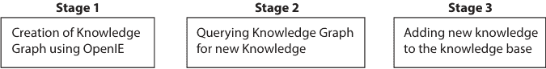

# 一种使用RDF知识图谱的临床决策支持系统知识库模型

Ravi Lourdusamy 和 Xavierial J. Mattam*

印度泰米尔纳德邦蒂鲁帕图尔圣心学院（自治）计算机科学系

#### 摘要

临床决策支持系统在医疗保健中用于协助做出拯救生命的决策。因此，这类系统必须具备高效性和可靠性，并拥有定期更新的相关知识。鉴于医学文献和网站中可获取的知识量巨大，如何将这些知识整理到可供决策支持系统使用的知识库中便成为一项挑战。在知识库系统中整理知识，最简单的方法是使用已发展成熟的关系数据库系统。但这并不能解决所有问题，尤其是在表示具有相关概念的知识时。近年来，知识图谱在知识表示中的应用日益普及。使用RDF三元组存储知识图谱是一种便捷的知识库构建方法。在临床决策支持系统中采用集中式的RDF知识图谱，将使所需的知识展示更易于处理。本章提出了一种此类知识库的模型，该模型利用开放信息抽取系统从医学文献中获取相关知识，并将其整理到临床决策支持系统的知识库中。

**关键词：** 知识库、知识图谱、知识库系统、资源描述框架、临床决策支持系统

#### 10.1 引言

使用关系数据库的知识库系统近年来一直很流行，尤其是因为将人工智能集成到此类系统中是一项容易的任务。但连接它们的多个表和标识符却十分繁琐。即使是在如此复杂的关系数据库系统上运行机器学习、深度学习等人工智能算法，也相当困难。当涉及复杂的决策系统（如临床决策支持系统）时，关系数据库可能成为一个错综复杂的迷宫。从这类系统的知识库中检索信息将是一项艰巨的任务，甚至不可能创建出高效可靠的系统。另一方面，图数据库利用知识的语义结构，通过关系边将各种概念连接起来。这种结构更易于可视化，因此信息检索会更加直接。因此，它比关系数据库系统更不消耗资源。

资源描述框架（RDF）利用图框架以三元组的形式表示信息。RDF图是节点表示概念、边表示概念间关系的有向图。RDF图利用本体论表示的语义网络。RDF图非常适合表示知识库中的复杂信息，而且其结构简单，使其在任意系统的应用程序之间具有高度可移植性。

在任何知识库中表示知识都是一项挑战。知识图谱是知识表示的实用模型，利用本体来形成新知识。知识图谱中实体关系的互联有助于提高基于知识图谱的搜索效率。RDF知识图谱是机器可读的，因此可以在机器中进行处理。RDF知识图谱以逻辑一致的形式高度互联，允许机器利用其进行推理，以搜索和检索相关信息。这就是为什么在需要健壮可靠的信息检索系统的知识库系统（如临床决策支持系统）中，RDF知识图谱可以非常高效。

信息检索的效率和可靠性完全取决于所使用的查询语言。SPARQL能够将自然语言查询转换为机器可读格式，使系统用户能够高效地从RDF知识图谱中检索相关信息。由于自然语言查询包含语义信息，可以很容易地在基于本体的RDF知识图谱上处理，因此SPARQL对查询的解释起着中间作用。SPARQL的另一个优势是它可跨多种编程语言和用户界面移植。大多数知识库系统面临的难题是与现有系统的兼容性。通过在使用基于RDF知识图谱的系统上使用SPARQL，兼容性问题可以在很大程度上得到缓解。

临床决策支持系统（CDSS）是在医疗保健中提供决策支持的系统。基于知识库的CDSS利用从多个来源创建的知识库。知识库是任何知识库型CDSS的支柱。CDSS的效率、可靠性和健壮性都依赖于知识库。因此，CDSS知识库中的知识表示是创建功能完备的CDSS的最大挑战。在CDSS中使用RDF知识图谱进行知识表示，并使用SPARQL进行信息检索，相比其他系统有两大优势。首先，知识表示将非常直接，此类知识的可视化也不困难。其次，此类系统具有高度可移植性。因此，此类系统与现有系统的兼容性不会成为系统运行的障碍。

本章重点介绍了RDF知识图谱在CDSS中的应用，并提出了一种使用RDF知识图谱的知识库型CDSS模型。下一节将传统关系数据库与图数据库进行了比较。接下来的部分将介绍图数据库的RDF模型，并详细阐述与之相关的技术。随后章节将详细讨论知识库系统、知识图谱、RDF知识图谱和SPARQL查询语言。然后，将结合所提出的知识库模型和通常使用的评估指标，讨论信息抽取的方法。在本章结论之前，还将讨论知识库创建的局限性以及CDSS知识库系统未来研究和发展的可能性。

#### 10.2 从关系数据库到图数据库

自从20世纪60年代初计算机开始普及以来，数据的存储和使用一直在不断演进。为了有效利用可用数据，人们进行了大量的研究和探索。E.F. Codd于1970年提出、并在1980年代商业化的关系数据库模型，在后来几年已发展成为一个相当成熟的系统，传统上被认为是适用于所有数据库应用程序的选择[1]。但随着互联网普及引发的大数据时代的到来，成熟的关系数据库系统已显不足，尤其是在知识管理领域，更新型的模型已取代了它的位置。

##### 10.2.1 用于知识表示的关系数据库

在20世纪70年代，当关系数据库还是一种发达的数据存储形式时，以Prolog形式出现的逻辑编程也随之发展。两者之间的密切关联可能是它们同时代发展的结果[2]。此后几十年来，关于将关系数据库与Prolog结合的研究一直很多[3-5]。就知识库系统所利用的链接数据而言，这种方法十分有效。1982年4月，随着新一代计算机技术研究所（ICOT）的成立，第五代计算机系统项目开始实施，极大地推动了人们对逻辑编程与关系数据库结合的兴趣增长[6]。ICOT在知识库系统上的研究和开发，设想将Prolog逻辑编程集成到存储海量数据的传统数据库系统中[7]。另一个促使基于规则的编程语言与关系数据库融合的重大推动力，是数据库界对逻辑查询使用兴趣的增长[8]。

数据库可以从两个基本方面考虑用于逻辑编程。第一种是基于模型论的方法，使用一阶逻辑或谓词逻辑；第二种是基于证明论的方法，使用基于规则的命题逻辑或产生式规则[9]。使用后一种方法创建知识库更方便，因为关系数据库在模块性、统一性、自然性和关键连接性方面与产生式系统相似。利用这些类似的概念以及关系数据库的第四范式，将IF条件转换为关系，就可以将产生式规则转换为关系数据库。将产生式规则转换为关系数据库，消除了逻辑编程在知识表示、存储和推理方面的障碍[10]。另一方面，前一种方法允许表示不完整知识，即并非所有关于所表示知识的事实都需要在知识库中。因此，使用一阶逻辑进行知识表示允许知识的增量增长，从而允许


系统通过交互来开发新知识。尽管在此过程中实现了形式化，但系统在概念上和计算上变得复杂，需要庞大的数据库[11]。

智能数据库是一种不仅能够以完全关联的关系方式存储数据，而且能够产生知识以解决各种问题的数据库。关系数据库系统具有共享数据而不损害数据一致性和完整性的优点。如果没有工具从数据中提取知识，该数据库就无法用于任何知识库系统。知识库系统是一种以知识形式存储数据、且这些知识可能对系统有用的系统。结构化查询语言（SQL）是一种可用于将关系数据库系统中的数据转换为知识的工具。为此，数据存储在关系数据库表中，并使用SQL查询从数据库中提取知识。因此，该系统并不是作为知识库系统运行，而是作为一个可以从中提取知识的数据库系统[12]。尽管利用现有数据库系统构建智能系统的可能性似乎很有吸引力，但它们在知识方面的局限性以及时间和空间复杂度远大于其优点。

一种在编程语言中规避使用SQL问题的方法是使用霍恩子句。ProLog建立在霍恩子句之上，用于定义和查询限于一阶逻辑的关系数据库。限制一阶公式的非终结符关系符号可以通过使用应用于正存在查询的不动点算子表示为霍恩子句集。使用霍恩子句的一个缺点是，使用霍恩子句程序向数据库添加关系元组无法删除查询的输出。为了克服这一缺陷，可以考虑扩展霍恩子句以包含否定的终结符关系符号，但全称量化无法由此表达。另一种可能性是允许任意带非终结符的一阶公式作为程序，但这根本不是解决方案[13]。

人们还尝试利用概念和关系的概念，通过霍恩子句注入分类法和语义解释。这是朝着将语义网络与逻辑编程和关系数据库合并以创建系统知识库迈出的一步。这些尝试被视为约束满足问题的权宜之计。概念域的使用通过早期推导失败，避免了冗余计算和回溯检查，极大地帮助降低了时间和空间复杂度[14]。使用关系数据库存储语义网络已被研究，并给出了实际示例，说明如何使用二维表存储可指向非结构化多维知识的节点[15]。此类解决方案降低了存储和知识查询过程的时间和空间复杂度，但在良好知识库所需的效率和鲁棒性方面有所欠缺。当数据库达到其性能容量的上限时，它们往往无法保持效率，而效率对于任何知识系统都很重要。此外，知识表示缺乏统一性，尤其是在各种知识共享活动中，因此关系数据库存储是不够的[16]。关系数据库注定不能作为知识库的另一个原因是，完整的大规模知识系统无法使用关系数据库有效表示[15]。

尽管关系数据库是一个成熟的系统，并且使用SQL查询相当高效，但在表示和存储知识方面却缺乏效率。知识来自结构化和非结构化来源，因此必须以一种能够在不损害时间和空间复杂度的情况下实现知识获取、知识库创建和推断知识形成的方式来表示。

#### 10.2.2 NoSQL数据库

关系数据库和SQL数据库不仅仅用于数据存储和查询处理。它们使用模式和元数据，以声明式语言提供带有强健结构的处理逻辑，并确保一致性。它们还具有通过日志快速恢复的能力，允许多用户操作和同步，并具备适当的用户角色和安全性，更重要的是，允许索引以支持快速搜索。这些数据库的所有优点导致了复杂的处理，使其在处理海量数据时迅速达到极限。因此，对数据完整性和安全性的强调损害了其性能、效率和灵活性，尤其是在处理Web上可用的大数据时[17]。关系数据库或SQL数据库的其他问题是读写速度慢、容量有限以及难以扩展，尤其是在涉及大量数据时[18]。

NoSQL一词由Carlo Strozzi于1998年提出，是关系数据库的一种修改版本，具有开源、关系型、轻量级且不含SQL的特点。当时NoSQL代表“no SQL”（非SQL）。后来在2009年初，Johan Oskarsson将其转变为非关系型分布式结构化数据存储¹。随后NoSQL被更新为“not only SQL”（不仅仅是SQL）的意思。自21世纪初以来，互联网的快速扩张推动了NoSQL的日益普及，尤其是在涉及海量数据管理的网络规模数据库中[17,19]。NoSQL的发展深受Google的Bigtable和Amazon的Dynamo系统的影响[20]。

大数据用户对NoSQL的痴迷主要在于其非关系模型，该模型避免了关系数据库复杂的连接操作。此外，NoSQL允许数据分布在不同位置，并使用元数据进行管理。NoSQL的分布式特性也使其能够根据需要水平扩展。插入数据时无需模式，使得添加数据具有灵活性。作为开源软件，该模型的可定制性和改进可能性深受数据用户青睐。NoSQL中的数据复制毫不费力，确保了数据的高可用性。NoSQL提供的应用程序编程接口（API）简单，对程序员来说很有吸引力。关系数据库的ACID（原子性、一致性、隔离性、持久性）属性被NoSQL的BASE（基本可用、软状态、最终一致性）属性所取代[17–28]。

CAP（一致性、可用性和网络分区容错）定理由加州大学伯克利分校的Eric Brewer提出，于1998年首次出现，并在1999年首次发表，随后于2000年发表。它被认为是关系数据库的ACID属性和NoSQL的BASE属性之间的中间点。根据该定理，数据库只能牺牲其中一个属性，即要么一致性，要么可用性，要么分区容错。这是因为如果存在网络分区，那么只能保证可用性（通过复制）或一致性（通过仅保留一组数据库），如图10.1所示。如果不需要网络分区，那么一致性和可用性可以共存。CAP中所说的一致性与ACID中的一致性不同，CAP中的一致性是关于所有节点中数据的物理一致性，而ACID中的一致性是数据库中数据的逻辑一致性或完整性[18,19,21,29]。

在分布式系统中，网络分区并不常见，因此在实际应用中，数据库的一致性和可用性得以保持。如果存在分区，那么一致性

#### 10.2.3 图数据库

针对这些系统，即使可以进行广义比较，也是不合适的。此外，随着新版本和新系统的不断出现，不能依赖通用评估来选择数据库系统。在如此众多且不断演化的系统中，即使评估单一标准也并非易事。因此，在大多数情况下，选择合适的系统更多是出于方便[32–35]。

图数据库最突出的特性是关系（Relationship）。关系型数据库和几乎所有NoSQL数据库模型都拥有链接数据（linked data）。链接数据表达了数据之间的联系，但并未深入。而图数据库则表达了数据之间的关系。在图数据库中，数据被表示为图的节点，数据之间的关系被表示为两个节点之间的边。建立节点之间关系的最大优势在于，与链接数据相比，搜索的时间复杂度会降低，且降低程度与起始节点和最终节点之间的深度成比例[36, 37]。

图具有一些独特的特征，使其具有重要价值。图的节点或边上可以附加向量值，这些值可用于表示节点或边的属性，并可能对图的算法或分析产生关键影响。这些值称为属性（attributes），是节点或其边的性质。图中节点之间的关系也可以根据问题的需求而对称或不对称。如果关系是对称的，则该图是有向的，相应的边指示尾节点和头节点。尾节点是边起始的节点，头节点是边结束的节点。有向图和无向图的区别用于连通性或路径长度等度量。在某些图中，节点和边会被标记以指示特定类型，这可能会影响在该图上运行的算法的结果。例如，节点或边可以被标记为正或负，以改变对该节点或边的操作[38]。

目前使用着不同的图数据库模型。简单图模型（Simple Graph Model）通常用作图处理的框架。它们并不常用作数据库，而更常用于设计更复杂的模型，例如带标签的属性图（Labelled Property Graph）。超图（Hypergraphs）是简单图模型的泛化，其中一条边可以连接到任意数量的节点，这种边称为超边（hyperedges）。超图主要用于表示网络，很少用作数据库存储。超节点（Hypernodes）是另一种泛化的简单图模型，其中超节点是一个包含一组节点和边的实体，用来替代简单图中的节点。换句话说，超节点是嵌套在图中的简单图。同样，由于涉及额外的复杂性，超节点与超图一样，很少用作图数据库。两种广泛使用的图数据库是带标签属性图模型（Labelled Property Graph Model，LPG），或简称为属性图，以及资源描述框架（Resource Description Framework，RDF），我们将在本章第2节中更详细地讨论它们。LPG具有额外的图属性或特征来处理各种复杂的现实世界问题。附加在LPG节点或边上的标签定义了不同的子集或类别。每个节点或边可以拥有任意数量的此类属性，每个属性包含一个用于标识该属性的键以及与该属性关联的值。标签的限制和使用造就了LPG的各种变体[38–40]。

图数据库的物理存储采用不同的方法实现。基于记录的图数据库系统将数据划分为记录或更小的单元。为了数据的局部性，记录被物理存储在连续的内存或磁盘簇中。记录可以是变长或定长的。图的每个顶点存储为一个或多个记录，这些记录有时称为顶点或节点记录；边要么存储在包含其对应源顶点和目的顶点的同一记录中，要么存储在单独的边记录中。在这些基于记录的系统中，指向连接内存位置的指针保存在每个记录内，以便可以更快地找到涉及目的顶点的查询。为了节省空间，某些系统不在记录中存储边的标签或属性，这些就是轻量级边（lightweight edges）。轻量级边仅包含目的顶点的信息或内存地址。基于索引的图数据库系统将数据存储在索引结构中，索引结构定位存储在不同位置的数据，并利用位置信息实现更快的检索。当物理位置发生变化时，只需更新索引，而无需更改与数据位置关联的所有指针[39]。

尽管图数据库近年来广受欢迎，但由于它们尚未像关系数据库那样完全成熟，在某些方面仍受到限制。在功能上，它们缺乏查询优化能力；当分区查询需要访问多个分区时，与NoSQL不同，图数据库无法从多个缓冲区读写；图数据库在模式和约束定义方面存在限制，导致数据不一致；最后，图数据库存在不允许传递闭包的查询限制。图数据库旨在帮助满足大数据需求，但在这方面存在一些局限性。从非图形资源中提取数据是复杂的；庞大数据集的复杂性和广泛分布导致查询成本高昂；通常在图数据库中进行的批处理在实时处理中并不总是有效；图算法不足以处理大数据；用于并行处理的图算法性能并非最优；此外，异构、不完整和不一致的大数据集需要经过语义集成才能实现有效查询，而目前的任何图数据库系统都尚未完全实现这一功能。在图数据库系统的使用中还有许多其他类似的挑战，需要在其未来的演进中加以解决[41]。

图数据库是大数据世界的理想解决方案，但与关系数据库系统不同，图数据库系统远未完全成熟。然而，它们的受欢迎程度并未减弱，从使用图数据库开发的系统数量不断增加中可见一斑。随着进一步的研究和开发，可以开发出一种没有当前局限性的系统。

#### 10.3 RDF（资源描述框架）

大数据具有五个特征元素，即体量（volume）、速度（velocity）、多样性（variety）、价值（value）和真实性（veracity），它们从根本上构成了关系数据库和传统SQL无法处理的巨大而复杂的数据集。大数据，尤其是非结构化形式、包含PB级数据的大数据，会被谷歌、Facebook、亚马逊等领先的互联网应用进行分析，以快速获得结果[42]。1995年，万维网联盟（W3C）开始试验互联网内容选择平台（PICS），该平台由互联网工程任务组（IETF）开发，用于对网页内容进行评级，供需要专门监控网络内容的各类社区使用。由于PICS存在各种局限性，W3C成立了PICS下一代（PICSNG）工作组，以解决有关资源描述的常见问题。该工作组制定的规范可应用于许多应用程序，后来被W3C整合为RDF工作组。尽管PICSNG在RDF的创建过程中做出了许多贡献，但RDF在其目前的发展阶段中，其形态受到了许多W3C成员公司和若干元数据工作的影响[43–45]。RDF具备大数据的五个元素，并且支持流式处理，即数据的持续变化。因此，尽管RDF有时可能不一致，它仍被广泛使用[46]。


#### 10.3.1 RDF 模型和技术

RDF 模型基于使用属性来描述资源，这些属性也是属性或特征。属性使用统一资源标识符 URI 唯一标识，与属性对应的资源使用具有匹配值的属性类型来标识。属性类型将资源链接到一个值，该值可以是另一个资源或原子值，或像文本字符串或整数这样的数据值的字面量。描述是一组链接到同一资源的属性。RDF 建立在其能够使用与语法无关的模型来表示资源及其描述的能力之上 [43–45, 47]。

资源、其属性类型和属性值形成一个三元组，其中资源是主语，其属性类型是关系或谓语，属性值是宾语。由三元组构成的 RDF 模型构成了 RDF 技术的基石，也是从各种异构数据源集成数据的依据。RDF 技术允许来自不同来源的数据被格式化为包含资源描述和资源之间关系的语义描述。这种在表示数据方面的自由是 RDF 技术在知识库系统和人工智能的知识表示中流行的原因。RDF 技术的基本要求是资源由 URI 标识，并且数据交换的基本条件是数据表示为一组三元组。必须严格避免三元组的重复，但三元组放置在哪个位置并不重要 [48, 49]。

#### 10.3.2 元数据和 URI

“元数据”一词可能最早由 Philip Bagley 于 1968 年在其著作《Extension of Programming Language Concepts》中使用，他在书中将元数据描述为像标识符或访问代码这样的二级数据元素，其中包含有关主数据元素内容的信息。他将包含此类二级元素的信息称为元数据元素。在此之前，“元数据”一词被用来描述出版物、图书馆目录、主题索引、各种分类器和文章摘要。从计算机系统发展的早期阶段开始，虽然没有特别提到“元数据”一词，但元数据的特征在源代码属性、编译器设计和文件存储中可见一斑。随着数据库描述和概念建模语言的使用，其特征变得更加明显。后来在文档检索系统中，为便于快速检索，文档索引与文档描述符一起提供。IBM 的 Report Program Generator 用于生成格式化的报告，这些报告可以是元数据。后来随着万维网的出现和超文本标记语言的使用，标记标签成为元数据资源。这些元数据资源被最近的语义网技术用于知识表示、数据搜索和逻辑推理。元数据现已成为描述与主题域相关属性的必要元素 [50]。

元数据可以根据元数据的功能分为不同类型。描述性元数据描述资源的内容以及元数据在查找或理解资源方面提供的帮助。管理性元数据包含有关资源创建或管理的相关信息。保存性元数据涉及对元数据的长期支持或其未来迁移，或关于数字文件的匹配。技术性元数据包含解密和提取数字文件所必需的数字文件信息。技术性和保存性元数据可视为管理性元数据的一部分。结构性元数据包含有关资源各部分之间关系的信息。权利元数据包含有关许可、版权等方面的信息。标记语言也被视为一种元数据类型，其中包含标志或格式信息，有助于定位段落、标题、标题、列表、名称、日期等 [51, 52]。还可能存在其他元数据类别，可处理有关统计、引用、索引等的信息。

管理元数据的方法不止一种。结构化和半结构化数据库的某些元数据管理方法包括注释、来源、质量参数、模式和映射、安全、叠加信息和时间。由于需要高度专业化来管理各种各样的元数据，元数据互操作性是一项相当具有挑战性的任务。此外，在查询时无法区分数据和元数据。换句话说，系统无法区分查询结果是数据还是元数据。人们曾多次尝试找到一种简洁、简单的方法来建立统一模型并查询数据。RDF 被认为主要是表示互联数据的解决方案。RDF 最初被引入作为表示网络上可用元数据的一种手段。网络上的元数据可能不仅仅是网络数据，还可能是其他数据。因此，在 RDF 中，网络数据被视为资源，并且网络数据使用唯一的 URI 表示 [53]。

1992 年，负责监督互联网开发所需基础设施的互联网工程任务组 IETF 成立了 URI 工作组，以解决有关标准化统一资源定位符 URL 方案的问题，避免服务器拥塞和跨洲际流量复制。URI 工作组提出了一个模型，通过统一资源名称 URN 和统一资源特征 URC 来标准化资源标识符。在对 URN 和 URC 进行了大量工作后，人们意识到 URI 的一部分 URL 是唯一实现的标准化格式。因此，1995 年 7 月，IETF 解散了 URI 工作组，并在 1996 年 7 月成立了 URN 工作组，负责命名方案和解析系统。URC 描述了语言、格式、字符集、版本号、作者姓名等，迄今尚未开发出任何特定方案 [54–56]。

URI 利用万维网全球信息计划提出的语法和语义，提供了一种简单且可扩展的资源标识方法。“Functional Recommendations for Internet Resource Locators” [57] 和 “Functional Requirements for Uniform Resource Names” [58] 是 URI 设计中使用的建议。URI 的特点在于其统一性，允许使用不同类型的资源标识符，即使获取标识符的方法可能不同。此外，在对不同资源标识符的通用语法解析进行语义解释时也具有统一性，并且可以使用新的标识符类型而不影响现有标识符。在各种上下文中重复使用标识符允许新应用程序和系统使用大量且广泛使用的现有标识符。资源一词的使用并不局限于网络中现有资源的使用，而是扩展到 URI 可以识别为资源的任何事物。因此，资源不仅限于网络中的内容，还可以是书籍、报告、调查等现实世界中的物质，也可以是关系类型、数学运算符等抽象世界中的事物。标识符区分一个资源与另一个资源，而不强调标识方法。标识符不必代表被标识的资源，也不会访问被标识的资源 [59]。

#### 10.3.3 RDF 存储

尽管最初曾考虑使用已经成熟的关系数据库系统来存储 RDF 数据，但很快就意识到


大量的语义网数据大多以半结构化和非结构化格式存在，并且可以通过 RDF 进行引用，无法容纳在任何关系数据库系统中。当对 RDF 数据进行连结查询时会出现很大的挑战，因为 RDF 数据是一个三元组，而大多数现有的查询语言需要执行多次连接和并集，这会大大降低可扩展的查询访问速度。但由于关系数据库系统在数十年的使用中已经高度发展，一些修改版本仍被用于存储 RDF 数据 [60, 61]。

RDF 存储是用于以 RDF 格式保存信息以实现更快搜索和检索的存储系统。它对非常灵活的 RDF 知识的海量数据处理能力更强，因此已被以多种不同的方式进行研究和开发。大量语义和知识处理应用程序由于其设备互操作性能力而使用 RDF 存储。RDF 存储的数据模型允许应用程序用户以查看信息的方式呈现，而不是向用户呈现数据本身。由于信息必须为此类用途而抽象化，因此不同 RDF 存储使用的数据结构存在很大差异。虽然一些 RDF 存储依赖于传统的数据库结构，但许多其他存储使用高级和复杂的结构，如 RDF 特定索引模式 [62]。

RDF 存储模型可以按三种方式分类。最简单的分类是 RDF 驻留在本地驱动器中的那些，以及通过联邦搜索获取 RDF 的那些，其中 RDF 来自不同的网页。实际上，联邦搜索归结为将 RDF 存储在本地驱动器中以供知识库系统使用。更常见的分类是识别 RDF 存储为集中式和分布式存储。集中式存储使用关系数据库技术将数据存储在集中式系统中，可从中查询以进行搜索和检索。为了更快地搜索和检索，数据可能会被索引，在这种情况下 RDF 三元组也可能包括索引值。虽然集中式存储在性能和速度方面可以提供效率，但它们受此类系统所能处理的数据量的限制。另一方面，分布式存储系统是可扩展的。原则上，分布式存储系统有多台运行集中式存储的机器，它们使用概念层链接起来以协调它们之间的数据分布 [61, 63–65]。

RDF 存储系统的更概括分类是通过将其大致区分为原生和非原生系统。原生存储系统为知识库系统设计了单独的存储后端。原生系统可进一步分为使用主内存的系统和使用磁盘存储的系统。主内存存储依赖于将 RDF 文件解析并加载到主内存的一部分中，该部分可能被索引以实现更快检索。磁盘存储模型对索引进行持久使用，这会导致操作瓶颈。非原生 RDF 存储使用现有的成熟数据库系统来存储 RDF 数据。这些 RDF 存储使用关系数据库或 NoSQL 后端来存储和检索信息。非原生 RDF 存储使用的关系数据库可以是基于模式或无模式的方法。相比之下，原生方法对于知识库系统来说比非原生方法更有效，尽管它需要在设计和实现此类系统方面付出大量努力 [60, 62, 66]。

#### 10.4 知识库系统和知识图谱

知识库是使用知识表示技术以结构化形式存储知识，可在此基础上构建知识库系统 [67]。知识可以用很多不同的方式定义，没有单一的定义能够涵盖其完整含义 [68–70]。对于知识库系统，知识可以定义为用于解决给定问题的已处理信息。因此，系统设计所要解决问题的各种解决方案以代表性方式存储在系统的知识库中。系统在需要时从知识库中检索相关知识。

##### 10.4.1 知识库系统

知识库系统是其知识库中保存特定领域问题解决方案的系统。知识型系统源于专家系统，而专家系统本身是人工智能的分支 [71]。知识库系统和专家系统是可互换使用的术语，因为早期开发的专家系统包含编码在系统中的专家知识，它们像人类专家一样执行任务并用于解决问题 [72]。后来当“知识库系统”一词首次于 1988 年由 E. Feigenbaum 等人在《专家公司的崛起》一书中使用时，也是与专家系统互换使用 [73]。在后来的发展中，专家系统被认为与知识库系统不同，因为专家系统将专家的知识作为独立实体内置于系统中，而知识库系统可以获取和推断新知识。虽然有些人认为专家系统是知识库系统的一种类型，因为它们基于人类认知过程建模并提供知识库系统的功能，如决策 [74]，但另一些人则认为知识库系统是专家系统的一个类别，因为知识和知识库是知识库系统的一部分，与专家系统类似 [75, 76]。

早期专家系统向当前知识库系统的演进发生在不同阶段。20 世纪 70 年代末和 20 世纪 80 年代初开发的早期专家系统，包括 MYCIN，一个用于诊断细菌感染的临床决策支持系统、用于诊断青光眼的 CASNET、用于识别钻探地点的 PROSPECTOR，以及用于配置计算机系统的 Rt，使用前向链和后向链技术以及符号逻辑表示来帮助推理和决策。这些系统在任务上受到限制，因为像规划和设计等复杂任务的需求无法通过这些系统的低效复杂性和不灵活的推理来满足。20 世纪 80 年代末至 20 世纪 90 年代末发生的下一个演进阶段见证了知识库系统通过各种开发的应用程序实现商业化，例如用于商业规划的预测和预测、为铁路乘务员分配工作和其他工作调度应用程序、规划电力系统和开发铁路路线、金融、制造领域的设计和规划、计算机辅助工艺规划、配置工具和管理危机。这些应用程序中知识库的开发缺乏复杂性，因此系统既不高效也不稳健，尽管在很大程度上很有帮助。下一代知识库系统在知识库的构建方面进行了更多研究和开发。知识库被开发为可附加到任何系统的通用组件。伴随着知识的正式理论的发展，知识库的创建方法具有更高效、更可靠的知识获取、表示和推理技术 [77]。目前，知识库系统已达到一定成熟度，成为计算智能系统的基础，后者建立在涉及工程经济学、运筹学、统计分析和决策理论的复杂理论之上。这些系统利用各种最近发展起来的技术，如知识工程、自然语言处理、机器学习、软件代理、推理引擎等来创建知识库。如此高度发展的知识


bases 在多方面的应用中被使用，例如信息检索、语义搜索、信息集成、决策支持系统、信息互操作性、生物信息学、医疗保健、学习工具、软件工程、商业、治理、社会网络、供应链、区块链等 [78]。

#### 10.4.2 知识图谱

基于图的知识表示对设计和构建知识库系统的知识库的知识工程师和专家具有两个特别的优势。对象在图中的可视化使其易于理解且处理舒适。语义网络之所以成为一种流行的知识表示形式，正是由于其图状特征。此外，由于图或图同态的结构保持映射特征，图结构中的推理机制可以在没有太多复杂性的情况下被理解。图的同态特征允许图被分解为更小的组件用于建模目的，这些组件可以轻松可视化。此外，相同的图形形式同时用于计算和界面层面，避免了将知识库组件转换为用户界面的需求。基于图的知识表示的另一个优势在于计算层面。图的同态允许基本图锚定在组合学上。同态将复杂性结果与许多领域的算法统一起来。用图形表示代替逻辑公式也可以为新的算法思想做出贡献。此外，标记图更适合于构建知识库时的知识获取过程 [79]。

知识图谱可以定义为知识库系统的知识库，其中知识使用图结构表示，不同的知识概念是图的节点，其边是概念之间的关系。知识图谱的构建涉及创建知识库所使用的所有技术，因为知识图谱本身就是知识库 [80–83]。知识图谱有众多定义，从精确的技术定义到更通用的定义 [84, 85]。知识图谱存在概念性和经验性定义 [86]。知识图谱的图的类型可能因知识表示模型而异。“知识图谱”一词可能由 E.W. Schneider 于 1972 年使用 [87]，后来在 1982 年，恩斯赫德大学的 Cornelis Hoede 和格罗宁根大学的 F.N. Stokman 将其用作离散数学概念 [88]。目前，知识图谱对许多科技公司至关重要，尤其是那些在互联网上处理大数据公司的公司，如 Microsoft、Google、Facebook、IBM、eBay、Yahoo 等 [89, 90]。

知识图谱的生成涉及知识获取过程，其中进行编辑、映射和注释，对获取的知识进行存储，通过评估、清理和丰富知识对知识进行策展，以及将知识部署到知识库系统中 [80]。策展或精炼过程对知识库的部署和系统的效率至关重要。知识获取可以通过完善现有知识图谱、众包编辑、从大型半结构化知识库中提取知识或使用从非结构化或半结构化来源的信息提取过程来完成。无论部署何种知识获取过程，如果不使用有效的策展过程，结果都将不完美且不可靠。策展过程的两个主要目标是通过图补全将缺失的知识添加到图中以完成图，以及错误检测以确保图没有错误信息且可靠。虽然知识创建和知识精炼过程可能相似，但它们是分别部署的，因为精炼可以同时在不同图上工作，并且精炼过程将对所构建的图提供更清晰的理解 [80, 91]。

#### 10.4.3 RDF 知识图谱

RDF 存储通常用于存储知识图谱，因此使用 RDF 知识模型的知识图谱被称为 RDF 知识图谱。RDF 知识图谱可以定义为知识图谱，其中知识以三元组的形式表示，由主语、谓语和宾语组成 [92–95]。RDF 知识图谱也可以定义为标记多重有向图，其中节点集可以是 URI 或字面量，对应的边是表示谓语的 URI [93–96]。

部署 RDF 知识图谱存在若干挑战。从各种异构知识源理解和封装概念是一个重要挑战。用户需要理解 RDF 知识图谱中的实体，以便知识图谱可以直接部署到用户应用中。另一个挑战在于利用 RDF 知识图谱中可用的知识。它需要高效的检索技术。使用 RDF 知识图谱表示的各种知识库的链接也是一个挑战，因为它需要有效地为应用程序所寻求的解决方案选择正确的知识库。同样，从庞大的知识库中高效有效地检索相关知识，其中自动查询生成可以提供洞察，也是部署 RDF 知识图谱的另一个巨大挑战 [97]。对这些挑战的一些解决方案已被研究和实验。RDF 映射语言 RML 是将各种异构知识源映射并序列化为 RDF 知识图谱的规范的正式化。将知识从不同格式映射到 RDF 模型是一项复杂任务，因为它涉及统一性、模块化、互操作性和可扩展性。RML 是关系数据库到 RDF 的扩展 R2RML，后者是 W3C 推荐标准 [98–100]。实例匹配 IM 是另一种用于互联不同知识库以检索用户应用的相关可靠知识的技术 [96]。在图编译过程中 RDF 知识图谱可视化可以帮助在文本文档处理时提取相关知识，并且是高效有效检索的有效工具 [101]。为更快的可发现性和知识的有效集成而提出的一种解决方案是来自知识子集的内容基于的并集和补全度量 [102]。集中式存储架构也被视为经济高效且稳健的高效知识库 [93]。更近期的研究集中在使用人工智能技术如机器学习对知识库进行预测分析。RDF Frames 是一项将 RDF 知识图谱与机器学习算法连接起来的提案 [92]。

#### 10.4.4 使用 SPARQL 进行信息检索

SPARQL（Simple Protocol and RDF Query Language²）是查询 RDF 数据以检索和操作知识的正式规范。它由知识库系统部署以从知识库中处理和产生相关知识。在 RDF 标准化之后，许多查询语言作为个人、学术和商业的努力而出现。2004 年初，W3C 成立了 RDF 数据访问工作组，并在 2004 年底，该工作组提出了 SPARQL 规范的草案。虽然 SPARQL 规范当时已投入运行，但官方 W3C 标准 SPARQL 1.0 规范直到 2008 年才宣布。在 RDF 数据访问工作组到期后，SPARQL 工作组于 2009 年成立，并在 2009 年底提出了 SPARQL 1.1 草案，经过多次修订和改进，于 2013 年 3 月成为官方 W3C 推荐标准 [103]。


尽管 SPARQL 采用了 SQL 的各种结构，但 SPARQL 在 RDF 图上使用基于导航的方法，而 SQL 实现使用的是表之间的连接。虽然某些关键字如 SELECT、FROM 和 WHERE 以及 LIMIT、DISTINCT、OFFSET、ORDER BY、GROUP BY 和 HAVING 等参数是从 SQL 采用并在 SPARQL 中经过修改后实现的，但 OPTIONAL、FILTER 和 UNION 等关键字是 SPARQL 独有的。此外，由于 SPARQL 处理的是图数据集，因此使用 FROM NAMED 关键字来识别具有共同标识符下的特定三元组集合。SPARQL 还允许使用 SERVICE 关键字查询远程数据集 [104]。

SPARQL 查询可以大致分为属于两个框架。集中式 RDF 查询处理系统在 SPARQL 查询的效率和可扩展性方面工作。虽然这些系统大大减少了通信开销，但它们受限于单个系统的性能和内存 [105, 106]。分布式或联邦 RDF 查询处理涉及对分散在多个集群中的去中心化知识库进行联合访问。此类集群的关键基准组件是数据存储容量、索引能力、语言支持和优化查询的生成 [106]。联邦查询模型或联邦信息系统可以是多数据库查询语言、联邦知识库或基于中介的信息系统 [107]。一种可以在集中式和分布式查询处理模型中使用的子类化是基于链接数据原则动态地从分布式知识库中发现知识的链接遍历框架。链接遍历可以有效减少查询搜索的大小和成本 [108]。

#### 10.5 CDSS 的知识库

CDSS 是帮助医疗工作者和患者做出决策的计算机系统。知识库 CDSS 是 CDSS 的一个类别，它具有知识库和接口系统。推理引擎或推理器是知识库的一部分，有助于处理来自接口系统的数据。CDSS 具有多种功能优势，例如诊断、报警系统、疾病管理、处方、药物控制、裁员预测等等。CDSS 的有效性取决于能够舒适地检索用于决策的相关、准确、可靠和及时的知识 [109, 110]。CDSS 除其概念架构外，还由模块化任务和职责组成，这些任务和职责独立于应用程序环境运行，因此它们被设计为可移植、可重用且可自行维护 [111]。

##### 10.5.1 CDSS 知识库的策展

选择、组织和管理知识库实体的过程是一项复杂任务。数据必须从结构化和非结构化来源中提取并准确高效地集成到现有知识库中，能够创建可视化报告。手动策展过程具有产生经过验证且及时的知识的效率 [112]，但手动填充的知识库的成本和可扩展性使其效率低下。协作策展可以在一定程度上缓解这一不足，但并不能解决问题 [113]。

由于缺乏用于手动策展过程的人力资源，据估计，从源到知识库翻译知识平均需要 1 年时间 [114]。现有的计算填充和策展方法在利用大量可用知识方面存在可扩展性限制。演绎过程中涉及的计算复杂性导致知识库比例非常小 [115]。

已有研究对 RDF 知识图谱在从文献或其他大量临床数据来源（如电子健康记录）中进行信息检索中的应用进行了研究 [116]。

在从半结构化和非结构化数据构建知识库方面已有大量研究。传统的基于本体信息提取试图使用知识库中已有的规范标识符来填充现有知识库。信息提取不包括新实体或关系。开放信息提取包括在文献中发现的新实体和关系。对于 CDSS，将信息提取分类为有针对性和非有针对性更为相关，因为知识库仅用于临床决策支持。因此，仅从医学期刊中检索信息并仅使用医学术语实体的信息检索方法是有针对性或聚焦的信息提取，而那些适用于所有文档而不加区分的方法是非有针对性或非聚焦的 [114]。

##### 10.5.2 策展的建议模型

作为 CDSS 知识库的 RDF 知识图谱是使用从医学文献中提取的知识构建的。早期知识提取方法基于规则，其结果被发现过于嘈杂，导致知识不可靠。而且规则需要不断被打破才能从非结构化文本中获得足够知识。后来基于人工智能算法的统计方法被用于更准确的知识提取，但由于缺乏成本和时间效率，新规则技术更受青睐用于知识提取。包含基于规则和人工智能算法的混合系统被认为比单独使用其中一种更好 [117, 118]。

OpenIE 可用于从文本 [120–124] 构建 RDF 知识图谱，从中可使用 SPARQL 查询相关知识以策展 CDSS 知识库。已引用的文本的 URI 保存在表中，以避免对同一文本重复进行信息提取。从文本构建的 RDF 知识图谱仅临时存储，直到 SPARQL 查询结果添加到知识库以减少系统的空间复杂度。

在建议的模型中，如算法 10.1 所示，系统将使用 CDSS 中使用的关键字通过 SPARQL 查询临时构建的 RDF 知识图谱。如果返回任何 RDF 三元组，则将其添加到 CDSS 知识库中。否则，系统会检查是否有任何新文档需要考虑并且不在已检查文档的 URI 表中。

**Algorithm 10.1 Curating the CDSS knowledge base using RDF knowledge graph.**

```
URI table U = {u₁, u₂, ..., uₙ}
RDF Knowledge Graph G = {V,E} where V = {v1,v2,...,vn} and E = {e1,e2,...,en}
RDF triple S = {s, p, o} (subject(s), predicate(p), object(o))
CDSS Keyword K = {k₁, k₂,...kₙ}
1 Read uᵢ (URI of a new document)
2 If uᵢ ∈ U GOTO Step 9
3 Else use OpenIE to create G
4 For every K
5 use SPARQL query to find kᵢ in G
6 For every S found
7 If S not in CDSS knowledge base
8 Append S to CDSS knowledge base
9 If another document exists GOTO Step 1
10 Else STOP
```



**Figure 10.2** Stages in the proposed model.

该模型将具有三个阶段，如图 10.2 所示。第一阶段创建知识图谱。第二阶段查询知识图谱。第三阶段将新的 RDF 三元组添加到知识库中。

##### 10.5.3 评估方法

用于评估知识库的衡量标准有很多。这些衡量标准基于 RDF 三元组与特定知识库的相关或不相关。据此，可以形成正负的应急矩阵，如表 10.1 所示。如果查询检索到的 RDF 三元组相关，则为真阳性；否则为假阳性。同样，如果相关三元组未被检索到，则为假阴性，如果不相关且未被检索到，则为真阴性。对于知识库策展，可以在从文档的相关 RDF 三元组中检索到的 RDF 三元组上使用精度、召回率、准确率、F 测度、G 测度、错误率、漏报率、误报率等指标 [125, 126]。

查询结果的评估也使用社区基准测试活动，例如文本检索会议（TREC）、XML 检索评估计划（INEX）、DBpedia 实体测试集合等，这些活动使用包含数据集、一组信息需求和相应相关性评估的文本集合 [127]。

**Table 10.1** Contingency matrix of positives and negatives.

|  | Relevant | Irrelevant |
|---|---|---|
| **RDF triple retrieved** | True positive | False positive |
| **RDF triple not retrieved** | False negative | True negative |


#### 10.6 进一步研究与开发的讨论

由于某些相关问题，目前可能还无法实现全自动化的知识库管理。首先，知识产权（IPR）不允许从网络来源免费获取完整文献供系统使用。其次，由于存在相互矛盾的文献，即使知识库是自动填充的，也可能削弱其可靠性。第三个原因是，文献可能并不完整，这会给知识库的管理带来问题。因此，如果应用程序要具有鲁棒性，就需要专家来监控知识库的管理过程。任何可行的全自动管理方法都将对创建独立系统大有裨益。

另一个可能的研究与开发方向是有效利用扩展的 RDF 知识图谱对知识库中的知识进行排序。这有助于从知识库中移除已过时的知识，也有助于基于排序的评估。虽然已有一些关于为 RDF 三元组添加权重的研究 [94]，但进一步的研究仍将是有益的。

#### 10.7 结论

在构建可靠且高效的知识库方面，RDF 知识图谱具有多项优势，这对于 CDSS 等系统至关重要。它能够从结构化、半结构化甚至非结构化来源中提供简洁而直观的知识抽象。对于像知识库 CDSS 这样的系统，知识库中必须包含准确且最新的知识，系统才能对任何医疗保健人员有用。与此同时，知识库虽然具有可扩展性，但在空间复杂度上存在局限。为了满足有预算限制的空间需求，所提出的使用 RDF 知识图谱构建 CDSS 等系统知识库的模型具有优势，因为非结构化来源的完整图谱不会永久保存在系统中。此外，该模型能够从医学文献等包含最新且相关知识的非结构化来源中抽象出知识，这使得所提出的模型具有重要意义。

### 参考文献

- 1. Berg, K.L., Seymour, T., Goel, R., 数据库的历史. *Int. J. Manag. Inf. Syst.*, 17, 29, 2012.
- 2. Parsaye, K., PROLOG 中的数据库管理、知识库管理与专家系统开发. *Databases Bus. Off. Appl. Database Week*, 159–178, 1983.
- 3. Vardi, M., 数据库逻辑编程. *J. Log. Program.*, 10, 179, 1991.
- 4. Ceri, S., Gottlob, G., Tanca, L., 逻辑编程与数据库：综述, in: *逻辑编程与数据库：计算机科学综述*, pp. 1–15, Springer: Berlin Heidelberg, 1990.
- 5. Gallaire, H., Minker, J., Nicolas, J.M., 逻辑与数据库：演绎方法. *ACM Comput. Surv.*, 16, 153, 1984.
- 6. Morgan, M.G., Feigenbaum, E.A., McCorduck, P., 第五代：人工智能与日本对世界的计算机挑战. *J. Policy Anal. Manag.*, 3, 156, 1983.
- 7. Itoh, H., ICOT 中知识库系统的研究与开发. VLDB '86 Proc. 12th Int. Conf. Very Large Data Bases, vol. 437, 1986.
- 8. Ullman, J.D., 数据库逻辑查询语言的实现. *ACM Trans. Database Syst.*, 10, 289, 1985.
- 9. Bibel, W. and Nicolas, J.-M., 逻辑在数据库与知识库中的作用：简要综述, in: *知识库管理基础（信息系统专题）*, J.W. Schmidt and C. Thanos (Eds.), pp. 3–22, Springer: Berlin, Heidelberg, 1989.
- 10. Li, H., 利用关系数据库管理系统开发数据-知识库管理系统. Proceedings of SPIE, 657, 82–94. 1987.
- 11. Levesque, H.J. and Lakemeyer, G., *知识库的逻辑*, pp. 3–18, The MIT Press: London, England, 2001.
- 12. Adams, T.M., 关系数据库中的知识表示与处理. *J. Comput. Civ. Eng.*, 7, 238, 1993.
- 13. Chandra, A.K. and Harel, D., Horn 子句查询与推广. *J. Log. Program.*, 2, 1, 1985.
- 14. Popescu, I., 专家系统中知识表示的关系模型. *J. Syst. Softw.*, 18, 147, 1992.
- 15. Li, Y. and Xiao, R., 基于关系模型的语义网络知识表示技术及其应用, in: *2014 Int. Conf. Identification, Inf. Knowl. Internet Things*, vol. 100, 2014.
- 16. Gruber, T.R., 面向知识共享的本体设计原则探讨？ *Int. J. Hum. Comput. Stud.*, 43, 907, 1995.
- 17. Meier, A. and Kaufmann, M., *SQL 与 NoSQL 数据库*, pp. 201–218, Association for Computing Machinery: New York, NY, USA, 2019.
- 18. Han, J., Haihong, E., Le, G., Du, J., NoSQL 数据库综述. *2011 6th Int. Conf. Pervasive Comput. Appl.*, vol. 363, 2011.
- 19. Kuznetsov, S.D. and Poskonin, A.V., NoSQL 数据管理系统. Program. Comput. Softw., 40, 323, 2014.
- 20. Schram, A. and Anderson, K.M., 从 MySQL 到 NoSQL. Proc. 3rd Annu. Conf. Syst. Program. Appl. Softw. Humanit. - SPLASH '12, vol. 191, 2012.
- 21. Lourenço, J.R., Cabral, B., Carreiro, P., Vieira, M., Bernardino, J., 为任务选择合适的 NoSQL 数据库：质量属性评估. J. Big Data, 2, 18, 2015.
- 22. Li, Z., NoSQL 数据库. Geogr. Inf. Sci. Technol. Body Knowl., (2nd Quarter 2018 Edition), John P. Wilson (Ed.). DOI: 10.22224/gistbok/2018.2.10, 2018.
- 23. Stonebraker, M., SQL 数据库与 NoSQL 数据库之比较. Commun. ACM, 53, 10, 2010.
- 24. Pokorny, J., NoSQL 数据库：迈向 Web 环境中数据库可扩展性的一步. Int. J. Web Inf. Syst., 9, 69, 2013.
- 25. Chen, J.-K. and Lee, W.-Z., 基于类别和应用行业的 NoSQL 数据库介绍. Algorithms, 12, 106, 2019. 开放获取 - https://www.mdpi.com/1999-4893/12/5/106
- 26. Pereira, D.A., Ourique de Morais, W., Pignaton de Freitas, E., NoSQL 实时数据库性能比较. Int. J. Parallel, Emergent Distrib. Syst., 33, 144, 2018.
- 27. Cattell, R., 可扩展的 SQL 与 NoSQL 数据存储. ACM SIGMOD Rec., 39, 12, 2011.
- 28. Huang, Y. and Luo, T., NoSQL 数据库：面向大数据的高可扩展、高可用、高性能存储, in: Pervasive Computing and the Networked World, ICPCA/SWS 2013. Lecture Notes in Computer Science, vol. 8351, Q. Zu, M. Vargas-Vera, B. Hu (Eds.), pp. 172–183, Springer: Cham, 2014.
- 29. Brewer, E., CAP 十二年后："规则"发生了怎样的变化. Computer (Long. Beach. Calif.), 45, 23, 2012.
- 30. Stonebraker, M., 探寻数据库一致性. Commun. ACM, 53, 8, 2010.
- 31. Kleppmann, M., 对 CAP 定理的评述. arXiv preprint arXiv, 2015. 1509.05393. 开放获取：http://arxiv.org/abs/1509.05393
- 32. Gandini, A., Gribaudo, M., Knottenbelt, W.J., Osman, R., Piazzolla, P., NoSQL 数据库的性能评估. Comput. Performance Eng. EPEW, 2014, pp. 16–29, Springer: Cham, 2014.
- 33. Klein, J., Gorton, I., Ernst, N., Donohoe, P., Pham, K., Matser, C., NoSQL 数据库的性能评估. Proc. 1st Work. Perform. Anal. Big Data Syst. - PABS '15, vol. 5, 2015.
- 34. Abramova, V., Bernardino, J., Furtado, P., NoSQL 数据库的实验评估. Int. J. Database Manag. Syst., 6, 1, 2014.
- 35. Schulz, W.L., Nelson, B.G., Felker, D.K., Durant, T.J.S., Torres, R., 用于管理基因组注释的关系型与 NoSQL 数据库架构评估. J. Biomed. Inform., 64, 288, 2016.
- 36. Robinson, I., Webber, J., Eifrem, E., 图数据库：连接数据的新机遇, pp. 11–24, O'Reilly, Media: Sebastopol, CA, 2015.
- 37. Celko, J., *Joe Celko 的 NoSQL 完全指南*, pp. 27–46, Elsevier: Boston, 2014.
- 38. Larriba-Pey, J.L., Martínez-Bazán, N., Domínguez-Sal, D. *et al.*, 图数据库导论, in: *Reasoning Web. Reasoning on the Web in the Big Data Era, Reasoning Web 2014*, Lecture Notes in Computer Science, vol. 8714, M. Koubarakis (Ed.), pp. 171–194, Springer: Cham, 2014.
- 39. Besta, M. *et al.*, 揭秘图数据库：数据组织、系统设计与图查询的分析与分类. *arXiv preprint arXiv*, 2019. 1910.09017. 开放获取：http://arxiv.org/abs/1910.09017
- 40. Angles, R. and Gutierrez, C., 图数据库模型综述. *ACM Comput. Surv.*, 40, 1–39, 2008.
- 41. Pokorný, J., 图数据库：优势与局限, in: *Computer Information Systems and Industrial Management. CISIM 2015. Lecture Notes in Computer Science*, vol. 9339, K. Saeed and W. Homenda (Eds.), pp. 58–69, Springer: Cham, 2015.
- 42. Ishwarappa, and Anuradha, J., 大数据 5V 特征与 Hadoop 技术简介. *Procedia Comput. Sci.*, 48, 319, 2015.
- 43. Needleman, M.H., RDF：资源描述框架. *Ser. Rev.*, 27, 58, 2001.
- 44. Miller, E., 资源描述框架导论. *D-Lib Mag.*, 4, 15–19, 1998.
- 45. Bizer, C., Vidal, M.-E., Weiss, M., 资源描述框架, in: *数据库系统百科全书*, pp. 3221–3224, Springer: New York, 2018.
- 46. Özsu, M.T., RFD 数据管理系统综述. *Front. Comput. Sci.*, 10, 418, 2016.
- 47. Pan, J.Z., 资源描述框架, in: *本体手册*, S. Staab and R. Studer (Eds.), pp. 71–90, Springer: Berlin, Heidelberg, 2009.
- 48. Bizer, C., Vidal, M.-E., Weiss, M., RDF 技术, in: *数据库系统百科全书*, L. Liu and M.T. Özsu (Eds.), pp. 3106–3109, Springer: New York, 2018.
- 49. Iannella, R., 资源描述框架傻瓜指南. *New Rev. Inf. Netw.*, 4, 181, 1998.
- 50. Kogalkowsky, M.R., 计算机系统中的元数据. *Program. Comput. Softw.*, 39, 182–193, 2013.
- 51. Riley, J., 理解元数据——什么是元数据？ *Nat. Inf. Standards Organiz. (NISO)*, 开放获取：http://www.niso.org/publications/press/UnderstandingMetadata.pdf, 2017.
- 52. Gilliland, A.J., 序幕, in: *元数据导论*, M. Baca (Ed.), pp. 1–19, Getty Research Institute, Los Angeles, 2008.
- 53. Bretherthon, F.P. and Singley, P.T., 元数据：用户视角. *Seventh Int. Work. Conf. Sci. Stat. Database Manag.*, vol. 166, 1994.


54. Schwartz，R.，“统一资源标识符与将‘书目控制’引入万维网的努力：当前进展概述”。Bull. Am. Soc. Inf. Sci. Technol.，24，12，2005.

55. Daigle，L.，Daniel，R.，Preston，C.，“统一资源标识符与在线连续出版物”。Ser. Libr.，33，325，1998.

56. Duranceau，E.F.，“网络电子资源的命名与描述：统一资源标识符的作用”。Ser. Rev.，20，31，1994.

57. Kunze，J.，“互联网资源定位器的功能性建议”。RFC series，1，1995，1736.

58. Sollins，K.，Masinter，L.，“统一资源名称的功能性需求”。RFC series，1，1994，1737.

59. Berners-Lee，T.，Fielding，R.，Masinter，L.，“统一资源标识符（URI）：通用语法”。RFC series，3986，1，2005.

60. Faye，D.C.，Curé，O.，Blin，G.，“RDF存储方法综述”。Rev. Africaine la Rech. en Inform. Mathématiques Appliquées，15，11，2012.

61. Hose，K.，Schenkel，R.，“RDF存储”，载于：《数据库系统百科全书》，L. Liu、M.T. Özsu（编），第3100–3106页，Springer：New York，2017.

62. Karvinen，P.，Diaz-Rodriguez，N.，Grönroos，S.，Lilius，J.，“面向增强生活环境的RDF存储：综述”，载于：《增强生活环境》，Lecture Notes in Computer Science，第11369卷，I. Ganchev、N. Garcia、C. Dobre、C. Mavromoustakis、R. Goleva（编），第19–52页，Springer：Cham，2019.

63. Hose，K.，Schenkel，R.，Theobald，M.，Weikum，G.，“可扩展RDF处理的数据库基础”，载于：《推理网络：数据网络的语义技术》，A. Polleres、C. D’Amato、M. Arenas、S. Handschuh、P. Kroner、S. Ossowski、P. Patel-Schneider（编），第202–249页，Springer：Berlin、Heidelberg，2011.

64. Harth，A.，Hose，K.，Schenkel，R.，“用于链接数据管理的数据库技术”。Proc. 2012 Int. Conf. Manag. Data - SIGMOD ’12，vol. 597，2012.

65. Nitta，K.，Savnik，I.，“RDF存储管理器综述”。DBKDA 2014，Sixth Int. Conf. Adv. Databases, Knowledge, Data Appl.，第148–153页，2014.

66. Curé，O.，Blin，G.（编），“RDF数据的存储与索引”，载于：《RDF数据库系统》，第105–144页，Elsevier：Boston，2015.

67. Swain，M.，“知识库”，载于：《系统生物学百科全书》，W. Dubitzky、O. Wolkenhauer、H. Yokota、K.-H. Cho（编），第1073–1074页，Springer：New York，2013.

68. Partridge，D.，“知识的表示”，载于：《人工智能》，M.A. Boden（编），第55–87页，Academic Press：San Diego，1996.

69. Zins，C.，“定义数据、信息和知识的概念方法”。J. Am. Soc. Inf. Sci. Technol.，58，479，2007.

70. Kakabadse，N.K.，Kakabadse，A.，Kouzmin，A.，“审视知识管理文献：走向分类学”。J. Knowl. Manag.，7，75，2003.

71. Mainzer，K.，“基于知识的系统”。J. Gen. Philos. Sci.，21，47，1990.

72. Buchanan，B.G.，Bobrow，D.，Davis，R.，McDermott，J.，Shortliffe，E.H.，“基于知识的系统”。Annu. Rev. Comput. Sci.，4，395，1990.

73. Feigenbaum，E.A.，McCorduck，P.，Nii，H.P.，《专家公司的崛起》，第1–348页，Times Books：New York，1988.

74. Kendall，S.，Green，M.，“知识工程导论”，载于：《知识工程导论》，第1–25页，Springer：London，2007.

75. Liao，S.-H.，“专家系统方法论与应用——1995至2004十年回顾”。Expert Syst. Appl.，28，第93–103页，2005.

76. Sajja，P.S.，Akerkar，R.，“面向发展的基于知识的系统”，载于：《高级基于知识的系统：模型、应用与研究》，P.S. Sajja、R. Akerkar（编），第1–11页，Technomathematics Research Foundation (TMRF)：Kolhapur, India，2010.

77. Fox，J.，“专家系统与知识理论”，载于：《人工智能》，M.A. Boden（编），第157–181页，Academic Press：San Diego，1996.

78. Alor-Hernández，G.，Valencia-García，R.，《基于知识的系统当前趋势》，第120卷，第iii–ix页，Springer：Cham，2017.

79. Michel，C.，Marie-Laure，M.，《基于图的知识表示》，第1–17页，Springer：London，2009.

80. Fensel，D.，Şimşek，U.，Angele，K.，Huaman，E.，Kärle，E.，Panasiuk，O.，Toma，I.，Umbrich，J.，Wahler，A.，《知识图谱》，第11–68页，Springer：Cham，2020.

81. Gomez-Perez，J.M.，Pan，J.Z.，Vetere，G.，Wu，H.，“企业知识图谱：导论”，载于：《在大型组织中利用链接数据与知识图谱》，J.Z. Pan、G. Vetere、J.M. Gomez-Perez、H. Wu（编），第1–14页，Springer：Cham，2017.

82. Yan，J.，Wang，C.，Cheng，W.，Gao，M.，Zhou，A.，“知识图谱回顾”。Front. Comput. Sci.，12，55，2018.

83. Balog，K.，《面向实体的搜索》，第25–53页，Springer：Cham，2018.

84. Ehrlinger，L.，Wöß，W.，“迈向知识图谱的定义”。Jt. Proc. Posters and Demos Track 12th Int. Conf. Semant. Syst. - Semant. 1st Int. Semant. Chang. Evol. Semant. co-located with 12th Int. Conf，2016.

85. Hogan，A.，Blomqvist，E.，等，《知识图谱》。arXiv预印本，2020年，2003.02320v3，开放获取：http://arxiv.org/abs/2003.02320

86. Fensel，D.，Şimşek，U.，Angele，K.，Huaman，E.，Kärle，E.，Panasiuk，O.，Toma，I.，Umbrich，J.，Wahler，A.，《知识图谱》，第1–10页，Springer：Cham，2020.

87. Schneider，E.W.，《课程模块化应用：接口系统及其对序列控制和数据分析的影响》，Human Resources Research Organization (HumRRO)：Virginia，1973.

88. Nurdiati，S.N.S.，Hoede，C.，“知识图谱理论25年发展：成果与挑战”。Memorandum 1876，2，2008，开放获取 - https://core.ac.uk/download/pdf/11468596.pdf

89. Noy，N.，Gao，Y.，Jain，A.，Narayanan，A.，Patterson，A.，Taylor，J.，“工业规模的知识图谱”。Commun. ACM，62，36，2019.

90. Guha，R.V.，Brickley，D.，MacBeth，S.，“Schema.org：网络结构化数据的演变”。Queue，13，10，2015.

91. Paulheim，H.，“知识图谱精炼：方法与评估方法综述”。Semant. Web，8，2017，开放获取 - http://www.semantic-web-journal.net/content/knowledge-graph-refinement-survey-approaches-and-evaluation-methods

92. Mohamed，A.，Abuoda，G.，Ghanem，A.，Kaoudi，Z.，Aboulnaga，A.，“RDFFrames：面向机器学习工具的知识图谱访问”。Proc. VLDB Endow.，13，2889，2020.

93. Urbani，J.，Jacobs，C.，“超大规模知识图谱的自适应低层存储”。arXiv预印本，2020年，2001.09078v1，开放获取：http://arxiv.org/abs/2001.09078

94. Arnaout，H.，Elbassuoni，S.，“RDF知识图谱的有效搜索”。J. Web Semant.，48，66，2018.

95. Zheng，W.，Zou，L.，Peng，W.，Yan，X.，Song，S.，Zhao，D.，“面向RDF知识图谱的语义SPARQL相似性搜索”。Proc. VLDB Endow.，9，840，2016.

96. Assi，A.，Mcheick，H.，Dhifli，W.，“RDF知识图谱上的数据链接：综述”。Concurr. Comput. Pract. Exp，32，19，p.e5746，2020.

97. Wu，H.，Denaux，R.，Alexopoulos，P.，Ren，Y.，Pan，J.Z.，“理解知识图谱”，载于：《在大型组织中利用链接数据与知识图谱》，J.Z. Pan、G. Vetere、J.M. Gomez-Perez、H. Wu（编），第147–180页，Springer：Cham，2017.

98. Dimou，A.，Sande，M.，Colpaert，P.，Verborgh，R.，Mannens，E.，Van de Walle，R.，“RML：面向异构数据集成RDF映射的通用语言”。CEUR Workshop Proceedings (CEUR-WS.org)，2014，开放获取：http://ceur-ws.org/Vol-1184/ldow2014_paper_01.pdf

99. Iglesias，E.，Jozashoori，S.，Chaves-Fraga，D.，Collarana，D.，Vidal，M.-E.，“SDM-RDFizer：高效创建RDF知识图谱的RML解释器”。arXiv预印本，2020年，2008.07176v1，开放获取：http://arxiv.org/abs/2008.07176

100. Heyvaert，P.，Chaves-Fraga，D.，Priyatna，F.，Corcho，O.，Mannens，E.，Verborgh，R.，Dimou，A.，“RDF映射语言（RML）的一致性测试用例”，载于：《知识图谱与语义网》，B. Villazón-Terrazas、Y. Hidalgo-Delgado（编），第162–173页，Springer：Cham，2019.

101. Kerdjoudj，F.，Curé，O.，“来自知识抽取系统的RDF知识图谱可视化”。CoRR，2015，abs/1510.00244，开放获取：http://arxiv.org/abs/1510.00244

102. Mountantonakis，M.，Tzitzikas，Y.，“基于内容的RDF知识图谱数据集搜索的并集与补集度量”。J. Data Inf. Qual.，12，1，2020.

103. DuCharme，B.，《学习SPARQL》，第19–45页，O’Reilly Media：Sebastopol, CA，2013.

104. Curé，O.，Blin，G.，“RDF与语义网技术栈”，载于：《RDF数据库系统》，O. Curé、G. Blin（编），第41–80页，Elsevier：Waltham, MA，2015.

105. Sakr，S.，Wylot，M.，Mutharaju，R.，Le Phuoc，D.，Fundulaki，I.，《链接数据》，第33–49页，Springer：Cham，2018.


- 106. Ali, W., Saleem, M., Yao, B., Hogan, A., Ngomo, A.-C.N. “Storage, Indexing, Query Processing, and Benchmarking in Centralized and Distributed RDF Engines: A Survey.” *arXiv preprint arXiv*:2009.10331v2, 2020. 开放获取：https://www.preprints.org/manuscript/202005.0360/v2
- 107. Quilitz, B. and Leser, U., Querying Distributed RDF Data Sources with SPARQL, in: *The Semantic Web: Research and Applications*, Y. Sure and J. Domingue (Eds.), pp. 524–538, Springer: Berlin, Heidelberg, 2008.
- 108. Fafalios, P. and Tzitzikas, Y., How many and what types of SPARQL queries can be answered through zero-knowledge link traversal? *Proc. 34th ACM/SIGAPP Symp. Appl. Comput.*, vol. 2267, 2019.
- 109. Berner, E.S. and La Lande, T.J., Overview of Clinical Decision Support Systems, in: *Clinical decision support systems*, E.S. Berner (Ed.), pp. 1–17, Springer: Cham, 2016.
- 110. Sutton, R.T., Pincock, D., Baumgart, D.C., Sadowski, D.C., Fedorak, R.N., Kroeker, K.I., An Overview of Clinical Decision Support Systems: Benefits, Risks, and Strategies for Success. *npj Digit. Med.*, 3, 17, 2020.
- 111. Greenes, R.A., *Clinical Decision Support*, pp. 111–144, Academic Press: Oxford, 2014.
- 112. Bauch, A., Pellet, J., Schleicher, T., Yu, X., Gelemanović, A., Cristella, C., Fraaij, P.L., Polasek, O., Auffray, C., Maier, D., Koopmans, M., de Jong, M.D., Informing epidemic (research) responses in a timely fashion by knowledge management—A Zika virus use case. *bioRxiv*, 2020. 2020.04.17.044743. 开放获取：https://www.biorxiv.org/content/10.1101/2020.04.17.044743v1.full.pdf
- 113. Baumgartner, W.A., Cohen, K.B., Fox, L.M., Acquaah-Mensah, G., Hunter, L., Manual curation is not sufficient for annotation of genomic databases. *Bioinformatics*, 23, 141, 2007.
- 114. Balog, K., *Entity-Oriented Search*, pp. 189–222, Springer: Cham, 2018.
- 115. Hunter, L.E., Knowledge-based biomedical Data Science. *Data Sci.*, 1, 19, 2017.
- 116. Callahan, T.J., Tripodi, I.J., Pielke-Lombardo, H., Hunter, L.E., Knowledge-Based Biomedical Data Science. *Annu. Rev. Biomed. Data Sci.*, 3, 23, 2020.
- 117. Sarawagi, S., Information Extraction. *Found. Trends Databases*, 1, 261, 2007.
- 118. Jiang, J., *Mining Text Data*, pp. 11–41, Springer: Boston, MA, 2012.
- 119. Etzioni, O., Banko, M., Soderland, S., Weld, D.S., Open Information Extraction from the Web. *Commun. ACM*, 51, 68, 2008.
- 120. Martinez-Rodriguez, J.L., Lopez-Arevalo, I., Rios-Alvarado, A.B., OpenIE-based approach for Knowledge Graph construction from text. *Expert Syst. Appl.*, 113, 339, 2018.
- 121. Wang, C., Ma, X., Chen, J., Chen, J., Information extraction and knowledge graph construction from geoscience literature. *Comput. Geosci.*, 112, 112, 2018.
- 122. Muhammad, I., Kearney, A., Gamble, C., Coenen, F., Williamson, P., Open Information Extraction for Knowledge Graph Construction. *Database Expert Syst. Appl.*, pp. 103–113, 2020.
- 123. Clancy, R., Ilyas, I.F., Lin, J., Scalable Knowledge Graph Construction from Text Collections. *Proc. Second Work. Fact Extr. Verif.*, pp. 39–46, 2019.
- 124. Martinez-Rodriguez, J.L., Lopez-Arevalo, I., Rios-Alvarado, A.B., Hernandez, J., Aldana-Bobadilla, E., Extraction of RDF Statements from Text. *Knowl. Graphs Semant. Web*, pp. 87–101, 2019.
- 125. Latha, K., *Experiment and Evaluation in Information Retrieval Models*, pp. 39–46, Chapman and Hall/CRC: Boca Raton, FL, 2017.
- 126. Manning, C.D., Raghavan, P., Schütze, H., *Introduction to Information Retrieval*, pp. 139–161, Cambridge University Press: Cambridge, 2008.
- 127. Balog, K., *Entity-Oriented Search*, pp. 57–99, Springer: Cham, 2018.
