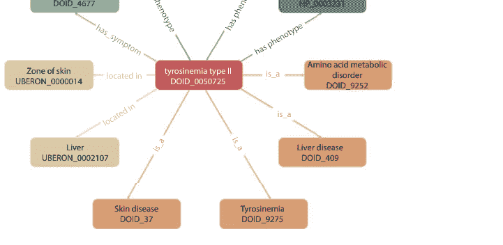
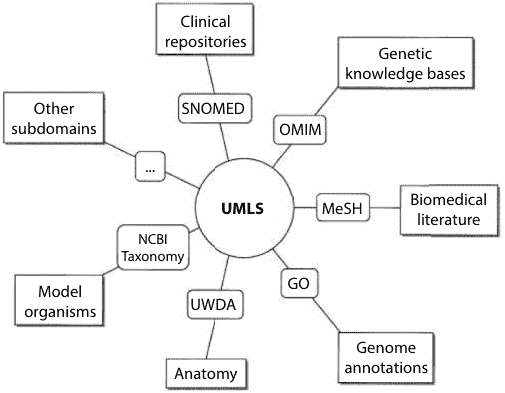

# 用于准确数据分析的医疗数据监督学习本体

B. Tarakeswara Rao¹, R. S. M. Lakshmi Patibandla²\*, V. Lakshman Narayana³ and Arepalli Peda Gopi⁴

¹计算机科学与工程系，Kallam Haranadha Reddy Institute of Technology，Guntur，Andhra Pradesh，印度

²信息技术系，Vignan’s Foundation for Science, Technology and Research，Guntur，Andhra Pradesh，印度

³信息技术系，Vignan’s Nirula Institute of Technology & Science for Women，Guntur，Andhra Pradesh，印度

⁴计算机科学与工程系，Vignan’s Nirula Institute of Technology & Science for Women，Guntur，Andhra Pradesh，印度

#### 摘要

本体和人工智能已发展成为用于在基于知识的框架中有效表示和提取信息两种方法。本体是知识工程师从专家处进行知识获取过程的正式结果，而知识通常并未在此过程中包含。这两种方法的动机是提取结构化知识。临床本体为计算机辅助临床决策支持提供支持。计算机辅助临床决策支持系统也可以是确定性的。例如，基于规则的系统使临床医生意识到药物-药物相互作用。这些规则直接源自临床本体。人工智能技术通过在大规模信息中发现有趣的模式（关系）来提取多个问题域中有意义的信息。推断信息和相似性度量的基本目标是为每个特定部分制作相关片段，而通常不是大规模划分。本体是表达临床和医疗领域现实世界实体的标准系统。然而，许多人工智能方法不允许使用领域本体来指导学习过程。本章概述了知识语义和本体在医疗保健和机器学习临床应用中的使用，并描述了统一医学语言系统（UMLS）在AQ21规则学习程序中的使用。

**关键词：**机器学习，知识，技术，学习，语义

#### 11.1 引言

机器学习（ML）的最新进展使其适用于广泛的问题，包括临床、医疗保健和福祉领域。这些技术可以通过在大规模信息中发现分布的模式，在不确定条件下做出准确预测。

许多最新技术的特点还在于能够将自然语言处理（NLP）工具与从结构化信息中学习相结合[1]。大多数新技术是统计性的，侧重于数值数据的分析。此类方法的领域知识仅限于数据中属性的临时编码或所学习模型的先验参数，如深度神经网络学习的情况。

令人惊讶的是，并非许多人工智能技术考虑到建模领域知识以便指导学习过程。

所介绍的研究调查了使用本体和知识语义来指导学习过程，通过提供超出数据中已存在的信息。研究的动机在于存在丰富的生物医学本体，旨在被信息集成策略、NLP算法和语义网使用。这种领域知识的存在为人工智能提供了理想的机会，可以用跨越数据的连接来补充纯数据。

本节介绍生物医学本体和人工智能引导学习，提出一种处理语义数据管理的方法，并讨论监督学习中的本体。

事实上，本体曾被用来描述古希腊哲学的一部分，该哲学关注存在本质及其关系的探究[1]。在当前软件工程中，该词用于指一种标准化的受控知识表示，旨在促进知识共享和使用计算机用于特定领域。目前，世界万维网联盟（W3C）的Web本体语言（OWL）是用于本体的最广泛使用的语言。


本体可从使用角度区分为三种类型。最大的一类是高层本体，是一种标准系统，用于表征和组织特定领域中的概念和关系 [2]。第三类是为特定情况/应用而产生的应用本体，为满足受限需求提供特定的术语结构 [3–12]。本体在生物医学领域已使用多年，用于理解信息异构性问题，推动了先进研究、信息合作等。

### 搜索数据库解决方案

创作者使用了以下标准或方法来检索相关文献：

- (i) 对 2000 年至 2019 年间本体进展进行了一般性检索，主要使用 Google Scholar、NCBI 数据库和 Google，重点关注本体的发展及其应用。
- (ii) 使用了“ontology”和“biomedical”关键词，以及“clinical”来限制在发现生物医学领域使用的本体时的搜索，已被使用并提供了对生物医学本体的初步理解。
- (iii) 结果使用附加术语“resource”和“repository”进行筛选，以定位特定的集成本体门户，并获得生物医学本体集合和网络的概览。
- (iv) 相应地，还应用了使用百度学术和中国多个相关数据库的国内学术文献检索，以发现本地开发的本体相关资源。

#### 11.2 生物医学本体

本体以概念集及其间关系的形式正式描述领域知识。受控词表、术语表、分类法和编码系统常被使用。本体在生物医学应用中发挥着重要作用，涵盖数据、信息和决策支持等广泛应用。系统化医学名词—SNOMED CT、国际疾病分类（ICD）、逻辑观察标识符名称和代码（LOINC）、基因本体（GO）、医学主题词表（MeSH）、RxNorm、解剖基础模型（FMA）和医学词典用于法规活动（MedDRA）是药学领域最流行的生物医学本体。每种本体都有其自身的目的和范围。异构数据之间的互操作性障碍因此产生。

不同的框架或应用在多个用户和系统中使用不同的术语。1986 年，美国国立医学图书馆（NLM）开发了 UMLS 以克服这些障碍，并不断更新。其知识来源有三个：Metathesaurus、语义网络和 SPECIALIST 词典。UMLS（2016AA）包含来自 150 多个来源的超过 325 万个概念（CUIs）、2200 万个链接和 1200 万个原子（AUIs）。UMLS 的主要目标是建立不同生物本体之间的映射。这是通过在 Metathesaurus 中为来自各种源本体的具有相似含义的术语分配概念唯一标识符（CUI）来实现的。这些词汇的映射有助于计算机系统在各种数据源之间交换信息。此外，UMLS 中丰富的关联为推理临床知识提供了良好的基础 [8]。不同的 UMLS 实现包括本体集成、自然语言处理以及有用的临床质量措施（CQMs）集合。

自美国国家航空航天局（NASA）的美国研究人员 Michael Cox 和 David Ellsworth 于 1997 年首次提出大数据挑战 [13] 以来，世界各地迅速产生大量信息这一可能性对自然科学、社会科学和工程学的各个领域都产生了影响 [14]。精准医学是另一种治疗概念和临床范式，依赖于来自多个来源的知识整合 [16]，包括多组学、电子健康记录甚至移动设备，也被视为“个性化医学”。

这些生物数据的异构性极大地阻碍了知识的协调和精准医学的整合。因此，一个强大有效的临床决策系统包括先进的分析、知识表示和推理。本体在链接和应用一致的临床知识方面发挥着至关重要的作用。首先，本体提供了一种术语机制来减少知识的异构性，并在生物医学数据系统中实现可互操作的信息。通过生物医学本体术语和元数据表示的结合，对唯一标识符（ID）及其对应标签进行编码。例如，HPO 术语可用于规范患者的体征和症状。DOID 可用于表示疾病。关于元数据标准化，生物医学研究本体（OBI）[17] 提供了元数据模式的准确描述。它不仅说明了元数据概念，还揭示了它们之间的关系。因此，生物医学数据系统的语义异构性可以减少以实现互操作性和知识的自动集成；基于信息检索策略的分析流程和可扩展推理可以毫无问题地实现。

本体可能有助于形成精准医学所需的精确且有用的表示。表示描绘了感兴趣领域的实体，例如疾病、表型、药物和暴露，通过为每个领域的实体命名并提供不同抽象层次的计算定义 [18]。本体中的关键关系是“is a”关联，用于构建基本层次系统。除此之外，本体还指定实体之间的其他逻辑关系，例如“has phenotype”（RO_0002200）关系，常用于表示一种疾病存在于一个生物体中，而该生物体具有表型。酪氨酸血症 II 型障碍在图 11.1 中得到了清晰的说明。



图 11.1 酪氨酸血症 II 型障碍。

满足国内中国用户对全球主流本体术语和中文本体术语的需求。此外，本体资源和系统如 Ontobee 和 Ontofox 也在中国使用，以满足国内本体开发和实施的需求。

### 基于社区的本体开发

随着本体的 proliferate，异构性和冗余已成为本体开发中的巨大挑战。解决这些问题的典型方法是基于同义词关系创建映射。然而，这种方法会引入新的错误和混乱进入本体。因此，作为一个被广泛接受的本体构建者社区，OBO Foundry 推广了一种基于共享原则构建生物医学本体网络的不同方法。

#### 11.3 监督学习

虽然人工智能是一个广泛的领域，但此处介绍的工作重点是监督学习，甚至更具体地说是分类。它可以很好地扩展以处理开放、序数或结构化输出。此处介绍的方法也可以应用于强化学习以及其他形式的人工智能，例如无监督技术。

问题是学习模型 M: X → Y 作为一个映射，将 Y 中的类别分配给 X 中的对象。该领域已开发出多种此类方法，其中包括监督学习方法，例如支持向量机 [9]、逻辑回归或非负矩阵分解。无论采用何种具体方法，最终目标都是构建能够最大化预测质量（或最小化损失函数）的模型。一个需要考虑的问题是，当已知外部结构时，即类别标签之间的层次关系或属性之间的非 IS-A 连接，模型如何得到增强。

可以看出，对神经网络的持续工作，特别是深度学习，可以用作模型结构中的表示学习范式。在深度学习中，考虑了各种层次模型，并且可以基于层次结构。早期和后续关于学习系统和背景知识使用的研究涉及复杂的归纳逻辑编程（ILP）和多层次学习技术。


#### 11.4 机器学习中的 AQ21 规则

AQ21 是乔治梅森大学 Ryszard Michalski 研究小组（之前在伊利诺伊大学）开发的最新指导系统。AQ21 实际上正通过一些方法来实现，这些方法不鼓励困难的知识，即将预期信息纳入本体、多种类型的信息，以及健康和福祉信息兴趣点。这项工作的规则是，具有语义的标准学习系统应以优于仅接收知识的系统的方式进行推理，很像特征或值之间的联系。例如，理解 I 型糖尿病和 II 型糖尿病也是糖尿病，会减少各种方面，并使知识图景更加广阔。通过信息语义，我们理解属性类别、元值、汇总数据与特定数据，以及信息组成部分之间的关系。值类型用于展示哪些思维技术可用于学习，包括知识迁移。所感知的基本属性类型有：表象的、普通的、周期的、有序的、图表、固定的、指定的、范围的、比例的、循环的和最高的。完整知识指的是这样的信息：模型提供给学习系统，而不是框架为其推理的单个条目。累积知识通常通过模型选择或代表性特征重现所测属性的平均值和标准差来展示。元值适用于特殊品质，如黑色名称、琐碎和无关紧要（Michalski 等，[16]）。这些元值与正常品质缺失时可能的目的相关：它们未知、不是好兆头，或根据专家意见被消除。接下来几节阐述本文的主要焦点：如何从 UMLS 中提取不同层级的连接用于 AQ21，以及 AQ21 如何发现渐进和正常模型；当前在 AQ21 中反映的带有序的泛化可能性提供了一种使用非 IS-A 连接符进行学习的技术。

该系统最近已扩展，以在生物医学信息准备中包括明确的重点 [17,18]。AQ21 是一种特征列表框架，用于识别被称为属性决策 [19] 的模式，这些模式可以被最终用户有效解释。CONSEQUENT <= PREMISE 是主要类型的属性规则，其中 CONSEQUENT 和 PREMISE 都与属性条件结合。每个属性条件包括程序在信息中包含或开发的属性。AQ21 系统还将处理信息异常。该框架学习标准规则，并产生指称被覆盖的负面模型的例外。该案例可以是属性合取表示，也可以是带有标准例外的模型列表。例外始终是临床数据库的可靠负面模型，如恶性肿瘤复发和疾病进展。Min 等人。Min. 生物医学语义学杂志 (2017) 8:39 第2页，共8页。AQ21 学习规则是委派输入、规则生成和规则改进的几个步骤。尽管 AQ21 的学习周期在某些方面是迭代的，但这些步骤通常按一定顺序执行。信息的预处理包括对信息进行类别重写、消除误导模型，并通过基本预准备策略（如离散化、质量选择）或使用效用可接受性计算 [20] 的开发策略来改变描述空间。其核心，规则学习修改理想半计算（Aq）的重组形式以开发标准，这代表了著名的连续计算 [21]。该计算从随机选择的正种子引用模型开始，该模型产生所有可能的（高质量）决策，覆盖种子且不覆盖（或不覆盖）负模型。然后选择最优质量规则并提交。在其他正模型中选择其他随机种子，并在未被这些规则覆盖的正模型中重新进行活动。这个周期产生几个通用概念，这些概念应被升级和组织以产生输出（通常多于所需）。规则的改进需要对其进行管理，通过排序、选项和属性规划进行过度简化。AQ21 的总体目标是做出增加用户特征质量模型的选择，这些选择通常会折中准确性（精确度/修正率）及其简洁性。最后，该程序使用多种策略，旨在人类导向的结构中取得结果，包括以典型语言表示（外行术语）[22] 生成规则。AQ21 是可追溯到 1970 年代的 AQ 系列算法的最新进展 [23]。近年来已经制定了各种显著规则 [24]，但许多目前尚未用于标准探索。在过去的几年里，机器学习领域一直被事实策略所淹没，这些策略主要专注于提供极其精确的模型。无论如何，该领域已经开始逐渐改变对所提供模型的理解和简单性的看法，这在生物医学应用中尤为重要。AQ21-OG（面向本体的 AQ21-OG）是 AQ21 规则学习框架的扩展。它实现了渐进泛化策略 [25]，在信息分解时整合 UMLS 和不同本体。目前，该软件使用 IS-A 链接准备。AQ21-OG 执行包括第 1 步：映射 UMLS CUI 信息。这一进展用于识别基本 CUI。因此，竞争 CUI（SQL）被识别，并由专家检查危险映射。第 2 步：通过使用基础 CUI 跟踪 IS-A 连接来提取总控制子链。这是通过跟踪 UMLS 中每个概念的 IS-A 连接来完成的，直到整个父级、子级和家族子链被分割。完整的子层级被指定为从基础 CUI（控制链中最远的孩子）到根（“超级父级”，例如一个本身也不是任何子节点的父级）的方向。这种提取是为什么（第 4 阶段中的）信息记录在步骤 5 中被 AQ21 用来定位基础 CUI 的最常见前驱。第 3 步：异常顺序的解决。由于 UMLS 的概念，不同的异常（例如循环、副本）可能会产生，因为它们是由多个源纹理生成的。AQ21 中不允许循环，因此通过打破连接来解决循环，这些连接将概念绑定到更高阶的概念，正如通过良好的根路径所估计的。最后的命令链排除了不同形式的异常。第 4 步：将消除的基本链编码成机器学习程序的内聚组织。AQ21 涉及在所有构建命令链的关系中重新处理父-子集。信息从文本记录中读取，这些记录包含有效表示信息所需的所有语义数据。特别是在 AQ21 中，渐进连接对于品质空间（一组潜在品质）的感觉很重要，这反映了知识。第 5 阶段：通过使用第 2 阶段的独立 UMLS 层级来优化值。在渐进方法中，AQ21-OG 寻求最高程度的泛化，这要么由知识可预测，要么扩展正常质量度量。这在分解具有可能大量的二元属性的编码临床知识时非常重要。

例如，ICD-9-CM 分析代码可能需要近 10,000 个二元属性。总结这些代码以减少特征数量也非常重要。来自 SEER-MHOS（监测、流行病学和最终结果——Medicare 健康结果调查）1998 年至 2011 年（1,849,311 条记录）的信息被用作恶性肿瘤属性，以区分日常合并症和日常生活活动（ADL）。该数据集包括两个庞大的基于人群的数据集，提供关于 Medicare 疾病接受者的详细数据。从恶性肿瘤库中分离出的 SEER 信息包括疾病患者的临床、分段和死亡数据，而 MHOS 信息取自调查反应，由 Min 等人提供。《生物医学语义学杂志》(2017) 中的 Medicare 健康相关生活质量（HRQOL）数据。


Advantage Organization (MAO)。已遵循多种方法来构建用于研究人群的数据集。首先，研究人群被限制为在癌症之前至少完成过一次随访，并在诊断后大约一年进行了一次随访。如果患者完成了多次随访，则在恶性肿瘤诊断前和 1 年随访时使用了最近的随访。这些非常严格的标准大大减少了样本规模，导致 829 名恶性肿瘤患者。次要/输出变量：六项 ADL（行走、穿衣、洗澡、坐立、如厕和进食）在疾病诊断后一年进行的患者随访中显示了主要结果。自主/输入变量：潜在预测因子是根据既往研究选择的，具体如下：

- (1) 患者的社会经济状况：年龄、种族和婚姻状况。
- (2) 癌症诊断前患者研究中报告的六项 ADL。
- (3) 癌症分析前从患者研究中提取的十三种自报合并症：心绞痛/冠状动脉疾病。
- (4) 总共，六个恶性特征的评估、组织、肿瘤大小、组织学、肿瘤增殖和行为从 SEER 库中排除。
- (5) 来自肿瘤的放射治疗和从 SEER 库中排除的手术标记。

#### 11.5 统一医学系统

Metathesaurus，即生物医学概念之间的存储库，是 UMLS 的主要组成部分。语义网络为每个 Metathesaurus 概念提供了另外两个信息来源点。它还提供高级类别和词汇资源，包括 SPECIALIST 术语和生物医学术语开发项目中的词汇变体。Metathesaurus 是本研究中深入呈现的主要资源。此处显示的版本为 2003AB，除非另有决定（2003 年 7 月）。UMLS 知识来源每季度更新。

##### 11.5.1 对生物信息学专家的相关性说明

尽管 UMLS 并非专门为生物信息学家的需求而开发，但生物信息学中的术语已被纳入。例如，



NCBI，一种用于识别生物体的科学分类和基因本体，用于在不同模型生物之间解释基因事物，已作为最新组织的短语包含在内。此外，Metathesaurus 涵盖了生物医学文献，其中包括 MeSH，用于编目 MEDLINE 的受控词汇。此外，在交互式解剖学家符号知识库中，诸如解剖学等核心子域已在各种生物医学应用中得到讨论。生物医学的临床部分最终得到了最突出的处理，并以 SNOMED® International（以及即将推出的 SNOMED-CT®）、临床术语第 3 版和国际疾病分类等一般术语进行了部分解释。医学遗传属性 在线人类遗传™（OMIM™）和多发先天异常/精神发育迟滞综合征（MCA/MR）© 由临床遗传特征的资源所召回。具有基本控制（例如，护理、精神病学）和临床数据结构部分在元词表中的各种文本分类中（例如，疾病、药物、方法、不良影响）。图 11.2 显示了 UMLS 元词表如何通过排列这些短语来填补语言与所传达的子域之间的关系。

##### 11.5.2 术语整合原则

UMLS 中的知识按概念（例如含义）进行分类（8）。可互换的概念被合并在一起以构建一个概念和

概念通过各种类型的关系相互链接并生成丰富的图表。在概念之间，原有词汇的排列或 Metathesaurus 编辑者直接获取的关系。象征性链接可以是不同级别（例如，“是”或“部分或合作”（例如，“区域”或“由...引起”））。此外，还有 MeSH 词汇视图之间的实际连接，这些视图是从 MEDLINE 中的 MeSH 共现中获得的。最后，Metathesaurus 中的每个术语都通过语义方法彻底分类（例如语义网络发现的 135 个基本分类），分配给 Metathesaurus 编辑者。这使得消费者更容易，例如执行工作任务。

- (i) 用于命名一个概念的各种词语被收集；
- (ii) 消除关联，渐进或熟悉，代表性或可观察，从一个概念到另一个概念；
- (iii) 为类型类别创建思想社区，使用分配给一周类别的思想概述。

用于将生物医学概念分组到概念中的词汇关系在形式上更正式地同义。概念构成的渐进基础是下位词关系（“是”）和部分关系（“一部分”）。关联关系，如共现关系，正在扩展此结构到各种子域。凭借不同分层关系的一部分，排列可以称为语义形式的重复。实际上，由于该结构独立于源术语的组织，因此这为 Metathesaurus 提供了简单且稳定的理论课程。

##### 11.5.3 外部交叉引用

生物医学配方还包含比基本术语和关系更多的细节。除了描述之外，附加细节可以提供交叉引用，无论是内部还是外部（例如，另见 MeSH，视为合作关系）（例如交叉引用到不同的措辞或信息库）。在 Metathesaurus 中，此数据也得到体现。例如，MeSH 有益概念文件包含多个用 GenBank 识别标记的蛋白质。此外，在任何情况下，当 OMIM 概念不在元词表中时，来自在线 MCA/MR 综合征的概念在 MeSH 和 OMIM 中都突出显示相关感染。这些交叉引用的示例如下所示。

##### 11.5.4 UMLS 数据访问

访问 UMLS 信息来源不需要任何费用。然而，UMLS 客户在获取信息之前预计会同意许可协议。在此安排下，所有词汇都可用于研究目的的基础，尽管某些词汇在不同用途上的使用可能有限。UMLS 来源既可通过 CD-ROM 也可通过 FTP 获得。

UMLS 的社会文件可以通过 SQL 请求加载和访问。相反，一个面向对象的 UMLS 模型已晚期开发，允许客户通过 API 针对 NLM 档案构建 Java 应用程序，类似于 XML 查询。知识来源服务器是收集和传播 UMLS 数据的在线工具。这三个组件期望 UMLS 被许可方为客户。

#### 11.6 性能分析

数据集被随机分为计划（75%）和测试（25%）。该集合用于创建高性能模型，而该集合用于分析产品的隔离。最初的模型被生成以找到预测结果（疾病诊断后的六项 ADL）的指标或指标集。为了建立模型，使用了两种 ML 技术：AQ21 和 AQ21−OG，这些技术之前已描述过。两种技术的性质和性质均使用规则和准则 Q（w）所覆盖的正例（p）数量、负例（n）进行检查。标准 R 质量是通过使用 Michalski 和 Kaufman 描述的以下配方建立的，Q(R,w) 权重为 w 或仅 Q(w)（标准中表示为 Q）。P 和 N 显示信息中所有正模型和负模型（此处，残疾与几乎自主就 ADL 而言）。

```
Q(R,w) = compl(R)w × consign(R)1 − w
```

其中

compl(R) = p/P
consign(R) = ((p/(p + n)) − (P/(P + N))) × (P + N)/N

w 是一个权重（0 到 1），代表连续性和圆满度之间的妥协。w 越低，准确性就越高


表 11.1 最终数据集中患者的特征（n = 829）。

|  | 数量 | % |
|---|---|---|
| 年龄 |  |  |
| <65 | 26 | 3.14% |
| 65-74 | 398 | 48% |
| 75-84 | 364 | 44% |
| >=85 | 41 | 5% |
| 前 5 位合并症 |  |  |
| 高血压 | 486 | 59% |
| 髋关节炎 | 298 | 36% |
| 手关节炎 | 263 | 32% |
| 其他心脏病 | 152 | 18.4% |
|坐骨神经痛 | 187 | 23% |
| 癌症类型 |  |  |
| 膀胱 | 59 | 7% |
| 乳腺 | 209 | 25% |
| 结直肠 | 112 | 14% |
| 头颈部 | 28 | 4% |
| 肺 | 94 | 11% |
| 黑色素瘤 | 62 | 8% |
| 胰腺 | 17 | 2.1% |
| 前列腺 | 178 | 22% |
| 胃 | 24 | 2.9% |
| 子宫 | 36 | 4.3% |

表 11.2 癌症诊断前后患者的 ADL 残疾。

| ADLs | 癌症诊断前患者人数 | % | 癌症诊断后患者人数 | % |
|---|---|---|---|---|
| 穿衣 | 29 | 3.5% | 83 | 10% |
| 坐立 | 15 | 2% | 67 | 8.1% |
| 沐浴 | 39 | 4.7% | 87 | 11% |
| 如厕 | 87 | 11% | 124 | 15% |
| 行走 | 99 | 12% | 152 | 18% |
| 进食 | 27 | 3.3% | 56 | 6.8% |

| ADL | AQ21 Q (R, w) | AQ21-OG Q (R, w) | AQ21 精度 | AQ21OG 精度 | AQ21 召回率 | AQ21-OG 召回率 | AQ21 F1 分数 | AQ21-OG F1 分数 |
|---|---|---|---|---|---|---|---|---|
| 穿衣 | 0.498 | 0.664 | 0.87 | 1.13 | 0.3 | 0.32 | 0.23 | 0.38 |
| 坐立 | 0.472 | 0.536 | 0.93 | 1.02 | 0.13 | 0.15 | 0.25 | 0.26 |
| 沐浴 | 0.654 | 0.645 | 0.97 | 0.98 | 0.32 | 0.37 | 0.45 | 0.47 |
| 如厕 | 0.592 | 0.595 | 1.03 | 1.04 | 0.19 | 0.19 | 0.34 | 0.35 |
| 行走 | 0.463 | 0.497 | 1.04 | 1.03 | 0.23 | 0.32 | 0.33 | 0.47 |
| 进食 | 0.626 | 0.687 | 1.05 | 1.07 | 0.24 | 0.35 | 0.34 | 0.48 |

# 表 11.3 Q (R, w*)，ADL 的规则。

19. Maier, A., Syben, C., Lasser, T., Riess, C., A gentle introduction to deep learning in medical image processing. Z. Med. Phys., 29, 2, 86–101, 2019, https://doi.org/10.1016/j.zemedi.2018.12.003.

20. Wernick, M.N., Yang, Y., Brankov, J.G., Yourganov, G., Strother, S.C., Machine Learning in Medical Imaging. IEEE Signal Process. Mag., 27, 4, 25–38, 2010. https://doi.org/10.1109/MSP.2010.936730.

21. Khan, A., Doucette, J.A., Cohen, R., Lizotte, D.J., Integrating Machine Learning Into a Medical Decision Support System to Address the Problem of Missing Patient Data. 2012 11th International Conference on Machine Learning and Applications, Boca Raton, FL, pp. 454–457, 2012.

22. Dou, D., Wang, H., Liu, H., Semantic data mining: A survey of ontology-based approaches. Proceedings of the 2015 IEEE 9th International Conference on Semantic Computing (IEEE ICSC 2015), Anaheim, CA, pp. 244–251, 2015.

23. Silachan, K. and Tantatsanawong, P., Domain Ontology Health Informatics Service from Text Medical Data Classification. 2011 Annual SRII Global Conference, San Jose, CA, pp. 357–362, 2011.

24. Asim, M.N., Wasim, M., Khan, M., Mahmood, W., Abbasi, H.M., A survey of ontology learning techniques and applications. Database J. Biol. Databases Curation 2018, 2018. bay101. https://doi.org/10.1093/database/bay101.

25. Muhlbacher, T., Linhardt, L., Möller, T., Piringer, H., TreePOD: Sensitivity-aware selection of pareto-optimal decision trees. IEEE Trans. Visual. Comput. Graphics, 24, 1, 174–183, 2018.
